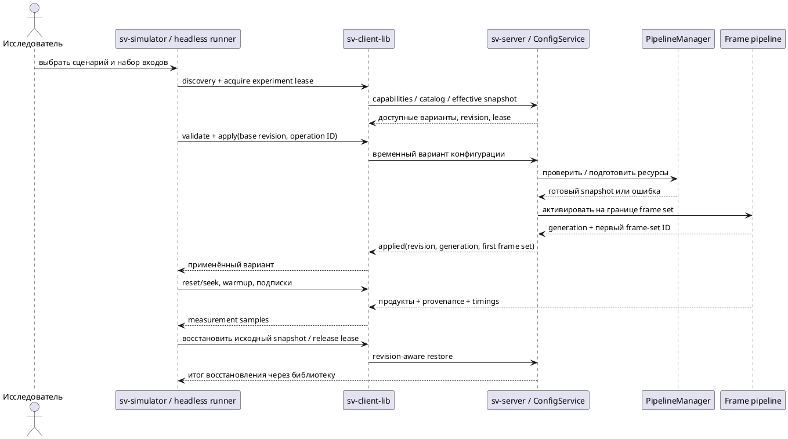
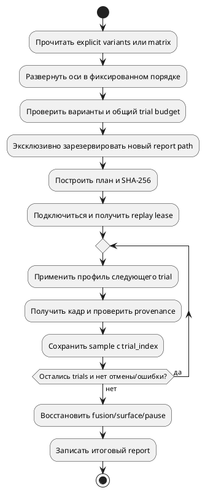
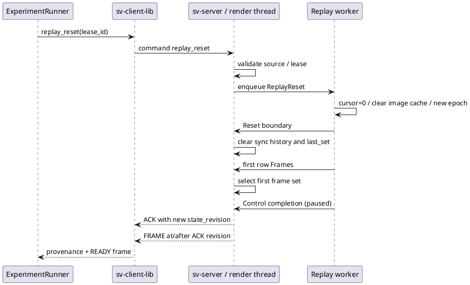

# Управляемый серверный стенд исследований

Проектное решение от 10.10.2026 по предложению пользователя. Общий API ниже — проектный; реализованные срезы отмечены отдельно. Текущий контракт — [[engineering/PROTOCOL_IMPLEMENTED]]. Связанные задачи — [[../TODO]], [[planning/ROADMAP]], ответственность компонентов — [[architecture/CLIENT_SERVER_MODEL]].

## Первый реализованный срез

`fusion_runtime_v1`: catalog, typed client wrapper, revision-checked temporary configure трёх существующих GPU-режимов и параметров; config revision/settings в ACK и frames. Интеграционная проверка сравнивает одни paused inputs и проверяет восстановление RGB без upload/rebuild. Контракт и ограничения: [[engineering/PROTOCOL_IMPLEMENTED]]. Добавлен общий C++ runner `examples/common/research` и `svctl research`: декларативные fusion-варианты, randomized complete blocks на последовательных paused frame sets с native RGBA capture, hashes/raw timing report и проверяемый restore при штатном завершении/cancel/callback failure. Проверки: [[validation/RESEARCH_RUNTIME]]. Ограниченный replay lease/watchdog `experiment_lease_v1` восстанавливает fusion/surface/pause после expiry/control disconnect; runner продлевает lease и ждёт idle после cleanup. Четыре native fusion-кандидата и runtime surface control добавлены: [[validation/NATIVE_FUSION]]. Многокадровый headless режим с lease-aware step реализован; другие группы ConfigService, cursor restoration и GUI сценариев ещё предстоят; явный start/history/decode-cache reset описан ниже. Контракт восстановления и опыт с direct-view truth: [[validation/SERVER_BOUNDARY]].

## Цель и границы

Сравнивать алгоритмы в том же `sv-server`, который формирует кадр для автомобильного клиента. `sv-simulator` составляет и запускает сценарий через `sv-client-lib`; CLI использует тот же исполнитель без Qt. Offline-инструменты сохраняются для независимых эталонов, проверки математики и предварительных опытов, но их CPU-время не выдаётся за производительность серверного GPU pipeline.

Включать все **выбранные для исследования и реализованные** варианты через общий контракт стадий, а не обещать все существующие алгоритмы. Исследовательская сборка, включая сборку для целевой платформы, сохраняет максимально широкий проверяемый набор вариантов; оптимизация не должна сводиться к удалению альтернатив до сравнительных опытов. Сокращённый эксплуатационный профиль возможен позднее как отдельный результат исследования, а не текущая цель. Каталог сообщает фактически доступные реализации, версии, параметры, backend, допустимые сочетания, ограничения памяти и статус experimental/production. Неизвестный или недоступный алгоритм отклоняется; скрытый fallback запрещён. Research build может включать дополнительные зависимости; минимальный Aurora build объявляет только собранные возможности и не скачивает зависимости при сборке RPM.

Direct Blender truth, object IDs, depth и true camera poses принадлежат независимому evaluator. По умолчанию исследуемый сервер получает только наблюдения, доступные реальной системе. Передача истинной калибровки или глубины допускается в явно помеченной oracle ablation; такие результаты не смешиваются с production-профилями.

## Компоненты и варианты

| Компонент | Ответственность | Исследуемые варианты / ограничения |
|---|---|---|
| AlgorithmCatalog | Версионированные descriptors и фабрики типизированных интерфейсов стадий | Общие контракты, параметры и compatibility checks; без Qt и удалённой загрузки кода |
| Projection / Carrier | Проекция и геометрия носителя | Plane, bowl, dome-floor, cylinder, cube и другие явно реализованные кандидаты; одинаковые бюджеты и ракурсы |
| Seam / Blend | Выбор камер и смешивание | Семь server methods (три GPU, четыре GLES/CPU) с native parity; текущий 3/4-camera fallback явно обозначен |
| Photometric / Temporal | Компенсация экспозиции и временная обработка | Реализованные кандидаты, reset/history semantics, измеряемая стоимость; отсутствие компенсации — baseline |
| CalibrationService | Асинхронный fit, независимая validation и revision-aware apply | Отдельный job, а не повторная калибровка каждого кадра; модели/решатели объявляются catalog |
| ConfigService / PipelineManager | Проверка, подготовка ресурсов и атомарная смена snapshot | Только сервер владеет конфигурацией и GPU-ресурсами |
| ExperimentRunner | Сценарии, повторы, журнал, восстановление и отчёты | Общая application service для simulator и headless CLI через sv-client-lib |
| IndependentEvaluator | Метрики по сохранённым продуктам и эталонам | Исходные reports, undefined ROI, отрицательные результаты и происхождение truth |

*Таблица ИС.1 — Целевое разделение исследовательского стенда. Наличие варианта в offline-коде ещё не означает наличие в серверном каталоге.*

## Смена конфигурации во время работы

Предлагаемые операции относятся к будущему typed API: discovery каталога, чтение effective snapshot, validate, apply/status и управление экспериментальным lease. Их wire names и capability version нужно закрепить отдельно; новые операции не добавляются в описание реализованного SV01 до тестов.

Запрос содержит base revision, operation ID, ожидаемые algorithm IDs/versions, параметры и режим сохранения. Сначала сервер проверяет совместимость и бюджет, затем подготавливает новый pipeline вне обработки текущего кадра. GPU-операции выполняются в принадлежащем им executor/context. На границе frame set активируется целиком готовый snapshot. Кадр не смешивает старые веса, новую сетку и чужую калибровку. Подготовка сверх установленного лимита отклоняется, а не вызывает неконтролируемое удвоение памяти.

Принятие запроса не равно применению: status различает preparing/applied/rejected/pending_restart. Событие applied указывает config revision, pipeline generation и первый frame-set ID. Каждый продукт содержит эти идентификаторы, входные frame IDs/timestamps и фактические algorithm/backend versions. При ошибке подготовки остаётся прежний pipeline; повтор operation ID не применяет изменения повторно. Изменения listeners/backend, требующие перезапуска, возвращают pending_restart и не считаются выполненным шагом опыта.

Промежуточные варианты эксперимента применяются как временные server-owned snapshots. Постоянное сохранение — отдельное явное действие через сервер; успешное сохранение подтверждается только после атомарной записи. После опыта восстанавливается исходный snapshot. При разрыве связи lease истекает по серверному deadline и запускает восстановление; его сбой публикуется как отдельная ошибка. Другие клиенты могут смотреть результаты, но конфликтующие изменения общего pipeline блокируются lease либо отклоняются по revision; per-session view не становится общей настройкой.



*Рисунок ИС.1 — Целевой порядок переключения и измерения. Discovery и lease должны завершиться успешно до изменения состояния; все стрелки управления проходят через библиотеку.*

## Сценарий исследования

Сценарий — версионированный декларативный JSON, без произвольного Python/shell на сервере. Он задаёт dataset manifest/hash, отдельный truth manifest, группы train/validation/test, seed, траекторию и временную шкалу, исходную конфигурацию, матрицу вариантов, ракурс, разрешение и лимиты ресурсов. Дополнительно задаются warmup, число повторов, порядок вариантов, products/subscriptions, метрики, сроки, критерии остановки и политика ошибок. Разделять capture, offline replay и live performance run: их временные характеристики различны.

Исполнитель использует состояния: preflight → acquire → snapshot → prepare → reset/seek → warmup → measure → export → restore → finished/failed. Даже при cancel/error выполняется restore; после утраты lease результат помечается interrupted, а не silently resumed. Возобновление создаёт новый attempt ID и проверяет входные hashes/versions. Сценарий выполняется локально на ноутбуке; при потере control connection измерение останавливается, watchdog на сервере обеспечивает восстановление.

Для парного quality-сравнения варианты получают точно те же наборы кадров, а не разные участки движущегося live-потока. Stateful-методы каждый раз начинают с явно сброшенной истории и одинакового прогрева; режим непрерывной истории — отдельный опыт. Для performance используются фиксированный поток и randomized complete blocks; публикуются warmup/setup cost отдельно от steady-state p50/p95/p99, CPU/GPU, drops, frame age, RSS и сетевого бюджета. Инструментация и подписки входят в профиль опыта: readback всех промежуточных продуктов не бесплатен.

Dataset truth и критерии финальной выборки замораживаются до подтверждающей серии. Один repeated replay измеряет повторяемость исполнения, но не заменяет независимые сцены. Пропуски, rejects, unavailable backend и нарушения бюджета включаются в отчёт. Нельзя объединять CPU/GPU реализации и разные разрешения в одну строку рейтинга.

## Этапы реализации и приёмка

1. Описать типы profiles/descriptors и интерфейсы стадий; зарегистрировать сначала существующие серверные режимы. Проверить соответствие каталога фактической сборке и отклонение несовместимых параметров.
2. Реализовать минимальный ConfigService: read/validate/temporary apply/status/restore с revisions, operation IDs и frame-boundary semantics. Проверить rollback, OOM/prepare failure, потерю ACK, cancel и persistent-write failure.
3. Через sv-client-lib создать headless runner: одна запись, два текущих алгоритма, фиксированный view, reset/warmup и products. Проверить общие input frame IDs, config hashes, generation и восстановление после ошибки.
4. Переносить исследовательские алгоритмы по одному. Для каждого нужны known-answer tests, CPU reference / server parity с объявленными допусками и явное определение fallback. Не переносить недостатки offline-методики как подтверждённый алгоритм.
5. Добавить продуктовые подписки, trace, calibration jobs и повторяемый producer. Разделять измерение качества и стоимости instrumentation.
6. Подключить тот же runner к GUI simulator: редактор/валидация сценария, запуск/отмена, прогресс, сравнение и экспорт. Не создавать отдельную GUI-реализацию сценарного движка.
7. Прогнать независимую подтверждающую серию и позднее тот же поддержанный профиль на Авроре. Различия capabilities документировать как ограничения сравнения.

GTest unit/contract tests покрывают catalog, конфликты revisions, lifecycle и ошибки; интеграционные tests проверяют команды через настоящую sv-client-lib, идентичность входов, границу переключения и восстановление. Отдельные parity tests связывают независимые fixtures с реальным серверным output. До выполнения этих этапов новые исследования offline остаются exploratory; закрывать весь исследовательский backlog наличием переключателя нельзя.

Многометочный кандидат 11.10.2026: native weighted Potts alpha-expansion выбран optional fusion.seam_solver, catalog v4; default legacy path сохранён. Renderer передаёт per-frame energy/convergence diagnostics через сервер; общий runner/capture не выполняет оптимизацию локально. Tests и empirical cost: [[validation/MULTILABEL_SEAM]].

## Ограниченные матрицы и фиксированный план испытаний

C++ service `examples/common/research` принимает либо прежний `variants`, либо `matrix`:

```json
{
  "schema_version": 1,
  "frames": 3, "warmup": 2, "repeats": 5, "seed": 17,
  "capture_frames": true,
  "matrix": {
    "base": {"mode": "multi_band"},
    "axes": {"pyramid_levels": [2, 4], "pyramid_boundary": ["zero", "normalized"]}
  }
}
```

`base` — optional объект начальных полей варианта; `axes` —1…16 именованных массивов значений.
Имена осей сортируются лексикографически, порядок значений массива сохраняется. Каждое значение
оси заменяет одно одноимённое поле base; последняя по имени ось меняется быстрее остальных.
Можно варьировать mode, параметры fusion и полные surface objects; dotted-path patching нет.
Расширенные варианты проходят тот же strict parser, что и explicit variants, затем server catalog/
configure validation. Одновременные variants/matrix, пустые оси, неизвестные поля и более32
комбинаций отклоняются до соединения. Duplicate values не удаляются: индексы вариантов сохраняются.

Лимит10000 trials включает frames × variants × (warmup+repeats). Сохранены границы frames1…256,
repeats1…1000, warmup0…100, seed0…2147483647. Все проверки выполняются до выделения полного
плана/соединения. API для будущего GUI использует тот же Scenario/runner; GUI редактора пока нет.

Вместо std::shuffle используется версионированный `mt19937_fisher_yates_reject_v1`: стандартный
mt19937, обратный Fisher–Yates и явный unbiased bounded-index draw. Для bound=n порог
`2^32 mod n`; слова меньше порога отбрасываются, остальные дают word mod n. Нет зависимости
от реализации std::shuffle/uniform_int_distribution. Состояние engine непрерывно между blocks
и frames, reset order к0…N−1 происходит перед каждым блоком. Каждый блок содержит каждый вариант
ровно один раз; первые warmup blocks каждого кадра исключаются из summaries.

Seed относится **только к порядку trials**, а не к генерации Blender scene/mount/noise.
Каждый вариант получает одно измерение после повторного применения профиля. Это прогрев на
paused frame set, не доказательство steady-state live FPS и не гарантия cold cache/источника.

До соединения строится полный `trial_plan`: trial_index/frame_index/variant/block/warmup.
В report schema1 добавлены `trial_order_algorithm`, `trial_plan`, `trial_plan_sha256`.
SHA-256 вычислен по компактной Boost.JSON serialization плана; scenario_sha256 относится к
нормализованному сценарию с **развёрнутыми variants**, не к исходному тексту matrix. Sample
содержит trial_index; при отмене/ошибке записанные samples являются выполненным префиксом плана.
Вызов capture может завершиться ошибкой до добавления sample — такой trial в successful prefix
не входит. Full plan не свидетельствует о выполнении всех пунктов: проверяйте success/error,
samples и restored/restore_error.

Прежние reports не переписываются. Порядок с тем же seed может отличаться от исторического
std::shuffle; сравнивать новые серии нужно по algorithm ID, plan hash и scenario hash, а также
по прежним config/input/build identities. Реальные cross-standard-library/target trials ещё нужны.



*Рисунок R.1 — общий C++ workflow плана, выполнения и восстановления. Ошибки соединения/lease
и невозможность restore фиксируются отдельно; схема не обещает возврат replay cursor.*

CLI резервирует report через O_CREAT|O_EXCL до подключения к серверу, включая metadata-only
режим. Существующий файл, параллельно зарезервированный путь или dangling symlink отклоняются
без truncate и запуска эксперимента. Report writer проверяет write/close и не допускает повторной
записи через тот же объект. При аварии может остаться пустой/частичный файл: это **не** atomic
publication, durable checkpoint или automatic resume. Для повтора используйте новый путь;
успешность определяется только завершённым JSON report и его полями. RGBA directory также должна
быть новой. Продуктовая реализация — C++; Python используется только integration tests.

Остаются cursor restoration/GPU cache policy, оркестрация независимых scene/mount seeds, GUI сценариев,
quality-oracle/критерии финальной серии, durable resume и общий experiment provenance. Изменения
не являются новым подтверждающим quality исследованием и не закрывают E-STITCH-01.


## Явный replay start и сброс истории

Сценарий schema1 принимает optional `reset_replay: true` (default false для прежнего поведения).
После acquire runner проверяет capability `replay_reset_v1`, выполняет leased `replay_reset`
вместо обычного pause и ждёт post-ACK READY кадр. `ready_preparation=reset_first_row` фиксирует
подготовку; нормализованный scenario и его hash включают reset_replay, в том числе false.
Поэтому hash новых reports может отличаться от исторического даже при прежнем поведении;
старые reports не переписываются. Готовый
`configs/research/multiband-matrix.json` включает этот режим. При неполной первой строке runner
завершает опыт ошибкой и выполняет cleanup; скрытого перехода к следующей строке нет.
Прежняя однократная READY preparation через step остаётся только при reset_replay=false.

Reset очищает decode cache источника и retained sync history, новый source session отделяет
прогоны, delivery sequence продолжает расти. Идентичность входов сравнивается внутри trial
с baseline своего прогона; между прогонами сравниваются dataset, scenario timestamps, settings,
plan и RGB hashes, а не абсолютные delivery timestamps/session IDs.



*Рисунок R.2 — граница сброса отделяет историю предыдущего прогона от нового набора кадров.*

Подробный wire contract и ограничения: [[engineering/PROTOCOL_IMPLEMENTED#Сброс replay к первой строке (`replay_reset_v1`)]].
Это не restore первоначального cursor: report сохраняет `cursor_restored=false` и
`restore_scope=fusion_surface_pause_only`. GPU/OS caches, telemetry и общая производительность
после reset отдельно не нормализуются. Потерянный ACK не допускает автоматического retry.


## Первый compiled quality evaluator

Общий C++ service принимает внешний QualityReference: до подключения загружает ограниченный
manifest/RGB/mask, затем на measured samples сверяет фактическую проекцию и input guards,
вычисляет masked RGB8 MAE/RMSE/PSNR/max error. Эталон остаётся на клиентской стороне и не
поступает исследуемому renderer. CLI использует optional scenario.quality_reference; будущий GUI
может передать тот же PImpl evaluator напрямую. Полный формат/ограничения:
[[engineering/RESEARCH_QUALITY]].

FRAME view фиксирует все параметры проекции: orbit/distance/FOV/clip/target плюс dimensions.
Это предотвращает сравнение одинаковых размеров с различной перспективой. Warmup исключён;
quality summaries считают frame_index один раз при повторных измерениях paused кадра.
Нестабильные повторные metrics приводят к failed report после restore.

Разделены declared independent_ground_truth и regression; код не подтверждает истинность
объявленного kind. Legacy schema1 проверяет только IDs/timestamps; schema2 дополнительно проверяет hashes
decoded camera pixels и активной числовой модели. Независимые scene/mount/noise seeds, полная dataset/config identity,
научно обоснованные thresholds, object/ghost metrics, GUI и durable checkpoints всё ещё нужны.
Наличие evaluator не закрывает подтверждение E-STITCH-01.


## Проверяемая идентичность replay observations

Quality manifest schema2 требует decoded-image и numeric camera-model hashes каждого input.
Сервер объявляет replay_input_identity_v1, worker привязывает digest к immutable image, render
thread сообщает модель, которой обработан кадр. Это обнаруживает замену pixels или intrinsics/
extrinsics с прежними paths/IDs/timestamps. Schema1 оставлена как явно обозначенный metadata-only
legacy режим, автоматического понижения проверки нет. Подробности и стоимость:
[[engineering/RESEARCH_QUALITY#Schema2: проверка содержимого входов и числовой модели]].

Не следует называть это полной immutable dataset registry: ещё не фиксируются вся запись,
scene/mount/noise seeds, все server groups и physical-camera provenance одним паспортом.


## Отдельный результат threshold acceptance

Optional criteria во внешнем manifest загружаются и хэшируются до подключения. C++ evaluator
аннотирует каждый measured sample; общий runner формирует quality_acceptance со статусами
not_requested/incomplete/passed/failed. Плохое качество не обрывает сбор данных; partial/cancel/
restore failure не может получить passed. Workflow success и scientific rejection различаются,
CLI отдаёт5 при завершённом опыте с непройденными порогами. Policy проверяет все measured
samples, не только averages. Контракт: [[engineering/RESEARCH_QUALITY#Заданные до запуска критерии качества]].
Это механизм фиксации/проверки порогов одного прогона; независимая preregistration,
обоснование норм, scene/mount/noise orchestration и подтверждающая серия остаются работой.


## Validation pilot двух окружений и пяти носителей

Для генерации inputs добавлены отдельные street/cargo_yard worlds и независимые scene/mount seeds.
Native configs/research/family-carrier-screen.json задаёт20 variants при прежнем близком active
mesh budget.4 cases×2 frames×20 variants×(1 warmup+3 measured)=640 trials;480 measured samples,
1920 независимых arithmetic checks. Все переключения и metrics выполняются C++ service, Python
остаётся exporter/fixture/oracle/plotting. Фактическая геометрия новых worlds и сохранность
исходной Blender Scene проверены через MCP. Results/limits: [[validation/FAMILY_CARRIER_SCREEN]].

Compiled multi-recording supervisor и GUI сценариев ещё отсутствуют. True camera calibration
передана стенду, поэтому данный pilot не является испытанием автоматической калибровки.
Наличие новых family inputs не закрывает noise/photometric/dynamic/holdout/target gates.
