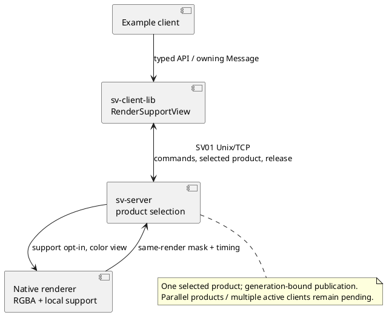

# Политика unsupported surfaces

Статус: native local-support mask реализована ([[validation/RENDER_SUPPORT]]), доставка одного выбранного продукта через wire/typed client API реализована ([[validation/OUTPUT_PRODUCTS]]). Optional presentation policy существующего fallback реализована: legacy/hatch через configure_fusion и кнопку simulator ([[validation/FALLBACK_DISPLAY]]). General reconstruction/fill и parallel subscriptions пока являются проектом. Обычный RGBA и существующий wire contract сохранены.

## Что существует

Server shader использует camera eligibility и веса fusion. При отсутствии positive contribution rectangular carrier получает opaque нейтральный fallback, dome — градиент. `fusion.diagnostic=coverage` показывает observed valid-camera count/4 вместо final color; `weights` — распределение весов. Native inspection/probe сохраняет per-camera statuses. Это не parallel typed subscription и не confidence о правильности scene surface. Требуемое разделение network products описано в [[engineering/PROTOCOL_IMPLEMENTED]] и [[architecture/CLIENT_SERVER_MODEL]].

## Различать три понятия

- Sample eligibility: camera projection/source constraints и объявленный occluder predicate пропустили sample. Он может относиться к другой поверхности.
- Positive fusion support: хотя бы один sample реально имеет положительный вес/вклад. Eligible source у границы с нулевым весом не гарантирует вклад.
- Scene observability/correspondence: исходные данные действительно наблюдают выбранную scene point. В текущем опыте это известно из independent Blender truth; в продукте такая готовая маска отсутствует.

Финальный кадр не должен обозначать fallback, interpolation или temporal/prior fill как новое прямое наблюдение. Название coverage не должно обещать geometry confidence.

## Реализованный native этап

`RenderInspectionRequest::support=true` возвращает `RenderInspection::support` в том же вызове renderer, что final RGBA. Формат `render_support_v1`: top-left CV_8UC4, R — число eligible cameras, G — число положительных локальных весов, B — фактически выбранная ветка output, A — признак raster geometry. Коды и ограничения: [[engineering/RENDERING#Native маска локальной поддержки]]. Запрос разрешён только для `diagnostic=color`; ego/background получают нулевые counts. Hybrid использует actual post-smoothing base weights и отдельные path codes. Это не scene visibility, не confidence и не effective multiband support.

Known-answer и RGBA parity проверены для семи алгоритмов на Mesa/NVIDIA. Отдельные controls различают zero weights, hard selection и fallback threshold. Путь маски не требует capture всех signed bands. Исторические frozen collectors/plans не менялись. Сетевой этап выполнен с проверкой identities, limits и отказов: [[validation/OUTPUT_PRODUCTS]].

## Реализованный сетевой этап

HELLO объявляет output_selection_v1/render_support_v1. Client::output_catalog() получает read-only contract; Client::configure_output(OutputProduct::RenderSupport) выбирает маску вместо обычного кадра. Общий type11 несёт integer RGBA8, schema и прежнюю frame/config/input identity; RenderSupportView сохраняет owning Message без копирования payload. Release type22 и bounded slot сохраняются. Native render по-прежнему вычисляет обычный кадр, но отправляется только выбранный продукт. Подробная последовательность: [[engineering/PROTOCOL_SCENARIOS#С12. Выбор и получение local-support mask]].

Selection временная, привязана к data generation и сбрасывается при новом attachment. Старый prepared/queued продукт не публикуется в новую generation. После ACK возможен прежний in-flight пакет: его нужно release-ить и ожидать нужные output_product/state_revision. Пока lease не idle, configure_output запрещён: selector не входит в lease snapshot. Non-color diagnostic несовместим с mask и отклоняется до mutation. Конфиг на диске не меняется. Linux profile по-прежнему имеет одну активную control/data pair.

Рисунок — Реализованный путь локальной поддержки. GUI palette и одновременные subscriptions ещё не реализованы.

## Проверки до включения

Native known-answer проверки no-input, projection invalid, eligible-but-zero-weight, positive support, ego/background и RGBA parity выполнены; supplied-box predicate использует ту же функцию проекции shader. Расширить matched captures на occlusion/geometry perturbations и измерить overhead при исследовательских разрешениях. Wire форматы/limits/revision identity, typed library acceptance/rejection, native/wire parity семи алгоритмов, восстановление final_frame и reconnect проверены на Mesa/NVIDIA. Дальше нужны matched geometry/occlusion matrix, GUI palette/selector и отдельный overhead benchmark. Никакой pixel mask без source-depth evidence не называть truth observability. Для новых reconstruction/temporal policies нужны отдельные capabilities, data provenance, invalidation/history tests и независимые scene/pose controls.

Для multiband signed/nonlocal contributions локальный positive base weight не равен поддержке конечного pixel: требуется отдельное определение effective support по уровням/доменам и соответствующие oracle tests. Реализованная base-weight mask должна называться и интерпретироваться именно как локальная маска; переносить на неё semantic confidence или финальную observed validity всех алгоритмов нельзя. Audit §4.78 относится к edge_feather, не устанавливает это определение для hybrid paths.

## Центральная неопределённость supplied box

Native `source_occlusion_box.uncertainty` добавляет explicit accept/reject центральной ambiguity с заданным радиусом; rejected ambiguity имеет native status8, accepted sample сохраняет status1 без definitely-clear гарантии. При отсутствии sources остаётся прежний fallback; новое правило заполнения или visual confidence этим не реализовано. Native54-case RGB control выполнен, robust joint gates не пройдены: [[validation/NATIVE_UNCERTAINTY]]. Дальше нужны joint central/footprint/surface correspondence, user-visible unsupported policy; accepted-ambiguity diagnostic product уже реализован ([[validation/SOURCE_VISIBILITY_PRODUCT]]); transmitted local-support counts не заменяют эти признаки.

Native finite-face-facing filter добавлен как opt-in ограничение supplied-box support: [[validation/NATIVE_FACING]]. Rejection9 не восстанавливает скрытую поверхность, не меняет fallback и не является confidence/scene-truth сертификатом. RenderSupportView по-прежнему сообщает eligibility/positive weights/path без отдельной accepted-ambiguity или rejection-reason классификации. General unsupported policy и GUI диагностика остаются открытыми.

Remaining entry-gap audit показывает, почему нельзя смешивать face-coordinate uncertainty и ray-distance tolerance: у grazing ray5mm сдвига грани соответствует105.274mm вдоль луча, а9 residual memberships вообще не пересекают смещённый supplied box. Fixed extra central2/0mm rejection нарушает visible preservation и не принят в продукт. Новый source_visibility_v1 различает accepted ambiguity и clear supplied-box certificate; independent scene correspondence нельзя выводить только из supplied-box eligibility. [[validation/FACING_ENTRY_GAP]].

Native и wire source_visibility_v1/SourceVisibilityView реализованы: причины central/ambiguity/facing/footprint, accepted10/11, explicit scope и owning typed delivery. RenderSupportView сохраняет прежние counts/path, отдельный продукт добавляет source classifications; parallel subscriptions не добавлены. General reconstruction/unsupported policy, GUI и scene correspondence остаются открытыми: [[validation/SOURCE_VISIBILITY_PRODUCT]].

Независимый residual audit (§4.86, [[validation/RESIDUAL_SURFACE]]) установил: у7/9 выбранных coordinates нет matching projection-valid alternative даже до eligibility при20mm; при2mm — у8/9. Same-object footprint не исключает wrong-point sampling. Это ограниченный post-hoc результат одного coded world, не runtime evidence: scene oracle нельзя использовать в продукте как доступный confidence input. Следующий контракт должен явно определить доступные признаки joint selection и unsupported policy; general reconstruction и holdout остаются открытыми.

§4.87 фиксирует доступные runtime evidence и реализует явную сетку только для существующих fallback branches. Source correspondence не выводится из branch/path, ambiguous/clear или RGB яркости. Реальные чёрные samples не отмечаются как missing; effective nonlocal support и joint selection требуют отдельного метода/проверок. [[validation/FALLBACK_DISPLAY]].
