---
aliases:
  - Глава 3. Разработка системы интерактивного кругового обзора
tags: [diploma, implementation, prototype]
status: draft
updated: 2026-10-06
---

# Глава 3. Разработка системы интерактивного кругового обзора

> Описывается Linux-прототип версии **0.6.0**. Введена поверхность «круглый пол + текстурированный купол» с виртуальной камерой внутри; bowl остаётся отдельным вариантом для сравнительных опытов. Используются OpenCV, native квалификация и offline RPM-профили. Целевые SDK/устройство Авроры и полная приёмка требований ещё не проверены. Результаты 0.1.0/0.2.0 в главе 4 сохранены как исторические baselines.

Результатом этапа разработки является воспроизводимый программный путь от четырёх известных камер до управляемого изображения в отдельном Qt Quick-клиенте. Математическое ядро, графический backend и host-приложения собраны как разные CMake targets. Помимо визуализации реализованы независимая проверка проекции, offline-оценивание параметров и сервисный критерий нарушения калибровки. Эти части дают основу для экспериментального раздела, хотя не заменяют весь комплекс для целевой платформы.

## 3.1 Формат конфигурации и калибровочных данных

Файл `configs/synthetic.json` задаёт профиль `linux-prototype-v1`, единицы m/rad/ns, размеры автомобиля, четыре камеры, bowl-поверхность, начальный ракурс, выходное разрешение и пределы синхронизации. Отдельный `street-demo.json` использует `dome_floor_v1`. Схема имеет явную версию 1. Неизвестные ключи и отсутствующие обязательные поля отклоняются до создания EGL-ресурсов. Матрицы записываются строками и применяются к столбцам.

Текущий профиль намеренно использует компактный набор полей. Это не полная реализация прежнего YAML-примера [[requirements/CONFIGURATION]]: отсутствуют произвольные маски, metadata resize/crop, все транспортные настройки и полноценный report-контракт. Вместо утверждения совместимости этих форматов граница зафиксирована в [[prototype/STATUS]]. Эффективный JSON сохраняется в каждом benchmark-каталоге; серия добавляет SHA-256 этого файла.

| Объект | Реализованная проверка | Причина |
|---|---|---|
| Версия и ключи | Версия 1, точный набор полей | Исключение молчаливого игнорирования |
| Камеры | Ровно четыре ID 0…3 | Однозначное соответствие текстурам |
| Матрица установки | Нижняя строка, $R^TR\approx I$, $\det R\approx1$ | Запрет отражения и неравномерного масштаба |
| Fisheye | Положительные фокусы, четыре коэффициента, нулевой скос | Соответствие выбранной модели |
| Угловой диапазон | $0<\theta_{max}<\pi/2$, положительный Z-порог | Передняя полусфера начального профиля |
| Монотонность | Минимум производной по краям и стационарным точкам | Однозначность радиального отображения |
| Поверхность | Центральная маска внутри плоской части, внешние размеры больше внутренних | Допустимая геометрия |
| Ракурс | Высота над поверхностью, расстояние и clip range | Устойчивый look-at и наблюдение сверху |
| Изображения | Размеры ограничены до выделения памяти | Согласование payload и буфера |

Для монотонности используется полином от $x=\theta^2$: $g(x)=1+3k_1x+5k_2x^2+7k_3x^3+9k_4x^4$. Проверяются концы интервала и все действительные корни $g'(x)$ внутри него. Корни находятся рекурсивным разделением интервала по корням производной и бисекцией. Это сильнее проверки только нескольких равномерных углов, хотя численные допуски всё равно ограничивают утверждение точности.

Ошибки JSON и диапазонов завершают запуск с причиной. Подробный путь любого неверного числового поля пока сообщается не во всех ветвях; это остаётся работой для полной машинной схемы. Код проверки: [config.cpp](../../src/core/config.cpp).

## 3.2 Математическое ядро

Ядро содержит векторные операции, преобразования, независимую аналитическую fisheye-проекцию, поверхность, сетку и преобразование sRGB. В `sv-vision` подключена **реальная OpenCV 5.0.0**: `cv::fisheye::projectPoints` даёт эталонные CPU-пиксели для `sv-project`, benchmark и native GPU-проверки [S04]. Аналитический double-путь сохранён для независимого сравнения; он не выдаётся за вызов библиотеки.

При вычислении используются double. Неконечные точки, Z за рабочей границей, превышение угла и выход из изображения делают наблюдение невалидным. Центральный луч имеет отдельный устойчивый предел. Виртуальные view/perspective получаются через GLM с явным `lookAtRH` и `perspectiveRH_NO` [S54], после чего приводятся к документированной строковой форме. Перед GLSL-загрузкой матрица преобразуется в column-major; transpose-флаг остаётся false, как требует используемый путь GLES.

Сетка строится по равномерным осям с дополнительными линиями $\xi=\pm a$, $\eta=\pm b$. Благодаря этому границы плоской области совпадают с рёбрами. Дубликаты координат удаляются, каждая ячейка содержит два одинаково ориентированных треугольника. При исходных 32 ячейках на ось фактическое добавление границ даёт 2312 треугольников; при 64 — 8712. Поэтому подпись «32×32» не должна подменять фактическое число элементов.

Независимый NumPy-эталон использует $\theta=\operatorname{atan2}(\sqrt{X_C^2+Y_C^2},Z_C)$ и направление луча. `independent_math` сравнивает с OpenCV 8000 точек и признаки валидности: по 1000 на камеру при нулевой и ненулевой дисторсии. Native suite дополнительно сравнивает аналитический C++ и OpenCV на 8192 точках. Проверяются единичная длина синтетических лучей и обратная проекция пикселей. GLSL-kernel возвращает пиксельные координаты в float-FBO и сравнивается непосредственно с OpenCV, проверяя матричную загрузку и шейдерную арифметику отдельно от растеризации поверхности.

Полный CPU-растеризатор итогового изображения не реализован. Следовательно, CPU/GPU-проверка подтверждает проекцию и отдельные геометрические инварианты, а не все пиксели готового изображения. Код: [math.cpp](../../src/core/math.cpp), [test_math.py](../../tests/test_math.py).

## 3.3 Первоначальная калибровка

Калибровочная утилита принимает уже найденные соответствия XYZ↔UV. Для каждой камеры оцениваются $f_x,f_y,c_x,c_y$, четыре коэффициента искажений, три компоненты малого вращения и три компоненты переноса. Фокусы параметризуются логарифмами, главная точка нормируется на размер изображения, перенос — на фиксированный масштаб. Это уменьшает различие размеров численных шагов.

Обновление вращения записывается как $R=\exp([\omega]_\times)R_0$ и вычисляется формулой Родрига. Резидуал — разность проекций и измеренных пикселей. Численный якобиан получается центральными разностями. Шаг демпфированного метода имеет вид

$$
(J^TWJ+\lambda D)\Delta\beta=-J^TWr,
\qquad D=\operatorname{diag}\bigl(\max(\operatorname{diag}(J^TWJ),1)\bigr).
\tag{3.1}
$$

Здесь $W$ соответствует Huber-взвешиванию с переходом 2 пикселя. Кандидат принимается только при уменьшении той же Huber-функции; демпфирование уменьшается при успехе и увеличивается при отказе. Общая форма устойчивых нелинейных наименьших квадратов описана в [S25]. Собственная реализация нужна для доступного первого опыта; её нельзя без дополнительных проверок считать заменой промышленному solver во всех условиях.

Обучающие и проверочные совокупности не могут содержать одинаковые XYZ. Требуются ≥30 соответствий на выборку и неплоская совокупная геометрия. После оценивания вычисляются ошибки по обеим выборкам и обусловленность нормированного якобиана. Новый набор принимается при полном численном ранге, допустимой монотонности и p95 проверочной ошибки не выше заданного порога.

В историческом known-XYZ опыте наблюдения имеют известные пространственные координаты и добавленный пиксельный шум; детектор изображений в этом опыте не участвовал. В версии 0.2.0 добавлен описанный ниже детектор шахматной доски. Получение настоящих снимков и метрическая привязка площадки ещё нужны перед выводами о реальных камерах; детектор маркированного шаблона не реализован.

Для снимков создан native `sv-calibrate`: режим `detect` использует `findChessboardCornersSB` и сохраняет annotated PNG/UV/XYZ доски [S65]; режим `intrinsics` оценивает оптическую модель реальным `fisheye::calibrate` [S04]. Требуются минимум шесть train и три validation views. Повторные файлы в обеих выборках отвергаются по SHA-256. Проверочный остаток вычисляется при фиксированных intrinsics и отдельно найденной `solvePnP`-позе доски. Его область отличается от ошибки известных XYZ автомобиля.

Export выполняется только при конечных параметрах, положительных focal, допустимой производной радиального отображения на 1025 углах заявленного домена и p95≤порога. Эта сеточная проверка в fitter не заменяет проверку стационарных точек полинома при загрузке полного config. Путь не изменяет внешнюю матрицу, не перезаписывает принятую конфигурацию и сохраняет происхождение каждого снимка. Код: [calibration.cpp](../../src/vision/calibration.cpp), [calibrate.cpp](../../src/apps/calibrate.cpp).

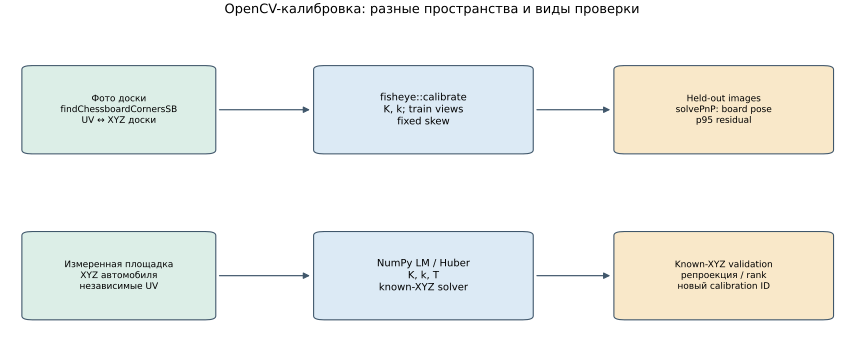

*Рисунок 3.1 — Image-based intrinsics через OpenCV и known-XYZ оценивание общей модели. Системы доски и автомобиля различаются; результаты двух методов нельзя интерпретировать одной метрикой без учёта pose fitting.*

## 3.4 Контроль нарушения калибровки

Сервисный алгоритм применяет текущие параметры к независимым контрольным точкам. Для каждой камеры вычисляется p95 остатка. Состояния NORMAL, SUSPECT и RECALIBRATION_REQUIRED определяются фиксированными порогами; недостаточные или непригодные точки дают INDETERMINATE. Список кандидатов содержит камеры, для которых превышен основной порог.

Алгоритм не меняет конфигурацию при обнаружении отклонения. Повторное оценивание выполняется отдельной командой, после чего требуется проверка и экспорт. Эта граница предотвращает обратную связь, в которой диагностический признак автоматически становится непроверенной новой калибровкой.

Испытание задаёт вращение задней камеры от 0 до 2° при неизменных наблюдениях. Результаты не распространяются на случай недостаточной текстуры, дождя или движения: текущий метод не извлекает признаки из перекрытия. Его назначение — подтвердить связь геометрического смещения с контролируемой ошибкой и корректность ветвей сервисной процедуры. Перед диагностикой проверяются полный набор четырёх ID и конечные положительные пороги; неполная таблица не может молча дать NORMAL. Код: [configurator.py](../../tools/configurator.py).

## 3.5 Реализация сервера

Сервер включает загрузку конфигурации, чтение manifest, ограниченные очереди и две независимые Unix stream-сессии. Основной поток владеет EGL-контекстом, наборами кадров и виртуальной камерой. Один дополнительный поток исполняет `io_context::run()` Boost.Asio. Сокеты, таймеры и их outgoing-очереди обслуживаются только этим потоком; команды передаются рендеру через mutex-защищённую очередь.

| Ресурс | Предел текущего профиля | Поведение при нехватке |
|---|---:|---|
| Входная очередь камеры | 3 кадра по конфигурации | Удаление старейшего, счётчик |
| Очередь команд | 64 | Отрицательный ACK `control_queue_full` |
| Обработка команд за цикл | До 16 | Остальные остаются в ограниченной очереди |
| Выходной кадр | Один ожидающий release | Следующий кадр не ставится в IO-очередь |
| Очередь control-записей | 64 | Закрытие перегруженного соединения |
| Header/payload | 64 KiB / 64 MiB | Отказ до выделения полного сообщения |
| Handshake/неполное сообщение | 2 с | Закрытие соединения |
| Release | 250 мс | Закрытие data; control продолжает работу |

При сборе набора используется опорное время среди свежих последних входов, а остальные выбираются по близости в пределах окна. Будущие и просроченные кадры исключаются. Итоговое окно набора контролируется отдельно: два наблюдения по разные стороны опоры не должны вместе нарушить общий skew. При неполном наборе возвращается DEGRADED; при отсутствии пригодных — NO_INPUT.

После pause сохраняется набор и отмечается `paused`; команды ракурса продолжают создавать результаты. При сохранённых входах upload-счётчик не растёт. Step выпускает следующую строку сценария. Полный replay-clock с speed и перерасчётом anchors пока отсутствует: строки идут с периодом около 33.3 мс, исходное время остаётся metadata. Это важное отличие от полного проектного контракта времени.

Декодирование PPM/PNG/JPEG пока выполняется основным потоком и использует кэш последних файлов каждой камеры. PNG/JPEG читает OpenCV с явным BGR→RGB. Отделение декодирования в worker pool является следующим улучшением. Добавление множества Asio runner-потоков без изменения владения объектами не решает эту задачу [S55]. Код: [server.cpp](../../src/apps/server.cpp).

## 3.6 GPU-конвейер

Используется EGL-контекст GLES 3 с небольшим pbuffer и отдельным framebuffer результата. Для Mesa выбирается surfaceless platform [S56], для NVIDIA — device platform с перечислением EGL-устройств [S58]. Эти расширения относятся к проверенным настольным профилям; на Авроре backend потребуется подтвердить отдельно.

Четыре RGB8-текстуры обновляются при изменении владельца входного изображения. Сетка хранится в VBO/EBO. Vertex shader преобразует её вершины в виртуальный ракурс; fragment shader получает интерполированную пространственную точку, рассчитывает четыре проекции, валидность и веса. Граничный feather-вес зависит от расстояния до края исходного кадра. Цвет переводится из sRGB в linear RGB, смешивается с нормировкой и кодируется обратно. Это прямое объединение в процессе рисования поверхности: отдельная общая panorama/cubemap texture сейчас не строится. Graph cut, multi-band, LUT-atlas и альтернативные носители описаны как направления исследования [[research/PROJECTION_AND_STITCHING]], а не функции текущего продукта.

Прямоугольная маска исключает чужие изображения внутри footprint автомобиля на полу. Поверх пола и дальней поверхности отдельным draw рисуется процедурная ego-модель из 132 треугольников: кузов, остекление, крыша, колёса и фары. Это визуальная опора ракурса, а не точный CAD автомобиля. Купол и пол остаются непрозрачными даже при отсутствии входа: для таких областей используется нейтральная заливка, не интерпретируемая как измерение. Depth attachment обеспечивает перекрытие поверхности и кузова.

GPU-результат читается как RGBA8 и один раз переворачивается по строкам в top-left. После этого ни IPC, ни UI не выполняют повторного переворота. Путь соответствует используемым правилам framebuffer, форматов и шейдеров GLES [S26]. Внутренние промежуточные readback не нужны, но финальный readback синхронен и входит в измеренное время.

Диагностический float-FBO возвращает прямую проекцию точек и требует float color attachment. Добавлены optional `EXT_disjoint_timer_query` вокруг surface+vehicle draw [S52], CPU-учёт upload и readback/flip. Query читается после финального readback; disjoint/неготовый результат исключается, причина сохраняется. Native report содержит valid GPU distributions либо null. Прежний metrics-контракт `sv-bench` сохраняет `gpu_time_ms=null`; расширенные измерения выполняет `sv-platform-test`. Полные UV/mask/weight diagnostic views и LUT пока отсутствуют.

## 3.7 Desktop-клиент Qt Quick и граница переноса

Клиент создаёт QGuiApplication и QQmlApplicationEngine, подключает C++-мост и QML-окно. Control handshake устанавливает сессию, после чего подключается data-сокет. Проверенные байты RGBA копируются в QImage, передаются thread-safe image provider и освобождают серверный слот. QQuickImageProvider является штатным механизмом предоставления изображений Qt Quick [S57]. Он выбран для проверяемого desktop-пути; проектный QQuickItem/QSGTexture остаётся последующим вариантом.

Интерфейс содержит изображение, три пресета, pause/resume/step и строку состояния. Drag-смещения объединяются за 33 мс, колесо меняет расстояние. Это уменьшает поток команд при частых mouse events. Команда содержит собственный ID; metadata кадра — принятую `state_revision`, что позволяет отличить новое положение от ранее выданного кадра.

После готовности изображения и события `frameSwapped` записывается `ui_present_submit`. Offscreen-тест подтверждает `ui_receive` и `ui_present_submit`; проверены Qt 6.11.2 и отдельная сборка Qt 5.15.19. Это свидетельство software-представления Qt, а не физического дисплея или ABI Авроры. QML включён в `.qrc`; GLSL — в generated C++ header, поэтому установка не зависит от checkout.

При проверке завершения обнаружено обращение socket callback к полям во время разрушения Bridge. Деструктор теперь отключает эти соединения до уничтожения строк/буферов и закрывает оба сокета. Повторный IPC-тест выполнен три раза; ошибка закрытия устранена. Это пример необходимости проверять завершение потока и владение ресурсами вместе с получением кадра.

Клиент восстанавливает соединение после отключения. Политика непрерывной stale-индикации и полная диагностика calibration state пока не реализованы. Код: [Main.qml](../../examples/sv-client/Main.qml), [bridge.cpp](../../examples/sv-client/bridge.cpp).

## 3.8 Offline-конфигуратор

CLI имеет режимы `calibrate` и `diagnose`. Первый читает конфигурацию и наблюдения, оценивает камеры, формирует отчёт и экспортирует принятый набор. Второй только сравнивает действующую геометрию с независимыми наблюдениями. SHA-256 наблюдений участвует в идентификаторе новой калибровки.

Принятая конфигурация записывается через временный файл с последующим rename. Уже существующий `calibrated.json` не перезаписывается: для новой версии выбирается другой каталог. Старые параметры сохраняются в исходном конфигурационном файле. Экспорт отвергается, если контроль качества не выполнен. Это даёт проверяемую историю первоначальной и повторной процедуры.

Python CLI решает известную пространственную задачу; отдельный OpenCV CLI — внутреннюю image-based калибровку. GUI отбора снимков, полный журнал площадки и совместная привязка нескольких камер к неизвестным позам шаблонов отсутствуют. Следовательно, наличие двух проверенных tools ещё не закрывает все CAL-F-001…006 для реального объекта. Команды и форматы — [[engineering/USAGE]].

## 3.9 Генератор и контролируемые данные

Генератор NumPy создаёт четыре широкоугольные камеры в известных позах. Каждый пиксель задаёт луч; для выбранных коэффициентов радиальный полином обращается численным методом. Лучи пересекают наземную плоскость и приподнятый сферический объект. Плоскость содержит клетчатую текстуру, метровые линии и движущийся наземный маркер.

Таким образом, вход строится из известной геометрии, а не из цветовой таблицы, уже рассчитанной C++-рендерером. Сфера используется для визуального показа искажений объекта, который не принадлежит условной поверхности. Этот признак особенно важен при сравнении плоскости и bowl: нельзя считать такое искажение случайной ошибкой калибровки.

Данные сохраняются в PPM и manifest с исходными временами, путями, calibration IDs, offset-полями и SHA-256. Null исключает вход, offset задаёт временное нарушение. Native suite проверяет все файловые hashes перед опытом; обычный replay-loader пока ограничивается IDs и форматом. В 0.6.0 добавлена потоковая программа `tools/producer.py`, описанная в §3.16. Код: [simulator.py](../../tools/simulator.py).

Добавлен `sv-capture` с реальным `cv::VideoCapture`: четыре `grab`, четыре `retrieve`, запись PNG/manifest и host delivery timestamps [S64]. Он проверен на четырёх видеофайлах; реальные устройства пока отсутствуют. Размеры кадров обязаны соответствовать калибровке, скрытого resize нет. Метки после retrieve не являются временем экспозиции датчика, а текущий сервер сохраняет фиксированную частоту replay 30 Hz.

Для демонстрации окружения `sv-scene` преобразует HDR-панораму улицы **Urban Street 01** автора Andreas Mischok, Poly Haven, CC0 [S63], в четыре fisheye-входа. В `street-demo.json` камеры горизонтально направлены на четыре стороны и имеют общий оптический центр на высоте 1.6 m. Это согласованно проецирует моноскопическую панораму, но не воспроизводит параллакс настоящих разнесённых камер.

Рендерер 0.3.0 создаёт круглый пол в `z=0` и отдельную верхнюю полусферу радиусом 12 m. На обе поверхности проецируются реальные входные текстуры согласно fisheye-калибровкам; валидные области смешиваются в линейном RGB. На полу применяется маска кузова, на куполе — нет. Автомобиль перекрывает дальнюю стенку по depth buffer. Виртуальная камера имеет расстояние 8.5 m от центра при радиусе купола 12 m; parser и обработчик orbit не позволяют ей выйти за оболочку.

На направлениях без входа, включая часть зенита за пределом FOV, шейдер рисует непрозрачный sky gradient; пропуски на полу закрываются цветом покрытия. Это убирает прозрачные отверстия и вид через пустую поверхность, но не подменяет ими измеренные камерные пиксели. Панорамный набор остаётся без параллакса и служит только визуальной демонстрацией. Код геометрии и ограничения качества — [[architecture/MATHEMATICS]] и [[engineering/SCENE]].

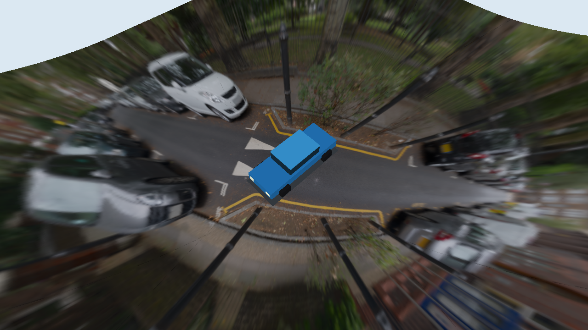

*Рисунок 3.2 — GLES readback купола и круглого пола: текстура улицы обволакивает процедурную модель автомобиля. Вход — моноскопическая HDR-панорама с общим оптическим центром, не запись установленного на ТС rig.*

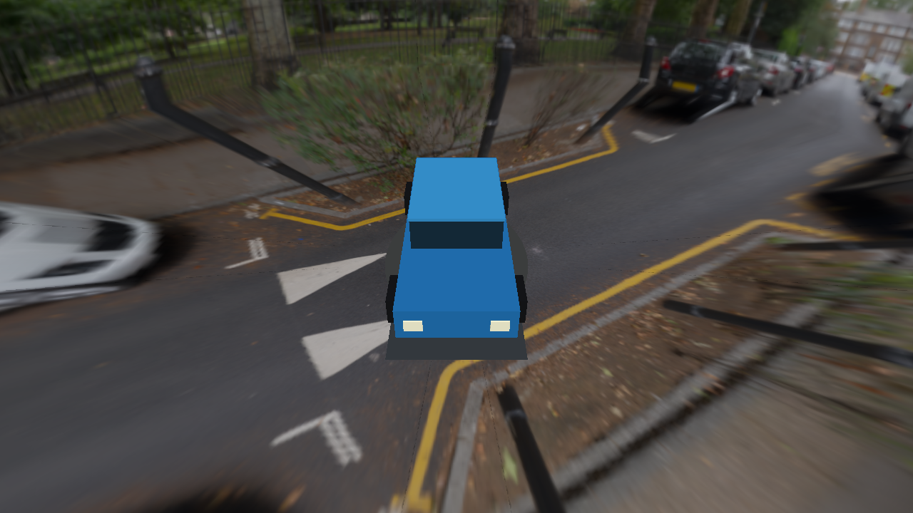

*Рисунок 3.3 — Тот же фотографический купол и нижний пол при ракурсе со стороны передней камеры; виртуальная камера остаётся внутри оболочки.*

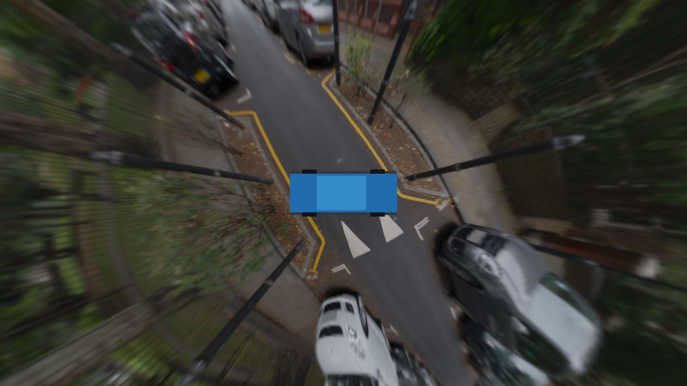

*Рисунок 3.4 — Вид сверху изнутри купола при тех же кадрах. Оболочка закрывает фон, положение препятствий не является метрическим ground truth.*

## 3.10 Протокол и жизненный цикл буфера

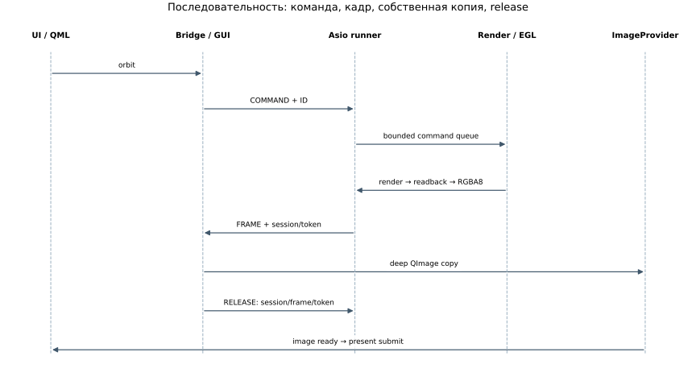

*Рисунок 3.5 — Обмен между GUI-мостом, Asio, EGL-владельцем и ImageProvider. Собственная QImage-копия отделяет server release от последующего представления кадра.*

Framing использует префикс SV01 длиной 24 байта, версию 1, тип, header size, payload size и нулевые flags. Затем следуют UTF-8 JSON и байты. Decoder накапливает неполные части, проверяет пределы и может выдавать несколько сообщений из одного чтения. Однобайтовая подача и объединённые сообщения проверены C++-тестом.

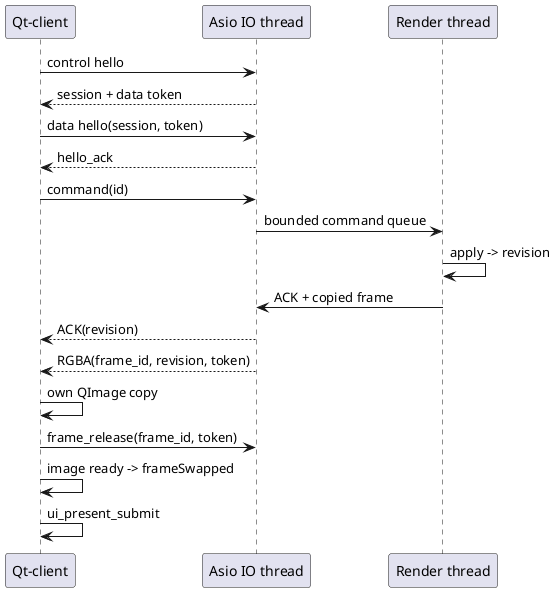

*Рисунок 3.6 — Handshake, ревизия команды и токен освобождения в текущем IPC-контракте; момент release не является моментом физического показа.*

Выходной пакет сохраняет ID кадра, набора, принятой ревизии и последней применённой команды, состав входов и runtime-метки. Клиент возвращает session/frame/token. Дублированный или поздний release не должен освобождать другой кадр. При reconnect создаётся новая control-сессия.

Полная схема протокола также требует source IDs, всех событий времени, capabilities и списка коалесцированных команд. Эти элементы реализованы частично. Поэтому текущий framing рассматривается как совместимая основа, а не доказательство полного PRO-F-001…011. Пределы и точное подмножество опубликованы в [[prototype/STATUS]].

## 3.11 Offline-сборка, RPM и подготовка переноса

Рабочая сборка проверена для Linux, Mesa/NVIDIA и Qt 5/6. CPU без EGL/Qt проходит ASan/UBSan. Все dependencies берутся из packages: CMake использует REQUIRED и **не содержит FetchContent**. SV_AURORA отключает host Python-tests; архитектуру и sysroot задаёт SDK, а не этот флаг.

Перенос начинается с проверки реального SDK, разрешённых зависимостей, EGL/backend, форматов и Qt integration [S20], [S21]. После этого следует собрать минимальный target-путь и повторить известные точки и контроль ориентации строк. Если Boost/GLM требуют другого способа включения, архитектурная граница позволяет изменить адаптер или dependency profile без изменения математического контракта.

Созданы GPU- и CPU-spec-профили с Source0, BuildRequires, `%cmake -GNinja`, `%ninja_build`, `%ninja_install` и точным payload [S59], [S60], [S67]. Source0 экспортируется только из чистого Git HEAD и содержит revision. Native Linux RPM обоих профилей собраны и распакованы; из установленного payload, без checkout, прошли core checks, native report, HDR generation, а для GPU — renderer. Эта проверка подтверждает упаковку и runtime resources на Linux, но **не** target ABI, RPM validator profile, подпись и установку Авроры [S61], [S62].

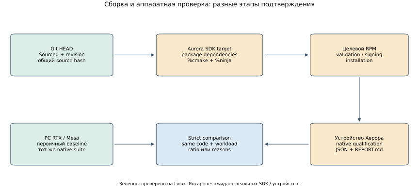

*Рисунок 3.7 — Путь от зафиксированных исходников до аппаратного сравнения. Янтарные этапы требуют фактических SDK/устройства; Linux RPM smoke не заменяет их.*

Подробные инструкции по зависимостям, native export, mb2, release rpmbuild, validation/signing, установке и возврату отчётов находятся в [[engineering/AURORA]]. Клиент остаётся desktop prototype; AuroraApp/Silica lifecycle и launcher являются отдельным этапом интеграции.

## 3.12 Переносимый отчёт и сравнение платформ

`sv-platform-test` в 0.4.0 выполняет 25 CPU/GPU-критериев без Python на целевой стороне. Проверяет analytic/OpenCV/GPU projections, config, mesh, цвета и ориентацию, синхронизацию, очереди, framing, детектор и fitter, cached uploads и десять render-вариантов, fusion-oracles и coverage замкнутых оболочек. Записывает SHA-256 реализации/config/fixture, библиотечные версии, GL/EGL capabilities, uname/CPU/memory и UTC-время. Каждый повтор создаёт новый EGL-контекст в одном процессе; raw времена сохраняются вместе с квантилями.

Первичные данные представлены JSON и Markdown с полным JSON-блоком. `compare_reports.py` допускает отношения времён только при совпадении кода/нагрузки/методики и успешной квалификации обеих сторон. Различия аппаратуры и библиотек сохраняются как характеристики платформ. При несовпадении выводится причина, ratio=null. Результаты будущего устройства можно сопоставить с сохранёнными PC baselines, повторив ПК при изменении реализации.

Оптимизация начинается с измеренных границ upload/draw/readback. Optional GPU query не включает финальное чтение; CPU-readback уже содержит ожидание GPU, поэтому эти времена нельзя складывать. IPC/UI и physical display latency пока не измерены native suite, dedicated GPU memory остаётся null. Подробные критерии, пороги, команды и ограничения — [[engineering/PLATFORM_TEST]].

## 3.13 Независимый объёмный источник кадров

Моноскопическая панорама полезна для проверки визуального окружения, но не содержит параллакса разнесённых камер. Для следующего исследования создан отдельный метрический мир в Blender: дорога, разметка, бордюры, здания, деревья, два припаркованных автомобиля и вертикальные столбики. Ego-автомобиль имеет процедурный кузов, стекло, зеркала и колёса. Модели формируются исходным Python-кодом без внешних ассетов. Авторинг и экспорт выполнены через проверенное MCP-подключение; существующая пользовательская сцена сохранена.

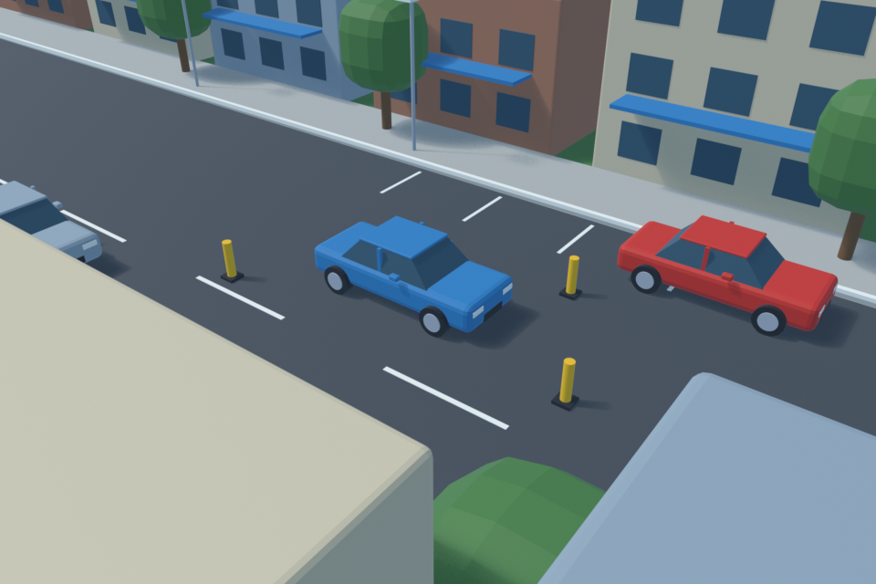

*Рисунок 3.8 — Истинная объёмная сцена источника, рендер Blender EEVEE. Изображение снято внешней камерой и показывает геометрию до реконструкции обзорной оболочкой.*

Четыре оптических центра находятся на переднем и заднем бамперах и снаружи боковых зеркал. Для системы V приняты оси +X вперёд, +Y влево, +Z вверх. Оптическая система C использует +X вправо, +Y вниз, +Z вперёд. Матрицы `T_camera_from_vehicle` постоянны относительно кузова; сценарное движение задаёт `T_world_from_vehicle(t)`. Для camera i истинная поза получается как

$$
T_{W\leftarrow C_i}(t)=T_{W\leftarrow V}(t)\,T_{C_i\leftarrow V}^{-1}. \tag{3.1}
$$

На данном этапе траектория — прямолинейное перемещение со скоростью 2 м/с. Она обеспечивает воспроизводимое изменение входных изображений, но не задаёт динамику шин, подвески или интерактивное управление. Поза внутри одного четырёхкамерного набора фиксируется; последовательный offline render не создаёт межкамерного scenario skew.

Blender последовательно рендерит пять 90-градусных перспективных граней из каждого центра. Выбор такой схемы отделяет создание геометрической сцены от конкретной fisheye-реализации render engine. Для оптического направления d выбирается доминирующая компонента; локальные координаты грани приводятся к пикселям:

$$
u={N\over2}\left(1+{d_x^f\over d_z^f}\right)-{1\over2},\qquad
v={N\over2}\left(1+{d_y^f\over d_z^f}\right)-{1\over2}. \tag{3.2}
$$

Здесь N — размер квадратной грани, а оси f направлены вправо, вниз и вперёд. Отрицательная оптическая Z-грань не используется: поддерживаемый предел угла 1.48 rad меньше π/2. Переход от Blender camera-local −Z/+Y к системе C задаётся явной матрицей. Перед capture выполняется независимая проверка перспективной проекции через Blender `world_to_camera_view` и pixel-center conventions. Свойства оптики и batch API описаны в официальной документации Blender; численная совместимость с установленной версией проверяется локально [[engineering/BLENDER]].

Для каждого fisheye-пикселя конвертер строит обратный луч, выбирает нужную грань и выполняет bilinear sampling в линейном RGB. Результат кодируется в sRGB RGB8 PPM. Экспорт включает совместимые config/manifest, SHA-256, scenario timestamps и истинные позы камер. Опциональный Blender EXR Z-pass сохраняется для шести граней каждой камеры и конвертируется в radial-range NPY; smoke-отчёт описывает покрытие и численные границы. Сглаживание через границы cube faces пока ограничено clamp-to-edge; semantic/object-ID labels и произвольные body-occlusion masks остаются следующими задачами.

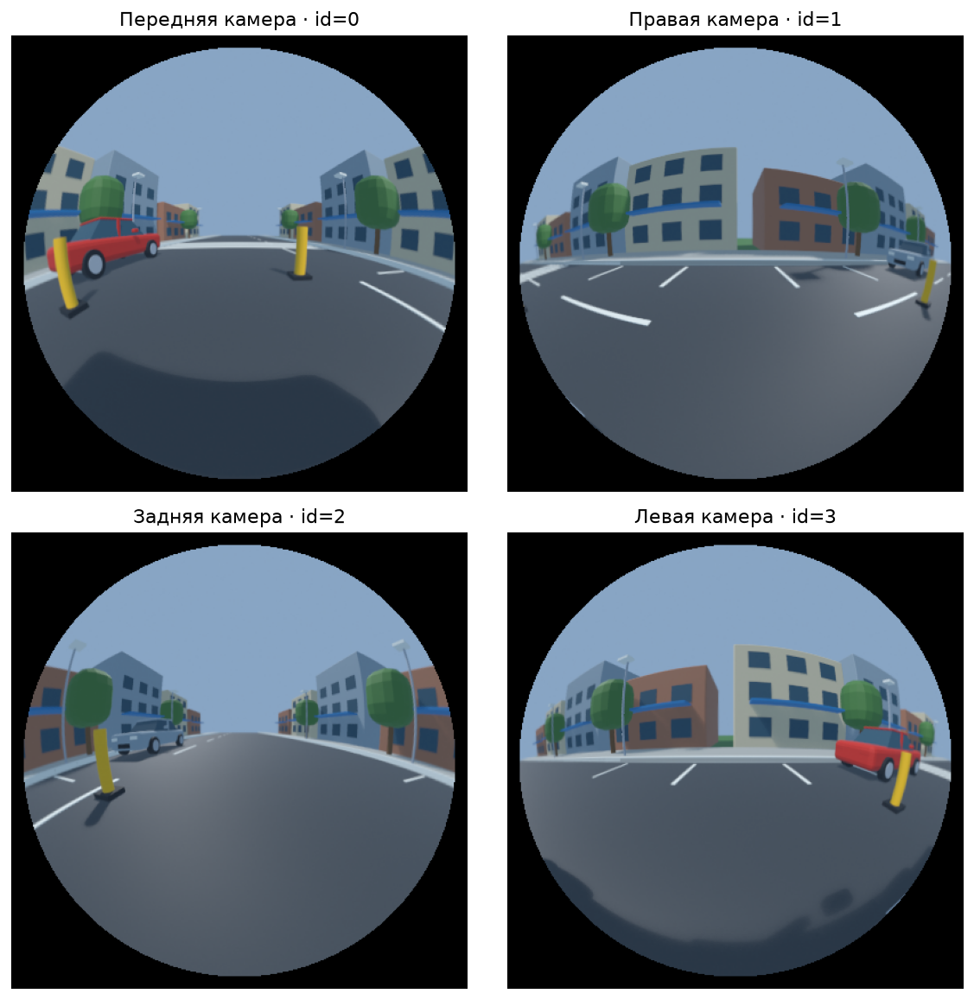

*Рисунок 3.9 — Реальные выходы offline Blender→fisheye конвертера, четыре разнесённых центра. Чёрная область лежит вне заявленного theta-bound и не считается наблюдением камеры.*

Набор поступает в существующий `sv-server` как replay-manifest. В 0.6.0 запись также можно передать через четыре Unix/TCP source endpoints; генерация самой 3D-записи остаётся offline. После projection/fusion сервер формирует изображение купола и нижнего пола, виртуальная камера находится внутри оболочки.

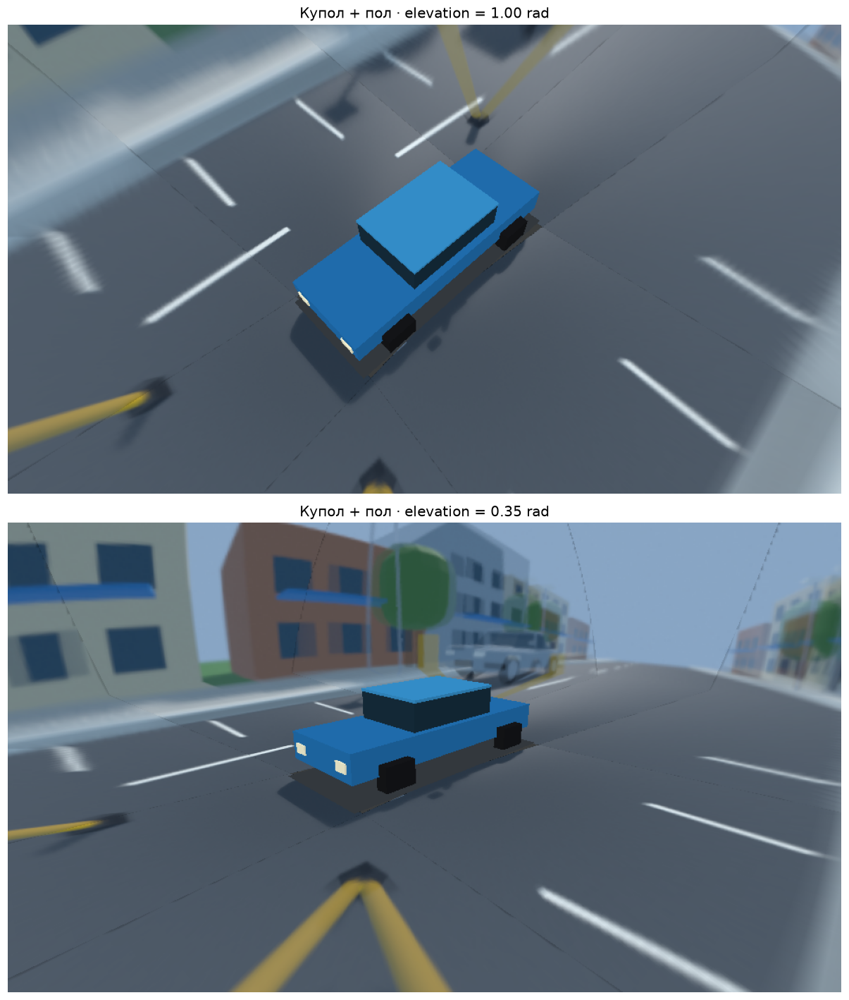

*Рисунок 3.10 — GLES readbacks одного набора на поверхности «купол + пол»: сверху elevation=1.00 rad (NVIDIA), снизу elevation=0.35 rad (Mesa llvmpipe). Это иллюстрация двух ракурсов, а не сравнение backend timings. Растяжения столбиков и двоение объектов показывают ограничения текущей surface projection и feather blending.*

Уличная геометрия содержит объёмные объекты, поэтому соответствие предположению о плоском полу нарушается наблюдаемым способом. При правильной калибровке такая ошибка сохраняется: калибровочная точность и качество переноса сцены на условный носитель — разные критерии. Новый depth capture создаёт основу для E-STITCH-01, но его точность на аналитических примитивах и независимые validation scenes ещё требуется проверить.

Скрипты мира и иллюстраций хранятся обычным Git. По решению пользователя Git LFS не используется; готовый авторский `.blend` сохранён в `assets/scenes/metric-street/` с provenance, а полные capture/replay-серии остаются в локальном `artifacts/`. Каталог исходных материалов и восстановление мира — [[engineering/ASSETS]]. Инструкция [[engineering/BLENDER]] задаёт команды повторения, [[validation/BLENDER_SMOKE]] — выполненные проверки. Скрипт рисунков [plot_blender.py](plot_blender.py) расположен рядом с этой главой.

## 3.14 Варианты носителя и диагностика вклада камер

В 0.4.0 добавлены цилиндр с круглыми полом/крышкой и кубическая оболочка с четырьмя стенами, квадратным полом и крышей. Они используют тот же fragment projection, что купол: заранее сшитая карта не создаётся. Форма замыкает видимое пространство виртуальной камеры, но не делает стену истинной геометрией окружающих объектов. Существующее разделение между носителем и texture representation [S26], изложенное в главе 1, сохраняется.

Parser и команды сервера используют одну функцию `safe_view`. Она проверяет зазор 0.25 m до пола и границ оболочки; sphere использует длину eye, cylinder — XY-радиус и высоту, cube — абсолютные X/Y и высоту. Outward winding проверяется CPU-тестами; три оболочки проверены GLES readback на 36 ракурсах без входных камер. Диагностика позволяет отличить opaque fallback от действительно наблюдаемого изображения.

Пусть $e_i$ — расстояние проекции до ближайшего края изображения, $\theta_i$ — угол к оси камеры, $\delta$ — ширина перехода, $p$ — степень. Реализованы:

$$
b_i=\min(1,\max(0,e_i/\delta)),\qquad a_i=\cos^p\theta_i.
$$

Edge-feather использует $w_i=b_i$, angular-feather — $w_i=b_i a_i$. Hard best-angle выбирает валидную камеру с максимальным $a_i$; при равенстве побеждает меньший ID. Угловое предпочтение — инженерная эвристика; оно не является photometric correction или seam optimization. Feather нормирует linear-RGB сумму при положительном знаменателе; hard не усредняет источники. При отсутствии наблюдения выводится заливка. Нормированное смешивание рассмотрено в [[diploma/01_THEORETICAL_FOUNDATIONS]]; graph-cut/multi-band остаются следующими методами.

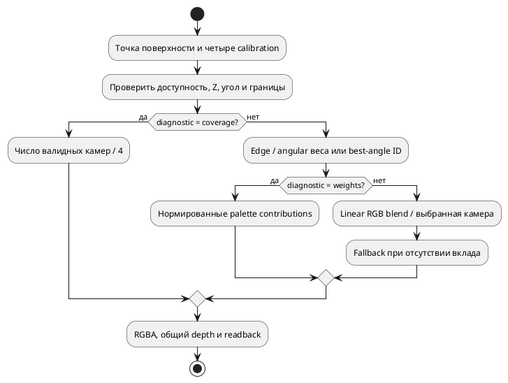

*Рисунок 3.11 — Реализованные ветви fusion и диагностики. Маска кузова обрабатывается на полу до проекции; в диагностике ego-модель не перекрывает карту.*

Native `GPU_FUSION_MODES` проверяет независимые ожидаемые RGB для равных и угловых весов, равенство/отказ hard-selection и coverage от нуля до четырёх камер. Например, равная linear-смесь red/green/blue/white даёт sRGB около (188,188,188), а не (128,128,128). Канонические тесты не используют ground truth самой Blender-сцены. Контракт JSON и команды — [[engineering/RENDERING]], первый screening — §4.12.

## 3.15 Универсальный клиент и конфигурация транспорта

В 0.5.0 общий SV01 codec выделен в `sv-wire`, а асинхронное подключение/сессия/команды/кадры — в `sv-client-lib`. Публичный C++17 API не зависит от Qt/OpenCV/EGL; installed target `sv::client` используется самостоятельным CMake consumer. GUI Bridge переносит события библиотеки на UI thread, копирует QImage и освобождает серверный буфер. Headless probe использует тот же API.

| Ответственность | Реализация | Проверка |
|---|---|---|
| Транспорт | Asio generic stream socket, Unix/TCP adapters | Native/headless/Qt TCP и прежний Python Unix |
| Разрешённые listeners | Строгий блок connections; только явно включённые endpoints | Unix-only без IP sockets в `/proc`, TCP-only без Unix files, combined |
| Сессия | Control handshake, случайный token связывает data | Restart/reconnect; новая сессия не повторяет pending команды |
| Результат | Immutable owning Message, RGBA/stride/origin/IDs validation, explicit release | Invalid payload, copied frame, installed consumer |
| Завершение | Stop/join/close и ограниченные очереди | Native lifecycle, CPU ASan/UBSan |

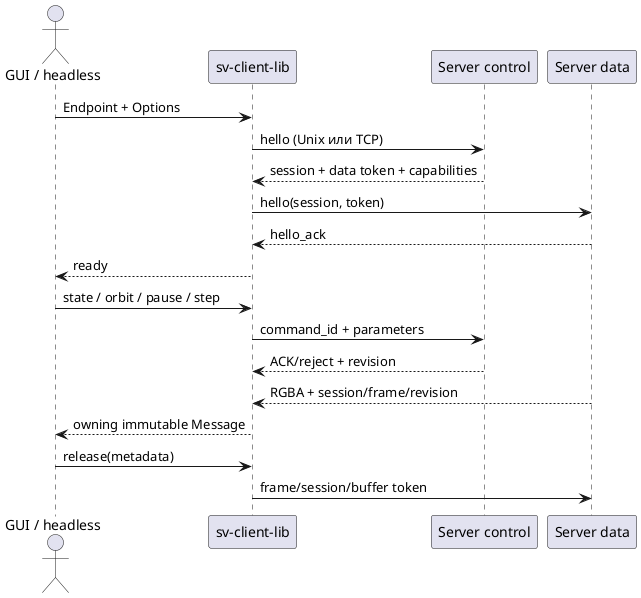

*Рисунок 3.12 — Одинаковый клиентский контракт для Unix и TCP. Сервер не открывает отключённые transport endpoints; UDP не реализован.*

`state` возвращает авторитетные view/paused/fusion/revision без мутации. После нового data handshake сервер повторяет готовый результат даже на паузе. Replay использует интервалы scenario timestamps manifest; decode/upload/mesh counters позволяют проверить повторное использование входов при повороте. Сетевые часы не считаются локальными: GUI не вычитает server monotonic timestamp из client timestamp.

Библиотека покрывает опубликованные команды текущего сервера. Runtime calibration/source-management/config editing, UDP и несколько клиентов остаются расширениями. Полный рабочий API, defaults/deadlines, server JSON и примеры — [[engineering/CLIENT_LIBRARY]]. Испытание между двумя физическими машинами и Аврора остаются открытыми.

## 3.16 Асинхронные источники и виртуальные камеры

Покадровое чтение файлов в GL-потоке связывало отзывчивость виртуальной камеры с диском и декодированием. Например, команда orbit при уже имеющихся текстурах могла ждать очередного PNG. Решение выделяет подготовку входов в `sv-sources`: интерфейс `FrameSource` возвращает owning кадры и завершения команд через ограниченный mailbox. Выбранный при запуске backend имеет один worker; OpenGL и Synchronizer остаются у основного потока. Общий thread pool здесь не требуется: replay сериализует свою временную шкалу, а socket worker обслуживает четыре независимых потока Asio.

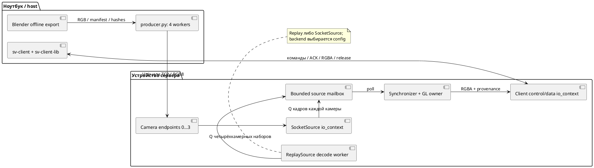

*Рисунок 3.13 — Раздельные producer и client endpoints; аппаратный adapter пока не реализован. Двухмашинное размещение показано как поддерживаемая топология, проверена передача на localhost.*

| Решаемая проблема | Механизм | Проверяемое следствие |
|---|---|---|
| Decode задерживает обработку ракурса | Worker и неблокирующие request/poll | Injected blocked loader не блокирует API GL-владельца |
| Команда pause обгоняет незавершённый decode | Source completion barrier | После ACK нет нового decode; step даёт ровно один набор |
| Общая очередь вытесняет одну из четырёх камер | Отдельная квота Q на camera ID | При насыщении остаются Q последних кадров каждой камеры |
| Producer переподключается с sequence=0 | Новая session, сохранение локального sequence | Synchronizer принимает новые кадры без ложного duplicate |
| Время ноутбука принимается за время устройства | Сохранение source clock domain отдельно от server delivery | Не выполняется вычитание несопоставленных monotonic clocks |
| Повреждённый поток останавливает весь сервер | Отдельный channel и deadline | Закрывается только проблемный camera endpoint |

Для socket source принимаются RGB8 top-left без padding, размеры и calibration ID должны совпасть с конфигурацией. Handshake выдаёт source session, последующие сообщения содержат source sequence и timestamps. Ограничение возраста и skew пока использует server delivery. Следовательно, READY нельзя интерпретировать как синхронность экспозиции: сеть, decode и планировщик способны изменить задержки. Для аппаратного опыта необходимо измерить sensor timestamps, смещение часов и неопределённость сопоставления. Исходная временная метка сохраняется в output provenance и не теряется при преобразовании.

На паузе socket worker продолжает читать и проверять поток, но отбрасывает новые входы. Это предотвращает накопление старого видео до resume; принятые до pause кадры обрабатываются перед completion. `step` имеет смысл только для конечной replay-последовательности, поэтому socket backend отклоняет его без изменения revision. Клиент узнаёт доступные операции из capabilities.

Host producer проверяет хэши и calibration IDs записи, читает изображения четырьмя потоками и передаёт их в отдельные сокеты. Он позволяет использовать сохранённый Blender-мир как источник данных без создания `/dev/video*`. Он пока не рендерит интерактивный мир; автоматический reconnect с ограниченным budget и новыми сессиями реализован в следующем подразделе. Прямой VideoCapture backend отложен до реализации ограниченного shutdown: блокирующий вызов драйвера нельзя считать отменяемым только потому, что он перенесён в thread.

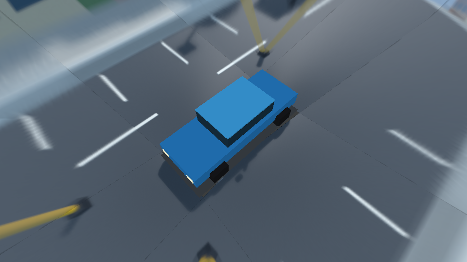

*Рисунок 3.14 — Actual RGBA readback `sv-server` на RTX 5070 Ti: Blender recording → четыре Unix producer sockets → купол + пол. Показано сохранённое окружение автомобиля; растяжения и швы текущей проекции остаются предметом исследования качества. Рисунок публикует `plot_blender.py --socket-validation`; это не рендер внешней Blender-камеры.*

Решение и пределы подтверждаются собственным кодом: [source.hpp](../../include/sv/source.hpp), [replay.cpp](../../src/sources/replay.cpp), [socket.cpp](../../src/sources/socket.cpp), [producer.py](../../tools/producer.py). Подробный контракт и команды — [[engineering/SOURCES]], результаты — [[validation/SOURCES_SMOKE]]. Свойства thread pool, драйверов и realtime Blender, которые в коде отсутствуют, этим компонентам не приписываются.

## 3.17 Восстановление producer и сохранение актуальности

Однократное подключение завершало camera worker при первом разрыве. Это мешало независимо перезапускать сервер во время настройки: остальные процессы приходилось запускать заново. Host producer теперь различает transport failure, ошибку протокола и пользовательскую остановку. Каждая камера имеет собственные retry budget, socket timeout и interruptible backoff. EOF/timeout закрывает текущий socket целиком; новый handshake создаёт новую session, source sequence начинается с 0. Успешный send сбрасывает budget, malformed handshake завершает данную камеру без повторов.

При восстановлении недостаточно повторить все пропущенные кадры: такой burst создаёт запоздалое видео и быстро переполняет bounded server queue. Producer сохраняет общий epoch записи и перед очередным send сравнивает текущее monotonic время с запланированным. Если lateness превышает настроенный budget, ряд учитывается как пропущенный. Проверка повторяется после handshake, поскольку сам connect мог задержать кадр. Это ограничение возраста до send, а не гарантия свежести sensor exposure на сервере.

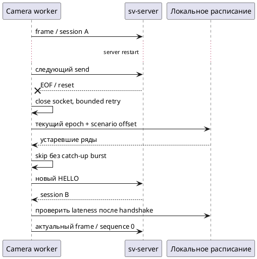

*Рисунок 3.15 — Восстановление одного источника без накопления application backlog. Уже переданные в kernel байты не отзываются; камеры восстанавливаются независимо.*

JSON/Markdown отчёт содержит четыре camera records с числами отправок, late/missing skips, transport errors, reconnects и временем блокировки send. Запись отчёта не создаёт unbounded history: сохраняются счётчики и последняя session/error. `completed` описывает завершение расписания; type 10 не имеет ACK обработки, поэтому sent нельзя объявлять числом кадров, использованных рендерером. При stop сохраняются частичные результаты; отказ одной камеры не завершает workers остальных камер.

Испытания используют настоящий sv-server с перезапуском на Unix/TCP и отдельные socket receivers для blocked handshake/slow read. Наблюдается восстановление четырёх READY inputs с новыми sessions, а просроченные ряды пропускаются. Методика/первичные отчёты — [[validation/PRODUCER_RECOVERY]], рабочие параметры — [[engineering/SOURCES]]. Двухмашинная синхронизация часов, долговременный RSS и аппаратный capture этим опытом не подтверждаются.

## Выводы по третьей главе

Создан рабочий Linux-прототип с четырёхкамерным отображением, управляемым ракурсом, независимыми математическими проверками, калибровкой по известным точкам и локальным IPC. Использование GLM и Boost.Asio связано с конкретными обязанностями: матрицами виртуальной камеры и отдельным потоком сокетов. Владение GL и ограничения очередей остаются явными.

Прототип теперь включает реальный OpenCV, photo-demo, native отчёты, начальный локальный OpenCV/V4L2 source и проверенную Linux RPM-упаковку. Реальные камеры ещё не подключались, длительные измерения и приложение Авроры не проверены. Эти ограничения определяют границы выводов следующей главы.

## Источники

Каталог: [[references/VISION#S04|S04]], [[references/DEVELOPMENT#S25|S25]], [[references/DEVELOPMENT#S26|S26]], [[references/PLATFORM#S20|S20]], [[references/PLATFORM#S21|S21]], [[references/DEVELOPMENT#S54|S54]], [[references/DEVELOPMENT#S55|S55]], [[references/DEVELOPMENT#S56|S56]], [[references/DEVELOPMENT#S57|S57]], [[references/DEVELOPMENT#S58|S58]], [[references/DEVELOPMENT#S64|S64]]. Дата обращения — 05.10.2026. Собственные алгоритмы и ограничения соотносятся с исходниками, а не приписываются этим источникам.

[S04]: https://docs.opencv.org/4.13.0/db/d58/group__calib3d__fisheye.html
[S25]: https://ceres-solver.readthedocs.io/latest/nnls_tutorial.html
[S26]: https://registry.khronos.org/OpenGL/specs/es/3.0/es_spec_3.0.pdf
[S20]: https://developer.auroraos.ru/doc/software_development
[S21]: https://developer.auroraos.ru/doc/software_development/reference/public_api
[S54]: https://github.com/g-truc/glm/blob/1.0.3/manual.md
[S55]: https://www.boost.org/doc/libs/latest/doc/html/boost_asio/overview/core/threads.html
[S56]: https://registry.khronos.org/EGL/extensions/MESA/EGL_MESA_platform_surfaceless.txt
[S57]: https://doc.qt.io/qt-6/qquickimageprovider.html
[S58]: https://registry.khronos.org/EGL/extensions/EXT/EGL_EXT_platform_device.txt
[S52]: https://registry.khronos.org/OpenGL/extensions/EXT/EXT_disjoint_timer_query.txt
[S59]: https://developer.auroraos.ru/doc/sdk/tools/mb2
[S60]: https://developer.auroraos.ru/doc/software_development/guidelines/rpm_requirements/spec_requirements
[S61]: https://developer.auroraos.ru/doc/sdk/tools/rpm_validator
[S62]: https://developer.auroraos.ru/doc/sdk/tools/rpmsign_external
[S63]: https://polyhaven.com/a/urban_street_01
[S64]: https://docs.opencv.org/4.13.0/d8/dfe/classcv_1_1VideoCapture.html
[S65]: https://docs.opencv.org/4.13.0/d9/d0c/group__calib3d.html
[S67]: https://developer.auroraos.ru/doc/5.1.4/sdk/app_development/work/create/create_new_project

## Дополнение: воспроизводимые ошибки монтажа и extrinsics solver

`tools/blender/scenario.py` валидирует компактный world recipe и формирует фактический rig из nominal. `src/vision/extrinsics.cpp` реализует known-intrinsics pose fitting с настоящим OpenCV, отдельный CLI adapter находится в `src/apps/calibrate_extrinsics.cpp`. Comparison service `tools/calibration/study.py` вызывается через существующий configurator и пригоден для дальнейшей интеграции в simulator GUI. Каждый слой отделяет train input от evaluator truth; численные результаты и рисунки — [[diploma/04_EXPERIMENTAL_STUDY#4.17 Восстановление положения камер при ошибках монтажа]]. Native solver ещё не подключён к серверному job API; offline export не меняет active config.

Добавлена команда `sv-calibrate board-observations`: она детектирует chessboard corners реальным OpenCV на четырёх наборах изображений и строит metric XYZ в координатах автомобиля из измеренных поз шаблона. Для симметричного узора оператор явно сверяет порядок углов с маркировкой и нумерованным preview. Качество детектора и точность по физическим камерам не измерены; предыдущая сравнительная серия остаётся синтетической. Формат, ограничения и запуск приведены в [[engineering/USAGE#OpenCV: внешняя калибровка по изображениям]].

## 3.18 Первые runtime-инструменты камеры, калибровки и задержек

После подготовки этого раздела в server loop добавлен `CalibrationJobManager`: клиент отправляет training и отдельные validation наблюдения, получает асинхронный job ID, запрашивает метрики и может применить вычисленную позу камеры. На validation наборе вычисляются RMSE и максимальная ошибка; применение блокируется при RMSE >3 px или максимуме >8 px. Это временные программные пороги, требующие подбора на физических данных. Применение строит candidate renderer до сохранения новой конфигурации, затем записывает JSON и переключает renderer; ошибка подготовки или persistence оставляет прежнюю пару config/renderer. Jobs ограничены по очереди/памяти и принадлежат control-session; отдельная команда отменяет задания, отключение клиента также помечает его jobs отменёнными. Вызов OpenCV нельзя прервать внутри, поэтому текущий solver заканчивается, но его результат отбрасывается. Revision-checked persistence отвергает второй кандидат, если после старта job активная конфигурация изменилась; отдельный stress-тест race двух одновременных apply не проводился. Подтверждение позы реальной камерой не реализовано. Клиент обязан передавать validation данные, не участвовавшие в подборе, но сервер пока не может доказать их независимость. Кнопка запуска калибровки в `sv-simulator` отключена, поскольку GUI пока не собирает достоверные observations.

Для локальных камер сервер теперь выбирает `source.type=camera`, открывает четыре пути `/dev/video*` через OpenCV `VideoCapture`, приводит BGR/grayscale/BGRA к RGB8 и отбрасывает неожиданные разрешения. Метка времени ставится на host после получения кадра; она не является сенсорным timestamp. OpenCV скрывает детали backend устройства, а `read()` может блокироваться внутри драйвера, поэтому поведение остановки и повторного подключения ещё надо измерить с целевыми камерами [[references/DEVELOPMENT#S64|S64]]. Конфигурация `configs/v4l2-camera.json` содержит синтетические размеры и параметры калибровки и служит только примером формата.

В trace и кадр-метаданные включены измеряемые coarse intervals: время опроса источника, подготовка до рендера, wall time рендера, nullable GPU draw query, CPU upload/readback-copy и enqueue результата. Значение `server_receive_to_render_ms` опирается на локальную шкалу доставки кадров. Эти интервалы частично перекрываются и их нельзя суммировать; раздельные decode, очередь, синхронизация, projection/fusion и клиентский present пока не измеряются. См. [[engineering/USAGE#Запуск сервера с локальными V4L2 камерами]] и [[engineering/CLIENT_LIBRARY]].


## 3.19 Переключение исследуемых режимов на работающем сервере

Для исследования важна возможность сравнивать альтернативы в том же серверном pipeline, который используется конечным клиентом. Поэтому исследовательская сборка сохраняет набор алгоритмов и их параметров; выбор единственной эксплуатационной конфигурации является результатом опытов, а не предварительным сокращением реализации.

Первый реализованный контракт `fusion_runtime_v1` предоставляет каталог трёх GPU-режимов (`edge_feather`, `hard_best_angle`, `angular_feather`), переключение `color/coverage/weights`, ширины feather и степени углового веса. Клиентская библиотека предоставляет типизированные методы получения каталога и изменения настроек. Сервер проверяет параметры общей схемой конфигурации и сопоставляет `base_config_revision` с активной версией. Валидированный snapshot применяется между вызовами render; shader uniforms используют весь новый набор параметров. GPU-ресурсы и входные текстуры для этого не пересоздаются.

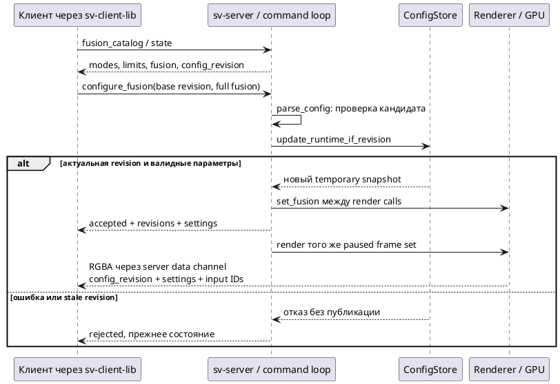

*Рисунок 3.19 — Реализованный порядок изменения fusion. Общий сценарный исполнитель и переключение остальных стадий пока не реализованы.*

Интеграционная проверка останавливает replay, переключает каждый режим и сверяет идентичность входных frame IDs, отсутствие повторных upload/mesh rebuild, а также версию и параметры результата. После восстановления полного исходного fusion проверяется побайтовое совпадение RGB; дополнительно проверяются неизвестные поля, недопустимые параметры и stale revision. GTest проверяет валидацию и отсутствие записи temporary snapshot в файл. Эти проверки доказывают механизм управления, но не превосходство алгоритмов и не их целевую производительность.

Настройки не сохраняются командой `configure_fusion`; они доступны до последующих изменений/завершения сервера. Существующее persistent применение калибровки сохраняет весь актуальный snapshot, поэтому в этой версии требуется восстановление baseline до него. Ограниченный lease с автоматическим rollback fusion/pause при disconnect реализован в §3.21; history reset, общий ConfigService и GUI сценариев остаются следующими этапами. Полный контракт: [[engineering/PROTOCOL_IMPLEMENTED]], план: [[architecture/RESEARCH_RUNTIME]].


## 3.20 Декларативный сценарий сравнения серверных реализаций

Общий application service `examples/common/research` отделён от Qt и CLI. `svctl research` читает версионированный JSON и вызывает этот сервис; будущий GUI сможет вызывать его в рабочем потоке с callback прогресса и cancellation token. Сервис общается с сервером только через `sv-client-lib`, не читает и не переписывает server config. Строгая схема запрещает неизвестные поля и исполняемые команды, ограничивает количество вариантов и кадров.

Первый сценарий сравнивает режимы fusion на текущем остановленном READY frame set. На каждом полном блоке порядок вариантов перемешивается с фиксированным seed; измерительные блоки следуют после прогревочных. Применение каждого профиля подтверждается ACK, а получение нужного результата проверяется по state/config revision, actual fusion и input IDs. RGBA SHA-256 позволяет проверить повторяемость каждого профиля и восстановление исходного изображения. Для настоящего парного опыта с последовательностями далее требуется reset/seek временной истории и одинаковый набор кадров для всех методов.

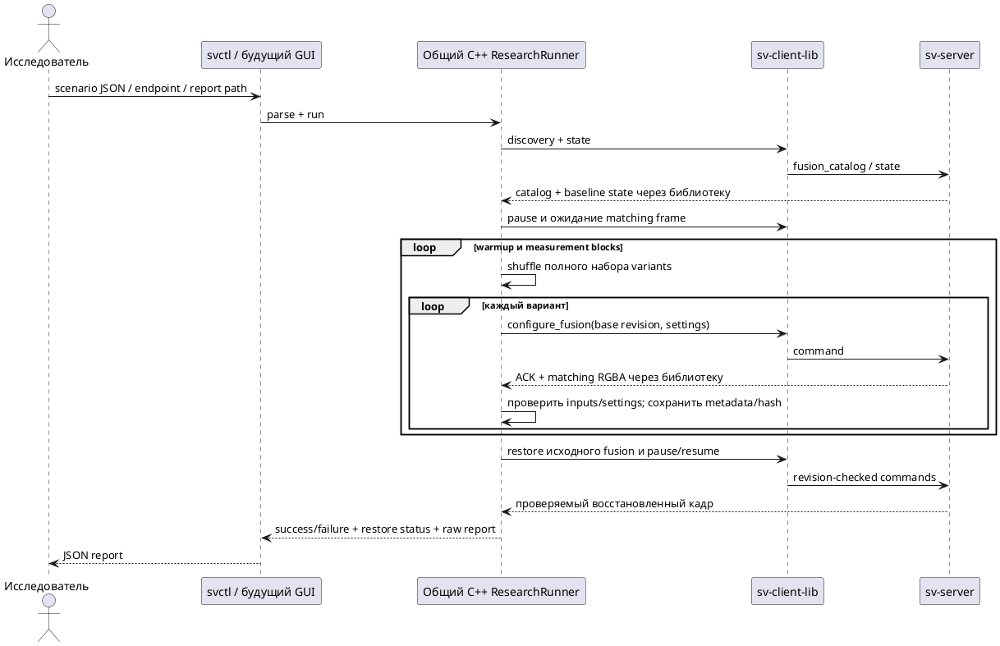

*Рисунок 3.20 — Сценарное управление существующими серверными алгоритмами. Независимая оценка качества и GUI пока не подключены.*

Отчёт содержит нормализованный сценарий и его SHA-256, исходное состояние, GPU/backend, revision и fingerprint серверных исходников, фактический порядок вариантов, метаданные и хеши кадров. p50/p95 вычисляются nearest-rank методом отдельно для каждого варианта, исключая warmup; raw samples сохраняются. На столь малой выборке квантили описательны и не дают доказательства устойчивого преимущества.

Принципиальное ограничение — warm-render одного набора: нет новых capture/decode/upload для каждого sample. Поэтому эти значения не превращаются в оценку sustained FPS и не смешиваются с live pipeline performance. Input IDs не заменяют content hashes независимого dataset. Сравнение качества требует отдельного evaluator с Blender/physical truth, заранее выбранных метрик и новых сцен.

Контрактные тесты проверяют схему и бюджет; Unix/TCP интеграция использует настоящие библиотеку и сервер, сверяет полные блоки, inputs, hashes и неизменность config file. Native GTest на живом endpoint проверяет cancel и исключение progress callback после первого кадра с успешным restore. Report отмечает restore failure клиента; ограниченный server lease/watchdog из §3.21 восстанавливает fusion/pause независимо от штатного cleanup клиента, пока server loop продолжает выполняться. Подробная приёмка: [[validation/RESEARCH_RUNTIME]].


## 3.21 Серверный lease и восстановление после потери исследовательского клиента

Клиентский cleanup недостаточен при аварии ноутбука, процесса или сети. Поэтому добавлен ограниченный lease `experiment_lease_v1`, принадлежащий control session. При acquire сервер фиксирует исходные fusion и pause; срок составляет 250..30000 ms по серверным монотонным часам. Renew продлевает тот же lease; старый или чужой ID не позволяет изменять состояние. Runner продлевает lease перед trial и cleanup, а client library предоставляет типизированные acquire/renew/release и передачу ID в mutations.

Пока lease активен, допускаются изменения fusion/surface и pause/resume владельцем; изменение view и calibration mutations блокируется. Расширение §3.31 допускает также owner step при capability experiment_step_v1, без восстановления replay cursor. Это ограничение удерживает область восстановления проверяемой и препятствует persistent сохранению временного fusion через apply_calibration. Общая транзакция всех параметров сервера ещё не реализована.

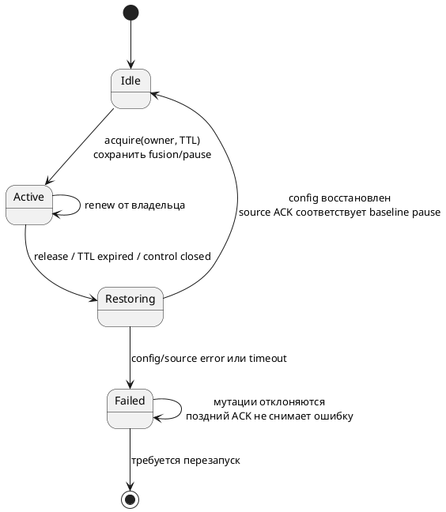

*Рисунок 3.21 — Реализованная машина состояний ограниченного эксперимента.*

Recovery выполняется на render thread между обработками кадров. Новый config snapshot возвращает fusion, затем при необходимости отправляется асинхронный source pause/resume. ACK release подтверждает лишь переход в restoring; клиент ждёт idle либо failed. Ошибка подготовки или source recovery сохраняется в status/trace, а мутации остаются заблокированными. Timeout recovery составляет 5 s при выполняющемся server loop; watchdog не прерывает зависший GPU/драйвер и не переживает аварию самого сервера. Истечение TTL использует серверные часы и не требует синхронизации с ноутбуком.

Native tests проверяют deadlines/ownership/conflicts, интеграционные — expiry, disconnect, running/paused baseline, неизменность файла и новый lease после восстановления. Они не доказывают восстановление при half-open сети раньше TTL, ограниченность зависших физических драйверов или hard realtime. Восстанавливаются настройки и pause/resume, но не playback cursor, временная история и прежний RGB после движения записи. Durable checkpoint клиентского отчёта также остаётся открытым. Контракт и проверки: [[engineering/PROTOCOL_IMPLEMENTED]], [[validation/RESEARCH_RUNTIME]].

## 3.22 Перенос исследуемых методов сшивки в сервер

Для сравнения на целевой платформе недостаточно offline Python-реализаций: их стоимость включает другую проекцию, дискретизацию и среду исполнения. В исследовательский сервер добавлены native реализации distance feather, binary graph-cut, multiband и graph-cut/multiband. Вместе с тремя прежними GPU-вариантами каталог содержит семь режимов. Выбор выполняется командой `configure_fusion` между обработками кадров; Python сервером не запускается. Универсальный ConfigService для этого среза не требуется.

Математическое основание многомасштабного слияния — Gaussian/Laplacian representation Burt–Adelson ([[references/VISION#S10|S10]]); выбор шва отделён от blending, как в пространстве вариантов [[references/VISION#S71|S71]]. Здесь используются собственные определения offline-эталона, а не вызов `cv::Stitcher`: известные fisheye intrinsics/extrinsics и геометрия носителя сохраняются. Выбор шва не исправляет параллакс, обусловленный неверной глубиной ([[references/VISION#S73|S73]]).

Пусть $C_{i,l}$ — Laplacian уровень linear RGB камеры $i$, а $W_{i,l}$ — Gaussian уровень её маски. Смешанный уровень определяется как

$$B_l(p)=\frac{\sum_i W_{i,l}(p)C_{i,l}(p)}{\sum_i W_{i,l}(p)},$$

при ненулевой сумме весов; иначе используется ноль. Восстановление выполняется от грубого уровня к точному: $R_l=B_l+\operatorname{upsample}(R_{l+1})$. Параметр pyramid_levels ограничен 1..8; фактическое число уровней ограничивается размером изображения. В multiband исходная маска определяется краевым feather; в graph-cut/multiband сначала рассчитывается бинарный шов, затем маска сглаживается Gaussian sigma=2, ограничивается validity и нормируется. Binary энергия приведена в §4.40. В 3–4-way overlap остаётся centrality fallback, глобальная многометочная оптимизация не заявляется.

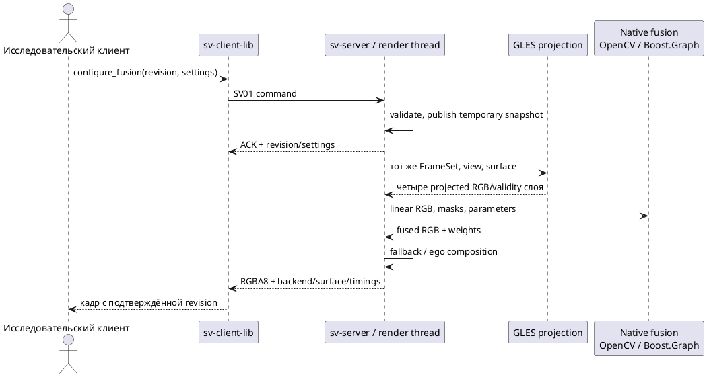

*Рисунок 3.22 — Реализованное переключение и выполнение четырёх дополнительных алгоритмов на сервере.*

Новые методы используют гибридный путь: GLES проецирует камеры в конечный viewport, CPU выполняет EDT/cut/pyramids и композицию. Слои RGB8 добавляют квантизацию относительно float offline-эталона; edge weights упакованы в alpha с шагом 1/254. Поэтому численное соответствие ядра отдельно от соответствия полного raster pipeline. Дополнительные readbacks являются частью измеряемой стоимости, а три локальных GPU-метода остаются прежним одним проходом. Для CPU backend введён предел 262144 выходных пикселя, предотвращающий неограниченный рост графа и пирамид.

Геометрия также меняется без перезапуска: `configure_surface` принимает plane/bowl, dome+floor, cylinder+floor или cube+floor. Сервер проверяет параметры и безопасность текущей view, готовит mesh/GPU buffers, затем публикует snapshot. Ошибка подготовки сохраняет активную конфигурацию. Камерные изображения повторно не загружаются; перестроение сетки учитывается отдельным счётчиком. Lease расширен до fusion/surface/pause; отсутствующая surface в варианте сценария означает исходный носитель, поэтому randomized порядок не переносит геометрию предыдущего варианта.

В отчёт включены backend, surface, mesh_triangles и CPU spans. Для гибридного пути gpu_draw равен null: прежний query измерял лишь базовый draw и не характеризует четыре дополнительных прохода. Render wall включает весь renderer, а layer_readback включает ожидание GPU. Такой контракт позволяет сравнивать реализации, сохраняя различие между качеством алгоритма, стоимостью его backend и накладными расходами вывода. Проверки и ограничения: [[validation/NATIVE_FUSION]].

## 3.23 Инспекция проекционных слоёв и конвенция ненаблюдаемых данных

Для проверки полного рендера добавлен явно запрашиваемый `RenderInspection`: actual projected linear RGB, validity/edge weights, базовый fallback RGBA и depth-tested ego overlay. Обычный сервер не запрашивает capture. Этот render-thread API не является сетевой подпиской и не добавляет Python-зависимость серверу. Проверочный executable использует тот же Renderer и позволяет независимо пересчитать fusion/композицию средствами NumPy/SciPy. При capture и без него изображение совпадает, входы повторно не загружаются.

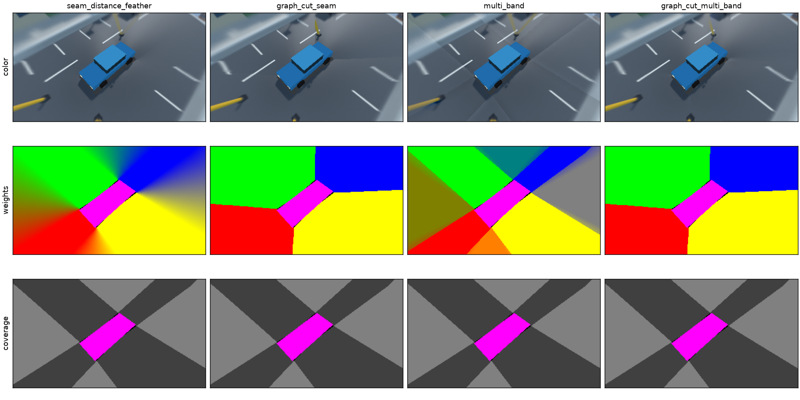

*Рисунок 3.23 — Фактические GLES/CPU изображения Blender-улицы: четыре native метода, строки color/weights/coverage, output 320×180, dome+floor. Это один replay frame и один ракурс, не сравнительная выборка качества. В weights graph-cut/multiband показана исходная cut mask до smoothing; она не описывает вклады всех частотных уровней. Рисунок сформирован `plot_native_fusion.py` из raw RGBA; config, source fingerprint и хэши сохранены рядом в JSON.*

Важное условие pyramid filtering — определение RGB за границей validity. Если сохранять там случайный либо clamped RGB, Gaussian/Laplacian уровни могут переносить ненаблюдаемые значения в наблюдаемую область. В версии validity_zero_extension_v2 используется $\widetilde I_i(p)=M_i(p)I_i(p)$ до построения цветовой пирамиды. Проверяется инвариант: изменение $I_i$ при $M_i=0$ не меняет результат. Нулевое продолжение определяет поведение метода, но не восстанавливает скрытые поверхности; оно само может давать тёмные полосы, видимые на иллюстрации multiband. Другие способы продолжения и нормированная свёртка требуют отдельного сравнения.

Проверка готового изображения разделена на три уровня: композиция из actual layers, независимая analytic plane sampling и доставка того же RGBA через настоящий SV01 сервер (§4.42). Shared fallback/ego passes не считаются независимой истиной геометрии автомобиля. Это позволяет локализовать ошибки алгоритма, координат/квантизации и транспорта, не приписывая регрессионному тесту значение физического эксперимента.

## 3.24 Настройка серверного алгоритма из компилируемого клиента

Серверные реализации должны быть доступны любому клиенту через общую библиотеку. Поэтому GUI симулятора расширен адаптером `RuntimeSettings` на C++, а не вызовом Python configurator. Адаптер получает снимок fusion/surface и каталоги ограничений; пользователь редактирует полный объект и отправляет его с ревизией загруженного снимка. Вычисления и проверка физической допустимости поверхности остаются в сервере. Поля fusion преобразуются в типизированный `FusionSettings`; дробное число уровней пирамиды отклоняется без неявного усечения.

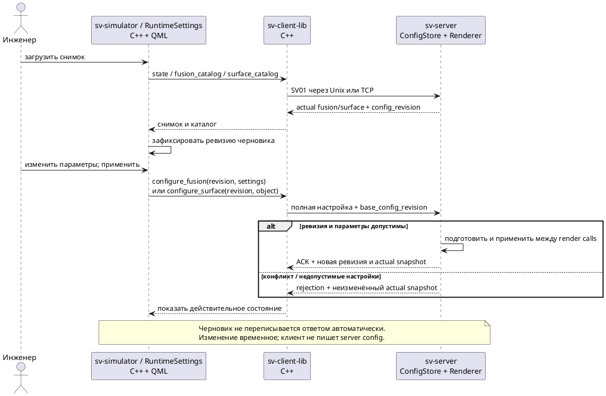

*Рисунок 3.24 — Реализованный путь редактирования fusion/surface через библиотеку. Сервер остаётся владельцем алгоритмов и конфигурации; Python не участвует в пользовательской операции.*

Ревизия защищает от потери промежуточной правки: повторное применение старого черновика отвергается, даже если интерфейс уже получил более новый actual state. При переподключении черновики очищаются. Это узкий runtime API; общий ConfigService, GUI сценариев и безопасная отдельная операция постоянного сохранения ещё требуют разработки. Протокол существующего persistent apply_calibration сохраняет весь активный snapshot, поэтому временные настройки нужно восстановить до его вызова вне lease.

Проверка включает настоящий сервер на Unix/TCP, применение, отрицательные ответы и восстановление через C++ GTest; harness проверяет неизменность файла конфигурации. Такая проверка подтверждает доступность управления и ownership, но не превосходство алгоритма, интерактивную эргономику или готовность Авроры. Независимые Python эталоны и скрипты рисунков сохраняются как исследовательские средства, отдельно от продукта: [[validation/RESEARCH_RUNTIME]].

При локальном отказе очереди библиотека выдаёт отдельный Error с command_id; ожидание ACK должно завершаться и по этому пути. Адаптер сопоставляет ID, снимает pending и показывает неподтверждённый исход, сохраняя отсутствие автоматического повторения. При потере сессии нельзя заключить из транспортной ошибки, что сервер не применил запрос. В Qt клиентах frame budget отделён от доставки ACK/lifecycle, а отброшенные кадры освобождаются. Реальный локальный отказ библиотеки покрыт отдельным C++ тестом; длительный overload GUI остаётся самостоятельной проверкой: [[validation/RESEARCH_RUNTIME]].

Отдельная ошибка обнаружена в конкуренции command/release submission: общий счётчик позволял потоку команд занять всю ёмкость и отказать освобождению уже полученного кадра. В библиотеке введены два независимых ограниченных бюджета, каждый размера command_capacity; ограничение data write queue сохраняется. Это изоляция ёмкости, а не гарантия приоритета или deadline. TCP mock с capacity=1 воспроизвёл дефект до исправления и проверил доставку RELEASE после исправления. При смене сессии GUI очищает прежнее изображение и метрики; симулятор также сбрасывает implicit calibration job. Поздний QML image-ready старого кадра не должен создавать событие present новой сессии. Проверки не заменяют длительный two-host overload: [[validation/RESEARCH_RUNTIME]].

## 3.25 Время жизни изображения при смене сессии

Идентификатор frame_id имеет смысл внутри сессии. Новый сервер или переподключение может снова выдать кадр с номером 1; поэтому Qt image URL включает percent-encoded session_id и frame_id. При потере сессии очищаются URL, изображение provider, информация об источнике и timings. Запоздалое image-ready сравнивается с текущим полным URL и не подтверждает показ изображения другой сессии, даже при совпадении frame_id.

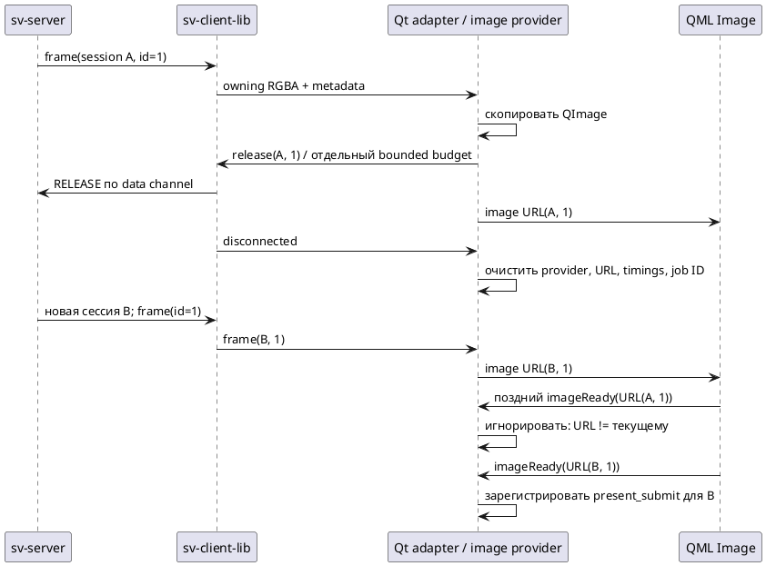

*Рисунок 3.25 — Разделение освобождения серверного кадра и показа клиентской копии, защита от запоздалого callback прежней сессии. Diagram описывает реализованный Qt adapter; физический момент вывода панели не измеряется.*

Симулятор дополнительно сбрасывает неявно выбранную calibration job: владение задачей связано с серверной сессией, а одинаковый текстовый ID на другом сервере не означает ту же задачу. Новые endpoint и timeout проверяются до остановки прежнего клиента. Эти свойства проверяются на событийной границе GUI; wire path проверяется отдельно: [[validation/RESEARCH_RUNTIME]].

### 3.26. Завершение команды и ошибки обработки ответа

Подтверждение команды нельзя считать завершённым, пока не проверены обязательные поля ACK. Иначе повреждённое поле `accepted` после удаления записи pending оставляет потребителя без результата и без уведомления о неопределённом исходе. Реализация сначала проверяет идентификатор, boolean `accepted` и строковый `reason` при отказе, затем удаляет pending и передаёт ACK. При ошибке протокола сессия закрывается, а ожидающая команда получает `session_lost`. Это не доказательство того, что сервер не выполнил изменение: автоматическое повторение мутации запрещено политикой клиента.

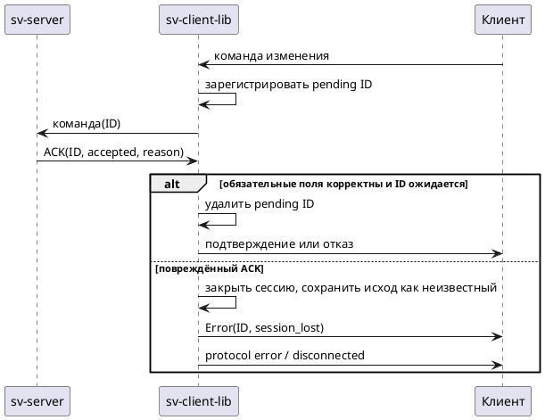

*Рисунок 3.26 — Проверка ACK перед завершением команды; повреждённый ответ не подтверждает и не отменяет серверное изменение.*

Дополнительная граница ошибок реализована на GUI-потоке: прикладные поля кадра и диагностики могут быть некорректны даже при допустимом транспортном конверте. Исключение закрывает соединение и очищает изображение, метрики и частичный snapshot. Симулятор инвалидирует отложенные callbacks и позволяет подключиться явно; автомобильный пример блокирует последующие события и требует перезапуска. Полная автоматическая реконструкция GUI после такой ошибки не реализована. Числа JSON допускают целую и дробную запись: нулевой GPU timing должен отображаться как измерение, а не отсутствие timer. Native mock проверяет повреждённые ACK; C++ GTest проверяет оба Qt-адаптера на событийной границе. Эти проверки не заменяют испытаний на физическом экране и Авроре: [[validation/RESEARCH_RUNTIME]].


### 3.27. Переключаемая поддержка границ pyramid fusion

В native C++ fusion добавлен `pyramid_boundary=zero|normalized`. Default zero сохраняет прежние результаты; normalized отдельно фильтрует цветовую массу и поддержку, затем делит их на каждом уменьшенном уровне. Laplacian reconstruction и fusion weights сохранены. Начальная validity остаётся критерием наблюдаемости; нормализованный вариант не создаёт новых измерений камеры.

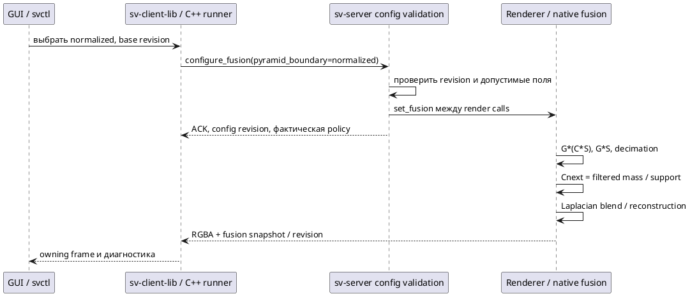

*Рисунок 3.27 — Управление исследовательским вариантом через серверный протокол. Файл конфигурации клиент не изменяет; настройка temporary. GPU projection и CPU fusion остаются прежними стадиями гибридного backend.*

Каталог версии 3 сообщает варианты и identifier `normalized_support_v1`. Типизированная библиотека опускает default zero при отправке, сохраняя прежний формат запроса; normalized требует поддержки каталога. GUI принимает шесть базовых полей и optional policy, C++ scenario runner сохраняет её в manifest опыта. Проверки численных свойств, actual RGBA и wire, включая ограничения constant-field controls, приведены в [[validation/PYRAMID_BOUNDARY]].

### 3.28. Сценарный контракт и порядок команд библиотеки

Для воспроизводимого управления сервером составлен каталог всех 18 реализованных команд и 11 сценариев: [[engineering/PROTOCOL_SCENARIOS]]. Пять PlantUML диаграмм фиксируют подключение двух каналов, revision-aware настройку, lease/recovery, frame/release и жизненный цикл библиотеки. Каталог отделяет принятый запрос, фактическое завершение операции и получение кадра: эти события нельзя считать взаимозаменяемыми. Потеря ACK оставляет исход мутации неизвестным; автоматического повторения pending команд нет.

Проверка сценария конкурентной отправки выявила ошибку: atomic выдача command ID не гарантировала порядок последующего post в worker. При восьми отправителях сервер мог получить `3,4,5,1,2` и отвергнуть команды 1 и 2, хотя приложение не повторяло их. Выдача ID, предварительная encode validation и post теперь выполняются под одним mutex; обработчик сети и release сохраняют отдельные пути. Проверка production библиотеки через TCP mock получает 256 возрастающих IDs и accepted ACK. Полная регрессия после исправления — 49/49 наборов; результаты и пределы проверки: [[validation/CLIENT_SMOKE]]. Это обеспечение порядка внутри одного Client, а не реализация нескольких независимых сессий сервера.

### 3.29. Разделение геометрических чисел и индексов камер

Серверный parser должен отличать вещественные измерения от дискретных идентификаторов. Для геометрии записи JSON `0` и `0.0` имеют одинаковый смысл: XYZ/UV и параметры виртуальной камеры принимают конечные int64/uint64/double с преобразованием в double. Bool, строки и коллекции числами не считаются. Для camera_id допускается только целочисленный тип и диапазон 0..3; проверка выполняется до преобразования в int. Идентификаторы/revisions в decimal strings сохраняют отдельный точный uint64 parser.

Ранее XYZ/UV читались через as_double, а camera_id сужался до проверки диапазона. На Linux native regression запросы 4294967296 и 4294967297 создали jobs для камер 0 и 1. Этот дефект мог направить вычисление калибровки другой камере; отдельная команда применения ещё требовалась, но ошибочное задание уже принималось. Новый helper `src/apps/command_parameters.hpp` устраняет обе неоднозначности до выделения job ID.

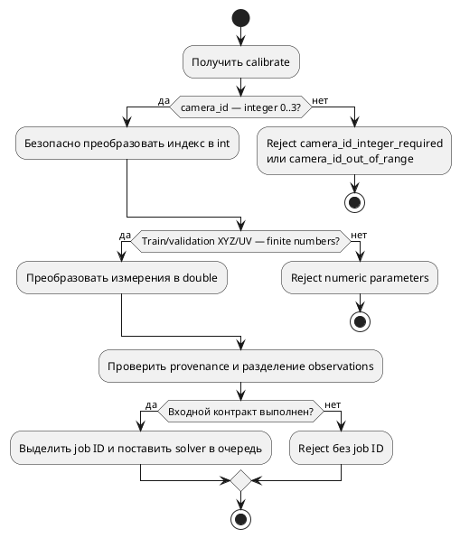

*Рисунок 3.29 — Предварительная проверка калибровочного запроса. Проверка индекса предшествует сужению, validation входов — постановке задания.*

GTest проверяет типы, границы и nonfinite values. Настоящий сервер отклоняет восемь некорректных camera IDs и четыре нечисловых входа без изменения config/state revisions; численно эквивалентные double и mixed integer/double запросы завершаются с совпадающими метриками до девяти десятичных знаков. Полная регрессия после исправления — 50/50, 11.10.2026. Это проверка корректности входного API, не новое подтверждение точности метода калибровки: [[validation/CALIBRATION_PROVENANCE]].

### 3.30. Проверка frame release на двух границах

Выходной кадр удерживает ограниченный серверный слот до release или закрытия data connection. Поэтому ошибки сообщения освобождения должны обрабатываться явно. В библиотеке размер metadata проверяется синхронно до post и до расходования release budget. Это предотвращает ситуацию, когда слишком большой token впервые вызывает исключение encode внутри network worker. Типы полей проверяются в том же вызывающем потоке; правильный release сохраняет независимую от command submission очередь.

На серверной границе type 22 обязан иметь пустой binary payload. Раньше достаточно было совпадения session/frame/token, даже при лишнем бинарном теле: native-server integration test получил следующий кадр. Теперь такой пакет закрывает data connection без ACK; слот возвращается при cleanup, а control ещё способен отвечать на state. Штатная библиотека при data EOF завершает свои оба канала и следует reconnect policy. Два GTest cases проверяют release до ready и при насыщении command queue; integration проверяет malformed packet и продолжение control. Результаты и границы проверки: [[validation/CLIENT_SMOKE]].

### 3.31. Последовательный native ExperimentRunner

Для парного исследования серверных алгоритмов общий C++ application service расширен до последовательности replay frame sets. Декларативный сценарий задаёт frames, варианты, warmup/repeats/seed и native RGBA capture; библиотека передаёт только команды и кадры. Python не участвует в исполнении сценария или product fusion. Сервер объявляет `experiment_step_v1` только для replay и разрешает step владельцу действующего lease. Настройки меняет сервер с проверкой revision.

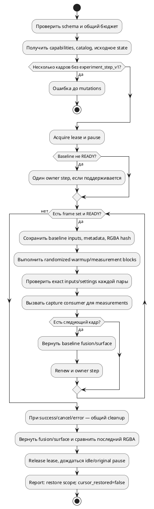

*Рисунок 3.31 — Жизненный цикл многокадрового native опыта. Исключение capture/progress или отмена выходят в общий cleanup; стрелки основного пути не обещают восстановления cursor/history.*

CLI создаёт отдельную свежую папку raw RGBA и сохраняет ссылки/hashes в samples. Report включает per-frame baseline и summaries; старый однофреймовый сценарий работает с defaults. Между кадрами исходная fusion/surface возвращаются перед step, поэтому следующий baseline не зависит от последнего случайного варианта. Watchdog защищает настройки, но lease не хранит replay cursor/history: состояние после опыта не тождественно состоянию до него по всем параметрам. Tests проверяют Unix/TCP, hash capture, отмену после перехода, исключение consumer и stale NO_INPUT preparation. Контракт и проверки: [[engineering/PROTOCOL_SCENARIOS]], [[validation/RESEARCH_RUNTIME]]; полученные исследовательские результаты — §4.45.

### 3.32. Многометочная сшивка как серверный вариант

Ограничение exactly-two-camera cut устранено для нового optional кандидата: fusion.seam_solver=alpha_expansion строит weighted Potts energy на общей observed области, включая single-camera anchors и 3/4-camera overlaps. Прежний binary_pairs сохранён по умолчанию для воспроизводимости. Solver не запускается в клиенте; configure проходит общие revision/lease/config validation. Catalogv4 перечисляет варианты и sweep limit. Native optimizer отделён от построения image graph: `seam_optimizer.cpp` работает с integer unary/edges, `multilabel.cpp` преобразует validity/colors/distances в эту задачу.

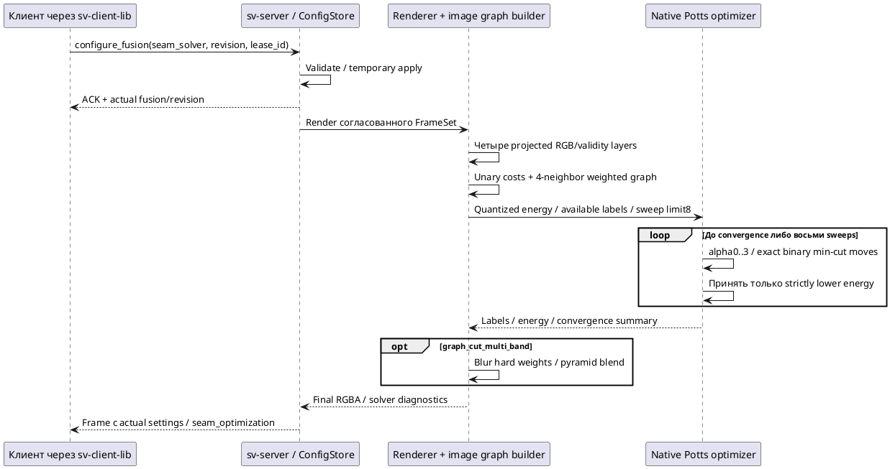

*Рисунок 3.32 — Место нового solver в серверном pipeline. Convergence относится к hard labels, последующие image blend stages не минимизируют эту energy.*

Публичные logical structs содержат unary/edge graph, результат и компактную summary; graph algorithm не зависит от Qt. Hard constraints исключают invalid camera labels. Все capacities int64, min-cut reduction использует удвоенную energy без половинного округления. До max-flow проверяется общий capacity bound, включая повторные forbidden costs; это закрывает overflow, который нельзя обнаружить проверкой одного edge. Флаги/energy передаются через renderer в metadata, сбрасываются на новом кадре и не остаются после возврата к legacy mode.

Typed FusionSettings, scenario parser, simulator adapter и native CLI сохраняют optional solver. Полная Linux suite51/51; отдельные tests сравнивают exact moves с exhaustive oracle, сохраняют global gap и проверяют unavailable labels/anchors. Формулы и отрицательные результаты: [[validation/MULTILABEL_SEAM]], §4.46. Friendly GUI selector теперь реализован (§3.26); independent quality qualification остаётся открытой.


## 3.26 Управление конфигурацией и неопределённый результат команды

На 14.10.2026 ConfigService позволяет читать согласованные active/persisted snapshots, получать
каталог fusion/surface, проверять replacement groups и атомарно применять их с explicit persistence.
Server prepare→revision recheck→optional atomic rename→noexcept publication сохраняет прежний renderer
при отказе подготовки или записи. Persist=true сохраняет весь active snapshot; crash durability/fsync
и persistent operation journal этим прототипом не обеспечиваются.

Ноутбучный sv-simulator предоставляет формы алгоритмов и геометрии с server catalog, отдельными
validation/runtime/save actions и вкладкой результата операции. Редактор не открывает config file;
все запросы проходят через sv-client-lib. Видимые поля разделены по группам, обычная работа не
требует ручного JSON. При смене типа геометрии создаётся новый draft; optional support/occlusion
поля сохраняются только при правках текущего типа, их отдельные формы теперь доступны во вложенных вкладках «Опора» и «Видимость» (§3.27).

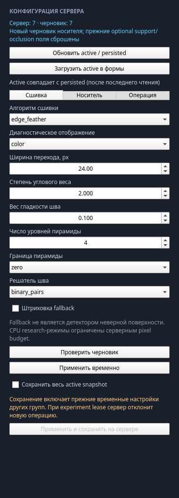

Рисунок 3.33 — Панель ConfigService с параметрами сшивки и подтверждением полного сохранения.
Иллюстрация получена QML regression с контрактным fixture, а не с аппаратной платформы Аврора.

При потере ACK клиент не может заключить, была ли выполнена команда. Для управления этой
неопределённостью сервер поддерживает process-scoped apply-once/status: GUI хранит instance,
operation ID, base revision, immutable groups и persistence policy до отправки. Same-ID replay
возвращает retained result, другой intent отклоняется. Журнал ограничен128 записями без eviction;
после restart instance меняется, старый запрос нельзя автоматически выполнить в новом процессе.
GUI intent сохраняется только в памяти текущего приложения.

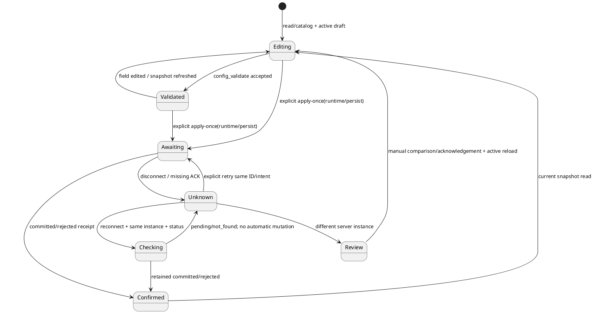

Рисунок 3.34 — Состояния GUI при отправке конфигурации и восстановлении после потери ACK.
Validation не резервирует revision; сервер повторно проверяет настройки при apply. Новый edit/apply
блокируется при unresolved outcome. Схема отделяет повторное получение результата от нового intent.

Проверена полная Linux сборка; selected CTest5/5 за29.91s включает model/reconnect guards,
Unix/TCP validate→apply→restore, native persistent editor workflow с проверкой файла и QML smoke
без binding warnings. Это подтверждает реализованный программный сценарий, но не заменяет
измерения на целевом устройстве, длительный overload или независимое исследование качества сшивки.
Server ConfigService/wire контракты и ограничения: [[engineering/CONFIG_SERVICE]],
[[engineering/CONFIG_OPERATIONS]]. Следующий диагностический этап — отключаемая devel telemetry
через библиотеку с bounded samples, графиками подсистем и отдельным измерением overhead; он пока
остаётся планом, а текущие frame timings не равны такому полному profiler.


## 3.27 Формы управляемых предположений об опоре и видимости

В ноутбучный клиент добавлены формы reference height, локального support patch и заданного opaque
AABB. Его mode, guard texels, support tolerance/facing и central-ray uncertainty доступны через
catalog-driven controls. Изменения идут через прежние validate/apply-once серверного ConfigService;
геометрическая проверка, принятие параметров и рендеринг остаются в sv-server.

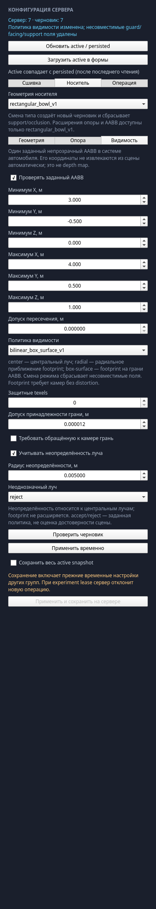

Рисунок 3.35 — Ввод AABB/box-surface/uncertainty через формы. Native QML fixture показывает интерфейс,
а не эмпирически найденную оптимальную настройку или результат на Авроре.

Выключение optional объекта означает omission в полном surface replacement; остальные группы
не меняются. Box-surface→radial/center удаляет запрещённые support/facing поля, center также убирает
guard. Заданные bounds/tolerances не считаются измеренной scene geometry, reference height не
оценивает глубину, accept/reject uncertainty не доказывает правильность correspondence. Эти границы
сохраняют корректное различие между управлением экспериментом и выводами самого исследования.

Проверены4 новых native model cases, real Unix/TCP enable→validate→apply→disable/restore всех3
visibility modes и отрицательный ordered-AABB case без изменения active revision. QML tests
вызывают реальные сигналы форм, сохраняют micro-scale values и проверяют framework warnings.
Selected CTest5/5 за29.86s; полный61-test прогон в этом шаге не повторялся.

Отдельно исправлена загрузка DriveWorld (FINAL left/right), scale builtin primitives, согласование
radian heading/degrees Euler, focus reset и Esc. Driving smoke теперь проверяет lazy Loader; host
OpenGL/Mesa проверка завершилась без сообщений. Preview остаётся визуальным инструментом с
placeholder автомобилем; физическая модель, синхронный camera producer и target performance
этим исправлением не подтверждены. Контракты/команды и первичная Qt ссылка:
[[engineering/CONFIG_SERVICE#Исправления QML и driving preview]].

## 3.28. Отключаемая телеметрия как инструмент дальнейшей проверки

Для измерения узких мест введён отдельный C++ TelemetryCollector и typed reader в sv-client-lib.
Сбор default off и принадлежит серверу; клиент не включает его одним запросом чтения. Hot изменения
settings проходят тот же ConfigService transaction, что и настройки алгоритмов. История выделяется
до сохранения config; неудачный persist не оставляет включённого sampler. После изменения настроек
новый epoch отделяет серии, restart меняет server instance. Это позволяет не соединять наблюдения
из разных экспериментальных условий автоматически.

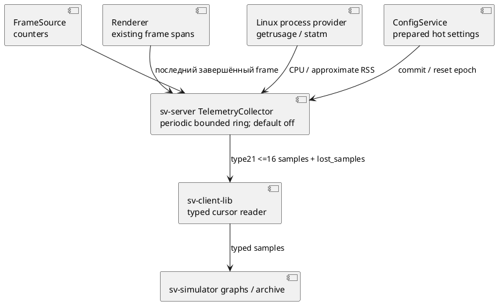

Рисунок 3.36 — Реализованный путь devel telemetry и планируемый потребитель графиков.

| Задача диагностики | Реализованная информация | Что пока нельзя заключить |
|---|---|---|
| Нагрузка процесса | CPU delta, approximate current RSS | Нет распределения по threads/подсистемам, GPU utilisation |
| Длительность кадра | Перекрывающиеся существующие stage wall spans и nullable GPU draw | Сумма spans не является полным latency; hybrid GPU total отсутствует |
| Застой вывода | data_ready/busy, samples продолжаются на paused/busy | Не измерена отдельная длительность send/encode |
| Смена режима | Sample/frame config revision, instance/epoch | Нет experiment markers/автоматической причинной атрибуции |
| Медленный reader | Bounded ring, next cursor, lost_samples | Lost samples не равны числу пропущенных frames |

Периодический sample хранит последний frame с признаком fresh. При pause повторный frame не
является новым render; его input age нельзя выдавать за время вычисления. Sampling выполняется
в render loop, поэтому длительный вызов образует временной gap, а не достоверный ряд значений
внутри заблокированного участка. CPU100% соответствует одному logical CPU и может превышаться
многопоточным процессом. RSS statm приближённый; первичные определения и формулы приведены
в [[engineering/TELEMETRY#Метрики и границы интерпретации]].

Проверены disable/provider calls, периодичность, fresh/repeated frame, counter reset, bounded
ring loss/pagination, foreign instance/epoch/cursor rejection, strict settings и malformed replies.
Live Linux tests проверяют hot apply-once/replay, pause/backpressure, lease, persistent restart,
rollback при disk error и typed Unix/TCP consumption. Это проверка корректности инструмента,
а не опыт, доказывающий ускорение алгоритма. Измерение overhead disabled/minimal/detailed,
полная инструментализация подсистем, GUI графики и target Aurora validation остаются необходимыми.

## 3.29. Управление сбором и наблюдение telemetry в GUI

В ноутбучный sv-simulator добавлена вкладка server settings (enabled/period/history) и отдельная
панель чтения. Настройки проходят server catalog/validation/apply-once; графики используют только
typed reader sv-client-lib. Чтение выключено по умолчанию и не включает collection автоматически.
Оператор различает серверную инструментализацию и её клиентское отображение; остановка reader
оставляет серверный sampler в прежнем состоянии.

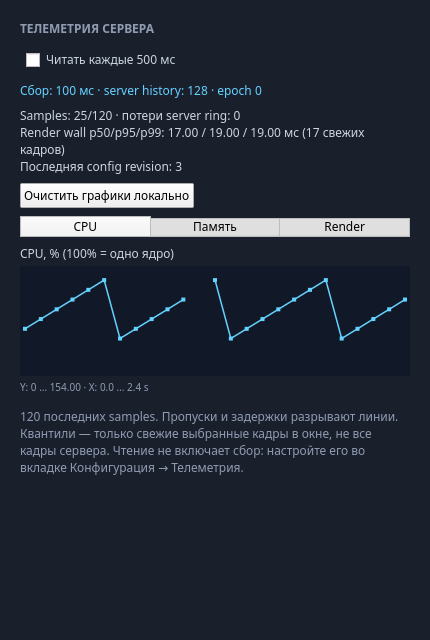

Рисунок 3.37 — CPU graph и вкладки RAM/render. Контролируемый QML fixture проверяет окно/пропуски;
значения на рисунке не являются результатами сравнительного performance experiment.

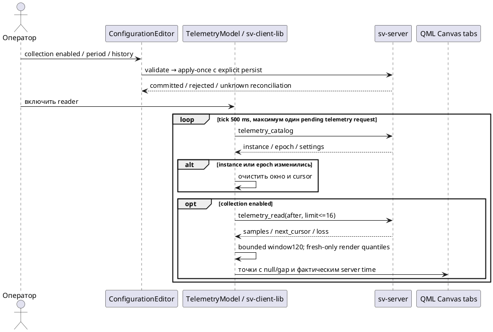

Рисунок 3.38 — Последовательность управления collection и отдельного bounded reader.

CPU и RSS представлены самостоятельными series; render wall рисуется только для fresh records.
Метод nearest rank определяет p50/p95/p99 в локальном окне выбранных кадров. Это descriptive
статистика sampled records, не оценка всех кадров pipeline и не доказательство причин торможения.
Gap после потери samples, недоступной metric или длительной задержки не заполняется интерполяцией.
Последняя config revision позволяет начать сопоставление режимов; timeline experiment markers и
автоматическая причинная атрибуция ещё не реализованы. Окно очищается при disconnect/смене серии,
поэтому данные разных серверов не смешиваются. Подробный контракт: [[engineering/TELEMETRY]].

Проверки охватывают known-answer quantiles, bounded window, repeated frame omission, loss/gaps,
серии/clock guards, unrelated ACK и transport failure. Native GUI adapter включает/читает/
восстанавливает settings через реальные Unix/TCP подключения; QML tests переключают вкладки
и формы без framework warnings. Требуются дальнейшие subsystem spans, export/replay и одинаковый
replay для измерения overhead; проверка целевой Aurora platform остаётся отдельным этапом.

## 3.30. Воспроизводимый просмотр сохранённого telemetry window

В sv-client-lib введён Qt-free C++ archive codec, в sv-simulator — save/open window через file chooser.
Полные typed records сохраняются вместе с instance/epoch, units, sampling settings, cursor/loss и
первоначальным временным origin. uint64 остаются decimal strings; повторные кадры и null metrics
не превращаются в нули. Это обеспечивает одинаковые графики/квантили после offline import.


Рисунок 3.39 — Статический offline view сохранённого окна. Изображение получено QML regression
с контролируемыми значениями; оно демонстрирует интерфейс, а не сравнение аппаратных платформ.

| Свойство | Реализованная проверка | Граница |
|---|---|---|
| Точность metadata | uint64 max и null round-trip | Clock разных hosts нельзя вычитать напрямую |
| Порядок серии | Instance/epoch в catalog, cursor/time order, original origin | Полного server config/host fingerprint в файле нет |
| Потери | Cumulative loss и внутренние cursor holes | UI eviction не равен server loss; прежние потери не доказываются retained window |
| Ограниченность |120 records,2MiB reader limit | Нет streaming rotation/полного trace |
| Целостность GUI | Candidate до замены окна, неверный файл сохраняет прежние графики | JSON schema не доказывает подлинность файла |
| Сохранение | QSaveFile temporary write/commit без direct fallback | Power-loss acceptance не проводилась |

Импорт доступен только после остановки reader и отключения attached Client. Подключение к серверу
очищает offline series; импорт не исполняет сетевых команд и не изменяет server config. Формат/API,
sequence diagram, первичные Qt ссылки и процедура запуска: [[engineering/TELEMETRY_ARCHIVE]].

GTest и real Unix/TCP проверки связывают цепочку live settings → samples → archive → offline model.
Проверяются совпадение points/quantiles, bounded truncated window, прежний origin, local clear,
invalid-file rollback и failed save. Следующий этап — host/config/build provenance, streaming trace,
scenario markers и paired platform reports; текущий snapshot не заменяет эти требования и не
является новым сравнительным исследованием производительности.

## 3.31. Разделение этапных измерений, очередей и давности результата

Для диагностики существующие telemetry fields подключены к отдельным metric selectors в GUI.
Fresh-only stage records формируют distributions CPU wall и nullable GPU query; source/delivery
gauges обновляются независимо от нового render. Это расширение наблюдаемости существующих данных,
а не добавление ещё одного алгоритма сшивки или нового фонового profiler.

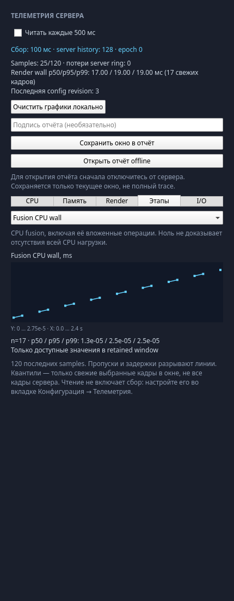

Рисунок 3.40 — Выбор метрики с пояснением и quantiles. Малые duration values заданы QML fixture;
кривая показывает корректность масштаба и переключения, не hardware performance.

| Диагностический вопрос | Доступное наблюдение | Ограничение вывода |
|---|---|---|
| Как меняется fusion wall? | Fresh fusion_cpu и sampled p50/p95/p99 | Нет отдельных seam/pyramid timers, интервалы вложенные |
| Растёт ли backlog источника? | Source queue gauge и точные counters | Backend units различаются; main-loop sampler не видит все peaks |
| Почему нет новых render metrics? | paused/data_busy/data_ready и возраст последнего record | Нельзя считать record age временем исполнения render |
| Есть ли пригодный GPU timer? | Fresh nullable gpu_draw | Нет GPU utilisation/memory/полного hybrid execution measurement |
| Сохранились ли маленькие duration? | Adaptive Y scale и archive precise parser≥1.83 | Legacy/wire/config numeric policies требуют отдельной проверки |

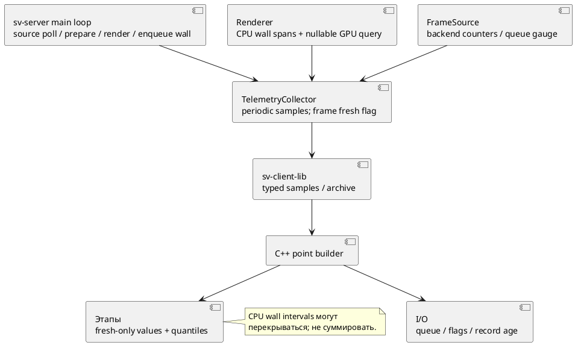

Рисунок 3.41 — Один набор typed records формирует два различных представления наблюдаемости.

Render record age вычисляется как sample timestamp минус timestamp последнего завершённого
render. Он остаётся определённым для repeated frame и растёт при paused/backpressured выводе.
Input age at render, напротив, относится к выбранным входам прежнего render и не является текущей
сетевой или вычислительной latency. Backend-specific meanings и формулы сверены с реализацией:
[[engineering/TELEMETRY#Pipeline и source/delivery графики]]. Доступные нулевые counters не доказывают
отсутствия операций: socket decoded и camera rejected отдельно не инструментированы.

QML regression переключает5 tabs,10 stage choices и6 I/O choices, проверяет repaint и ненулевой
масштаб малых duration. Native tests проверяют fresh-only selection, nullable GPU, repeated-frame
record age, точный uint64 text и подавление queue conversion>2^53. Archive equality и real Unix/TCP
adapter tests проверяют тот же point builder после offline import. Найденный drift дробных archive
values исправлен только в local archive parser для Boost≥1.83 и проверен repeated save/load;
общая конфигурационная/wire precision и performance overhead остаются отдельными задачами.

## 3.32. Измерения работы источников и защита от смешивания серий

В существующие camera/replay workers добавлены отключаемые timing boundaries. Camera read wall
охватывает вызов OpenCV, RGB preparation — conversion/copy; replay load охватывает ImageLoader,
а cache hit обозначает skipped load. OpenCV read объединяет получение/декодирование кадра, поэтому
эти данные нельзя назвать раздельными hardware acquisition/decode measurements. Первичная API
ссылка и точные границы: [[engineering/SOURCE_TIMING]].

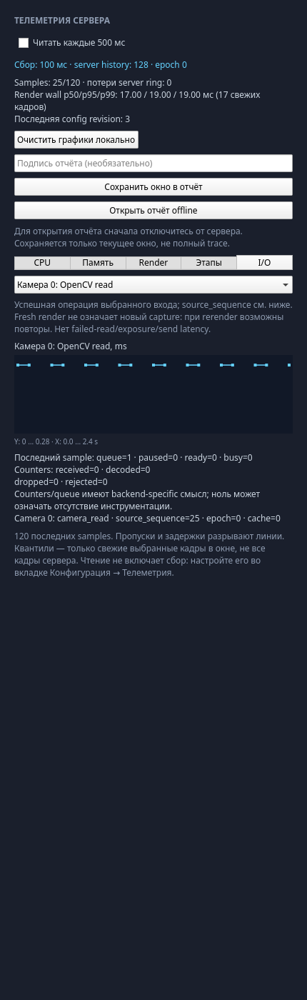

Рисунок 3.42 — Per-camera input-operation graph с source_sequence/epoch/cache provenance. Показаны
контролируемые значения QML fixture, не физические измерения или ranking hardware.

Prepared config transaction выделяет immutable session заранее; workers получают atomic snapshots.
Если read начался до commit и завершился после него, его metadata сохраняет старую session.
Collector сопоставляет session pointer/epoch/camera/sequence с выбранным Frame и исключает старый
timing, продолжая использовать само корректное изображение. Это предотвращает приписывание
раньше начатой операции новой серии. Disabled запрещает начало дополнительных timing measurements;
in-flight work может закончиться, но не входит в новую историю. Постоянные pointer checks/поля и
существующие frame clocks остаются, поэтому overhead нельзя объявлять нулевым.

| Проверяемое свойство | Программная проверка | Что ещё требуется |
|---|---|---|
| Настоящий processing path | BGR/GRAY/BGRA→RGB через OpenCV и fake capture driver | Физический V4L2 capture |
| Load/cache distinction | Real PNG OpenCV loader и repeated-path cache controls | Cold/warm filesystem scenarios на target |
| Epoch lifecycle | Blocking read через commit, old-input rejection, hot replay pause/step | Hardware reconnect/blocking read acceptance |
| Delivery bounds |32KiB pagination, SDK clock/kind/IDs/duration guards | Независимый worker event channel/byte budgets |
| Reproducibility | Optional source_work archive round-trip, live Linux Unix/TCP tests | Полный experiment provenance и platform comparison |

Source timings в samples относятся к inputs последнего render, а не ко всем worker operations.
Fresh render может повторно выбрать прежнее изображение и его timing. GUI поэтому не строит
capture-rate/quantile claims из этого набора; source identity доступна для последующего dedup.
Failed/dropped/unselected operations не представлены. Current implementation полезна для выявления
нагрузки на успешном source path, но не доказывает worst-case device latency. Общая sequence diagram,
контракт и границы приёмки: [[engineering/SOURCE_TIMING]]. Отдельные sync/calibration/seam/send
spans, уровни/budgets и controlled overhead comparison остаются следующими инженерными этапами.

Дополнительно устранена ошибка layout camera input: CV_16U и другие неподдерживаемые depths
не выдаются за RGB8 после cvtColor. Кадр отклоняется с source status/drop до публикации, а fake
16-bit capture test проверяет отсутствие такого Frame. Это программная validation guarantee,
не свидетельство поддержки конкретного набора физических camera formats.

Граница camera read в миллисекундах определяется из серверного monotonic clock:

$$
\Delta t_{\mathrm{read}} = (t_{\mathrm{read,end}} - t_{\mathrm{read,start}}) / 10^6.
$$

Аналогично вычисляется preparation wall. Это host interval операции OpenCV, а не измерение
времени экспозиции. Ключ series/input provenance необходим для интерпретации даже при совпадении
числовой duration в двух соседних samples. Финальные проверки и ограничения зафиксированы в
[[engineering/SOURCE_TIMING#Проверка и следующий шаг]].


### 3.33. Изоляция ошибок аппаратных камер

Вызов захвата выполняется в отдельном потоке каждой камеры. Исключение OpenCV, вышедшее
из функции потока, представляет риск аварийного завершения всего серверного процесса.
Поэтому обработчик `cv::Exception` располагается внутри цикла камеры и охватывает открытие,
чтение и подготовку изображения. При recoverable ошибке capture закрывается, выполняется
прерываемая задержка и повторное открытие. Ни неполный кадр, ни измерения успешной операции
для этого отказа не публикуются. Порядковый номер следующего подготовленного кадра не сбрасывается.

Если само закрытие завершается исключением, состояние backend считается неизвестным:
worker прекращает работу и сообщает диагностический статус. Другие камеры продолжают захват.
Это ограниченная политика восстановления, а не гарантия сохранения полного кругового обзора:
при потере камеры дальнейшее поведение определяется существующими правилами синхронизации
и отсутствующих входов. Перезапуск отдельного capture worker ещё не реализован.

Программные испытания используют подставной драйвер за тем же интерфейсом, что и OpenCV.
Проверяются ошибки open/read, false/empty read, последующее RGB-изображение, ошибки release
и независимость соседнего потока. Схема процесса и границы подтверждения приведены на рисунке
И.3 в [[engineering/SOURCES#Восстановление camera worker после ошибки OpenCV]]. Прерываемое
ожидание retry улучшает завершение между вызовами backend; оно не ограничивает время зависшего
`VideoCapture::read`. Такое ограничение и фактическое восстановление после отключения USB
необходимо проверить на реальном стенде отдельно.


### 3.34. Накопительная диагностика источников камер

События source_status ограничены ёмкостью очереди и не гарантируют сохранения истории каждого
отказа. Для диагностики сервер ведёт отдельный снимок счётчиков camera workers: попытки open,
неуспешные read, исключения OpenCV, успешные повторные open, отказы release и признак остановки.
Все четыре записи копируются под source mutex. Обновления при ошибке/открытии не требуют
добавления блокировки на каждый успешно обработанный кадр.

Это два разных вида наблюдения. Измерения source_work относятся к успешному выбранному входу
и защищены identity серии. Health counters принадлежат lifetime источника и могут увеличиваться
без единого входного кадра. Поэтому смена collection epoch не должна их обнулять. Например,
недоступное устройство увеличивает open_attempts, но worker_stopped остаётся false, пока поток
продолжает попытки. Такой флаг не доказывает исправность камеры. Reconnect засчитывается только
после предыдущего успешного открытия; он не означает успешного формирования изображения.

Снимок проходит через существующий bounded polling sv-client-lib, сохраняется в архиве и
отображается по камерам в I/O симулятора. Отсутствие поддержки представляется null, а не нулём;
точные uint64 сохраняются отдельно от графического double. Схема взаимодействия показана на
рисунке И.4 и определения счётчиков приведены в
[[engineering/SOURCES#Диагностика состояния каждой аппаратной камеры]].

Программная проверка связывает ожидаемые счётчики с намеренно вызванными отказами fake driver.
Отдельно настоящий OpenCV adapter вызывается с несуществующими путями: сервер остаётся доступен
для polling и сообщает повторные попытки открытия. Это не испытание физического USB-disconnect,
ограниченного shutdown или длительной работы на Авроре. Сбор этих счётчиков также не заменяет
failed-operation durations, частоту потерь по каждой камере и эксперимент с overhead телеметрии.


### 3.35. Разделение успешного чтения и готовности изображения

Непустой Mat после read ещё не гарантирует пригодность изображения для известной калибровки:
разрешение должно совпадать с её параметрами, а depth и число каналов поддерживаться RGB8
конвейером. Поэтому статус готовности перенесён после этих проверок и подготовки owned RGB
Image. В прежнем порядке постоянная несовместимость формата порождала ложное чередование
ready/error. Повтор одного и того же ошибочного состояния теперь не прерывается ложным ready.

После rejected format worker ожидает 100 мс с возможностью пробуждения при stop. Это ограничивает
частоту повторных чтений неподходящих кадров, сохраняя возможность восстановления на том же
открытом устройстве. Такая задержка не является ограничением длительности блокирующего read
и не подменяет будущую configurable timeout/reconnect policy. Отказ формата учитывается как
dropped input, а не как false read или исключение OpenCV.

Три программных сценария меняют размер, глубину и число каналов, затем возвращают корректный
RGB-совместимый формат и снова нарушают его. Они проверяют sequence, пиксели, дедупликацию
статусов и диагностику. Порядок операций показан на рисунке И.5 в
[[engineering/SOURCES#Валидность кадра и статус camera_ready]]. Ready свидетельствует только
о подготовке валидного изображения данной камеры; полнота набора и доставка конечного кадра
проверяются другими частями системы.


### 3.36. Границы отмены операций захвата

Запрос остановки и фактическое завершение worker — разные события. Проверки stop flag между
is_open/open/read не позволяют намеренно продолжать следующий этап, если остановка уже
наблюдается после возврата backend. Это устраняет конкретный дефект: завершившийся open
раньше мог инициировать новый блокирующий read даже после запроса stop. Результат read,
отменённый на этой границе, также не проходит подготовку RGB и не даёт ложного ready.

Отдельный shutdown mutex сериализует вызовы stop. Второй caller ожидает завершения join,
а не трактует установленный флаг как уже завершённую остановку. Source mutex не удерживается
во время join/driver calls, а межэтапные проверки используют atomic flag. Приложение должно
отдельно гарантировать lifetime FrameSource до окончания всех обращений.

Три теста с управляемыми gate для is_open/open/read вызывают остановку во время backend call.
После наблюдаемого stop они освобождают backend и проверяют отсутствие следующего этапа,
корректный cleanup и ожидание второго concurrent stop. Процесс показан на рисунке И.6 в
[[engineering/SOURCES#Остановка на границах camera backend]]. Это не эксперимент с физическим
V4L2 и не доказательство ограниченного времени завершения. Проверка flag не атомарна с началом
driver call; уже заблокированный вызов по-прежнему должен вернуться самостоятельно.


### 3.37. Согласование аппаратного режима и MOCK-камеры

Открытие устройства ещё не гарантирует получение изображения в режиме, согласованном с
калибровкой. Поэтому OpenCvCapture применяет настройки и проверяет backend readback до read.
Разрешение берётся из calibrated camera record; FPS, FOURCC и buffers можно задать независимо
для каждой из четырёх камер. FOURCC применяется первым, а чтение всех запрошенных свойств —
после последней настройки. Для FPS допускается отклонение max(0.01, 1% requested); остальные
запрошенные свойства должны совпасть точно. Этот допуск является инженерной политикой
negotiation, а не выводом о временной точности сенсора.

OpenCV указывает на зависимость свойств от backend/driver и отсутствие гарантии принятия
значения по одному результату set ([VideoCapture](https://docs.opencv.org/4.x/d8/dfe/classcv_1_1VideoCapture.html)).
Readback также не является независимым ground truth, поэтому проверка размера/depth/channels
реального Mat сохраняется. Принудительное требование decoded conversion исключает намеренный
raw-mode в текущем adapter; FOURCC устройства не следует путать с итоговым RGB8.

При отказе согласования capture закрывается перед retry. Это важно и для false open с частично
приобретёнными ресурсами: такой capture нельзя оставить is_open и на следующей итерации
пропустить настройку. Выполнение read разрешается лишь после успешного согласования.
Схема показана на рисунке И.7 в [[engineering/SOURCES#Настройки и проверка согласования OpenCV/V4L2]].

По требованию автора программа пока проверяется через MOCK-камеры. Интерфейс VideoDevice
позволяет моделировать ignored set, unsupported/nonfinite get, взаимное изменение свойств,
разные профили и частичный open, сохраняя production вызовы cv::VideoCapture в отдельном adapter.
Матрица включает разрешения от320×240 до1920×1080, FPS15/25/29.97/30, FOURCC GREY/YUYV/MJPG
и buffers1/2/4/8. Это воспроизводимый тест контракта и lifecycle, а не эмуляция сенсора/USB
или исследование качества JPEG, производительности и синхронности физических камер.


### 3.38. Наблюдаемый режим и поколение открытия камеры

Для подготовки реального стенда недостаточно знать только requested capture profile. Adapter
сохраняет успешно проверенный readback в CameraCaptureMode; worker связывает его с номером
попытки открытия и передаёт через существующий telemetry snapshot. Для FPS фиксируется actual
double в пределах допуска, поэтому запрос30 и подтверждённое29.97 не смешиваются. Значения
optional свойств без запроса не выдумываются и представлены null.

Режим очищается при начале нового open и перед close, включая release failure. Это исключает
выдачу прежнего согласования за текущий режим после reconnect. SDK дополнительно проверяет
совпадение attempt identity со счётчиком камеры и отсутствие mode у stopped worker. Жизненный
цикл представлен на рисунке И.8 в [[engineering/SOURCES#Проверенный режим камеры через SDK]].
Новый тип не зависит от Qt/OpenCV в public client library и сохраняется в существующем архиве.

Такое наблюдение всё ещё является свидетельством backend, а не независимым измерением сенсора.
Оно может существовать до первого валидного Frame либо одновременно с rejected Mat. Кроме того,
source snapshot и selected input могут относиться к разным открытиям, если после reconnect ещё
используется прежний кадр. Связывание open_attempt с каждым Frame реализовано следующим этапом (§3.39).
MOCK tests проверяют очищение режима и возвращаемые характеристики; реальные FPS/cadence,
синхронность экспозиции, отключение устройства и поведение Авроры этим не подтверждаются.


### 3.39. Неизменяемое происхождение выбранных кадров

Текущий режим источника нельзя автоматически считать режимом ранее полученного изображения.
Поэтому успешное open создаёт отдельный immutable объект provenance, общий для Frames этого
открытия. После reconnect появляется новый объект, а старые кадры удерживают прежнюю const
ссылку вместе с проверенными характеристиками. Это не зависит от включения timing collection.

В metadata результата и telemetry передаются camera_id, source_sequence и capture open_attempt
с optional checked mode. Ключ интерпретируется в контексте экземпляра сервера и конкретной
камеры. Current diagnostics характеризует источник сейчас; frame.camera_inputs характеризует
последний render. Эти записи намеренно могут различаться, например при удержании старого
кадра после reconnect. Схема показана на рисунке И.9 в
[[engineering/SOURCES#Происхождение выбранного кадра при reconnect]].

SDK валидирует структуру и согласованность identities, сохраняя допустимую разницу current/
selected. Для source_work той же камеры проверяется совпадение source_sequence. Архив сохраняет
историческую запись, а повторный render/sample и смена telemetry epoch не меняют происхождение
самого Frame. Collector удерживает metadata без владения Image буферами.

Программный MOCK-опыт выдаёт кадры от открытий1/2 с режимами15/30 FPS и намеренно выбирает
прежний Frame. Снимок должен сохранить selected1 при current2, затем пережить архивирование
и reset серии. Такой опыт проверяет владение и правильность атрибуции; он не является проверкой
hot смены capture profile, сенсорной частоты, синхронности экспозиции или физического отключения.
Дополнительные расходы shared metadata и JSON остаются частью будущего overhead эксперимента.


### 3.40. Ограниченная политика повторов аппаратного источника

Для длительных отказов добавлена per-camera startup recovery policy. Четыре категории имеют
независимые base delays, общий capped backoff и optional предел последовательных отказов.
Default multiplier1 и unlimited budget сохраняют прежнее поведение. Значения проверяются
при разборе config и до запуска capture workers, включая программно созданный Config.

Delay вычисляется как min(max_delay, base(category) × multiplier^(n−1)), где n — общий номер
последовательного отказа. Успешный open не обнуляет n: иначе камера с постоянно неуспешным read
никогда не достигала бы лимита. Обнуление происходит после валидного owned RGB, независимо
от pause и публикации результата. Это отделяет неисправность захвата от ограничения доставки.
Алгоритм показан на рисунке И.10 в [[engineering/SOURCES#Политика повторов и backoff аппаратной камеры]].

На N-м отказе finite budget worker публикует terminal status, закрывает capture и завершает
работу; соседние камеры и сервер остаются активны. Возобновление source-wide pause не создаёт
worker заново. Следовательно, политика уменьшает частоту бесполезных попыток и задаёт понятный
конечный режим, но не гарантирует восстановление обзора. Автоматический worker restart/hot
перенастройка остаются отдельным lifecycle этапом.

Pure C++ tests проверяют exact delays без ожидания времени; MOCK tests подтверждают persistent
open/read/format/exception, независимость соседа, сброс на valid RGB при pause и прерывание
длительного retry wait. Live unavailable-path test проверяет работу сервера после остановки
одного worker. Ни один из этих опытов не ограничивает длительность driver call: max_delay
ограничивает только wait между операциями, а зависший V4L2 read/open/release всё ещё может
задержать завершение процесса. Hardware deadlines и performance выводы этим не подтверждаются.


### 3.41. Наблюдаемость восстановления и причин остановки камеры

Ограниченная очередь статусов не гарантирует сохранение события остановки. Поэтому сервер
дополнен постоянным снимком recovery каждой аппаратной камеры. Клиентская библиотека и архив
передают точное число последовательных отказов, назначенную задержку текущего повтора и причину
завершения worker. Реализация использует общий mutex диагностик и небольшой вложенный DTO;
новый транспорт или команда не требуются. Контракт и исходные ограничения OpenCV рассмотрены
в [[engineering/SOURCES#Снимок восстановления камеры]] и в разделах 3.37–3.40.

Это позволяет различать исчерпание retry budget и ошибку освобождения драйвера. При второй
причине состояние устройства неизвестно, поэтому `release_failure` имеет приоритет даже после
уже зафиксированного exhaustion. Terminal публикуется после close совместно с stopped; зависший
close не объявляется завершённым. Метод не решает отмену физических драйверных вызовов.

```plantuml
@startuml
participant "Camera worker" as W
participant "Capture backend" as C
participant "Source diagnostics\nmutex" as D
participant "Telemetry / SDK" as T
W -> D : streak увеличен, budget исчерпан
W -> C : close()
alt release success
  C --> W : закрыт
  W -> D : stopped=true\nterminal=retry_exhausted
else cv::Exception
  C --> W : ошибка освобождения
  W -> D : stopped=true\nterminal=release_failure
end
T -> D : скопировать snapshot
D --> T : counters + recovery + current mode
note over D,T
Копирование не зависит от сохранности status events.
Historical selected Frame mode живёт отдельно.
end note
@enduml
```

*Рисунок 3.41 — различение исчерпания повторов и отказа освобождения камеры в клиентской диагностике.*

| Проверка | Наблюдаемое поведение | Граница вывода |
|---|---|---|
| Постоянные open/read/format/exception отказы | Streak 3, exhaustion, соседний worker продолжает работу | MOCK backend |
| Stop во время 60000-мс wait | Delay очищен, причина stop_requested | Прерывается retry wait |
| Ошибка final close после exhaustion | Итог release_failure, счётчик release увеличен | Отмена зависшего close не проверена |
| SDK/архив | Exact uint64, legacy omission/null, отклонение противоречивых состояний | Совместимость schema1 |
| Симулятор | Recovery в деталях камеры, прежние 42 metric choices | Без нового UI перегруженного списка |

Таким образом, экспериментальный отчёт может фиксировать причину потери камеры без зависимости
от lossy очереди статусов. Snapshot не равен трассе событий: короткие ожидания могут не попасть
между samples. Диагностика полезна для воспроизводимости отказов; она не подтверждает физическую
скорость камеры, точность sensor timestamps или bounded shutdown на целевом оборудовании.


### 3.42. Разделение явных настроек и наблюдений автоматического режима камеры

Отсутствие explicit FPS/FOURCC/buffers в профиле не означает, что устройство не имеет этих
характеристик. Чтобы отчёт эксперимента описывал выбранный драйвером режим, после обязательного
согласования добавлено best-effort чтение незаданных свойств. Наблюдения хранятся в отдельной
подструктуре `automatic_properties`, проходят клиентскую библиотеку и сохраняются вместе с
metadata выбранного кадра. Условия приведены в [[engineering/SOURCES#Наблюдаемые свойства автоматического профиля камеры]].

Такое разделение следует ограничению OpenCV: поддержка и смысл get зависят от промежуточных
слоёв, а ноль может означать неподдерживаемое свойство. Readback не является независимым измерением
камеры. [OpenCV VideoCapture::get](https://docs.opencv.org/4.13.0/d8/dfe/classcv_1_1VideoCapture.html).

| Состояние | Действие сервера | Значение для исследования |
|---|---|---|
| Explicit FPS30, get29.97 в допуске | Сохранить checked fps29.97 | Запрос согласован по принятому допуску |
| FPS не задан, get29.97 | Checked fps=null, automatic fps29.97 | Наблюдение выбранного backend режима |
| Optional get возвращает0/NaN или исключение | Только соответствующее automatic поле=null | Избежать ложной остановки работоспособной камеры |
| Explicit get не подтверждает запрос | Отклонить open | Сохранить строгость experiment configuration |
| Reconnect изменяет automatic buffers4→8 | Current8, retained Frame4 | Не приписывать старому кадру новый режим |

```plantuml
@startuml
component "Startup capture profile" as P
component "Strict checks" as C
component "Best-effort automatic get" as A
component "Mode snapshot\nchecked + automatic" as M
component "Immutable Frame metadata" as F
component "sv-client-lib\ntelemetry / archive / output" as L
component "sv-simulator\ncurrent и Selected details" as G
P --> C : только explicit optional + mandatory
C --> A : после успешной проверки
A --> M : незаданные свойства; unavailable=null
C --> M : подтверждённые значения
M --> F : копия в capture provenance
M --> L : current source diagnostics
F --> L : selected result provenance
L --> G
@enduml
```

*Рисунок 3.42 — пути наблюдаемых автоматических свойств до отчёта клиента.*

MOCK-проверки охватывают fractional FPS, invalid/nonfinite/fractional readback, неизвестные
FOURCC bytes, исключение отдельного get, partial/explicit профили и отсутствие повторных запросов.
Проверены SDK legacy/contradiction rejection, archive round-trip и сохранность свойств старого
Frame после reconnect. Эти результаты относятся к программной обработке свойства; полная
таблица режимов V4L2, реальная частота доставки и latency buffers требуют аппаратного испытания.


### 3.43. Численная воспроизводимость передачи и сохранения параметров

Проверка цепочки конфигурации выявила изменение одного binary64 на1 ULP после encode→decode.
Для исходного значения -1.1959916878056157e-7 ожидаемые bits как uint64 были13726986393446128461,
полученные —13726986393446128460. Это программная погрешность обмена: ни вычисления калибровки,
ни рендер для её появления не требовались. Regression использует exact bit comparison, поскольку
сравнение с ULP-допуском способно скрыть такой дефект.

Введён общий parser policy для startup конфигурации, SV01, GUI/CLI и telemetry archive.
На Boost≥1.83 используется Precise; на более раннем Boost сохранена совместимость сборки с
legacy parser без гарантии exact fidelity. Boost характеризует Precise как более точный и более
медленный режим; влияние на runtime нужно измерять отдельно.
[Boost.JSON number_precision](https://www.boost.org/doc/libs/1_86_0/libs/json/doc/html/json/ref/boost__json__number_precision.html).

```plantuml
@startuml
participant "Qt / CLI client" as U
participant "Shared precise parser" as P
participant "SV01 Decoder\nserver / SDK" as D
participant "ConfigStore" as C
participant "Config file" as F
U -> P : draft / command JSON
P --> U : binary64 parameters
U -> D : encode message
D -> C : validated parameters
C -> F : explicit persist; Boost serialize
F -> P : load_config after restart
P --> C : same binary64 (tested cases)
note over U,F
Metadata/payload framing сохранён.
Legacy datasets и old Boost требуют отдельной политики.
end note
@enduml
```

*Рисунок 3.43 — точки применения точного разбора в цепочке управления сервером.*

| Контроль | Метод | Что подтверждается |
|---|---|---|
| Wire metadata | 520 finite/boundary doubles, десять циклов | Exact bits, int64/uint64 kinds, payload и repeated bytes |
| Матрица калибровки | Десять load→wire→persist→restart циклов | Отсутствие drift typed translation и effective config |
| Qt draft / CLI params | Проблемная дробь через реальные converters | Точность соответствующего intent |
| Legacy loader | Явный policy и default read_json | Сохранение прежней интерпретации datasets |
| Невалидный JSON | NaN/Infinity/comments/trailing input | Синтаксис не ослаблен ради точности |

Generic dataset reader оставлен в legacy режиме, тексты исторических artifacts не меняются.
Однако новый load_config и wire decoder изменяют численную интерпретацию отдельных decimals;
новые эксперименты следует обозначать новым build fingerprint и версией Boost. Исторические
quality metrics не пересчитаны. Изменение не доказывает визуального улучшения сшивки: оно
устраняет неконтролируемую погрешность при перемещении исследуемых параметров.
Контракт и оставшиеся ограничения: [[engineering/JSON_PRECISION]].


### 3.44. Offline поставка зависимостей для испытаний на Авроре

Для испытательного стенда добавлен optional профиль RPM с приватными OpenCV shared libraries.
Он нужен, когда development package отсутствует в SDK repository. Headers/CMake-config и `.so`
предварительно собираются тем же target toolchain и передаются как Source1; GLM передаётся
как header-only Source2. Сервер приложения не скачивает и не устанавливает зависимости.
Default deployment через системные packages сохраняется.

| Проверка | Назначение | Ограничение |
|---|---|---|
| Version и imported locations | Исключить случайное использование host OpenCV | Package config должен быть подготовленным target input |
| ELF machine/class/endianness | Отклонить библиотеку чужой архитектуры | Не доказывает полную glibc/ARM floating-point ABI совместимость |
| SONAME и OpenCV DT_NEEDED closure | Не скрыть отсутствующий внутренний модуль фильтром RPM | External OS dependencies остаются Requires |
| `$ORIGIN` executable и каждой `.so` | Разрешить direct/transitive libraries после переноса | Loader behavior проверен на Linux fixture, не target Aurora |
| Notices и private Provides | Сохранить лицензии и изоляцию зависимостей | Полнота notices и SDK package validation требуют отдельной приёмки |

Схема поставки приведена на рисунке P.1 в [[engineering/PRIVATE_DEPENDENCIES]], там же находятся
команды подготовки и установки. Native test строит собственные ELF libraries, переносит install
root, скрывает исходный prefix и запускает приложение без LD_LIBRARY_PATH. Проверки spec conditionals
подтверждают выбор BuildRequires/payload для обоих профилей. Это проверка механизма упаковки;
реальный bundled OpenCV под Аврору, RPM signing и запуск на автомобильной платформе ещё не выполнены.


### 3.45. Воспроизводимый план сценарного эксперимента

Общий C++ runner расширен декартовыми матрицами параметров и явным планом trials. Вместо
зависимого от реализации std::shuffle применяется versioned mt19937/Fisher–Yates с rejection
sampling. Full plan, algorithm ID и SHA-256 записываются до соединения, а каждый завершённый
sample ссылается на trial_index. Это позволяет отличить запланированный опыт от фактически
выполненного префикса после отмены или ошибки.

| Механизм | Подтверждаемое свойство | Ограничение |
|---|---|---|
| Matrix axes в сортированном порядке | Стабильные индексы combinations | Не генерация независимых сцен |
| Complete randomized blocks | Каждый вариант один раз в каждом block | Не устранение thermal/cache carryover |
| Warmup исключён из summaries | Раздельные прогрев и измерения | Paused frame experiment, не live FPS |
| Plan hash и sample trial_index | Проверяемый порядок выполнения | Hash не заменяет input/config/build provenance |
| Lease restore и cancellation tests | Восстановление fusion/surface/pause | Cursor/history не возвращаются |
| Exclusive report reservation | Повтор не уничтожает предыдущий report | Аварийный файл может быть частичным |

Процессы и диаграмма приведены в [[architecture/RESEARCH_RUNTIME#Ограниченные матрицы и фиксированный план испытаний]].
Golden-order unit test фиксирует известный schedule; другие tests проверяют block completeness,
budget, matrix validation, report protection и live Unix/TCP restore. Изменение предоставляет
воспроизводимый инструмент для будущей подтверждающей серии; новые quality conclusions здесь
не получены. Управляемый reset источника реализован в §3.46; следующий этап — независимые datasets.


### 3.46. Управляемая начальная позиция повторного опыта

Фиксация порядка методов недостаточна, если playback начинается с произвольной строки записи.
Добавлен серверный `replay_reset_v1`: клиент запрашивает сброс через библиотеку, а владелец
source worker последовательно очищает декодированные изображения, устанавливает первую строку
manifest и публикует границу новой истории. Render thread очищает Synchronizer до приёма первого
набора. Ответ выдаётся после обработки набора; счётчики доставки остаются монотонными, новый
source_session_id позволяет отличить epoch. Таким образом старое изображение не получает
идентификатор нового опыта, а начальная строка доступна явной проверке timestamps.

| Состояние | Действие при reset | Значение для опыта |
|---|---|---|
| Replay cursor | Первая строка manifest | Повторяемая последовательность наблюдений |
| Decode image cache | Освобождение четырёх cache entries | Первое декодирование после команды выполняется заново |
| Sync history и guards | Очистка до нового набора | Прежние камеры не дополняют неполную первую строку |
| Delivery IDs / counters | Продолжаются; source session новый | Нет совпадения идентичности старого и нового кадра |
| GPU / OS page cache | Сохраняются | Не доказывается cold hardware latency |
| Lease baseline | Fusion/surface/pause | Первоначальный cursor после опыта не восстанавливается |

Последовательность взаимодействия представлена на рисунке R.2 в
[[architecture/RESEARCH_RUNTIME#Явный replay start и сброс истории]]. В сценарии параметр
reset_replay по умолчанию выключен, что сохраняет прежнюю семантику. READY должен быть проверен
после ACK: первая строка может быть неполной. При явном reset runner в таком случае
завершает опыт ошибкой и восстанавливает настройки; строка не пропускается скрытым step.

Приёмка включает два повторных трёхкадровых прогона через Unix/TCP, сравнение RGB hashes и
scenario timestamps при различных session IDs, повторную загрузку изображений, очистку guards
и сохранение lifetime counters. Результаты и команды: [[validation/RESEARCH_RUNTIME]]. Эти
проверки подтверждают программную воспроизводимость входов стенда; они не являются новым
сравнением качества сшивки и не подтверждают работу на физической платформе Аврора.


```plantuml
@startuml
start
:Получить replay lease;
:Запросить replay_reset;
:Worker очищает cache и начинает новую source session;
:Render thread очищает sync history;
:Получить первый набор и ACK;
if (Первый набор READY?) then (да)
  :Выполнить warmup и measured trials;
else (нет)
  :Зафиксировать ошибку без пропуска строки;
endif
:Восстановить fusion/surface/pause и освободить lease;
:Экспортировать report, cursor_restored=false;
stop
@enduml
```

*Рисунок 3.44 — подготовка входов сценарного опыта и разделение reset и восстановления настроек.*


### 3.47. Оценка результата по внешнему изображению

В общий C++ исполнитель добавлен отдельный QualityReference с PImpl, который загружает RGB8
эталон и бинарную маску области оценки до подключения к серверу. Реализация не передаёт truth
исследуемому алгоритму. Сохраняются SHA-256 manifest и декодированных pixels; это позволяет
проверить, относительно какого изображения рассчитана ошибка. Loader ограничивает manifest1 MiB,
число кадров256 и суммарный объём reference RGB/mask128 MiB. До опыта проверяются размерности,
непустая бинарная ROI и совместимость сценария: explicit reset, color diagnostic и ровно один
reference на frame set.

Размер изображения и положение камеры недостаточны для совпадения проекций. Поэтому сервер
публикует в каждом кадре снимок orbit/elevation/distance, FOV, clipping planes и target. Evaluator
проверяет этот снимок, формат/stride, READY, output_product и calibration IDs/timestamps четырёх
использованных камер. Ошибка сопоставления прекращает эксперимент с восстановлением настроек.
В первом срезе не было content verification camera images; schema2 с такими guards описана в §3.48.

Для области M рассчитываются:

$$
\mathrm{MAE}=\frac{\sum_{p\in M,c}|I_{pc}-T_{pc}|}{3|M|},\qquad
\mathrm{RMSE}=\sqrt{\frac{\sum_{p\in M,c}(I_{pc}-T_{pc})^2}{3|M|}},
$$

$$
\mathrm{PSNR}=10\log_{10}\left(\frac{255^2}{\mathrm{MSE}}\right).
$$

Значения относятся к кодовым RGB8 каналам, а не к линейной яркости. Alpha не оценивается;
при нулевом MSE JSON содержит exact_match=true и psnr_db=null. Warmup исключается. Повторные
рендеры одного paused кадра не объявляются независимыми наблюдениями: summaries используют
один результат каждого frame_index и взвешивают MAE/MSE числом выбранных пикселей. Изменение
metrics между repeats помечает опыт как failed, сохраняя samples и результат restore.

| Источник reference | Что подтверждает сравнение | Что не подтверждает |
|---|---|---|
| Независимый direct-view RGB и заранее заданная ROI | Ошибку реконструкции в выбранной области при согласованных guards | Независимость сцен, если взят один клип; качество вне ROI |
| Прежний вывод сервера (regression) | Совпадение/изменение результата реализации | Физическую правильность сшивки |
| Неподходящая проекция/входы | Должны вызвать отказ guard | Допустимость сравнения после скрытого resize/подгонки |

Kind независимого эталона декларируется автором, а не доказывается loader. Программная приёмка
использует известный аналитический пример errors3/4/0 и явный regression capture: нулевые
метрики такого capture проверяют оценщик, но не дают нового научного вывода о сшивке.
Протокол, формат manifest и проверки: [[engineering/RESEARCH_QUALITY]],
[[validation/RESEARCH_RUNTIME]]. success=true означает завершённый workflow, а не достижение
заранее заданного порога качества; механизм критериев описан в §3.49, независимая подтверждающая серия ещё нужна.

```plantuml
@startuml
rectangle "Независимый exporter / reference author" as E
rectangle "QualityReference (клиент, C++)" as Q
rectangle "ExperimentRunner (клиент, C++)" as R
rectangle "sv-client-lib" as L
rectangle "sv-server: исследуемая сшивка и renderer" as S
E --> Q : RGB + ROI + guards
R --> L : reset / configure / restore
L --> S : команды
S --> L : RGBA + projection/input metadata
L --> R : фактический результат
R --> Q : measured sample
Q --> R : masked metrics
note bottom of S
  Truth/ROI не поступают алгоритму.
  Вход сервера — камеры и настройки.
end note
@enduml
```

*Рисунок 3.45 — разделение исследуемой реализации и канала внешнего эталона.*


### 3.48. Идентичность использованных наблюдений

Проверка timestamps и calibration IDs не обнаруживает замену изображения либо изменение
числовой калибровки с прежним именем. Добавлены два domain-separated SHA-256 fingerprint:
packed_rgb8_sha256_v1 связывает размеры и декодированные top-left RGB pixels, а
camera_model_sha256_v1 — числовые поля модели renderer. Второй использует явно заданный порядок
полей и big-endian IEEE754, поэтому не зависит от порядка JSON keys; -0 канонизируется в+0.
Имена камер не влияют на fingerprint, calibration ID остаётся отдельным guard.

Replay worker вычисляет digest при загрузке в image cache и помещает его рядом с immutable
buffer каждого Frame. Render thread сообщает fingerprint активной модели. После replay reset
перечитываются pixels и повторно вычисляется digest; передача только строки пути не считается
доказательством идентичности изображения. Хэш относится к реально использованному buffer,
поэтому изменения дискового файла до следующего cache miss не меняют уже загруженное наблюдение.

Quality manifest schema2 требует обе проверки для всех четырёх камер. Schema1 сохранена для
совместимости, но явно маркируется metadata-only. На старом сервере без replay_input_identity_v1
опыт schema2 отклоняется до acquire/reset; автоматического ослабления guards нет.

```plantuml
@startuml
participant "Replay worker" as W
participant "Frame / immutable RGB" as F
participant "Renderer / active camera" as S
participant "QualityReference schema2" as Q
W -> W : decode + dimension-bound SHA256
W -> F : image + image hash
F -> S : selected input
S -> S : numeric camera-model fingerprint
S --> Q : output + image/model identities
Q -> Q : compare expected hashes / IDs / timestamps
alt content/model mismatch
  Q --> Q : fail evaluation; runner restores settings
else match
  Q -> Q : compute masked RGB metrics
end
@enduml
```

*Рисунок 3.46 — идентичность наблюдения связывается с использованными pixels и моделью, а не только с именем файла.*

Приёмка включает независимые Python struct/hashlib known-answer fingerprints, native tests
числовых изменений и reset/cache, а также подмену одного пикселя в реальном replay-файле при
прежних paths/IDs/timestamps через Unix/TCP. Подмена выявлена, restore успешен.
Хэширование имеет стоимость и пока не включено в отдельный stage span: replay_load измеряет
loader, не весь decode/hash/cache workflow. Результат не является полным паспортом dataset:
вся запись, все группы конфигурации и scene/mount/noise seeds ещё требуют фиксации.
Контракт и результаты: [[engineering/RESEARCH_QUALITY]], [[validation/RESEARCH_RUNTIME]].


### 3.49. Разделение выполнения и приёмки качества

Численные метрики сами по себе не задают критерий приемлемости. В manifest эталона введены
optional criteria: максимальные MAE/RMSE и минимальный PSNR. Loader проверяет значения и
фиксирует manifest/hash до подключения к серверу. Это фиксация правил конкретного прогона,
а не доказательство независимой научной preregistration; нормы необходимо обосновать отдельно.
Порог сравнивается включительно с каждым measured sample. Perfect match представлен null PSNR
с exact_match=true и проходит минимальный PSNR. Плохое качество не останавливает оставшиеся
trials: это сохраняет сведения об остальных методах и кадрах и предотвращает выборочный экспорт.

| Измерение результата | Возможные состояния | Смысл |
|---|---|---|
| Workflow success | true/false | Выполнен ли план без технического отказа |
| Restore | true/false | Восстановлены ли предусмотренные настройки |
| Quality acceptance | not_requested/incomplete/passed/failed | Проверены ли все measured samples и пройдены ли заданные thresholds |

Partial/cancel/guard/restore failure не может получить quality passed, даже если успевшие samples
имеют нулевую ошибку. Сводка сохраняет evaluated/failed_samples и отдельное число уникальных
пар(frame_index,variant); повторы одного paused кадра не трактуются как независимые сцены.
CLI возвращает5 для завершённого опыта с quality failed,4 для технической ошибки/incomplete,
0 для успешного опыта с passed/not_requested. Это позволяет автоматизации не путать научное
отклонение кандидата с поломкой стенда.

```plantuml
@startuml
start
:До подключения загрузить truth/ROI/criteria;
:Зафиксировать manifest SHA256;
:Выполнить все trials и записать raw samples;
:Выполнить restore;
if (Workflow завершён и measured samples полны?) then (да)
  if (Все заданные thresholds пройдены?) then (да)
    :quality_acceptance = passed;
  else (нет)
    :quality_acceptance = failed;
    :CLI exit 5;
  endif
else (нет)
  :quality_acceptance = incomplete;
  :CLI exit 4;
endif
stop
@enduml
```

*Рисунок 3.47 — критерии не превращают неполное измерение в успешное подтверждение качества.*

Диаграмма относится к явно заданным criteria; при их отсутствии status=not_requested.
Known-answer tests проверяют включительные границы, нулевую ошибку и partial/restore guards.
Unix/TCP test изменяет reference RGB при неизменных наблюдениях: серия сохраняется полностью,
workflow/restore успешны, quality failed и CLI5. Подмена source RGB отдельно даёт guard failure
и quality incomplete. Исправлено также ложное несовпадение integer/double JSON representations
одного view: значения нормализуются в double без изменения точности и без epsilon comparison.
Подробный контракт и результаты: [[engineering/RESEARCH_QUALITY]], [[validation/RESEARCH_RUNTIME]].


### 3.50. Сквозная проверка оценщика на прямом Blender изображении

Для проверки внешнего reference использован прежний frozen paired_street_v1: три позы,
четыре камеры400×400 после cubemap conversion, прямой виртуальный RGB320×180 и object-ID ROI.
Источник truth — непосредственный рендер сцены, а не предыдущий output сервера. Проверены hashes
входов и capture, синхронность poses/timestamps. ROI берётся из прежней методики: исключены фон,
кузов и расширенная на2 пикселя граница объектов; маска не зависит от исследуемого output.

C++ runner исполнил multi_band/graph_cut_multi_band ×zero/normalized ×3 frames ×2 repeats,
то есть24 samples. Для каждого native RGBA независимый NumPy расчёт проверил MAE/RMSE/PSNR/max:
96 сравнений совпали, максимальная числовая разница0 в сохранённом прогоне NVIDIA. Тот же test
прошёл в software Mesa CTest. Это приёмка инструмента оценки, а не доказательство преимущества
метода на независимой выборке.

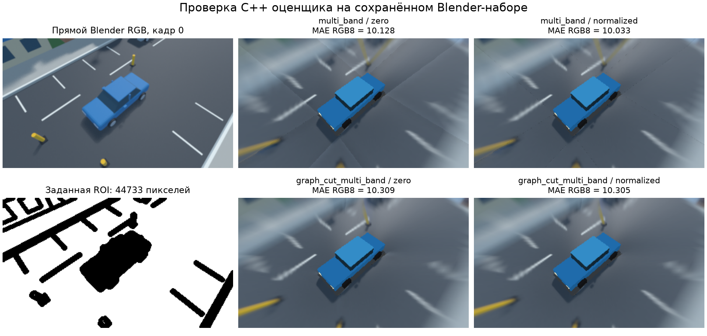

*Рисунок 3.48 — одинаковый виртуальный ракурс кадра0: прямой Blender reference, ROI и native
результаты. MAE относится к выбранной ROI и кодовым RGB8 значениям; размытие и геометрические
искажения видны, близкие численные результаты не означают равного физического качества.*

| Native вариант | Pixel-weighted MAE RGB8 трёх кадров | Pixel-weighted RMSE RGB8 |
|---|---:|---:|
| multi_band / zero | 10,230029 | 15,786368 |
| multi_band / normalized | 10,151724 | 15,712383 |
| graph_cut_multi_band / zero | 10,541895 | 16,917803 |
| graph_cut_multi_band / normalized | 10,537396 | 16,911487 |

Во всех условиях одна область134325 pixels суммарно по трём frame indices; repeats не увеличивают
её статистический вес. Качество в этих условиях не принято по нормативному порогу: criteria не
заданы, status=not_requested. Этот повторно использованный городской fixture не закрывает
внешнюю валидность; независимые семейства окружения, конфигурации камер и дополнительные метрики
ещё нужны. Генератор рисунка сохранён рядом с главой: plot_native_quality.py. Native отчёт и
RGBA — ignored artifacts/q-native-v1; воспроизведение: [[engineering/RESEARCH_QUALITY]].

### 3.51. Управляемые семейства fixture и граница продуктового кода

Для испытаний добавлено второе процедурное окружение cargo_yard, отличающееся от улицы
расположением стен, грузов, рёбер и разметки. Геометрия задаётся сохранённым recipe и отдельным
scene_seed; mount_seed управляет двумя поворотами и сдвигом четырёх камер. Изменение сцены не
изменяет монтаж, и наоборот; legacy seed остаётся fallback. Blender exporter создаёт отдельные
scenes и snapshots. Через живой MCP проверены4 новых мира и сохранённая исходная Scene/Cube.

План до начала захвата записан в Git. Очередь экспортера проходит pure preflight: допустимые
семейства, uint32 seeds, безопасные уникальные IDs, bounded dimensions/frames и строгие types.
Job journal публикует queued/running/complete/failed/cancelled; cancel действует между случаями.
Это средство генерации fixture/независимого truth. Оно не является продуктовым сервером или
общим compiled supervisor для нескольких исследований.

| Компонент | Исполняемая работа |
|---|---|
| Blender scene/paired_truth | Процедурный мир, true camera poses, direct RGB/object/visibility truth |
| Fixture converter/test oracle | Подготовка наблюдений/reference и независимая численная проверка |
| sv-server | Replay, синхронизация, проекция на выбранный носитель, seam/blend, итоговый RGBA |
| sv-client-lib + общий C++ runner | Подключение/lease/reset/configure, provenance, samples/metrics/restore |
| Plot script рядом с главой | Визуализация сохранённых native reports и парных изменений |

```plantuml
@startuml
rectangle "Asset recipes + scene/mount seeds" as A
rectangle "Blender exporter (fixture)" as B
rectangle "Наблюдения четырёх камер" as I
rectangle "Direct RGB / ROI / input guards" as T
rectangle "sv-server (C++)" as S
rectangle "sv-client-lib + ExperimentRunner (C++)" as R
rectangle "Python oracle / plots (проверка)" as P
A --> B
B --> I
B --> T
I --> S
R --> S : lease / reset / fusion / carrier
S --> R : RGBA + provenance
T --> R : external reference
R --> P : report / capture
T --> P : independent arithmetic check
@enduml
```

*Рисунок 3.49 — Python сохраняется на границе fixture/oracle, продуктовые алгоритмы и оценка исполняются в C++.*

Обнаружен и исправлен отказ test harness при глубоком output path: explicit Unix directory
сервер ограничивает80 bytes, поэтому IPC отделён от архива и помещается в короткий /tmp path.
ID dataset формируется из capture hash, а не из одинакового basename. Server child ограниченно
останавливается, при timeout применяется kill с последующим wait. Native matrix из20 вариантов
использует существующий runner; логика сшивки не продублирована в fixture harness.
Результаты и оставшиеся границы: [[validation/FAMILY_CARRIER_SCREEN]], §4.93.

Проверка живых сцен выявила дефект исходного вида: после paired export камера могла вернуться
в начало координат под автомобилем. Общий helper задаёт обзорную позу над машиной при создании
сцены и при overview capture; калиброванные ракурсы задаются отдельно. Проверка 72 проекций
Blender дала максимальную ошибку 0,00004753 px при допуске 0,001 px и подтвердила восстановление
обзорной позы/оптики. Второй helper требует `FINISHED` и непустой PNG после render: отменённая
операция не может быть опубликована как успешный захват. Отказы проверены через подставной
render callback; реальный preview создан в Blender. Сохранённые данные пилота не перегенерированы.

## 3.52. Общий сервис последовательных исследований

Следующий продуктовый срез устраняет отдельную CLI-логику загрузки reference, RGBA capture и
записи report. Класс FileExperiment с PImpl фиксирует scenario/reference в памяти, затем
резервирует output и допускает единственную попытку execute. Им пользуется и одиночный
`svctl research`, и новый `research-batch`. Алгоритмы по-прежнему выполняются сервером;
серия организуется общим C++ application service через sv-client-lib.

Предварительная проверка всех участников важна для невмешательства при ошибке позднего
сценария: отсутствующий reference второго участника должен обнаружиться до запуска первого.
Поэтому загрузка/валидация всех входов и эксклюзивное резервирование outputs предшествуют сети.
Суммарные пределы — 8 участников, 10000 trials и 128 MiB удерживаемых reference pixels.
Исходные байты scenario и batch plan получают отдельные hashes; semantic scenario hash
сохраняет прежнее назначение и не подменяется file hash.

| Событие | Действие серии | Итог качества |
|---|---|---|
| Успешные workflow и restore всех участников | Записать все reports и summary | passed по заданным критериям либо not_requested |
| Порог качества не пройден при исправном workflow | Продолжить остальные сценарии | failed при полном завершении |
| Source/view guard mismatch, технический отказ или неудачный restore | Не запускать оставшиеся сценарии | incomplete |
| Отмена через API | Проверить флаг между участниками и в runner; restore активного прогона | incomplete |

Серия использует один уже запущенный сервер и recording. Каждый сценарий явно задаёт reset
replay и имеет отдельный lease; между участниками возможны команды других клиентов.
Это не общая транзакция и не доказательство неизменности процесса. Restored относится к
fusion/surface/pause, а не прежнему cursor или GPU cache. Переключение recording, server
registry, GUI формы и durable recovery остаются открытыми задачами.

Последовательность взаимодействий приведена на рисунке RR.6 в [[architecture/RESEARCH_RUNTIME]],
формат файлов/команды — [[engineering/RESEARCH_BATCH]]. Тесты проверяют отмену до подключения,
immutable input, output aliases, общую preflight, воспроизводимость RGBA через Unix/TCP,
продолжение после quality rejection и остановку при input-content mismatch.

## 3.53. Визуальный редактор одиночного исследования

В sv-simulator добавлена отдельная страница «Исследования» с вкладками «План», «Выполнение»
и «Результаты». Пользователь отмечает методы, задаёт frames/warmup/repeats/seed, pyramid levels,
boundary и seam solver через элементы формы. Формирование JSON вручную не требуется:
typed draft проверяется общим parser и сохраняется как scenario.json для воспроизведения.
Это ограниченный редактор одного исследования, а не готовый редактор произвольных batch-планов.

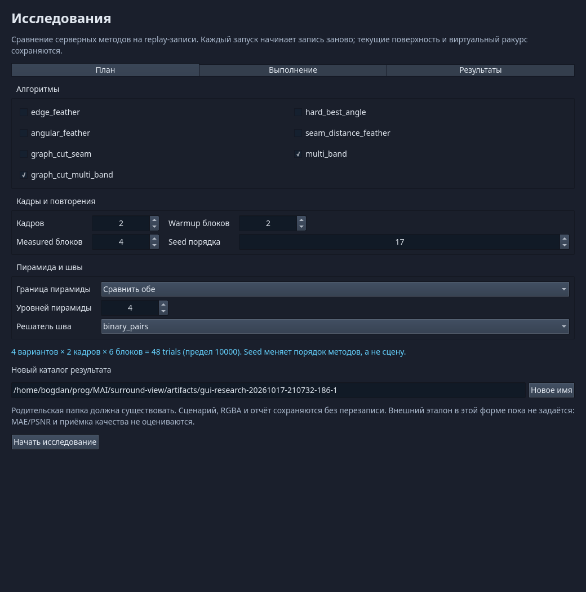

*Рисунок 3.50 — реальный offscreen screenshot Qt-формы из UI acceptance fixture: выбраны два
multiband метода и две границы, frames=2, warmup=2, repeats=4. Число 48 относится к плану;
изображение не является отчётом о выполненных trials или измеренном качестве.*

Генератор draft не размножает параметры, которые не влияют на выбранный метод: обе boundaries
порождают две variants только для multi_band и graph_cut_multi_band, solver назначается
только graph-cut методам. Все семь методов дают максимум девять вариантов. Duplicate/unknown
методы, неверные типы, seed и превышение общего бюджета отвергаются до создания output.
По умолчанию выполняется replay reset и сохраняются measured RGBA; warmup frames не экспортируются.

| Часть | Ответственность |
|---|---|
| ResearchPanel.qml | Формы, бюджет trials, вкладки, отмена и таблица |
| research_draft.cpp | Строгое преобразование полей формы в сценарий |
| ResearchController/PImpl | Snapshot endpoint, worker lifecycle, cancel/progress, terminal status |
| research_results.cpp | Ограниченные строки вариантов, недоступные метрики как прочерки |
| FileExperiment / общий runner | Capture/report, SV01 lease/reset/trials/restore через sv-client-lib |
| sv-server | Переключение и исполнение алгоритмов, frame/provenance, восстановление конфигурации |

Исполнение вынесено из UI thread. Worker обновляет atomic counters, UI читает их раз в 100 мс;
очередь событий не растёт пропорционально числу trials. Terminal callback передаёт строки
по вариантам, а полный report остаётся на диске. При отмене сначала завершается текущая
синхронная операция, затем выполняется обычный restore. При закрытии окна приложение ожидает
этот путь; destructor дополнительно запрашивает cancel и join, не оставляя detached worker.
Последовательность приведена на рисунке RR.7 в [[architecture/RESEARCH_RUNTIME]].

Начать прогон можно после подключения и завершения локальных configuration requests.
Параметры endpoint фиксируются перед запуском: изменение доступности viewer не перенаправляет
идущий прогон на другую машину. Основные настройки и orbit input блокируются на время работы;
после возврата worker запрашивается обновление active configuration/revision. Эти меры не
обеспечивают изоляцию от других клиентов или посторонней нагрузки на сервер.

Форма этого среза не принимает внешний reference: MAE/PSNR показываются как недоступные,
а завершение workflow не называется научной приёмкой качества. Таблица render wall p50/p95
описывает paused samples с исключённым warmup, не sustained FPS. Viewer остаётся отдельным
потребителем frames, поэтому режим запуска должен учитываться при дальнейшей qualification.
Для masked RGB/criteria применяется headless runner, описанный в §3.49–3.52.

GTest проверяет типы/границы draft, нулевые и отсутствующие метрики, отказ подготовки без
перезаписи, frozen endpoint и отзывчивость event loop. На живом сервере проверены штатное
завершение, cancel с partial report/restore и destructor/join для Unix/TCP/combined profiles.
QML acceptance меняет поля/вкладки и фиксирует warnings, screenshot проверен визуально.
GUI batch editor, carrier/parameter matrices, выбор reference, capabilities-driven options,
импорт и сравнение нескольких отчётов остаются открытыми. Команды и ограничения:
[[engineering/RESEARCH_BATCH#Исследование из sv-simulator]].

## 3.54. Внешний эталон и импорт сценария в GUI

Следующий срез расширяет редактор §3.53 двумя способами задания исследования. В форме выбирается
reference manifest через файловый диалог. Альтернативно загружается существующий scenario JSON;
он исполняется без подмены настроек значениями формы и без редактирования исходного файла.
Это импорт одного сценария, не готовый GUI batch-планов или архив всего dataset.

FileExperiment принимает исходный файл либо точные JSON bytes с явным reference base directory.
В обоих случаях он заранее проверяет bounds, фиксирует RGB/mask pixels и criteria в памяти.
GUI выполняет эту подготовку в worker **до создания output и любого подключения**. Неверный
reference или несовместимое число кадров не должны менять сервер и создавать ложный отчёт.
При импорте относительные пути разрешаются от canonical source directory; форма сохраняет
абсолютный locator выбранного reference в scenario.json. Данные эталона серверу не передаются.
Порядок взаимодействия приведён на рисунке RR.8 в [[architecture/RESEARCH_RUNTIME]].

Для аудита отчёт содержит `scenario_input_sha256` точных входных bytes, input_kind, base directory
и исходный path для файла. Semantic scenario hash сохраняет прежний смысл. Snapshot формы
имеет те же bytes/hash, что переданы memory constructor; при импорте source остаётся на своём
месте. Эти hashes не заменяют dataset registry или portable bundle: исходные manifest и
RGB/mask нужно сохранять отдельно. Сценарий и его external reference фиксируются до выполнения,
но это само по себе не является независимой научной preregistration.

### 3.54.1. Раздельная интерпретация результатов

GUI показывает kind/dataset/schema reference, workflow/restore и criteria status раздельно.
При successful workflow с непройденным threshold сохраняется code 5/failed; это исследовательский
результат, а не потеря соединения. При guard mismatch заданные критерии получают incomplete.
Без criteria acceptance остаётся not_requested, в том числе при техническом отказе, поэтому
проверять только этот badge нельзя. Успешный workflow с reference без criteria всё равно
имеет рассчитанные метрики. Новая неудачная подготовка очищает прежние rows/report path/badge,
чтобы результат предыдущего успешного прогона не выдавался за новый.

`regression` явно обозначает проверку воспроизводимости. Даже значение passed не доказывает
качество реконструкции произвольной сцены. `independent_ground_truth` является заявлением
автора о происхождении данных; программа не проверяет независимость и научное обоснование норм.

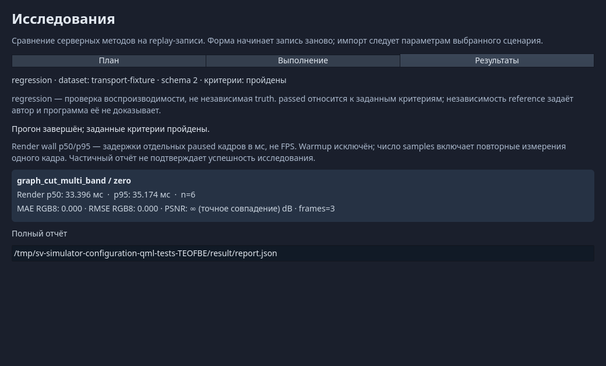

*Рисунок 3.51 — реальный QML запуск сохранённого сценария через sv-server и schema2 regression
reference из transport fixture. Три кадра и шесть measured samples дают точное совпадение
с ранее записанным output того же метода. Это проверка GUI/протокола/оценщика, не независимый
benchmark качества; показанные timing values не квалифицируют производительность платформы.*

### 3.54.2. Агрегирование и отображение метрик

Новые поля общего C++ summary дают PSNR по общей MSE уникальных кадров:

$$
\mathrm{MSE}_{pool}=\frac{\sum_{f\in F}N_f\mathrm{RMSE}_f^2}{\sum_{f\in F}N_f},
\qquad \mathrm{PSNR}_{pool}=10\log_{10}\frac{255^2}{\mathrm{MSE}_{pool}}.
$$

Здесь $N_f$ — число выбранных ROI pixels, значения ошибок заданы в кодовых RGB8. Warmup не
оценивается; paused repeats не увеличивают число quality frames. Усреднение PSNR отдельных
кадров в dB давало бы другую величину. При точном совпадении JSON хранит null вместе с
exact_match=true, GUI показывает «∞ (точное совпадение)». Без оценённых кадров PSNR недоступен.
Политика threshold остаётся per-measured-sample и не определяется округлёнными summaries.

Форматирование малых ненулевых ошибок переведено на значащие цифры: иначе изменение одного
pixel при строгом max_mae=0 могло давать failed и визуальное `0.000` одновременно. Контроль
неравных ROI weights при RMSE 1 и 3, $N_1=1$, $N_2=3$ даёт MSE=7 и PSNR≈39,6798232085 dB;
повтор первого кадра пять раз не меняет результат. Эта проверка выполняется в GTest.

Live acceptance проверяет форму и импорт при passed, failed, not_requested и incomplete для
Unix/TCP/combined. Источник изменяется при неизменных paths/IDs/timestamps, что обнаруживается
schema2 content guard; штатный restore проверяется независимо. Дополнительно настоящий QML
сценарий запускается кнопкой, результаты выводятся на экран без warnings. Сводка проверок:
[[validation/RESEARCH_RUNTIME]]. Для окончательного исследования остаются независимые данные,
обоснованные нормы и прежние gates; GUI возможностей не достаточно для их автоматического закрытия.


## 3.55. Серия исследований из графического клиента

Для воспроизводимых повторов добавлен запуск сохранённого batch-плана в `sv-simulator`.
Научный алгоритм не дублируется в GUI: фоновый worker вызывает C++ `run_batch`, который
предварительно загружает все сценарии/эталоны и резервирует outputs, а затем исполняет
участников через тот же FileExperiment и sv-client-lib, что CLI (§3.52).
Это клиентская оркестрация уже реализованных серверных алгоритмов, без Python subprocess
и без новых сетевых команд. Последовательность приведена на рисунке RR.9 в
[[architecture/RESEARCH_RUNTIME]]; точный контракт — [[engineering/RESEARCH_BATCH]].

| Ситуация | Действие серии | Отображение в GUI |
|---|---|---|
| Все технические операции завершены | Переход к следующему участнику | Отдельные workflow, restore и quality |
| Измерения полные, threshold не пройден | Продолжить; итоговый код5 | `failed` качества при завершённом workflow |
| Несовместимый вход или техническая ошибка | Остановить; итоговый код4 | `incomplete`, подтверждение restore отдельно |
| Отмена пользователем | Дождаться текущей операции/restore, не запускать следующие | Частичная сводка, остальные `not_started` |
| Невалидный поздний участник при preflight | Не подключаться и не создавать output | Ошибка подготовки без прежнего badge/results |

Прогресс `(member_index, done, total)` относится к текущему сценарию. Начальное событие
`done=0` сбрасывает предыдущий счётчик; сто процентов текущих trials не доказывают завершение
restore или всей серии. Endpoint копируется при запуске, поэтому смена доступного подключения
не перенаправляет работающий worker. Общий close guard запрашивает отмену и ждёт terminal
callback; зависимость shutdown от синхронного driver IO сохраняется.

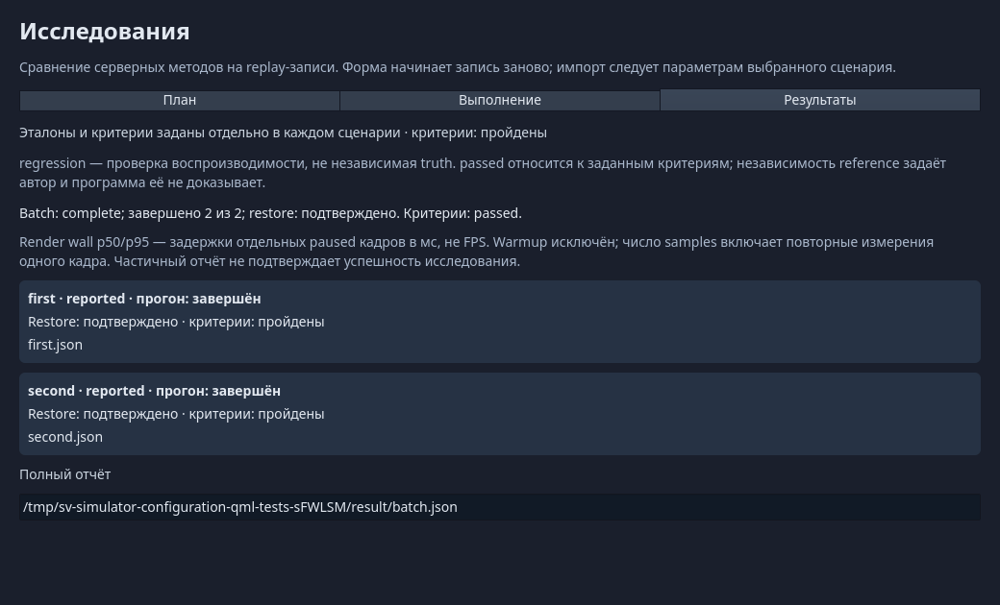

*Рисунок 3.52 — фактический QML экран сводки двух сценариев одной replay-записи:
оба workflow и restore завершены, заданы regression criteria. Это проверка интерфейса
и воспроизводимости; снимок не доказывает независимого качества сшивки либо производительности.*

В GUI передаются только до восьми компактных строк: ID, status, workflow, restore, quality,
имя отчёта и ошибка. Промежуточные кадры и полные reports не копируются в QML.
`reported` подтверждает запись отчёта, `not_started` не даёт свидетельств об измерениях.
Общее `passed` касается только участников с criteria: участники без criteria не становятся
принятыми автоматически. Индивидуальные метрики сохраняются в `ID.json`, а общая сводка —
в `batch.json`; их научная интерпретация остаётся раздельной.

Проверки включают late-member preflight без сети/output, отсутствующие evidence в строках,
запуск/отмену с настоящим сервером, четыре состояния acceptance для Unix/TCP/combined
и запуск серии кнопкой настоящего QML окна. Это Linux/Qt6 evidence. Qt5/Aurora, независимые
holdout и обоснованные thresholds не подтверждены. Срез не закрывает визуальный редактор
состава серии, переключение записей, durable recovery и сравнение разных отчётов.

## 3.56. Визуальный состав серии и сохранение плана

После запуска готовых batch files (§3.55) реализовано составление новой серии без ручного
ввода JSON. Пользователь выбирает готовые scenario files, меняет их порядок кнопками и удаляет
участников. Один файл можно повторить для проверки повторяемости; автоматически назначенные
ID уникальны внутри текущего состава и сохраняются при перестановке. Лимит — восемь участников.
Отдельный `ResearchBatchEditor.qml` хранит только состав; общие правила испытаний остаются
в C++ application service. Последовательность фиксации и preflight показана на рисунке RR.10
в [[architecture/RESEARCH_RUNTIME]]. Практический порядок работы: [[engineering/RESEARCH_BATCH]].

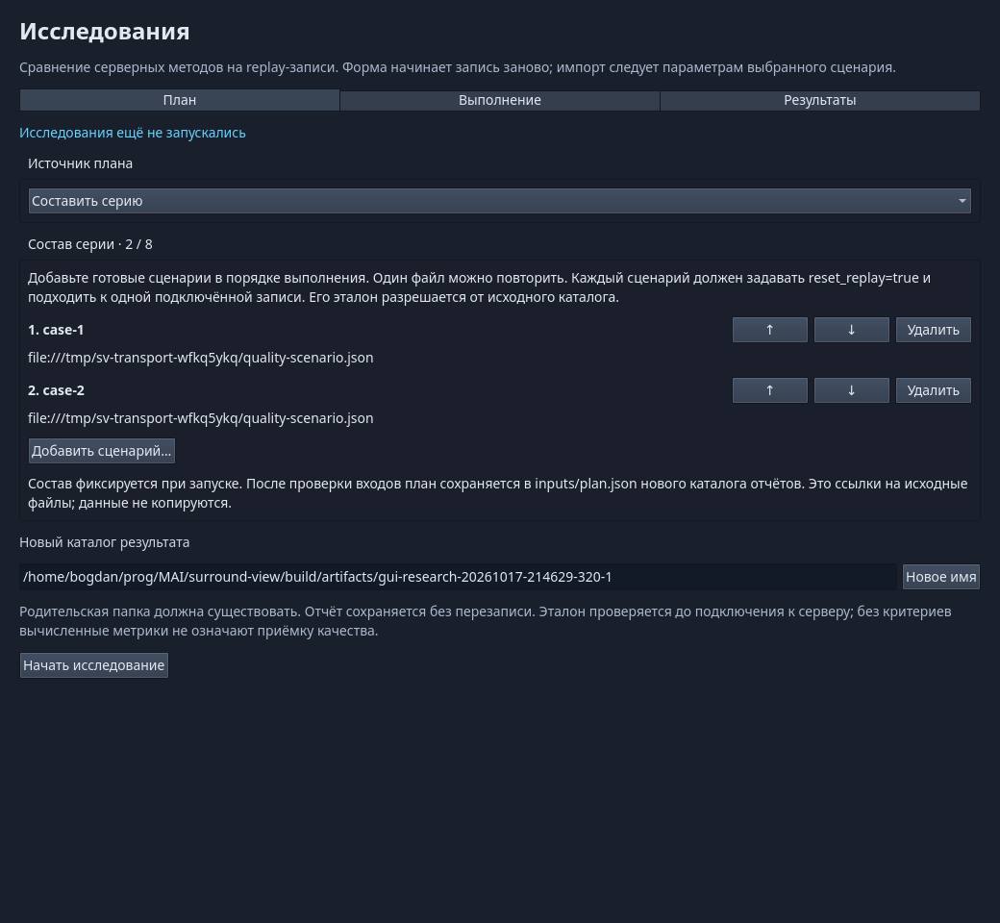

*Рисунок 3.53 — фактический QML редактор перед запуском: два участника одного regression
scenario, кнопки порядка и удаления. Повторение одного файла не создаёт независимых сцен.*

| Свойство | Сохранённый batch file | Визуальный состав |
|---|---|---|
| Подготовка плана | Выбор файла | Добавление/порядок/удаление через controls |
| Вход общего исполнителя | Точные bytes файла | Документ из памяти |
| База относительных scenario paths | Каталог исходного batch file | GUI заранее делает пути абсолютными |
| Эталоны scenario | От canonical scenario directory | То же правило FileExperiment |
| Фиксация плана | Raw-byte hash и semantic plan в summary | Snapshot inputs/plan.json и hash его bytes |
| Проверки и исполнение | Общий C++ preflight/run_batch | Тот же C++ preflight/run_batch |

GUI C++ builder проверяет типы полей и локальные URL, включая literal `#`/`%` в именах файлов.
Контроллер копирует документ и endpoint перед worker; дальнейшее изменение доступного
подключения не перенаправляет опыт. Общая проверка IDs, ссылок, reset_replay и суммарных budgets
выполняется в worker до output/сети. Невалидный поздний участник не приводит к запуску ранних.
После успешного preflight резервируются outputs и до сети сохраняется snapshot плана.

Для составленного документа (P) фиксируется

\[
H_{plan}=\operatorname{SHA256}(\operatorname{serialize}(P)\,\Vert\,\mathrm{LF}).
\]

`ReportOutput` записывает тот же compact JSON с завершающим переводом строки, поэтому hash
соответствует bytes сохранённого `inputs/plan.json`. Общая сводка содержит optional
`plan_snapshot`; версия summary1 сохранена. Snapshot можно заново выбрать в GUI либо передать
`svctl research-batch`, пока абсолютные source paths и данные доступны. Прямой C++ overload
также допускает относительные пути с явной base; только GUI гарантирует абсолютные ссылки
для такого повторения. Содержимое datasets в snapshot не копируется и на будущие запуски не
закрепляется. Ошибка резервирования/записи может оставить частичный output без сетевых мутаций;
механизм не является durable journal.

Проверки охватывают строгий preflight memory/file входов, hash snapshot, порядок и повторное
чтение GUI-совместимого плана, неверные типы/URL, девятого участника, реальные QML кнопки
перестановки/удаления и отсутствие автоматического запуска при редактировании. Live harness
проверяет составленные серии при passed/failed/not_requested/incomplete и отмену с restore;
настоящая QML кнопка запускает визуально составленную серию на подключённом сервере.
Это инженерное подтверждение workflow на Linux/Qt6, не новое доказательство качества сшивки.
Импорт batch в редактируемый список, отдельное сохранение неисполненного черновика,
редактирование параметров каждого scenario в этой панели, multi-recording и переносимые
bundles остаются дальнейшими работами.

## 3.57. Импорт серии без потери черновика и смысла путей

Визуальный редактор (§3.56) дополнен загрузкой существующего batch file. Это локальная операция
клиента: при успехе весь состав заменяется одновременно, при ошибке или отмене сохраняется
прежний список. ID и порядок импортированных участников сохраняются, новые участники получают
свободный `case-N`. Трасса приведена на рисунке RR.11 в [[architecture/RESEARCH_RUNTIME]],
пользовательские действия — [[engineering/RESEARCH_BATCH#Импорт плана в редактор серии]].

Структурный parser вынесен в общий C++ модуль `batch_plan`, который используют импорт и оба
варианта run_batch. Это исключает расхождение проверок schema_version, неизвестных полей,
ID/дубликатов, размеров и числа участников. Чтение принимает обычный файл, сохраняет точные
bytes для прежнего CLI digest и ограничивается65537bytes, чтобы обнаружить превышение64KiB.
Open выполняется с O_NONBLOCK, затем fstat подтверждает тип: FIFO не заставляет ждать writer.
Импорт небольшого плана синхронный; большие scenario/reference данные загружаются в worker
только перед исполнением. Размерный предел не является временным deadline для дискового IO.

| Проверка | При импорте | При запуске |
|---|---|---|
| JSON/schema/IDs/path bounds/до8 участников | Да, общий parser | Да, тот же parser |
| Существование scenario и reference | Не требуется для правки состава | Обязательно |
| Replay reset и общий бюджет trials/reference memory | Не подтверждаются импортом | Проверяются до сети |
| Серверный lease/apply/render/restore | Не выполняются | Прежний runner через sv-client-lib |
| Сохранение прежнего черновика | При любом отказе/отмене | Состав фиксируется до worker |

Успешная загрузка структуры не означает готовность источников или научную приёмку качества.
Пользователь может удалить отсутствующий scenario из списка; полный preflight всех оставшихся
участников обязателен при запуске. Импорт допускается без соединения с сервером и отклоняется
во время активного исследования. Ошибка импорта не очищает результаты предыдущего прогона.

Отдельная регрессия выявила ошибку lexical нормализации пути. Если `link` указывает на
`real/deep`, то `link/../scenario.json` на Linux разрешается как `real/scenario.json`;
предварительное удаление `link/..` выбирало другой файл — `scenario.json` в исходном каталоге.
Общий преобразователь входных file URL теперь сохраняет абсолютные segments, а относительные
дополняет текущим каталогом без lexical сокращения. Регрессионный тест создаёт оба различных
файла и сравнивает конечную canonical identity после import → draft roundtrip.

Относительные paths импортируемых сценариев привязаны к каталогу выбранного batch file,
совпадая с CLI; даже для symlink самого batch используется каталог выбранной ссылки.
Отдельный FileExperiment по-прежнему разрешает reference от canonical scenario directory.
Это разные базы; их нельзя заменять текущим каталогом GUI либо каталогом нового report.
После правки запускается memory overload, который сохраняет новый `inputs/plan.json`;
исходный файл плана не перезаписывается, datasets не копируются.

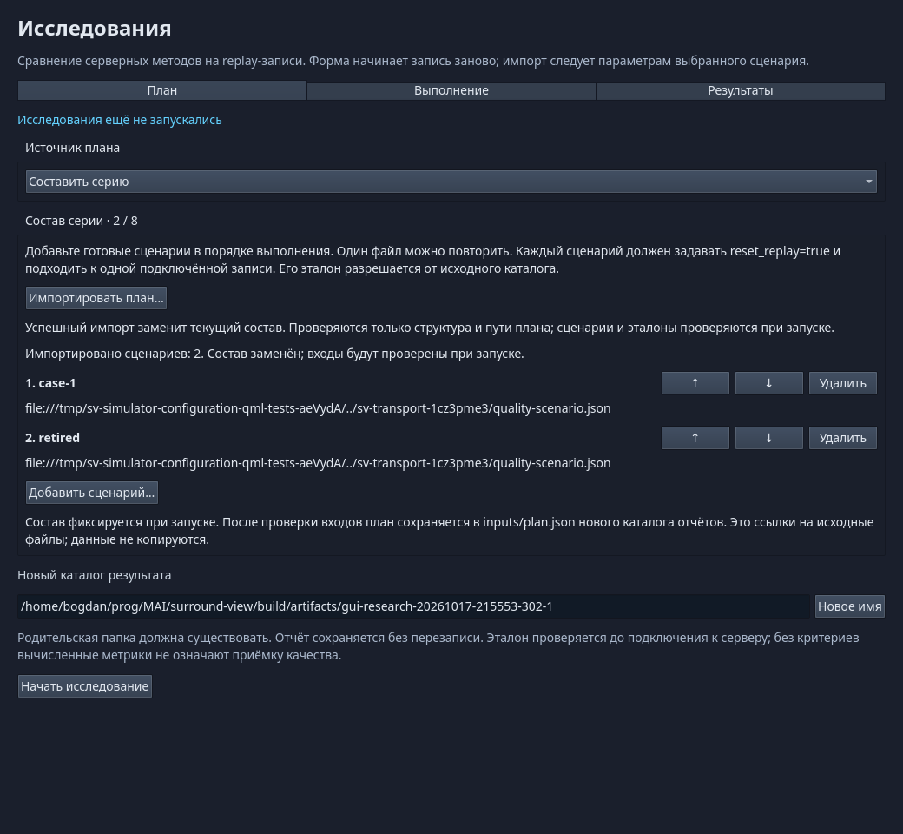

*Рисунок 3.54 — фактический QML состав после импорта двух участников regression плана;
показан результат структурной загрузки, до полного preflight и исследования.*

Проверки включают invalid late row без частичной замены, cancel chooser, ID collision при
добавлении, относительные пути, literal `#`/`%`, symlink/.. и symlink самого batch, отказ FIFO
и oversize, отсутствие worker/сетевых действий при импорте. Live QML workflow импортирует
план, удаляет участника, добавляет новый и меняет порядок настоящими кнопками, затем запускает
серверную серию и сверяет ID результата с новым порядком. Это проверка инженерного workflow
на Linux/Qt6, а не новый рейтинг алгоритмов сшивки. Сохранение черновика без исполнения,
сравнение отчётов, bundles и прежние научные/целевые gates остаются открытыми.

## 3.58. Сохранение черновика серии без серверного исполнения

Редактор дополнен отдельным действием **Сохранить черновик как…**. Пользователь может
подготовить и сохранить серию без подключения к серверу, затем импортировать её для правки
либо исполнить позднее. В отличие от execution snapshot (§3.56), это действие не создаёт
отчёт исследования, не загружает сценарии/эталоны и не начинает сетевые мутации.
Последовательность показана на рисунке RR.12 в [[architecture/RESEARCH_RUNTIME]],
порядок использования — [[engineering/RESEARCH_BATCH#Сохранение черновика без исполнения]].

C++ builder формирует обычный schema1 plan с абсолютными scenario paths. Общий parser
проверяет структуру и лимиты до записи. `write_batch_plan` возвращает SHA256 точных bytes
compact JSON + LF, а общий ReportOutput резервирует только новый файл с O_EXCL. Это защищает
исходные документы, существующие hard links и symlinks от перезаписи; для следующей версии
выбирается новое имя. Родительский каталог должен существовать. Ошибка IO после reservation
может оставить частичный новый файл; это не durable journal и не fsync checkpoint.

| Свойство | Сохранение черновика | Запуск исследования |
|---|---|---|
| Подключение к серверу | Не требуется | Требуется |
| Schema/ID/число участников/лимит плана | Проверяются до создания файла | Те же общие проверки |
| Scenario/reference content и budgets | Не проверяются | Полный preflight до сети |
| Результат | Отдельный plan JSON и локальный digest | Reports/captures и execution snapshot |
| Существующий файл | Отказ записи | Новый каталог/эксклюзивные report paths |
| Доказательство качества сшивки | Не возникает | Зависит от данных, guards и criteria |

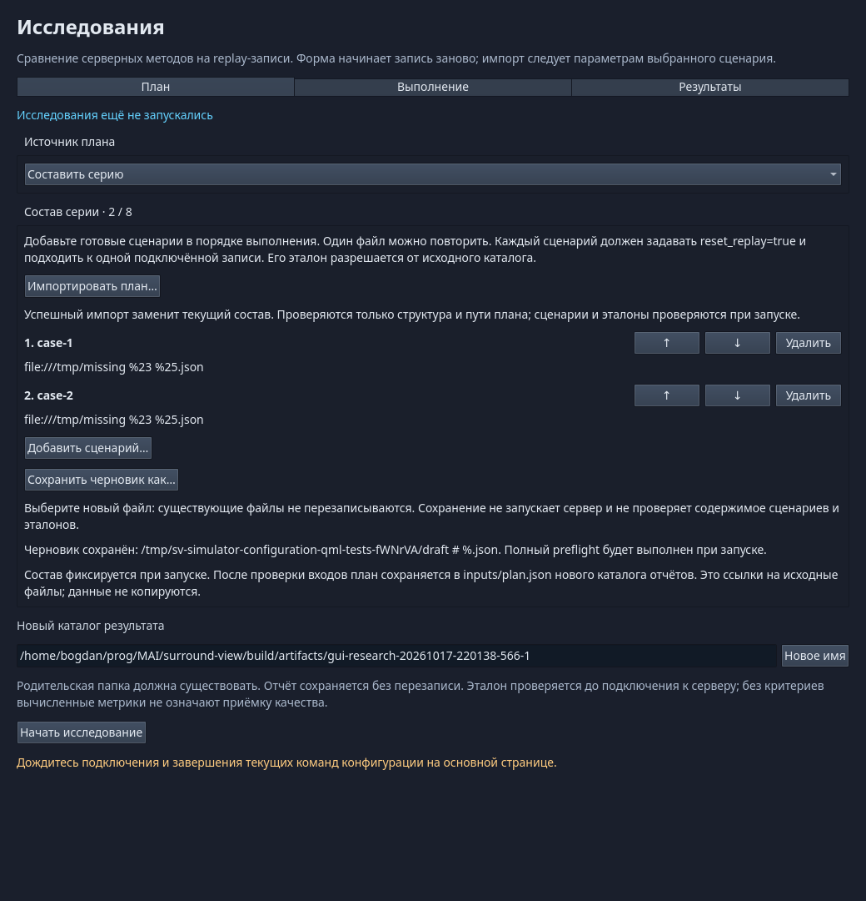

*Рисунок 3.55 — фактический QML экран после сохранения черновика без соединения с сервером.
Отсутствующие scenario paths намеренно допустимы в этой проверке; успешная запись не означает
готовность данных или научную приёмку.*

Пути записываются без lexical сокращения symlink/.. (§3.57). Проверка сохраняет filesystem
identity как источника, так и назначения, включая запись через `link/../saved.json`.
Абсолютные ссылки позволяют переместить сам plan в другой каталог, если исходные файлы
и данные остаются доступными. Dataset bundle при этом не создаётся.

Qt клиент показывает результат сохранения отдельно от статуса импорта и последнего прогона.
После изменения состава/порядка сообщение указывает на отличие от сохранённого черновика;
возврат к сохранённому составу возвращает отметку совпадения. Сравнивается представление
состава в UI, а не содержимое файла на диске или научная эквивалентность сценариев.
Ошибка/отмена не меняет текущий состав и прежние результаты. Во время active worker
сохранение блокируется. Qt6 диалог не предлагает overwrite, но фактическую защиту обеспечивает
C++ O_EXCL независимо от файлового диалога.

Проверки включают offline save/import с literal `#`/`%`, перенос plan в другой каталог,
SHA256 записанных bytes, отказ overwrite/hardlink/symlink/invalid draft/missing parent,
сохранение source/destination identity через symlink/.., cancel chooser и dirty-state UI.
Live QML workflow сохраняет изменённую серию, импортирует сохранённый plan и выполняет её
через общий runner; порядок ID результата проверяется. Это инженерная проверка Linux/Qt6,
не дополнительный рейтинг fusion/carrier алгоритмов. Report comparison, catalog-driven
controls, bundles/multi-recording и прежние научные/целевые gates остаются открытыми.

## 3.59. Контролируемое сопоставление сохранённых отчётов

После сохранения сценария и исполнения серии возникает отдельная задача: сопоставить
результаты двух запусков. Простое вычитание строк с одинаковым номером некорректно:
порядок вариантов может измениться, а одно название метода не фиксирует глубину пирамиды,
решатель шва, геометрию носителя и параметры поддержки. Поэтому реализован общий C++
application service, сопоставляющий **полные наблюдённые настройки fusion/surface**.
Источник фактических настроек — metadata samples, дополнительно проверяемые относительно
scenario. Пара определяется по содержимому профиля; неоднозначные дубликаты не выбираются
произвольно. Пример отличия — два multiband-профиля с разным числом уровней: они остаются
разными строками, даже если их текстовые названия совпадают.

Входом служат два individual report schema1 общего `ExperimentRunner`; batch-индекс сначала
разрешается пользователем в нужный `ID.json`. Локальная операция не вызывает сервер и не
изменяет результат последнего прогона. Она вынесена из QML в общий компилируемый модуль,
а Qt модель управляет только worker, отменой, queued completion и представлением компактных
строк. Файлы читаются с пределом16MiB каждый; устройства/FIFO/каталоги отвергаются.
Вложенные пути и изображения из импортированных документов не открываются.

```plantuml
@startuml
title Сопоставление отчётов: идентичность работы до вычисления разниц
actor Исследователь as User
participant "sv-simulator\nResearchComparison" as GUI
participant "C++ comparison service" as Service
database "Individual reports A/B" as Reports
User -> GUI: Выбор A/B; сравнить
GUI -> GUI: Зафиксировать пару; очистить прошлые rows
GUI -> Service: Worker: compare_report_files(A, B, cancel)
Service -> Reports: Ограниченное чтение bytes
Reports --> Service: JSON + raw SHA256
Service -> Service: Schema, координаты, полнота samples
Service -> Service: Full-settings matching; input/view identities
Service -> Service: Workload/build gate; truth/mask gate
alt Достаточные заявления о соответствии
  Service --> GUI: Метрики A/B; допустимые B−A
else Недостаточные либо разные данные
  Service --> GUI: Метрики A/B; причины; delta=null
end
GUI --> User: Два паспорта; настройки; экспорт нового audit JSON
@enduml
```

*Рисунок 3.56 — последовательность локального сравнения с раздельными условиями для времени и качества.*

| Проверяемая область | Условие вычисления разницы | Смысл ограничения |
|---|---|---|
| Входы | Одинаковые decoded RGB/model hashes четырёх камер, calibration IDs, timestamps, view и порядок baseline frames; samples согласованы с baseline | ID набора сам по себе не доказывает одинаковое содержимое |
| Полнота | success/restored, полный набор уникальных frame/block/variant | Частичный запуск не становится нулевой стоимостью |
| Время | Одинаковый source fingerprint, frames/warmup/repeats/seed/reset, алгоритм и фактический порядок trials, определение percentile; полный measured count | Сравнивается одна измеряемая работа |
| Качество | Одинаковый вид reference, decoded truth/mask hashes, view/inputs и число выбранных пикселей; все frames оценены | Regression и независимый эталон не смешиваются |
| Платформа | Backend/vendor/renderer и revision/fingerprint показаны для A и B | Разный GPU допустим, но OS/CPU/нагрузка требуют отдельного паспорта |

Для допустимой matched строки вычисляется

$$\Delta t_{50}=t_{50,B}-t_{50,A},\qquad
\Delta E_{\mathrm{MAE}}=E_{\mathrm{MAE},B}-E_{\mathrm{MAE},A}.$$

Если условие соответствующего gate не выполнено, значение остаётся неопределённым (`null`),
в интерфейсе выводится тире. Отсутствие PSNR в прежнем report не заменяется нулём;
точное совпадение с нулевой MSE отображается как бесконечный PSNR. Малые ошибки сохраняют
значащие цифры. Workflow, восстановление конфигурации и quality acceptance показаны
раздельно у каждого запуска. Успешное выполнение не является успешной научной приёмкой.

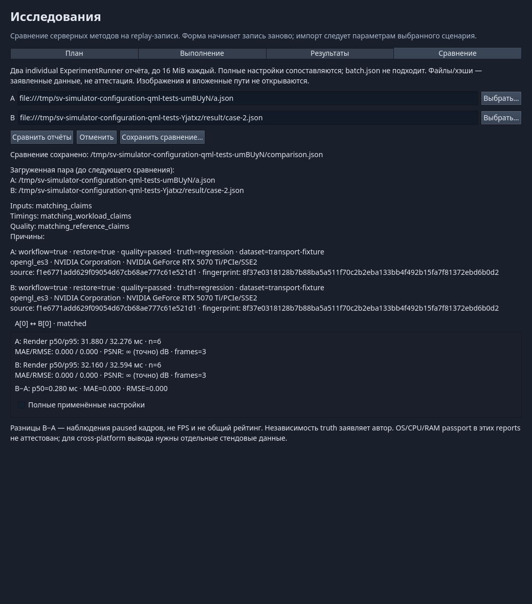

*Рисунок 3.57 — реальная Qt6 вкладка сравнения individual server reports одного regression fixture; значения времени иллюстрируют наблюдение paused кадров, не рейтинг методов или FPS.*

Для рисунка использован live transport workflow: отдельный опыт и участник составленной
batch-серии на том же трёхкадровом replay с двумя measured repeats и одним warmup.
Исходный эталон — regression capture; совпадение MAE не доказывает качество синтеза
относительно независимой сцены. Это инженерная проверка связности runner → reports → GUI.
Экспорт содержит raw SHA256 обоих прочитанных файлов, версию policy, паспорта, сопоставления,
gates и причины. Существующий файл защищён `O_EXCL`; durable checkpoints не реализованы.

Сравнение использует **заявления отчётов**, не аттестацию данных или аппаратуры. В частности,
одинаковые hashes без повторной проверки первичных изображений не доказывают их происхождение.
Не вычисляются общий победитель, confidence intervals и причинная атрибуция разницы времени.
Для вывода по теме диплома по-прежнему требуются независимый confirmatory holdout,
обоснованные критерии и измерения целевой платформы. Формат и воспроизводимые действия:
[[engineering/RESEARCH_REPORTS]]; фактические проверки: [[validation/RESEARCH_RUNTIME]].

Полная финальная Linux регрессия:68/68 CTest за152,17с, включая transport79,13с
и QML6,97с. Одиннадцать новых common C++ cases, два Qt model cases и два QML cases
проверяют guards, сохранность исходников, отмену и отсутствие прежних результатов после
ошибки. Проверка Qt5/Авроры и реальные физические камеры в этот прогон не входят.

## 3.60. Ограничение исследовательского профиля возможностями сервера

До этого этапа GUI формы содержали фиксированный перечень методов, границ пирамиды и
решателей. Такой перечень описывал возможности клиентской реализации, но не подтверждал
их наличие у конкретного сервера. Это различие существенно при переносе на Аврору:
установленная версия сервера, backend и ограничения целевой платформы могут отличаться
от стенда Linux. Поэтому форма исследования связана с fusion catalog текущей сессии,
который ConfigService уже передаёт через `sv-client-lib` в ConfigurationEditor.

Клиент вычисляет пересечение известных ему и объявленных сервером значений. Неизвестный
метод не добавляется в интерфейс только потому, что встретился в сообщении: GUI должен
знать его параметры и способ построения scenario. Для совместимых fusion catalog versions1–5
проверяется diagnostic `color`, доступные режимы, границы пирамиды, целочисленные пределы
уровней и явно объявленные seam solvers. Перечень UI режимов задаётся C++ адаптером, а не
дублируется отдельным жёстким списком QML.

| Семейство | Необходимые сведения каталога | Действие при отсутствии |
|---|---|---|
| Базовые feather/best-angle | Известный mode и `color` | Метод недоступен |
| Graph-cut seam | Mode и хотя бы один известный solver | Семейство исключается из доступных |
| Multiband | Mode, известная boundary, непустой диапазон уровней | Пирамида недоступна |
| Graph-cut multiband | Все условия двух предыдущих строк | Профиль не разрешается частично |
| Сравнение двух boundaries | Объявлены `zero` и `normalized` | Опция `both` не разрешается |
| Неверная версия/типы/дубли enum | Совместимый каталог не установлен | Запуск формы заблокирован |

Для уровней проверяется пересечение

$$L_{\mathrm{доп}}=[L_{\min,\mathrm{server}},L_{\max,\mathrm{server}}]
\cap[1,8],\qquad L_{\mathrm{выбор}}\in L_{\mathrm{доп}}.$$

Границы и solver выбираются по **имени**, поэтому перестановка элементов каталога не
переопределяет выбор. При изменении каталога недоступный выбранный mode остаётся отмеченным,
а прежнее boundary/solver name и число уровней сохраняются. Пользователь явно исправляет
профиль; приложение не заменяет исследуемый метод автоматически. Над формой показаны
допустимый диапазон и причина запрета запуска. Параметры нерелевантных семейств не участвуют
в scenario: например, pyramid levels не ограничивают запуск одного `edge_feather`.

```plantuml
@startuml
title Построение сценария с проверкой объявленных возможностей
participant "ConfigurationEditor" as Catalog
participant "Форма исследования" as UI
participant "C++ capability adapter" as Adapter
participant "FileExperiment / runner" as Runner
participant "sv-server" as Server
Catalog --> UI: Fusion catalog текущей сессии
UI -> Adapter: Известные enum ∩ объявленные enum; ranges
Adapter --> UI: Возможности и причины отказа
UI -> UI: Сохранить имена выбранных параметров
actor Исследователь as User
User -> UI: Явно исправить профиль; запустить
UI -> Adapter: Values + snapshot каталога
alt Профиль несовместим
  Adapter --> UI: Отказ до output/network
else Профиль совместим по snapshot
  Adapter -> Runner: Обычный scenario
  Runner -> Server: Прежний research workflow
  Server --> Runner: Проверка, frames, restore
  Runner --> UI: Отчёт с фактическим server catalog
end
@enduml
```

*Рисунок 3.58 — два уровня проверки: локальная совместимость формы и авторитетная проверка сервером.*

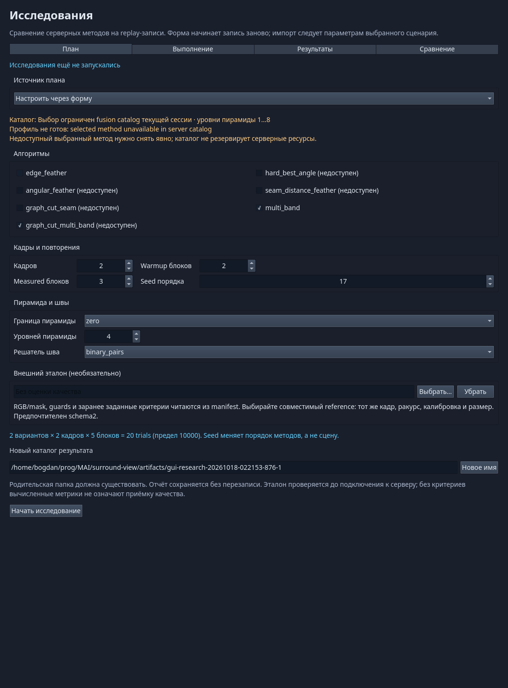

*Рисунок 3.59 — искусственно суженный каталог в QML regression test: выбранный graph-cut multiband остаётся видимым, а запуск заблокирован до явного исправления. Это тест поведения интерфейса, не описание ограничений реального GPU.*

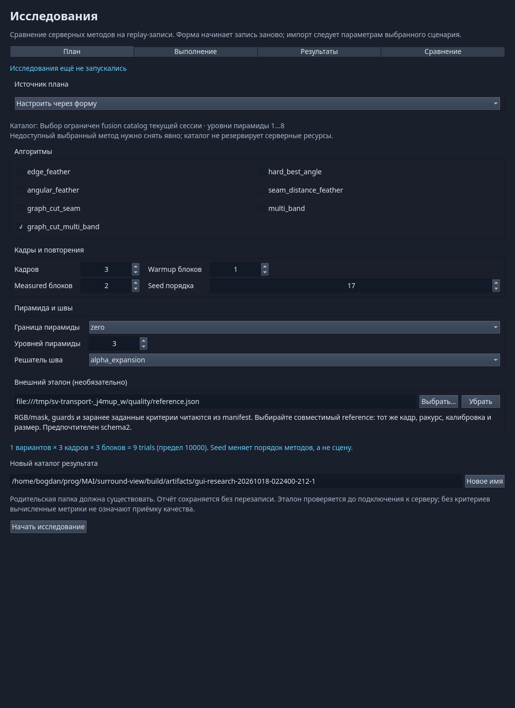

*Рисунок 3.60 — форма исследования с fusion catalog реального серверного прогона: graph-cut multiband, zero boundary, alpha-expansion и три уровня; внешний эталон является regression capture.*

Метод `startCatalogDraft` повторно строит и проверяет scenario в C++, прежде чем передать
его прежнему worker. Поэтому прямой вызов GUI slot с недоступными значениями также не
создаёт каталог результатов и не начинает сетевую операцию. Каталог не резервирует
revision, память или backend: сервер может измениться после проверки формы. Runner
повторно получает фактический catalog и выполняет прежние lease/apply/frame/restore операции;
ошибки проходят обычный механизм отчёта и восстановления. Сохранённые scenarios и batch
сохраняют прежний общий путь исполнения, без переопределения настроек текущей формой.

Проверки включают C++ пересечение enum, недоступные уровни/boundary/solver, отсутствие
предпосылок отдельных семейств, неизвестную версию, неверные типы и duplicate enum.
QML проверяет смену каталога, сохранение выбранных значений, явное снятие недоступного
метода и очистку возможностей после disconnect/reset. В live transport workflow добавлен
запуск самой формы по каталогу native report с тем же внешним reference; это дополнение
к прежним import/batch/comparison flows. Инженерные результаты и ограничения:
[[validation/RESEARCH_RUNTIME]]; использование: [[engineering/RESEARCH_BATCH#Каталог возможностей в форме исследования]].

Этот этап не выбирает лучший алгоритм и не подтверждает пригодность профиля на целевой
Авроре. Carrier/parameter matrices, остальные численные поля fusion, редактор критериев,
независимое качество и аппаратная приёмка остаются отдельными задачами.

Финальная инженерная регрессия Linux:68/68 CTest за155,01с, transport82,20с и QML6,99с.
Отдельно выполнены22/22 Qt unit cases; пять новых cases относятся к capability adapter.
В research QML standalone пройдено6 cases, live-only case выполнен transport harness.
Подтверждающая серия исследований и квалификация на Авроре остаются открытыми.

## 3.61. Фиксация критериев конкретного опыта и происхождение оценки

Метрика качества и условие приёмки решают разные задачи. MAE/RMSE/PSNR описывают отличие
изображения от заданного эталона; порог определяет, какое отличие допускается в конкретном
протоколе опыта. Ранее thresholds задавались только в manifest эталона. Для исследования
с разными заранее выбранными условиями это вынуждало менять исходный manifest или создавать
его копии, смешивая описание truth и решение о допустимой ошибке.

В общий C++ scenario schema1 добавлен optional `quality_criteria`. По умолчанию сохраняется
наследование criteria manifest. При явном override задаётся **полный заменяющий набор**, а
не дополнение к прежнему. Например, manifest с MAE и PSNR плюс override только RMSE
означает проверку только RMSE. Это правило позволяет точно воспроизвести условия, не
предполагая неявного объединения полей. Пустой override, неизвестный критерий, нечисловое,
неfinite или отрицательное значение и criteria без reference отклоняются.

| Режим | Эффективные критерии | Запись происхождения |
|---|---|---|
| Нет override, manifest содержит criteria | Набор из manifest | `manifest_v1` |
| Нет override и criteria в manifest | Приёмка не запрошена; вычисляются доступные метрики | `not_requested` |
| Явный непустой override | Только выбранные поля scenario | `scenario_override_v1` и исходный `manifest_criteria` |
| Пустой override либо нет reference | Запуск не подготавливается | Ошибка до output/network |

В FileExperiment reference и override загружаются при preflight. Неизменяемый evaluator
фиксирует truth, masks, guards и выбранные thresholds до создания результата и соединения
с сервером. Исходный manifest не переписывается: его raw SHA256 сохраняется отдельно от
`scenario_sha256`, учитывающего override. Нормализованные effective criteria и источник
сохраняются в `quality_reference`; при override добавляется прежний набор либо null,
если его не было. Прямой C++ вызов runner также проверяет согласованность scenario и
подготовленного evaluator, чтобы забытый override не привёл к оценке по другим условиям.

```plantuml
@startuml
title Критерии конкретного опыта без изменения исходного truth
actor Исследователь as User
participant "sv-simulator / svctl" as Client
participant "FileExperiment" as Prepare
database "Исходный reference manifest\nRGB / masks / guards" as Files
participant "Immutable evaluator" as Evaluate
participant "Общий runner" as Runner
participant "sv-server" as Server
User -> Client: Reference + явный полный набор criteria
Client -> Prepare: Frozen scenario
Prepare -> Files: Чтение до output/network
Files --> Prepare: Original bytes/hash + manifest criteria + truth
Prepare -> Evaluate: Effective criteria и исходный policy
Prepare -> Runner: Prepared inputs; reserved output
Runner -> Server: Прежние команды получения кадров
Server --> Runner: Результаты renderer
Runner -> Evaluate: Measured RGBA sample
Evaluate --> Runner: Metrics + sample acceptance
Runner --> Client: Scenario/hash, criteria/source, original policy, итог
@enduml
```

*Рисунок 3.61 — truth и пороги остаются в клиентском evaluator и не передаются исследуемому алгоритму сервера.*

Итоговая политика не изменена. Для множества измеренных samples \(S\) и выбранных условий
\(C\) успешная пороговая приёмка требует

$$\mathrm{passed}=\mathrm{workflow\_complete}\land\mathrm{restored}
\land\bigl(|S|=N_{frames}N_{variants}N_{repeats}\bigr)
\land\bigwedge_{s\in S}\bigwedge_{c\in C}c(s).$$

Warmup исключён. Нарушение порога не прекращает остальные trials и восстановление:
полный опыт получает `failed`, неполный — `incomplete`. Точное совпадение при нулевой MSE
по-прежнему имеет бесконечный PSNR, представленный парой null/`exact_match`, а не нулём.

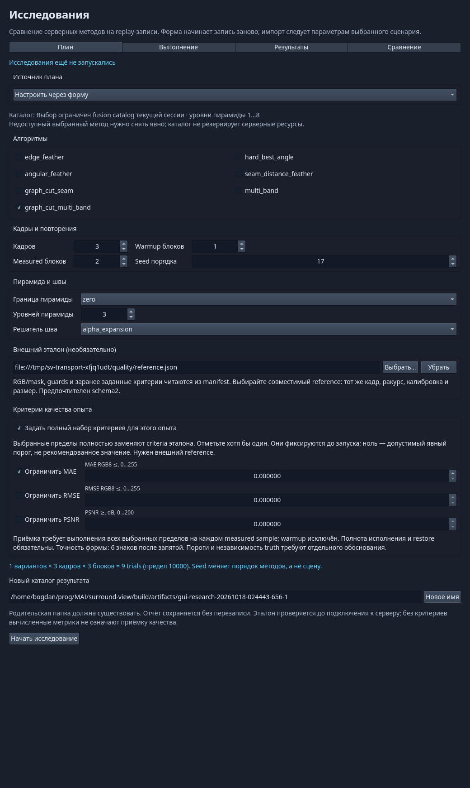

*Рисунок 3.62 — реальная Qt6 форма перед native запуском: явный override MAE≤0 для regression fixture; нулевой порог проверяет совпадение RGB в выбранной маске и не является рекомендованным порогом для реальной сцены.*

GUI использует отдельный компонент с переключателем наследования/override, флажками
MAE/RMSE/PSNR и числовыми полями. Непомеченные поля не входят в policy. Начальный набор
пуст, поэтому включение override требует явного выбора. MAE/RMSE допускают0…255,
PSNR0…200dB; форма поддерживает шесть знаков после запятой, общий C++ API — поддерживаемую
double точность. Отключение режима возвращает наследование, сохраняя введённые значения
для последующего явного включения. Параметры формы не переопределяют saved scenario/batch.

При сравнении отчётов паспорта показывают effective criteria/source, а разные policy дают
причину `acceptance_policy_differs`. Это не запрещает вычисление сырых MAE/RMSE deltas на
тех же inputs/truth: одинаковое качество и прохождение разных thresholds — разные утверждения.
Никакой общий рейтинг или научная приёмка из смены порога не выводится.

Проверки включают replacement без merge, сохранность manifest/hash, неизменность prepared
policy после редактирования файлов, несогласованность scenario/evaluator, сохранение criteria
в отменённом отчёте, invalid/orphan criteria, состояние QML формы и native запуск через
Unix/TCP/combined с проверкой provenance. Это инженерная проверка механизма. Обоснование
thresholds до confirmatory серии, независимость truth и целевая квалификация остаются
открытыми. Формат и использование: [[engineering/RESEARCH_QUALITY#Критерии конкретного сценария без изменения эталона]].

Финальная Linux регрессия:68/68 CTest за156,20с, transport82,35с и QML7,02с.
Три новых evaluator/preflight cases, один comparison-policy case, три Qt model/draft cases
и один QML case дополняют live form workflow. Проверены44 PlantUML вставки architecture/главы3.
Qt5/Аврора и независимая подтверждающая серия в эту проверку не входят.

## 3.62. Применимые матрицы параметров fusion в интерфейсе исследования

Фиксированный выбор одного числа уровней и одного решателя достаточен для демонстрации,
но не для воспроизводимого исследования чувствительности метода. Поэтому в форму добавлены
диапазон уровней пирамиды и сравнение двух поддержанных решателей шва. Они сочетаются
с прежними methods и boundary. Реализация остаётся C++: application adapter использует
общий `expand_variant_matrix`, а GUI передаёт только типизированные значения элементов формы.

Полный Cartesian product всех полей для всех методов был бы некорректен как план опыта.
Например, pyramid levels не изменяет `edge_feather`, а seam solver не относится к обычному
multiband. Такие оси увеличивали бы число trials, создавая повторные псевдоварианты.
Поэтому матрица строится отдельно для каждого метода с его применимыми осями.

| Метод | Boundary axis | Levels axis | Solver axis | Вариантов в примере |
|---|---|---|---|---:|
| edge_feather | Не применяется | Не применяется | Не применяется |1|
| graph_cut_seam | Не применяется | Не применяется | binary_pairs / alpha_expansion |2|
| multi_band | zero / normalized |2 /4| Не применяется |4|
| graph_cut_multi_band | zero / normalized |2 /4| binary_pairs / alpha_expansion |8|
| Всего | | | |15|

Для диапазона с первым уровнем \(a\), верхней границей \(b\) и положительным шагом \(s\)
число значений равно

$$n_L=\left\lfloor\frac{b-a}{s}\right\rfloor+1,\qquad 1\le a\le b\le8.$$

Конечное значение не добавляется принудительно: диапазон2…5 с шагом2 даёт2 и4.
Если \(B_m,L_m,S_m\) — числа значений применимых осей метода \(m\), то

$$N_{variants}=\sum_m B_mL_mS_m,\qquad
N_{trials}=N_{variants}N_{frames}(N_{warmup}+N_{repeats}).$$

Для отсутствующей либо неприменимой оси множитель равен1. Предел32 variants и10000 trials
проверяется для всего профиля до запуска worker, создания output и сетевых операций.
Неверный диапазон, дробные/boolean значения, нулевой шаг и повторные/неизвестные solver
отклоняются. Число trials не означает число независимых сцен или наблюдений качества.

```plantuml
@startuml
title Матрица параметров: применимые оси и проверка фактического исполнения
actor Исследователь as User
participant "ResearchMatrixEditor" as UI
participant "C++ form adapter" as Build
participant "Common matrix expander" as Expand
participant "Catalog guard / FileExperiment" as Prepare
participant "Runner / sv-server" as Run
User -> UI: Methods, boundary, level range, solvers
UI -> Build: Typed form values
loop Для каждого метода
  Build -> Expand: Только применимые axes
  Expand --> Build: Детерминированные варианты
end
Build --> UI: C++ counts либо ошибка лимита
User -> UI: Запустить
UI -> Prepare: Frozen ordinary scenario
Prepare -> Prepare: Проверить все variants по catalog и inputs
Prepare -> Run: Прежний shuffled trial plan
Run --> UI: Report + metadata фактических settings
UI --> User: Подписанные карточки: index, levels, solver
@enduml
```

*Рисунок 3.63 — общий построитель и серверный workflow сохраняются при добавлении матрицы формы.*

C++ функция `draftSummary` формирует preview quantities из того же scenario, которое
проверяется перед исполнением. QML не поддерживает отдельную формулу разворачивания.
При ошибке отображается причина, а не нулевое число вариантов. Сужение каталога не фильтрует
выбранную матрицу молча: пользователь явно исправляет диапазон или отключает сравнение
solver. Одиночные значения временно отключаются при sweep и сохраняются для возврата.
При снятии всех методов семейства его ось не передаётся в scenario; при возврате метода
сохранённые настройки вновь проверяются.

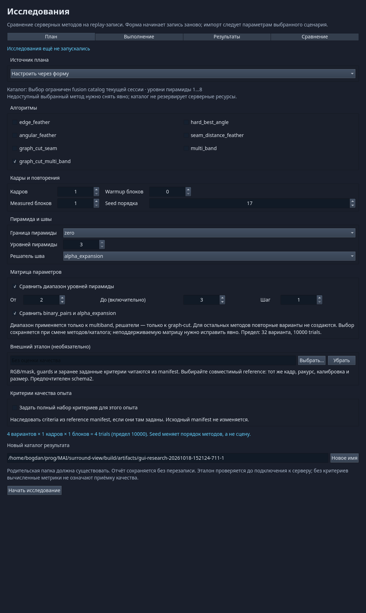

*Рисунок 3.64 — native GUI профиль из четырёх graph-cut multiband вариантов: levels2/3 × два solver, одна zero boundary. Reference не выбран: это проверка исполнения, не качества.*

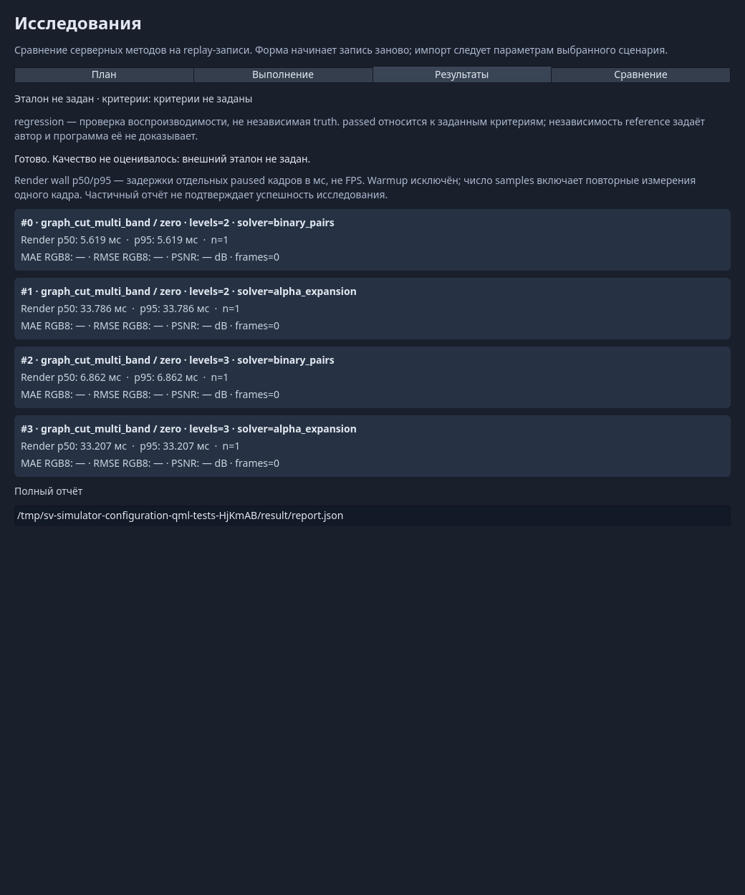

*Рисунок 3.65 — результаты native матрицы с явными levels/solver и индексом варианта; по одному measured sample на вариант без warmup иллюстрируют связность системы, не статистическое преимущество алгоритма.*

При реализации выявлена отдельная проблема представления: прежние карточки содержали только
mode/boundary и не различали варианты с другими levels/solver. Теперь подпись содержит номер,
уровни для pyramid family и solver для graph-cut. Высота карточки вычисляется по содержимому,
текст переносится при недостаточной ширине. Неприменимые параметры в подпись не добавляются.

Snapshot остаётся обычным scenario со списком всех `variants`; его можно повторить через
`svctl research`. Дополнительного server protocol или интерпретатора сценариев не вводится.
Внутренние UI range/checkbox состояния отдельно не сериализуются; повторение готового списка
не требует их восстановления. Критерии/reference продолжают фиксироваться FileExperiment.

В native transport test проверяются не только четыре подписи scenario: metadata каждого
sample должны содержать соответствующие levels, solver и boundary, а input identities
оставаться равными baseline. Варианты выполняются shuffled, поэтому проверка сопоставляет
их по sample.variant, а не порядку прихода. Отдельно проверяется уникальность отображаемых
профилей. Это проверка конфигурации и исполнения; численная корректность алгоритмов и
независимое качество остаются предметом прежних oracle/confirmatory этапов.

Реализация закрывает первый срез parameter matrices. Набор геометрий добавлен в §3.63;
применимые числовые оси добавлены в §3.64. Bundles/multi-recording и
исследовательская/целевая приёмка остаются открытыми. Использование:
[[engineering/RESEARCH_BATCH#Матрица параметров fusion в форме]].

Финальная сборка успешна, Linux CTest68/68 за155,97с; transport85,14с, QML7,06с.
Отдельно прошли31/31 Qt unit cases и QML matrix case; добавлены шесть C++ cases и один QML case.
Проверены46 PlantUML вставок architecture/главы3. Целевая Аврора и независимая
подтверждающая серия не квалифицированы этим функциональным прогоном.

## 3.63. Матрица носителей на основе принятой сервером конфигурации

Сравнение способов сшивки без контроля носителя смешивает два воздействия: изменение
весов/швов и изменение геометрического отображения. Для исследования эти факторы
нужно задавать явно. В форме sv-simulator реализован набор полных профилей поверхности,
который пересекается с применимыми вариантами fusion. Набор включает плоский вариант
rectangular bowl при нулевой высоте края, bowl, купол с полом, цилиндр с полом и куб;
разные размеры или разбиения одного типа также могут быть отдельными профилями.
Математическая постановка и ограничения геометрий приведены в главе2; здесь описана
реализация воспроизводимого управления ими через существующий серверный протокол.

Принципиально разделены `surface` — редактируемый черновик конфигуратора — и
`activeSurface` — прочитанный active-снимок. Новый read-only accessor модели возвращает
только active, пока соединение и snapshot/catalog готовы; при disconnect он возвращает
пустой объект. Нажатие «Добавить текущий active» копирует весь объект, а не только тип
и размеры. Это сохраняет resolution, reference height, local support и source occlusion.
Позднейшее редактирование черновика или новое состояние active не меняют уже добавленный
профиль. Доступ к конфигурационному файлу клиенту не предоставляется.

```plantuml
@startuml
title Получение носителей для одного воспроизводимого сценария
actor Исследователь as User
participant "Конфигуратор" as Config
participant "sv-server" as Server
participant "Набор носителей" as Profiles
participant "C++ form adapter" as Adapter
participant "ExperimentRunner" as Runner
User -> Config: Тип / размеры / разбиение
Config -> Server: validate / apply / read_configuration
Server --> Config: active.surface
User -> Profiles: Добавить текущий active
Config --> Profiles: Полная независимая копия
User -> Profiles: Повторить; включить набор
Profiles -> Adapter: surface_profiles и fusion controls
Adapter -> Adapter: Проверки и S × F, не более32 variants
Adapter -> Runner: Обычный frozen scenario.json
loop Trial согласно seed и block plan
  Runner -> Server: revision-aware surface / fusion
  Server --> Runner: Frame + actual metadata
  Runner -> Runner: Проверить surface и fusion
end
Runner -> Server: Восстановить исходные surface / fusion / pause
@enduml
```

*Рисунок3.66 — снимок принятой конфигурации, матрица и проверка фактического применения.*

Пусть \(S=(s_0,\ldots,s_{m-1})\) — упорядоченный набор поверхностей, а
\(F=(f_0,\ldots,f_{n-1})\) — применимые fusion variants из §3.62. Тогда

\[
V_{i n+j}=(s_i,f_j),\quad 0\le i<m,\quad 0\le j<n,
\qquad |V|=mn\le32.
\]

Для \(K\) кадров, \(W\) прогревочных и \(R\) измерительных блоков число trial
равно \(T=mnK(W+R)\le10000\). Индекс variant фиксирует комбинацию, а порядок
выполнения trial определяется общим планировщиком с seed. Поэтому sample сопоставляется
с поверхностью по своему индексу, а не по позиции в массиве результатов.

| Состояние формы | Поведение |
|---|---|
| Набор выключен | Surface не добавляется в variants; используется исходный носитель сервера |
| Набор включён и пуст | Ошибка до worker, output и соединения |
| Полностью одинаковые профили | Добавление блокируется; C++ adapter также отвергает дубликаты |
| Один тип с разными параметрами | Отдельные профили с отдельными индексами |
| Тип отсутствует в текущем catalog | Запуск блокируется без удаления сохранённого профиля |
| Превышены32 variants/10000 trials | Ошибка всей матрицы, а не скрытое усечение |
| Профиль несовместим с актуальными vehicle/view | Сервер отклоняет применение; runner пытается восстановить исходное состояние |

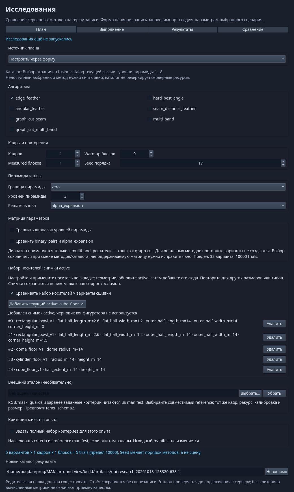

*Рисунок3.67 — набор пяти носителей, полученных из active реального тестового sv-server.
Размеры относятся к функциональной fixture и не рекомендуются как настройки автомобиля.*


*Рисунок3.68 — отдельные карточки пяти вариантов с индексом и типом носителя. Точный
объект surface хранится в scenario и sample metadata; reference в этом прогоне отсутствует.*

Окончательная проверка геометрии остаётся серверной. Снимок active удостоверяет принятие
на момент чтения, но не гарантирует совместимость с новым vehicle/view, другим сервером
или ресурсами целевого устройства. Набор формы до запуска находится в памяти окна;
при запуске сохраняется обычный scenario schema1 с полными `variants[].surface`, который
можно повторить compiled `svctl research`. Восстановление не включает replay cursor.

Сравнительный live-тест использует plane/bowl/dome/cylinder/cube: каждый профиль сначала
применяется к настоящему серверу, затем читается через `config_read` и добавляется кнопкой
формы. Перед экспериментом восстанавливается исходный носитель. Для каждого результата
проверяется точное совпадение metadata.surface с объявленным variant и неизменность
baseline input identities; после runner отдельно читается состояние сервера для проверки
восстановления поверхности. Это проверка управляющего пути, а не исследовательский рейтинг:
один кадр, один repeat, без warmup и quality reference не обосновывают преимущество носителя.
Открыты матрицы других fusion parameters, independent truth/holdout, многокадровые серии
и проверка на Авроре. Подробности реализации и приёмки:
[[engineering/RESEARCH_BATCH#Набор носителей в форме]], [[validation/RESEARCH_RUNTIME]].

Проверка реализации: полная Linux сборка и CTest68/68 за157,92с; Unix/TCP harness87,02с,
QML7,09с. После добавления проверки точного сохранения optional snapshots повторены
сборка и research unit CTest1/1, GTest33/33. Новые проверки включают два C++ matrix cases,
один EditorUnit case, один QML case и расширенный live GUI workflow. Проверены48 PlantUML
вставок architecture/главы3.

## 3.64. Числовые оси и исключение неприменимых параметров

Следующий срез формы охватывает ширину смешивания, степень углового веса и регуляризацию
graph-cut. Полный декартов продукт этих полей для каждого метода создавал бы повторные
варианты с неиспользуемыми настройками. Применимость проверена по фактическим путям
`src/render/surface.frag` и `src/fusion/fusion.cpp`, а не по названию семейства.

| Метод | Edge width | Angle power | Smoothness |
|---|---|---|---|
| edge_feather | Да | Нет | Нет |
| angular_feather | Да | Да | Нет |
| hard_best_angle | Нет | Не перебирается | Нет |
| seam_distance_feather | Нет | Нет | Нет |
| graph_cut_seam | Нет | Нет | Да |
| multi_band | Да | Нет | Нет |
| graph_cut_multi_band | Нет | Нет | Да |

В shader обычное смешивание использует \(w_e=\operatorname{clamp}(d/e,0,1)\), где
\(e\) — edge width, \(d\) — расстояние до края изображения. Angular feather умножает
этот вес на \(\max(\cos\theta,0)^p\). Hard best angle выбирает максимум углового веса;
для положительного \(p\) математический порядок не меняется. Поэтому эта степень
не создаёт отдельную ось hard-best исследования; численные underflow-эффекты здесь
не исследуются. Обычный multiband использует edge weights проекционных слоёв. Graph-cut
строит шов из distances и smoothness; его multiband-вариант сглаживает cut labels,
поэтому edge width не является осью этих двух методов в текущей реализации.

Каждая числовая ось задаётся явным упорядоченным списком, а не десятичным диапазоном
с накоплением шага. Пользователь раскрывает группу, включает ось, вводит число в SpinBox
и добавляет его кнопкой. Значения удаляются по отдельности; допускается1..8 различных
конечных чисел. UI поддерживает точность0.001, C++ проверяет полный числовой диапазон:
edge width \((0,4096]\), angle power \((0,32]\), smoothness \([0,100]\).
Включённый пустой список блокирует запуск. Сворачивание группы не выключает оси.

Пусть \(A_m\) — множество применимых осей метода \(m\), а \(L_a\) — список значений
оси \(a\). При \(s\) носителях число вариантов равно

\[
N=s\sum_{m\in M}\prod_{a\in A_m}|L_a|\le32,
\]

где в \(A_m\) включены также применимые boundaries, levels и solvers из §3.62.
Например, для edge/angle/smoothness списков по два значения и фиксированной boundary
набор edge_feather, angular_feather, graph_cut_seam и multi_band даёт
\(2+2\cdot2+2+2=10\) вариантов. Каждый native sample сопоставляется по variant index,
поскольку порядок trial перемешан общим планировщиком.

```plantuml
@startuml
title От числовых controls до подтверждённых настроек кадра
actor Исследователь as User
participant "Раскрываемые списки GUI" as UI
participant "C++ numeric axes adapter" as Adapter
participant "Catalog guard" as Guard
participant "ExperimentRunner" as Runner
participant "sv-server" as Server
User -> UI: Включить оси, добавить явные числа
UI -> Adapter: Typed lists
Adapter -> Adapter: Конечность / пределы / distinct / применимость
Adapter -> Adapter: Common expander, общий лимит32 variants
Adapter -> Guard: Parsed FusionSettings каждого варианта
Guard -> Guard: Все числовые поля, включая defaults
Guard --> UI: Preview либо ошибка; выбор сохраняется
User -> UI: Запустить
UI -> Runner: Frozen ordinary scenario
loop Trial
  Runner -> Server: configure_fusion
  Server --> Runner: Frame + actual fusion metadata
  Runner -> Runner: Сверить применённые настройки
end
Runner -> Server: Восстановить исходные настройки
@enduml
```

*Рисунок3.69 — выбор применимых осей и проверка полного набора отправляемых чисел.*


*Рисунок3.70 — форма с числовыми осями для десяти вариантов. Явные списки редактируются
через controls; отдельный JSON для настройки не требуется.*


*Рисунок3.71 — карточки числовой матрицы: параметры различаются в подписях, значения
метрик качества отсутствуют, поскольку независимый reference не задан.*

Отключённые оси не наследуют active-настройки сервера: сохраняется прежняя семантика
Scenario defaults — ширина24, степень2 и smoothness0.1. Runner отправляет полный
FusionSettings, поэтому каталожная проверка охватывает и эти неявные числа. Даже если
конкретный метод не использует параметр для color, сервер может отклонить его значение
как невалидную конфигурацию. Сужение catalog не исправляет список молча; ошибка блокирует
worker/output. Общий лимит10000 trials применяется после всех осей и носителей.

Нативный GUI workflow проверяет десять вариантов на реальном сервере, включая fractional
width12.5, angle power1/2 и smoothness0/0.125. Для каждого sample явно выбранные числа
сверяются с actual fusion metadata, input identities — с baseline; после завершения
отдельное чтение state проверяет восстановление исходной fusion. Функциональные данные
содержат один кадр и один repeat без warmup: они подтверждают переключение параметров,
но не оценивают статистическое преимущество алгоритмов. Применимость параметра не
гарантирует, что два значения дадут разные изображения на любой сцене. Научная приёмка,
многокадровые серии, bundles и Аврора остаются отдельными этапами.

Полная сборка и Linux CTest68/68 за161,04с, включая Unix/TCP/combined и QML.
Проверены50 PlantUML вставок architecture/главы3; сравнительные screenshots получены
из реального GUI workflow. Дополнительная QML проверка охватывает нажатие кнопки удаления значения;
research GTest36/36. Подробности: [[validation/RESEARCH_RUNTIME]].

## 3.65. Допуск сравнения времени с учётом нагрузки наблюдения

При аудите сравнения отчётов обнаружен методический пробел: допуск учитывал порядок
trial, входы и source fingerprint, но не различал сохранение RGBA и работу evaluator.
Render wall измеряет отдельную серверную стадию, однако межкадровая клиентская работа
может влиять на условия последующих измерений. Поэтому доступность разницы времени
не должна определяться только совпадением названия алгоритма и replay inputs.

В общий C++ runner добавлен `observation_policy` с идентификатором
`paused_observation_v1`. Он фиксирует SHA256 RGBA каждого trial, capture flag/consumer,
включение masked RGB evaluator, наличие progress callback и telemetry settings сервера.
FileExperiment уточняет известный файловый consumer `rgba8_files_v1`; произвольный
capture callback остаётся неподтверждённым. Телеметрия читается через существующий
read-only config_read после получения lease и после последнего trial перед restore.
Нормализуются enabled, period_ms и history_capacity; конфигурация не изменяется.

```plantuml
@startuml
title Нагрузка наблюдения как отдельное условие сравнения времени
participant "Runner / FileExperiment" as Run
participant "sv-server" as Server
participant "Отчёт A/B" as Reports
participant "C++ comparison" as Compare
participant "GUI паспорт" as UI
Run -> Run: Capture/evaluator/progress/digest profile
Run -> Server: Acquire lease; config_read
Server --> Run: Telemetry before
loop Paused trials
  Run -> Server: Configure fusion/surface
  Server --> Run: Frame + stage timings
  Run -> Run: SHA256; optional evaluate / capture / progress
end
Run -> Server: config_read before restore
Server --> Run: Telemetry after
Run -> Reports: Versioned profile; stability
Reports -> Compare: Две независимые записи
Compare -> Compare: Observation schema/flags/telemetry checks
Compare -> Compare: Inputs/order/build/reference/criteria gates
alt Совместимые заявления о работе и полные samples
  Compare --> UI: Допустимая разница B-A
else Нагрузка неизвестна или отличается
  Compare --> UI: Исходные p50/p95 видны; timing delta отсутствует
end
@enduml
```

*Рисунок3.72 — профиль наблюдения фиксируется отдельно от исходных render timings.*

Формально допуск времени расширен:

\[
G_t=G_{inputs}\land G_{complete}\land G_{trial}\land G_{source}\land G_{observation}.
\]

Последний множитель требует известных совпадающих observation profiles. Если evaluator
включён, дополнительно проверяются одинаковые schema2 reference content/ROI и effective
criteria: evaluator выполняет metric computation и проверки порогов между samples.
Равенство criteria_source само по себе не требуется для одинаковой вычислительной работы,
но разница происхождения criteria остаётся видимой в acceptance_policy_differs.
Разность \(\Delta t=p50_B-p50_A\) вычисляется только после этого допуска и проверки
полноты счётчиков строки. Недоступная разность отображается как «—», а не ноль.

| Ситуация | Поведение сравнения policy v2 |
|---|---|
| Старый report без observation_policy | Читается; timing delta недоступна |
| Разные capture flags или неизвестный capture callback | Timing delta недоступна, raw timings сохранены |
| Разные progress-presence flags | Timing delta недоступна |
| Telemetry unknown/unstable/разная | Timing delta недоступна |
| Evaluator включён, разные reference masks/criteria | Timing delta недоступна |
| Разные criteria, но одинаковые content-bound reference | Raw MAE/RMSE deltas по-прежнему могут быть доступны |
| Совпадает observation profile | Далее проверяются прежние inputs/order/source/complete gates |


*Рисунок3.73 — сравнение двух отчётов реального сервера. В паспортах видны capture,
evaluator, progress и telemetry; observation gate отделён от timing/quality gates.
Источник качества — regression fixture, не независимая ground truth.*

Неполученные telemetry settings не заменяются значениями false/0: соответствующее поле
остаётся null, при ошибке чтения записывается observation_error. Сбор экспериментальных
данных может продолжиться, но сравнение времени не получает разрешения. Два снимка —
не непрерывная аттестация; при штатном исполнении lease запрещает конкурирующий config apply.
Новый экспорт сравнения помечен `report_claims_comparison_v2`, native report сохраняет
schema1 с добавленным полем. Существующие отчёты доступны для просмотра и допустимых
quality comparisons, но недостающие сведения не восстанавливаются предположениями.

Это ограниченная методическая защита, а не performance-приёмка. Совпадение флага progress
не аттестует реализацию callback; идентификатор файлового consumer не описывает storage
latency и cache. Не квалифицированы compiler/options/SDK/dependencies, binary identity,
trace I/O, частоты/thermal, внешняя нагрузка и аппаратная платформа. Source fingerprint
по-прежнему описывает исходники. Вывод о лучшем алгоритме требует отдельного стендового
паспорта, достаточной серии и независимого качества, а не одного допущенного delta.
Контракт: [[engineering/RESEARCH_REPORTS#Нагрузка наблюдения и policy v2]].

В том же аудите уточнена граница исходного restore snapshot: прежний отдельный state
читался до acquire. Теперь initial_state берётся
из ACK успешного acquire, включающего active lease ID и текущие fusion/surface/pause.
Сервер сериализует acquire и формирование ACK в обработке команды; это согласует клиентский
снимок с серверным lease baseline. В отчёте добавлен origin experiment_acquire_ack_v1,
нативный тест сверяет active state и lease ID. Отдельный pre-acquire запрос удалён.

Текущий сервер односессионный: этот прогон не воспроизводит многоклиентную гонку.
Привязка к acquire ACK исключает зависимость от интервала read→acquire при будущем
расширении concurrency; тест подтверждает согласованный lease snapshot и restore.

Приёмка реализации: полная сборка, Linux CTest68/68 за156,91с, в том числе
Unix/TCP/combined87,50с и QML7,12с; comparison GTest16/16 и Qt research units36/36.
Проверены52 PlantUML вставки architecture/главы3. Подробности и первоначальная ошибка
нового assert описаны в [[validation/RESEARCH_RUNTIME]].

## 3.66. Переносимый набор client-side входов исследования

До этого этапа сохранённый scenario мог ссылаться на reference manifest и PPM по путям
ноутбука. Копирование одного JSON не переносило эти зависимости. Для повторного запуска
на другом Linux-стенде реализован compiled формат scenario_bundle_v1: один сценарий,
его reference manifest и все используемые RGB/mask PPM помещаются в новую папку.
Экспорт переписывает зависимости в относительные имена, сохраняет размеры и SHA256,
а загрузка проверяет полный набор и фиксирует данные до подключения к серверу.

Граница формата принципиальна: это **client_scenario_and_reference_only**. Server replay,
геометрия/калибровка камер из server config и бинарная сборка не переносятся этим набором.
Для полноценного повторения нужен отдельно подготовленный совместимый server recording;
quality guards на фактических кадрах остаются обязательными. Формат не объявляет
воспроизводимым весь автомобильный стенд и не доказывает независимость ground truth.

```plantuml
@startuml
title Границы переносимого сценария
package "Scenario bundle directory" {
  artifact "bundle.json\nsize/hash inventory + scope" as Manifest
  artifact "scenario.json\nrelative reference path" as Scenario
  artifact "reference.json\nguards, view, criteria" as Reference
  artifact "assets/frame-N-rgb.ppm" as RGB
  artifact "assets/frame-N-mask.ppm" as Mask
  Manifest --> Scenario
  Manifest --> Reference
  Manifest --> RGB
  Manifest --> Mask
  Scenario --> Reference
  Reference --> RGB
  Reference --> Mask
}
node "Отдельно подготовленный sv-server" {
  artifact "Replay recording" as Replay
  artifact "Server config / calibration" as Config
}
Scenario ..> Replay : inputs должны совпасть
Reference ..> Config : guards проверяются на кадрах
@enduml
```

*Рисунок3.74 — переносимые client inputs отделены от ещё не зарегистрированных server inputs.*

Manifest содержит schema_version1, kind и scope, source_scenario_sha256,
files[{path,bytes,sha256}] и reference_description. Digest исходного сценария считается
до переписывания reference path; descriptor scenario.json описывает уже packed bytes.
PPM копируются без перекодирования. Reference manifest сериализуется заново с безопасными
относительными путями; его hash и decoded RGB/mask identities фиксируются в description.
Сохраняются declared kind, guards, view, manifest criteria и scenario overrides.

Пусть \(F\) — список members, \(D(f)\) — проверенные bytes файла, \(n_f,h_f\) —
его заявленные размер и hash. Загрузка требует

\[
\forall f\in F:\quad |D(f)|=n_f\ \land\ SHA256(D(f))=h_f,
\qquad F=\operatorname{closure}(scenario,reference).
\]

Во втором равенстве учитываются только внешние зависимости поддерживаемого scenario:
quality manifest и frame RGB/mask. Ссылки source camera IDs и content/model hashes
не являются файловыми путями. Абсолютные paths, `..`, неизвестные имена, duplicate entries,
пропущенные ссылки и неиспользуемые inventory entries отвергаются. Посторонние физические
файлы, не перечисленные в manifest, не читаются. Корневой каталог, assets directory и
file leaves открываются без следования финальным symlink; FIFO и devices не принимаются.

Для исключения повторного чтения изменяемых исходных файлов verified bytes копируются
в private staging directory с mode0700. FileExperiment загружает scenario из памяти и
фиксирует decoded reference из этой копии; description сравнивается с manifest. После
конструктора ScenarioBundle изменение/удаление original bundle уже не меняет execute.
Проверяется снимок конкретных прочитанных bytes, а не непрерывная неизменность папки.

```plantuml
@startuml
title Verified snapshot до output reservation и подключения
actor Исследователь as User
participant "svctl" as CLI
participant "ScenarioBundle" as Bundle
participant "Bundle files" as Files
participant "Private staging" as Stage
participant "FileExperiment" as Experiment
participant "sv-server" as Server
User -> CLI: research-bundle-run DIR NEW_REPORT
CLI -> Bundle: Constructor
Bundle -> Files: Read manifest + listed regular members
Bundle -> Bundle: Names / budget / size / SHA256 / closure
Bundle -> Stage: Copy verified bytes
Bundle -> Experiment: Freeze scenario + decoded reference
Bundle -> Bundle: Match frozen description
Bundle --> CLI: Ready immutable inputs
CLI -> Bundle: execute
Bundle -> Experiment: Reserve new report
Experiment -> Server: Existing research protocol
Server --> Experiment: Frames + metadata
Experiment --> CLI: Report + input_bundle identity
@enduml
```

*Рисунок3.75 — preflight и фиксация выполняются до output и connection, а не между trial.*

| Команда svctl | Результат | Подключение |
|---|---|---|
| research-bundle-export SCENARIO NEW_DIR | Новая папка с проверенными входами и manifest | Нет |
| research-bundle-verify DIR | Receipt с manifest hash, file/trial counts и decoded reference bytes | Нет |
| research-bundle-run DIR NEW_REPORT | Повторная проверка, frozen inputs и обычный research report | После preflight |

Сервис не зависит от Qt и не запускает Python. Он использует прежний ExperimentRunner
и sv-client-lib; новых wire-команд нет. Report получает input_bundle identity и
scenario_input_kind=verified_bundle_snapshot_v1. Staging path в report временный;
для воспроизведения сохраняется сам bundle, а не этот путь. Одна загрузка допускает
одну попытку execute. Existing output не перезаписывается.

Введены явные пределы: manifest/scenario/reference JSON до1MiB, до256 reference frames,
до514 members, до16MiB на PPM и64MiB total member bytes. Decoded reference дополнительно
проверяется прежним128MiB pixel budget. Это не обещание фиксированного RSS. Cancel
проверяется между chunks и до execute; parser/syscall не прерывается посередине.
Экспорт валидирует copied inputs до создания destination и пишет manifest последним,
но не реализует atomic publication/fsync. При ошибке может остаться partial новая папка,
которую нельзя принимать за bundle без полной проверки.

Шесть GTest cases проверяют перенос каталога, literal `#`/`%` в путях, сохранность criteria
и source digest, отсутствие reference, отказ от overwrite, pre-cancel и invalid mask,
изменённые/пропущенные/symlink/FIFO members, traversal/неполную closure даже после
пересчёта raw hashes, version/size/digest limits и mismatch reference description.
Отдельно проверено удаление исходников и bundle после загрузки: frozen reference и
provenance доступны в отчёте намеренно неудачной попытки без сервера. Нативный harness
добавляет offline export/verify, перемещение папки и исполнение на реальном sv-server
через Unix/TCP; испорченный member отклоняется до создания report.

SHA256 подтверждает соответствие прочитанных данных manifest, а не авторство manifest.
Согласованное изменение всех полей создаёт другой unsigned набор. Signature, dataset/
config/build registry, GUI integration, batch/multi-recording bundles, deduplication и
resume остаются открытыми. Приёмка качества по-прежнему требует независимого reference
и обоснованной серии; точное воспроизведение regression fixture не заменяет её.
Использование: [[engineering/RESEARCH_BATCH#Переносимый набор сценария]].

Приёмка реализации: полная сборка, Linux CTest68/68 за162,34с; native Unix/TCP
harness91,43с, QML7,16с. Bundle GTest6/6 и новый parser case1/1 успешны. Проверены55
PlantUML вставок architecture/главы3 и git diff --check. Полные сведения:
[[validation/RESEARCH_RUNTIME]].


## 3.67. Управление переносимым набором из графического клиента

В §3.66 переносимый набор реализован как общий C++ сервис и команды svctl. Для
практического использования на исследовательском стенде добавлен режим
«Переносимый набор» в исследовательскую страницу sv-simulator. Пользователь выбирает
папку, получает результат offline-проверки и запускает опыт теми же кнопками прогресса,
отмены и просмотра результатов. Сценарий не вводится как JSON-текст в поле интерфейса.
Экспорт сохранённого сценария вынесен в отдельную раскрываемую группу: исходный файл,
родительская папка, имя нового каталога и кнопка экспорта. Несохранённая форма этого
режима пока не экспортируется; такой пункт оставлен в плане явно.

| Действие в GUI | Общий C++ сервис | Нужен endpoint | Результат |
|---|---|---|---|
| Проверить без сервера | ScenarioBundle constructor + summary | Нет | Квитанция целостности |
| Экспортировать без сервера | export_scenario_bundle | Нет | Новая папка с manifest |
| Начать исследование | Новый ScenarioBundle + execute | Да | report.json обычного runner |
| Отменить | Общий atomic cancel | Только уже начатый прогон | Ожидание текущей операции и необходимого restore |

Квитанция содержит путь прочитанного каталога, число файлов и manifest SHA256. При
следующей операции она сбрасывается. Даже успешная проверка не разрешает пропустить
повторное чтение при запуске: между действиями пользователь может изменить файл,
переместить каталог или заменить носитель. Поэтому каждая попытка запуска создаёт
новый ScenarioBundle, который проверяет и фиксирует входы до создания выходного
каталога и сетевого соединения. Проверка целостности и проверка научного качества
отображаются отдельно: offline-проверка не переводит quality status в passed.

```plantuml
@startuml
actor "Исследователь" as User
participant "ResearchBundleEditor\nGUI thread" as UI
participant "ResearchController" as Controller
participant "Research worker" as Worker
participant "ScenarioBundle" as Bundle
participant "sv-server" as Server
User -> UI: Выбрать каталог; проверить
UI -> Controller: verifyBundle(local URL)
Controller -> Worker: busy=true; frozen path
Worker -> Bundle: Проверка и фиксация входов
Bundle --> Worker: summary
Worker --> Controller: queued receipt
Controller --> UI: Квитанция; busy=false
note over User,Bundle: Файлы могли измениться после проверки
User -> UI: Начать исследование
UI -> Controller: startBundle(folder, new output)
Controller -> Worker: frozen path / output / endpoint
Worker -> Bundle: Новый экземпляр; повторная проверка
alt Ошибка входов
  Bundle --> UI: Ошибка; каталог отчёта не создан
else Входы корректны
  Worker -> Bundle: execute(new report)
  Bundle -> Server: Обычный lease / research protocol
  Server --> Bundle: Кадры и metadata
  Bundle --> Controller: Report + input_bundle identity
  Controller --> UI: Rows / quality / restore
end
@enduml
```

*Рисунок3.76 — квитанция предыдущей проверки не заменяет preflight запуска.*


*Рисунок3.77 — фактический Linux/Qt6 GUI после экспорта, перемещения и offline-проверки
regression-набора; endpoint выбран для последующего запуска. Временные пути являются
путями тестового стенда, а не инструкцией по ручному вводу.*

Чтение файлов, копирование, hashing и декодирование reference выполняются в worker,
который уже используется обычными исследованиями и batch. Busy gate запрещает запуск
второй операции и блокирует изменение параметров из исследовательской формы. Endpoint
снимается в момент запуска и не меняется при последующих обновлениях состояния GUI.
Отмена и закрытие окна используют существующий общий lifecycle: worker получает atomic
cancel, завершает текущую неделимую операцию и необходимое восстановление, а QObject
не уничтожается с работающим потоком. Для offline-действий сервер не подключается,
поэтому восстанавливать его настройки не требуется.

Источник поведения — общий сервис examples/common/research/scenario_bundle, Qt-адаптер
examples/sv-simulator/research_controller и ResearchBundleEditor.qml; новый wire protocol
не добавлен. Linux/Qt6 проверен GTest и QML workflow. Три новые проверки контроллера
покрывают offline export/verify, exclusive busy, literal #/% paths, отказ от overwrite,
ошибочные URL/имена, tampering до output, отмену и destruction/join. QML-проверка
проверяет доступность кнопок без сервера, квитанцию и отказ после изменения файлов.
Отдельный native workflow через Unix/TCP экспортирует реальный regression-сценарий,
перемещает папку, проверяет её и запускает через кнопку GUI, затем проверяет restore,
quality status и manifest identity в report. Это проверка инженерного workflow на
fixture, а не новая независимая серия качества сшивки.

Пределы сервиса из §3.66 сохранены. Набор не содержит server replay/config/build;
согласование серверной записи остаётся отдельной подготовкой. При неудачном экспорте
может остаться новая частичная папка. Qt5-диалог предусмотрен в отдельном компоненте,
но тестирование Aurora/Qt5 и автомобильного устройства не подменяется Linux/Qt6.
Пошаговое использование: [[engineering/RESEARCH_BATCH#Переносимый набор в sv-simulator]].

Финальная Linux-проверка этого среза: сборка успешна, CTest68/68 за165,91с,
client_transports94,55с, QML7,15с. Контроллер39/39 GTest;57 PlantUML вставок architecture
и главы3 корректны. Подробности и границы свидетельств: [[validation/RESEARCH_RUNTIME]].

## 3.68. Переносимая серия сценариев одной серверной записи

Следующий недостаток воспроизводимости относился к серии: обычный batch-план хранил
пути к сценариям, а перенос отдельного сценария не сохранял порядок и состав серии.
Добавлен C++ BatchBundle и три команды svctl. Формат batch_bundle_v1 объединяет1–8
проверяемых дочерних scenario_bundle_v1; каждая строка top manifest связывает ID,
фиксированный каталог run-N и SHA256 точных bytes child manifest. Исходный план
фиксируется через source_plan_sha256. Все клиентские references доступны после
перемещения папки; серверная запись и конфигурация подготавливаются отдельно.

```plantuml
@startuml
left to right direction
folder "batch bundle" {
  artifact "bundle.json\nkind=batch_bundle_v1\nsource_plan_sha256\nordered runs" as Top
  folder "run-0" {
    artifact "bundle.json\nkind=scenario_bundle_v1" as Child0
    artifact "scenario / reference / PPM" as Data0
  }
  folder "run-1 .. run-7" {
    artifact "bundle.json\nkind=scenario_bundle_v1" as ChildN
    artifact "scenario / reference / PPM" as DataN
  }
}
Top --> Child0 : id / directory / manifest SHA256
Top --> ChildN : id / directory / manifest SHA256
Child0 --> Data0 : sizes / hashes / closure
ChildN --> DataN : sizes / hashes / closure
@enduml
```

*Рисунок3.78 — top manifest связывает состав серии, child manifests связывают её входы.*

Проверка выполняется до output/network. Top manifest ограничен64KiB, ID уникальны и
безопасны для имён отчётов, directories строго соответствуют позиции run-0..run-7.
Файлы читаются по фиксированным путям с no-follow на root, run-N, assets и leaves;
FIFO/devices отвергаются. Verified bytes копируются в private staging, после чего
каждый child проходит прежние hash/closure/decoder/reference-description проверки.
Конструктор сохраняет все FileExperiment до исполнения. Поэтому удаление исходной
папки после загрузки не подменяет входы в следующих сценариях.

Для серии из n сценариев введены суммарные ограничения:

$$
1 \le n \le 8,\qquad
\sum_{i=1}^{n} T_i \le 10000,\qquad
\sum_{i=1}^{n} R_i \le 128\,\mathrm{MiB},\qquad
\sum_{i=1}^{n} B_i \le 64\,\mathrm{MiB},
$$

где T_i — число trials сценария, R_i — объём decoded references, B_i — точные bytes
child manifest и перечисленных child files. Top manifest имеет отдельный64KiB budget.
Каждый сценарий обязан явно reset_replay=true. Это пределы принимаемого набора;
они не равны пику RSS или временному месту на диске. Во время preflight существуют
дополнительные raw/decoded/staging копии. Односценарные пределы JSON/PPM/frame count
из §3.66 также сохраняются. Отдельный тест строит шесть допустимых children примерно
по12MiB: каждый child проходит собственную проверку, суммарная серия отклоняется
при export и при независимом verify.

Обычный batch и BatchBundle используют общий executor над уже подготовленными
FileExperiment. Он сохраняет прежнее поведение: создаёт новый output, резервирует
batch.json и все `<id>.json` до первого подключения, выполняет сценарии последовательно
и формирует summary. Критерий качества со статусом failed не останавливает следующие
сценарии, technical failure/cancel останавливает. Для не начатых сценариев reservation
может остаться пустым файлом; источник истины о состоянии — summary.runs, а не сам
факт наличия `<id>.json`. Existing output не заменяется, empty/NUL output paths
отвергаются до создания каталога.

```plantuml
@startuml
start
:Проверить top manifest и child hashes;
:Зафиксировать все scenario/reference inputs;
:Проверить aggregate budgets и replay reset;
:Создать новый output;
:Зарезервировать summary и все member reports;
while (Есть следующий сценарий?) is (да)
  if (Cancel?) then (да)
    :Остановить серию;
    break
  endif
  :Обычный runner, кадры и restore;
  if (Technical failure?) then (да)
    :Отметить incomplete / restore status;
    break
  else (нет)
    :Сохранить quality status;
  endif
endwhile (нет)
:Записать batch.json с top и child identities;
stop
@enduml
```

*Рисунок3.79 — scientific rejection не приравнивается к технической остановке серии.*

Summary получает input_bundle с top identity и упорядоченными child receipts.
Individual reports сохраняют child manifest identity и snapshot kind
verified_bundle_snapshot_v1. Внутренний plan_sha256 относится к построенному плану,
source_plan_sha256 — к исходному документу. Пути run-N в summary разрешаются от
bundle, не от результата; inputs/plan.json для этого режима не публикуется как
повторяемый launcher. Для нового запуска сохраняется bundle и вызывается
research-batch-bundle-run. Один экземпляр BatchBundle допускает одну попытку execute.

Экспорт создаёт children в private staging, проверяет всю серию, затем создаёт новый
destination, копирует children и пишет top manifest последним. Ошибка записи или
отмена может оставить частичный новый destination. Atomic publication/fsync, signature,
resume, deduplication и server dataset/config/build registry не реализованы. Multi-recording
не заявляется: все сценарии используют одну заранее выбранную запись сервера.
В срезе §3.68 GUI для batch bundle ещё отсутствовал; он добавлен в §3.69.
Общий сервис и CLI используют C++; Python остаётся проверочным harness.
Команды и ограничения: [[engineering/RESEARCH_BATCH#Переносимая серия одной записи]].

Шесть GTest нового формата покрывают relocation/freeze/reservation, поздние ошибки и
aggregate trials, overwrite/pre-cancel/output-path guards, tampering/regular-file checks,
строгий manifest и aggregate raw budget. В native Unix/TCP harness проверены успешная
серия, продолжение после quality rejection с кодом5, остановка после input guard failure
с кодом4 и отказ до output при повреждении позднего child. Это инженерные regression
controls, не новая независимая проверка качества сшивки. Финальная Linux-сборка успешна,
CTest68/68 за169,93с, client_transports99,73с, QML7,16с;60 PlantUML вставок корректны.
Подробные результаты и ограничения: [[validation/RESEARCH_RUNTIME]].

## 3.69. Графическое управление переносимой серией

После общего сервиса §3.68 оставался разрыв пользовательского процесса: подготовленный
набор серии можно было запускать только из CLI. В sv-simulator добавлен выбор типа
«Одиночный сценарий» / «Серия одной серверной записи» внутри существующего режима
«Переносимый набор». Отдельный редактор JSON не требуется. Пользователь выбирает
сохранённый batch-план, родительскую папку и новое имя; экспорт/verify выполняются без
endpoint. План можно предварительно составить и сохранить прежним визуальным редактором
серии. Экспорт несохранённых форм остаётся отдельной работой.

| Свойство интерфейса | Одиночный набор | Серия |
|---|---|---|
| Export source | Сохранённый scenario | Сохранённый batch-план |
| Common service | ScenarioBundle | BatchBundle |
| Offline receipt | Manifest hash и file count | Top hash, ordered IDs, total/member trials |
| Output | report.json и captures | batch.json, member reports и captures |
| Result rows | Варианты, timings и quality | Участники, workflow, quality и restore |
| Проверка перед run | Новый экземпляр, full preflight | Новый экземпляр, full preflight всех children |

При смене типа текущие input folder и export source очищаются. Это исключает случайное
использование прежнего выбора как входа другого формата. Квитанция явно показывает
фактически проверенный тип и называется результатом последней операции: смена выбора
не превращает старый receipt в разрешение на новый запуск. Ошибка формата или tampering
позднего child сбрасывает receipt и не создаёт output. Offline-проверка не устанавливает
quality status passed.

```plantuml
@startuml
package "Ноутбук исследователя: Linux / Qt6" {
  component "ResearchBundleEditor\nТип / файлы / папки / квитанция" as UI
  component "ResearchController\nGUI thread + worker lifecycle" as Controller
  component "ScenarioBundle" as Single
  component "BatchBundle" as Batch
  component "Общий batch executor\nи ExperimentRunner" as Executor
  component "sv-client-lib" as Client
  UI --> Controller : frozen type / paths / endpoint
  Controller --> Single : single task
  Controller --> Batch : batch task
  Batch --> Executor : verified frozen members
  Single --> Executor : existing runner
  Executor --> Client : research protocol
  Controller --> UI : queued progress / receipt / rows
}
node "Серверный стенд: Linux\nАврора требует отдельной проверки" {
  component "sv-server" as Server
}
Client --> Server : Unix local / TCP remote
@enduml
```

*Рисунок3.80 — GUI использует общие compiled services и sv-client-lib; wire protocol не изменён.*


*Рисунок3.81 — фактический Linux/Qt6 GUI после offline-проверки перемещённого набора:
два сценария по9 trials, всего18 с учётом warmup. Временные пути относятся к test fixture.*


*Рисунок3.82 — завершение обоих сценариев, отдельные workflow/quality/restore и путь
к batch.json. Regression-критерии пройдены; независимая truth этим снимком не подтверждается.*

Выбранный тип, source/output paths и endpoint передаются worker как снимок. Чтение,
copying, hash и reference decoding не выполняются в GUI-потоке. Общий busy gate запрещает
параллельный запуск второй задачи, а существующий close/cancel guard ждёт worker и
необходимый restore. Batch progress показывает номер участника и trials текущего
сценария. Результат сохраняет прежнее разделение workflow, quality и restore для каждой
строки; итоговый reportPath указывает на batch.json. Успешная quality acceptance относится
только к заданным критериям и не доказывает независимость regression reference.

Публичный Qt adapter расширен необязательным флагом batch у startBundle, verifyBundle и
exportBundle; прежние single-вызовы остаются допустимыми. Сам common BatchBundle и
server commands не менялись. Ошибки готовности endpoint, URL/name guards, wrong type,
поздний tamper, отмена и teardown проверяются тестами. Native QML workflow исполняет
одиночный и batch-вариант: export → relocation → offline verify → кнопка run → реальные
Unix/TCP → summary/member reports. В серии проверяются порядок двух ID, top/child hashes,
restored, quality status и строки результатов. Harness остаётся Python, продуктовый путь
целиком compiled C++.

Серия ограничена одной серверной записью; между участниками lease не удерживается.
Server registry, multi-recording, полный build/runtime passport, independent truth и
Aurora/Qt5 qualification остаются открытыми. Использование:
[[engineering/RESEARCH_BATCH#Серия в GUI переносимых наборов]].


Финальная Linux-проверка20.10.2026: сборка успешна; CTest68/68 за174,72с,
client_transports104,32с, QML7,18с, controller41/41 GTest. Проверены62 PlantUML blocks.
Подробности: [[validation/RESEARCH_RUNTIME]].
