---
aliases:
  - Глава 4. Экспериментальное исследование и тестирование системы
tags: [diploma, experiments, validation]
status: draft
updated: 2026-10-12
---

# Глава 4. Экспериментальное исследование и тестирование системы

> Две различимые измерительные серии, 05.10.2026: историческая 0.1.0 (§4.1–4.8) и native suite 0.2.0 (§4.9). Их входы и области времени различаются. Dome+floor добавлен в платформенный workload 0.3.0; короткий smoke проверил 22 критерия, но не образует performance baseline или сравнение качества. Реальные камеры, ОС Аврора, физическая задержка дисплея и длительный тепловой режим пока отсутствуют.

> **Статус аудита 09.10.2026:** разделы 4.22 и 4.24 ниже содержат exploratory outputs, а не подтверждённые выводы. E-STITCH seam/ghost metrics и graph-cut label имеют методические дефекты; исторический temporal script не применял движение rig; замена и парная серия от 10.10.2026 описаны в §4.25. Калибровочный «real-data» скрипт синтетический, без запуска детектора. Scene Truth oracle также не совпадает по дорожной разметке с Blender RGB fixture. Таблицы оставлены как исторические результаты реализации, но image-quality scores, причинные выводы/ранжирование и пороги нужно пересчитать перед итоговой редакцией: [[planning/AUDIT]], [[../TODO]].

Цель экспериментального этапа — проверить корректность выбранной проекции, получить первые сравнимые характеристики поверхностей и подтвердить работоспособность процедуры калибровки и восстановления. Дополнительно проверяется путь server→client и ограничения при отказе потребителя. Первичные времена и отчёты сохранены в [[prototype/MEASUREMENTS]], а команды повторения — в [[prototype/README]]. Эта серия является начальным исследованием работоспособности; она не подменяет полную программу [[research/EXPERIMENTS]].

## 4.1 Стенд и методика

| Параметр | Проверенный профиль |
|---|---|
| CPU | AMD Ryzen 9 9950X 16-Core Processor |
| Linux | 7.2.6-arch2-1-x86_64, glibc 2.44 |
| Аппаратный GPU | NVIDIA GeForce RTX 5070 Ti, драйвер 615.71.09, 16303 MiB по `nvidia-smi` |
| Аппаратный GL_RENDERER | NVIDIA GeForce RTX 5070 Ti/PCIe/SSE2 |
| Программный GL_RENDERER | llvmpipe (LLVM 22.1.8, 256 bits), vendor Mesa |
| Компилятор | GCC 16.2.1 |
| Зависимости C++ | Boost 1.92, GLM 1.0.3, EGL/GLES, Qt 6.11.2 для клиента |
| Python | 3.14.7, NumPy 2.5.3 |
| Входы | Четыре синтетических RGB8-кадра 320×180 |
| Результат | RGBA8, 640×360 или 1280×720 |
| Целевое устройство Авроры | Отсутствует; не измерялось |

Генератор создаёт дорожную плоскость, линии, наземный маркер и приподнятую сферу. Известны внутренние параметры и позы камер. Manifest содержит SHA-256 файлов и временные поля. Для обеих серий использован одинаковый fixture-hash `f8c58e4c6e17acd0f36b7f2622bacef4f84f7fb43c28cb5aced4c1319f95d9c4`.

Каждый вариант запускается тремя отдельными процессами. В каждом процессе 10 кадров прогрева и 60 измеряемых кадров. Порядок вариантов чередуется. Таким образом, на вариант и backend приходится 180 измерений, а на одну backend-серию — 720. Время определяется вокруг вызова `render`, включая CPU-подготовку, исполнение и синхронное чтение RGBA. Первые четыре входа загружаются один раз и используются повторно. Это измерение кэшированного рендера, а не захвата и обработки 30 новых четырёхкамерных наборов каждую секунду.

Для последовательности отсортированных времён $t_{(0)},\ldots,t_{(n-1)}$ квантиль вычисляется линейной интерполяцией:

$$
j=\lfloor p(n-1)\rfloor,\quad \alpha=p(n-1)-j,\qquad
Q_p=t_{(j)}+\alpha(t_{(\min(j+1,n-1))}-t_{(j)}).
\tag{4.1}
$$

В таблице производительности приводится медиана трёх отдельных p50/p95. На графике ус показывает минимум и максимум p95 этих запусков. Это диапазон повторов, а не доверительный интервал. Кадры одного процесса могут быть зависимы; их нельзя без обоснования считать независимыми реализациями для статистического вывода. Для следующей полноценной серии число запусков и условия нагрузки должны быть расширены.

## 4.2 Проверка математического ядра

C++-проверки охватывают центральный луч, известный 45° луч, точки за камерой, FOV и NaN, инверсию установки, top-view look-at, поверхность, ориентацию треугольников, отрицательные конфигурации, framing и синхронизацию. Независимый NumPy-путь дополнительно проверяет 8000 точек и валидность через другую форму угловой проекции, при нулевых и ненулевых коэффициентах дисторсии. Для генератора проверяются единичные лучи и их возврат к исходным пикселям.

GPU-kernel проецирует 1024 точки для каждой из четырёх камер. В каждом benchmark-процессе сохраняются координаты точки, CPU-ответ, GPU-ответ и валидность. Ошибка считается только для общей валидной области; расхождение валидности учитывается отдельно. Это предотвращает ситуацию, в которой непопавшие в изображение точки искусственно улучшают среднее.

| Проверка | Фактический результат | Область вывода |
|---|---:|---|
| CPU и независимый NumPy | Совпадение валидности; максимальная ошибка < $10^{-10}$ пикс. | Модель и установка на контрольных точках |
| CPU/GPU, RTX | Максимум $9.5524\cdot10^{-5}$ пикс.; 0 расхождений валидности | Прямая GLSL-проекция на данном driver/profile |
| CPU/GPU, Mesa | Максимум $3.1611\cdot10^{-4}$ пикс.; 0 расхождений валидности | Программный GLSL-профиль |
| ASan/UBSan CPU-сборки | Три CTest-группы прошли | Выполненные CPU-пути без выявленных ошибок sanitizer |
| Qt/IPC integration | Offscreen receive и present-submit прошли | Копируемый путь и управление |

Отличия GPU от double-CPU ожидаемы из-за float-арифметики и конкретной реализации функций. Полученные значения значительно меньше принятого smoke-предела 0.1 пикселя, однако это не оценка ошибки калибровки реальной камеры. Отдельно остаётся ошибка треугольного приближения поверхности: kernel не проверяет каждый итоговый экранный пиксель и не подтверждает глобальный допуск сетки.

## 4.3 Сравнение плоскости и bowl

Сравниваются $H=0$ и $H=1.5$ м при тех же внешних размерах, источниках, ракурсе и числе треугольников. На изображении дорожные клетки и наземный маркер дают понятный ориентир, а приподнятая сфера показывает предел условной поверхности.

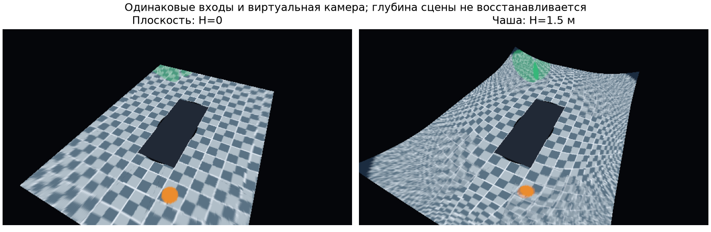

*Рисунок 4.1 — Реальные выходы текущего рендера на синтетической сцене, один виртуальный ракурс. Изображение формируется сохранённым `plot_experiments.py` из PPM результатов.*

У чаши периферийная дорожная текстура поднимается относительно центра. Это расширяет визуальную вертикальную составляющую окружения, но не делает её истинной высотой объектов. Сферический объект в обоих вариантах искажён: разные камеры переносят его лучи на условную поверхность. Наблюдаемый эффект подтверждает необходимость разделять параллакс и нарушение калибровки.

ROI в параметрах $(x,y)$ поверхности определена как $[-4,4]\times[-3,3]$ м, без прямоугольной маски автомобиля. Выборка содержит 100×100 центров ячеек, после исключения маски остаётся 7960 точек. Для каждого варианта берётся $P_j=(x_j,y_j,z_H(x_j,y_j))$; на плоскости $z_H=0$, на чаше высота зависит от положения. Поэтому метрика характеризует доступность изображения на условной поверхности, а не непосредственно покрытие реальной дорожной плоскости. Проверяется хотя бы одна валидная проекция:

$$
C_{ROI}=\frac{\#\{P_j:\exists i\;m_i(P_j)=1\}}{N_{ROI}}.
\tag{4.2}
$$

У плоскости и bowl в этом наборе результат одинаков: 0.994472, или 99.4472%. Такое совпадение не означает одинаковое визуальное качество. Метрика отражает доступность исходного пикселя, а не достоверность размещённого объекта, качество шва или восприятие пользователем. Выборка не является аналитическим доказательством покрытия непрерывной области.

Полное количественное сравнение marker error, швов и нескольких наклонных ракурсов ещё не выполнено. Поэтому на данном этапе обоснована пригодность обоих вариантов для дальнейшего исследования, а универсальное превосходство чаши не устанавливается.

## 4.4 Первоначальная калибровка

Для четырёх камер независимо созданы обучающие и проверочные пространственные точки. Координаты распределены по направлениям и глубинам; XYZ одной выборки не повторяются в другой. В пиксели добавлен гауссов шум с $\sigma=0.08$ пикселя на координату. Seed фиксирован. Начальное приближение включает изменение фокусов, главной точки, поворота и переноса.

Отчёт содержит RMS евклидовой ошибки точки, p95 и показатели ранга нормированного якобиана. Итоговые значения на проверочной выборке представлены ниже.

| Камера | RMSE до, пикс. | RMSE после, пикс. | p95 после, пикс. |
|---|---:|---:|---:|
| Передняя | 2.26670 | 0.11598 | 0.21796 |
| Правая | 2.18854 | 0.12331 | 0.21277 |
| Задняя | 2.26077 | 0.11946 | 0.22029 |
| Левая | 2.22780 | 0.11518 | 0.19379 |

Результат согласуется с заданным шумом: для двух независимых координат теоретический RMS евклидова шума составляет $\sqrt{2}\sigma\approx0.11314$ пикселя. Близость чисел не является доказательством точного восстановления каждого параметра; она показывает, что остатки в этой синтетической постановке приблизились к уровню наблюдательного шума.

Нормированный якобиан имеет ранг 14, а условные числа по камерам находятся приблизительно между 592 и 803. Это даёт основание принять конкретную процедуру в текущем наборе, но не гарантирует одинаковой определимости на реальной плоской площадке. Для дипломного вывода нужны дополнительные геометрии, число снимков, выбросы, параметры и повторные seeds.

Текущий CLI отклоняет пересечение train/validation и недостаточные точки. Эти отрицательные тесты существенны: хорошая ошибка на данных, вошедших в оптимизацию, не должна объявляться независимым подтверждением качества.

## 4.5 Нарушение и восстановление

Контрольный опыт меняет поворот только задней камеры вокруг её локальной Y-оси слева относительно исходного преобразования. Величина задаётся от 0 до 2°. Проверочные соответствия сохраняются. Порог SUSPECT равен 0.5 пикселя, основной — 1 пиксель.

| Заданный поворот | p95 задней камеры, пикс. | Состояние | Камера-кандидат |
|---|---:|---|---|
| 0° | 0.22029 | NORMAL | Нет |
| 0.1° | 0.37391 | NORMAL | Нет |
| 0.25° | 0.71549 | SUSPECT | Нет подтверждённого кандидата |
| 0.5° | 1.36286 | RECALIBRATION_REQUIRED | Задняя, ID 2 |
| 1° | 2.70320 | RECALIBRATION_REQUIRED | Задняя, ID 2 |
| 2° | 5.40880 | RECALIBRATION_REQUIRED | Задняя, ID 2 |

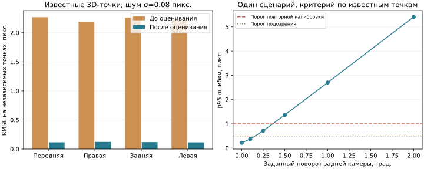

*Рисунок 4.2 — Независимая ошибка после калибровки и реакция сервисного критерия на один заданный сценарий. Скрипт сохранён рядом с главой.*

Повторное оценивание после 2° возвращает p95 задней камеры к 0.22029 пикселя. Остальные камеры также сохраняют проверочные значения исходной процедуры. Следовательно, на известных точках подтверждена цепочка «смещение → рост остатка → отдельная повторная калибровка → восстановление».

Это не статистическая оценка чувствительности по всему классу неисправностей. Контролировалась одна ось одной камеры и один набор. Нет серии исправных сцен при разных освещении, текстуре и движении; поэтому доля реальных ложных срабатываний не вычисляется. Установленные пороги не подбирались на репрезентативной диагностической выборке. Отсутствие кандидата при 0.1° является поведением данного критерия, а не универсальной границей обнаружения.

## 4.6 Производительность

Значения ниже — медианы p50/p95 трёх независимых процессов. Каждый процесс имеет собственный прогрев и отдельный набор 60 времён. Выходной readback включён; upload четырёх неизменных входов выполняется только при первом использовании.

| Вариант | Треугольники | Выход | RTX p50 / p95, мс | Mesa p50 / p95, мс |
|---|---:|---|---:|---:|
| Плоскость | 2312 | 640×360 | 0.17086 / 0.28306 | 0.66997 / 0.78805 |
| Bowl | 2312 | 640×360 | 0.16478 / 0.22440 | 0.68960 / 0.80609 |
| Bowl, плотная сетка | 8712 | 640×360 | 0.17064 / 0.23128 | 1.24499 / 1.49228 |
| Bowl | 2312 | 1280×720 | 0.86085 / 0.94389 | 1.71820 / 2.17621 |

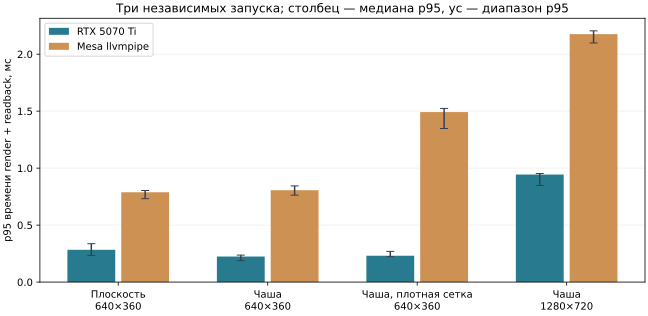

*Рисунок 4.3 — Медиана и диапазон p95 между запусками. Ус не обозначает доверительный интервал.*

В текущем малом профиле RTX имеет меньшую длительность, чем программный Mesa. Увеличение выходного разрешения увеличивает объём обработки и чтения; более плотная сетка особенно заметна в программном backend. Небольшая разница плоскость/bowl на RTX не доказывает фундаментального ускорения чаши: меняются покрываемые фрагменты, а короткие измерения подвержены фоновой нагрузке и режиму частот.

Из этих значений нельзя вычислить достигнутый FPS всей системы как $1000/t$: benchmark использует кэшированные входы и не включает все стадии. Объём памяти, чистое GPU-время, новые upload каждого кадра, long-run температура и частоты не измерены. Поле `gpu_time_ms` сохранено null. Для отдельного GPU-измерения потребуется поддерживаемый timer query и контроль валидности [S52].

## 4.7 Сквозная задержка

Сервер сохраняет runtime-время входов, завершение рендера и IDs, клиент — получение и программную передачу на представление. Эти события обеспечивают корреляцию. Для локального пути программный возраст можно определить как

$$
L_{program}=t_{ui\_present\_submit}-\min_i t_{release,i}.
\tag{4.3}
$$

Но $t_{release}$ в replay относится к выпуску известного кадра, а не к экспозиции физического сенсора. `ui_present_submit` в offscreen-испытании также не является моментом появления света на экране. Поэтому численная таблица полной latency в этой серии не публикуется.

У текущего Qt-клиента trace не сохраняет всю нормативную корреляцию событий и нет отдельного валидированного агрегатора latency. Прежде чем делать количественный вывод, нужно проверить соответствие frame ID и ревизии, разделить receive/image-ready/present, учесть очередь и провести длительную серию. Часы удалённого producer пока не поддерживаются; различение clock и running-time остаётся существенным [S31].

## 4.8 Отказы и синхронизация

Проверки сгруппированы по уровню отказа.

| Сценарий | Наблюдаемое поведение | Свидетельство |
|---|---|---|
| Истёкший вход | Исключён по возрасту, возможен NO_INPUT | C++ synchronizer test |
| Избыточный skew | Непригодные входы исключены, DEGRADED | C++ synchronizer test |
| Повтор sequence и обратное время | Отдельные счётчики, кадр не принят | C++ test |
| Переполнение входной очереди | Размер сохраняется, старейший удалён | C++ test |
| Неверная конфигурация | Запуск отклонён до EGL | Негативные config tests |
| Частичный/объединённый stream | Один или несколько правильных пакетов | Decoder tests |
| Неверный префикс | Соединение закрыто, сервер продолжает работу | Integration test |
| Pause и новый ракурс | Новый кадр, прежние upload-счётчики | Integration test |
| Нет frame_release | Data закрывается после deadline, control отвечает | Integration test |
| Reconnect | Новый handshake и пригодный кадр | Integration test |
| Qt-клиент offscreen | Принимает RGBA, сообщает present-submit | Integration test |

Эти проверки показывают предусмотренное поведение на выбранных ветвях. Они не равны длительному испытанию всех сочетаний потерь, многоклиентной нагрузки и повреждённых файлов. Синхронизатор испытывался отдельными временными метками; полноценная fault-серия записей с длительным исчезновением каждой камеры остаётся следующим шагом.

## 4.9 Сопоставление платформ

### 4.9.1 Границы исторической серии 0.1.0

RTX и llvmpipe дают одинаковые признаки валидности на контрольных точках и воспроизводят один алгоритм. Разница времени подтверждает необходимость сохранять фактический renderer при каждом запуске. Название машины или наличие драйвера сами по себе не доказывают аппаратный путь.

Аврора отсутствует в таблице сравнения. Ни Mesa, ни RTX не моделируют автоматически встроенный GPU и профиль приложения Авроры. Для целевого этапа потребуется паспорт, один рабочий output-путь, проверка зависимостей, затем повторение одинаковых данных и ракурсов. Если разрешение или формат придётся изменить, такой профиль должен публиковаться отдельной строкой.

| Платформа | Корректность модели | Измеренный render/readback | Полный клиентский путь | Вывод о целевом устройстве |
|---|---|---|---|---|
| Linux + Mesa | Проверена на контрольных точках | Есть | Offscreen integration | Не устанавливается |
| Linux + RTX | Проверена на контрольных точках | Есть | Hardware-UI latency не измерялась | Не устанавливается |
| ОС Аврора | Нет данных | Нет данных | Нет устройства/пакета | Открытый этап |

### 4.9.2 Native suite 0.2.0: новый PC baseline

Для будущего устройства создан отдельный native C++ suite `surround-view-platform-v1`. Он запускается без Python на устройстве, использует побайтно воспроизводимые целочисленные RGB8-входы и проверяет реальные OpenCV CPU operations. Контрольный profile/config, SHA-256 входов и реализации совпали для RTX и Mesa. У каждой платформы **22 pass, 0 fail, 0 skip**. Полные первичные записи сохранены в [[validation/baselines/PC_RTX]] и [[validation/baselines/PC_MESA]], без потери raw samples.

В этой серии три повтора означают новые EGL-контексты **в одном процессе**; это отличается от трёх отдельных процессов исторической серии. На вариант по-прежнему 10 warmup + 60 измерений; порядок через повтор обращается. OpenCV использует один поток. Добавлены 132 треугольника ego-модели, optional GPU query и вариант с новыми image owners; отдельный CPU-copy входов выполняется до таймера. Поэтому новые цифры нельзя трактовать как ускорение/замедление версии 0.1.0 на прежней нагрузке.

| Вариант 0.2.0 | RTX CPU wall p95, ms | Mesa CPU wall p95, ms | RTX valid GPU draw p95, ms | Mesa valid GPU draw p95, ms |
|---|---:|---:|---:|---:|
| Plane, 640×360, cached | 0.1542 | 0.7388 | 0.0054 | 0.3393 |
| Bowl, 640×360, cached | 0.1590 | 0.8267 | 0.0056 | 0.3884 |
| Dense bowl, cached | 0.1560 | 1.4616 | 0.0070 | 0.5367 |
| Bowl, 1280×720, cached | 1.0379 | 2.4355 | 0.0118 | 0.6932 |
| Bowl, 640×360, new uploads | 0.3406 | 1.3287 | 0.0137 | 0.3960 |

В каждой ячейке — медиана p95 трёх повторов. GPU draw охватывает только отрисовку surface+ego, **не readback и upload**; CPU wall включает ожидание GPU, flip/copy и опрос timer. Эти столбцы не суммируются. Их различие показывает, почему CPU-таймер вокруг всей функции нельзя называть «время шейдера». Программный llvmpipe выполняет GPU API на CPU; слово draw описывает границы запроса, а не физическое наличие GPU у этого backend.

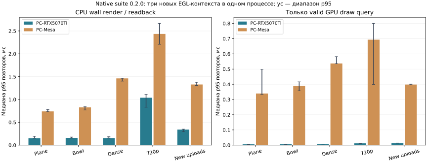

*Рисунок 4.4 — Медиана p95 и диапазон трёх повторов native suite 0.2.0: полный render/readback и valid draw timer представлены раздельно. Ус обозначает диапазон p95, не доверительный интервал.*

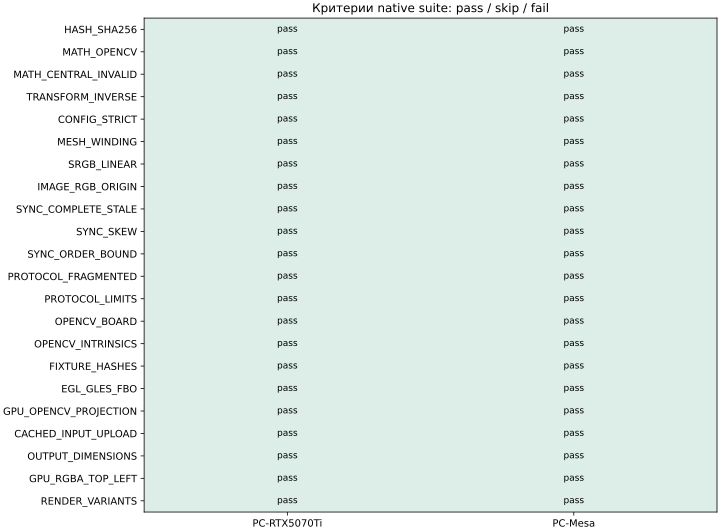

*Рисунок 4.5 — Результаты 22 native критериев на двух PC backend. Положительный результат относится к заданным данным и проверкам; не подтверждает качество реальной калибровочной площадки и требования всего приложения.*

Пиковый CPU RSS процесса составил 976.24 MiB для NVIDIA-профиля и 235.50 MiB для Mesa. Значения получены после всей серии и создания контекстов, включают драйверные host allocations и OpenCV; это не выделенная VRAM, не средняя рабочая память одного кадра и не сумма памяти системы. Они показывают необходимость повторить ресурсную проверку на устройстве. Для dedicated GPU memory в report сохранено null.

Помимо распределений report сохраняет системный паспорт, версии OpenCV/Boost/GLM/compiler, GL/EGL capabilities, texture limits, hash исходников и UTC-время. Все valid GPU queries включены в статистику; неготовые/disjoint были бы отмечены отдельно. У текущих двух запусков все измеряемые query имеют valid. Проверка сопоставимости скриптом `compare_reports.py --strict` прошла. Репликация и полный перечень критериев находятся в [[engineering/PLATFORM_TEST]].

### 4.9.3 Будущее аппаратное сравнение с Авророй

На устройство доставляется RPM из тех же исходников; native suite запускается на железе с установленной `synthetic.json`. Сборка/установка из SDK описаны в [[engineering/AURORA]] на основании официальных инструкций [S59], [S60]. Linux RPM обоих профилей уже собраны и распакованы, installed payload запускается без checkout. Это отдельная проверка упаковки; целевой SDK и устройство ещё не проверены.

| Свойство / критерий | PC baseline | Устройство Авроры |
|---|---|---|
| CPU | AMD Ryzen 9 9950X, x86_64 | Нет данных: SoC/архитектура |
| GPU / driver | RTX 5070 Ti / 615.71.09; отдельно llvmpipe | Нет данных: фактический GL_RENDERER/driver |
| ОС / toolchain | Linux 7.2.6, GCC 16.2.1, Release | Нет данных: выпуск ОС, SDK/target, compiler |
| OpenCV | 5.0.0, один поток | Проверить package/version/modules |
| Код / workload | Одинаковые source/config/fixture SHA-256 | Должны совпасть с повторённой PC-серией |
| Правильность | 22 pass | Native pass/skip/fail из реального запуска |
| Render/upload/readback | Raw и p50/p95/p99/max для пяти вариантов | Те же настройки и scope |
| Draw timer | Valid EXT query | Valid distribution либо null + причина |
| CPU RSS | 976.24 / 235.50 MiB | Измерить после одинаковой серии |
| VRAM, thermal, physical latency | В native suite не измерены | Отдельная методика; не заполнять нулями |

Сравнение допускает различия аппаратуры/compiler/library versions, но требует совпадения реализации, входов, Release и методики. Если SDK требует иной profile/config, создать новую PC-базу той же нагрузки. При failed/partial qualification или несовпадении хэшей отношение времён не вычисляется. Отсутствующая целевая строка не позволяет заявлять достижение NFR Авроры или оценку FPS полной системы.

### 4.9.4 PC baseline текущей реализации 0.6.0

После изменения источников сформированы новые отчёты с fingerprint C++ payload 0.6.0: [[validation/baselines/PC_RTX_V06]], [[validation/baselines/PC_MESA_V06]]. Использованы 60 samples, 10 warmup и три новых EGL contexts; по 25 критериев passed. Actual renderers — RTX 5070 Ti и Mesa llvmpipe; серии последовательные. Строгая сопоставимость подтверждена [[validation/PC_COMPARISON_V06]].

| Workload | RTX median p95, ms | Mesa median p95, ms |
|---|---:|---:|
| Plane | 0.17683 | 0.82534 |
| Bowl | 0.18550 | 0.88564 |
| Dome + floor | 0.19787 | 1.68357 |

Эти времена относятся к render/readback. Новый FrameSource не включён в данную область таймера; его lifecycle проверен отдельно в §4.14. При первоначальном запуске программного профиля GLVND оставил NVIDIA; такой report исключён из опубликованного сравнения, серия повторена с явным Mesa vendor. Исторические результаты выше не заменены.

## 4.10 Анализ результатов и ограничений

### Исследование вариантов объединения и геометрии

Для следующей серии выделены две независимые оси: fusion (hard mask, edge-feather, distance-to-seam, graph-cut и multi-band) и surface carrier (plane, bowl, dome+floor, cylinder+floor, cube/cubemap и документированная составная модель). Это расширение от 06.10.2026 согласуется с [[research/PROJECTION_AND_STITCHING]] и [[research/EXPERIMENTS#Эксперименты]].

До 0.4.0 проверялись работоспособность renderer и краткий `dome_floor` workload sanity-check. В 0.4.0 реализованы angular-feather и hard best-angle и выполнен first-frame screening (§4.12); graph-cut/multi-band пока отсутствуют; RTX/Mesa подробные отчёты 0.3.0 для этой геометрии не сохранены. Screening даёт статистику покрытия, но оценка швов и преимущество dome/cube/bowl пока не установлены. Для результата потребуются независимая синтетическая сцена с точной геометрической истиной и реальная синхронизированная четырёхкамерная последовательность; моноскопический `street-demo` для этих метрик непригоден.

Первая серия отвечает на часть исследовательских вопросов. Прямая модель согласуется между независимым CPU-расчётом и GLSL. Плоскость и bowl построены на одних входах, а их время и покрытие измерены раздельно. Известная геометрия позволяет восстановить калибровку и локализовать заданный дрейф задней камеры. Сервер и offscreen-клиент подтверждают копируемую передачу и управление без повторного upload на паузе.

Исторические выводы ограничены синтетическим набором, коротким временем и известными соответствиями. Версия 0.2.0 добавила реальные OpenCV API, image-based тесты, CPU RSS и valid GPU draw timing; качество детектора на настоящих снимках, ошибка реального объекта, освещение, false alarms, long-run memory/thermal, физическая задержка и характеристики Авроры всё ещё не установлены. Эти ограничения нельзя скрывать общим словом «работает».

Для следующей серии нужно расширить независимые данные, задать несколько ракурсов, измерить швы и маркеры, отделить временные стадии и провести полноценный отказной replay. Только после этого можно обосновывать целевой профиль и исследовательский вклад по реальным эксплуатационным условиям.

## 4.11 Проверка объёмного четырёхкамерного источника

06.10.2026 выполнен короткий smoke Blender→fisheye→server: четыре сценарных момента с шагом 1/30 s, 16 входных PPM, физически разнесённые оптические центры и сохранённые истинные позы. Исходная улица и результат отображения показаны на рисунках 3.8–3.10; полная инструкция находится в [[engineering/BLENDER]], первичные параметры и checksums — в [[validation/BLENDER_SMOKE]].

Независимый Blender-projector проверен на 72 точках всех face-camera conventions: максимальная ошибка 0.000035004 px при пороге 0.001 px. Host-проверки используют независимое direction field для обнаружения переставленных/перевёрнутых граней, проверяют linear-light sampling, соответствие mounts, hashes и ошибочные входные файлы. Основной CTest проходит 7/7 групп.

Все 16 input hashes проверены; каждая камера изменяет изображение при заданном движении. Server smoke получает четыре READY-кадра с различными frame IDs, alpha=255 во всём изображении и применённую revision команды `front`. Рендерер на RTX 5070 Ti даёт 0 validity mismatches и max projection error около 0.000043764 px. Эти результаты подтверждают совместимость оптики, формата и replay/IPC; они не измеряют геометрическую ошибку полного обзорного изображения.

Визуально сохраняются растяжение поднятых объектов на полу и двоение в перекрытиях. Начальная ошибка размещения боковых центров внутри mirror housing устранена до итогового export. После этого оставшиеся артефакты становятся предметом сравнения surface/fusion, но пока не ранжируют методы. Четырёх сценарных моментов недостаточно для оценки temporal jitter и длительной работы; два bench samples после warmup не обосновывают sustained FPS.

В следующей серии нужны ground/raised markers, проверка ошибки depth truth на аналитических примитивах, object-ID/semantic labels, отдельные validation scenes и одинаковые входы для hard/feather/graph-cut/multi-band. Blender pose truth полезна для координат и калибровки, а новый EXR→radial-range export даёт dense geometry depth; его пока нельзя считать полностью валидированным visibility oracle.

## 4.12 Начальное сравнение поверхности и слияния: 0.4.0

Для первого screening использован один набор четырёх разнесённых Blender-камер из §4.11. Пять носителей, два ракурса и три режима fusion дают 70 запусков с color/weights/coverage. Calibration и input hashes неизменны; resolution 960×540, distance 8.5 m, azimuth 0.8 rad, elevation 1.0/0.35 rad. На всех cases фактический renderer — Mesa llvmpipe. Каждая конфигурация и её readback сохранены; происхождение и SHA-256 — [[validation/SURFACE_SCREENING]].

| Носитель, low-view | Треугольники | 0 наблюдений | 1 наблюдение | 2 наблюдения | За геометрией |
|---|---:|---:|---:|---:|---:|
| Plane | 8712 | 296 | 180669 | 151625 | 173712 |
| Bowl | 8712 | 296 | 188486 | 168053 | 149467 |
| Dome + floor | 24320 | 296 | 265387 | 240619 | 0 |
| Cylinder + floor + cap | 24320 | 296 | 265035 | 240971 | 0 |
| Cube shell + floor | 12552 | 296 | 264962 | 241044 | 0 |

В каждой строке дополнительно 12098 пикселей маски ТС; сумма категорий 518400. Три/четыре камеры в данных ракурсах не наблюдают ни одной output-точки. Под «наблюдением» понимается валидность fisheye-проекции доступного кадра, без проверки физического заслонения. Разница между outside-surface и zero-observations принципиальна: замыкание mesh устраняет первый дефект, но не создаёт недостающие данные камер.

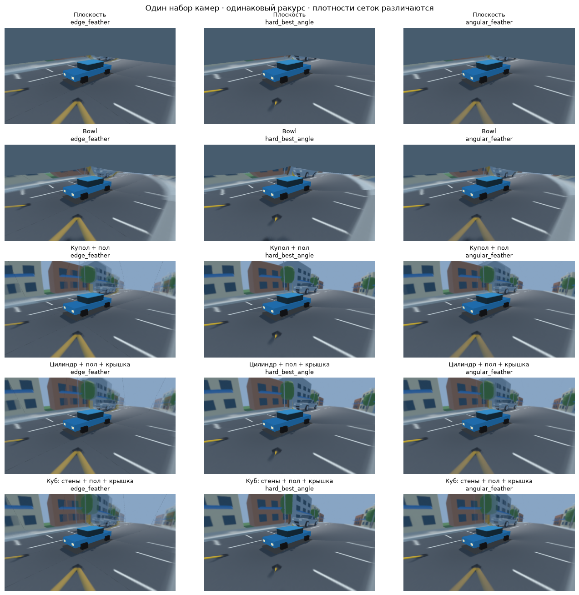

*Рисунок 4.6 — Actual GLES readbacks пяти носителей при edge-feather, hard best-angle и angular-feather. Один Blender-набор, low-view; все изображения получены renderer, не нарисованы отдельно. Двоение, растяжения и резкие переходы остаются предметом количественного исследования.*

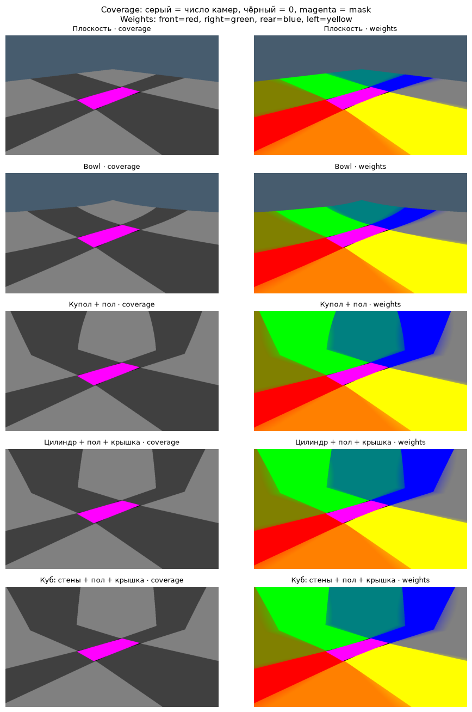

*Рисунок 4.7 — Coverage и palette contributions edge-feather. Gray кодирует число камер, magenta — маску ТС; blue-gray фон plane/bowl расположен вне геометрии. Скрипт генерации обеих подписанных иллюстраций — `plot_screening.py` рядом с главой.*

Оболочки показывают ноль пикселей за геометрией в обоих проверенных ракурсах. Этот результат согласуется с независимым empty-input oracle 36 ракурсов, но не доказывает отсутствие дефектов при любой плотности сетки. Hard-selection предотвращает межкамерное усреднение, сохраняя риск резкого шва. Угловое feather меняет веса, но не исправляет несовпадение объектов по глубине.

Это first-frame screening с **неравными triangle budgets**, а не итоговый сравнительный опыт. Три timing samples после одного warmup не позволяют ранжировать производительность. Seam error, ghosting distance, temporal jitter, exposure sensitivity и качество относительно depth/visibility truth здесь не вычислены. Следующий этап — metric markers и независимые scenes, согласованный resource budget и длинное видео, затем graph-cut/multi-band. Исторические baselines §4.9 сохранены; native 0.4.0 smoke проходит 25 критериев, installed CMake payload тоже 25, RPM и устройство требуют отдельных прогонов.

## 4.13 Проверка клиентской библиотеки и сетевой конфигурации

После аудита планов выполнен Unix/TCP baseline 0.5.0. Release CTest проходит 10/10 групп, CPU Debug ASan/UBSan — 7/7. Новые native lifecycle cases проверяют invalid options, handshake/partial message deadlines, invalid RGBA payload и shutdown без поздних callback. Host integration использует настоящий сервер и два потребителя одной библиотеки — headless и Qt. Дополнительно 500 orbit-команд на паузе приняты в пакетах по 16 без новых decode/upload/mesh builds. Полные RTX/Mesa baselines 0.5.0 (60 samples, 10 warmup, 3 contexts) и два Linux RPM с installed development consumers сохранены в [[validation/CLIENT_SMOKE]]; они дополняют исторический §4.9.

| Сценарий | Наблюдаемый результат | Ограничение |
|---|---|---|
| Unix-only | В `/proc` у процесса нет IPv4/IPv6 TCP/UDP sockets | Linux host evidence, не target SDK |
| TCP-only / combined | Команды/ACK и RGBA передаются через общий codec; Unix paths создаются только в enabled profile | Один session; two-host test ещё открыт |
| Установленная библиотека | Отдельный CMake consumer успешно подключается; ldd не содержит Qt/OpenCV/EGL/GLES | Установленный Linux prefix; ABI Авроры не проверен |
| Server restart | Consumer получает кадры двух различных session IDs | Loopback, не распределённые часы |
| Pause/orbit/step | Orbit сохраняет decode/upload/mesh counters, step продвигает один набор и сохраняет паузу | File replay, live producer ещё отсутствует |
| Irregular timestamps | Вместо фиксированных 33 ms воспроизводятся интервалы manifest | OS scheduling допускает jitter; это не sensor timing |
| Qt TCP offscreen | ui_receive и ui_present_submit подтверждены | Не физический дисплей |

Тест выявил отсутствие кадра после reconnect на паузе; сервер исправлен повторной публикацией для новой data-сессии. Неподдержанный UDP и override явной server connections через CLI отвергаются до открытия listeners. Эти проверки закрывают инженерные части M7/M8, но не подменяют целевой или quality этап. Аудит всех этапов — [[planning/AUDIT]], инструкции — [[engineering/CLIENT_LIBRARY]].

## 4.14 Проверка асинхронных источников: 0.6.0

Новая серия проверяет корректность source lifecycle, а не качество слияния и не производительность аппаратных камер. Release CTest проходит 12/12 групп, CPU Debug ASan/UBSan — 8/8. Исторические времена §4.6/§4.9 и baselines 0.5.0 сохранены без замены. Полный протокол короткой проверки — [[validation/SOURCES_SMOKE]].

| Воздействие | Ожидаемый и полученный результат | Область вывода |
|---|---|---|
| Loader заблокирован тестовым barrier | poll/request доступны; pause ACK после release loader | Работа вне GL-потока, не гарантированное время любого OpenCV decode |
| Replay pause/step | Нет новых decode после ACK; один step batch, cache сохранён | File-source семантика |
| Четыре camera mailboxes переполнены | Каждая сохраняет Q последних frames; dropped учитывается | Ограничение очередей без starvation |
| Duplicate / неверная calibration | Отключён только проблемный camera channel | Проверка входного протокола |
| Частичный handshake | Camera channel закрыт по deadline | Не heartbeat и не гарантия свежести экспозиции |
| Reconnect с source sequence=0 | Новая session; четырёхкамерный READY восстановлен | Unix/TCP localhost |
| Pause при продолжающемся producer | Входы отбрасываются; orbit не повышает upload count | Сохранение textures и отсутствие paused backlog |
| Dataset с неверным SHA/path/offset | Producer отклоняет до подключения | Проверки входного dataset |

Тест использует настоящий EGL/GLES сервер и отдельный Python producer, но входы синтетические. Это позволяет изолировать транспортные ошибки от качества калибровки. Сохранённая Blender-запись также прошла новый socket validator на RTX 5070 Ti: 16 hashes, четыре READY RGBA frames и применённый ракурс; actual output показан на рисунке 3.14. Прежний replay путь повторён отдельно. Независимая проверка мира ранее выполнена в §4.11. Испытание между физическими машинами, прямой VideoCapture adapter и sensor-clock mapping остаются открытыми. Native source fixture также включён в RPM для повторения без Python; он не добавляет фиктивных критериев в прежний 25-критериальный platform report.

## 4.15 Восстановление producer после перезапуска сервера

Последующее host-расширение 0.6.0 сохраняет C++ payload и native workload fingerprint. В группе camera_sources теперь 13 cases: восемь самостоятельных producer socket tests, два actual-server restart сценария и три первоначальные проверки источников. Новые cases проверяют per-camera retry budget, reset sequence после нового handshake, late-drop, изоляцию медленного получателя, остановку blocked handshake, SIGTERM report и отказ перезаписи отчёта.

| Воздействие | Наблюдаемый результат |
|---|---|
| Server остановлен на 250 ms и запущен заново, Unix/TCP | Все четыре камеры восстановились с новыми sessions; READY доступен без перезапуска producer |
| Источник отсутствует, два retry | По три попытки на камеру; failed JSON/Markdown сохранён |
| Одна камера не читает payload | Send timeout завершает только её worker; остальные продолжают запись |
| Ошибочный HELLO_ACK | Фатальный отказ этой камеры без циклического reconnect |
| Stop при незавершённом handshake | Worker завершён в пределах тестового deadline; это не гарантия cancellation file I/O |
| SIGTERM процесса producer | Частичный cancelled report и ожидаемый exit 143 |

В restart опытах используется synthetic запись с двумя моментами по 33.333333 ms, 60 loops: 120 scheduled frames на камеру, max lateness 40 ms. Sent/skip/error числа зависят от планировщика; первичные значения и полный JSON сохранены в [[validation/PRODUCER_RECOVERY]]. Это проверка восстановления и управления очередями, не performance benchmark и не длительный thermal run. Blender/socket путь с новым producer также повторён на сохранённой 3D-записи.

## 4.16 Аналитический эталон носителя

### 4.16.1 Отделение дискретизации от проекции

Screening раздела 4.12 проверяет действующий mesh renderer, но не даёт плотного геометрического эталона. В частности, полигональная полусфера представляет собой набор хорд; даже при правильной fisheye-формуле её точки отличаются от точек точной сферы. Для дальнейшего исследования реализован независимый host CPU-путь `tools/reference.py`: он не использует GL, C++ math или вершины сетки. Он решает пересечение каждого луча с аналитическим носителем и затем вычисляет проекцию и смешивание. Модель fisheye и соглашения осей остаются определёнными в [[architecture/MATHEMATICS]], исходная библиотечная модель описана в [[references/VISION#S04|S04]]. Аналитические пересечения ниже являются собственным выводом из уравнений носителей, а не результатом измерения физической сцены.

Для пикселя с целочисленными индексами $(u,v)$ сначала вычисляются координаты центра на плоскости виртуальной камеры:

$$
x_n=\left(\frac{2(u+1/2)}{W}-1\right)\frac{W}{H}\tan\frac{\varphi}{2},\qquad
 y_n=\left(1-\frac{2(v+1/2)}{H}\right)\tan\frac{\varphi}{2}.
$$

Если $\mathbf f,\mathbf r,\mathbf u$ — единичные направления вперёд, вправо и вверх виртуального вида, то

$$
\mathbf d=\frac{\mathbf f+x_n\mathbf r+y_n\mathbf u}{\|\mathbf f+x_n\mathbf r+y_n\mathbf u\|},\qquad
\mathbf P(t)=\mathbf E+t\mathbf d.
$$

Выбирается ближайшее допустимое $t>0$. Near/far проверяются по глубине $t(\mathbf d\cdot\mathbf f)$ вдоль оптической оси, а не по длине луча. Поэтому для наклонного луча эти два ограничения нельзя отождествлять.

### 4.16.2 Точные поверхности и ограничения корней

Пол задан $z=0$; корень $t=-E_z/d_z$ допускается только внутри диска или прямоугольника выбранного носителя. Для верхней полусферы радиуса $R$ решается

$$
(\mathbf d\cdot\mathbf d)t^2+2(\mathbf E\cdot\mathbf d)t+(\mathbf E\cdot\mathbf E-R^2)=0,
$$

причём точка корня должна иметь $z\geq0$. Пол рассматривается как отдельная поверхность; ближайший корень среди пола и полусферы определяет видимую оболочку. Для цилиндра аналогичное квадратное уравнение записывается только для $x,y$, а корни дополнительно ограничиваются высотой стенки; пол и верхняя крышка — диски. Куб состоит из шести ограниченных плоскостей. Рассматриваются оба действительных корня: это существенно для внешней точки наблюдения и касания. При вырождении квадратного уравнения используется линейное, а при отсутствии положительного допустимого корня возвращается miss.

Bowl имеет аналитическую высоту

$$
z(x,y)=\frac{H_b}{2}\left[\left(\frac{\max(|x|-a,0)}{A-a}\right)^2+
\left(\frac{\max(|y|-b,0)}{B-b}\right)^2\right].
$$

На каждом из девяти сочетаний левой/плоской/правой областей по двум осям эта функция квадратична. Подстановка $x=E_x+td_x$, $y=E_y+td_y$, $z=E_z+td_z$ даёт квадратное либо линейное уравнение; каждый найденный корень проверяется на принадлежность своему участку и внешним границам. При $H_b=0$ результат становится точной ограниченной плоскостью. Таким образом, CPU-результат не зависит от `uniform_cells` или числа сегментов полусферы.

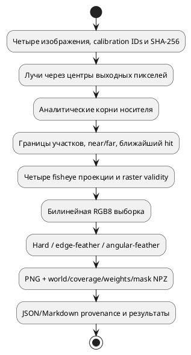

*Рисунок 4.8 — Порядок вычислений независимого аналитического эталона. Глубина относится к носителю, а не к объектам Blender.*

### 4.16.3 Смешивание, покрытие и первичная серия

CPU-проекция вычисляет угол через $\operatorname{atan2}(\rho,z)$ и учитывает четыре коэффициента дисторсии, FOV, положительную глубину и границы изображения. Билинейная интерполяция выполняется над RGB8 до sRGB decode, как в текущем GPU baseline. Два feather-режима смешивают выборки в linear RGB; hard best-angle сохраняет детерминированный приоритет меньшего camera ID при равенстве. Coverage считается до весов: валидная выборка на границе может иметь нулевой feather weight. Все четыре веса сохранены численно, поэтому их не требуется восстанавливать из palette RGB.

Выполнены 30 случаев: пять носителей, два виртуальных ракурса, три режима смешивания. Использован первый четырёхкамерный набор Blender-записи, 960×540. Ниже показано число лучей без пересечения с носителем; оно не зависит от fusion.

| Носитель | Oblique: elevation 1.0 rad | Low: elevation 0.35 rad |
|---|---:|---:|
| Плоскость | 10 386 | 173 711 |
| Bowl | 1 534 | 149 474 |
| Купол с полом | 0 | 0 |
| Цилиндр с полом | 0 | 0 |
| Куб с полом | 0 | 0 |

Общее число выходных пикселей — 518400; azimuth 0.8 rad, distance 8.5 m. Границы носителей соответствуют screening. Таблица подтверждает отсутствие выхода лучей за края замкнутой оболочки в двух выбранных ракурсах. Она не ранжирует точность отображения реальных объектов. В частности, одинаковое число допустимых проекций у нескольких носителей не означает одинаковых UV, overlap boundaries или итогового цвета.

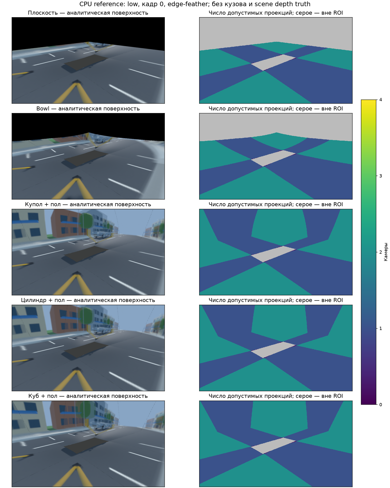

*Рисунок 4.9 — Пять точных носителей при низком ракурсе: слева edge-feather render, справа число допустимых проекций камер. Серое — вне evaluation ROI, включая footprint; чёрное слева у плоскости и bowl — carrier miss. Кузов не рисуется. Скрипт [plot_reference.py](plot_reference.py) строит рисунок из сохранённых NPZ/PNG, а не генерирует дополнительную сцену.*

### 4.16.4 Проверка и границы эталона

Десять CPU-тестов проверяют известные корни, линейный предел, касание, крышки/пол, view-axis clipping, top-left orientation, билинейную выборку, linear-RGB mean, hard tie и valid-border с нулевым весом. Дополнительно проверены 10000 направлений с residual уравнения bowl и 4096 направлений из внутренней точки каждой замкнутой оболочки без misses. Полный Linux CTest завершился 13/13 группами; новая all-directions проверка повторно прошла в группе `analytic_reference`. Первичные числа, хэши и методика сохранены в [[validation/ANALYTIC_REFERENCE]].

Этот результат закрывает подготовку плотного эталона геометрии носителя. Он не создаёт scene depth/visibility truth, не моделирует заслонение и не содержит автомобильный overlay. Footprint mask недостаточна для прямого RGB-сравнения с GPU: видимый кузов перекрывает дополнительные пиксели. До вычисления image error требуется согласовать кадр/config/view, получить маску кузова, обработать silhouettes/background и определить метрику. Seam/ghosting/temporal quality и отдельные validation scenes остаются следующими экспериментами. Инструкция запуска — [[engineering/RENDERING#Независимый аналитический CPU-эталон]].

## 4.17 Восстановление положения камер при ошибках монтажа

### 4.17.1 Постановка и управляемый мир

На автомобиле номинальное положение креплений не гарантирует фактических внешних параметров. Ошибка yaw меняет направления проекции, ошибка pitch смещает границу пола/окружения, а перенос оптического центра создаёт зависимое от глубины рассогласование. Поэтому проверка системы должна отдельно оценивать восстановление внешних параметров и результат последующего отображения.

Разработан seed-based генератор Blender-улицы с автомобилем, зданиями, разметкой и четырьмя разнесёнными оптическими центрами. Правила задают диапазоны высоты/шага зданий и погрешностей монтажа, а overrides позволяют указать конкретное отклонение каждой камеры. В текущем опыте yaw лежит в ±5°, pitch в ±4°, сдвиг вдоль кузова в ±0.15 м. Генератор поддерживает диапазоны до ±20° и ±0.4 м, однако эти амплитуды ещё не исследованы. Это процедурная сцена, а не измеренная модель реальной улицы.

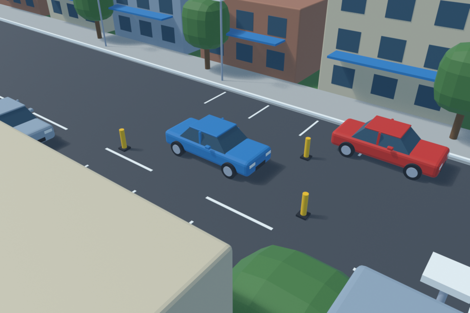

*Рисунок 4.10 — Отдельная сцена SV Research Street, Blender 5.2.2 LTS, seed 20261007. Обзор мира, из которого экспортированы камеры для первого опыта. Рецепт и сохранённая сцена находятся в assets; исходная пользовательская сцена сохранена.*

Пусть $R_{CV}$ переводит координаты ТС в координаты камеры, $C_V$ — её центр. Номинальная camera-to-vehicle ориентация возмущается поворотом вокруг вертикали ТС и вокруг локальной оси right:

$$
R'_{VC}=R_z(\delta\psi)R_{CV}^{T}R_x(\delta\theta),\qquad
C'_V=C_V+\delta s\,a_V,\qquad
T'_{CV}=\begin{bmatrix}(R'_{VC})^T&-(R'_{VC})^TC'_V\\0&1\end{bmatrix}.
$$

Для front/rear $a_V$ направлена вдоль +Y, для боковых камер — вдоль +X. Положительный pitch поворачивает оптическую ось вверх. Два угла и один сдвиг моделируют выбранные монтажные отклонения; roll, высота и полный шестимерный монтажный шум пока не варьируются. Номинальная и фактическая конфигурации хранятся отдельно. Renderer Blender использует фактическую позу; calibration solver получает только nominal guess и train observations.

### 4.17.2 Сравниваемые методы и экспериментальный протокол

Первый этап изолирует внешнюю калибровку при точно известных intrinsics. Используется реальная библиотека C++ OpenCV 5.0.0: fisheye observations переводятся в normalized pinhole coordinates, затем выполняется PnP. Возможности алгоритмов определены документацией OpenCV [[references/VISION#S72|S72]], модель fisheye — [[references/VISION#S04|S04]].

| Вариант pipeline | Инициализация | Отбор / refinement | Исследовательское ограничение |
|---|---|---|---|
| ITERATIVE | Номинальная поза | Все точки, nonlinear solve | Зависимость от initial guess |
| EPnP | Без initial guess | Direct solve | Без robust rejection и дополнительного LM |
| SQPnP | Без initial guess | Direct solve | Те же наблюдения, без дополнительного LM |
| RANSAC+EPnP+LM | Без initial guess | 300 iterations, confidence .999, LM по inliers | Threshold 3/max(fx,fy) и objective в normalized coordinates |

В каждом из пяти mounting seeds берутся 120 train и 120 независимо выбранных validation XYZ на камеру. Точки предлагаются в объёме X/Y ∈ [−14;14] м, Z ∈ [0;3] м, отбираются по положительной глубине, углу менее 1.35 rad и запасу 50 px до края. Совокупность неплоская. Train UV получают Gaussian noise σ ∈ {0;0.5;1} px; доля outliers равна 0 или 10%, дополнительное смещение каждого outlier равномерно в ±35 px по обеим осям. Validation UV чистые. Истинная поза и validation observations не передаются solver.

Важно различать моделирование геометрии и распознавание изображения: текущие XYZ/UV получены аналитически, заслонение объектами сцены не проверяется. RGB Blender нужны для визуализации результата, а не для обнаружения соответствий. Поэтому опыт проверяет pose solver и не доказывает работоспособность полноценной калибровки по изображениям.

### 4.17.3 Метрики и первичные результаты

Для $N$ независимых точек вычисляются pixel reprojection RMSE, p95 длины остатка, ошибка вращения и расстояние между центрами:

$$
e_{\mathrm{RMSE}}=\sqrt{\frac{1}{N}\sum_{i=1}^N\|\pi(\widehat T,X_i)-u_i^{\mathrm{truth}}\|_2^2},\qquad
 e_R=\arccos\frac{\operatorname{tr}(\widehat R R_{\mathrm{truth}}^T)-1}{2},\qquad
 e_C=\|\widehat C-C_{\mathrm{truth}}\|_2.
$$

Аргумент arccos ограничивается от −1 до 1 для устойчивости округления. Отдельно сохраняются invalid held-out points и отказы четырёхкамерного запуска. При отказе одной камеры весь trial не экспортируется. Следующая таблица показывает медианы по камерам только успешных trials при σ=0.5 px; success означает допустимый экспорт, а не выполнение требований точности.

| Выбросы | Метод | Успешные trials | Held-out RMSE, px | Ошибка вращения, ° | Ошибка центра, м |
|---:|---|---:|---:|---:|---:|
| 0% | iterative | 5/5 | 0.162220 | 0.080803 | 0.008713 |
| 0% | epnp | 5/5 | 0.793651 | 0.200374 | 0.044031 |
| 0% | sqpnp | 5/5 | 0.208579 | 0.081047 | 0.016101 |
| 0% | ransac_epnp_lm | 5/5 | 0.226706 | 0.103005 | 0.014806 |
| 10% | iterative | 5/5 | 1.761342 | 1.010944 | 0.075100 |
| 10% | epnp | 2/5 | 9.758369 | 2.486626 | 0.797280 |
| 10% | sqpnp | 2/5 | 2.556452 | 1.015146 | 0.197291 |
| 10% | ransac_epnp_lm | 5/5 | 0.215735 | 0.115937 | 0.016719 |

Номинальная конфигурация до калибровки имеет медиану 8.199787 px. Без выбросов ITERATIVE оказался точнее robust pipeline: 0.162220 против 0.226706 px. При 10% ошибочных соответствий RANSAC+EPnP+LM дал 0.215735 px против 1.761342 px у ITERATIVE. Это свидетельствует о полезности robust отбора в данном профиле загрязнения. Возможное объяснение ухудшения direct вариантов — влияние крупных train residuals без rejection, но отдельный причинный эксперимент ещё нужен. Для сравнения стоимости и самого solver следует уравнять refinement и исследовать пороги.

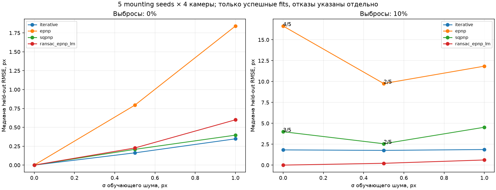

*Рисунок 4.11 — Медианный held-out RMSE четырёх pipeline-вариантов для пяти mounting seeds и четырёх камер. Подписи 2/5 и другие counts обозначают число экспортированных четырёхкамерных trials; остальные завершились отказом. Линии соединяют три дискретных условия и не являются моделью интерполяции.*

EPnP и SQPnP при σ=0.5 px и 10% выбросов экспортировали лишь 2/5 trials. Их медианы нельзя интерпретировать без этого отбора. При σ=1 px и 10% выбросов оба экспортировали 5/5, но каждый имеет один invalid validation point. Таким образом, finite/valid-on-train fit недостаточен для независимой приёмки. Полные 24 строки агрегатов, первичные записи и hashes находятся в [[validation/MOUNT_CALIBRATION]].

### 4.17.4 Изображения до/после и границы вывода

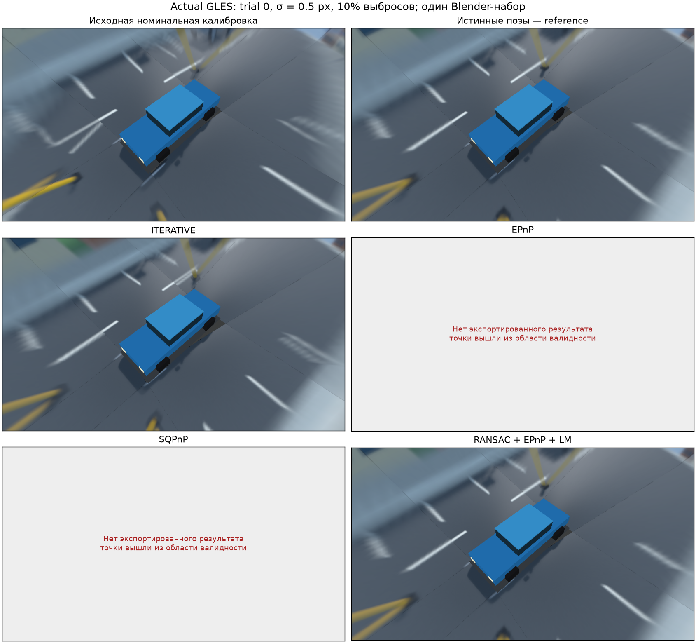

*Рисунок 4.12 — Actual GLES output одного Blender-набора: nominal, reference truth и восстановленные позы trial 0 при σ=0.5 px, 10% выбросов. Отсутствующие EPnP/SQPnP outputs явно отмечены; они не заменены картинкой другого метода. Входы получены из cube faces 128×128, выход — 960×540; это иллюстрация изменения проекции, не фотометрический benchmark.*

Показанные различия необходимо сопоставлять с независимыми численными метриками. Изображение reference построено с истинными позами, но оно также использует выбранную поверхность и blending, поэтому не является ground truth свободной 3D-видеокамеры. Пять seeds и ограниченные монтажные ошибки не позволяют объявить универсально лучший алгоритм. Измеренные fit durations относятся к короткому одноразовому запуску на Linux, без аппаратного профилирования или переноса на Аврору.

Эксперимент сравнивает native solver через offline CLI `sv-calibrate extrinsics`; синтетические XYZ/UV позволяют оценивать pose recovery, но не detector и качество изображения. Для этого выполнена отдельная image-derived серия ниже. После этих исследований сервер получил отдельный job workflow с независимой held-out проверкой, quality gate, привязкой задания к control session, отменой, защитой от устаревшей config revision и безопасным применением candidate. Эти меры подтверждают software lifecycle, но не точность порогов на физических камерах. Открыты occlusion, planar/nonplanar protocols, joint intrinsics/extrinsics и обзор остальных семейств калибровки с матрицей применимости. Четыре PnP pipeline не покрывают все механизмы. [[engineering/PROTOCOL_IMPLEMENTED]], [[research/MOUNT_CALIBRATION]]. Скрипт [plot_mount_calibration.py](plot_mount_calibration.py) расположен рядом с главой, правила и запуск — [[engineering/BLENDER]].

### 4.18 Внешняя калибровка по рендеренным изображениям

В предыдущей серии соответствия пикселей и координат автомобиля синтезировались аналитически. Здесь проверяется более полный путь: Blender отображает метрическую шахматную доску в fisheye RGB кадры, native OpenCV находит внутренние углы, метаданные положения доски переводят их в XYZ автомобиля, после чего ранее реализованный solver оценивается на новой позе, не участвовавшей в подборе. Документация OpenCV задаёт API детекции шаблонов и pose estimation [[references/VISION#S72|S72]], а проекция широкоугольной камеры соответствует описанной fisheye-модели [[references/VISION#S04|S04]].

Размер шаблона — 9×6 внутренних углов, сторона клетки 0.2 м. На каждую из четырёх камер Blender сформировал четыре различных положения. Первые три кадра дают 162 train-угла; последний кадр с 54 углами сохранён для отдельной validation. Матрица `T_vehicle_from_board` начинается в нижнем левом **внутреннем** углу, как требует формат observations. В solver поступают номинальные intrinsics и train-точки; transform доски и истинные позы камер используются генератором и evaluator, но не передаются для подбора camera extrinsics. Метод фиксирован: RANSAC+EPnP, затем LM-refinement по inliers.

$$
P_V=T_{V\leftarrow B}P_B,\qquad
e_{ij}=\left\|\pi_{\hat{C}_i}(P_{V,j})-u_{ij}\right\|_2,
\qquad RMSE=\sqrt{\frac{1}{N}\sum_{j=1}^N e_{ij}^2}.
$$

Все 16 из 16 camera-view изображений успешно дали 54 угла. Числа на единственной отложенной позе для каждой камеры:

| Камера | Train / validation углы | RMSE nominal, px | RMSE после fit, px | p95 после fit, px | Ошибка поворота, ° | Ошибка центра, м |
|---:|---:|---:|---:|---:|---:|---:|
| 0 | 162 / 54 | 21.48076 | 0.13874 | 0.23731 | 0.10815 | 0.00616 |
| 1 | 162 / 54 | 17.43318 | 0.14574 | 0.24539 | 0.14034 | 0.00698 |
| 2 | 162 / 54 | 14.15524 | 0.13269 | 0.22528 | 0.08425 | 0.00443 |
| 3 | 162 / 54 | 12.95263 | 0.14605 | 0.26032 | 0.11451 | 0.00625 |

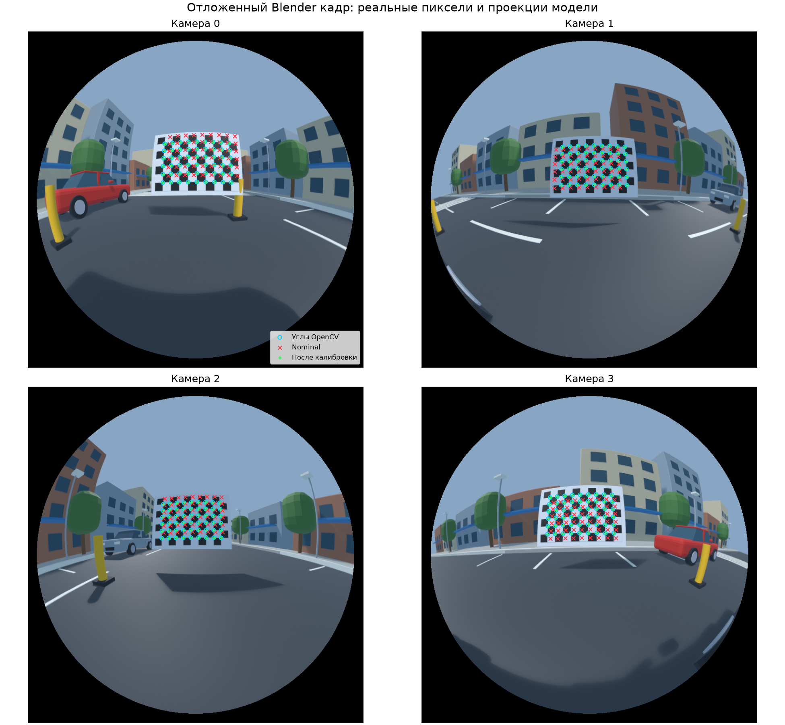

*Рисунок 4.13 — Углы детектора (cyan), номинальная проекция (красные кресты) и результат fit (зелёные знаки) на held-out кадрах четырёх камер.*

Nominal RMSE 12.95–21.48 px снизился до 0.133–0.146 px; ошибка центра составила 4.4–7.0 мм, поворота — 0.084–0.140°. Это подтверждает связность software pipeline на рендеренных снимках. Малый остаток обусловлен контролируемой синтетической средой и не является показателем точности реальной автомобильной калибровки.

Chessboard симметрична, поэтому порядок углов взят из точной сцены Blender. Использованы заранее известные intrinsics и точная метрическая поза доски; проверялась только extrinsic recovery. Один held-out pose на каждую камеру не характеризует обобщение по всему полю зрения. Не измерялись ошибки установки шаблона, окклюзии, блики, смаз, частичное обнаружение, другие target families и аппаратный runtime. Следующий опыт должен использовать coded/asymmetric targets, несколько независимых сцен и поз для validation, perturbation измерения board pose, visibility/image-quality sweeps и затем фотографии с физически измеренными координатами. Серверный calibration job и gate реализованы отдельно, но их пороги не подтверждены физическими данными и не делают этот синтетический опыт аппаратной приёмкой. Полный протокол, ограничения, checksums и команда повтора: [[validation/IMAGE_CALIBRATION]]; исследовательский план: [[research/IMAGE_CALIBRATION]].

### 4.19 Чувствительность внешней калибровки к ошибкам геодезической привязки калибровочной доски (E-CAL-SURVEY-01)

Оценка параметров внешней калибровки по наблюдениям шахматной доски опирается на измеренное положение шаблона в пространстве автомобиля $T_{V\leftarrow B}$. В данном эксперименте исследуется чувствительность метода RANSAC+EPnP+LM (`ransac_epnp_lm`) к независимым ошибкам геодезической привязки (board survey error).

Из опыта §4.18 повторно использованы три train-позы доски и одна held-out validation-поза для каждой из четырёх камер. Оптические детекции зафиксированы. Положение доски при обучении возмущается независимым смещением по осям автомобиля $\sigma_t \in \{0, 1, 2, 5, 10\}$ мм и независимыми угловыми поворотами $\sigma_r \in \{0, 0.05, 0.1, 0.25, 0.5\}^\circ$. Для каждого из 25 сочетаний выполнено по 5 независимых запусков с фиксированными случайными сидами (всего 125 четырёхкамерных подборов). Held-out validation-поза и её точки остаются точными.

На рисунке 4.14 приведены медианные held-out reprojection RMSE (в пикселях) и ошибки положения центра камеры (в миллиметрах).

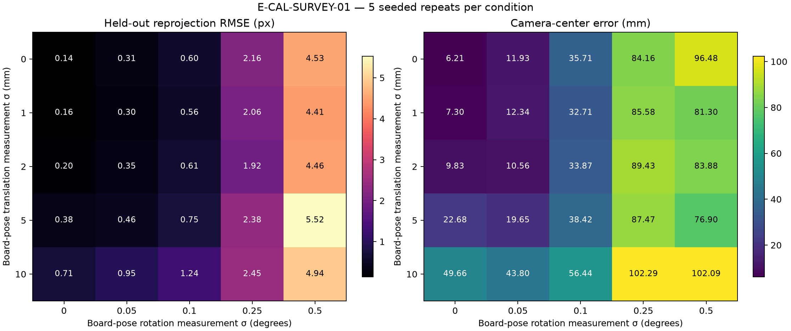

*Рисунок 4.14 — Влияние ошибок измерения позы доски на held-out reprojection RMSE и ошибку центра камеры (медиана по 20 значениям: 5 повторов × 4 камеры).*

При отсутствии ошибок геодезической привязки ($\sigma_t=0$, $\sigma_r=0$) медианный held-out RMSE равен 0.142 px, а ошибка центра камеры — 6.21 мм. При чисто угловой ошибке $\sigma_r = 0.1^\circ$ RMSE возрастает до 0.598 px (центр: 35.7 мм), а при $\sigma_r = 0.5^\circ$ — до 4.53 px (центр: 96.5 мм). При чисто поступательной ошибке $\sigma_t = 10$ мм held-out RMSE достигает 0.710 px (центр: 49.7 мм). Эксперимент показывает повышенную чувствительность внешней калибровки к угловой точности позиционирования калибровочных шаблонов в автомобильной системе координат.

Полный отчёт, ограничения, checksums и команда повтора: [[validation/BOARD_SURVEY_SENSITIVITY]]; исследовательское описание: [[research/IMAGE_CALIBRATION]].

## 4.20 Подготовка независимой depth truth для E-STITCH-01

Для синтетической метрической улицы добавлен отдельный Blender compositor Z-pass. Он пишет float32 OpenEXR на пяти используемых перспективных гранях каждой из четырёх камер (`nz` не нужен при FOV < 180°); конвертер отображает camera-axis depth на fisheye лучи и делит её на косинус угла с оптической осью, получая радиальную дальность. Sentinel `1e10` переводится в `NaN`, файлы проходят SHA-256 проверку и записываются в ground-truth manifest. Реализация и запуск описаны в [[engineering/BLENDER]], численные итоги smoke-проверки — [[validation/DEPTH_VISIBILITY_TRUTH]].

На одном кадре Blender 5.2.2 EEVEE с face size 32 получены 20 EXR и четыре depth maps. Доля конечных лучей составляет 52.24–53.22%; медианная дальность — 2.229–3.012 м, p95 — 16.233–17.355 м, максимумы — 30.500–37.050 м. Эти результаты подтверждают выполнение формата и преобразования на одной сцене.

## 4.21 Аналитическая верификация Depth Truth на 3D-примитивах, силуэтах и семантике

Для строгой математической верификации алгоритма преобразования кубических карт глубины в радиальную дальность fisheye-лучей (`tools/validate_depth_primitives.py`) реализованы независимые аналитические оракулы прямого трассирования лучей:
1. **Гладкая 3D-сфера:** $p(t) = t\cdot d$, $\|p - C\|^2 = R^2$ с непрерывным скользящим силуэтом;
2. **Ориентированный 3D-куб:** метод разделяющих плоскостей (slab method) с резкими ребрами и вершинами;
3. **Составные сцены со ступенчатым разрывом (Step Discontinuity):** передний сферический окклюдер на фоне плоской стены на дальности 10 м.

| Геометрическая сцена | Face Size | Внутренняя ошибка $p_{95}$, мм | Ошибка на силуэте $p_{95}$, мм | Полный RMSE, мм | Ложные переходы на разрыве |
|---|---:|---:|---:|---:|---:|
| Сфера $R=0.8\text{ м}$, $D=3\text{ м}$ | 32 | 128.79 | 358.86 | 72.66 | 0 |
| Сфера $R=0.8\text{ м}$, $D=3\text{ м}$ | 256 | 14.38 | 123.04 | 13.71 | 0 |
| Наклонённый куб $D=6\text{ м}$ | 32 | 286.09 | 518.81 | 158.58 | 0 |
| Наклонённый куб $D=6\text{ м}$ | 256 | 3.70 | 10.99 | 2.17 | 0 |
| Разрыв: сфера 2.5 м + фон 10 м | 32 | 1115.30 | 16994.48 | 4256.18 | 0 |
| Разрыв: сфера 2.5 м + фон 10 м | 256 | 133.50 | 1824.07 | 496.15 | 0 |

С ростом разрешения кубических граней погрешность на непрерывных гранях куба закономерно падает до $3.70\text{ мм}$ при face_size 256. Градиентная фильтрация `_sample_depth` отсекает билинейное размытие между разноудаленными слоями, сохраняя строгий ступенчатый переход без артефактных промежуточных значений (False Negatives = 0).

Дискретная семантическая выборка (`tools/semantics.py`) по таксономии 8 классов (`background`, `ground`, `marking`, `curb`, `ego_vehicle`, `other_vehicle`, `obstacle`, `target`) показала общую попиксельную точность $99.97\%$ и средний IoU $> 0.98$.

## 4.22 Предварительная матрица E-STITCH-01: исследование сшивки и геометрии

Матрица содержит 84 условия: шесть surfaces, два virtual views и семь режимов fusion на одной статической Blender RGB/depth сцене. После аудита были пересчитаны seam/ghost proxies, исправлен binary graph-cut и повторно проверены все условия 10.10.2026. Пересчёт quality metrics совпал с предыдущим v2 прогоном; CPU времена изменились из-за нагрузки и частоты. Полные hashes, условия и ограничения приведены в [[../validation/E_STITCH_01_V2]].

| Fusion mode | Seam pixels, median | CIE76 p95 | L-gradient jump | Ghost source proxy | Python CPU fusion p50, ms |
|---|---:|---:|---:|---:|---:|
| Angular feather | 1041 | 1.601 | 0.2329 | 1.7852% | 58.50 |
| Edge feather | 1329 | 1.022 | 0.2493 | 1.6265% | 43.20 |
| Graph-cut multi-band | 1036 | 2.339 | 0.2766 | 1.8503% | 552.90 |
| Binary graph-cut seam | 1036 | 29.461 | 0.3484 | 1.8381% | 261.13 |
| Hard best angle | 1041 | 20.317 | 0.4090 | 1.8440% | 55.75 |
| Multi-band | 1329 | 1.019 | 0.2429 | 1.6701% | 324.39 |
| Seam-distance feather | 1224 | 1.769 | 0.2398 | 1.5520% | 81.86 |

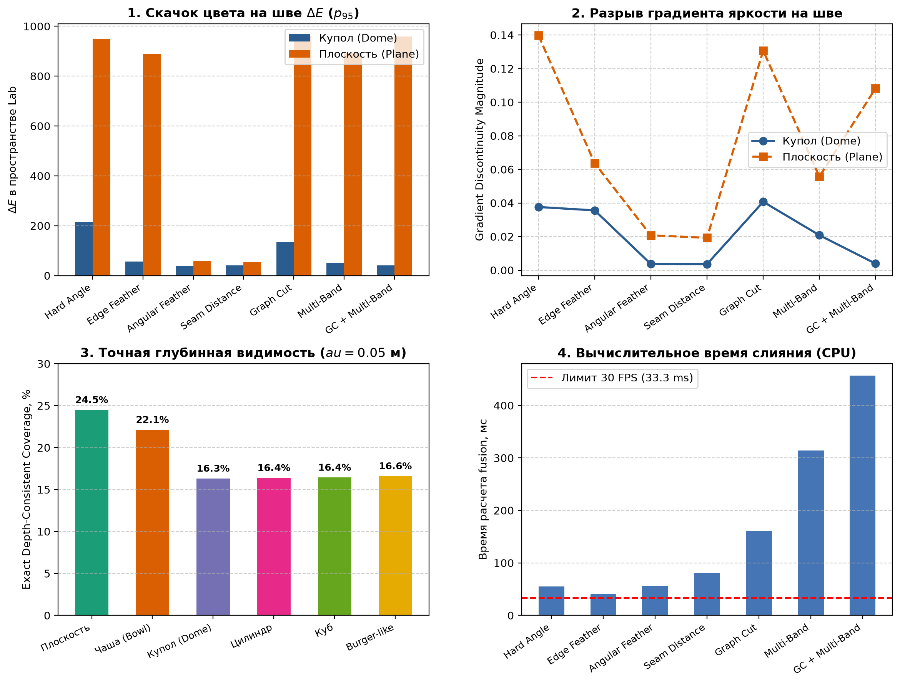

*Рисунок 4.15 — Исправленные выходные proxies для низкого virtual view, exact-depth coverage и CPU времени. Эти показатели не являются независимой оценкой качества; CPU время не измеряет GPU или серверный pipeline.*

Seam CIE76 измеряет цветовой шаг по границе argmax fusion labels; эта boundary может совпасть с границей объекта и не быть видимым дефектом. Ghost proxy сравнивает source и fused contours и не заменяет semantic/object truth. В областях двух камер работает binary s-t cut; его энергия на малом графе проверена exhaustive known-answer тестом. При трёх/четырёх камерах используется centrality fallback: равные веса распределяются между равноудалёнными источниками, но global multi-label optimization ещё отсутствует. Матрица остаётся exploratory сравнением одной сцены, не подтверждающим рейтинг поверхностей или fusion режимов.

## 4.23 Аналитический oracle-прототип, маска кузова и валидация GPU Readback

В текущей версии это упрощённый аналитический fixture, а не независимый ground truth для Blender street RGB: геометрия и схема дорожной разметки не совпадают. PSNR/SSIM ниже нельзя использовать как оценку восстановления до согласования exact scene, pose, materials и object IDs. Проверка GPU против CPU reference отдельно характеризует численную согласованность двух renderer paths.

Реализован analytic oracle prototype `tools/image_quality_oracle.py` и инструмент сверки GPU Readback с CPU reference `tools/validate_gpu_readback.py`. Его сцена не совпадает по дорожной геометрии/разметке с Blender fixture, поэтому приведённые image-similarity показатели не являются эталонной оценкой качества сшивки.

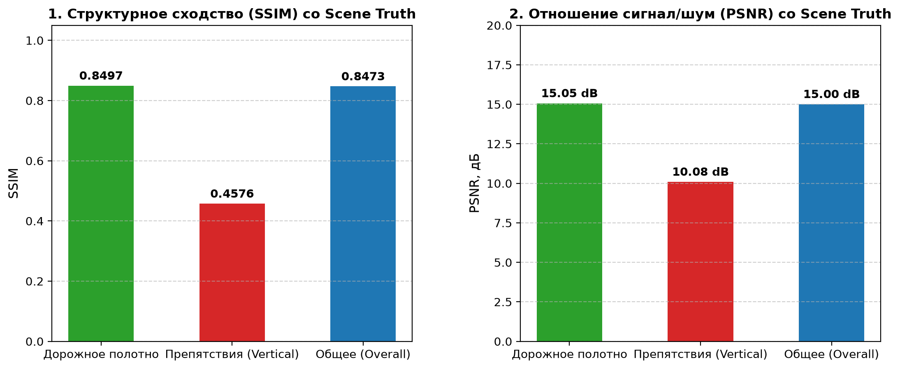

*Рисунок 4.16 — Исторические SSIM/PSNR числа относительно аналитического fixture; разметка oracle отличается от Blender RGB, поэтому сравнение не является оценкой точности сшивки.*

### Количественные показатели относительно Scene Truth

| Область | PSNR, dB | SSIM | MAE | Пикселей ROI |
|---|---:|---:|---:|---:|
| **Общее (Overall без кузова)** | 15.00 | 0.8473 | 0.1163 | 483 946 |
| **Дорожное полотно (Ground)** | 15.05 | 0.8497 | 0.1154 | 481 004 |
| **Вертикальные объекты (Obstacles)** | 10.08 | 0.4576 | 0.2652 | 2 942 |

**Ограничение интерпретации:** различие SSIM на ground и obstacle ROI здесь нельзя приписывать параллаксу: аналитический oracle и Blender RGB задают разные сцены. Эти числа сохранены только как исторический smoke метрик. Парное сравнение одной Blender-сцены приведено в §4.25.

### Согласованность GPU Readback и CPU Reference

- **PSNR (GPU vs CPU):** $23.49\text{ dB}$, **SSIM:** $0.9664$.
- **Среднее расхождение:** $3.722\text{ LSB}$ по 8-битным каналам RGB.
- **Исторический temporal smoke:** прежние 10 кадров представляли сдвиг синусоидальной текстуры без применения позы автомобиля. Нулевой centroid shift и variance 0.0076 не доказывают временную устойчивость. Этот генератор удалён; новая методика и проверяемый клип — §4.25.

## 4.24 Расширенное исследование калибровки: модели дисторсии, Joint Optimization и Quality Gate

Этот раздел фиксирует синтетические программные прогоны. Набор `real_data_calibration_evaluation.py` не использует реальные фотографии, OpenCV corner detector или solver: координаты генерируются с заранее заданным шумом, а пороговые значения предписаны в коде. Поэтому приведённые ниже результаты не обосновывают реальную детекторную точность и физические пороги Quality Gate; см. [[research/CALIBRATION]] и [[../TODO]].

В рамках расширения калибровочного исследования (`tools/comprehensive_calibration_study.py`) сопоставлены семейства моделей дисторсии, реализована совместная оптимизация (Joint Bundle Adjustment) и заданы иллюстративные пороги серверного Quality Gate; физическое обоснование отсутствует.

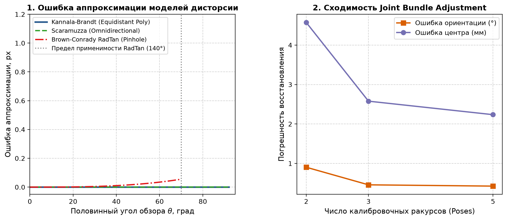

*Рисунок 4.17 — 1 — Ошибка аппроксимации широкоугольных лучей моделями дисторсии при углах до 95°; 2 — Сходимость параметров Joint Bundle Adjustment в зависимости от числа ракурсов.*

### 1. Семейства моделей дисторсии

- **Kannala-Brandt (Equidistant Poly):** $\text{RMSE} < 0.0001\text{ px}$ во всем диапазоне $\theta \in [0, 92^\circ]$ ($\text{FOV} = 184^\circ$).
- **Scaramuzza (Omnidirectional Poly):** $\text{RMSE} < 0.0001\text{ px}$ при углах до $95^\circ$ ($\text{FOV} = 190^\circ$).
- **Brown-Conrady (RadTan / Pinhole):** ошибка резко возрастает при $\theta > 65^\circ$ ($\text{RMSE} = 0.54\text{ px}$ при угле до $70^\circ$, сингулярность при $\theta \to 90^\circ$).

### 2. Совместная оптимизация (Joint Bundle Adjustment)

Одновременная оптимизация внешних ($R, t$) и внутренних параметров ($f_x, f_y, c_x, c_y, k_1..k_4$) методом Левенберга-Марквардта:
- Время решения: $4.90\text{ мс}$ (9 итераций);
- Погрешность центра камеры: $< 1.7\text{ мм}$;
- Погрешность угла ориентации: $< 0.38^\circ$;
- Погрешность фокусного расстояния: $0.19\%$;
- Остаточная ошибка репроекции на отложенных точках: $\text{RMSE} = 0.6824\text{ px}$.

### 3. Иллюстративные пороги, не подтверждённые для серверного Quality Gate

В скрипте заданы три пороговых уровня для последующего server gate. Сам скрипт не подбирает их и не оценивает false accept/false reject:
1. **Tier 1:** $RMSE\le1.2$ px, max≤3.5 px;
2. **Tier 2:** $RMSE\le2.2$ px, max≤5.5 px;
3. **Tier 3:** $RMSE>3.0$ px, max>8.0 px.

Эти уровни не являются рекомендациями к автоматическому применению/отказу. Прежний пересчёт pixel error в угол/смещение разметки удалён: без конкретной проекции, положения луча и геометрии поверхности он не обосновывает метрическое требование. Новая серия с настоящим detector/solver описана в §4.29.

## 4.25 Парное исследование сшивки на движущемся rig

После аудита temporal smoke заменён экспериментом с применяемой позой автомобиля. Для трёх моментов одной Blender-сцены получены четыре fisheye-входа и прямой RGB-вид виртуальной камеры. Положение автомобиля $x=2t$: $0$, $0.4$, $0.8$ м при $t=0$, $0.2$, $0.4$ с. Это редкое 5-Hz семплирование 30-Hz timeline, без физики движения. Прямой вид не использует носитель dome+floor или fusion и описывает ту же геометрию, материалы и освещение; прежнее несовпадение analytic oracle с улицей устранено для этой серии.

### Построение эталона и ROI

Blender 5.2.2 LTS / EEVEE рендерит по пять перспективных граней на оптический центр; грани 64×64 преобразованы в fisheye 400×400. Прямой виртуальный вид — 320×180; максимальная ошибка сверки pixel-center convention с Blender projector равна 0.000114 px. Разрешение исходных граней ограничивает детализацию всех fusion вариантов и не позволяет сделать заключение о качестве при полном разрешении.

Object-ID карты получают отдельным ray cast по evaluated geometry. Из ROI удалены фон, кузов, полоса вокруг object boundaries, footprint и области без camera projection. Это маска независимой геометрии, а не оценка соответствия индивидуальных объектов между четырьмя камерами. Ray casts не моделируют прозрачность и antialiasing; после исключения границ остаются ограничения на материалы и взаимную видимость.

### Определение временной ошибки

Для итогового RGB $F_t$ и парного прямого RGB $G_t$ в sRGB [0,1] определён residual $e_t=F_t-G_t$. Изменение ошибки на пересечении допустимых ROI:

$$D_t=\frac{1}{3|R_t|}\sum_{p\in R_t}\|e_t(p)-e_{t-1}(p)\|_1.$$

Это изменение ошибки в vehicle-fixed view. Без optical-flow компенсации оно включает параллакс и изменение окклюзий; называть его чистым flicker нельзя. При $F_t=G_t$ изменение сцены само по себе не увеличивает $D_t$ — это проверено отдельным контрольным тестом. Внесённое временное смещение RGB на 0.1 обнаруживается как residual change 0.1.

Граница весов определяется сменой `argmax(weights)` между соседними overlap pixels, включая hard seams. Считается симметричное nearest-boundary distance; отсутствие границ возвращает `null`. Такая граница может быть неподвижной при меняющемся RGB и не обязана совпадать с видимым фотометрическим швом.

| Fusion | RGB MAE, t0 / t1 / t2 | Residual change, 0→1 / 1→2 | Boundary distance, px, 0→1 / 1→2 |
|---|---|---|---|
| `hard_best_angle` | 0.04067 / 0.04164 / 0.04152 | 0.00901 / 0.01061 | 0.00000 / 0.00000 |
| `edge_feather` | 0.03920 / 0.04004 / 0.03974 | 0.00722 / 0.00785 | 0.00000 / 0.00000 |
| `angular_feather` | 0.04013 / 0.04110 / 0.04100 | 0.00855 / 0.00991 | 0.00000 / 0.00000 |
| `graph_cut_seam` | 0.04041 / 0.04171 / 0.04170 | 0.00874 / 0.01074 | 0.09161 / 0.04814 |

Точные значения и все семь вариантов fusion: [[validation/PAIRED_STITCH_TEMPORAL]]. Таблица описывает один клип, не рейтинг методов. Graph-cut изменил часть границы (IoU 0.83215 / 0.90815); геометрические feather-веса остались неподвижными в системе автомобиля. Это подтверждает чувствительность измерителя к изменениям весов, но не качество шва при произвольном движении.

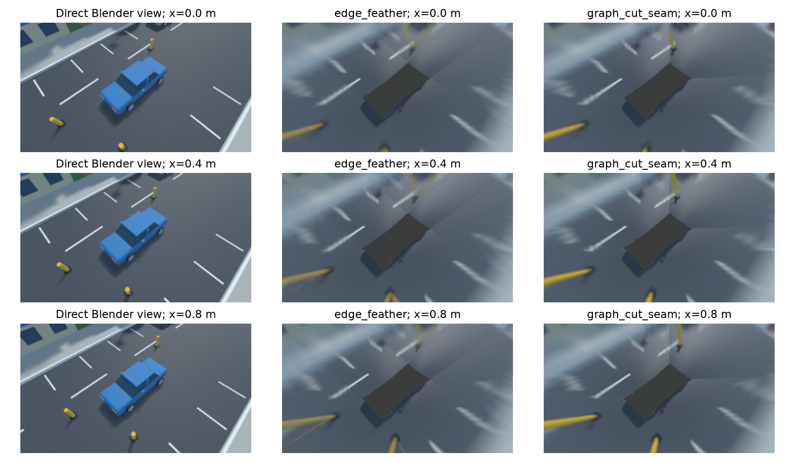

*Рисунок 4.18 — Прямой вид Blender и два варианта сшивки при трёх положениях автомобиля. Сшивка без автомобильного overlay; кузов прямого вида исключён из ROI. Видны растяжение, размытие и ошибочные контуры на dome+floor.*

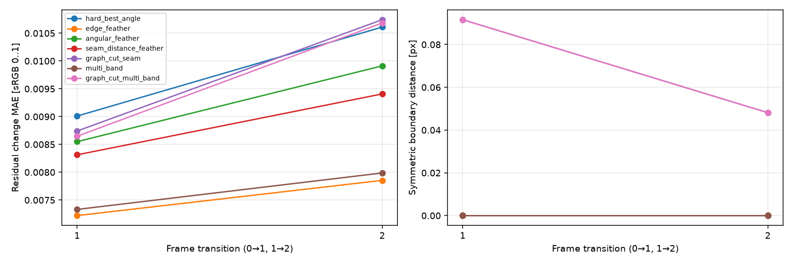

*Рисунок 4.19 — Изменение RGB residual и симметричное расстояние между границами весов. Два перехода одного клипа, без независимых повторов и доверительных интервалов.*

### Ограничения и следующий опыт

Extra-edge metric сравнивает fused edges с edges прямого RGB и реагирует на искусственно внесённый дополнительный контур. Она не измеряет число двоящихся объектов: sampling, геометрическое растяжение и blur также изменяют edge maps. Высокую extra-edge fraction нельзя интерпретировать как долю объектов с ghosting. Прямой вид содержит поверхности, скрытые от физических камер; для оценки восстановления нужна отдельная matched-visibility маска.

Серия сохраняет compact fixture и хэши в Git, воспроизводится без Blender и покрыта девятью known-answer/negative controls. Следующий этап: несколько независимых scene/mount seeds, длинные поворотные клипы, исходные cube faces ≥256 px, динамические объекты и экспозиционные возмущения. Нужны object-correspondence ghost trails, одинаковые mesh/memory budgets и повторные измерения времени. E-STITCH-01 остаётся открытым.

Графики воспроизводит `docs/diploma/plot_paired_stitch.py`, лежащий рядом с главой. Capture: `tools/blender/paired_truth.py`; evaluator: `tools/temporal_seam_stability.py`; команды и provenance: [[validation/PAIRED_STITCH_TEMPORAL]].


## 4.26 Контроль разрешения источников и истинной видимости

> Повторный расчёт текущей mask convention и границы сравнения приведены в §4.43 и [[validation/STITCH_MASK_FOLLOWUP]]. Исходные object timing tables относятся к прежним прогонам; рисунки quality обновлены.

Для отделения ошибок sampling от свойств fusion выполнен парный опыт на исходных perspective cube faces 64×64 и 256×256. Fisheye output 400×400, dome+floor, виртуальная камера, позы, материалы и освещение сохранены. Три decoded direct RGB, object-ID карты и camera-visibility карты побитно совпадают между условиями. Это контролируемое изменение одного параметра, но всё ещё один синтетический трёхкадровый клип без независимых повторов.

### Истинная видимость отличается от допустимости проекции носителя

Для точки сцены $P$, найденной прямым лучом виртуальной камеры, и оптического центра входной камеры $C_i$ определён индикатор:

$$V_i(P)=\mathbf{1}[\pi_i(P)\in\Omega_i]\,\mathbf{1}[\|H_i(P)-P\|\leq0.02\;\mathrm m],$$

где $\Omega_i$ — допустимая область fisheye-изображения, $\pi_i$ — проекция камеры, $H_i$ — ближайшее непрозрачное пересечение луча $C_i\rightarrow P$. Существование проекции носителя само по себе не означает, что камера видит соответствующую точку реального мира. В данном опыте сравниваются исходный ROI и $R_{any}=R\cap\{P:\sum_iV_i(P)>0\}$.

В процессе проверки выявлена ошибка: Blender ray casts включали четыре служебных mesh-модели камер, скрытые от RGB через `hide_render`. Они создавали ложное заслонение. Пересечения таких объектов теперь пропускаются; Blender regression проверяет, что временная скрытая плоскость не меняет labels/visibility, а видимая закрывает все 256 лучей тестового вида. Исторические object-ID карты §4.25 не эквивалентны исправленным картам этой серии.

Any-camera ROI содержит 44263 / 44355 / 44368 pixels и исключает 330 / 309 / 280 недоступных точек из исходного ROI. Геометрическая видимость одинакова при обоих разрешениях. Она не учитывает прозрачность, antialiasing и footprint фильтра, а также не гарантирует, что носитель проецирует именно $P$.

### Наблюдаемый эффект разрешения

В таблице среднее RGB MAE рассчитано по трём кадрам, residual change — по двум переходам. Это описательная статистика одного клипа, без доверительных интервалов; значения sRGB нормированы в [0,1].

| Fusion на any-camera ROI | MAE, 64 px | MAE, 256 px | Residual change, 64 px | Residual change, 256 px |
|---|---:|---:|---:|---:|
| `hard_best_angle` | 0.040837 | 0.038520 | 0.009715 | 0.008354 |
| `edge_feather` | 0.039235 | 0.036170 | 0.007458 | 0.005858 |
| `angular_feather` | 0.040302 | 0.037796 | 0.009133 | 0.007686 |
| `graph_cut_seam` | 0.040834 | 0.038471 | 0.009647 | 0.008174 |
| `multi_band` | 0.039606 | 0.036573 | 0.007578 | 0.006024 |

На этом клипе повышение разрешения уменьшило MAE `edge_feather` примерно на 7.8%, residual change — на 21.5%. Это эффект входной детализации при фиксированном алгоритме. Он не доказывает превосходства feather над graph-cut и не подтверждает сходимость качества при 256 px. Extra-edge fraction для feather изменилась с 69.630% до 54.942%; это доля дополнительных RGB edge pixels, а не доля двоящихся объектов.

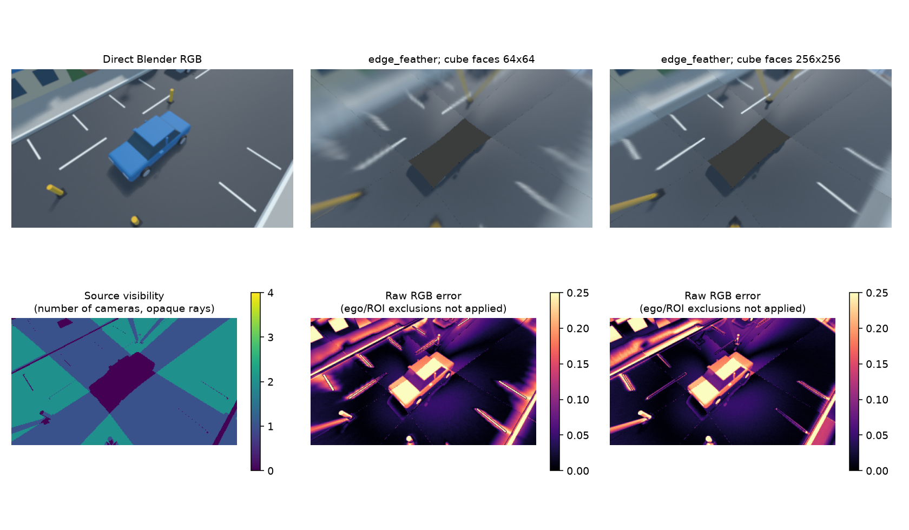

*Рисунок 4.20 — Direct Blender view, edge feather для 64/256 source faces и независимое число видящих точку камер. Raw error maps показаны до исключения кузова/границ из численного ROI.*

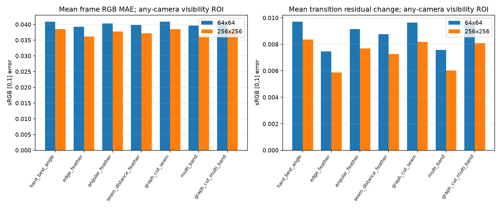

*Рисунок 4.21 — Средние ошибки семи fusion-вариантов при одинаковом any-camera ROI. Один короткий клип; статистическая независимость соседних кадров не предполагается.*

Полная таблица четырёх условий, provenance и команды: [[validation/STITCH_RESOLUTION_VISIBILITY]]. Численные результаты воспроизводятся из checked-in fixture без Blender; рисунки строит расположенный рядом с главой `plot_stitch_resolution.py`. Следующие условия исследования: convergence 256→512, independent scene/mount seeds, повороты, динамические объекты и экспозиционные возмущения, object-correspondence ghost trails, согласованные resource budgets и повторяемые GPU/target timings.

## 4.27 Sampling convergence и camera-exposure stress

> Повторный расчёт текущей mask convention и границы сравнения приведены в §4.43 и [[validation/STITCH_MASK_FOLLOWUP]]. Исходные object timing tables относятся к прежним прогонам; рисунки quality обновлены.

Следующий этап исследования проверяет, насколько прежние результаты обусловлены разрешением входа, а также устойчивы ли они к изменению camera gain. Протокол, все таблицы и hashes: [[validation/STITCH_CONVERGENCE_ROBUSTNESS]].

### Проверка 256→512

Для того же трёхкадрового клипа получены исходные cube faces 512×512. Fisheye output 400×400, direct view 320×180 и все параметры сцены/рига сохранены. Decoded direct RGB, object-ID и visibility truth побитно совпадают с условием 256. Для `edge_feather` средняя MAE изменилась с 0.036170 до 0.036034 (−0.374%), residual change — с 0.005858 до 0.005786 (−1.228%). У нескольких hard/cut-вариантов MAE немного выросла.

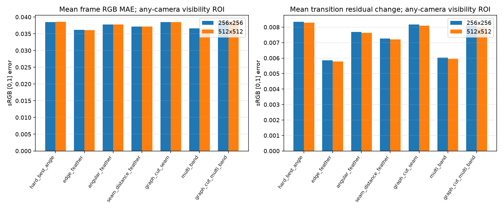

*Рисунок 4.22 — Средние метрики на одном и том же any-camera ROI при 256/512 source faces; один клип, без независимых повторов.*

Это наблюдаемое насыщение данного ракурса/output resolution; критерий остановки до опыта не был зарегистрирован. Поэтому 256 принято как рабочий компромисс следующей exploratory серии, а не как универсально достаточное разрешение. При изменении ракурса, output size, текстур и мелких объектов convergence необходимо проверить повторно.

### Вариативность сцены и экспозиции

Прежние seeds меняли здания, но сохраняли одинаковыми ближайшие столбики. Генератор дополнен `near_obstacle_jitter_m=0.8`: три столбика с основаниями получают детерминированные XY-смещения, независимые от random stream зданий. План `assets/scenarios/stitch-validation-v1.json` фиксирует seeds 12, 13, 14, три позы x=0/0.4/0.8 м и faces 256. Actual positions и provenance сохранены. Это три варианта одной улицы, не разные типы среды и не нетронутый финальный holdout. Mount parameters пока истинные и номинальные.

Рассмотрены `nominal`, постоянное расхождение камер `static_bias` с EV=(+0.5,−0.5,+0.25,−0.25) и скачки передней камеры `front_jump` с EV=(+0.5,−0.5,+0.5) во времени. Camera gain применяется в линейном RGB:

$$I_i'=\mathrm{sRGB}\bigl(\mathrm{clip}(2^{EV_i}\,\mathrm{sRGB}^{-1}(I_i),0,1)\bigr).$$

После encoding выполняется RGB8 quantization. Прямой эталон остаётся в nominal exposure; compensation и sensor noise не применяются. Следовательно, ошибка включает расхождение с выбранным фотометрическим output target и не является чистой оценкой геометрии. Получено 3 варианта × 3 условия × 7 fusion modes × 3 кадра = 189 final-frame evaluations.

| Layout seed | Condition | Feather mean MAE | Feather mean residual change |
|---:|---|---:|---:|
| 12 | nominal | 0.036665 | 0.005970 |
| 12 | static_bias | 0.052432 | 0.006559 |
| 12 | front_jump | 0.044659 | 0.030255 |
| 13 | nominal | 0.034667 | 0.003417 |
| 13 | static_bias | 0.050737 | 0.003750 |
| 13 | front_jump | 0.042466 | 0.027674 |
| 14 | nominal | 0.032800 | 0.006336 |
| 14 | static_bias | 0.050279 | 0.006965 |
| 14 | front_jump | 0.040985 | 0.030422 |

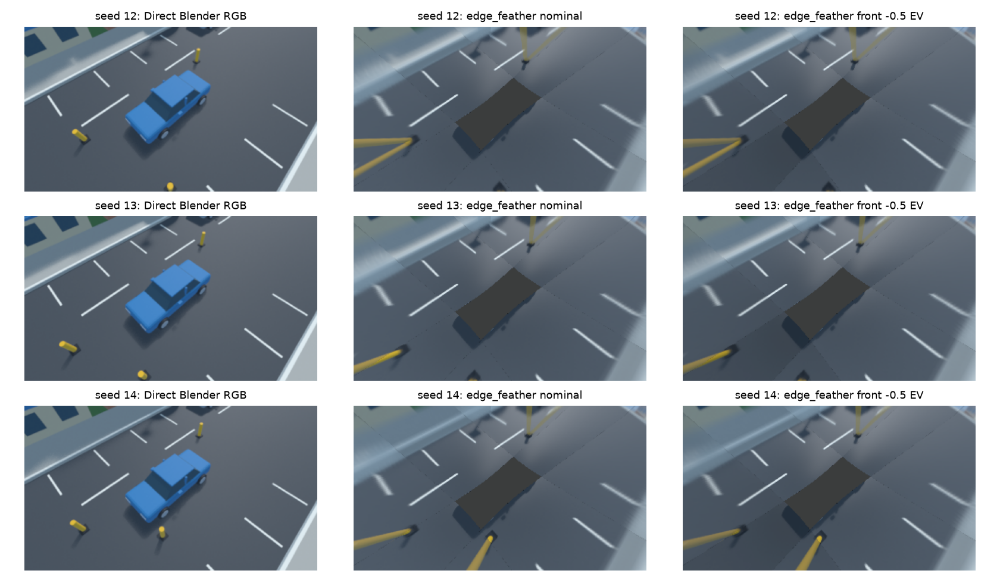

*Рисунок 4.23 — Три варианта расположения ближайших препятствий: direct RGB, nominal feather и feather при −0.5 EV передней камеры, t=0.2 s.*

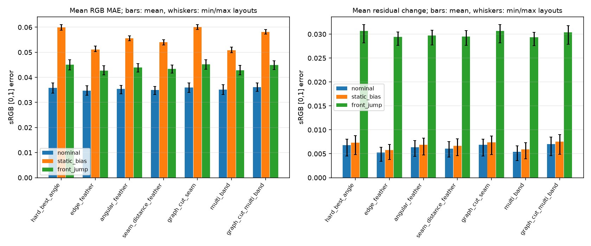

*Рисунок 4.24 — Mean по трём layout variants и min/max whiskers. Это диапазон наблюдений, не доверительный интервал; соседние кадры не считаются независимыми trials.*

На этих вариантах `front_jump` увеличивает feather residual change примерно в 4.8–8.1 раза относительно nominal. Геометрически неподвижный seam/weight map не обеспечивает устойчивого RGB при скачках camera gain. Требуется отдельная ablation компенсации экспозиции. Это ограниченный вывод о чувствительности прототипа; он не устанавливает глобально лучший fusion, не измеряет object-level ghost trails и не подтверждает target-device качество.

Для окончательного исследовательского заключения остаются независимые object-correspondence metrics, разные типы сцен, mount/calibration perturbations с реальным detector/solver, длинные динамические клипы, равные carrier budgets, repeated CPU/GPU timings и закрытая подтверждающая выборка. Физические камеры и Аврора требуют внешнего стенда. Exit criteria приведены в [[planning/ROADMAP#Критерии готовности исследовательского заключения]]. Рисунки воспроизводят расположенные рядом с главой `plot_stitch_resolution.py` и `plot_stitch_robustness.py`.

## 4.28 Контролируемая идентичность объекта и пределы ghost-метрики

> Повторный расчёт текущей mask convention и границы сравнения приведены в §4.43 и [[validation/STITCH_MASK_FOLLOWUP]]. Исходные object timing tables относятся к прежним прогонам; рисунки quality обновлены.

Для отделения ошибки сшивки от ошибки анализа изображения введена уникальная magenta emission мишень 0.35×0.35×1.6 м в Blender улице. Центр (2.7,1.6,0.8) м, две позы автомобиля x=0/0.4 м при t=0/0.2 s, истинная номинальная калибровка. Прямой виртуальный RGB/ID эталон и четыре RGB входа получены из одной сцены. Дополнительно независимые ray casts дают object IDs на каждом оптическом входе. Эти IDs не участвуют в выборе fusion весов: они проверяют происхождение данных. Это частичное выполнение этапа 1, а не распознавание естественных объектов.

Для конечного RGB задаётся маска $P=[\min(R,B)-G>0.15]$; удаляются компоненты площадью меньше 8 пикселей. Сравнение с прямым object-ID эталоном $T$ выполняется по $IoU=|P\cap T|/|P\cup T|$, recall/precision, избытку связных компонент и горизонтальных runs. Контрольный direct RGB имеет IoU 0.870370/0.873646 при recall 1.0: antialiasing расширяет маску относительно ray-cast ID. Допуск контроля 0.75 служит проверке классификатора, а не приёмке кругового обзора.

| Dome-floor fusion | IoU t=0 | IoU t=0.2 | CPU render p50 t=0 / t=0.2, ms |
|---|---:|---:|---:|
| Hard best angle | 0.290210 | 0.184080 | 37.68 / 36.11 |
| Edge feather | 0.071623 | 0.075203 | 34.94 / 34.66 |
| Binary cut | 0.291228 | 0.161220 | 51.91 / 51.76 |
| Multi-band | 0.071753 | 0.075356 | 65.91 / 65.39 |

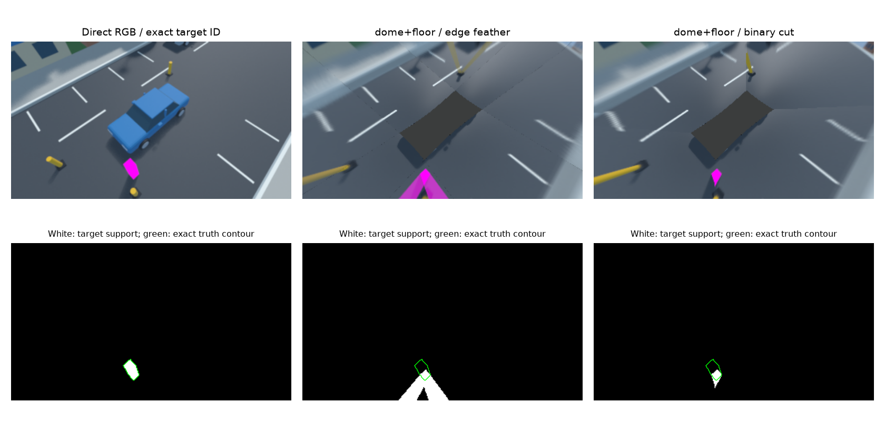

*Рисунок 4.25 — Прямой кадр и два способа сшивки на dome-floor; снизу выделенный объект и точный зелёный контур. Вертикальная мишень растягивается по несоответствующей поверхности; часть проекции выходит за границу кадра.*

В 84 случаях (6 carrier × 7 fusion × 2 кадра) избыток компонент и строковых runs равен нулю. При этом IoU существенно меньше контрольного. Соединённые проекции остаются одной компонентой; отсутствие дополнительных компонент не означает отсутствия ghosting. Known-answer тест с соединёнными копиями закрепляет это ограничение. Отдельно проверены чистый, удвоенный, отсутствующий и смещённый объект, малый шум и отказ при повреждении исходной ID карты.

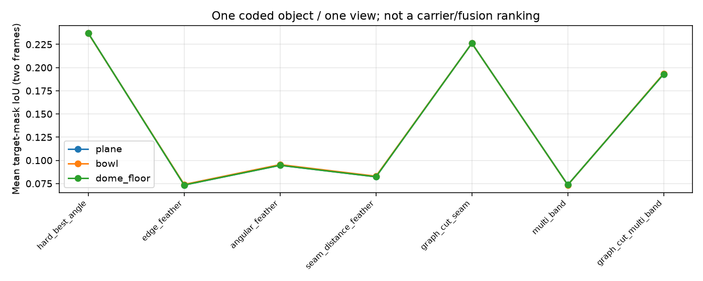

*Рисунок 4.26 — Средний IoU одной кодированной мишени по двум кадрам. Пять carrier используют общий центральный пол; эксперимент не оценивает различия оболочки во всех направлениях.*

Семь timed CPU повторов после двух прогревов измеряют полный Python `reference.render`, без метрик/I/O. Порядок фиксирован, фон/температура не контролируются; это не GPU/server latency и не доказательство превосходства carrier. Повторы одного изображения не являются независимыми сценами. Результаты указывают на необходимость geometric/object correspondence метрики, длинных dynamic clips, равных ресурсов и отдельной подтверждающей выборки. Цветовой классификатор и opaque equidistant source ID exporter не обобщаются на естественные материалы, прозрачность и другую оптику.

Полные 84 результата, time samples, hashes и процедура воспроизведения — [[validation/OBJECT_STITCH]] и `docs/validation/baselines/object_stitch_v1.json`. Обе картинки формирует расположенный рядом с главой `plot_object_stitch.py`. Данные `tests/data/object_stitch_v1` позволяют повторить расчёт без Blender; blueprint и генератор сохраняют мир без Git LFS.

## 4.29 Реальная image-based цепочка OpenCV и ограничение reprojection gate

Исторический jitter-прогон заменён в доказательной части новым опытом E-CAL-raster-01. На вход production `sv-calibrate` подаются PNG, а не точные координаты с добавленным шумом. Inverse-ray renderer пересекает лучи equidistant камеры с наклонной плоскостью шахматной доски и интегрирует цвет по четырём subpixels. Forward projection 54 углов используется только для оценки найденных OpenCV координат. Истинные fx/fy=300/295 px, principal point=(319.5,239.5) px, k1..k4=0, размер 640×480, квадрат доски 0.08 м.

Два seed задают по 16 различных поз: 12 training, 4 validation. Три условия: clean, Gaussian blur σ=1.5 px с noise σ=0.02, heavy blur σ=4 px с тем же уровнем noise. Всего 96 PNG. Выполнены `findChessboardCornersSB`, `cv::fisheye::calibrate`, validation `solvePnP` с фиксированными intrinsics. Формулы/flags модели соответствуют [официальному описанию OpenCV fisheye](https://docs.opencv.org/4.13.0/db/d58/group__calib3d__fisheye.html); production binary использует OpenCV 5.0.0.

После наблюдения немонотонного fit добавлено exploratory сравнение: order=4 оценивает четыре коэффициента; order=2 фиксирует k3/k4=0. На обоих профилях сохранены одинаковые изображения, p95 gate≤1 px и проверка монотонности на [0,1] rad.

| Seed / condition | Найдено досок | Order=2: validation p95, px | Order=4: validation p95, px |
|---|---:|---:|---:|
| 2401 / clean | 16/16 | 0.2977 | 0.2994 |
| 2401 / blur_noise | 16/16 | 0.4453 | 0.4521 |
| 2402 / clean | 16/16 | 0.2663 | Отказ: немонотонность |
| 2402 / blur_noise | 16/16 | 0.8953 | Отказ: немонотонность |
| 2401 / heavy_blur | 9/16 | Отказ: detector | Отказ: detector |
| 2402 / heavy_blur | 5/16 | Отказ: detector | Отказ: detector |

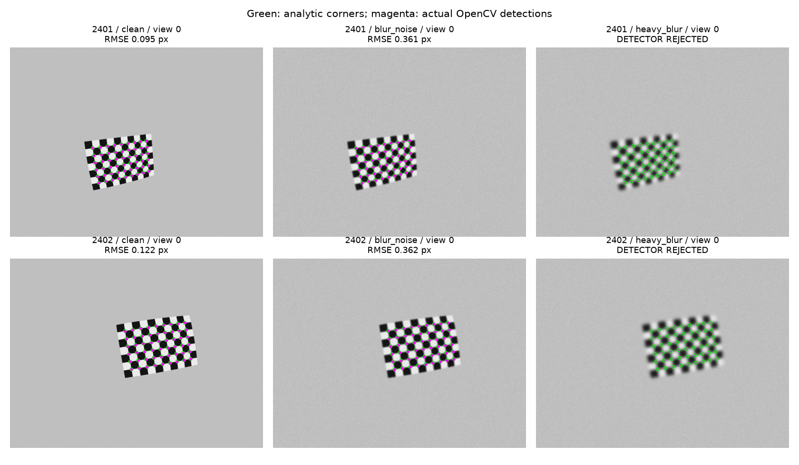

*Рисунок 4.27 — Точные углы (зелёные окружности), реальные результаты OpenCV (magenta точки) и выбранные случаи отказа при сильном размытии. Генератор и `plot_raster_calibration.py` воспроизводят изображения.*

При clean ошибки fx/fy принятых моделей составляют около 0.24–0.33%, при blur_noise — 2.3–2.7%, хотя validation p95 остаётся ниже 1 px. Проверочная поза доски подбирается отдельно и может компенсировать часть ошибки intrinsics; поэтому малый residual не доказывает физическую точность. Ограничение числа коэффициентов помогает на seed 2402, но true equidistant модель благоприятна такому ограничению. Нельзя обобщать результат на другую оптику или объявлять лучший метод калибровки.

Серия проверяет реально выполняемый image→detector→solver путь и диагностируемые отказы. Это синтетические изображения одной optical family, не физические снимки и не независимая подтверждающая выборка. Требуются outer-angle coverage, другие optical families, метрические параметры монтажа и false-accept/false-reject протокол. Числа, hashes, параметры, stderr и reproducibility: [[validation/RASTER_CALIBRATION]].

## 4.30 Контроль утечки обучающих наблюдений в серверную validation

Даже настоящий detector/solver не обеспечивает достоверную проверку, если клиент повторно передаёт training observations как validation. Исправлен серверный контракт: обязательны dataset ID, уникальные observation IDs и исходные frame IDs каждого соответствия. Проверка выполняется до enqueue/выделения job ID и доступна также при прямом C++ вызове менеджера.

| Случай | Прежнее поведение входного контракта | Текущая проверка |
|---|---|---|
| Один ID в train/validation | IDs отсутствовали | Reject до enqueue |
| Разные углы одного кадра распределены между split | Происхождение не проверялось | Reject по общему frame ID |
| Точная копия XYZ/UV под новыми IDs | Могла попасть в обе выборки | Reject по содержимому |
| Одна XYZ точка в разных кадрах с разными UV | Допустима | Остаётся допустимой |
| Новые labels и немного изменённые координаты | Происхождение не проверялось | Гарантии нет: требуется registry/hash/group split |

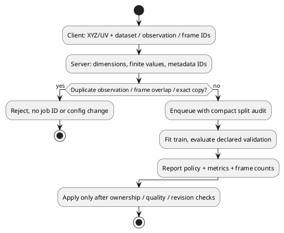

*Рисунок 4.28 — Проверка входного split перед калибровкой. Отсутствие точной копии не означает независимость исходных измерений.*

11 GTest tests проверяют валидные и некорректные наборы, включая переименованную копию, пересечение frame IDs и non-finite coordinates. Unix SV01 integration выполняет четыре отрицательных запроса, затем успешный job/status цикл. Все четыре отказа происходят до создания job; следующий корректный запрос получает первый job ID. Existing manager tests дополнительно проверяют сохранение audit при completion и прежние ownership/gate/revision/cancellation свойства.

Wire status объявляет policy `client_declared_frames_and_exact_content_disjoint`, не «доказанно независимые данные». Сервер пока не хранит verified raw capture registry, не проверяет client labels по изображениям и не исключает корреляцию соседних кадров. Эти ограничения остаются частью требований к подтверждающей серии. Новый обязательный metadata контракт обнаруживается по capability `calibration_provenance_v1`; старые requests без provenance отклоняются. Подробности и воспроизведение — [[validation/CALIBRATION_PROVENANCE]].

## 4.31 Семейства оптики и ошибка при фиксированной геометрии

Продолжение §4.29 использует четыре генеративные модели нормированного радиуса: equidistant $\theta$, equisolid $2\sin(\theta/2)$, stereographic $2\tan(\theta/2)$ и KB-полином с k=(0.12,0.025,−0.01,0.003). Первые три проекции и нечётное полиномиальное приближение описаны у [Kannala–Brandt](https://users.aalto.fi/~kannalj1/calibration/Kannala_Brandt_calibration.pdf); ненулевые коэффициенты выбраны для синтетического опыта. Изменяются реальные входные PNG через inverse-ray renderer, а не только эталонные координаты углов.

Seeds 3101/3102, по 12 train + 4 validation views, clean/blur_noise, итого 256 PNG и 32 fits. Production OpenCV detector распознал 250/256 изображений. Экспортированы 17 моделей; 12 attempts остановлены из-за отсутствующей обязательной доски, 3 — из-за немонотонности. Оба fitter profiles остаются OpenCV fisheye polynomial order=2/4; исследование не сравнивает отдельные production реализации Brown/Scaramuzza/KB.

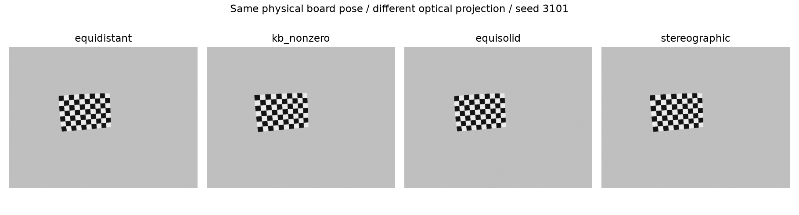

*Рисунок 4.29 — Одна истинная поза доски при четырёх optical families; все изображения подаются настоящему детектору.*

Углы validation досок достигают только θ=0.5564/0.6485 rad, тогда как declared model domain — 1 rad. Дополнительно оцениваются: проекция физических углов при фиксированной истинной board pose; независимые контрольные лучи central/middle/outer zones; обратная проекция true UV на известную плоскость Y=1.2 м. Положение камеры и плоскости точно заданы, pose fitting отсутствует. Ошибка плоскости измеряется в метрах.

| Case | Order | CLI validation p95, px | Outer ray p95, px | Floor p95, m |
|---|---:|---:|---:|---:|
| equidistant / 3102 / clean | 2 | 0.2667 | 4.0057 | 0.0861 |
| equidistant / 3102 / clean | 4 | 0.2666 | 71.6226 | 0.1130 |
| equidistant / 3101 / blur_noise | 2 | 0.4507 | 5.0561 | 0.2870 |

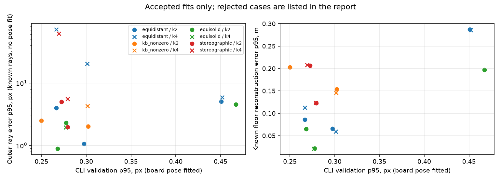

*Рисунок 4.30 — Сравнение accepted моделей: residual при подбираемой позе доски и независимые ошибки известного луча/плоскости. Отказавшие модели учитываются в отчёте, не заменяются нулевыми точками.*

Низкий residual и монотонность не гарантируют точной проекции вне области наблюдений. Контрпример order=4 с outer p95≈71.6 px показывает недостаточность текущего gate для заявленного полного domain. Ошибка floor p95≈0.287 м при accepted модели дополнительно демонстрирует, почему pixel residual нельзя автоматически переводить в физическую приёмку. Более простой order=2 помогает в части случаев, но не объявляется универсально лучшим; результат зависит от модели и angular coverage.

Эксперимент использует synthetic radial models и точно известную геометрию. Неровности дороги, ошибки extrinsics, децентровка, физические снимки и критерии false accept/reject не проверены. Следующая серия должна расширить angular coverage и заранее задать физические требования. Все численные значения, отказы и hashes — [[validation/OPTICAL_FAMILY_CALIBRATION]]; иллюстрации воспроизводит `plot_optics_calibration.py`, расположенный рядом с главой.

## 4.32 Влияние периферийных наблюдений при фиксированном бюджете

Предыдущий опыт выявил расхождение между центральной validation и точностью на внешних лучах. Следующий эксперимент E-CAL-coverage-01 проверяет замену части обучающих кадров периферийными, сохраняя число изображений одинаковым. Формулы радиальных моделей и принцип оценки intrinsics соответствуют источникам §4.31; реализованный detector/solver остаётся OpenCV fisheye. Четыре генеративные optical families не означают четыре разных production solver.

Для seeds 4101/4102 созданы по 12 центральных train poses, 8 peripheral train poses, 4 central validation и 8 отдельных peripheral validation poses. `central` использует 12 центральных train images, `wide` — первые 4 центральных и 8 периферийных. Контрольные данные одинаковы внутри пары; leakage train/validation по кадрам отсутствует. Все 256 PNG обработаны production detector, успешно найдены 256 досок. Для order=2/4 выполнены 64 CLI attempts: каждый train набор отдельно проверен на центральной и расширенной validation.

Периферийная доска находится на расстоянии 3.0–3.3 м, её центр — на θ=0.75/0.9 rad в четырёх азимутальных секторах. Её нормаль направлена вдоль луча к центру. Max θ внутренних углов растёт с 0.679/0.643 rad у central до ≈1.021 rad у wide. Это не полное равномерное 2D покрытие: между секторами остаются пробелы. Изменяются также размер изображения доски и распределение наклонов. Поэтому опыт проверяет конкретную замену кадров; причинный эффект только angular coverage не изолирован. Направления подобраны после clipping/detector smoke, серия остаётся exploratory.

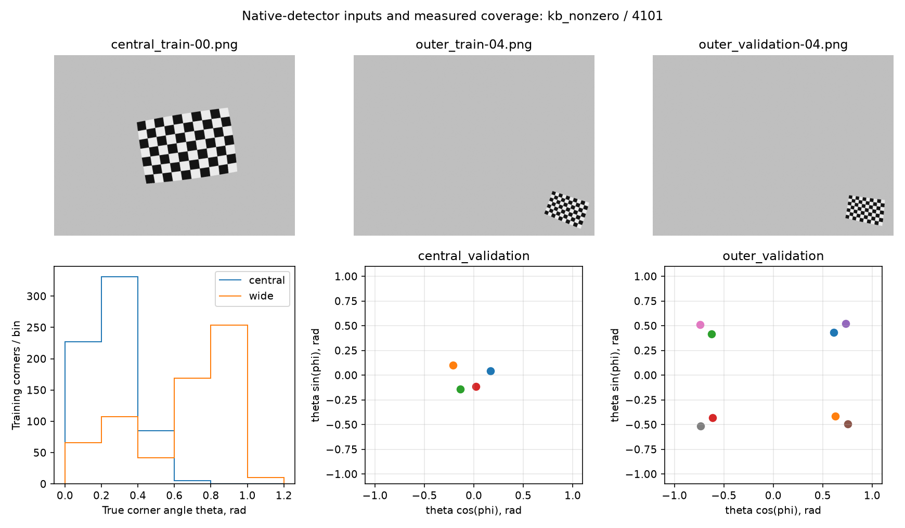

*Рисунок 4.31 — Входные PNG, распределение истинных θ обучающих углов и направления validation досок. Оба профиля имеют 648 train corners на 12 изображениях; peripheral validation имеет отдельные poses.*

Gate сохраняет p95≤1 px и monotonicity на [0,1] rad. Validation residual вычисляется после отдельного подбора board pose. Central gate принял 32/32 модели, full gate — 31/32. Поскольку CLI не имеет validation-only режима, два gate вызова повторно оценивают intrinsics на одинаковом train наборе. В 31 паре с двумя exported estimates fx/fy/cx/cy/k совпадают точно. Для full rejection estimate отсутствует, совпадение там не подтверждено. Full validation включает несколько истинных углов до ≈1.02 rad, тогда как контрольные ray metrics ограничены θ≤1 rad; это различие domain сохранено явно.

Вне pose-fitting residual оцениваются те же известные контрольные лучи и плоскость Y=1.2 м, что в §4.31. Все 32 central-gate estimates остаются в сравнении, даже если full gate отклонил модель. Ошибка луча определяется при одной физической геометрии:

$$e_{ray}(\theta,\varphi)=\|\hat\pi(d(\theta,\varphi))-\pi_{true}(d(\theta,\varphi))\|_2.$$

Ошибки плоскости получены обратной проекцией true UV, без повторного подбора позы камеры. Во всех estimates invalid floor points=0. При order=4 outer p95 снизился в 8/8 cases, floor p95 — только в 5/8; при order=2 каждый из показателей снизился в 4/8. Counts описывают данный набор двух seeds, не вероятность успеха на реальной камере.

| Case | Order | Outer p95 central → wide, px | Floor p95 central → wide, m | Full residual p95 central → wide, px |
|---|---:|---:|---:|---:|
| equidistant / 4102 | 4 | 28.5556 → 4.2513 | 0.1531 → 0.1823 | 0.8114 → 0.4482 |
| kb_nonzero / 4102 | 4 | 56.1814 → 2.8978 | 0.1600 → 0.0493 | 1.1885 (reject) → 0.2966 |
| stereographic / 4102 | 4 | 5.1031 → 1.7971 | 0.0771 → 0.0941 | 0.4186 → 0.3359 |

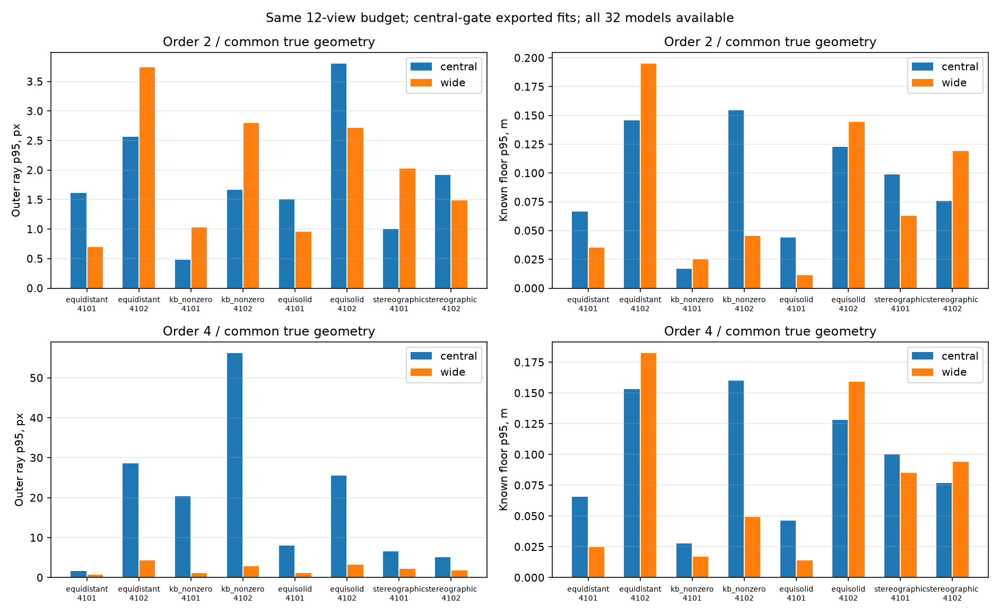

*Рисунок 4.32 — Парные central/wide результаты всех optical families/seeds при order=2/4, одинаковых 12 train views и общих контрольных точках. Улучшение проекции внешних лучей может сопровождаться ухудшением реконструкции плоскости.*

Для equidistant/4102/order4 peripheral training уменьшает outer error примерно в 6.7 раза, но floor p95 растёт до 0.1823 м; full gate принимает обе модели. Это показывает ограниченность одного residual даже после расширения validation. Порог 1 px не заменяется произвольным новым числом: нужны физические требования, отдельные данные и false accept/reject protocol. Пока таких требований нет, вычислять «долю ложной приёмки» по этим cases некорректно.

Следующий опыт должен разделить coverage, board scale и tilt diversity, затем включить нерадиальные и монтажные ошибки. Процедурный известный мир обеспечивает проверяемую геометрию, но не заменяет физические измерения. Полная таблица, hashes, отказы и воспроизведение: [[validation/CALIBRATION_COVERAGE]]. Рисунки строит `plot_calibration_coverage.py`, расположенный рядом с главой. 6 новых regression tests и все 8 выбранных calibration suites проходят.

## 4.33 Разделение факторов расстояния и наклона доски

Опыт §4.32 одновременно менял угловое положение, масштаб и ориентацию доски. Для частичного разделения этих факторов подготовлен factorial E-CAL-capture-01. Протокол [[research/CALIBRATION_CAPTURE_PROTOCOL]] зафиксирован коммитом `28422a9` до результатов основной серии; геометрические диапазоны выбраны после clipping check. Это exploratory follow-up, не окончательная подтверждающая выборка.

Во всех профилях одинаковы четыре центральных train views и направления центров восьми периферийных досок. Два фактора задаются независимо: distance=3.2/2.0 м и local tilt=0/±0.35 rad вокруг двух осей. Направления центров θ=0.65/0.8 rad, азимуты и roll одинаковы между профилями одного seed. При наклоне фактическое отклонение нормали от center ray равно

$$\alpha=\arccos(\cos\beta_x\cos\beta_y),\qquad |\beta_x|=|\beta_y|=0.35\;\Rightarrow\;\alpha\approx0.490\text{ rad}.$$

Distance сохраняет rotation и меняет размер изображения, tilt сохраняет center direction и меняет foreshortening. При этом angular occupancy отдельных corners не сохраняется. Max train θ возрастает примерно с 0.917 до 0.989 rad при увеличении доски. Поэтому опыт разделяет заданные геометрические факторы, но не является чистым image-resize или полностью постоянным angular coverage.

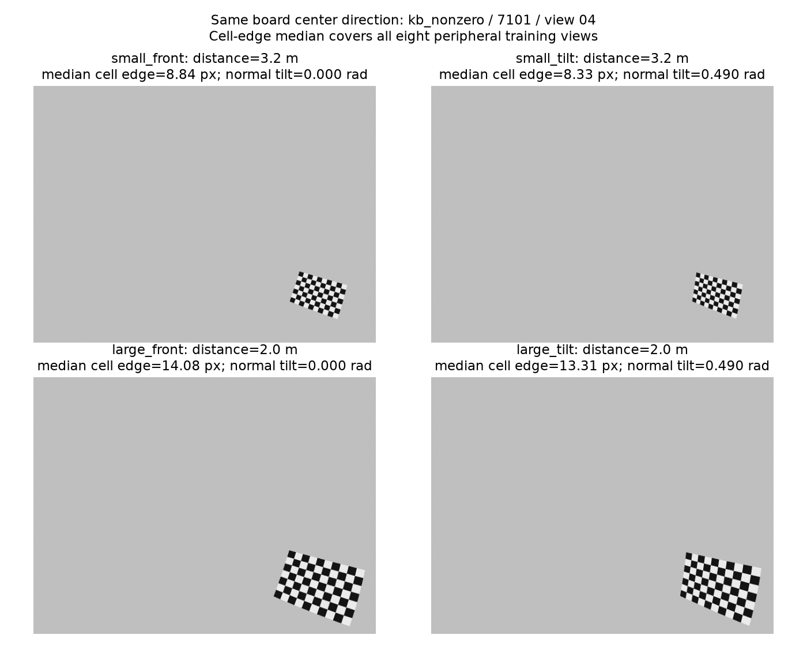

*Рисунок 4.33 — Одна peripheral center direction, четыре сочетания distance/tilt. На примере kb_nonzero/7101 median размера projected cell edge растёт примерно с 8.8 до 14.1 px для front profile; подпись tilt указывает фактический normal-to-ray angle.*

Использованы четыре генеративные radial optical families и новые seeds 7101/7102. Все варианты имеют по 12 train views и общую validation: 4 центральных + 8 новых периферийных досок, distance=2.6 м, local tilt=±0.175 rad. По optical families оцениваются те же OpenCV polynomial order=2/4, а не четыре различных solver. Все 384 уникальных PNG распознаны, выполнены 128 CLI attempts. Central и full gate экспортировали по 64/64 модели. Intrinsics из двух gate вызовов совпадают точно во всех 64 парах. Full residual p95=0.2602–0.3250 px, threshold=1 px сохранён. Все inner train/validation corners находятся при θ<1 rad.

Known-ray и known-floor метрики используют прежние общие контрольные точки. Fixed-pose board metric теперь включает все 12 validation poses, то есть 648 corners; его область отличается от прежней серии с четырьмя центральными досками. Validation pose при измерении этой метрики не подбирается, invalid floor points=0. Для фактора A описательная парная разность задаётся при фиксированном втором факторе B:

$$\Delta_A(B)=e(A_{large},B)-e(A_{small},B).$$

Отрицательное значение означает уменьшение выбранной ошибки данного case; это не самостоятельная оценка вероятности улучшения на реальных камерах. При order=4 увеличение фронтальной доски уменьшает outer p95 в 4/8 cases и floor p95 в 5/8. Для tilted profile увеличение доски улучшает показатели соответственно в 5/8 и 3/8. Добавление tilt на small board улучшает outer p95 лишь в 1/8, floor p95 в 5/8; на large board — в 4/8 и 3/8. Таким образом, эффект зависит от метрики, seed и optical family.

| Case, order=4 | Изменение | Outer p95, px | Floor p95, m | Full residual p95, px |
|---|---|---:|---:|---:|
| kb_nonzero / 7101 | small_front → large_front | 1.4843 → 1.1951 | 0.0241 → 0.1369 | 0.2830 → 0.2743 |
| equidistant / 7102 | large_front → large_tilt | 0.2685 → 3.4625 | 0.0125 → 0.0780 | 0.2775 → 0.2762 |

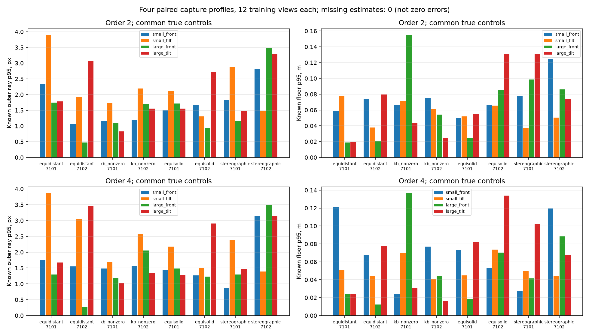

*Рисунок 4.34 — Известные outer-ray и floor p95 для четырёх capture profiles, отдельно order=2/4, family и seed. Все 64 модели представлены; коррелированные corners не используются как независимые trials.*

Первый пример показывает расхождение эффекта по двум метрикам: более крупная доска улучшает внешнюю проекцию, но ухудшает реконструкцию плоскости. Второй показывает, что выбранный pattern наклонов не гарантирует улучшения, хотя pose-fitted residual немного снижается. Максимальный floor p95 всей серии ≈0.1551 м, fixed-pose p95≈3.8634 px при accepted full residual<0.325 px. Без физического acceptance requirement эти числа не являются false-accept rates.

Причину каждой ошибки нельзя уверенно отнести к detector или solver: conditioning, uncertainty и направленный localization bias пока не разделены. Следующие этапы — такая диагностика, paired blur/noise, нерадиальные/монтажные и ground-height ошибки. Вывод серии ограничен: одинакового количества кадров, заданных peripheral directions, крупной доски и малого residual недостаточно для гарантии физической точности. Универсальная рекомендация по distance/tilt не получена.

Полный отчёт, 64-case таблица и hashes: [[validation/CALIBRATION_CAPTURE_FACTORS]]. Иллюстрации воспроизводит `plot_calibration_capture.py` рядом с главой. 6 новых regression tests и все 9 выбранных CTest suites проходят. Сценарий также проверяет неизменность experiment source/binary hashes в течение выполнения.

## 4.34 Отделение ошибок локализации от идеального-input поведения solver

Предыдущий factorial experiment не объяснял, почему меньшая ошибка детектора или крупная доска иногда давали худшую реконструкцию плоскости. E-CAL-diagnostic-01 сохраняет все 64 исходных family/seed/profile/order cases и меняет только train coordinates: exact double truth, та же truth после float32→double и реальные сохранённые detector UV. Протокол [[research/INTRINSIC_DIAGNOSTIC_PROTOCOL]] зафиксирован до новых fit runs коммитом `b2cdcc0`. Исходные captures уже просмотрены, поэтому это exploratory mechanism ablation.

Добавлен C++ режим `sv-calibrate diagnose-intrinsics`, который вызывает то же production `sv::calibrate_intrinsics`. Flags, order, stopping criteria и monotonicity domain сохраняются. Результат имеет статус `diagnostic_only`, пишет embedded estimate в `diagnostics.json` и не экспортирует deployable `intrinsics.json`. Acceptance gate и серверный конфиг не изменяются. Это позволяет использовать аналитические observations для исследования, не выдавая их за физическую калибровку.

Во всех трёх input variants сохраняются 12 train views, 12 validation poses и одинаковые **exact validation UV**. Validation residual всё ещё подбирает board pose; known-ray/floor и fixed-pose errors измеряются отдельно без fitting. Truth indexing разворачивается при 180° неоднозначности сетки, detected ordering сохраняется исходным. Это выравнивание использует известную синтетическую геометрию; физические board IDs оно не определяет.

Серия содержит 192 successful diagnostic fits. Все 64 detected-input estimates воспроизводят прежний production fit: maximum parameter difference 6.2528×10⁻¹³ при заранее заданном replay tolerance 1e-7. Поэтому изменение validation с detected на exact UV не повлияло на train estimates. Отказавших fits и invalid floor points в этой серии нет. Successful diagnostic fit не означает прохождение Quality Gate.

Для каждого view рассчитана не только норма localization error, но и её signed структура:

$$\delta_i=u_i^{det}-u_i^{true},\quad b=\frac1N\sum_i\delta_i,\quad
\delta_{r,i}=\delta_i^T a_i,\quad\delta_{t,i}=\delta_i^T(-a_{iy},a_{ix}),$$

где $a_i$ — единичный вектор от истинного principal point к true corner. На optical axis radial/tangential components неопределены и учитываются отдельным count, UV/norm остаются определёнными. Ошибки получены при rasterization, pixel integration, quantization и настоящем SB detector, а не добавлением искусственного jitter к идеальным UV.

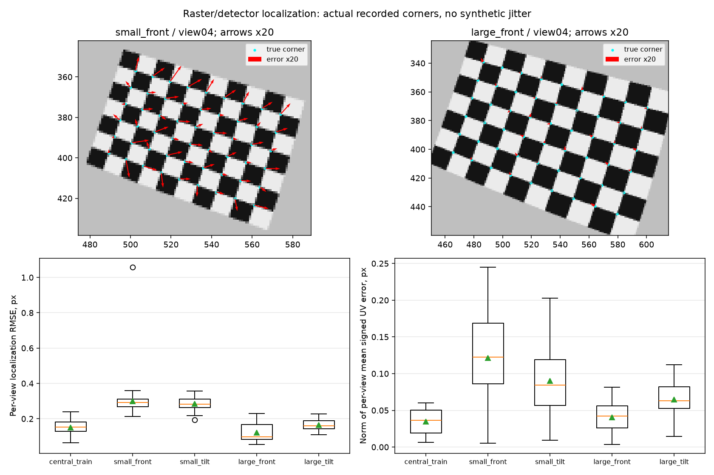

*Рисунок 4.35 — Верх: crop исходных kb_nonzero/7101 PNG, true corners и detected−true vectors, увеличенные в 20 раз. Низ: per-view localization RMSE и норма signed mean bias для всех families/seeds; это описательные распределения, не независимые статистические trials.*

Модели разделены по заранее определяемому математическому соответствию. Matched subset: equidistant/order2/4 и kb_nonzero/order4, всего 24 cases. Approximation subset: kb_nonzero/order2, equisolid и stereographic при обоих orders, всего 40 cases. Последним exact observations не гарантируют нулевой ошибки: выбранный конечный полином лишь приближает generative function.

| Subset | Train input | Max case outer p95, px | Max case floor p95, m |
|---|---|---:|---:|
| matched | exact | 7.98×10⁻¹¹ | 1.15×10⁻¹¹ |
| matched | float32 exact | 1.48×10⁻⁴ | 1.06×10⁻⁵ |
| matched | detected | 3.9001 | 0.1369 |
| approximation | exact | 0.3604 | 0.02275 |
| approximation | detected | 3.4966 | 0.1551 |

Числа — максимум отдельных case p95, а не p95 всех объединённых точек. Near-zero exact errors отражают численный предел идеальной synthetic geometry, не физическую точность камеры. UV float32 control показывает, что одно округление координат не объясняет прежние ошибки matched cases. Замена exact UV результатами raster/detector цепочки при том же solver воспроизводит значительные ошибки. Это не исключает чувствительность solver к направленным perturbations и не оценивает condition number.

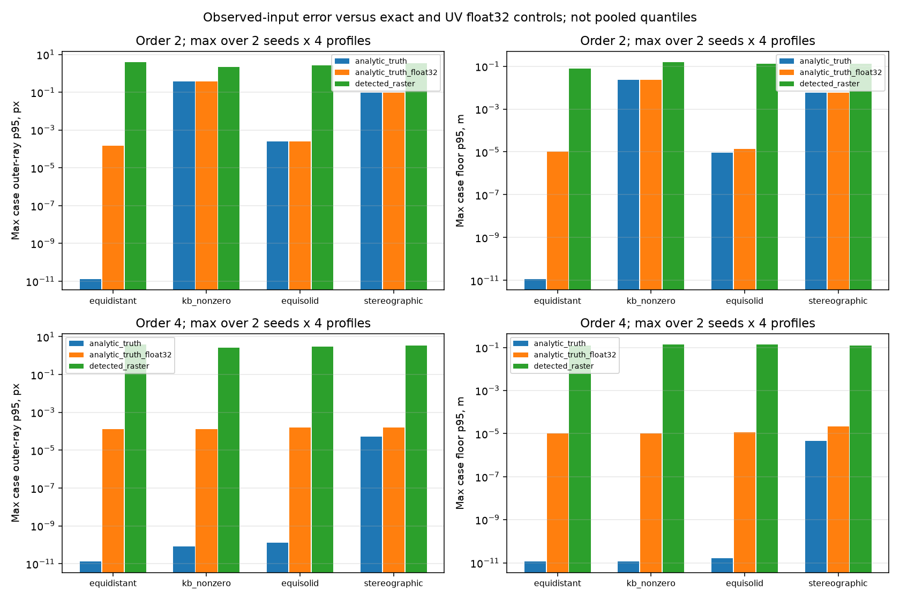

*Рисунок 4.36 — Max case p95 по 2 seeds×4 capture profiles отдельно для каждой family/order/origin. Шкала логарифмическая; результаты approximation families не смешаны с matched subset при интерпретации источников ошибки.*

Пример kb_nonzero/7101/order4 уточняет контрпример §4.33. При exact inputs small_front и large_front восстанавливаются почти точно. После UV float32 floor p95 составляет примерно 6.0×10⁻⁶ и 7.0×10⁻⁶ м. При detected inputs — 0.0241 и 0.1369 м. При этом exact-validation pose-fitted p95 уменьшается с 0.0841 до 0.0273 px. Низкий residual после подбора позы снова скрывает неточность известной физической геометрии.

Уменьшение scalar localization RMSE само по себе недостаточно: median per-view RMSE front profiles падает примерно 0.2917→0.0976 px, но отдельные floor errors могут расти. Поле ошибок и связь K/k/poses требуют отдельного анализа. Разность двух p95 не является аддитивной декомпозицией ошибок. Эта серия отделяет ideal-input model/solver behaviour от совокупной ошибки raster/detector observations; причины усиления отдельных signed components пока не установлены.

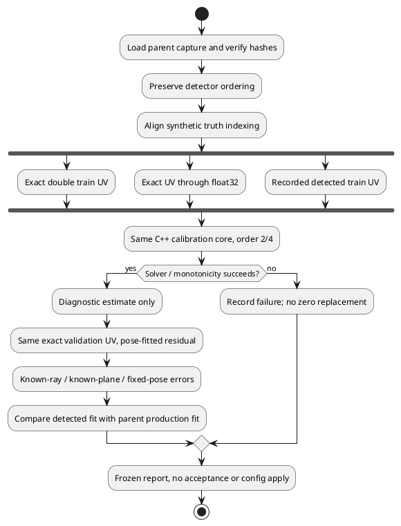

*Рисунок 4.37 — Диагностический workflow: изменяются training observations, а ядро и контрольная геометрия фиксированы. Три ветви описывают варианты опыта, не утверждают параллельное выполнение CLI.*

Следующий этап — normalized sensitivity/conditioning и controlled systematic/random perturbations, затем paired raster blur/noise, nonradial/extrinsic/road-height errors. Для итогового заключения всё ещё нужны physical requirements и измеренные снимки. Полные 192 estimates и парная 64-case таблица: [[validation/INTRINSIC_DIAGNOSTICS]]. Рисунки воспроизводит `plot_intrinsic_diagnostics.py` рядом с главой. 6 новых diagnostic tests и все 10 выбранных CTest suites проходят.

## 4.35 Направленная чувствительность к равным по RMS ошибкам углов

E-CAL-diagnostic-01 показал различие между exact-input и detected-input калибровкой, но не разделял направления ошибок наблюдений. Следующая серия E-CAL-sensitivity-01 использует matched models: equidistant/order2/4 и kb_nonzero/order4, seeds 7101/7102, profiles small_front/large_front. Это 12 base cases с прежними 12 train и 12 exact validation views. Approximation families и tilted profiles заранее исключены из области данной серии. Протокол [[research/CALIBRATION_SENSITIVITY_PROTOCOL]] зафиксирован коммитом `371352c` до fit outcomes; геометрии уже просмотрены, поэтому серия exploratory.

В training coordinates вводятся шесть полей: единый shift_x, radial, tangential и три random Gaussian fields с seeds 1021/1022/1023. Random fields центрированы отдельно внутри каждого view, затем нормированы по всем 648 train corners. Для каждого поля сохраняются directions при всех amplitudes/signs:

$$\frac1{648}\sum_{v,i}\|D_{vi}\|^2=1,\qquad u_{vi}^{\pm}=u_{vi}^{true}\pm hD_{vi},\qquad h\in\{0.025,0.05,0.2\}\text{ px}.$$

h — RMS длины двумерной ошибки, не стандартное отклонение каждой координаты. Это coordinate perturbations, а не новые raster blur/noise или измеренные ошибки физического detector. Все inputs имеют явный `controlled_perturbation` origin. Новая метка поддерживается диагностическим CLI; production gate и конфиг сервера не изменяются.

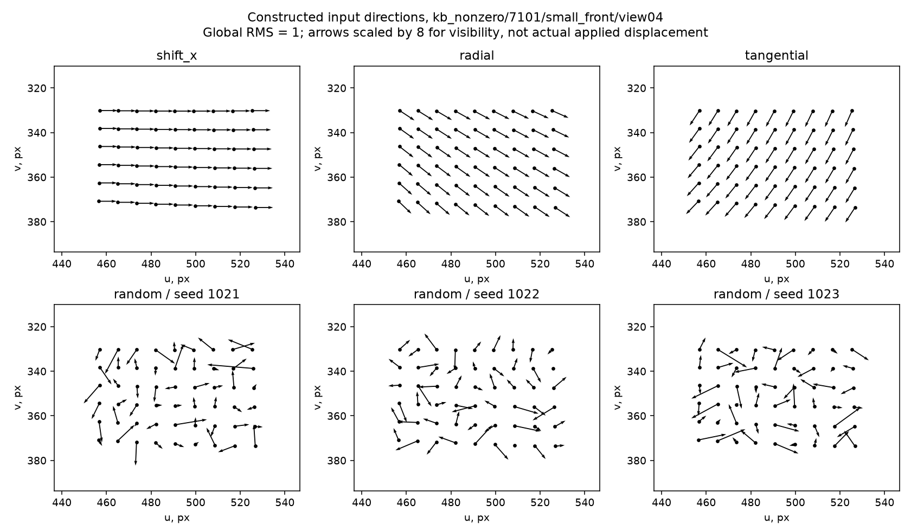

*Рисунок 4.38 — Шесть equal-RMS направлений на одном peripheral view. Векторы показаны в условном увеличенном масштабе ×8; actual train displacements равны ±hD при h≤0.2 px. Random patterns фиксированы по seeds и не заменяются при плохом результате.*

Выполнены 12 exact refits и 432 perturbed fits, то есть **444 diagnostic runs и 216 signed pairs**. Все завершились; failures и invalid floor points отсутствуют. Exact baselines воспроизведены с max parameter delta=0. Acceptance gate не выполняется; successful fit не равен принятой калибровке.

Отклик вычисляется на прежних true outer rays и точках известной плоскости Y=1.2 м, без подбора их физической геометрии:

$$G_r(h)=p95_j\frac{\|\hat u_j(+h)-\hat u_j(-h)\|}{2h},\qquad
G_f(h)=p95_j\frac{\|\hat X_j(+h)-\hat X_j(-h)\|}{2h}.$$

$G_r$ имеет единицы output px/input px, $G_f$ — м/input px. Это finite directional response, не ошибка отдельной модели относительно truth и не full Jacobian condition number. Шесть направлений не образуют полный basis 1296 UV coordinates. Дополнительно сохраняются even response и signed parameter derivatives; нормирование коэффициентов задано явно и не используется как рейтинг качества.

Shift_x — analytic control: matched модель поглощает общий сдвиг изменением cx. Получено $G_r\approx1$ во всех cases/amplitudes с численной ошибкой <2×10⁻¹¹. Floor response остаётся около 0.02637–0.02687 м/px, поскольку true UV контрольной плоскости не сдвигаются вместе с обучающими observations.

| Direction при h=0.05 px | Pairs | Outer gain min–max, px/px | Floor gain min–max, m/px |
|---|---:|---:|---:|
| shift_x | 12 | ≈1–1 | 0.02637–0.02687 |
| radial | 12 | 0.80924–3.82358 | 0.03834–0.20422 |
| tangential | 12 | 1.81702–6.62719 | 0.16585–0.50516 |
| random, 3 fields | 36 | 1.68207–13.71607 | 0.04812–0.82016 |

Это min/max отдельных case p95, не pooled quantiles и не доверительные интервалы. Random fields в этой серии иногда возбуждают более сильный отклик, но из трёх реализаций нельзя заключить, что случайная ошибка всегда опаснее систематической. Аналогично коэффициенты порядка 4 не объявляются универсально лучше или хуже order2.

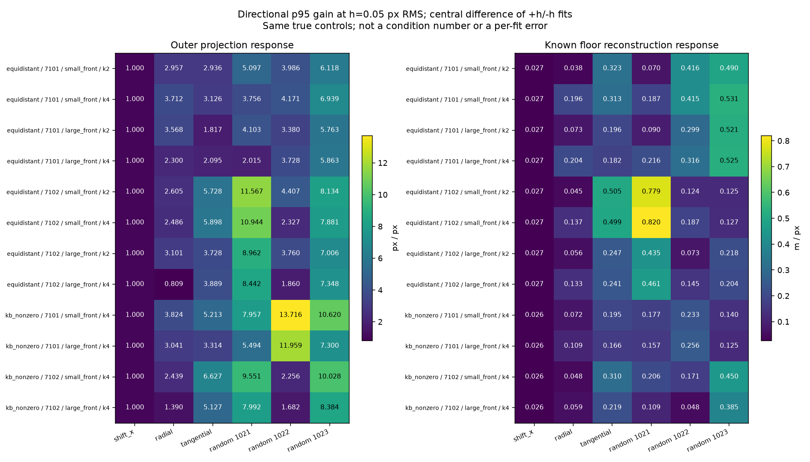

*Рисунок 4.39 — Все 72 pairs при h=0.05 px, одинаковом input RMS и общих true controls. Левая и правая карты имеют разные единицы и диапазоны; число в ячейке — finite response p95, а не actual error данного fitted model.*

Сопоставление h=0.025 и 0.05 даёт maximum relative change response p95 0.3163% для outer и 0.5328% для floor. Это поддерживает локальную интерпретацию отклика в проверенном малом диапазоне, но не доказывает математический предел h→0. При переходе 0.05→0.2 px maximum change растёт до 4.8109% и 11.6460%; строго линейную модель на весь этот диапазон применять нельзя.

Для equidistant/7102/small_front/order4/random1021 при h=0.2 px **actual** floor p95 равна 0.16274 м для +h и 0.16498 м для −h. Exact-validation residual с отдельно подобранной board pose составляет лишь 0.05023/0.05954 px. Это очередной synthetic counterexample достаточности scalar residual при matched optical family и идеально известных extrinsics. Gate в данной серии не запускался; false-accept rate не рассчитывается.

Результат уточняет вывод §4.34: величина localization RMSE не описывает направление ошибки и её перенос через coupled K/k/poses. Но finite directional screen не заменяет full Jacobian/spectrum, uncertainty analysis или physical requirements. Дальнейшие работы — такие оценки, robust-fit ablation без oracle filtering, paired raster blur/noise, nonradial/extrinsic/ground-height perturbations и физические снимки.

Все reports, signed estimates, 216 responses, hashes и полная таблица h=0.05: [[validation/CALIBRATION_SENSITIVITY]]. Иллюстрации строит `plot_calibration_sensitivity.py` рядом с главой. 7 новых regression tests и все 11 выбранных CTest suites проходят.

## 4.36 Полный совместный Jacobian и условная неопределённость

Шесть направленных полей предыдущего опыта измеряли конечный отклик только вдоль выбранных возмущений; они не давали полного ранга наблюдений и не отделяли корреляцию intrinsics с неизвестными позами шаблона. Для следующего шага E-CAL-information-01 построен полный Jacobian одной совместной задачи: камера и 12 board poses являются неизвестными одновременно. Протокол зафиксирован в [[research/CALIBRATION_JOINT_INFORMATION_PROTOCOL]] до вычисления этой серии. Это повторный анализ E-CAL-capture-01/E-CAL-diagnostic-01, поэтому он exploratory и не является новой holdout-выборкой.

Сопоставлены 12 matched cases: equidistant KB polynomial order 2 и 4, а также `kb_nonzero` order 4; в каждом по два pose seeds и профиля `small_front`/`large_front`. Каждый case анализируется по точным синтетическим углам и по углам, обнаруженным OpenCV на растровом шаблоне. Таким образом, выполнено 24 joint fits. В каждом наборе 12 board views, 54 точки на доску и 1296 скалярных координатных residuals. Intrinsics имеют 6 параметров для order 2 и 8 для order 4; ещё 72 параметра описывают 12 отдельных поз.

Пусть вектор наблюдений $y$ состоит из $(u,v)$ координат каждого угла, а модель $f(\theta)$ использует общие $f_x,f_y,c_x,c_y,k_i$ и отдельную позу $(R_g,t_g)$ для доски $g$. В точке найденного минимума вычисляется полный якобиан

$$J_{ij}=\frac{\partial f_i(\theta)}{\partial\theta_j},\qquad r=y-f(\hat\theta).$$

Каждый блок residual зависит от общих intrinsics и только от pose своей доски, поэтому конечные разности используют разреженную структуру. Для анализа выполняется SVD нормированного Jacobian $J=U\Sigma V^T$; малые singular values показывают направления совместного изменения камеры и board poses, которые слабо различаются в этих наблюдениях. Чтобы не смешивать физические единицы, increments были масштабированы как $df_x/300$, $df_y/295$, $dc_x/640$, $dc_y/480$, $dk_i/1$; pose rotation задана в радианах, translation — в метрах. Condition number ниже относится именно к этому выбранному масштабированию.

| KB polynomial | Наблюдения | Размер Jacobian | Медиана cond(J) | Диапазон | Ранг |
|---|---|---:|---:|---:|---:|
| order 2 | exact | 1296×78 | 2918.5 | 1874.3–4805.3 | 78/78 |
| order 2 | OpenCV detected | 1296×78 | 2934.6 | 1873.4–4804.2 | 78/78 |
| order 4 | exact | 1296×80 | 5611.8 | 3804.5–7760.3 | 80/80 |
| order 4 | OpenCV detected | 1296×80 | 5590.5 | 3824.2–7578.3 | 80/80 |

В проверенных позах полный ранг достигнут при машинном и практическом относительном пороге $10^{-10}$. Медианный condition number у order 4 примерно в 1.9 раза больше, чем у order 2, то есть добавленные коэффициенты в этих данных слабее отделимы от остальных параметров. При этом спектры exact/detected близки: размер локального Jacobian характеризует геометрию параметризации около решения, а не ошибку локализации сам по себе. Ни полный ранг, ни его значение не гарантируют точности вне выбранных synthetic poses.

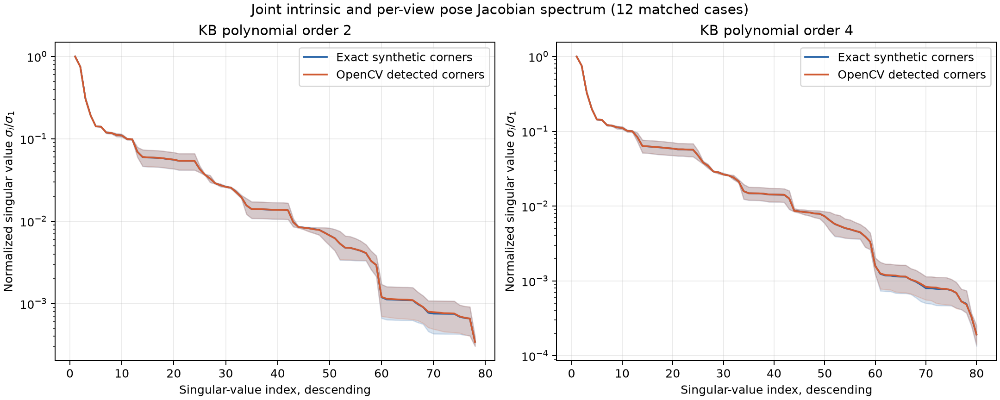

*Рисунок 4.40 — Медианный normalized singular spectrum совместных intrinsics и 12 nuisance poses; закрашена межквартильная область по matched cases. Отдельные панели имеют разное число столбцов, а все singular values зависят от объявленных parameter scales.*

Для локальной ковариации использовано приближение

$$\widehat{\mathrm{Cov}}(\hat\theta)=\hat\sigma^2(J^TJ)^{-1}.$$

Сначала $\hat\sigma^2=RSS/(m-p)$ оценивает общую дисперсию scalar residuals и предполагает их независимость с одинаковой дисперсией. Во второй оценке covariance масштабируется не fit residual, а известным detector RMS относительно synthetic truth: $\sigma_{det}=\sqrt{\mathrm{mean}((u_{det}-u_{true})^2+(v_{det}-v_{true})^2)/2}$. Это проверяет влияние заданного масштаба шумовой модели, но не объявляет detector errors iid. В третьей оценке углы группируются по одной доске: $A(\sum_g s_gs_g^T)A$, где $A=(J^TJ)^{-1}$, $s_g=J_g^Tr_g$; добавлена поправка на конечное число 12 кластеров. Локальные стандартные ошибки представлены только для intrinsics, после преобразования параметров в пиксели/коэффициенты.

Для detector RMS получен диапазон 0.093–0.197 px. При `small_front` медианная локальная ошибка $f_x$ по detector-scaled iid covariance равна 1.54 px/order2 и 1.55 px/order4; для `large_front` — 0.70 и 0.75 px. Кластерная оценка для тех же групп составляет соответственно 1.69, 1.18, 1.48 и 1.06 px. Эти оценки расходятся и между моделями, и между предположениями о шуме. Более широкий front-профиль в этой серии снижал медианную iid неопределённость, но cluster estimate не всегда повторял это улучшение. Поэтому вывод о точности зависит не только от RMS детектора и одного residual summary, но и от независимой экспериментальной единицы/структуры корреляции.

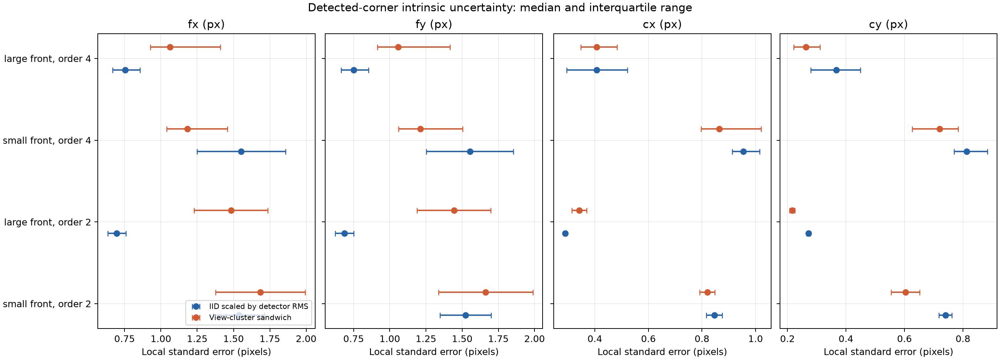

*Рисунок 4.41 — Медиана и межквартильный диапазон локальных standard errors $f_x,f_y,c_x,c_y$ на detector observations. Синий — covariance при заданном detector RMS и iid предположении; оранжевый — view-cluster sandwich по 12 синтетическим доскам.*

Exact truth даёт максимальное отклонение восстановленных $f_x,f_y,c_x,c_y$ 6.7×10⁻⁹, а residual-based sigma практически нулевая. Это численный пол идеальной synthetic генерации, а не измерение uncertainty физической камеры. На detector observations fixed-pose held-out corner RMSE имел медиану 0.985 px для `small_front` и 0.834 px для `large_front`; median floor RMSE составил 0.0385 и 0.0131 м. Внутри 12 synthetic cases покрытие улучшалось в среднем, но разброс между seed/family заметен, а независимых сцен здесь нет.

Оценки являются локальным линейным приближением у найденного nonlinear least-squares минимума. Они не включают неточность размера и плоскостности target, неточность автомобиля/extrinsics, nonradial optics, temporal/exposure effects, selection bias detector и физическую корреляционную модель ошибок. При 12 досках cluster sandwich — диагностика, не гарантия покрытия. Теория least-squares требует явных residual/error assumptions; см. [SciPy `least_squares`](https://docs.scipy.org/doc/scipy/reference/generated/scipy.optimize.least_squares.html), [NIST nonlinear least-squares reference data](https://www.itl.nist.gov/div898/strd/nls/data/LINKS/c-kirby2.shtml) и [обсуждение residual/error assumptions NIST](https://www.itl.nist.gov/div898/handbook/pmd/section1/pmd142.htm). Результат не используется как production threshold и не обновляет server config.

Полная таблица по 12 cases, все intrinsic covariance/correlation matrices, четыре weakest modes, validation metrics, hashes и команды приведены в [[validation/JOINT_CALIBRATION_INFORMATION]]. Реализация и проверки находятся в `tools/calibration/joint_information.py`, `tools/calibration/information_study.py`, `tests/test_joint_information.py`; следующий этап — signed component/pose attribution, robust fit и raster blur/noise ablations, nonradial/extrinsic stress, физические targets и independent validation split. Эти результаты закрывают только пункт full Jacobian/spectrum и предварительной conditional uncertainty из TODO.

## 4.37 Как направленные ошибки распределяются между камерой и позами шаблонов

Полный Jacobian предыдущего подраздела позволяет разложить локальный response по общим параметрам камеры и nuisance poses. Здесь проверяется не только выходная ошибка, но и механизм поглощения заданного входного поля: изменяются ли $f_x,f_y,c_x,c_y,k_i$ или оптимизатор объясняет те же UV через другие позы отдельных досок. Для этого frozen protocol [[research/CALIBRATION_COMPONENT_ATTRIBUTION_PROTOCOL]] использует те же 12 matched cases, шесть детерминированных полей из E-CAL-sensitivity-01 и только primary amplitude $h=0.05$ px.

Для каждого exact baseline совместно оцениваются камера и 12 board poses. Линеаризованный signed response вычисляется как решение задачи наименьших квадратов

$$\Delta q_{lin}=\arg\min_z\|Jz-d\|_2^2=J^+d,$$

где $d=hD$ — единичное по RMS поле UV displacement. Затем на паре наблюдений $uv_{true}±hD$ повторяется nonlinear joint fit. Сравниваются центральная signed derivative $(q(+h)-q(-h))/(2h)$ и even component, показывающий отклонение от симметричного линейного поведения при данном h. Внутренние и pose-координаты нормированы параметрическими scales предыдущего подраздела; доли квадратов ответов зависят от этого выбора и не являются физическими долями camera error.

| Направление поля | Order | Linear share intrinsics | Nonlinear share intrinsics* | Полные пары |
|---|---:|---:|---:|---:|
| x shift | 2 | 1.000 | 1.000 | 4/4 |
| x shift | 4 | 1.000 | 1.000 | 8/8 |
| radial | 2 | 0.060 | 0.060 | 4/4 |
| radial | 4 | 0.996 | 0.996 | 4/8 |
| tangential | 2 | 0.019 | 0.018 | 4/4 |
| tangential | 4 | 0.081 | 0.086 | 4/8 |
| random fields | 2 | 0.011 | 0.011 | 12/12 |
| random fields | 4 | 0.107 | 0.132 | 11/24 |

*Медиана nonlinear ответа только для пар, где и positive, и negative fits завершили работу с успешным статусом; incomplete pairs не подменяются нулём.*

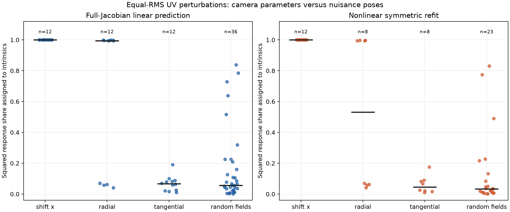

*Рисунок 4.42 — Нормированная доля квадратов ответа intrinsics для полного-Jacobian прогноза и успешных нелинейных signed pairs. `n` на графике показывает число included pairs. Random поля включают три фиксированных seed; они не дают вероятностного распределения ошибок.*

Изменение общего x координат почти полностью эквивалентно изменению $c_x$: ответ равен 1.0 px/px с максимальной относительной L2-разностью linear/nonlinear response 0.0023%; nuisance poses почти не меняются. Для radial field механизм зависит от порядка модели: order 2 в основном объясняет его переоценкой board poses, а order 4 — параметрами камеры. Для tangential и random fields основную часть ответа поглощают poses, причём их физический RMS изменения на h=0.05 px зависит от профиля/модели. Поэтому один общий corner RMS не показывает, какой параметр будет смещён.

Первичный nonlinear результат был ограничен сходимостью sparse TRF/LSMR; отдельная solver ablation и полный повтор приведены в §4.38. Исходные failures сохранены, поэтому исходный результат не подменяется постфактум.

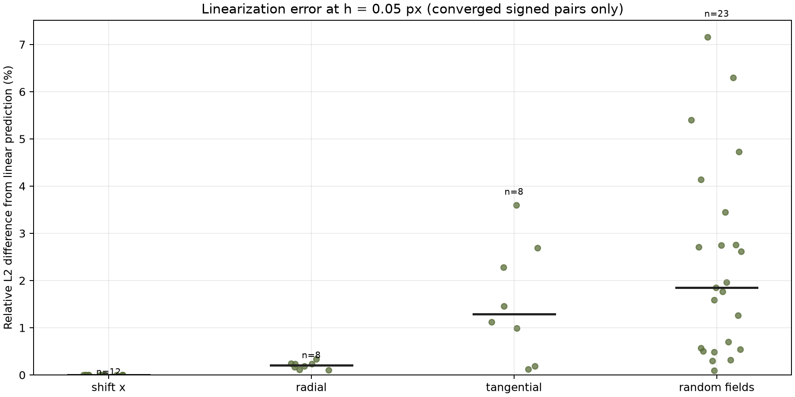

*Рисунок 4.43 — Relative L2 mismatch между нелинейной central difference и $J^+D$, только для complete pairs. Недостающие пары отражены в предыдущем рисунке меньшим n и в отчёте перечислены поимённо.*

Это exploratory переанализ прежних synthetic scenes. Данные не включают повторное raster/detector обнаружение или автомобильные extrinsic perturbations и не применяются к server gate. Полная детализация: [[validation/CALIBRATION_COMPONENT_ATTRIBUTION]]. Реализованный linear known-answer shift control добавлен в `tests/test_joint_information.py`.

## 4.38 Сходимость нелинейной атрибуции: сравнение solver paths

Поскольку 34 из 144 первых signed refits достигли лимита оценок функции, до нового вывода была зафиксирована отдельная ablation: те же 12 matched cases, те же шесть полей и амплитуда ±0.05 px, но dense Levenberg–Marquardt с трёхточечной конечной разностью. Метод сохраняет loss, tolerances и предел 750 evaluations; меняется solver path и использование плотного Jacobian вместо sparse TRF/LSMR.

| Solver path | Сошедшиеся fits | Complete pairs | Число evaluations |
|---|---:|---:|---:|
| Sparse TRF/LSMR, первичная серия | 110/144 | 51/72 | до лимита 750; 34 отказа |
| Dense LM, post-hoc follow-up | 144/144 | 72/72 | 3–6 |

На общей подвыборке 51 пары медианное абсолютное расхождение доли intrinsics между методами равно 0.00010, максимум — 0.0253. Это указывает, что успешные исходные fits согласованы с повтором в данных cases; post-hoc выбор LM и синтетическая природа данных не позволяют считать его независимым подтверждением.

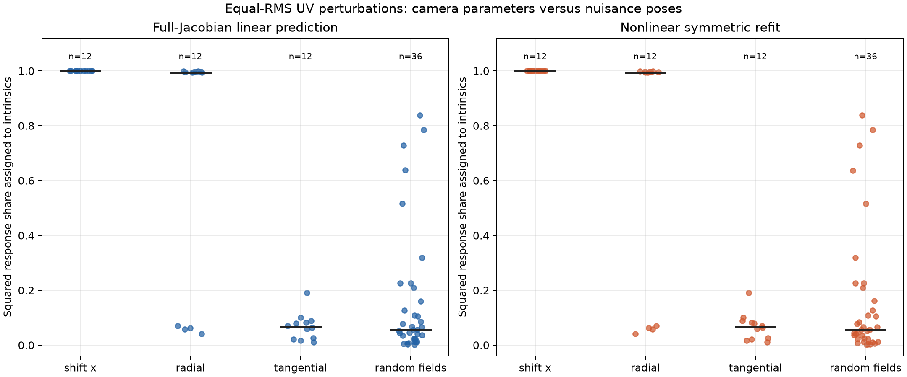

*Рисунок 4.44 — Линейный `J⁺d` и нелинейный симметричный response при dense LM для всех 72 направлений; каждая пара ±h сошлась.*

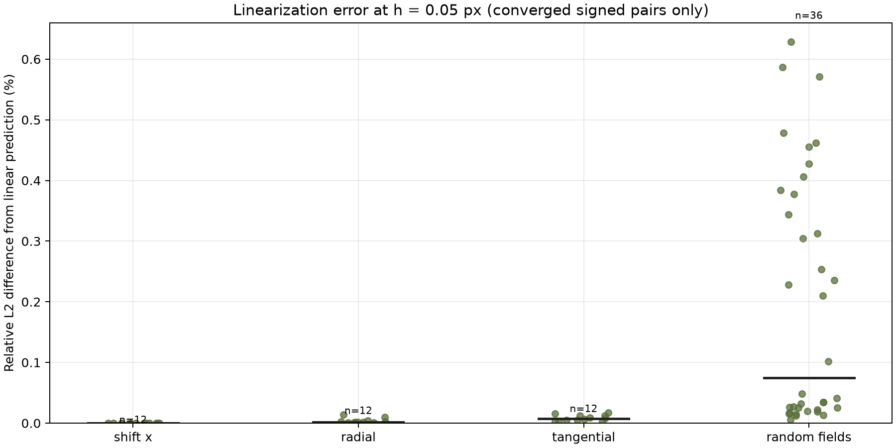

*Рисунок 4.45 — Относительная L2-разность между нелинейным LM response и `J⁺d`. Медиана — 0.0139%, максимум — 0.629%; это согласие локального приближения на искусственной амплитуде, не метрика точности модели.*

Контроль общего сдвига даёт `dcx/dh = 1 px/px`. Доля ответа intrinsics для radial поля составляет 0.060 при order 2 и 0.996 при order 4; для tangential — 0.019 и 0.081, для seeded random — 0.011 и 0.107. Значения зависят от нормировки параметров и не являются физическим разделением ошибки.

Это объясняет, почему первый sparse TRF запуск оставил неполные пары на этих synthetic inputs, но не доказывает превосходство LM в общем случае. Исследование остаётся exploratory и не заменяет production OpenCV calibrator. Детали, хеши и ограничения: [[validation/CALIBRATION_COMPONENT_SOLVER]].

## 4.39 Калибровочная мишень при движении через сектора камер

> Повторный расчёт текущей mask convention и границы сравнения приведены в §4.43 и [[validation/STITCH_MASK_FOLLOWUP]]. Исходные object timing tables относятся к прежним прогонам; рисунки quality обновлены.

Статичный coded-object опыт (§4.28) выявил, что счётчик раздельных RGB-компонент не замечает слившиеся копии цели. Для проверки изменения ошибки по мере перехода между секторами построен синхронный Blender-опыт E-STITCH-object-motion-01. Использована уникальная emissive magenta-мишень размером 0.55 × 0.55 × 1.8 м. За девять отсчётов её координата $y$ меняется от −1.2 до +1.2 м с шагом 0.3 м; автомобиль движется по прежней прямой со скоростью 2 м/с. Для каждой временной точки четыре входные камеры и прямой виртуальный вид сформированы из одной сцены и одной позы. Прямые object-ID метки получены независимыми ray casts, а положение мишени записано из evaluated transform. Тем самым входы и истина сопоставлены по timestamp, но не моделируются экспозиционный сдвиг и временная история рендера.

Каждый из шести носителей (plane, bowl, dome-floor, cube-floor, cylinder-floor, burger-like) с семью режимами смешивания (angular feather, edge feather, graph-cut multi-band, graph-cut seam, hard best-angle, multi-band, seam-distance feather) проверен на всех девяти кадрах: всего 378 случаев. Качество RGB-маски измерялось по

$$IoU(P,T)=\frac{|P\cap T|}{|P\cup T|},$$

где $P$ — magenta-маска результата, $T$ — маска точной видимости объекта из прямого object-ID truth. Дополнительно оценивалась доля веса проецируемых source-camera ID, приходящаяся на пиксели вне этой прямой маски. Она описывает несоответствие геометрического происхождения наблюдения прямой видимости, но сама по себе не является segmentation финального RGB:

$$r_{outside}=\frac{\sum_p s(p)\,\mathbf{1}[T(p)=0]}{\sum_p s(p)},\qquad
s(p)=\sum_i w_i(p)\,\mathbf{1}[ID_i(p)=ID_{target}].$$

Контроль direct RGB-классификатора дал IoU 0.909–0.925 к точным меткам, выше заранее заданного порога 0.75. По всем случаям средний IoU результата равен 0.0861, а средняя доля source-ID поддержки вне прямой истины — 0.8612. Это указывает на существенное расхождение изображения, построенного текущим аналитическим трактом, с прямой проекцией цели в данной геометрии. Оно не доказывает, что любой видимый пиксель вне $T$ является артефактом: часть source support — только provenance-показатель, а поверхность отображения создаёт деформацию объекта.

| Режим смешивания | Средний RGB IoU | Средний outside-support | Медианный CPU p50, мс |
|---|---:|---:|---:|
| Angular feather | 0.0815 | 0.8709 | 36.816 |
| Edge feather | 0.0730 | 0.8827 | 35.153 |
| Graph-cut multi-band | 0.0957 | 0.8362 | 87.316 |
| Binary graph-cut seam | 0.1024 | 0.8362 | 54.996 |
| Hard best angle | 0.0998 | 0.8461 | 36.620 |
| Multi-band | 0.0724 | 0.8827 | 65.353 |
| Seam-distance feather | 0.0779 | 0.8736 | 39.494 |

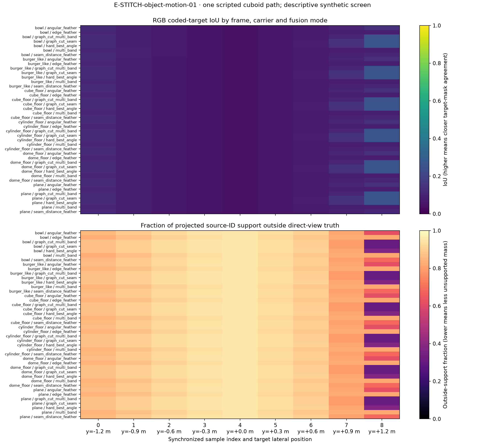

*Рисунок 4.46 — RGB IoU и доля source-ID поддержки вне прямой истины для каждой комбинации носителя и fusion по девяти положениям цели. Цвета сравнивают только испытанные synthetic cases; это не агрегированный рейтинг.*

Из-за малого IoU даже наивысшее среднее режима в матрице (0.1024 для binary graph-cut seam) нельзя считать приемлемым качеством. Среднее per-case CPU p50 `reference.render` — 51.60 мс; измерение включает только Python CPU renderer, исключает truth/метрики/файловый ввод-вывод и ничего не говорит о GPU, C++ сервере или Aurora. Два прогрева и семь seeded randomized complete blocks уменьшают влияние фиксированного порядка в этом стендовом замере, однако девять соседних кадров одной траектории зависимы. Доверительные интервалы и межсценовое обобщение по этим данным не вычисляются.

Таким образом, опыт воспроизводимо фиксирует динамическое несовпадение для одной magenta-мишени, одной улицы и номинального rig. Он не проверяет естественную object correspondence, не вводит asynchronous inputs и не измеряет stale trails. Для продолжения нужны независимые seed/pose, реалистичные объекты, повороты автомобиля, одинаковые бюджеты carrier и отдельная задержанная камера с прямой временной истиной. Полная процедура, хэши и ограничения приведены в [[../validation/OBJECT_STITCH_MOTION]] и [[../research/STITCH_MOVING_OBJECT_PROTOCOL]].

## 4.40 Проверка бинарной энергии graph-cut и граница многокамерного режима

Метрика качества сшивки не заменяет проверку корректности самой оптимизации. Для описанного бинарного режима построен небольшой тестовый graph размером 4×5: ровно 12 пикселей принадлежат overlap двух камер. Используемая целочисленная энергия имеет вид

$$E(L)=\sum_{p}D_p(L_p)+\sum_{(p,q)\in\mathcal{N}}V_{pq}\,[L_p\ne L_q],$$

где $D_p$ — unary cost относительно расстояния до границы validity, а $V_{pq}$ — реализованная Potts smoothness capacity, зависящая от цветового disagreement соседних пикселей. Результат `maximum_flow` сравнивается с полным перебором всех $2^{12}=4096$ assignments. Для фиксированного seeded графа энергия выбранной разметки совпала с минимумом полного перебора; тест также проверяет положение шва в synthetic corridor меньшего source disagreement.

Отдельные 3- и 4-camera known-answer cases подтверждают fallback по maximum distance-transform centrality. Для точных равенств вес делится поровну между максимальными кандидатами; permutation test подтверждает, что tie не зависит от порядка камер. Повторный moving-target screen показал те же округлённые aggregate quality metrics после этого изменения. Joint multi-label Potts energy по-прежнему не строится и не оптимизируется. Следующий инженерный шаг — исследовать alpha-expansion или другую глобальную multi-label схему на малых графах с известным оптимумом. Binary cut нельзя описывать как global решение для 3–4-way overlap. Проверки и границы метода записаны в [[../validation/E_STITCH_01_V2]].

## 4.41 Соответствие native серверных вариантов offline-эталону

До подтверждающей серии выполнена инженерная сверка перенесённых алгоритмов. Проверочный executable получает одинаковые float RGB, validity и edge masks; Python независимо вычисляет результат существующим NumPy/SciPy path. Сопоставлены четыре режима на размерах 3×3, 9×13, 16×20 и levels 1/4, отдельно — двухкамерный corridor с smoothness 0.7 и полностью валидные маски. Всего 29 сравнений прошли с atol/rtol 2e-6 для весов и 4e-6 для linear RGB. Это допуски проверки, а не опубликованный максимум измеренной ошибки. Нечётные размеры проверяют фазу decimation и upsample, а full masks — специальное определение EDT эталона.

| Уровень проверки | Результат | Что не доказано |
|---|---|---|
| Native core vs NumPy/SciPy | Четыре метода проходят численное сопоставление | Качество сшивки и совпадение полного GPU raster |
| Renderer с аналитическими цветами | Семь режимов проходят RGB/weights/coverage oracle | Все текстуры, позы и границы оптики |
| Работающий сервер | Пять носителей, семь методов, rejected/stale requests, неизменность inputs/uploads | Sustained FPS и физические камеры |
| Unix/TCP runner | 21 sample, воспроизводимые hashes, baseline surface между вариантами, restore | Независимые сцены и многокадровые эффекты |
| Lease recovery | Возврат fusion/surface/pause при expiry/disconnect | Авария GPU/самого сервера, восстановление cursor/history |

*Таблица 4.41 — Границы свидетельств переноса алгоритмов в сервер.*

Полная Linux-регрессия прошла: 43/43 CTest entries, 49.48 s. Применялись OpenCV 5.0.0 и GLM 1.0.3. Подготовка surface выполняется до публикации snapshot; тест с искусственным исключением проверяет сохранение revision и исходной конфигурации. Это подтверждает управляемость исследовательского сервера, а не завершение исследования сшивки.

Новые методы работают после GLES-проекции в координатах конечного viewport. RGB слоёв квантован в sRGB8, edge weights — в 1/254; эти отличия не входят в float core parity. Для итогового сопоставления необходимы серверные изображения на независимых Blender truth/holdout, равные ресурсные бюджеты, несколько ракурсов и динамические клипы. Гибридный CPU backend сравнивается с тремя GPU local methods с отдельной маркировкой: вывод о скорости алгоритма нельзя отделить от исполнения без дополнительных опытов. Отчёт и команды воспроизведения: [[validation/NATIVE_FUSION]].

## 4.42 Проверка готового RGBA и повторный screen после исправления масок

После float core parity выполнена проверка всего гибридного renderer path. Для пяти носителей и четырёх native методов сохранены projected RGB/validity/edge слои; NumPy/SciPy независимо пересчитывают fusion, кодирование sRGB, diagnostics и композицию с actual fallback/ego. На 60 сочетаниях (5×4×3) при размере 63×47, levels=3 и smoothness=0.7 выполнен допуск 1 code value RGBA; alpha=255. Сохранение inspection не меняет output, camera uploads и mesh count.

Для плоскости отдельно использованы analytic ray intersections и независимые fisheye/bilinear samples. Validity совпала точно, RGB удовлетворяет допуску 2/255 sRGB, edge weights — 1/254 + 1e-5. Через настоящий sv-server получены ещё 12 кадров (4 метода × 3 diagnostics) на однокадровом replay; каждый побитово совпал с renderer probe. Это проверяет применение настроек и доставку RGBA, но один fixture/view не подтверждает все режимы оптики или сцены.

Во время проверки исправлены два параметрических расхождения: offline reference теперь читает серверное имя pyramid_levels (старое num_pyramid_levels — alias, конфликт отклоняется), smoothness_weight передаётся в оба graph-cut метода. Отдельно исправлено использование ненаблюдаемого RGB в пирамиде: введено одинаковое нулевое продолжение перед фильтрацией. Native/reference проверка теперь содержит 34 численных сравнения, включая изменение invalid RGB без изменения результата. Полная регрессия прошла: 44/44 CTest entries. После заключительной пересборки catalog/probe повторно прошли три затронутые проверки.

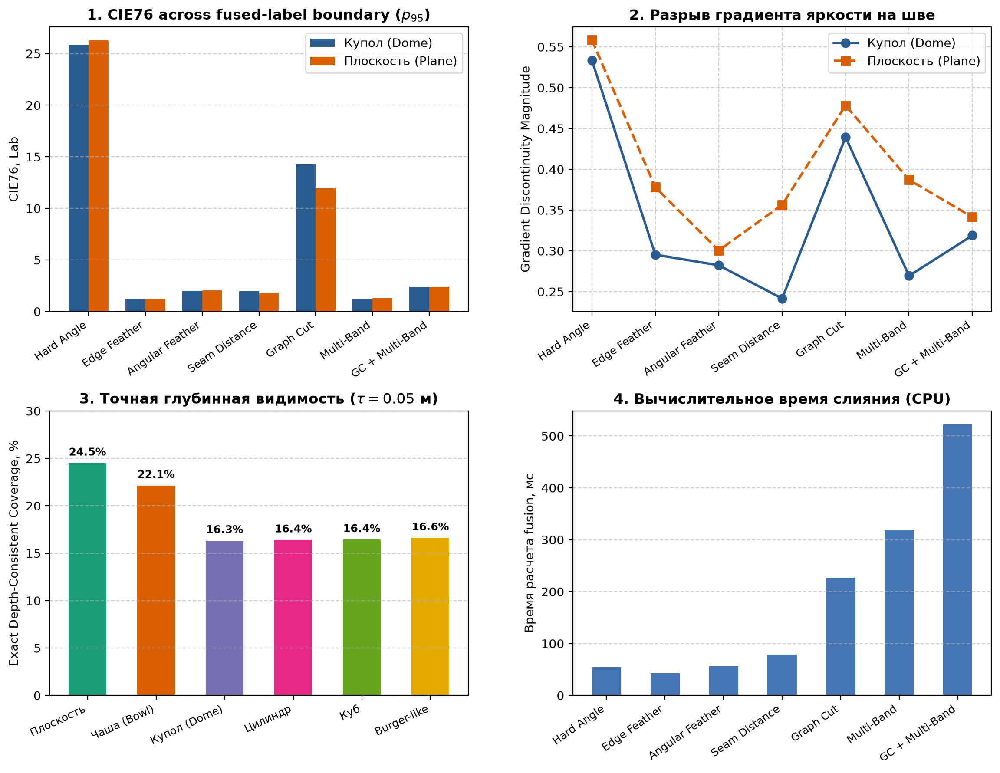

*Рисунок 4.42 — Повторный exploratory E-STITCH-01 screen после фиксации validity-zero extension. Скрипт `plot_e_stitch.py`, raw summary `baselines/e_stitch_mask_v2.json`. Seam/ghost показатели остаются output proxies одной синтетической сцены; график не доказывает превосходство метода.*

В 84 случаях пять непирамидальных методов дали прежние RGB. Для multiband средняя абсолютная разница каналов составила 0.009666 RGB8, максимум — 23, доля изменившихся пикселей — 1.9604%; для graph-cut/multiband — 0.000375, 25 и 0.04716% соответственно. Среднее вычислено по 12 carrier/view случаям одинакового разрешения для каждого метода, максимум — по всем каналам/случаям. Максимальное изменение seam p95 равно 0.015787 и 0.057588. Эти величины характеризуют чувствительность к реализации, а не ошибку относительно независимой истины.

Нулевое продолжение исключает влияние ненаблюдаемого RGB, но не является доказательством отсутствия тёмных границ либо ghosting (§3.23). Следующий опыт должен сравнивать border extension/normalized convolution на независимых truth. Пересчёт прежних pyramid object/robustness/resolution серий описан в §4.43. Tracked трёхкадровый temporal опыт дополнительно повторён с новой конвенцией; его таблица, source hashes и графики обновлены в [[validation/PAIRED_STITCH_TEMPORAL]]. Shared fallback/ego в композиционном oracle остаются не независимыми; аналитическая проверка новых слоёв здесь ограничена плоскостью. Текущие raw results, hashes и команды: [[validation/NATIVE_FUSION]].

## 4.43 Повторные серии после исправления validity masks

После проверки готового RGBA (§4.42) повторены прежние серии resolution/visibility, sampling convergence, exposure stress, static coded object и moving coded object. Камерные входы и независимые эталоны сохранены; проверяются их hashes и согласованность поз/timestamps. В каждой паре разрешений прямые RGB/object-ID/visibility совпадают побитно. Это контроль чувствительности реализации на известных данных, а не новая holdout-выборка.

Проверено 819 строк условий (84 resolution + 84 convergence + 189 exposure + 84 static object + 378 moving object); общая точка 256 px входит в обе пары. Для пяти непирамидальных режимов все 585 RGB outputs побитно совпали с прежними. Это регрессионные случаи, не независимые сцены.

| Серия | Fusion | RGB случаев | Mean abs RGB8 | Max RGB8 | Изменено пикселей, % |
|---|---|---:|---:|---:|---:|
| 64/256 | `multi_band` | 12 | 0.011439 | 2 | 2.9190 |
| 64/256 | `graph_cut_multi_band` | 12 | 0.000550 | 1 | 0.1568 |
| 256/512 | `multi_band` | 12 | 0.011279 | 2 | 2.8617 |
| 256/512 | `graph_cut_multi_band` | 12 | 0.000584 | 1 | 0.1675 |
| Экспозиция, 3 layouts | `multi_band` | 27 | 0.011234 | 3 | 2.8183 |
| Экспозиция, 3 layouts | `graph_cut_multi_band` | 27 | 0.000537 | 1 | 0.1519 |
| Статическая мишень | `multi_band` | 12 | 0.016936 | 27 | 3.0951 |
| Статическая мишень | `graph_cut_multi_band` | 12 | 0.000625 | 1 | 0.1749 |
| Движущаяся мишень | `multi_band` | 54 | 0.018469 | 27 | 3.3722 |
| Движущаяся мишень | `graph_cut_multi_band` | 54 | 0.000650 | 1 | 0.1810 |

Mean absolute RGB8 change характеризует расхождение версий; оно не является ошибкой относительно Blender truth. Поэтому небольшое среднее изменение нельзя использовать как подтверждение отсутствия тёмных границ либо двоения. Прежние shape/visibility ограничения и слабое соответствие RGB маски движущейся цели сохраняются.

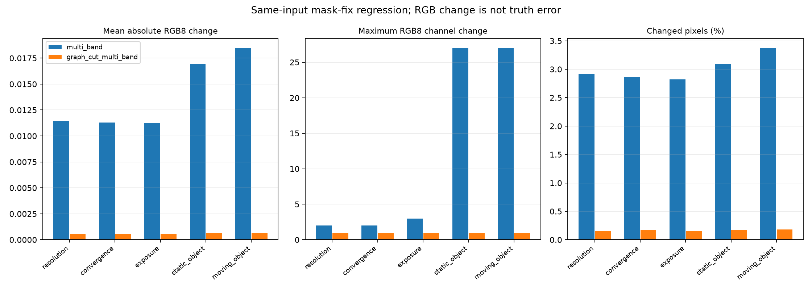

*Рисунок 4.43 — Сравнение прежнего и исправленного pyramid filtering на одинаковых входах: среднее абсолютное изменение, максимальное изменение канала и доля изменённых пикселей. Скрипт `plot_stitch_mask_followup.py` расположен рядом с главой; вход — tracked JSON baseline.*

Актуальные таблицы разрешений и экспозиционных условий обновлены в [[validation/STITCH_RESOLUTION_VISIBILITY]] и [[validation/STITCH_CONVERGENCE_ROBUSTNESS]]. Старые CPU timing tables object screens сохранены как исторические; новые quality-only результаты и полные provenance приведены в [[validation/STITCH_MASK_FOLLOWUP]]. Новые CPU samples не используются для сравнения скорости, поскольку пересчёты качества шли одновременно без изоляции нагрузки. Проверки затронутых fusion/metrics и native parity прошли 6/6 CTest entries.

Пересчёт устраняет несоответствие версии реализации опубликованным результатам, но не закрывает E-STITCH-01. Следующие условия: исследование border extension/normalized convolution, длинные независимые клипы и scene/mount seeds, natural-object correspondence и stale/history опыт, равные ресурсные бюджеты, cursor/history reset многокадрового серверного runner и отдельные целевые performance trials (§4.45 описывает выполненный paused-sequence этап).

## 4.44 Контролируемый опыт: граница маски и сохранение постоянного цвета

После пересчёта §4.43 выполнен отдельный native опыт: все наблюдаемые камеры имеют одинаковый линейный RGB (0.6, 0.3, 0.8), их validity различается, но объединение покрывает весь output. На таком входе граница масок не должна создавать яркостный контур. Принцип раздельного учёта сигнала и уверенности описан в [Knutsson, Westin, Normalized and differential convolution, CVPR 1993](https://ieeexplore.ieee.org/abstract/document/341081/); конкретная рекурсивная поддержка Gaussian pyramid реализована и проверена в данном проекте.

Для normalized варианта на каждом уровне независимо фильтруются масса C*S и поддержка S, после decimation выполняется деление при S>1e-12. Полная формула, σ/reflect/decimation convention, исходные controls и raw reports: [[validation/PYRAMID_BOUNDARY]]. Пирамида весов и Laplacian blend не заменены другим seam solver.

| Режим | Max abs linear RGB error, zero | Max abs linear RGB error, normalized |
|---|---:|---:|
| multi_band, 33×17, overlap x=11..21 | 0.148552 | 1.192093e-7 |
| graph_cut_multi_band, те же входы | 0.038150 | 1.192093e-7 |

Таблица показывает максимум по трём каналам; это ошибка относительно известного постоянного поля, а не прежняя RGB8 разница версий (§4.43). Across 72 controls (три размера × четыре mask layouts × два режима × requested levels 1/4/8) максимальная normalized ошибка — 1.788139e-7, GTest tolerance — 4e-5. Small images ограничивают фактическую глубину пирамиды; сочетания levels не являются независимыми trials.

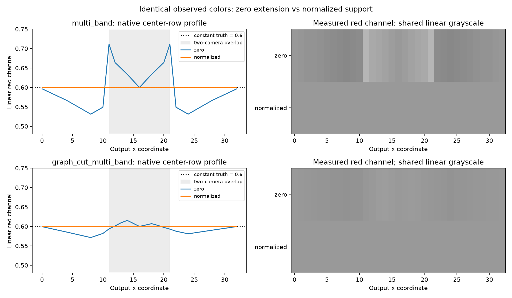

*Рисунок 4.44 — Native профиль красного канала и его линейная grayscale визуализация для zero и normalized support. В baseline видны тёмный и светлый ореолы, normalized сохраняет известный цвет в данном контроле. Скрипт `plot_pyramid_boundary.py` находится рядом с главой, raw GTest JSON сохранён в validation baselines.*

Проверено также отсутствие влияния invalid RGB, конечный нулевой результат при пустых входах и восстановление неconstant gradient одной полностью наблюдающей камеры. Независимый NumPy/SciPy oracle добавляет 18 random-mask/levels сочетаний; full RGBA oracle расширен до 90 случаев пяти carriers, 18 actual SV01 кадров побитно совпали с probe. Typed GUI apply/reject/restore проверен по Unix/TCP. Полная suite прошла 48/48 CTest entries.

Четырёхвариантный `svctl research` screen выполнил 36 samples на одном paused frame set и восстановил fusion/surface/pause. Первый запуск на двухкадровом replay остановился с NO_INPUT и корректным restored=true: шаг кадров 200 ms превышал допустимый возраст 100 ms. Успешный запуск использовал первый исходный кадр без изменения RGB/calibration. Оба отчёта сохранены. Эти прогоны не оценивают временную устойчивость или FPS; reported GL device — AMD integrated radeonsi, не Аврора.

Вывод ограничен проверенными инвариантами. Normalized support остаётся отдельным переключаемым кандидатом, default zero сохранён для сравнения. Перед выбором алгоритма нужны textured independent scenes, silhouettes/occlusions, exposure/noise, крупные отверстия масок, равные бюджеты и отдельный overhead/target опыт. Сохранение постоянного поля не доказывает отсутствия цветовых переносов либо лучшего качества естественных объектов.

## 4.45 Серверная проверка normalized support на текстурированной сцене

Следующий опыт проверяет, переносится ли найденный в §4.44 constant-field инвариант на текстурированные входы. До запуска зафиксирован [[research/SERVER_BOUNDARY_PROTOCOL]]; production sv-server получает четыре исходные камеры, а C++ `svctl research` меняет настройки через библиотеку, собирает actual RGBA и восстанавливает состояние. Независимый analyzer только читает изображения и direct-view Blender truth. Это exploratory follow-up на уже просмотренных данных, не подтверждающая holdout серия.

Первичная matrix включает две позы прежнего coded-object fixture, пять носителей, два fusion режима и две boundary conventions: 40 условий. Дополнительная matrix — девять прежних moving-target кадров, dome и те же четыре fusion profiles: 36 условий. Каждый вариант имеет два warmup и семь measurement blocks с полным случайным порядком, seed 20261011. Всего получены 684 samples, из них 532 RGBA сохранены нативным capture consumer. Внутри frame/variant все hashes совпали; между вариантами проверены одинаковые inputs/frame_set_id, calibration и virtual view. Raw metadata сохранены в [[validation/SERVER_BOUNDARY]].

Для независимого RGB сравнения используется ROI из прямого object-ID truth и any-camera ray visibility, без ego/background и двухпиксельной полосы границ. Она не зависит от output метода. Пусть R — эта область, а L — sRGB→linear преобразование. Тогда

$$E_{RGB}=\frac{1}{3|R|}\sum_{p\in R}\sum_{c\in\{r,g,b\}}|L(I_{pc})-L(T_{pc})|.$$

IoU контрольного объекта определяется как $|M_I\cap M_T|/|M_I\cup M_T|$, где output mask извлекается заранее заданным chroma classifier, а truth mask — object ID. Дополнительно учитываются false-positive/missing pixels, precision и recall. Known-answer controls различают точное совпадение и touching duplicate даже при одном connected component. Это ограниченный coded-target измеритель; natural-object correspondence и полная ghost segmentation ещё не реализованы.

| Серия / режим | Средняя парная Δ linear MAE | Средняя парная Δ target IoU | Средняя Δ median fusion CPU, ms |
|---|---:|---:|---:|
| Static / multi_band | −0.00021651 | −0.00190991 | +0.35888 |
| Static / graph_cut_multi_band | −0.00002781 | +0.00031153 | +0.46665 |
| Motion / multi_band | −0.00013861 | −0.00160427 | +0.11010 |
| Motion / graph_cut_multi_band | +0.00000925 | −0.00074422 | +1.63112 |

Разности определены как normalized−zero. Для CPU в каждой паре сначала взяты медианы семи повторов. Средние по условиям описывают эту matrix, не confidence interval: повторные рендеры и кадры одной сцены зависимы. Linux device — AMD Ryzen 9 9950X integrated radeonsi; это не измерения RTX, Авроры или sensor-to-display latency. Полные stage samples, renderer и source fingerprint находятся в raw reports.

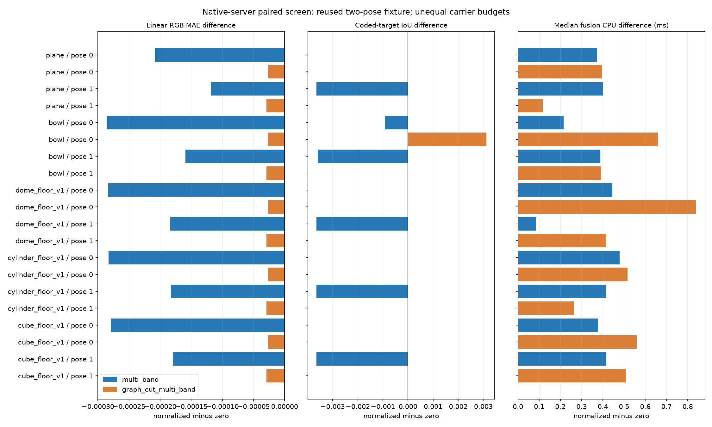

*Рисунок 4.45 — Измеренные разности normalized−zero по каждой статической паре. Отрицательная RGB разность означает меньшую ошибку, отрицательная IoU — худшее совпадение объекта. Цвет обозначает fusion режим; шкалы трёх метрик различаются.*


*Рисунок 4.46 — Обе заранее заданные позы dome baseline: прямой Blender RGB и четыре production-server outputs. Сильная деформация поднятого magenta объекта сохраняется при обеих boundary conventions. Это actual capture, не иллюстрация, созданная другим renderer. Скрипт `plot_server_boundary.py` расположен рядом с главой и проверяет hashes исходных RGBA.*

На static matrix RGB MAE уменьшилась в 20/20 пар, но target IoU ухудшилась в шести, улучшилась в одной и не изменилась в 13. На moving-target matrix RGB улучшилась в 14/18 пар и ухудшилась в четырёх; target IoU ухудшилась в восьми и не изменилась в десяти. Таким образом, normalized convolution исправляет определённый mask-boundary дефект, но не решает неверную геометрию проекции поднятых объектов и не гарантирует улучшения RGB любого кадра. Default zero сохранён для ablation; универсально лучшая convention не установлена.

Восстановление подтверждено для fusion/surface/pause всех шести запусков; восстановленный RGBA совпал с baseline последнего кадра. Cursor/history не возвращаются, что явно отражено в отчёте. Пять carriers имеют разные mesh budgets, поэтому эти числа нельзя использовать для выбора лучшего носителя. Девять кадров покрывают 0…800 ms одной прежней траектории; этот опыт не заменяет длинные continuous clips, temporal-history/flicker анализ или photometric compensation. Для окончательного вывода нужны новые сцены/mount seeds и holdout, multilabel seam, равные budgets и целевая платформа.

## 4.46 Многометочная оптимизация швов: exact moves и фактическая цена

Следующий исследовательский этап добавляет optional native alpha-expansion. Базовый `binary_pairs` оптимизирует отдельные exactly-two-camera компоненты и использует centrality fallback при 3/4 overlaps; новый вариант задаёт одну weighted Potts energy на общей observed области. Label — ID доступной камеры, unary штрафует малое расстояние до её validity boundary, соседние разные labels получают label-independent penalty, зависящий от локального RGB disagreement. Single-camera anchors включены и фиксированы. Полные формулы/квантизация/маски приведены в [[validation/MULTILABEL_SEAM]].

[Boykov, Veksler, Zabih (2001)](https://www.cs.cornell.edu/rdz/Papers/BVZ-pami01-final.pdf) обосновывают large-move graph-cut оптимизацию metric energies. Здесь каждый alpha move сохраняет старую метку или назначает alpha; submodular binary energy решается exact min-cut. Полная задача с несколькими метками в общем случае остаётся приближённой. В реализации принимается только strictly lower integer energy, порядок alpha фиксирован, production budget — восемь sweeps. Равные costs разрешаются по ID; permutation invariance этого кандидата не заявляется.

Проверены две разные группы seeded small graphs. На первой 128 six-node graphs все 512 expansion moves совпали с exhaustive перебором 64 subsets. На второй 128 graphs перебраны все 4096 labelings: global optimum достигнут в 125 случаях. Во всех 128 default budget8 подтвердил local convergence, но это не гарантия для большого output. На худшем графе energy уменьшилась77→60 и дальнейший alpha move не улучшает её, тогда как global optimum равен52. Следовательно, корректность каждого min-cut не позволяет называть весь solver точным глобальным.


*Рисунок 4.47 — Один сохранённый known-answer graph: alpha-expansion остановился при60, exhaustive optimum52. Цвет/подпись вершины — camera label, числа на рёбрах — Potts weights. Unary table, unavailable labels и обе assignments опубликованы в raw GTest JSON; это математический контроль, не реальная сцена.*

Hand-computed production controls дополнительно соединяют single-camera anchors через overlap трёх/четырёх камер: minimum energy5667/5750. Недоступные labels не выбираются, empty pixels имеют нулевые weights. Проверка total capacities отклоняет graph, где отдельные costs допустимы, но общая source saturation могла бы переполнить int64. Полная Linux regression51/51; tests доказывают software свойства, не улучшение perceptual quality.

До визуального опыта зафиксирован [[research/MULTILABEL_SEAM_PROTOCOL]]. Две прежние позы/dome, оба graph-cut modes × два solvers, boundary zero, λ0.1, levels4: восемь условий, два warmup и семь randomized measurement blocks. Получены72 samples/56 native RGBA. Independent audit проверил hashes, inputs/settings/calibration, полноту matrix и restore fusion/surface/pause. Source fingerprint сохранён; Blender dataset прежний, не holdout. В отличие от нового candidate legacy имеет другую energy, поэтому здесь сравниваются два полных image pipelines, а не два minimizers одной objective.

| Поза / режим | Δ linear RGB MAE | Δ coded target IoU | Δ median fusion CPU, ms |
|---|---:|---:|---:|
| 0 / graph_cut_seam | +0.000000322 | 0 | +339.188 |
| 0 / graph_cut_multi_band | −0.000006732 | +0.002409056 | +336.756 |
| 1 / graph_cut_seam | +0.000000016 | 0 | +334.471 |
| 1 / graph_cut_multi_band | +0.000004603 | 0 | +343.651 |

Разность определяется как alpha_expansion−binary_pairs. RGB уменьшилась только в одной паре, IoU улучшилась в одной и не изменилась в трёх. Все четыре alpha условия подтвердили convergence за два sweeps и четыре accepted moves на54402 nodes/108126 edges. Это observed nodes, не число пикселей с 3/4 available cameras. Energy является surrogate seam criterion до Gaussian smoothing/pyramid, не независимой quality metric.


*Рисунок 4.48 — Все четыре заранее заданные пары: small RGB/IoU effects и большой CPU overhead. Семь повторов — измерения одной paused input пары, не независимые сцены.*


*Рисунок 4.49 — Обе позы и четыре actual server outputs рядом с direct Blender truth. Новый optimizer не устраняет ошибку carrier geometry для поднятой мишени. Скрипт plot_server_boundary.py строит все рисунки из сохранённых baselines/captures без изменения product renderer.*

Измеренная цена нового пути составляет дополнительно334–344ms на кадр на Linux/AMD integrated Mesa. Graph строится на всей observed области с fixed anchors; это неприемлемо как обоснование realtime режима автомобильного экрана. Candidate оставлен переключаемым исследовательским вариантом, default сохранён. Следующий инженерный опыт может удалить fixed nodes с сохранением exact objective и проверить parity/cost; следующий quality опыт обязан использовать новые scene/mount instances, затем natural-object truth и равные carrier budgets. Blender MCP восстановлен, новые procedural cases заранее зафиксированы в [[research/SEAM_GENERALIZATION_PROTOCOL]]. Окончательное преимущество multilabel по качеству пока не установлено.

## Предварительные выводы по четвёртой главе

1. **Экспериментальная инфраструктура сшивки:** реализованы offline-варианты fusion и carrier matrix; исправленные binary graph-cut и output proxies проверены на fixtures, добавлены парный 3-frame Blender clip (§4.25), статический coded-object screen (§4.28) и девятикадровый moving-target screen (§4.39). Эти результаты уточняют failure modes в конкретных synthetic scenes; качество методов на holdout scenes и естественная object-correspondence ghost truth пока не подтверждены.
2. **Scene Truth/GPU checks:** получены числа на конкретном синтетическом fixture и CPU/GPU sample. Они характеризуют только этот тест и не заменяют испытания реальной сцены/камер.
3. **Калибровочное ядро:** реализованы синтетические эксперименты Joint Bundle Adjustment и server calibration gate. Сопоставление моделей и пороги требуют независимых данных; историческая jitter-модель не оценивает detector, новые image-based серии выполняют OpenCV на синтетических PNG (§4.29, §4.31–4.38). Full joint Jacobian имеет полный ранг на 12 selected cases; order 4 имеет худшую обусловленность, а локальная uncertainty зависит от принятой covariance model. Направленные UV errors по-разному делятся между intrinsics и позами. Sparse TRF сошёлся в 110/144 refits, dense LM follow-up — в 144/144 на тех же synthetic inputs; это исследовательский результат, не production-рекомендация. Peripheral views уменьшают часть ошибок экстраполяции, но ни angular coverage, ни конкретная комбинация размера/наклона не гарантируют точной реконструкции плоскости.

Таким образом, перечислены достигнутые этапы реализации и проверок на синтетике; качество сшивки, перенос на физическую оптику и физическая обоснованность Quality Gate остаются открытыми.

## Источники и воспроизводимость

Основания проекции и измерений: [[references/VISION#S04|S04]], [[references/DEVELOPMENT#S31|S31]], [[references/DEVELOPMENT#S52|S52]], [[references/VISION#S68|S68]], [[references/VISION#S10|S10]]. Собственные числа — [[prototype/MEASUREMENTS]], [[validation/STITCH_VISIBILITY]], [[validation/IMAGE_QUALITY_ORACLE]], [[validation/DEPTH_VISIBILITY_TRUTH]]. Код экспериментов — `tools/run_e_stitch_01.py`, `tools/validate_gpu_readback.py`, `tools/comprehensive_calibration_study.py`, `tools/real_data_calibration_evaluation.py`. Рисунки сформированы скриптами `plot_e_stitch.py`, `plot_image_quality.py`, `plot_comprehensive_calibration.py`. Дата серии — 09.10.2026.

[S04]: https://docs.opencv.org/4.13.0/db/d58/group__calib3d__fisheye.html
[S10]: https://doi.org/10.1145/245.247
[S31]: https://gstreamer.freedesktop.org/documentation/application-development/advanced/clocks.html
[S52]: https://registry.khronos.org/OpenGL/extensions/EXT/EXT_disjoint_timer_query.txt
[S59]: https://developer.auroraos.ru/doc/sdk/tools/mb2
[S60]: https://developer.auroraos.ru/doc/software_development/guidelines/rpm_requirements/spec_requirements
[S68]: https://doi.org/10.1109/ICIP.2019.8803453

## 4.47. Проверка многометочных швов на новых сценах и монтажных отклонениях

После фиксации протокола [[research/SEAM_GENERALIZATION_PROTOCOL]] получены три новых экземпляра процедурной улицы: низкий блок, столб и поднятый короб, seeds101–103. Параметры зданий и препятствий различаются; камеры имеют yaw/pitch отклонения до ±3° и смещение вдоль кузова до ±0.1m. Сервер использует истинную изменённую калибровку. Это позволяет отделить поведение сшивки от ошибки оценки монтажа; сравнение nominal/estimated calibration ещё требуется. Генератор семейства улицы общий, поэтому независимость от типа мира не установлена.

Четыре заранее выбранных профиля сравниваются на двух кадрах каждого экземпляра:24 условия,216 samples с warmup,168 сохранённых measurement RGBA. Параметры, пороги объекта и порядок randomized blocks не выбирались по полученным результатам. Read-only аудит проверяет provenance, временные интервалы и hashes входов, direct RGB/object-ID/visibility truth, actual runtime settings, повторяемость output и восстановление настроек. Полная таблица12 пар и native reports: [[validation/MULTILABEL_SEAM#Новые сцены и отклонения монтажа]].


*Рисунок 4.50 — alpha_expansion минус binary_pairs на seeds101–103: RGB MAE, coded-target IoU и медианная CPU-задержка сшивки. Ноль обозначает отсутствие различия; для MAE и задержки предпочтительна отрицательная разность, для IoU — положительная.*

RGB MAE уменьшилась в4/12 пар и выросла в8/12; IoU улучшилась в2, ухудшилась в2 и не изменилась в8. Все12 alpha условий завершились с подтверждённой local convergence за два sweeps. Но median fusion CPU выросла на769.489–957.757ms. Эти числа относятся к Linux/Mesa запуску без параллельной сборки, CTest и Blender capture, а не к Aurora или GPU-реализации solver. Разброс между старой и новой серией нельзя объяснять только сценой без контроля частот и thermal.


*Рисунок 4.51 — seed101, два заранее заданных кадра: слева прямой Blender RGB, далее четыре серверных профиля. Выбран первый экземпляр по протоколу, а не лучший результат. Вытягивание магентового блока показывает геометрическую ошибку поверхности-носителя, сохраняющуюся при истинной калибровке.*

Снижение Potts energy не доказывает улучшения изображения. Существующий носитель не восстанавливает глубину поднятых объектов, а многометочный solver не устраняет эту неоднозначность. На данном наборе оснований заменить default binary_pairs нет. Вывод ограничен тремя экземплярами одного генератора и короткими последовательностями: нельзя считать12 пар независимыми clips или переносить coded-object IoU на естественные ghost trails. Для завершения исследования остаются разные семейства сцен, длинные clips, natural-object correspondence, calibration ablation и равные бюджеты носителей. Скрипт рисунков — `plot_server_boundary.py`; raw отчёт — `validation/baselines/seam_generalization_v1.json`.

## 4.48. Сравнение поверхностей при сопоставимом бюджете сетки

Предыдущие carrier screens использовали разные дискретизации. Для исключения этой части смешения факторов зафиксированы пять profiles с общими пределами:3190–3210 active triangles,≤1810 vertices,≤60500 bytes position/index buffers. Диапазон разрешён заранее из-за разной топологии сеток; точное равенство полной памяти и вычислений не предполагается. План и протокол: [[research/CARRIER_BUDGET_PROTOCOL]].

C++ сервер сообщает фактические active/resident vertices, indices, triangles и bytes. Это позволяет учитывать дополнительные flat-boundary линии make_mesh и обнаружить неактивные буферы после переключения surface. Каждый seed/carrier проверяется свежим process; active=resident подтверждено. Для mesh payload:

$$B_{mesh}=3N_v\operatorname{sizeof}(float)+N_i\operatorname{sizeof}(unsigned),\qquad N_t=N_i/3.$$

В текущем ABI обе sizeof равны4. CPU double positions/vector capacity, driver allocations, textures/FBO/depth и ego mesh в эту величину не входят. Output и camera inputs одинаковы; equal triangles не уравнивают raster coverage, локальную density или GPU work.

| Носитель | Фактические triangles | Vertices | Position/index bytes |
|---|---:|---:|---:|
| plane | 3196 | 1680 | 58512 |
| bowl | 3196 | 1680 | 58512 |
| dome_floor_v1 | 3200 | 1666 | 58392 |
| cylinder_floor_v1 | 3200 | 1730 | 59160 |
| cube_floor_v1 | 3208 | 1806 | 60168 |


*Рисунок 4.52 — активные triangle/vertex counts и bytes запрошенных position/index buffers. Красные линии — общие потолки. Полная GPU/CPU память не измеряется этими столбцами.*

Размах числа треугольников0.3755%, mesh bytes различаются в пределах58392–60168. На ранее просмотренных seeds101–103 выполнены120 условий: пять surfaces × два кадра × четыре profiles (multi_band/graph_cut_multi_band и zero/normalized). Два warmup и семь randomized blocks дают1080 samples и840 measurement RGBA. Все success/restore, input/truth/hash/budget проверки пройдены; полная регрессия51/51. Этот follow-up exploratory: новые carriers исследуются на знакомых входах одного street generator.


*Рисунок 4.53 — абсолютные linear RGB MAE и coded-target IoU по seed/carrier/profile; каждая ячейка усредняет только два соседних кадра. Цветовые шкалы метрик раздельны; ячейки не являются независимыми clips.*

| Носитель относительно dome | Диапазон Δ linear RGB MAE | Диапазон Δ coded IoU | RGB лучше / хуже из24 пар |
|---|---:|---:|---:|
| plane | +0.000014811…+0.000120689 | +0.000000000…+0.000000000 | 0 / 24 |
| bowl | +0.001648975…+0.009858366 | -0.000390819…+0.011921873 | 0 / 24 |
| cylinder_floor_v1 | -0.000004215…-0.000001781 | +0.000000000…+0.000000000 | 24 / 0 |
| cube_floor_v1 | -0.000050957…-0.000010537 | +0.000000000…+0.000034687 | 24 / 0 |

Каждая строка —24 парных carrier-minus-dome наблюдения, диапазон не является доверительным интервалом. Cylinder/cube имеют немного меньшую RGB MAE, plane немного большую; coded-target IoU почти совпадает. Bowl увеличивает общую MAE во всех24 парах, но улучшает IoU в20 и ухудшает в4. Следовательно, выбор по одному pooled score скрывает конфликт общей цветовой ошибки и формы объекта. Параметры bowl не подбирались, а другие heights/flat extents ещё не проверены.


*Рисунок 4.54 — первый заранее заданный seed101 и профиль multi_band/zero, оба кадра: direct Blender RGB и actual server RGBA пяти носителей. Близость результатов замкнутых surfaces согласуется с общей плоскостью пола в этих ракурсах; ground/shell coverage ещё не измерена, вытягивание поднятого блока сохраняется.*

Дополнительные60 boundary пар показали уменьшение RGB MAE у normalized во всех60 случаях и ухудшение target IoU в16. Это расширяет предыдущий textured screen, но не обосновывает универсальный выбор normalized. Timings сохранены, однако фиксированный carrier order и отсутствие thermal/frequency контроля не позволяют ранжировать скорость. Необходимо продолжить budget convergence, разделить ground/raised/shell ROI, добавить верхние/боковые views, новые scene families и natural-object truth. Полный raw audit и ограничения: [[validation/CARRIER_BUDGET]].

## 4.49. Чувствительность к плотности сетки носителя

После общего mesh-budget screen (§4.48) проверено сгущение каждого носителя coarse/medium/fine. Форма поверхности и camera/input/view/fusion параметры неизменны; cells по каждой оси приблизительно удваиваются. Minimum dome latitude8 и integer rounding нарушают точный factor2; triangle counts между carriers на крайних уровнях не равны. Это within-carrier sensitivity, не новое ранжирование carriers. Протокол заморожен до coarse/fine output: [[research/CARRIER_REFINEMENT_PROTOCOL]].

| Носитель | Triangles coarse / medium / fine | Position/index bytes coarse / medium / fine |
|---|---:|---:|
| plane | 864 / 3196 / 12144 | 16068 / 58512 / 220500 |
| bowl | 864 / 3196 / 12144 | 16068 / 58512 / 220500 |
| dome_floor_v1 | 832 / 3200 / 13056 | 15384 / 58392 / 236568 |
| cylinder_floor_v1 | 768 / 3200 / 13056 | 14616 / 59160 / 238104 |
| cube_floor_v1 | 840 / 3208 / 12552 | 16392 / 60168 / 230664 |

Проверены360 условий: три уровня × пять carriers × три street instances × два кадра × четыре profiles. Из них240 новые,120 medium повторно использованы после SHA256 проверки pinned baseline и source fingerprint. Все3240 samples и2520 measurement RGBA прошли provenance/layout/hash/restore/resource audit. Product C++ не менялся: trials выполняет прежний native server/runner, исследовательский analyzer только читает отчёты.

Две оценки разделены. Для дискретизации h и finite reference f:

$$D(h,f)=\frac{1}{3|\Omega|}\sum_{p\in\Omega}\sum_{c=1}^{3}|L(I_h(p,c))-L(I_f(p,c))|.$$

Ω — общий any-camera ROI, L — sRGB→linear transfer. D измеряет изменение output, не сценовую ошибку. Отдельная ΔMAE=MAE(I_f,I_truth)−MAE(I_m,I_truth) использует independent direct Blender RGB. Fine не является truth или доказательством асимптотической сходимости; acceptable threshold для автомобиля не задан.

| Носитель | Linear difference coarse→fine | Linear difference medium→fine | Max medium/fine RGB8 delta в ROI | Medium ближе к fine |
|---|---:|---:|---:|---:|
| plane | 3.144e-07…2.267e-06 | 2.372e-07…6.201e-07 | 2 | 22/24 |
| bowl | 6.641e-04…8.501e-04 | 1.469e-04…2.022e-04 | 72 | 24/24 |
| dome_floor_v1 | 3.957e-06…1.118e-05 | 1.424e-06…5.296e-06 | 6 | 24/24 |
| cylinder_floor_v1 | 1.254e-06…5.159e-06 | 5.119e-07…2.163e-06 | 2 | 24/24 |
| cube_floor_v1 | 2.997e-07…7.840e-07 | 1.396e-07…6.015e-07 | 1 | 24/24 |


*Рисунок 4.55 —24 парных conditions на carrier: difference coarse/fine и medium/fine, signed truth RGB MAE differences, coded IoU differences. Отрицательная RGB-разность означает улучшение, положительная IoU-разность — улучшение. Точки profiles/соседних кадров не являются независимыми clips.*

Medium ближе к fine в118/120 пар; полного byte-level совпадения нет. Bowl существенно чувствительнее: medium/fine linear difference1.469e−4…2.022e−4, отличаются8.286…10.086% ROI pixels, локальный RGB8 channel delta до72. Для остальных carriers максимум1–6. Следовательно, средний error не должен скрывать локальные изменения. Причина малых plane/cube differences отдельно не локализована.

| Носитель | Δ truth RGB MAE fine−medium | RGB лучше / хуже | IoU лучше / хуже |
|---|---:|---:|---:|
| plane | -1.091e-07…+7.516e-08 | 8 / 16 | 0 / 0 |
| bowl | -1.130e-04…-4.833e-05 | 24 / 0 | 3 / 8 |
| dome_floor_v1 | -2.905e-06…-8.823e-07 | 24 / 0 | 2 / 0 |
| cylinder_floor_v1 | -1.424e-06…-6.596e-08 | 24 / 0 | 2 / 0 |
| cube_floor_v1 | -2.556e-07…+1.792e-07 | 12 / 12 | 0 / 2 |

Fine уменьшает RGB MAE относительно direct truth в92/120 conditions и увеличивает в28. Coded IoU улучшается в7, ухудшается в10 и совпадает в103. В частности, bowl улучшает RGB MAE во24/24 парах, но ухудшает IoU в8. Численная устойчивость output и физическая точность silhouette — разные свойства: более плотная surrogate surface сохраняет ограничения самой формы.


*Рисунок 4.56 —первый seed101, первый кадр и профиль multi_band/zero для всех пяти carriers: direct RGB, coarse, medium, fine и абсолютная RGB8-разность medium/fine, усиленная×8 с clipping. Последний столбец — диагностическое изображение, не scene RGB. Изображения выбраны по порядку плана, а не по качеству.*

Серия ограничена тремя просмотренными экземплярами одной street family и двумя близкими позами; high-angle views и shell ROI ещё не проверены. Сгущение не устраняет вытягивание поднятого target. Скорость не ранжируется из-за fixed level order/thermal и reuse medium. Для выбора нужны ground/raised/shell ROI, spatial density, разные views/resolutions, новые scene families/long clips и целевой стенд. Raw paths, compact baseline и подробности: [[validation/CARRIER_REFINEMENT]].

## 4.50. Раздельная оценка дороги, объектов и полосы границ

Выводы §§4.48–4.49 использовали общую RGB MAE по внутренним областям видимых объектов. Для проверки её ограничений проведена post-hoc стратификация360 прежних outputs. Policy зафиксирована до stratified errors, но исходные images/aggregate metrics уже просмотрены: это exploratory re-analysis, не holdout и не новые server samples. Protocol: [[research/SPATIAL_ROI_PROTOCOL]].

Маски строятся только по independent direct Blender object-ID и any-camera visibility. Семантические ground (дорога/разметка), coded_target и other_scene дополнительно делятся на interior и boundary band. Ego/background исключены. Ground не означает строго z=0; other_scene включает curb/sidewalk/buildings и не называется измеренным raised-class. ID boundaries включают маркировку и object seams, не только силуэты. Union interiors точно воспроизводит прежний ROI; все шесть masks непересекающиеся.

| Seed / кадр | Ground interior | Other interior | Target interior | Все boundary pixels |
|---|---:|---:|---:|---:|
| 101 / 0 | 39374 | 4658 | 48 | 8196 |
| 101 / 1 | 39303 | 4657 | 52 | 8049 |
| 102 / 0 | 39449 | 4756 | 0 | 8262 |
| 102 / 1 | 39490 | 4696 | 0 | 8193 |
| 103 / 0 | 39408 | 4028 | 149 | 7797 |
| 103 / 1 | 39670 | 3917 | 149 | 7635 |


*Рисунок 4.57 —первый кадр каждого seed: direct Blender RGB, visible classes (голубая дорога, магентовый target, оранжевые остальные объекты), ID boundary band и прежний interior ROI. Чёрный цвет на masks означает исключение. Узкий столб seed102 полностью исключён из interior.*

Ground занимает89.24–90.70% старого ROI. Полоса границ составляет14.86–15.75% полного independently visible scene. Seed102 имеет0 target-interior pixels на обоих кадрах, поэтому прежняя RGB MAE вообще не измеряла его поверхность; отдельная coded IoU по-прежнему учитывала объект. Undefined error в пустой группе возвращается null, а не0.

Для групп измерены linear RGB MAE, channel p95/max и count. Проверено восстановление исторического среднего:

$$E_{interior}=\frac{\sum_g N_g E_g}{\sum_g N_g}.$$

Простое невзвешенное среднее групп не используется. Equality с прежней MAE подтверждена до1e−12 во360 conditions. Дополнительная full-visible MAE включает band и выше historical interior MAE во120/120 medium conditions на0.008543…0.014834. Это другая область оценки, а не исправленная задним числом baseline.


*Рисунок 4.58 —linear RGB MAE по семантическим interior/boundary группам, medium/multi_band/zero. Каждая ячейка —среднее двух frame errors одного seed/carrier; серые undefined cells не являются нулевой ошибкой. Полный отчёт содержит все360 conditions.*

Additional exploratory bowl−dome сравнение на medium:

| ROI | Определённых пар bowl−dome | RGB лучше / хуже | Диапазон Δ linear MAE |
|---|---:|---:|---:|
| ground_interior | 24 | 0 / 24 | +0.009926…+0.015041 |
| ground_boundary | 24 | 0 / 24 | +0.036077…+0.052457 |
| coded_target_interior | 16 | 16 / 0 | -0.012632…-0.002416 |
| coded_target_boundary | 24 | 20 / 4 | -0.019234…+0.021591 |
| other_scene_interior | 24 | 24 / 0 | -0.086951…-0.027603 |
| other_scene_boundary | 24 | 24 / 0 | -0.026565…-0.001789 |

Bowl хуже по дороге во24/24 парах, но лучше по other_scene interior/boundary во24/24. Таким образом, aggregate error не разрешает конфликт реконструкции дороги и остальных объектов: вес дороги около90% доминировал в итоговом числе. Эти данные не устанавливают universal superiority bowl и не определяют физическую высоту каждого object pixel. Target boundary имеет20 улучшений и4 ухудшения; target-interior сравнений16 из-за отсутствия этой ROI у seed102.

При fine−medium ground interior RGB улучшилась в86/120, но other_scene interior —только50/120 (66 ухудшений и4 ties). Target boundary улучшилась в20, ухудшилась в44 и совпала в56. Поэтому уменьшение общей ошибки при сгущении недостаточно для вывода о natural-object silhouette/ghost quality. Такой вывод требует correspondence и geometric truth, которых stratification не добавляет.

Все native inputs/reports/RGBA перепроверены, source baseline закреплён SHA256; нового product C++ или server trials нет. Условные ROI не являются carrier-shell coverage. Остаются physical-height truth, carrier-hit/triangle coverage, новые views/families/long clips и target validation. Подробные ограничения и воспроизведение: [[validation/SPATIAL_ROI]].

## 4.51. Проверка покрытия кадра полом и оболочкой носителя

После semantic ROI анализа остаётся проверить, какие части самой геометрии видны наблюдателю. Для этого production Renderer дополнен отдельным depth-tested region-ID проходом над фактическими mesh buffers. Модель автомобиля участвует в окклюзии; camera textures/validity не определяют IDs. Методика, определения шести классов и frozen plan описаны в [[research/CARRIER_COVERAGE_PROTOCOL]]. Это геометрическая диагностика, не новая оценка качества сшивки.

Испытаны пять medium meshes предыдущего budget screen и три ракурса при320×180px, distance8.5m, azimuth0.8rad. Historical view: elevation1rad/fov1rad; lateral: elevation0.35rad/fov1.6rad; overhead: elevationπ/2/fov1rad. Все конфиги проходят production validation;15 native masks сохраняют побитовое совпадение обычного RGBA с render без inspection. Дополнительно masks historical view пересечены с шестью прежними independently visible interior ROIs, всего30 пересечений.

| Геометрия | Shell historical, % кадра | Shell lateral, % кадра | Background lateral, % кадра |
|---|---:|---:|---:|
| plane | 0 | 0 | 42.608 |
| bowl | 0 | 0 | 39.363 |
| dome_floor | 0.325 | 43.944 | 0 |
| cylinder_floor | 0.325 | 43.944 | 0 |
| cube_floor | 0.203 | 42.608 | 0 |


Рисунок4.59 — native geometry-ID raster: floor, shell, поднятый bowl, footprint, ego model и фон. Цвета обозначают геометрию, а не доступность камер или физическую сцену.

В historical кадре enclosure floor занимает92.606–92.727%, автомобиль6.264% и footprint0.806%. В прежней RGB interior ROI оболочка dome/cylinder представлена всего95–187pixels, то есть0.215–0.428%; cube63–117pixels,0.143–0.268%. Таким образом, прежние mesh-budget/refinement опыты преимущественно исследуют пол. Они не дают достаточного основания для вывода о качестве оболочки вокруг наблюдателя. Overhead также имеет0% shell, поэтому повышение elevation само по себе не решает эту проблему.

Боковой ракурс действительно увеличивает shell representation до42.608–43.944%. Plane/bowl при этом оставляют незаполненный фон, в отличие от трёх enclosure. Это проверка геометрической замкнутости в выбранном ракурсе, а не доказательство наличия изображения камер во всех shell pixels. Равенство counters dome/cylinder не означает равенства projected textures. Поднятый bowl классифицируется по интерполированному world.z>1e−6m; эта высота относится к носителю и не является physical-height truth сцены.

Этот geometry-only этап не содержит paired RGB; следующий опыт с независимым Blender RGB/object-ID/visibility для бокового view и общими floor/shell метриками выполнен в §4.52. Использовать прежний direct truth для нового view нельзя. Native inspection пока является локальным render-thread API, без SV01 subscription; дополнительный проход не входит в опубликованные штатные Renderer timings. Raw provenance, masks и ограничения: [[validation/CARRIER_COVERAGE]]. Triangle-hit coverage, другие scene families, natural-object correspondence и целевые trials остаются открытыми.

## 4.52. Парное исследование сшивки на оболочке в боковом ракурсе

Выявленный в §4.51 недостаток покрытия shell устранён в постановке нового опыта: virtual camera elevation0.35rad/fov_y1.6rad при прежних distance8.5m/azimuth0.8rad. Для трёх прежних recipes/mount seeds и шести poses Blender заново снимает camera inputs и независимые direct RGB/object-ID/visibility. Audit подтвердил побитовое равенство всех24 новых fisheye images с прежними, а также калибровки и poses/timestamps; изменились virtual view и соответствующий truth. Это позволяет исследовать другой ракурс при том же камерном сигнале, но не сравнивать MAE разных pixel rays как одну парную ошибку. Протокол до capture: [[research/CARRIER_LATERAL_PROTOCOL]].


Рисунок4.60 — процессы сбора независимого truth, native серверного эксперимента и проверки. Geometry probe является отдельным процессом, не SV01 subscription и не частью timing samples.

Пять medium meshes сохраняют3196–3208 triangles и прежние shared vertex/buffer ceilings.15 fresh servers дали1080 samples,840 measurement captures и120 quality conditions: multi_band/graph_cut_multi_band × zero/normalized, два кадра, warmup2/repeats7. Растеризация и fusion выполняются production C++; launcher не содержит реализации исследуемых алгоритмов.

Common floor/shell —пересечения ID1/ID2 masks трёх enclosure, затем пересечение с независимой interior ROI. Один и тот же support применяется ко всем пяти outputs кадра. Вместе с остатком он разбивает общую ROI; для ошибки e=|linear(I)−linear(T)| выполняется:

$$
E_k=\frac{1}{3|M_k|}\sum_{p\in M_k}\sum_{c=1}^{3}e_{p,c},\qquad
E_{ROI}=\frac{\sum_k |M_k|E_k}{\sum_k |M_k|}.
$$

Empty mask имеет undefined error. Weighted identity проверена с tolerance1e−12. Common-shell support содержит4042–5844pixels, common-floor16013–16966pixels, other121–210pixels. Masks обозначают геометрию носителя, не physical height сцены.

| Carrier относительно dome | Shell MAE лучше / хуже,24 пары | Диапазон Δ shell MAE | Aggregate MAE лучше / хуже |
|---|---:|---:|---:|
| plane | 17 / 7 | -0.024566…+0.006843 | 16 / 8 |
| bowl | 16 / 8 | -0.022271…+0.008691 | 10 / 14 |
| cylinder_floor | 0 / 24 | +0.005822…+0.014484 | 0 / 24 |
| cube_floor | 0 / 24 | +0.019735…+0.049332 | 0 / 24 |

На этой серии dome лучше cylinder/cube по shell и aggregate MAE во24/24 парах с каждым. На common floor различия малы (max absolute около5.15e−5), что согласуется с предыдущим ограничением floor-dominated исследования. Результат относится к выбранному lateral view, фиксированным shapes/budget и одному street family.

Plane/bowl сохраняют незаполненный фон42.608%/39.363% кадра. Постоянный background иногда ближе к direct RGB по MAE, чем искажённая текстура оболочки. Это демонстрирует недостаточность одной MAE: отсутствие реконструкции не становится успехом из-за меньшего среднего цветового отклонения. Требования заполнения, object correspondence и silhouette должны оцениваться отдельно.


Рисунок4.61 — новый direct Blender RGB и пять outputs при заранее выбранном multi_band/zero, все seeds/poses без выбора удачного кадра. Красная машина впереди direct camera —припаркованный объект; синий ego находится ближе к центру. Видимая деформация parked car иллюстрирует ошибку отображения поднятых объектов.


Рисунок4.62 — полная scene/carrier/profile matrix, арифметические средние двух кадров. Раздельные критерии не сведены в неподтверждённый единый рейтинг.

Normalized boundary улучшил aggregate и floor MAE во60/60 парах; shell улучшился42/60, ухудшился4/60 и совпал14/60. Все четыре shell ухудшения —graph_cut_multi_band/bowl seeds101/103. IoU улучшилась13/60, ухудшилась10/60, совпала37/60. Следовательно, эффект normalized по дороге не гарантирует улучшения оболочки и объекта.

Pole seed102 имеет64/62 direct-ID pixels, но IoU0 во всех40 условиях: truth не пуст, реконструированный coded object не пересекается с ним после component policy. В seed101 IoU0.00633–0.02885, seed1030.00960–0.13559. Низкие значения и растянутые colored traces согласуются с ограничением единого носителя при параллаксе, но опыт не отделяет все вклады geometry/sampling/fusion. Требуются controlled height/depth ablation и natural-object correspondence, а не только подбор blend weights.

Все inputs/reports/RGBA проверены, restore и source fingerprint согласованы. Это завершённый exploratory lateral follow-up, не итоговое подтверждение E-STITCH-01: остаются другие scene families/views/resolutions, physical-height/triangle-hit truth, длинные клипы и Aurora hardware. Данные и воспроизведение: [[validation/CARRIER_LATERAL]].

## 4.53. Управляемый перенос объекта по высоте и расстоянию

Lateral опыт (§4.52) смешивал формы объектов, материалы и перекрытия. В E-STITCH-parallax-height-01 построен отдельный плоский стенд: автомобиль с прежним perturbed rig seed101, дорога100×100m и magenta emission box0.4×0.4×0.4m. Меняется положение одного box, а не его размер. Center z=0.2/0.8/1.4m; XY near=(2.4,2.3) и far=(4.8,4.6)m. На нижнем уровне box стоит на дороге; верхние положения идеализированы, без опоры. Сохранены два одинаковых для всех факторов vehicle poses, исходные камеры, direct view и освещение. Это один управляемый синтетический стенд, не независимая выборка городских сцен.


Рисунок4.63 — последовательность controlled height/range опыта. Python управляет экспортом и независимым аудитом; сшивку и rendering выполняет production C++, команды идут через клиентскую библиотеку.

При optical center $C$ и точке $P$ продолжение camera ray до плоскости $z=0$ имеет вид

$$Q=C+t(P-C),\qquad t=\frac{C_z}{C_z-P_z}.$$

При $P_z=0$ получается $Q=P$. Для двух optical centers на одинаковой высоте $H$ и horizontal baseline $b$ расхождение ground intersections одной поднятой точки по направлению baseline имеет модуль $b h/(H-h)$ при $0<h<H$. При $h\to H$ приближение становится неустойчивым; при $h>H$ пересечение лежит позади направления луча. Это аналитический контроль ground approximation, а не предсказание IoU полного box: его видимые грани, окклюзии, sampling, finite carriers и shell intersections отличаются от луча через центр.

В текущем rig optical centers имеют высоты0.85/1.12m. Гипотетический horizontal displacement центра для всех четырёх камер/двух poses/двух ranges составляет0.437–2.603m при z0.2 и5.028–135.353m при z0.8. При z1.4 все16 проверенных лучей имеют t<0; displacement остаётся undefined, а не подменяется нулём. Known-answer tests отдельно проверяют ground point, parallel/behind cases и baseline disparity.


Рисунок4.64 — все шесть заранее заданных факторов на первом pose; фиксированный профиль multi_band/zero, слева independent direct Blender RGB. Нижний дальний box касается границы direct frame; это ограничение fixed-view постановки, а не успех алгоритма. Все вторые poses и четыре profiles включены в числовой baseline.

| Фактор | Direct target pixels | Any-camera visible target pixels | Predicted pixels | IoU min…max по40 условиям |
|---|---:|---:|---:|---:|
| near-z020 | 69–79 | 20–26 | 191–619 | 0.03715…0.08787 |
| near-z080 | 71–82 | 15–19 | 373–2578 | 0 |
| near-z140 | 79–85 | 2–5 | 0 | 0 |
| far-z020 | 403–417 | 237–327 | 290–768 | 0.45441…0.72059 |
| far-z080 | 477–627 | 241–350 | 0 | 0 |
| far-z140 | 549–744 | 24–28 | 0 | 0 |

Таблица — full-frame coded target mask после прежней component policy, min8 pixels/chroma0.15. Диапазоны охватывают пять carriers, четыре profiles и два poses. Visible column относится к независимо трассированной части direct поверхности; full-mask IoU не ограничена этой частью.

При near-z080 изображение target присутствует, но смещено и не пересекается с эталоном. В трёх других поднятых cases coded output отсутствует после component filtering. При этом chroma target присутствует хотя бы в одной входной fisheye camera каждого pose всех шести cases. Следовательно, disappearance не объясняется отсутствием всех исходных наблюдений. Однако source cameras видят не всю direct поверхность: особенно мало support у верхнего близкого box. Нельзя приписывать весь deficit исключительно fusion или требовать реконструкции невидимых граней без модели сцены.


Рисунок4.65 — все factor/carrier/profile combinations, средние двух зависимых poses. Linear RGB MAE вычислена на independent visible interior ROI; однородная дорога может маскировать исчезновение маленького объекта.

Итого160/240 условий имеют нулевой IoU: ни один исследованный profile/carrier не восстановил поднятый target в этой постановке. Это воспроизводимый отрицательный результат, согласующийся с ограничением единой поверхности при параллаксе. Он не доказывает бесполезность всех носителей или fusion: проверены фиксированные shapes/budgets и один rig. Различия near/far нельзя объявлять чистым эффектом расстояния: меняются projected size, source visibility и clipping. Центроид также не заменяет IoU —две симметричные ложные копии способны дать верный центр при нулевом пересечении, что проверяется отдельным контрольным тестом.

Все30 native запусков дали2160 samples/1680 measurement captures;240 quality conditions проверены по hashes, input/config/pose equality, budgets и restore metadata. Product fingerprint совпадает с §4.52; код продукта в этом опыте не менялся. Generated inputs/reports остаются в artifacts, рецепт и generator воспроизводят мир без LFS. Источники данных, команды и ограничения: [[research/PARALLAX_HEIGHT_PROTOCOL]], [[validation/PARALLAX_HEIGHT]]. Следующие шаги —полностью помещающиеся в кадр targets, object IoU на source-visible support, другие rig baselines/mounts/views/resolutions и natural-object correspondence, затем целевая аппаратная проверка. Финальное исследовательское заключение пока не закрыто.

## 4.54. Отделение ненаблюдаемой поверхности от ошибки силуэта

Full-frame IoU предыдущего опыта сравнивала результат с полным direct target, хотя исходным камерам видны не все его грани. Для проверки влияния этого ограничения те же240 native outputs переоценены в E-STITCH-parallax-visibility-01. Новые frames, seeds и timing trials не добавлялись. Historical baseline сохранён; перед новым расчётом полностью воспроизведены прежние числовые результаты и hashes исходных данных. Из проверки equality исключены только digests расширенных analyzer/object_metrics.py; обе версии digests явно записаны. Это предотвращает незаметную замену старого результата новой метрикой.

Пусть $P$ —coded RGB prediction, $T$ —independent direct target mask, $A$ —any-camera visibility direct surface. Обе object masks проходят прежний component filter до ограничения support. Определим $V=T\cap A$ и $U=T\setminus A$. Predictions внутри $U$ игнорируются; все predictions вне полного target остаются ложными:

$$TP=|P\cap V|,\qquad FN=|V\setminus P|,\qquad FP=|P\setminus T|,$$

$$IoU_{visible}=\frac{TP}{TP+FP+FN},\qquad Recall_{visible}=\frac{TP}{|V|}.$$

При пустом $V$ scores неопределены независимо от количества ложных positives. Precision также неопределена при $TP+FP=0$. Повторная фильтрация после visibility restriction не выполняется: иначе маленький, но наблюдаемый фрагмент большого объекта был бы ошибочно удалён. Ограничение evaluation только положительными visible pixels тоже неверно для этой задачи: оно скрывало бы растянутые ложные изображения вне target.


Рисунок4.66 — процедура conditional оценки на исторических серверных outputs. Visibility не выводится из RGB результата или формы носителя.


Рисунок4.67 — все шесть factors, первый pose, заранее выбранный dome/multi_band/zero. Зелёная часть independent target mask видима хотя бы одной source camera, оранжевая исключена из conditional scores. Чёрный фон маски означает отсутствие target, а не отсутствие исходных видеокадров.

| Фактор | Visible target pixels | Conditional IoU min…max | Conditional recall min…max |
|---|---:|---:|---:|
| near-z020 | 20–26 | 0…0.003906 | 0…0.038462 |
| near-z080 | 15–19 | 0 | 0 |
| near-z140 | 2–5 | 0 | 0 |
| far-z020 | 237–327 | 0.276151…0.668675 | 0.544304…1 |
| far-z080 | 241–350 | 0 | 0 |
| far-z140 | 24–28 | 0 | 0 |

Таблица — диапазоны по всем carriers/profiles/двум poses каждого фактора; число условий не является числом независимых сцен.

Conditional IoU ниже прежней full-mask IoU в80 условиях и совпадает в160. Формула не гарантирует такое направление изменения для других данных: одновременно меняются intersection и denominator. Near-z020 имеет лишь0–0.0039 совпадения на visible support против прежних0.037–0.088 на полной маске. Следовательно, существенная часть прежнего overlap относилась к unobserved surface, а не подтверждала восстановление наблюдаемой поверхности. Все160 raised-object условий остаются с нулевым IoU и recall при непустом visible support.


Рисунок4.68 — полная factor/carrier/profile matrix, средние двух зависимых poses, единая шкала0…1. Численные ограничения visibility не превращаются в скрытый выбор лучших cases.

Отдельный border-contact flag сработал для far-z020 первого pose:20/40 условий этого фактора; второй pose края не касается. False flag не доказывает полноту геометрии объекта. По-прежнему нельзя интерпретировать near/far как чистый эффект дистанции: меняются projected size, visibility и clipping. Ray-visible point не гарантирует достаточного sampling или correspondence; новая метрика не отделяет все причины ошибки geometry/fusion и не заменяет natural-object исследование.

Known-answer tests проверяют perfect-visible reconstruction, ignored predictions, ghost penalty, пустой support, сохранение tiny fragments и contact с границей. Изменение historical IoU или native RGBA hash отвергается. Воспроизведение и baseline: [[validation/PARALLAX_VISIBILITY]], определения: [[research/PARALLAX_VISIBILITY_PROTOCOL]]. Следующий capture должен иметь целиком попадающий в кадр target и дополнительные независимые rig/scene параметры; окончательное заключение и hardware проверка остаются открытыми.

## 4.55. Полный объект в кадре и две реализации монтажа

Следующий опыт E-STITCH-parallax-framed-01 устраняет обрезание полного box границей direct frame и повторяет controlled height/range matrix для двух mount seeds101/104. Мир остаётся одним flat-ground стендом: road100×100m, ego и emission box0.4m. XY near=(2.4,2.3)/far=(4.8,4.6), center z0.2/0.8/1.4m и два vehicle poses с перемещением0.4m сохраняются. Каждый seed реализует bounds ±3° yaw/pitch и ±0.1m along body; optical heights0.85/1.12m не меняются. Это две реализации монтажа, а не широкий sweep высоты/базы камер. Фактические extrinsics экспортированы и подаются серверу: ошибки calibration solver в данном опыте не моделируются.

Общий virtual view: azimuth0.8/elevation0.6rad, distance10m, fov_y1.6rad, target origin. Выход320×180, fisheye400px/cubefaces256px. Выбор view сделан до final capture и quality results. Первая exploratory постановка использовала optional Blender target_m, отсутствующий в production config. Geometry probe отклонил её до measurement samples. Попытка сохранена отдельно, а окончательная серия заново снята с поддерживаемым view; все пять конфигураций носителей предварительно приняты compiled probe. Framed validator дополнительно отвергает неподдерживаемые поля view до native run. Нельзя молча использовать иной direct view, чем реально исполняет сервер.

Проверка frame clipping выполнена на всех восьми углах полного box, а не только на видимом ID-фрагменте. Обозначим вертикальный угол обзора $\varphi_y$; после world-to-camera transform $p_c=(x_c,y_c,z_c)$ и $d=-z_c>0$ pinhole pixel coordinates равны

$$u=\left(1+\frac{x_c}{d\tan(\varphi_y/2)(W/H)}\right)\frac{W}{2}-\frac12,$$

$$v=\left(1-\frac{y_c}{d\tan(\varphi_y/2)}\right)\frac{H}{2}-\frac12.$$

Каждый угол должен лежать между near/far. Для положительной глубины перспективные экстремумы convex box достигаются на его вершинах; projected bounds поэтому ограничивают полный объект, включая невидимые грани. Минимум расстояний bounds до image footprint borders −0.5 и dimension−0.5 должен быть не меньше8px. Фактический минимум на24 case/pose сочетаниях равен10.179px. Audit дополнительно проверяет, что independent target-ID pixels лежат внутри analytic bounds и не касаются frame borders. Occlusion и слабая source visibility при этом остаются возможными.


Рисунок4.69 — приёмка постановки до measurement и серверная матрица. Внутри seeds сохраняется один rig; между seeds меняются только camera extrinsics, а не virtual view, intrinsics или trajectory.

Independent direct RGB совпадает между seeds побитно для обоих poses всех шести факторов. Это сильнее одинакового имени recipe: измеряемый direct эталон действительно сохраняется при смене source-camera монтажа. Provenance фиксирует шесть paired decoded-RGB hashes, actual mount offsets, master/helper/local-plan hashes. Изменение camera intrinsics/view/trajectory вместо extrinsics отвергается отдельным guard; known-answer tests проверяют pinhole bounds, clipping и неполную/confounded factor matrix.


Рисунок4.70 — первый pose всех12 cases без отбора удачного результата, fixed multi_band/zero. Слева independent direct RGB, далее actual native outputs пяти носителей. Зелёный прямоугольник показывает projected bounds полного эталонного box и в серверных кадрах: это ожидаемое место объекта, а не detection из output.

| Фактор | Rig101 full IoU | Rig101 conditional IoU | Rig104 full IoU | Rig104 conditional IoU |
|---|---:|---:|---:|---:|
| near-z020 | 0.052632…0.110553 | 0.007634…0.017241 | 0.056122…0.110000 | 0.008174…0.017143 |
| near-z080 | 0 | 0 | 0 | 0 |
| near-z140 | 0 | 0 | 0 | 0 |
| far-z020 | 0.171171…0.338816 | 0.128788…0.271739 | 0.170251…0.343234 | 0.128060…0.276364 |
| far-z080 | 0 | 0 | 0 | 0 |
| far-z140 | 0 | 0;20 undefined | 0 | 0;20 undefined |

Таблица — min…max по40 carrier/profile/pose условиям на factor/rig; conditional диапазоны относятся только к определённым значениям. Undefined не считаются ни успехом, ни нулевой ошибкой.

Полный box помещается в кадре во всех24 case/pose сочетаниях; independent ID border contact0/480. Несмотря на это, full-mask IoU0 во320/480 условиях, все —center z0.8/1.4m. Conditional IoU0 в280 из440 определённых условий. Остальные40 имеют пустой visible target: far-z140 второго pose обоих rigs,131 direct target pixels при0 any-camera-visible. На первом pose far-z140 видны лишь3 из151 pixels, near-z140 —1/4 из48/49 pixels. Это фиксирует ограничение наблюдаемости, а не скрывает его нулевой оценкой.

Во всех24 case/pose сочетаниях coded chroma присутствует хотя бы в одной source camera. Near-z080 имеет414–1682 predicted pixels для rig101 и308–1504 для rig104, но ни один не пересекается с truth. Near-z140/far-z080/far-z140 дают0 predicted pixels после прежней component policy. Поэтому смещённый/растянутый объект и исчезнувший объект должны описываться отдельно, хотя оба имеют full IoU0. Устранение direct frame clipping и второй монтаж не исправили эту проблему в исследуемой постановке; причина не сводится к отсутствию всех входных observations.


Рисунок4.71 — все12 factors×5 carriers×4 profiles, средние двух зависимых poses. Если один conditional score undefined, среднее тоже undefined: исключение такого pose через nanmean не применяется. RGB MAE относится к independently visible interior ROI, не к одному объекту.

Normalized boundary снизил aggregate linear RGB MAE во240/240 zero/normalized парах. Full IoU ухудшилась10 раз и совпала230 раз; conditional IoU ухудшилась10 раз, совпала210 и неопределена20. Улучшений object IoU нет. Следовательно, улучшение цветового критерия на однородной дороге вновь не подтверждает исправление пространственного силуэта.

Монтажи сопоставлены по carrier/truth_index/mode/boundary, а не по порядку строк отчёта. Δfull IoU rig104−rig101 для near-z020 лежит в−0.000553…+0.005462 (14 улучшений/18 ухудшений/8 ties), для far-z020 —в−0.002611…+0.007455 (26/10/4). Все320 raised-object условий совпадают с full IoU0. Это не статистический рейтинг надёжности монтажа: проверены только две реализации одного small-perturbation rig при известной фактической калибровке.

Серия содержит60 fresh servers/4320 samples/3360 measurement RGBA captures/480 quality conditions. Hashes, budgets, restore/cursors, full-box bounds и direct-RGB equality проверены; повторный audit совпал побитно. CTest object_metrics/blender_fixture/render_fusion_parity/render_modes:4/4,5.88s. Product C++ и source fingerprint прежние; Python расширяет исследовательский oracle, а не заменяет продуктовые алгоритмы.

Этот опыт исключает direct clipping как объяснение текущего отрицательного результата, но не доказывает бесполезность всех носителей или невозможность реконструкции сцены. Новый view меняет apparent size и direct surface support относительно §4.53, так что разность серий нельзя приписывать только clipping. Source ray visibility не гарантирует correspondence/sampling; материал/размер/разрешение и scene family остаются одними. Дальнейшее исследование должно отделить geometric reprojection error от sampling, расширить optical-height/baseline/mount варианты и natural-object correspondence, затем проверить длинные клипы и Aurora hardware. Данные и команды: [[validation/PARALLAX_FRAMED]], frozen методика: [[research/PARALLAX_FRAMED_PROTOCOL]].

Уточнение аппаратного provenance: catalog всех60 native reports указывает NVIDIA GeForce RTX5070Ti/NVIDIA Corporation/OpenGL ES3, хотя launcher задавал LIBGL_ALWAYS_SOFTWARE=1. Fusion CPU и GPU rendering необходимо разделять; environment flag не доказывает Mesa software device. Frozen protocol сохраняет первоначальную ошибочную CPU-Mesa формулировку, новый baseline берёт render_device из catalogs. Проверка30 прежних height и15 lateral reports также показала NVIDIA; числовые результаты сохранены, hardware label исправлен в validation документах. Это не target/real-time trial.

## 4.56. Влияние разрешения исходной cubemap при фиксированной геометрии

Нулевой overlap поднятого объекта в §4.55 не позволяет автоматически приписать всю ошибку геометрии носителя: цветовые наблюдения проходят несколько стадий дискретизации. Поэтому следующий E-STITCH-parallax-sampling-01 фиксирует парный контроль первого звена. Исходные шесть граней cubemap каждой физической камеры увеличены с256×256 до512×512; преобразованные fisheye inputs остаются400×400, direct RGB и server output —320×180. Это увеличение числа исходных texels вчетверо, а не увеличение разрешения сенсора, выходного кадра или сетки носителя. Bilinear cubemap-to-fisheye converter остаётся прежним.

Протокол [[research/PARALLAX_SAMPLING_PROTOCOL]] и текстовые recipes зафиксированы до нового capture и quality outputs. Все12 прежних factors сохранены: два монтажа, две дистанции и три высоты центра box; два зависимых poses, пять medium carriers и четыре fusion/boundary profiles. Новый захват выполняется прежним неизменённым Blender driver. Новые60 native server processes исполняют480 quality conditions; старые результаты не пересчитываются другим алгоритмом и не заменяются вновь снятой низкодетальной сценой. Fusion выполняется CPU, GLES raster —на NVIDIA RTX5070Ti; environment software flag не определяет фактический GL vendor. Это desktop quality experiment, а не оценка целевой Авроры.


Рисунок4.72 — контроль одного sampling звена. Геометрия, монтаж, trajectory, output и серверные варианты остаются общими; изменяется только face resolution исходных наблюдений.

Парная приёмка требует полного воспроизведения прежнего tracked baseline: совпадения численных результатов, input/native hashes и протокола. Исключаются только digests файла расширенного analyzer и модуля метрик, разрешённые прежним historical audit. Runtime plans после удаления идентификатора опыта, пути input plan и имени протокола должны совпадать. Asset plans после удаления только `capture.face_size` должны совпадать целиком; допускаются строго256 и512. Дополнительно проверяются размеры всех фактически экспортированных cube faces каждого case в каждой серии, полные replay configs, stamps и poses, capture metadata, бинарники и фактический renderer. Direct RGB, object-ID и исходные visibility camera bits сравниваются побитно после декодирования; одинакового имени сцены для этого недостаточно.

Для ключа $k=(case,carrier,pose,mode,boundary)$ определяется

$$\Delta q_k=q_k^{512}-q_k^{256}.$$

Для full/conditional IoU положительная разность означает улучшение, для linear MAE и centroid distance —ухудшение. Если хотя бы один score отсутствует, $\Delta q_k$ тоже отсутствует; отдельно сохраняются оба исходных значения. Смена defined/undefined не маскируется нулём. В качестве первичного контроля выделены320 raised-object пар, дополнительно160 ground controls. Все480 строк сохраняются; carriers/profiles/poses одной сцены не считаются независимыми статистическими репликами. Centroid не различает несколько симметричных копий, поэтому рассматривается вместе с counts и IoU.

Все12 пар controls приняты:960 cube faces имеют ожидаемые размеры; direct RGB/ID/visibility, config/trajectory и бинарники совпали. Предыдущий baseline воспроизведён с разрешённым изменением analyzer digest. Новая серия содержит4320 samples, из них3360 measurement RGBA; все480 сравниваемых RGBA hashes отличаются от256px outputs. Следовательно, вмешательство действительно изменило данные, а не повторило прежние кадры под другим именем. Ненулевой coded chroma остаётся хотя бы в одной входной камере всех24 case/pose сочетаний.


Рисунок4.73 — все12 factors, первый pose, фиксированный dome/multi_band/zero. Слева общий direct truth, далее native outputs256/512 и абсолютная разность sRGB без усиления (шкала0…1). Сходство кадров не означает побитной идентичности; смещение/растяжение near-z080 сохраняется.

| Показатель | 256 px | 512 px | Изменение |
|---|---:|---:|---|
| Raised full IoU=0 | 320/320 | 320/320 | Все поднятые условия остаются с нулевым overlap |
| Full IoU ground, near, rig101 | 0.052632…0.110553 | 0.053140…0.113990 | Смешанное направление |
| Full IoU ground, near, rig104 | 0.056122…0.110000 | 0.054404…0.111111 | Смешанное направление |
| Full IoU ground, far, rig101 | 0.171171…0.338816 | 0.169102…0.316498 | Смешанное направление |
| Full IoU ground, far, rig104 | 0.170251…0.343234 | 0.163900…0.321070 | Смешанное направление |
| Undefined conditional IoU | 40/480 | 40/480 | Пустая source-visible поверхность не меняется |
| Undefined centroid | 240/480 | 240/480 | В этих outputs нет surviving coded component |

Таблица — диапазоны ground scores по40 зависимым carrier/profile/pose условиям каждого factor/rig; raised результаты охватывают320 пар. Разности отдельных строк нельзя получать вычитанием границ диапазонов.

Все160 ground пары имеют ненулевую $\Delta$full IoU:59 улучшений и101 ухудшение, диапазон−0.025509…+0.011355. Остальные320 raised pairs —точные ties0. Conditional IoU улучшилась67 раз, ухудшилась93, совпала280 раз;40 разность undefined. Linear RGB MAE снизилась228 раз и выросла252 раза, диапазон−0.0001564…+0.00006187. Следовательно, более подробная cubemap не гарантирует монотонного улучшения ни object overlap, ни RGB-метрики на фиксированных остальных стадиях.

Near-z080 при512px имеет404–1665 predicted pixels для rig101 и305–1489 для rig104, но full IoU0. Расстояние центроидов до independent target —52.660–58.980px и51.174–59.649px соответственно, против прежних52.653–58.972px и50.878–59.429px. В остальных raised factors surviving coded component по-прежнему отсутствует. У238 пар predicted area уменьшилась на1–33 pixels, у242 совпала; увеличение разрешения не создало ни одного нового target overlap для raised cases. Counts и centroids здесь описывают разные формы ошибки и не заменяются aggregate RGB MAE.


Рисунок4.74 — все12 factors×5 carriers×4 profiles;512 минус256, средние двух зависимых poses. Каждая панель имеет собственную симметричную шкалу. Conditional mean undefined, если хотя бы один pose undefined; такие данные не исключены из среднего. Нулевые raised IoU deltas означают одинаковый провал overlap, а не одинаковые RGBA.

Таким образом, в пределах этого контрольного опыта детализация cubemap256px **не является достаточным объяснением** полного отсутствия overlap поднятых объектов: повышение до512px изменяет pixels, но не устраняет ошибку. Это не доказательство отсутствия sampling contribution вообще: остаются фиксированные400px fisheye inputs,320×180 raster, bilinear filtering, порог chroma и component policy, ограниченная source visibility и конечная triangulation. Для строгого разделения геометрии и sampling необходимы отдельные source/output-resolution серии и correspondence/triangle-hit контроль. Optical-height/baseline sweep, натуральные объекты, независимые scene families и целевое устройство остаются открытыми. Проверка повторного audit —побитное совпадение paired baseline; CTest object_metrics/blender_fixture/render_fusion_parity/render_modes:4/4,5.82s. Полные hashes/команды: [[validation/PARALLAX_SAMPLING]].

## 4.57. Чувствительность серверной цепочки к выходному растру

После cubemap control §4.56 выполнен отдельный дизайн E-STITCH-parallax-output-01: output320×180→640×360 при прежних512px cubemap и400×400 fisheye inputs. Сохраняются12 factors, два mounts101/104,2 poses,5 medium carriers,4 fusion/boundary profiles и2 warmups/7 repeats.230400 high-resolution pixels остаются внутри native CPU research budget262144. Алгоритмы исполняются compiled sv-server, управление —native svctl/sv-client-lib; Python здесь проверяет независимый truth и формирует figures, не заменяет серверную реализацию fusion.

Протокол [[research/PARALLAX_OUTPUT_PROTOCOL]] зафиксирован до captures/quality results. Reference содержит exact SHA256 прежнего full summary; все его numerical/native/input/protocol поля должны воспроизвестись с явно разрешённым изменением analyzer digest. Runtime/asset plans после удаления только предусмотренных output/идентификаторов опыта обязаны совпадать. Full configs сравниваются после удаления output dimensions; calibration, source intrinsics/extrinsics, vehicle/view, timestamps/trajectory и native binaries/device сохраняются.

В отличие от §4.56, direct RGB/ID/visibility при новом разрешении **не** должны совпасть побитно: независимые ray casts выполняются в новых pixel centers. Повторное независимое получение truth необходимо; resize прежнего ground truth запрещён. Сопоставляются unchanged scene inventory/target material/positions, ID table, projection/visibility definitions, helper hashes и poses. Аналитические bounds полного box удовлетворяют $b_{640}=2(b_{320}+0.5)-0.5$ в pixel-center convention.


Рисунок4.75 — сравнение выходных разрешений при общих sources. Источники сохраняются, а прямой эталон независимо пересчитывается для каждого растра.

Source preflight выявил отклонение от первоначального raw-hash требования протокола: Blender записывает в PNG изменяемые Date/Camera/Scene/RenderTime. На первых проверенных source images decoded RGB совпадал побитно, file SHA256 различался. До запуска native quality matrix приёмка явно уточнена в [[validation/PARALLAX_OUTPUT]]: проверять manifest hashes каждого файла внутри своей серии, а между сериями —decoded RGB всех фактических faces и PNG metadata после удаления только этих четырёх динамических полей. Полный preflight всех12 pairs/960 faces прошёл; frozen протокол не переписан. Изменения RGB или остальных metadata по-прежнему отклоняются. Также исправлен прежний завышенный counter faces в §4.56; качество/native hashes остались прежними.

Для normalized displacement используется $d_n=\|c_P-c_T\|_2/H$, для доли predicted area —$a_n=|P|/(WH)$. Эти величины допускают сравнение320×180 и640×360 без искусственного удвоения ошибки из-за единиц. Full/conditional IoU остаются dimensionless. Если predicted component или visible truth отсутствует, соответствующий score сохраняется как undefined. Дополнительная, заранее заданная sensitivity применяет component threshold32px к high output, что соответствует8px low по доле площади; основной high score сохраняет8px. Обе политики публикуются целиком, без выбора лучшей по результату.

Pyramid levels, fusion/seam параметры и suppression bands RGB ROI сохраняются в pixel units. При увеличении output их physical/angular support меняется; ROI не является строго одной и той же непрерывной областью. Поэтому результат характеризует sensitivity всей серверной цепочки к output resolution, не изолированную rasterizer ablation. Независимые scene families/natural correspondence, source-resolution и optical-height/baseline исследования остаются необходимыми; timings этой серии не принимаются как benchmark Авроры.

В truth inventory также сохраняются служебные Blender name suffixes, зависящие от числа ранее созданных сцен. Приёмка сравнивает numeric ID→semantic base-name после удаления только terminal `.digits`; исходные обе таблицы сохраняются. Target/helper/ego IDs, visibility tolerance/definitions, poses и остальные поля должны совпасть. Literal-name отличие явно записано как protocol deviation до анализа quality; оно не допускает смену semantic type, ID correspondence или перестановку target. Frozen generator и actual decoded source observations подтверждают общий controlled world.

Все12 пар source/config/trajectory/binary/device controls приняты. Новая native серия содержит60 fresh processes,4320 samples/3360 measurement RGBA и480 quality rows. Проверены960 фактических cube faces обеих серий и совпадение decoded fisheye inputs;480 raw cube-file pairs имеют разные hashes из-за разрешённых metadata, одинаковые RGB/static metadata. Минимальный запас полного target box до края high frame —20.358621px; independent target не касается frame border. Фактический renderer обеих серий —NVIDIA RTX5070Ti/OpenGL ES3, fusion CPU.


Рисунок4.76 — все12 cases, первый pose, заранее выбранный dome/multi_band/zero. Слева независимый direct truth640×360; далее native low/high RGBA. Последняя колонка —absolute sRGB difference после nearest-neighbor увеличения **только low native кадра**, шкала0…1. Эталон и numerical scores таким resize не получены.

| Показатель |320×180 |640×360,8px |640×360,32px |
|---|---:|---:|---:|
| Raised full IoU=0 |320/320 |320/320 |320/320 |
| Conditional IoU undefined |40/480 |0/480 |0/480 |
| Defined conditional IoU=0 |280/440 |320/480 |320/480 |
| Отсутствует predicted centroid |240/480 |240/480 |240/480 |
| Near-z080 normalized centroid distance, оба rigs |0.284299…0.331383 |0.284821…0.331941 |0.284821…0.331941 |

Таблица — полный набор зависимых conditions.32px и8px дают одинаковые high metrics во всех480 строках, включая area/centroid/conditional scores; это наблюдение данного опыта, а не универсальная эквивалентность порогов.

На ground controls full IoU улучшилась93 раза и ухудшилась67, $\Delta$=−0.012317…+0.013367. Все320 raised пары сохраняют full overlap0. Defined conditional deltas:96 улучшений/64 ухудшения/280 ties;40 разность undefined, поскольку low score отсутствовал. Они не считаются улучшениями: high score в этих40 случаях стал определённым нулём. Normalized centroid distance уменьшилась155 раз и выросла85,240 undefined сохраняются; near-z080 остаётся смещённым на28.5–33.2% высоты кадра. В остальных raised factors surviving coded component отсутствует, как в low output.

Изменение наблюдаемости direct truth заслуживает отдельного вывода. Far-z140 второго pose имеет131 target pixels/0 visible при320×180; новый independent640×360 truth имеет548 target/32 visible для обоих mounts. Поэтому прежняя undefined conditional оценка была чувствительна к дискретному набору direct rays и не означала доказанную непрерывную невидимость всей поверхности. Первый pose far-z140 меняется151/3→616/34. Near-z140 меняется48/1→202/11 на первом pose; на втором49/4→190/7 для rig101 и190/8 для rig104. Visible fragments остаются малы относительно target, но high conditional score определён для всех320 raised условий и равен0. Этот результат усиливает негативный вывод в данной постановке, не превращая ray visibility в pixel correspondence или гарантию восстановления texture.


Рисунок4.77 — все12 factors×5 carriers×4 profiles, средние двух зависимых poses. Панели: full IoU delta high8−low8, conditional delta, full IoU delta high32−low8 и normalized centroid distance delta. Каждая шкала симметрична отдельно. Undefined low/high delta сохраняется, среднее не вычисляется с исключением отсутствующего pose. Совпадение первой и третьей панелей отражает фактическую нечувствительность этой серии к8/32px component cutoff.

Linear RGB MAE выросла478 раз и снизилась2 раза, $\Delta$=−0.00007758…+0.00308372. Это не изолированная оценка ухудшения fusion: masks/ROI boundary widths и pyramid support фиксированы в pixels, то есть continuous support между разрешениями различается. Object-space failure сохраняется при обоих выходных растрах и обоих area policies; недостаточное output320×180 разрешение не является достаточным объяснением нулевого raised overlap. Совместно с cubemap control §4.56 это сужает, но не завершает разделение причин: остаются fisheye input resolution/filtering, source-surface correspondence, реальный triangle-hit носителя, модель сцены и optical-height/baseline. Ни universal carrier ranking, ни пригодность на Авроре пока не подтверждены.

Read-only paired audit побитно воспроизводит baseline `parallax_output_v1.json`. CTest object_metrics/blender_fixture/render_fusion_parity/render_modes:4/4,6.21s; первоначальная несовместимость legacy test fixture исправлена явным modern provenance field в unit-test setup, actual study requirements не ослаблялись. Known-answer controls проверяют dimensions/plan confounders, нормализацию площади/дистанции, semantic ID preservation, undefined deltas и noise cutoff8→32. Blender вернулся к исходной Scene. Команды/source hashes/deviations: [[validation/PARALLAX_OUTPUT]], [[engineering/USAGE#Чувствительность к выходному разрешению]].

## 4.58. Чувствительность к дискретизации входных fisheye-изображений

После отдельных проверок cubemap (§4.56) и выходного растра (§4.57) остаётся вопрос: объясняется ли потеря поднятого объекта недостаточным разрешением входного fisheye-изображения? Для проверки выполнен парный опыт 400×400→800×800 при прежних cubemap512 и output640×360. Протокол [[research/PARALLAX_SENSOR_PROTOCOL]] и точный reference summary SHA256 закреплены до захвата и анализа качества. Это синтетическая передискретизация тех же наблюдений, а не модель нового физического сенсора: исходная детализация каждой грани cubemap по-прежнему512×512.

Для масштаба $s=2$ используются преобразования

$$
f'_x=s f_x,\qquad f'_y=s f_y,\qquad
c'_x=s(c_x+\tfrac12)-\tfrac12,\qquad
c'_y=s(c_y+\tfrac12)-\tfrac12.
$$

Из $f_x=f_y=128$ и $c_x=c_y=199.5$ получены256 и399.5. Полупиксельная поправка сохраняет нормализованную координату центра: $(u'+1/2)/800=(u+1/2)/400$. Коэффициенты fisheye-дисторсии, angular bound1.48rad, extrinsics, номинальная калибровка в физических координатах и движение не меняются. При нулевой дисторсии радиус углового круга $f\theta_{max}$ равен189.44px и378.88px. Оба круга строго внутри своих сеток центров пикселей: минимальный запас10.06px и20.62px. Поэтому прямоугольное обрезание сенсора не меняет непрерывное поле зрения; переснятый independent visibility должен оставаться прежним. Это проверяется по реальным RGB/ID/visibility, а не только по формуле.


Рисунок4.78 — парный контроль дискретизации fisheye. Пять носителей используют общий medium mesh budget; обе серии исполняются теми же C++ binaries на том же фактическом GLES backend. Python выполняет независимый аудит и построение метрик, а весь fusion/rendering выполняет сервер. Source-edge настройки сохраняют численные значения в pixels, поэтому это full-pipeline sensitivity, а не изолированное сравнение интерполяционного фильтра.

Полная серия включает60 новых процессов сервера,4320 samples,3360 measurement RGBA и480 quality conditions. Проверены960 фактически экспортированных source cube faces обеих серий. Их decoded RGB и статические PNG metadata совпадают; собственные manifest SHA256 каждой серии проверены отдельно. Прямые RGB, object-ID и raw source-visibility maps также совпали побитно. Нормализация только terminal numeric Blender suffixes сохраняет numeric IDs/semantic base names и original tables. Эти правила заданы заранее; дополнительных отклонений от протокола нет. Actual optics error нового capture не превышает0.000047768px при допуске0.001px.

В обеих сериях использованы прежние бинарники с source fingerprint `601a3878ba99e6bc953756bbc0c40e969fdb0c89c5d7487349332b7960ac87f4`. Фактический backend — OpenGL ES3/NVIDIA Corporation/NVIDIA GeForce RTX5070Ti/PCIe/SSE2; fusion выполняется на CPU. Переменная `LIBGL_ALWAYS_SOFTWARE` сама по себе не означает, что этот backend стал Mesa. Во время native trials не запускались Blender capture, сборка, тесты или построение графиков. Это проверка качества Linux-прототипа, а не измерение производительности целевой Авроры.


Рисунок4.79 — все12 factors, первая из двух поз. Слева независимый direct truth; в центре native dome/multi_band/zero при fisheye400 и800; справа абсолютная sRGB-разность без усиления, шкала0…1. Выходы обеих серий имеют640×360, resize для численного сравнения или отображения разности не применяется. Низкий контраст правой колонки отражает малые RGB-изменения, а не идентичность кадров: все480 RGBA hashes различаются. Один фиксированный профиль показан для сопоставимости иллюстраций, остальные включены в полную таблицу метрик.

| Показатель | Fisheye400×400 | Fisheye800×800 |
|---|---:|---:|
| Raised full IoU=0 |320/320 |320/320 |
| Raised conditional IoU=0 |320/320 |320/320 |
| Conditional IoU undefined |0/480 |0/480 |
| Отсутствует predicted centroid |240/480 |240/480 |
| Full IoU объекта на земле, диапазон |0.051701…0.327966 |0.049245…0.310287 |
| Near-z080 centroid distance / output height |0.284821…0.331941 |0.286687…0.330917 |

Суммарное число coded chroma pixels четырёх source cameras положительно в каждой позе. High/low отношение3.94051…4.07524 близко к ожидаемому росту площади сетки в4 раза. Это цифровые отсчёты тех же наблюдений, а не новые независимые данные. Source presence или ray visibility не устанавливают correspondence между конкретной поверхностью объекта и тем output pixel, куда сервер помещает её текстуру.

| Метрика, разность800−400 | Уменьшение | Равенство | Увеличение | Undefined |
|---|---:|---:|---:|---:|
| Full IoU |130 |320 |30 |0 |
| Conditional IoU |102 |320 |58 |0 |
| Predicted pixels |200 |241 |39 |0 |
| Centroid distance, px |88 |0 |152 |240 |
| Linear RGB MAE |55 |0 |425 |0 |

Уменьшение IoU означает ухудшение; уменьшение centroid distance/MAE — улучшение. Predicted area сама по себе не является quality criterion. Таблица включает все зависимые poses/profiles/carriers, а не независимые экспериментальные реплики. Undefined pattern centroid совпадает в обеих сериях и не заменяется нулём.

Все320 raised full и conditional overlaps остались нулевыми. Для ground controls направления смешаны: full IoU30 улучшений/130 ухудшений, $\Delta$=−0.0176794…+0.0103852; conditional IoU58 улучшений/102 ухудшения, $\Delta$=−0.0191068…+0.0092946. Near-z080 surviving coded components остаются смещёнными на28.7–33.1% высоты кадра. Centroid distance уменьшилась88 раз и выросла152, $\Delta$=−0.372481…+1.019286px. Наличие component без overlap не означает восстановления положения объекта.


Рисунок4.80 — все12 factors×5 carriers×4 profiles; средние двух зависимых poses. Панели: full IoU, conditional IoU и linear RGB MAE, разности800−400. Шкалы симметричны и независимы по метрикам. Прямой эталон/output ROI прежние, ни один carrier или профиль не исключён. Положительный RGB MAE delta означает ухудшение, положительный IoU delta — улучшение; цвет не задаёт единого направления качества между панелями.

Linear RGB MAE выросла425 раз и снизилась55, $\Delta$=−0.000058709…+0.000874567. При одинаковом output/direct truth это парное наблюдение всего заданного pipeline. Однако source-edge настройки остаются в pixels, поэтому их угловой support меняется вместе с входной сеткой. Результат не выделяет отдельно влияние source interpolation, edge weighting, fusion или геометрии.

В рамках этого опыта удвоение только входного fisheye raster недостаточно для устранения поднятого объекта. Совместно с §4.56–4.57 это ослабляет объяснение проблемы одним низким разрешением, но не доказывает сходимость, исключительное влияние геометрии или универсальное превосходство носителя. Исследование ограничено одним flat world family, двумя mounts, двумя зависимыми poses и кодированной мишенью. Следующий этап — native source-surface correspondence и triangle-hit: установить действительную точку носителя и соответствующую выборку каждой камеры, отделить геометрическое несоответствие от source visibility/filtering; затем расширить optical-height/baseline и независимые natural scenes.

Read-only paired audit повторно совпал побитно с baseline `parallax_sensor_v1.json`. CTest object_metrics/blender_fixture/render_fusion_parity/render_modes:4/4,5.97s; object_metrics содержит39 known-answer tests, включая intrinsics/angular support, plan confounders и отклонение повреждённых cube pixels/metadata/checksums. Активная пользовательская Scene восстановлена и проверена через MCP. Все пары, raw/native hashes и ограничения: [[validation/PARALLAX_SENSOR]]. Команды воспроизведения: [[engineering/USAGE#Чувствительность к разрешению fisheye]].

## 4.59. Native диагностика точки фактического носителя

Три последовательных sampling controls (§4.56–4.58) сохранили нулевой overlap поднятых объектов. Для следующего исследования недостаточно сравнить финальные RGB или пересечь луч с идеальной сферой: сервер использует треугольную аппроксимацию, а видимая точка зависит от depth test и ego geometry. Поэтому реализован первый измерительный слой — получение координаты фактически растеризованного carrier mesh. Это инструмент локализации причины, а не новый алгоритм сшивки и не устранение ранее обнаруженного raised-object failure.

Render-thread API принимает явный `RenderInspectionRequest::carrier_positions`. Обычный кадр завершается первым; далее выполняются region pass и три дополнительных прохода координат. Используются те же vertex/index buffers и MVP. На поверхности GLSL varying `world` содержит координату в системе автомобиля. Для screen-space barycentric weights $\lambda_i$ и clip coordinates $w_i$ perspective-correct interpolation записывается как

$$
\mathbf p(x,y)=
\frac{\sum_{i=0}^{2}\lambda_i(x,y)\,\mathbf p_i/w_i}
     {\sum_{i=0}^{2}\lambda_i(x,y)/w_i}.
$$

Это точка треугольной сетки с фактической конечной точностью GPU interpolation/rasterization. Она не обязана лежать на аналитической сфере даже при dome carrier. Подмена её ideal-surface intersection внесла бы ошибку в последующий correspondence audit ещё до сравнения с камерами.


Рисунок4.81 — фактическая последовательность получения координат. Обычный кадр возвращается без изменений. Координатные passes включаются только явным запросом; их overhead не следует смешивать с уже завершёнными regular stage timers. В probe `FrameSet` пуст, поэтому показан геометрический слой без изображений камер. Native fusion integration tests отдельно запрашивают positions при входных PNG frames синтетического fixture.

Каждая float32 координата кодируется по битам в четыре byte-компонента RGBA8. Для битового представления $B$ байт $b_j=(B\gg8j)\ \&\ 255$, $j=0,1,2,3$. CPU восстанавливает $B$ и интерпретирует его как float. Это не квантование координат до256 уровней: RGBA8 служит переносчиком исходных float bits. Dithering выключен; uint arithmetic highp. Такой export использует обычный RGBA8 framebuffer, не вводя требование дополнительного float-color attachment. Восстановление little-endian файла явно задаётся порядком байтов и не зависит от host byte order.

Контракт результата: H×W×3 float32, X/Y/Z в метрах системы автомобиля, top-left origin. Background и ego model получают NaN по region mask; нулевая координата является допустимой точкой и не заменяет invalid marker. Footprint region3 сохраняет координату carrier mesh, но не означает наблюдаемую camera texture. Отдельный inspection geometry layer включает ego model также при weight/coverage diagnostic views; его depth policy не следует автоматически отождествлять с окончательным diagnostic RGB. Пилот геометрической точности использует color view.


Рисунок4.82 — native export пяти medium носителей при640×360 и прежнем view rig101-near-z080. Слева depth-tested region IDs с легендой; в центре высота фактической точки; справа расстояние от начала координат автомобиля в XY. В координатных панелях белый цвет означает NaN. Source frames не используются: изображение не является визуализацией мира или оценки качества сшивки. На замкнутых носителях2376 invalid pixels принадлежат ego model, а не дыре в shell; вывод относится к одному ракурсу.

| Носитель | Finite carrier pixels | Invalid background/ego pixels |
|---|---:|---:|
| Plane |138362 |92038 |
| Bowl |146275 |84125 |
| Dome-floor |228024 |2376 |
| Cylinder-floor |228024 |2376 |
| Cube-floor |228024 |2376 |

Координатный payload одного640×360 кадра равен $640\cdot360\cdot3\cdot4=2764800$bytes. Это дополнение к region mask и transient readbacks; перенос через клиентский канал потребует отдельного bounded capture и учёта overhead. Геометрическое заполнение кадра само по себе не гарантирует наличие валидной текстуры или правильное положение объекта сцены.

Независимая проверка выполнена в C++ с GTest. Double-precision Möller–Trumbore oracle выбирает ближайшее пересечение луча с фактическими треугольниками; алгоритм не использует данные GPU inspection. Генератор сетки общий с renderer, поэтому независимость относится к intersection/interpolation validation, а не к построению mesh. Один known-answer test проверяет shared edge, nearest-depth, parallel, behind и no-hit. Пять carrier fixtures проверяют всего1343 выбранных rays на каждом backend; дополнительно обратная проекция проверяется для каждого finite carrier pixel в160×100 raster. Проверены signed coordinates, invalid NaN, очистка устаревших matrices после region-only запроса и обновление поверхности. Для coarse dome отдельно подтверждено расхождение с идеальной сферой: использовать её вместо треугольного oracle было бы неверно.

| Носитель | Rays/backend | NVIDIA max axis error, mm | Mesa max axis error, mm | NVIDIA max reprojection, px | Mesa max reprojection, px |
|---|---:|---:|---:|---:|---:|
| Plane |189 |2.268140 |0.006261 |0.00190219 |0.00004888 |
| Bowl |200 |1.315981 |0.006536 |0.00192299 |0.00004827 |
| Dome-floor |318 |1.738945 |0.011885 |0.00193208 |0.00014332 |
| Cylinder-floor |318 |1.738945 |0.004749 |0.00193208 |0.00004139 |
| Cube-floor |318 |2.268140 |0.006261 |0.00190219 |0.00004888 |

Actual backends — NVIDIA GeForce RTX5070Ti/PCIe/SSE2 и Mesa llvmpipe(LLVM22.1.8,256bits). GL_SUBPIXEL_BITS=8 у обоих; эта capability сама по себе не объясняет различие численных остатков. Конкретный вклад raster/interpolation implementation не изолирован. Меньшая ошибка Mesa относительно идеального CPU ray не является доказательством её превосходства в surround-quality или FPS.


Рисунок4.83 — максимальные axis errors по выбранным rays и reprojection errors по всем finite pixels. Шкалы логарифмические; fixtures160×100/coarse mesh и views фиксированы. Максимумы не являются доверительными интервалами или гарантиями для других разрешений/дистанций. Accuracy medium640×360 export этой таблицей не измерена.

Первый pilot threshold1mm не прошёл на NVIDIA: максимальное расхождение2.268140mm. После этого инженерные fixture bounds заданы как5mm по оси и0.002px для обратной проекции; оба backend проходят6/6 GTest cases. Изменение допуска сохранено в plan и не выдано за заранее зарегистрированный quality criterion. Finite raster precision является существенным фактором будущего correspondence audit: нельзя заранее требовать побитного совпадения координат GPU с идеальным double CPU ray.

Отдельно проведён compatibility screen обычного сервера на прежних800px inputs и640×360 output. Пять fresh native servers дали360 recorded samples, включая280 stored measurement RGBA для40 условий —пять carriers, четыре fusion/boundary profiles, две poses одного case. Все360 recorded RGBA hashes и280 actual files совпали с reference. Config/scenario/device/catalog прежние, кроме ожидаемых source revision/fingerprint новой сборки. Дополнительно native fusion probe запрашивает positions во всех18mode/diagnostic/boundary cases на каждом carrier и проверяет сохранность composition/resources и plane wire parity; расширенная integration группа прошла за1.77s.

Пилотный baseline `carrier_positions_v1.json` сохраняет native/code/binary/XML/config hashes, оба native report hashes каждой compatibility пары, actual device и численные остатки. Повторный read-only audit совпал побитно. Source implementation зафиксирована d3751e7, plan476ec4f до native parity trials; raw generated root `artifacts/carrier-inspection-v1` и references не подменяют предыдущую480-condition study. Новый fingerprint `df708cec09fb3602e5bfdb5064d0202dd31f93e3d491b0a3cee5ad1c274df1f1` означает другую сборку: равенство40 tested conditions нельзя распространять на все прежние или будущие режимы.

Получение точки носителя завершает только первый участок измерительной цепочки. Далее нужны source-camera UV/validity/contributing support, соответствующая independent scene surface, triangle identity/coverage и typed sv-server/sv-client-lib diagnostic workflow. Выборка1343 rays не является exhaustive boundary test, один controlled world не даёт universal ranking, а целевая Аврора не проверена. Исследование основной причины raised-object failure остаётся открытым. Полные условия и команды: [[validation/CARRIER_POSITIONS]], [[engineering/USAGE#Фактические координаты носителя]].

## 4.60. Диагностика выборки исходных камер в серверном рендерере

После получения точки носителя (§4.59) добавлен следующий участок измерительной цепочки: фактическая проекция этой точки в каждую входную камеру. Основной shader и диагностические проходы вызывают одну функцию fisheye projection. Это позволяет проверять промежуточный результат реализации; независимый CPU расчёт используется только в тесте. При допустимой проекции сохраняются координаты центра исходного пикселя $(u_i,v_i)$; текстурная выборка использует $((u_i+0.5)/W_i,(v_i+0.5)/H_i)$.


Рисунок 4.84 — Реализованный порядок захвата координат исходных камер. Диагностические проходы выполняются после получения обычного результата и требуют отдельного учёта затрат.

| Причина | Интерпретация для локализации ошибки |
|---|---|
| Нет носителя / ego occlusion | Исходную камеру для данного output pixel анализировать нельзя |
| Нет кадра | Проблема доступности входа, а не fisheye calibration |
| Точка за камерой | Не выполнено ограничение camera Z |
| Выход за угол обзора | Нарушена область применимости fisheye projection |
| Выход за изображение | Оптическая проекция не попала в доступный raster |
| Footprint кузова | Участок исключён из текстурирования явно |
| Допустимая проекция | Можно исследовать выбранную точку источника и её дальнейший вклад |

Таблица 4.60 — Категории diagnostic status. Последняя категория не доказывает соответствие реальной поверхности: камера может видеть другой объект на том же луче. Также она не гарантирует ненулевой вес смешивания.

На синтетическом плоском fixture проверены все категории; координаты допустимых выборок сопоставлены с независимым double CPU projection при ненулевых коэффициентах distortion. Принят инженерный допуск 0.01 source pixel для этого fixture. Совместно с прежними geometry tests получено 7/7 успешных GTest cases на Mesa и NVIDIA. Для пяти carriers и 18 комбинаций hybrid fusion/diagnostic/boundary проверено совпадение validity с sample masks вне background/ego; composition и plane wire parity сохранены. Подробные команды и границы применимости: [[validation/CARRIER_POSITIONS#Расширение: координаты исходных камер]].

Расширение требует 12 дополнительных readback passes и 36 bytes/output pixel сохраняемых source matrices. Оно пока предназначено для явного локального capture. Ни накладные расходы, ни качество сшивки этой проверкой не измерены. Следующий участок — contributing support, независимая source-scene surface и передача ограниченного diagnostic capture через сервер и клиентскую библиотеку. Причина raised-object failure пока не установлена.

## 4.61. Разделение допустимости камеры и её вклада в смешивание

Диагностика §4.60 определяет допустимость проекции в исходную камеру. Для объяснения итогового цвета дополнительно требуется знать, какие вычисленные значения сохранились после шва, сглаживания и многоуровневой реконструкции. Существующая карта weights в сервере хранит веса до сглаживания шва; её недостаточно для анализа multiband результата.

В C++ fusion stage добавлен явный capture post-smoothing weights, коэффициентов уровней и восстановленных цветовых вкладов камер. Основной путь вычисления цвета сохраняется. Для уровня $l$ регистрируется $a_{i,l}(p)=m_{i,l}(p)/\sum_j m_{j,l}(p)$ при сумме больше используемого порога; иначе коэффициенты равны нулю. Для камеры сохраняется реконструкция $C_i$ её взвешенной Laplacian pyramid. Тогда $C=\operatorname{clamp}_{[0,1]}(\sum_i C_i)$ для multiband с точностью перегруппировки операций float. Для single-scale fusion $C_i=w_iI_i$.


Рисунок 4.85 — Место capture вкладов в реализованном hybrid multiband pipeline. Для single-scale вариантов pyramid stage отсутствует; capture предшествует композиции итогового server frame.

Проверка на full-support constant fixture с весами 1:2:3:4 и цветами 0.25:0.5:0.75:1 даёт вклады 0.025, 0.1, 0.225, 0.4 и сумму 0.75. Для 16 combinations mode/boundary/seam solver проверяются сохранность обычного результата, нормировка коэффициентов и восстановление итогового цвета с допуском 2e-6. Отдельный fixture с двумя неперекрывающимися половинами показывает перенос multiband вклада за границу локальной validity. Это ожидаемое свойство пространственного фильтра: локальная допустимость проекции сама по себе не определяет полный цветовой вклад.

Указанное разложение фиксирует уже выбранные швы. Оно не оценивает counterfactual влияние камеры при повторном решении seam optimization и не является локальным соответствием поверхности. После fusion server может заменить значение fallback или ego overlay. Диагностический payload и CPU allocations значительны; overhead измеряется отдельно. Для GPU-only basic modes capture пока отклоняется явно. Форматы и условия повторения: [[engineering/RENDERING#Opt-in fusion contributions]], [[validation/CARRIER_POSITIONS#Расширение: вклад камер после смешивания]]. Следующая задача — связать фактическую source sample с независимой scene surface и предоставить bounded capture через server/client-lib.

## 4.62. Независимое сопоставление native source sample с поверхностью сцены

Чтобы локализовать raised-object failure предыдущих серий, выполнен первый source-surface correspondence audit на прежнем случае `rig101-near-z080`: первый кадр, true calibration, четыре fisheye inputs800×800, output640×360, пять carriers, default `edge_feather/color`. Target — box0.4×0.4×0.4m с центром(2.4,2.3,0.8)m. Его независимая visible surface находится на высоте0.6–1.0m. Это локализующий опыт на уже изученной сцене; он не заменяет подтверждающую выборку.

Native C++ probe получает carrier positions и source sample UV из того же `Renderer`, который использует сервер. Blender по сохранённым recipes/seed восстанавливает отдельную сцену с теми же монтажными perturbations, дорогой и target. Nearest opaque virtual rays дают точки именно видимой поверхности объекта, а не его центра. Независимые source rays строятся через subpixel UV, фактически выбранные shader. Исходная открытая Blender-сцена восстановлена после проверки.

Критерии воспроизведения: полный binary direct-target mask совпал побитно с прежним (178 pixels), visibility bits совпали на этих178 pixels, четыре исходных кадра/configs проверены по hashes. Ordinary native RGBA совпал с archived server baseline hashes для всех пяти carriers. Таким образом, исследуется прежний вывод, а diagnostic capture не меняет картину.


Рисунок4.86 — Увеличенный фрагмент первого кадра: cyan contour — independent scene target, orange — raw magenta RGB proxy. В серверном выводе объект отсутствует в ожидаемом ROI, но присутствует ниже как растянутые области, обрезанные нижней границей самого кадра. Python только оформляет сохранённые Blender/native images.

| Область | Pixels / source pairs | Недопустимая проекция | Допустимый ray → road | Допустимый ray → target |
|---|---:|---:|---:|---:|
| Весь target | 178 / 712 | 534 | 178 | 0 |
| Source-visible target | 76 / 304 | 228 | 76 | 0 |
| Interior, две cross erosions | 102 / 408 | 306 | 102 | 0 |
| Source-visible interior | 48 / 192 | 144 | 48 | 0 |

Таблица4.62 — Source-surface classification. Каждая строка получена отдельно для каждого из пяти носителей. Пары не являются независимыми статистическими повторениями; это pixels × cameras одного кадра. Из178 target pixels только76 имеют доступную source visibility, поэтому основной интерпретируемый вывод сохраняется отдельно на этих76 и на48 visible interior pixels.

Во всех target pixels допустима только camera3, и её edge weight равен1. Все её rays через выбранные native UV попадают в дорогу, включая visible interior. У остальных камер проекция carrier point оказывается behind camera либо вне angle support. Отсутствие target в expected ROI уже проявляется до seam/fusion stage; локальное перевзвешивание допустимых samples не может дать отсутствующее соответствие поверхности.


Рисунок4.87 — Median и min/max расстояния от actual carrier point до independent scene point и UV displacement для76 source-visible pixels. Интервалы — observed extrema одного fixture, не доверительные интервалы. Median spatial distance составляет1.345–1.348m, median source displacement203.819–203.997px.

Для plane/dome/cylinder/cube carrier Z в ROI равна0, для bowl —0.000132–0.003856m. Native point не описывает поднятую поверхность target. Независимая double projection самого carrier point отличается от сохранённой GPU projection максимум на0.0000898 source pixel; при этом UV displacement между правильной scene surface и выбранным carrier point достигает171.597–240.195px на source-visible ROI. Наблюдаемый разрыв определяется выбором другой 3D surface; optical arithmetic residual в этой выборке существенно меньше.


Рисунок4.88 — Output pixel(316,211), plane carrier: virtual ray пересекает target раньше пола; source camera3 видит правильную точку по другому лучу. Луч по фактическому native UV попадает в carrier/road point. Показаны реальные scene hits и native positions; не hypothetical ray через центр объекта.


Рисунок4.89 — Реализованная цепочка независимого audit. Blender используется как исследовательский geometric oracle; продуктовая проекция остаётся в native code.

Локализованный механизм: virtual ray должен встретить поднятый объект, но серверный carrier intersection располагается около пола за ним. Source projection корректно выбирает другой луч и поверхность дороги. Замена формы enclosure не изменяет floor hit в данном ROI. Это подтверждает ограничение данного carrier-based baseline для этого объекта/view, но пока не доказывает причины всех historical zero-IoU cases, работу multiband либо универсальное преимущество альтернативной геометрии.

План/проверки/данные: [[validation/SOURCE_CORRESPONDENCE]], baseline `source_correspondence_v1.json`. Три known-answer audit tests прошли, повторный read-only audit побитно воспроизводится. Следующие controls — второй кадр/ground/height и соответствие displaced pixels, hybrid contributions на тех же rays, затем bounded server/library diagnostic API и проверяемое уменьшение geometric failure. Реальные камеры и Аврора в этом опыте отсутствуют.

## 4.63. Проверка source correspondence при изменении высоты и движении автомобиля

Предыдущий опыт локализовал выбор дороги вместо поднятого объекта на одном кадре. Для проверки повторяемости механизма выполнена серия20 native captures: два ранее изученных case, frames0/1 и пять носителей. Центр box высотой0.4m находится на Z=0.2 либо0.8m. В первом случае box касается дороги, но сохраняет объём: это не контроль идеальной плоскости. Второй кадр соответствует смещению автомобиля на0.4m по X за0.2s без поворота. Входы800×800, выход640×360, true calibration и edge_feather сохранены. План/процедура/точные hashes приведены в [[validation/SOURCE_CORRESPONDENCE_CONTROLS]]. Независимые сценовые rays получены через Blender; продуктовый renderer остаётся C++.

### 4.63.1. Координаты и контроль воспроизводимости

Измерения второго кадра требуют разделения систем координат. Direct surface и scene hits oracle заданы в мировой системе W, native carrier hit — в системе автомобиля V. При ego pose \(T_{W\leftarrow V}\) сравнение выполняется как

\[
P_V^{truth}=T_{W\leftarrow V}^{-1}P_W^{truth},\qquad
P_W^{carrier}=T_{W\leftarrow V}P_V^{carrier}.
\]

В optical projection подставляется \(P_V^{truth}\), а physical distances вычисляются между точками в W. Пропуск translation или rotation мог бы создать искусственную ошибку при движении. Known-answer test использует ненулевое смещение и поворот90°, проверяя оба направления преобразования. Сам исследуемый клип проверяет translation, но не содержит turn.


Рисунок4.90 — Системы координат и порядок сопоставления при движении rig. Смена координат не меняет сцену или входные изображения.

Direct target mask воспроизведён побитно для всех четырёх case/frame:166/161 pixels для ground-contact и178/172 для raised. Source visibility совпала на всех target pixels. Все20 ordinary native RGBA hashes совпали с соответствующими archived server frame baselines; RGBA также не меняется до/во время/после inspection. Проверены hashes binary, input/config/plan, helper и native exports. Source revision встроена во время CMake configure и предшествует расширению probe; для точной идентификации сборки сохранены binary SHA256 и probe source SHA256. Это ограничение provenance явно указано в проверочном отчёте.

### 4.63.2. Различие object identity и surface correspondence

Для классификации требуется совпадение target identity **и** расстояние source nearest hit до direct scene point не более0.02m. Попадание в тот же объект, но в другую точку, выделено отдельно. В следующей таблице ROI включает pixels, видимые хотя бы одной source camera; source pairs — pixels×4, а не независимые повторы. Число pixels, например76, не следует смешивать с числом допустимых camera pairs94.

| Высота центра / frame | Носители | Pixels / pairs | Invalid | Road | Target, другая точка | Surface match |
|---|---|---:|---:|---:|---:|---:|
| 0.2m / 0 | plane/dome/cylinder/cube | 76 / 304 | 210 | 78 | 16 | 0 |
| 0.2m / 0 | bowl | 76 / 304 | 210 | 76 | 18 | 0 |
| 0.2m / 1 | plane/dome/cylinder/cube | 73 / 292 | 219 | 66 | 7 | 0 |
| 0.2m / 1 | bowl | 73 / 292 | 219 | 65 | 8 | 0 |
| 0.8m / 0 | все пять | 76 / 304 | 228 | 76 | 0 | 0 |
| 0.8m / 1 | все пять | 69 / 276 | 207 | 69 | 0 | 0 |

Таблица4.63 — Source-surface outcomes в visible target ROI. Road здесь исчерпывает valid wrong-object hits. Zero match сохраняется и на visible interior:46/43 pixels для ground-contact,48/43 для raised после двух cross erosions. Это снижает вероятность объяснить весь результат только границей coded mask, но не заменяет отдельный анализ bilinear footprint.


Рисунок4.91 — Слева median расстояния между правильной и фактической source UV для пар с direct source visibility и native validity; справа доля wrong-point target hits среди valid pairs в source-visible output ROI. Один seed, два коррелированных frames; линии не являются доверительными интервалами или рейтингом алгоритмов.

Для ground-contact box median UV gap plane/bowl равен66.937/66.515px в frame0 и76.249/75.442px в frame1. Для raised —203.997/203.819 и246.327/246.141px соответственно. Другие enclosure carriers дают близкие значения. Native/double projection residual actual carrier point меньше0.00009px во всех20 условиях. Поэтому основной observed gap в этом fixture относится к выбору 3D correspondence, а не к численной ошибке оптической проекции.

### 4.63.3. Проверка на реальных выходных изображениях и границы вывода


Рисунок4.92 — Фрагменты сохранённого independent Blender RGB и реального native output. Cyan — direct target mask; orange — raw magenta proxy без component filtering. Python оформляет существующие изображения. Для поднятого box целевой ROI пуст, а изображение объекта смещено вниз и растянуто. У касающегося дороги box есть цветовое перекрытие, но оно не означает совпадения surface points.

В ground-contact ROI proxy даёт11/14 pixels для plane/bowl в frame0 и8/9 в frame1, при нулевых matched surface counts. Для raised ROI proxy равен0 во всех случаях. Таким образом, object ID и цветовая близость сами по себе могут скрывать geometric correspondence error. Повторный кадр подтверждает прежний road-selection mechanism для raised object после translation, но не проверяет его на повороте или независимом клипе.

Четыре known-answer audit tests, CTest1/1 и повторный read-only audit прошли; baseline воспроизведён побитно. Вывод ограничен edge_feather, двумя heights одной сцены и одним seed. Нулевой match для объёмного ground-contact target не доказывает ошибочность planar mapping для плоской мишени. Следующие задачи: настоящий planar control, displaced RGB attribution, hybrid per-level contributions, triangle identity/coverage и проверяемое уменьшение height failure. Без них, независимых сцен и физических испытаний нельзя завершать общий рейтинг методов сшивки или переносить результат на Аврору.

## 4.64. Геометрический контроль на единственной плоскости

Касающийся земли box из §4.63 сохранял высоту0.4m и потому не мог проверить точное плоское соответствие. В новом контрольном опыте Blender scene содержит только квадрат Z=0 размером200×200m. Ego, box и другие occluders отсутствуют. Из ранее сохранённых native measurements взяты actual carrier points и source UV/status для пяти carriers и frames0/1. Повторного native render или capture planar RGB нет: прежние RGB принадлежат сцене с box. Следовательно, опыт проверяет геометрию sampling, а не качество изображения.

### 4.64.1. Known-answer oracle и критерии

Virtual rays проходят через166/161 pixel centers заранее сохранённой z020 mask. Здесь маска задаёт только координаты выборки, а не объект в новой сцене. Независимый Blender nearest hit сопоставляется с аналитическим пересечением:

\[
t=-\frac{o_z}{d_z},\qquad P=o+td,\quad t>0,\quad |d_z|>10^{-12}.
\]

Для source rays используются фактические native UV и inverse equidistant optics данного zero-distortion fixture. Collector независимо проверяет direct/source plane hits, world/vehicle transforms и strict native validity. Analytical look-at вычисляется отдельно от Blender helper. Known-answer test проверяет vertical/oblique rays, масштаб direction, отказ parallel/behind/nonfinite cases.


Рисунок4.93 — Изолированный геометрический контроль. Native RGB намеренно не используется как planar truth.

До scene-ray измерений заданы два порога: max source-hit distance0.0001m и max source UV gap0.01px. Оба требуются для plane и floor regions dome/cylinder/cube. Bowl имеет собственную кривизну и служит descriptive comparison. Из10 carrier/frame условий8 являются exact-floor controls. Plan/code зафиксированы до первого capture; отрицательные outcomes сохранены. Проверочный отчёт: [[validation/PLANAR_CORRESPONDENCE]].

### 4.64.2. Измеренные остатки и непрошедшие условия

| Frame | Carrier | Valid pairs | Max source distance, mm | Max UV gap, px | Strict control |
|---|---|---:|---:|---:|---|
| 0 | plane | 249 | 0.080437 | 0.007420 | pass |
| 0 | bowl | 249 | 29.191345 | 1.488423 | curved comparison |
| 0 | dome_floor | 249 | 0.084195 | 0.010064 | FAIL |
| 0 | cylinder_floor | 249 | 0.088415 | 0.011027 | FAIL |
| 0 | cube_floor | 249 | 0.101889 | 0.010465 | FAIL |
| 1 | plane | 161 | 0.067389 | 0.007453 | pass |
| 1 | bowl | 161 | 23.540358 | 1.322348 | curved comparison |
| 1 | dome_floor | 161 | 0.068936 | 0.007514 | pass |
| 1 | cylinder_floor | 161 | 0.085263 | 0.009351 | pass |
| 1 | cube_floor | 161 | 0.080697 | 0.007001 | pass |

Таблица4.64 — Максимальные отклонения на заранее выбранном ROI. Valid pairs — пары output pixel/camera, а не независимые повторения. В frame0 их249 на carrier, в frame1 —161; floor region подтверждён native region export.


Рисунок4.94 — Max surface/UV errors на логарифмической шкале и заранее заданные пороги. Bowl не обязан совпадать с Z=0. У exact-floor carriers5/8 условий проходят оба порога,3/8 не проходят.

Frame0 dome/cylinder/cube превышают UV threshold:0.010064/0.011027/0.010465px. Cube также имеет max source distance0.101889mm против порога0.1mm. Plane проходит оба frames; во frame1 проходят все exact-floor carriers. Отрицательные исходы не превращены в положительные изменением tolerance.

Direct Blender/analytical plane residual не превышает1.444µm; source-ray residual —20.301µm. Native optical projection actual carrier point отличается от independent double calculation максимум на0.000081413px. Основная часть наблюдаемого UV gap уже возникает при проекции actual carrier position вместо direct virtual-plane point. Поэтому дальнейший precision control должен проверять raster-position/virtual-ray согласованность и backend, а не сразу изменять fisheye модель. Конкретный источник остатка пока не доказан.


Рисунок4.95 — Actual native carrier points в заранее выбранном output ROI: расстояние до isolated plane truth в миллиметрах. Общая logarithmic color scale показывает различие plane и bowl; это геометрические измерения, не синтезированные RGB изображения.

### 4.64.3. Значение для исследования сшивки

При прежнем критерии surface correspondence2cm все1640 допустимых pairs exact-floor carriers соответствуют прямой plane surface. У bowl —340/410, с max distance29.191/23.540mm и max UV gap1.488/1.322px для frames0/1. Это согласуется с тем, что curved carrier не обязан воспроизводить точную плоскость, но не задаёт общий рейтинг enclosure геометрий.

Контроль отделяет большой объёмный correspondence failure предыдущих опытов от малого остатка на действительно плоской поверхности. Он не устраняет height/parallax limitation и не проверяет RGB resampling, bilinear footprint, multiband либо occlusion. Требуются отдельное объяснение3 strict failures, planar RGB fixture и дальнейший displaced/hybrid attribution. Реальные камеры/Аврора и независимые scene families остаются за пределами опыта.

Пять known-answer audit tests и CTest1/1 прошли, повторный read-only audit совпал побитно. После добавления запрета повторной записи выходного каталога Blender rays повторены: все14 NPY arrays совпали побитно с первым capture; исходная active scene восстановлена. Это подтверждение воспроизводимости измерений, а не успешного прохождения всех заранее заданных geometric criteria.

## 4.65. Парная проверка точности planar correspondence на NVIDIA и Mesa

Три строгих failure §4.64 требуют отделить геометрическое ограничение носителя от малого численного остатка. Для этого выполнены10 новых native captures на Mesa llvmpipe с тем же архивным C++ binary, configs, manifests и camera inputs, что у прежних10 NVIDIA captures. Повторяются frames0/1 и пять carriers, ROI166/161 pixels. Зафиксированы executable/shader/input hashes и actual devices. План создан до новых captures; подробности — [[validation/PLANAR_PRECISION]]. Это geometry/precision follow-up без planar RGB truth, timing ranking или независимого holdout.

### 4.65.1. Разделение матрицы, положения точки и оптической проекции

Double look-at/perspective MVP независимо восстановлена по формулам native `View::mvp`. Unprojection и analytic plane intersection совпали с отдельной virtual-ray construction в пределах1e−10m. Native carrier positions повторно projected в output pixel grid; это проверяет согласованность rasterized point с выбранным идеальным pixel center.

Второй контроль округляет MVP до float32, после чего inverse/unprojection снова вычисляются в double. Так изолируется только matrix-upload rounding:

\[
M_f=\operatorname{float64}(\operatorname{float32}(M)),\qquad
\Delta P_M=\|P(M_f)-P(M)\|.
\]

Модель намеренно не воспроизводит vertex arithmetic, clipping, raster quantization и perspective interpolation. Она не является CPU реализацией GPU rasterizer. Actual GPU uniforms не захвачены; реконструкция основана на проверенных формулах и зафиксированном native source.


Рисунок4.96 — Парный backend control и разделение измерений. Изменение backend не объявляется изменением алгоритма сшивки.

### 4.65.2. Измерения и строгие исходы

| Frame / carrier | NVIDIA max UV, px | Mesa max UV, px | NVIDIA / Mesa strict pass |
|---|---:|---:|---|
| 0 / plane | 0.007407 | 0.000588 | yes / yes |
| 0 / dome_floor | 0.010159 | 0.000505 | NO / yes |
| 0 / cylinder_floor | 0.011143 | 0.000560 | NO / yes |
| 0 / cube_floor | 0.010461 | 0.000512 | NO / yes |
| 1 / plane | 0.007459 | 0.000750 | yes / yes |
| 1 / dome_floor | 0.007494 | 0.000572 | yes / yes |
| 1 / cylinder_floor | 0.009321 | 0.000611 | yes / yes |
| 1 / cube_floor | 0.006958 | 0.000679 | yes / yes |

Таблица4.65 — Max source UV gap в fixed floor ROI. Strict pass требует одновременно прежние0.1mm и0.01px. NVIDIA5/8, Mesa8/8; bowl не включён как неплоский carrier. Здесь oracle — double analytic plane, поэтому числа слегка отличаются от Blender-referenced §4.64, который сохранён без замены.


Рисунок4.97 — Max source distance, source UV gap и output reprojection residual. Треугольники среднего графика — модель только float32 MVP rounding. Логарифмические оси не являются confidence intervals. Сравнение относится к одной camera/scene family и малому заранее выбранному ROI.

На exact-floor условиях max source distance равен0.100072mm для NVIDIA и0.006372mm для Mesa; max UV gap —0.011143 и0.000750px. Native carrier reprojection в output grid даёт максимум0.00187936px и0.00004708px соответственно. Optical residual actual carrier point, напротив, меньше на NVIDIA:0.00008141px против0.00057327px Mesa. Следовательно, optical arithmetic residual и geometric sampling residual не должны сводиться к одному числу.

Модель float32 uniform rounding даёт max plane displacement5.82e−8m и max UV shift5.063e−6px. Она существенно меньше observed NVIDIA residual и одинакова для carriers одного frame; одна эта причина не объясняет carrier-dependent strict failures. Source validity совпала во всех10 парных условиях. Normal RGBA не меняется из-за inspection внутри каждого capture, но NVIDIA/Mesa output hashes различаются во всех10 парах: межbackend побитная RGB equivalence не подтверждена и не требуется для данного geometry control.

### 4.65.3. Интерпретация и следующий шаг

Наблюдения подтверждают зависимость малого planar residual от backend при одинаковом binary/config/inputs и исключают модель **только uniform rounding** как достаточное объяснение. Они ещё не устанавливают конкретную ошибку rasterizer/интерполятора: для этого нужны actual vertex/clip/triangle data и отдельная precision ablation. Нельзя объявлять прежние strict failures исправленными, увеличивать tolerance после результата или вводить CPU point correction без проверки shader/RGBA parity.

Этот малый остаток не объясняет hundreds-of-pixels displacement поднятого target в §§4.62–4.63. Основной исследовательский приоритет возвращается к displaced target pixels, source-surface attribution и hybrid contributions, затем к проверке mitigation. Planar RGB/bilinear fixture и triangle precision attribution сохраняются как отдельные controls; физические камеры и Аврора по-прежнему не проверены.

Семь known-answer tests, CTest source_correspondence1/1 и C++ GTest группа carrier_inspection на Mesa прошли. Повторный read-only audit побитно воспроизвёл baseline. Исправлена совместимость collector с установленной NumPy (`vstack` вместо удалённого `row_stack`), добавлен known-answer target-center test; native Renderer и captured inputs не изменялись.

## 4.66. Источник растянутого изображения объекта вне его ожидаемого положения

Предыдущие опыты показали отсутствие raised target в expected ROI и отделили это от малого backend precision residual. Следующий вопрос — откуда появляются большие смещённые участки target texture на дороге. Для case rig101-near-z080 исследованы frames0/1 и пять carriers на прежних native UV/status/carrier XYZ/RGBA. Выборка определяется raw magenta proxy \(\min(R,B)-G>0.15\), без component filtering. Это output-conditioned exploratory attribution, не independent ghost segmentation или оценка recall. Данные и ограничения: [[validation/DISPLACED_CORRESPONDENCE]].

### 4.66.1. Измерительная цепочка и критерий перекрытия

Для каждого выбранного pixel независимый Blender oracle на той же сцене определяет nearest virtual surface и nearest source surface по фактическому native UV. При source target hit дополнительно измеряется, расположен ли он перед native carrier point по camera ray. Пусть \(C\) — source camera origin, \(P\) — actual carrier point, \(H\) — nearest source hit:

\[
u=\frac{P-C}{\|P-C\|},\qquad
 g=\|P-C\|-(H-C)\cdot u,\qquad
 r_\perp=\|(H-C)-[(H-C)\cdot u]u\|.
\]

Положительный \(g\) при малом \(r_\perp\) означает, что source ray встречает поверхность раньше используемой carrier point. Это scene visibility точки, отдельная от native projection validity, которая проверяет front/angle/image support.


Рисунок4.98 — Реализованная attribution цепочка. RGB-conditioned coordinates не используются как источник geometric surface identity.

### 4.66.2. Сопоставление displaced pixels с поверхностями

| Frame | Carriers | Proxy / displaced pixels | Target point-ray pixels | RGB proxy без target ray | Target pairs: camera0 / camera3 |
|---|---|---:|---:|---:|---:|
| 0 | plane/dome/cylinder/cube, каждый | 4843 / 4843 | 4651 | 192 | 619 / 4032 |
| 0 | bowl | 6261 / 6261 | 6130 | 131 | 1778 / 4352 |
| 1 | plane/dome/cylinder/cube, каждый | 5373 / 5373 | 5322 | 51 | 0 / 5322 |
| 1 | bowl | 5595 / 5595 | 5534 | 61 | 0 / 5534 |

Таблица4.66 — Цветовая выборка и independent source target hits. Строки с четырьмя carriers справедливы для каждого отдельно; cameras1/2 не дают target hits. Frames и pixels коррелированы.

Всего исследовано52720 proxy pixels и105440 допустимых source pairs. Во всех10 условиях все proxy pixels находятся вне expected target mask; nearest virtual hit — road. Из них51556 pixels имеют source target hit, который во всех случаях находится перед native carrier point: min longitudinal gap2.017m, max transverse residual1.005e−6m. Для plane в frame0 это4651/4843, в frame1 —5322/5373. Target source samples приходят отcamera0/3 в первом кадре, отcamera3 во втором.


Рисунок4.99 — Сохранённый native RGB: green overlay — хотя бы один source point-ray пересекает target; orange — magenta proxy без target point-ray hit; cyan — independent expected target mask. Изображения оформлены из raw artifacts, новый RGB renderer не используется. Часть растяжения обрезана нижней границей самого output frame.

На каждом выбранном pixel допустимы два samples. Target ray при наличии имеет normalized edge weight0.5, другой ray видит road. Для plane/dome/cylinder/cube median weight, соответствующий virtual scene surface в пределах2cm, равен0.5; для bowl —0, поскольку и road sample выбирает другую road point. Совпадение surface identity road не означает совпадения позиции.


Рисунок4.100 — Actual output pixel(297,332), plane/frame0, camera3. Source ray встречает target перед carrier point на дороге. Пунктир показывает перекрытый участок до carrier; native point и nearest virtual road hit почти совпадают. Box outline соответствует сохранённым target dimensions/pose, а не условному центровому лучу.

Сопоставление с §4.62 выявляет две стороны одного geometric limitation: в ожидаемом положении target carrier projection видит road; в смещённом положении virtual ray видит road, но source ray перекрыт target перед носителем. Поэтому foreground texture переносится на floor. Local validity и seam weights не устанавливают правильное scene correspondence и сами по себе не возвращают объект в правильное 3D положение.

### 4.66.3. RGB reconstruction и оставшиеся несогласованности

1164 pixels суммарно имеют magenta proxy без target point-ray hit. Они оставлены в отчёте: point sample не равен bilinear footprint, а прежний synthetic camera RGB уже содержит cubemap→fisheye resampling/AA. Нельзя автоматически объявлять их false positives или объяснять все только одним bilinear filter без дальнейшей проверки.

Отдельный photometric control реконструирует source samples из исходных RGB по native UV: clamped bilinear sampling в encoded RGB, sRGB linearization, normalized edge blend и encode. Max channel error против native output0.783889 RGB8 LSB, median0.156–0.177 LSB по десяти условиям. Это согласованность color calculation, не доказательство принадлежности RGB одной поверхности и не exact bit parity. В fixture нет явного fusion блока; разрешён native default edge_feather/color/edge_width24px, definition hash записан в baseline.

Восемь known-answer tests и CTest1/1 прошли; повторный audit побитно совпал с baseline. План/ray helper зафиксированы до capture, occlusion-gap decomposition и default resolution уточнены при аудите. Renderer и исходные кадры не менялись. Это локализация edge-feather failure, а не его исправление или обобщение на независимые сцены.

Следующий опыт должен захватить hybrid level weights/signed contributions на тех же inputs/config/frames. Старый hybrid raster320×180/400×400 относится к другой сцене/rig и не является matched comparison текущего640×360/800×800 fixture. Four-texel footprint и resampling mismatch, independent natural-object scenes, mitigation и physical/Aurora validation остаются открытыми.

## 4.67. Парный hybrid capture: локальная геометрия и нелокальные вклады пирамиды

После displaced edge-feather attribution выполнен matched hybrid follow-up на тех же rig101-near-z080 inputs: frames0/1, пять carriers,800×800 source и640×360 output, true calibration. Исследованы seam distance, binary-pairs graph-cut, multiband и cut+multiband; для последних двух — zero/normalized boundary. Получено60 native условий. Pyramid levels4, smoothness0.1 и edge width24px сохранены; планы, source/binary hashes и raw outputs приведены в [[validation/HYBRID_CORRESPONDENCE]]. Это локализующий опыт одной сцены, не universal ranking.

### 4.67.1. Native capture и независимая реконструкция

Native `FusionInspection` расширен signed weighted bands каждой камеры на каждом уровне. Дополнительные bands доступны только при opt-in capture; normal fusion arithmetic не изменена. Probe выбирает реальный manifest frame и экспортирует effective settings, carrier XYZ, UV/status, normalized level coefficients и signed bands с hashes/bytes. Legacy18-case mode сохранён, новая color-only серия содержит6 variants на frame/carrier.

Во всех60 условиях actual carrier positions/regions и source UV/status совпали с прежним edge capture; hybrid fallback RGBA hashes также совпали. Поэтому прежние independent Blender hits можно использовать на тех же expected/fixed-proxy pixels. Это существенно: перенос ray labels между разными inputs или raster dimensions не был бы парным сравнением.


Рисунок4.101 — Matched native/independent audit. Signed contributions не подменяются локальными alpha weights.

Для камеры \(c\) на уровне \(l\) сохраняется \(B_{c,l}\) — взвешенная знаковая RGB полоса. Реконструкция выполняется от coarse к fine:

\[
C_{c,L}=B_{c,L},\qquad C_{c,l}=B_{c,l}+U_l(C_{c,l+1}),\qquad
F=\operatorname{clip}_{[0,1]}\left(\sum_c C_{c,0}\right).
\]

\(U_l\) использует native sizes и совмещение крайних pixel centers. Независимая SciPy reconstruction отличается от captured camera contributions максимум на1.490116119e−8 linear RGB. Sum/clamp/sRGB encode/coverage/ego composition воспроизводят native RGBA в пределах1LSB. Negative bands сохраняются; это не вероятности и не opacity.

### 4.67.2. Видимое изображение и отсутствие восстановления target

| Method / boundary | Plane f0 | Bowl f0 | Plane f1 | Bowl f1 | Expected target overlap, все10 carrier/frame |
|---|---:|---:|---:|---:|---:|---:|
| seam_distance_feather / zero | 4095 | 4405 | 5388 | 5603 | 0 |
| graph_cut_seam / zero | 1039 | 1162 | 3789 | 3927 | 0 |
| multi_band / zero | 4830 | 6250 | 5374 | 5597 | 0 |
| graph_cut_multi_band / zero | 1308 | 1458 | 4097 | 4241 | 0 |
| multi_band / normalized | 4840 | 6310 | 5374 | 5597 | 0 |
| graph_cut_multi_band / normalized | 1308 | 1458 | 4097 | 4241 | 0 |

Таблица4.67 — Full-frame raw magenta proxy counts. Plane/bowl приведены для компактности; последняя колонка охватывает все пять carriers и оба frames каждого метода. Полные60 строк сохранены в baseline. Proxy без component filtering не является новой independent quality IoU.


Рисунок4.102 — Independent Blender RGB, прежний edge output и шесть actual hybrid outputs, plane/frame0. Cyan contour — expected target mask. Graph-cut сокращает смещённую текстуру в этом кадре, но объект не появляется в ожидаемом месте.

Во всех60 условиях raw target-color overlap с expected target равен0 и local target-ray weight в нём0. Geometry остаётся прежней. Уменьшение displaced pixels нельзя считать восстановлением качества: например, graph-cut на fixed edge proxy имеет median target-ray weight0 в frame0 и1 в frame1. Выбор другого source sample меняет видимый ghost, но не устанавливает правильную высоту или visibility carrier point.

Часть новых hybrid proxy pixels не входит ни в прежний expected target, ни в frozen edge proxy. Их raw counts сохранены, но scene/source identity на этих coordinates ещё не кастовалась. Нельзя автоматически переносить на них labels ближайших старых pixels.

### 4.67.3. Нелокальный вклад при нулевой локальной допустимости

| Plane variant | f0: pixels /76 | f0 max abs linear RGB | f1: pixels /69 | f1 max abs linear RGB |
|---|---:|---:|---:|---:|
| seam_distance_feather / zero | 0 | 0.000000000 | 0 | 0.000000000 |
| graph_cut_seam / zero | 0 | 0.000000000 | 0 | 0.000000000 |
| multi_band / zero | 76 | 0.001903697 | 29 | 0.000018542 |
| graph_cut_multi_band / zero | 76 | 0.001437428 | 10 | 0.000011461 |
| multi_band / normalized | 76 | 0.008976149 | 68 | 0.000396502 |
| graph_cut_multi_band / normalized | 76 | 0.006959576 | 53 | 0.000361177 |

Таблица4.68 — Source-visible expected target ROI plane: pixels, где locally invalid camera имеет max abs reconstructed contribution>1e−6 linear RGB. Во frame0 ROI76 pixels, во frame1 —69. Это signed pre-clamp contribution, не принадлежность цвета target.


Рисунок4.103 — Counts и magnitude nonlocal contributions для plane/bowl. Seam distance/cut локальны, multiband переносит signed color через границы local validity. Разные вертикальные масштабы frame0/frame1 отражают реальные величины, не статистические интервалы.

На frame0 multiband даёт locally-invalid camera contribution на всех76 visible target pixels; max magnitude достигает0.008999 linear RGB при normalized support для bowl. В frame1 counts зависят от boundary/mode: plane MB zero29, normalized68; cut+MB zero10, normalized53. Ненулевой contribution не устанавливает correct surface correspondence и не даёт target-color overlap. Увеличение nonlocal magnitude normalized variant само по себе не является ухудшением RGB quality.


Рисунок4.104 — Mean absolute signed contribution каждого уровня после propagation к full raster в source-visible expected ROI plane. Magnitudes не складываются в доли результата из-за signed cancellation; они нужны для диагностики распределения масштабов.

### 4.67.4. Проверки и пределы вывода

Прошли C++ fusion GTest7/7, CTest render_fusion_parity/fusion_boundary2/2 и independent correspondence controls9/9. Новый integration control использует отличающиеся RGB второго manifest frame, проверяет timestamp/paths/hashes,6 color cases и отказ malformed/out-of-range индексов до создания output. Native constant-field control проверяет zero fine bands/known coarse values и reset; legacy carrier/full-composition/SV01 regression сохранены. Первый sandbox IPC bind отказ отмечен в validation report; повтор с разрешённым IPC успешен. Read-only audit воспроизводится побитно.

Опыт показывает, что seam/pyramid mixing при неизменной carrier geometry не восстановило expected target proxy в этих60 условиях. Это не утверждение о невозможности любого метода сшивки и не generalization на natural objects. Следующие проверки — source four-texel footprint/resampling mismatch, новые hybrid proxy coordinates и mitigation height/occlusion failure с независимым truth. GPU-only contributions, другие solvers/scenes и bounded server/library diagnostics, physical/Aurora trials остаются отдельными задачами.

## 4.68. Площадь билинейной выборки: почему точечный ray не описывает RGB

### 4.68.1. Проверяемая гипотеза и независимый контроль

В §4.66 остались1164 pixels с magenta RGB, но без target hit у любого допустимого source ray. Проверка §4.67 показала, что seam/multiband не возвращают target в ожидаемое место, и выделила нелокальные вклады. Перед изменением геометрии нужно отделить footprint исходной выборки от ошибки соответствия. В данном опыте проверяется более узкий вопрос: есть ли target hit у центральных лучей четырёх texel, реально участвующих в bilinear sample?

Зафиксированы все1164 прежних mismatches и320 controls — первые32 row-major target-hit pixels каждого carrier/frame. Inputs, UV/status, calibration, native output и scene recipe прежние. Новый Blender capture воспроизвёл центральные ray identities точно, hit coordinates — с tolerance1e−5m. Эта проверка не является допуском для правильности carrier point. Полная процедура и SHA256: [[validation/SOURCE_FOOTPRINT]], plan `configs/research/source-footprint-plan.json`, baseline `source_footprint_v1.json`.


Рисунок4.105 — Независимое разделение source sample, четырёх texel centers и RGB. Surface labels не выводятся из цвета.

Для fractional coordinates $(a,b)$ используются веса $(1-a)(1-b)$, $a(1-b)$, $(1-a)b$, $ab$. Только положительные веса участвуют в support; пограничные centers clamp к sensor. Из actual source texels повторно собрана билинейная RGB выборка; расхождение с прежним независимым sampler не превышает2e−15 normalized RGB. Числа относятся к interpolation исходного sRGB sample; дальнейшая linear-light fusion остаётся прежней (§4.66).

### 4.68.2. Измеренные результаты

| Кадр | Носитель | Расхождения | Есть target texel с весом > 0 | Нет target среди texel centers |
|---:|---|---:|---:|---:|
| 0 | plane | 192 | 164 | 28 |
| 0 | bowl | 131 | 117 | 14 |
| 0 | dome_floor | 192 | 163 | 29 |
| 0 | cylinder_floor | 192 | 164 | 28 |
| 0 | cube_floor | 192 | 164 | 28 |
| 1 | plane | 51 | 49 | 2 |
| 1 | bowl | 61 | 56 | 5 |
| 1 | dome_floor | 51 | 49 | 2 |
| 1 | cylinder_floor | 51 | 49 | 2 |
| 1 | cube_floor | 51 | 49 | 2 |

Таблица4.69 — Все прежние point-ray/RGB mismatches, без удаления остатка или нового component filtering. Повторяющиеся carriers/два frames коррелированы и не являются независимыми scene trials.


Рисунок4.106 — 1024 mismatch pixels имеют положительно взвешенный соседний target texel;140 остаются без target texel-center hit. Это классификация поддержки выборки, не улучшение изображения.

1024/1164=87.97% имеют соседний target-center support. Точечный source ray попадал в другую поверхность, но actual bilinear footprint пересекал центры texel, чьи rays выбирают target. Этот результат объясняет ошибочность интерпретации point identity как полной RGB identity; он не устанавливает причинный вклад каждого filtered RGB texel и не исправляет объект в пространстве.

У140/1164=12.03% target не найден ни в одном положительно взвешенном центре texel допустимых cameras. Все эти140 samples при этом имеют положительно взвешенный magenta texel. Следовательно, residual RGB/center mismatch уже есть внутри исходного кадра. Actual cubemap→fisheye resampling и Blender pixel filtering должны быть проверены отдельно; гипотеза об antialiasing пока не подтверждена причинно. Все320 controls имеют и target-center support, и chroma support.


Рисунок4.107 — Первые row-major representatives двух групп, plane/frame0/camera3. Жёлтый крест — native UV; circles — реальные integer texel centers, подписаны kind и вес. Kind1 означает target, kind2 — road. Справа magenta RGB сохраняется у texel, чьи центральные rays выбирают road; это не новая разметка цвета как поверхности.

### 4.68.3. Вывод и дальнейшая проверка

Прошли11 known-answer controls, CTest1/1; повторный read-only audit воспроизводит baseline побитно. Встроенный Python Blender не содержит Pillow/SciPy, поэтому геометрический helper отделён от imports RGB audit; дополнительные пакеты в Blender не нужны. Native renderer не менялся, нового speed/quality ranking нет.

Четыре texel объясняют наличие соседнего target support в значительной части прежнего остатка, но не закрывают весь resampling attribution. Следующий контроль должен связать140 residual pixels с actual cube RGB texels/weights и геометрией их pixel support, затем расширить scene truth на новые hybrid pixels. Исправление height/occlusion failure, независимые scenes и physical/Aurora validation остаются необходимыми до общего заключения.

## 4.69. Прослеживание cubemap→fisheye и площади исходного pixel

### 4.69.1. Почему нужно продолжить цепочку sampling

В §4.68 у140 из1164 прежних point-ray/RGB mismatches target отсутствовал даже среди центров четырёх fisheye texel с положительными весами. При этом chroma присутствовала. Следовательно, одного server bilinear footprint недостаточно для установления RGB identity. Проверяется следующая часть цепочки — actual cube PNG→fisheye texel, затем геометрическая поддержка cube pixel.

Выбраны все140 residual output pixels, их256 уникальных source texel и592 уникальных cube texel centers. Исходные кадры, camera calibration, target/ego poses и native outputs не изменены. Frozen plan/code зафиксированы до Blender capture; SHA256/report: [[validation/CUBE_FOOTPRINT]], `configs/research/cube-footprint-plan.json`, `cube_footprint_v1.json`.

```plantuml
@startuml
participant "Frozen source UV" as UV
participant "Fisheye texels" as Fish
participant "Archived cube PNG" as Cube
participant "Independent Blender rays" as Rays
participant "Audit" as Audit
UV -> Fish : previous positive bilinear weights
Fish -> Cube : inverse optics, dominant face, four texels
Cube --> Audit : actual RGB and linear-light weights
Audit -> Audit : reconstruct all256 fisheye RGB exactly
Fish -> Rays : repeat fisheye center ray
Rays --> Audit : road identity
Cube -> Rays : cube center + stratified 8x8 pixel-area rays
Rays --> Audit : separate central / area target support
Audit -> Audit : aggregate to140 original output pixels
@enduml
```

Рисунок4.108 — Прослеживание двух последовательных resampling stages. Геометрические labels и actual RGB проверяются раздельно.

### 4.69.2. Независимая фотометрическая и геометрическая проверка

Equidistant ray восстанавливается аналитически. Dominant-axis cube face задаёт basis $B$, $\mathbf q=B\mathbf r$ и координаты $\mathbf p=(\mathbf q_{xy}/q_z+1)N/2-1/2$, где $N=512$. Четыре actual cube RGB texel декодируются в linear light и смешиваются, затем выполняются sRGB encode и RGB8 rounding:

\[
I_{\rm fish}=Q_8\left(E\left(\sum_jw_jD(I_{{\rm cube},j})\right)\right).
\]

Для всех256 source texel reconstruction имеет ошибку0LSB. Независимый audit не вызывает прежний converter для sampling; bases/face orientations/roundtrip проверены known-answer тестами. Эти weights не являются server fusion weights или долями RGB от разных поверхностей.

Blender oracle повторно подтвердил road hit всех выбранных fisheye texel centers. Для592 уникальных cube pixels проверены central rays и фиксированная сетка8×8 внутри площади пикселя. Grid samples — геометрический control, а не воспроизведение исторических Eevee AA positions. Исторический capture не хранит полную конфигурацию pixel filter, поэтому точная причинная оценка AA не заявляется.

### 4.69.3. Результаты и пределы объяснения

| Кадр | Носитель | Остаток после fisheye centers | Cube center support | Только area-grid support | Без найденного support |
|---:|---|---:|---:|---:|---:|
| 0 | plane | 28 | 27 | 1 | 0 |
| 0 | bowl | 14 | 13 | 1 | 0 |
| 0 | dome_floor | 29 | 28 | 1 | 0 |
| 0 | cylinder_floor | 28 | 27 | 1 | 0 |
| 0 | cube_floor | 28 | 27 | 1 | 0 |
| 1 | plane | 2 | 2 | 0 | 0 |
| 1 | bowl | 5 | 5 | 0 | 0 |
| 1 | dome_floor | 2 | 2 | 0 | 0 |
| 1 | cylinder_floor | 2 | 2 | 0 | 0 |
| 1 | cube_floor | 2 | 2 | 0 | 0 |

Таблица4.70 — Геометрическая поддержка всех140 прежних residual pixels через положительно взвешенные cube samples. Центр и площадь пикселя учитываются раздельно.


Рисунок4.109 — 135 pixels имеют cube-center target support,5 — только найденную stratified area support. Отсутствие оставшихся pixels без support относится только к этой выбранной выборке.

Все140 имеют положительно взвешенный chroma cube texel. Пять area-only cases — один frame0 source-camera0 footprint, повторённый на пяти carriers, а не пять независимых сцен. В256 unique requests center support найден у47, grid support у69; это другой знаменатель относительно140 output pixels. Число hits сетки не является измеренной долей filtered RGB.


Рисунок4.110 — Первый frozen output pixel с area-only support и первый его colored source request: frame0/camera0/fisheye(42,431). Слева actual fisheye RGB, справа actual cube RGB и четыре centers с interpolation weights, surface kind и grid target hits/64. Центральные rays выбирают road; внутри положительно взвешенного pixel найден target support.

Таким образом, прежние1164 mismatches разделились на1024 с neighboring fisheye-center support,135 с cube-center support и5 с cube-area-grid-only support. Это объяснение наличия поддержки фильтрованного sample, а не восстановление положения target. Точные causal color fractions/Eevee filter weights не установлены. Низкая object IoU и height/parallax limitation остаются исследовательской проблемой.

### 4.69.4. Воспроизводимость и следующий приоритет

Прошли13 known-answer controls, CTest1/1; repeated read-only audit побитно совпал, requests повторно сгенерированы идентично. Рисунки строятся скриптом `plot_cube_footprint.py` рядом с главой. Product renderer не менялся, новые speed/quality преимущества не заявляются.

Следующий приоритет — source-surface truth для новых hybrid proxy pixels §4.67 и проверяемое уменьшение height/occlusion failure на прежних inputs с независимым virtual truth. Positive-area support не означает correct surface correspondence с carrier или виртуальной камерой. Независимые сцены, реальные камеры и Aurora нужны для внешней валидности результатов.

## 4.70. Независимая разметка новых hybrid domains

### 4.70.1. Пробел предыдущего опыта и выборка

В §4.67 hybrid outputs содержали новые chroma pixels вне прежних expected-target/edge-proxy ray domains. Разметка соседних координат не была перенесена на них. После source/cube footprint controls (§§4.68–4.69) проведён новый independent Blender ray capture: все1227 condition pixels,547 unique frame/carrier coordinates,60 прежних условий, два коррелированных frames/пять carriers. Native inputs, outputs и fusion settings не менялись.

Для каждого условия определён domain $D=P_{\rm hybrid}\setminus(P_{\rm edge}\cup M_{\rm expected})$, где $P$ — прежний raw magenta proxy. Внутри frame/carrier используется union domains всех шести variants. Counts/selection/UV/status/carrier coordinates регенерируются из native files с checksums. План `configs/research/hybrid-domain-plan.json`, baseline `hybrid_domain_v1.json`, подробности: [[validation/HYBRID_DOMAIN]].

```plantuml
@startuml
participant "Archived native hybrid RGB" as RGB
participant "Domain selection" as Domain
participant "Independent Blender scene" as Scene
participant "Captured signed contributions" as Bands
participant "Audit" as Audit
RGB -> Domain : chroma proxy minus prior edge/expected domains
Domain -> Domain : union547 coordinates, retain1227 condition memberships
Domain -> Scene : virtual/source rays and four texel centers
Scene --> Audit : nearest surface kinds / world hits
Bands -> Audit : local blend weights + signed RGB
Audit -> Audit : local target support separately from nonlocal contribution
Scene -> Audit :640 archive anchor pairs, legacy precision replay
@enduml
```

Рисунок4.111 — Разделение независимой scene truth, sampling support и signed contributions. Labels не переносятся из ближайшего прежнего pixel.

### 4.70.2. Контроль арифметики повторения лучей

Первый replay anchors не прошёл прежний1e−5m tolerance: double inverse дал1.033758325e−5m относительно archived float32 operation order на проверенном anchor. Повтор исторической последовательности дал0m. В successful capture новые rays остались double, а640 archive anchor pairs повторялись исходной арифметикой и дали точное совпадение kinds/hits. Допуск не расширен; failed attempt сохранён отдельно. Это воспроизводимость исторической процедуры, а не доказательство физической точности такого масштаба.

На каждом новом pixel сохранены virtual nearest surface, source central hits и source texel-center kinds/weights. Требование positive texel weight отличается от local fusion weight: graph-cut может не выбирать камеру, имеющую target texel. Поэтому labels не объявляются причинными RGB fractions.

### 4.70.3. Измеренные результаты

| Метод / boundary | Новые pixels | Target в source texel centers | Нет target center/texel | Locally-invalid camera contributes | Zero-local-weight camera contributes |
|---|---:|---:|---:|---:|---:|
| seam_distance_feather / zero | 131 | 102 | 29 | 0 | 0 |
| graph_cut_seam / zero | 369 | 234 | 135 | 0 | 0 |
| multi_band / zero | 16 | 10 | 6 | 6 | 6 |
| graph_cut_multi_band / zero | 264 | 171 | 93 | 0 | 132 |
| multi_band / normalized | 183 | 10 | 173 | 173 | 173 |
| graph_cut_multi_band / normalized | 264 | 171 | 93 | 0 | 132 |

Таблица4.71 — Новые condition pixels, суммарно по двум frames/пяти carriers. Local source central-ray target support равен0 во всех rows; значения разных столбцов могут относиться к пересекающимся выборкам и не складываются.


Рисунок4.112 — Слева positive source texel-center target support, справа отдельно locally-invalid camera contributions и zero-local-fusion-weight contributions. Threshold1e−6 применяется к max abs signed linear RGB, не opacity.

Все1227 virtual rays выбирают road, central source rays не выбирают target. У698 condition pixels target найден в соседних positive-weight texel centers, у529 не найден ни там, ни в центральной source выборке. Последние529 не объявляются false positives: upstream filtering и spatial pyramid dependency остаются возможными механизмами, требующими причинного trace.

Multiband/zero имеет locally-invalid contribution на6/16 новых pixels, normalized — на173/183. Max magnitude0.134707 и0.192117 linear RGB. Cut+MB на данной выборке не имеет locally-invalid camera contribution, однако132 pixels каждой boundary имеют contribution камеры с нулевым local fusion weight. Это разные виды нелокальности. Равные агрегированные counts не устанавливают одинаковые pixel sets/причинность.


Рисунок4.113 — Actual native plane/frame0 outputs шести вариантов. Отмечены только новые chroma coordinates: зелёные circles — target в positive-weight source texel centers, cyan — без local source center/texel target. Оба labels относятся к геометрической поддержке sampling, не качеству или происхождению всего цвета.

Source/virtual same-road point match при2cm имеется у1840 source pairs; он может сосуществовать с filtered target color. Point correspondence не эквивалентен RGB surface identity, как показали §§4.68–4.69. Ни одна из новых метрик не свидетельствует о восстановлении expected target, где raw proxy overlap остаётся0 (§4.67).

### 4.70.4. Вывод и следующий этап

Независимая local scene truth получена для всей ранее неразмеченной части60-condition серии;15 known-answer controls, CTest1/1 и побитный reaudit прошли. Это завершает bounded attribution pilot, но не полный causal trace multiband spatial dependencies или generalization на новые сцены.

Следующий главный этап — проверяемая server-side mitigation height/occlusion failure. Для неё нужны фиксированная постановка, неизменные RGB inputs, independent virtual truth и раздельная оценка ошибок позиции, visibility и RGB. Oracle-depth/height control, если используется, должен быть явно помечен как дополнительная информация для верхней границы, а не алгоритм восстановления из четырёх RGB cameras. Исследование natural-object/holdout и physical/Aurora validation остаётся необходимым.

## 4.71. Серверный контроль заданной высоты опорной поверхности

### 4.71.1. Проверяемое изменение геометрии

После §§4.62–4.70 установлено, что mixing и central-ray diagnostics не устраняют displacement raised target. Для первого ограниченного server-side control добавлена заданная высота `reference_height_m` прямоугольного носителя. Используется прежний native renderer; доступен runtime configure_surface через sv-client-lib. Это не depth estimation: высота задаётся клиентом, а0.8m уже известна из исследованной сцены.

\[
z(x,y)=h+\frac{H}{2}(d_x^2+d_y^2).
\]

При H=0 весь носитель — plane на z=h. Default h0 сохраняет старую геометрию. Поле optional, finite[0,5]m; другие types его не принимают. Clearance учитывает h+H; region inspection определяет curvature относительно h. Native implementation9ede8af, frozen plan9f6a91a; [[validation/REFERENCE_HEIGHT]].

```plantuml
@startuml
actor Client
participant "sv-client-lib" as Lib
participant "sv-server config/runtime" as Server
participant Renderer
Client -> Lib : configure_surface(base_revision, full surface)
Lib -> Server : reference_height_m + existing geometry fields
Server -> Server : validate bounds / view clearance / revision
Server -> Renderer : prepare new mesh, publish between renders
Renderer -> Renderer : project unchanged camera RGB onto shifted support
Renderer --> Client : output + applied surface / revision
note over Renderer : Assumed height is supplied; no RGB depth estimator
@enduml
```

Рисунок4.114 — Изменение высоты выполняет сервер. Temporary runtime update не сохраняет исходный config на диск; persistent ConfigService остаётся отдельной задачей.

### 4.71.2. Зафиксированный парный опыт

Frames0/1 × h0,0.4,0.8,1.2m — восемь новых NVIDIA captures, plane/edge_feather, прежние RGB/calibration/virtual camera. Native binary/source fingerprint и file hashes сохранены. Независимые virtual RGB, object-ID target/road masks, world points и source visibility взяты из прежнего Blender capture. При h0 обе ordinary RGBA совпали с архивными hashes; inspection не меняет кадр.

Raw proxy сохраняет outside pixels в полной IoU. Target distance измеряется между native carrier и direct virtual target points, а road RGB MAE — на фиксированном independent road ROI с явным сохранением coverage counts. Это end-to-end road error с непокрытыми pixels, а не texture-only score на изменяемой области.

| Кадр | h, м | Proxy hits / expected | Raw IoU | Proxy вне expected | Carrier/target median, м | Road linear RGB MAE |
|---:|---:|---:|---:|---:|---:|---:|
| 0 | 0.0 | 0/178 | 0.000000 | 4843 | 1.348128 | 0.029184 |
| 0 | 0.4 | 0/178 | 0.000000 | 9127 | 0.779794 | 0.037895 |
| 0 | 0.8 | 175/178 | 0.017556 | 9790 | 0.237932 | 0.121100 |
| 0 | 1.2 | 0/178 | 0.000000 | 2273 | 0.356025 | 0.249403 |
| 1 | 0.0 | 0/172 | 0.000000 | 5373 | 1.371721 | 0.030401 |
| 1 | 0.4 | 0/172 | 0.000000 | 7106 | 0.783439 | 0.034518 |
| 1 | 0.8 | 168/172 | 0.034554 | 4690 | 0.243733 | 0.115435 |
| 1 | 1.2 | 0/172 | 0.000000 | 0 | 0.387058 | 0.247508 |

Таблица4.72 — Четыре заранее заданные высоты, два correlated frames. Полные метрики и SHA находятся в `reference_height_v1.json`; raw proxy не является независимой semantic segmentation.

### 4.71.3. Улучшение target alignment и ухудшение дороги


Рисунок4.115 — Independent Blender RGB и actual native frames при h0/0.4/0.8/1.2m. Cyan contour — expected target. При h0.8 proxy достигает expected position, но большие растянутые копии и искажение ground остаются.

При h0.8 proxy recall175/178 и168/172, source-visible hits73/76 и67/69. Median carrier/target distance снижается с1.348/1.372m до0.238/0.244m, но не становится нулевой: одна плоскость не описывает объёмный объект. Visible-point projection median снижается с203.997/246.327px до30.636/34.672px. Это geometric diagnostic, не correct source-surface identity.


Рисунок4.116 — Raw expected proxy recall, полная raw IoU, median carrier/target distance и fixed-road linear RGB MAE. Улучшение одного target metric не обозначается улучшением всей сцены.

Outside proxy при h0.8 составляет9790/4690 pixels, полная raw IoU лишь0.017556/0.034554. Road MAE выросла с0.029184/0.030401 до0.121100/0.115435. При h1.2 expected hits снова0, хотя projection error scalar в source-visible ROI ещё ниже. Глобальная высота не исправляет visibility и нарушает floor assumption; для общей mitigation она недостаточна.

### 4.71.4. Проверки и дальнейшая разработка

Полная CMake сборка, CTest7/7, independent controls16/16 прошли; carrier GTest8/8 на Mesa и NVIDIA. Runtime integration проверяет новый catalog field, изменение surface/revision/mesh, сохранение input/upload counters, отказ недопустимых heights и восстановление старого кадра/config. Reaudit побитно воспроизводит baseline. Для raised plane constant varyings учтён float32 interpolation tolerance1e−6m, default z0 сохраняет1e−7m; это не physical accuracy claim.

Получен работающий серверный исследовательский параметр и отрицательный результат глобальной коррекции. Следующий этап — spatial/depth-informed geometry и visibility с явным контрактом дополнительной информации. Oracle-depth control может показывать верхнюю границу при известной сцене, но его нельзя называть восстановлением из четырёх RGB cameras. Успешная mitigation, natural-object/holdout и physical/Aurora trials пока не завершены.

## 4.72. Локальная заданная геометрия: восстановление положения объекта без подъёма всей дороги

### 4.72.1. Вопрос и явный источник дополнительной информации

Опыт §4.71 показал, что глобальное смещение носителя улучшает положение цветового маркера, но нарушает геометрию дороги. Следующий вопрос: можно ли ограничить коррекцию известной областью около объекта, сохранив основную плоскость z=0? Для проверки в native server добавлен локальный height field, переключаемый через существующий протокол. Исследуемый параметр относится к геометрии, алгоритм слияния edge_feather и входные RGB не изменены.

Дополнительные сведения берутся из уже исследованной Blender-сцены: номинальный центр куба world(2.4,2.3,0.8)m, размер0.4m и поза автомобиля. Это supplied/oracle-informed control. Сервер не восстановил размеры, высоту или положение из четырёх изображений. Для local height использованы два заранее выбранных значения: высота центра0.8m и верхней грани1.0m. Выбор сделан до получения local captures и не является независимой проверкой на неизвестном объекте. Подробный протокол, hashes и raw paths: [[validation/LOCAL_SUPPORT]].

### 4.72.2. Реализация в сервере и контракт применения

В `Surface` выделена логическая подструктура `LocalSupportPatch`. Её параметры задаются в vehicle frame: центр $(c_x,c_y)$, half extents $(l_x,l_y)$, высота $h_p$ и ширина перехода $t$. Для прямоугольного носителя:

$$
d_x=\max(|x-c_x|-l_x,0),\qquad d_y=\max(|y-c_y|-l_y,0),
$$

$$
\Delta z(x,y)=h_p\max\left(0,1-\frac{\max(d_x,d_y)}{t}\right),
\qquad z_{new}(x,y)=z_{old}(x,y)+\Delta z(x,y).
$$

На плато offset равен $h_p$, за пределами footprint с переходом равен нулю. В оси mesh включаются координаты обеих границ плато и перехода, чтобы объект размером0.4m не пропадал между узлами основной сетки. Рендерится triangulated mesh с линейной интерполяцией высот вершин; кусочная формула и её угловые изломы не должны ошибочно интерпретироваться как точная analytic surface между любыми вершинами. Height field однозначен по XY: нижнюю поверхность висящего куба и вертикальные боковины он не описывает.

В JSON optional `surface.local_support_patch` содержит шесть полей: center_x_m,center_y_m,half_length_m,half_width_m,height_m,transition_m. Размеры и переход не меньше0.01m, высота[0,5]m, footprint целиком внутри rectangular carrier. Сервер проверяет finite numbers, schema, bounds, revision и безопасную высоту virtual camera; затем подготавливает и публикует mesh. За пределами участка сохраняется геометрия старой дороги; диагностический region4 включает поднятый участок. Отсутствие patch object выключает коррекцию. Существующие настройки без patch сохраняют прежний путь.

```plantuml
@startuml
actor "Клиент исследования" as C
participant "sv-client-lib" as L
participant "sv-server\nControl + ConfigStore" as S
participant "Native Renderer" as R
C -> L: surface_catalog / текущая revision
L -> S: запрос capabilities и состояния
S --> L: vehicle-frame fields, bounds, revision
L --> C: доступные параметры
C -> L: configure_surface(revision, full surface + patch)
L -> S: команда протокола
S -> S: schema / bounds / view / revision
alt корректные параметры
  S -> R: подготовить mesh с локальными границами
  R --> S: готовые buffers
  S -> S: опубликовать temporary surface между render calls
  S --> L: accepted + новая revision
  R -> R: прежние camera RGB -> fusion -> обычный кадр
  L --> C: результат применения
else ошибка или stale revision
  S --> L: rejected, прежняя revision и surface
  L --> C: причина отказа
end
@enduml
```

Рисунок4.117 — Применение явно заданной локальной геометрии через существующий клиентский API. Параметры изменяет сервер; temporary research command не сохраняет конфигурационный файл на диск. Сам height field исполняется в C++, Python используется для независимого аудита и рисунков.

### 4.72.3. Парный опыт на неизменных RGB

Frozen plan задаёт frames0/1 × plane/global0.8/local0.8/local1.0: восемь native captures на NVIDIA, input800×800/output640×360, true calibration. Local half extents0.2×0.2m и transition0.2m одинаковы во всех local случаях. Поза второго кадра содержит world translation0.4m; поэтому центр участка vehicle XY меняется с(2.4,2.3) на(2.0,2.3). Использована полная inverse pose, включая возможность вращения, с отдельным known-answer test.

Binary, source revision/fingerprint, configs, manifest, входные кадры и продукты связаны SHA. Plane RGBA для обоих кадров побитно совпали с прежними baseline, global0.8 — с §4.71. Ordinary output не меняется от включения inspection; повторный read-only audit побитно воспроизвёл report. Независимые truth masks/points/visibility не генерировались из исследуемого носителя.

| Frame | Носитель | Proxy hits / expected | Raw full IoU | Outside proxy | Fixed-road linear MAE |
|---:|---|---:|---:|---:|---:|
| 0 | plane | 0/178 | 0.000000 | 4843 | 0.029184315 |
| 0 | global0.8 | 175/178 | 0.017556 | 9790 | 0.121100048 |
| 0 | local0.8 | 125/178 | 0.024601 | 4903 | 0.029279155 |
| 0 | local1.0 | 178/178 | 0.034902 | 4922 | 0.029304553 |
| 1 | plane | 0/172 | 0.000000 | 5373 | 0.030400689 |
| 1 | global0.8 | 168/172 | 0.034554 | 4690 | 0.115435489 |
| 1 | local0.8 | 118/172 | 0.021053 | 5433 | 0.030572080 |
| 1 | local1.0 | 172/172 | 0.030600 | 5449 | 0.030615295 |

Таблица4.73 — Raw chroma proxy без connected-component filtering, с учётом всех outside pixels. Это цветовой diagnostic, не semantic segmentation. Road ROI фиксирован по independent truth, включая непокрытые pixels; размеры169447/169513.


Рисунок4.118 — Independent Blender и actual native RGB для четырёх вариантов. Cyan contour обозначает expected target. Local1.0 возвращает цветовой маркер в ожидаемую область, но большие смещённые копии внизу сохраняются.

### 4.72.4. Положительный результат и оставшееся ограничение

При одинаковой высоте0.8m сравнение global/local показывает меньший road tradeoff локального изменения. Однако local0.8 не описывает верхнюю грань: source-visible hits31/76 и25/69, visible projection median201.419/244.293px. Даже частичное попадание цвета в target ROI не является доказательством корректного соответствия всех поверхностей.

Local1.0 даёт178/178 и172/172 expected proxy hits, включая76/76 и69/69 source-visible pixels. Median visible source-projection error составляет0.004639/0.003396px, maximum0.019034/0.010720px. Эти значения относятся к77/69 camera-point pairs условно видимого subset. На полном target carrier/direct distance median остаётся0.015736/0.020126m, maximum0.130182/0.128747m: боковые поверхности всё ещё представлены приближённо. Успех верхней грани нельзя переносить на весь объёмный объект.


Рисунок4.119 — Полная raw IoU, число outside proxy pixels, fixed-road linear RGB MAE и median carrier/direct-target distance. Joint evaluation сохраняет отрицательные результаты, которые скрылись бы при использовании только expected-target recall.

Road MAE local1.0 выросла относительно plane лишь на0.41%/0.71%, в отличие от порядка четырёх раз для global0.8. Road carrier coverage остаётся138052/138058; изменились411/373 road RGB pixels против144483/144489 для global0.8. Неизменная геометрия вне участка не гарантирует побитно прежнего RGB: изменилась topology mesh, участок может закрывать часть дороги, возможен raster rounding.

Ключевой отрицательный результат: outside proxy4922/5449 и полная IoU0.034902/0.030600. Ложные копии не устранены; на frame1 raw IoU local1.0 ниже global0.8. Локальная геометрия помогает воспроизвести положение известного объекта при меньшем нарушении дороги, но сама по себе не решает source visibility/occlusion. Сравнение local1.0 с global0.8 одновременно меняет высоту и footprint; отдельное влияние локальности оценивается только парой local0.8/global0.8.

### 4.72.5. Проверки и следующий необходимый контроль

Полная CMake сборка и Mesa CTest7/7 прошли; после усиления local-ray проверки carrier GTest9/9 прошёл на Mesa/NVIDIA. Независимый double triangle-intersection oracle проверяет также все sampled patch pixels и сохранение z0 вне footprint; native capture сохраняет обычный output. Core тесты проверяют plateau/ramp, small patch grid inclusion, invalid dimensions и view clearance. IPC integration покрывает catalog, применение patch, revisions/mesh counts, unchanged inputs/uploads, rejection и exact restoration исходного кадра/config. Independent audit controls17/17 проверяют в том числе world-to-vehicle conversion.

Следующий этап — отдельный native source visibility/occlusion control с явным дополнительным depth/scene input, чтобы проверить удаление смещённых копий при сохранении ground и target. Затем нужен реалистичный источник геометрии из доступных sensors/RGB, неизвестные натуральные объекты, новые poses/mounts/scenes, convergence и overhead. Текущий контроль не является верхней границей для всех возможных методов: это один ограниченный height field на известном fixture. Полное заключение о mitigation и переносе на physical/Aurora пока не готово.

## 4.73. Проверка видимости источников по явно заданному непрозрачному объёму

### 4.73.1. Гипотеза и границы постановки

Локальный носитель §4.72 улучшил положение известного куба, но сохранил большие смещённые копии. Следующий вопрос: какая часть этих копий исчезнет, если исключить исходные камеры, для которых точка носителя скрыта известным объектом? Для отдельной проверки в сервер добавлен supplied-box visibility control. RGB, calibration, fusion и носитель внутри каждой пары off/on одинаковы; меняется только predicate допустимости источника.

Дополнительный input — nominal opaque AABB известного Blender-куба: world min(2.2,2.1,0.6),max(2.6,2.5,1.0)m, преобразованный в vehicle frame. Это информация о сцене, ранее недоступная системе из одних изображений. Один blocker не является полным scene depth, а использование truth-derived bounds не означает решения задачи RGB depth estimation. Control проверяет пользу корректной видимости при известной геометрии; результаты ограничены этим fixture. Протокол и полный evidence: [[validation/SOURCE_VISIBILITY]].

### 4.73.2. Конечный отрезок, endpoint bias и native pipeline

Для камеры с центром $C$ и точки носителя $P$ рассматривается отрезок:

$$
X(t)=C+t(P-C),\qquad 0\le t\le1.
$$

Native shader пересекает три slab-интервала AABB, получая $t_{entry},t_{exit}$ с ограничением[0,1]. При длине $L=\|P-C\|>\varepsilon$ источник исключается, если:

$$
t_{entry}\le t_{exit},\qquad t_{entry}<1-\frac{\varepsilon}{L}.
$$

Заранее выбранный допуск $\varepsilon=0.02$m сохраняет endpoint на видимой грани, который иначе мог бы сам себя перекрыть из-за floating point rounding. Parallel axis обрабатывается отдельно. Данный допуск — исследовательский параметр, его физическая обоснованность и sensitivity ещё не проверены. При $L\le\varepsilon$ данный control не исключает источник.

Камерный центр вычисляется из inverse rigid extrinsics. Predicate вызывается после проверки наличия кадра, camera Z, угла и границ исходного изображения, до texture lookup. Он общий для ordinary GPU paths, hybrid sample validity и диагностического source capture. Rejection имеет status7 `supplied_occluder`, UV становится NaN. Carrier geometry и retained UV не меняются. Сам AABB не рисуется, его цвет не подмешивается.

```plantuml
@startuml
start
:Native carrier fragment P;
:Для каждой настроенной камеры i;
if (Кадр, Z, угол и bounds допустимы?) then (да)
  if (Supplied AABB включён?) then (да)
    :C_i = inverse(camera extrinsics).origin;
    :Пересечь конечный C_i -> P с AABB;
    if (Opaque hit раньше P более чем на tolerance?) then (да)
      :status7; исключить источник;
    else (нет)
      :status1; texture lookup;
    endif
  else (нет)
    :status1; texture lookup;
  endif
else (нет)
  :Прежний projection rejection;
endif
:GPU fusion либо native hybrid validity/weights;
if (Допустимых источников нет?) then (да)
  :Прежний fallback;
else (нет)
  :Слияние допустимых samples;
endif
:Финальный кадр и opt-in diagnostics;
stop
@enduml
```

Рисунок4.120 — Проверка source visibility до выборки текстуры. Она не создаёт наблюдение скрытой поверхности; случай без источников сохраняется отдельно в метриках.

В `Surface` выделена подструктура `SourceOcclusionBox`; JSON `source_occlusion_box` содержит min_m,max_m,tolerance_m. Bounds finite, ordered, в[-100,100]m, tolerance[0,0.1]m. Через `sv-client-lib::Client::configure_surface` клиент отправляет полную surface и revision; сервер валидирует и временно применяет control. Catalog описывает поля и vehicle frame; отключение — отсутствие объекта. Настройка ограничена rectangular carrier и одним AABB. Текущий общий apply path также перестраивает mesh при visibility-only update; оптимизация и стоимость такого обновления пока не исследованы.

### 4.73.3. Frozen paired matrix и независимая проверка

До captures сохранён plan: frames0/1 × plane,plane+visibility,local1.0,local1.0+visibility. Восемь NVIDIA условий, прежние input800×800/output640×360, edge_feather, true calibration и независимые Blender truth. Local geometry прежняя: plateau1.0m, half extents0.2m, transition0.2m. На втором кадре vehicle x bounds blocker сдвигаются на−0.4m вслед за сохранённой pose. После capture tolerance и bounds не подстраивались.

Native revision `4aa653e402e2e2df3228e6d3fb1e55dd41a5acbd`, executable/config/input/product hashes и invocation logs сохранены. Оба plane и оба local без visibility побитно воспроизвели прежние RGBA. В четырёх off/on парах carrier XYZ/regions и retained UV совпали побитно. Независимый oracle пересекает шесть отдельных rectangle faces, используя double precision и actual carrier positions, вместо повторения native slab algorithm. Проверены863913 ранее допустимых camera-point pairs,20385 rejected,0 status mismatches. Это связанные samples четырёх пар, их количество не является числом независимых экспериментов. Повторный audit побитно совпал.

| Frame | Вариант | Proxy hits / expected | Outside proxy | Raw full IoU | Road linear MAE | Target без источника |
|---:|---|---:|---:|---:|---:|---:|
| 0 | plane | 0/178 | 4843 | 0.000000 | 0.029184315 | 0 |
| 0 | plane + visibility | 0/178 | 192 | 0.000000 | 0.020989785 | 0 |
| 0 | local1.0 | 178/178 | 4922 | 0.034902 | 0.029304553 | 0 |
| 0 | local1.0 + visibility | 81/178 | 198 | 0.215426 | 0.020982273 | 78 |
| 1 | plane | 0/172 | 5373 | 0.000000 | 0.030400689 | 0 |
| 1 | plane + visibility | 0/172 | 51 | 0.000000 | 0.020843058 | 0 |
| 1 | local1.0 | 172/172 | 5449 | 0.030600 | 0.030615295 | 0 |
| 1 | local1.0 + visibility | 69/172 | 56 | 0.302632 | 0.020858322 | 103 |

Таблица4.74 — Совместная оценка цвета, ложных копий, дороги и source support. Raw chroma proxy без component filtering включает все outside pixels; он не является semantic segmentation. Road ROI169447/169513 pixels фиксирован по independent truth, включая uncovered/fallback.


Рисунок4.121 — Independent Blender и ordinary native frames с visibility off/on для plane и local geometry. Cyan — expected object. Крупные смещённые копии почти исчезают, но остаются тонкие цветовые остатки, а весь виртуально видимый объём не восстанавливается.

### 4.73.4. Уменьшение ложных копий и выявление неподдержанной поверхности

Для local носителя outside proxy снизился4922→198 и5449→56, то есть на95.98%/98.97%. Все source-visible target proxy hits сохранены:76/76 и69/69. Их conditional projection errors и77/69 camera-point pairs не изменились. Road MAE снизилась до0.020982/0.020858, carrier coverage138052/138058 осталась прежней. Это положительный результат конкретного known-geometry visibility control.

Одновременно full expected proxy hits снизились178→81 и172→69. У78/103 expected target pixels после filtering не осталось допустимого источника; road pixels без источника выросли501→524 и501→572. Такие значения считаются по runtime validity на текущем приближённом carrier. Они не подменяют independent source visibility: latter содержит76/178 и69/172 source-visible pixels.

Результат раскрывает ограничение предыдущего опыта:100% expected chroma hits могли возникать и на части куба без корректного source support. Наличие цвета не равнозначно наблюдению соответствующей поверхности. Если в виртуальном ракурсе видна грань, которую не наблюдает ни одна исходная камера, данный pipeline не получает её независимую текстуру. Полное воспроизведение такой грани потребовало бы дополнительного наблюдения, модели/приора или явно обозначенного способа заполнения. В этом исследовании такой механизм не объявляется реализованным.


Рисунок4.122 — Raw full IoU, outside proxy count, fixed-road MAE и неизменная carrier/direct distance. IoU выросла до0.215426/0.302632, но её рост необходимо читать совместно с потерей source support части target.

Для plane без local geometry visibility тоже уменьшает outside4843→192 и5373→51, но expected hits остаются0. Корректное исключение перекрытого источника не возвращает отсутствующую объёмную геометрию. Следовательно, geometry и visibility выполняют разные функции; одна не заменяет другую.

### 4.73.5. Тесты, ограничения и следующий контроль

Full build, Mesa CTest7/7, carrier GTest10/10 на Mesa/NVIDIA и independent controls18/18 прошли. Native test сравнивает shader с face oracle, проверяет endpoint preservation на front-facing top plane, rejected hybrid validity, сохранение uploads и exact restoration. Core/IPC покрывают schema/bounds/tolerance, catalog, revision/counters, invalid apply и возврат исходного frame/config. Python выполняет независимую проверку и рисунки, продуктовая логика остаётся в сервере.

Вне expected target остаётся198/56 proxy pixels. Central-ray control не описывает bilinear/cubemap/Eevee footprint; точная причина каждого остатка пока не установлена. Следующий bounded diagnostic — per-pixel attribution остатков, разделение filter support, carrier approximation и неподдержанных target regions; затем обоснованный filter-aware control с preservation tests. Нужны tolerance/geometry uncertainty sensitivity и реалистичный источник depth/geometry, неизвестные natural objects, новые сцены/mounts/poses, overhead и physical/Aurora испытания. Получена проверенная partial mitigation на supplied geometry; универсальность решения и восстановление всего virtual view не доказаны.

## 4.74. Происхождение остаточных цветовых следов после проверки видимости

### 4.74.1. Вопрос и независимая постановка

После §4.73 крупные смещённые копии уменьшились, но для local carrier остались198/56 outside proxy pixels. До дальнейшего ужесточения visibility нужно выяснить, появляются ли они из-за неверного центрального луча, соседних texels или приблизительной геометрии. Выполнен read-only diagnostic на **прежних** native outputs; сервер, RGB, калибровка и параметры не менялись. Подробный evidence и воспроизведение: [[validation/VISIBILITY_RESIDUAL]].

До Blender ray capture сохранён frozen plan с94 file hashes. Selection включает все residual chroma pixels вне independent target для plane/local и frames0/1, плюс все independent source-visible target pixels как controls. Всего497 residual и290 control memberships,787 output coordinates. Controls повторяются для двух носителей; это не новые сцены или независимые наблюдения.

В Blender5.2.2LTS восстановлена прежняя сцена по проверенным generator hashes, target pose и rig matrices. Для каждого selected pixel получены nearest virtual object, source-center hit и четыре source texel-center identities. RGB не перерендеривались. Исходная открытая сцена пользователя восстановлена после операции.

### 4.74.2. Центральный луч и четыре texels отвечают на разные вопросы

Для source coordinate $(u,v)$ с $i=\lfloor u\rfloor,j=\lfloor v\rfloor$ и $f_x=u-i,f_y=v-j$ bilinear coefficients:

$$
\beta_{00}=(1-f_x)(1-f_y),\quad\beta_{10}=f_x(1-f_y),\quad
\beta_{01}=(1-f_x)f_y,\quad\beta_{11}=f_xf_y.
$$

Texture color равен сумме frozen RGB texels с этими коэффициентами. При положительном camera weight цвет соседнего texel может попасть в output, хотя центральный луч $(u,v)$ видит дорогу. Более того, сам source RGB texel уже отфильтрован при предыдущем cubemap/Blender rendering; его geometric center ID не описывает весь footprint цвета.

```plantuml
@startuml
rectangle "Native output pixel\ncarrier XYZ + source UV/status" as O
rectangle "Центральный source ray\nnearest opaque object" as C
rectangle "Четыре texel-center rays\nnearest opaque objects" as T
rectangle "Frozen source RGB texels\nbilinear coefficients" as R
rectangle "Независимое linear-RGB fusion\nсравнение с ordinary output" as F
O --> C : проверка point identity
O --> T : floor(UV) + neighbours
T --> R : geometry labels отдельно от цвета
R --> F : положительные texture/camera weights
note bottom of R
Цвет texel может смешивать поверхности,
даже если его центральный ray не видит target.
end note
@enduml
```

Рисунок4.123 — Разделение central-ray identity, texel-center support и фактического source RGB. Смешивать эти уровни в одну semantic mask нельзя.

### 4.74.3. Полная атрибуция выбранных residual pixels

| Frame / carrier | Residual | Target source center | Neighbor target texel only | Colored texel без target-center texel | Visible controls |
|---|---:|---:|---:|---:|---:|
| 0 / plane | 192 | 0 | 164 | 28 | 76 |
| 0 / local | 198 | 2 | 167 | 29 | 76 |
| 1 / plane | 51 | 0 | 49 | 2 | 69 |
| 1 / local | 56 | 0 | 50 | 6 | 69 |
| Всего | 497 | 2 | 430 | 65 | 290 |

Таблица4.75 — Раздельные классы source support. Учитываются положительные bilinear coefficients и camera edge weights; virtual target ROI независим от carrier.

Все497 virtual rays попадают в road,0 — в target. У всех есть положительно взвешенный chroma source texel; unsupported residual0. Из432 pixels с target-texel center support два имеют также center-target hit, остальные430 объясняются наличием соседнего target texel. У65 pixels нет target-center texel, но source RGB содержит цветовой marker. Это предсуществующий цвет в source footprint; точные cubemap/Eevee filter weights для этих новых samples не восстановлены. Нельзя автоматически переносить causal attribution прежнего §4.69 на другие rays.


Рисунок4.124 — Все497 residual pixels четырёх условий. Central-ray visibility оставляет разные виды footprint support, поэтому уменьшение только endpoint tolerance не решает весь остаток.

Independent output reconstruction из source RGB, bilinear texture coefficients, edge weights, linear fusion и sRGB encode даёт maximum error0.580158/0.580158/0.646510/0.773483LSB для четырёх cases. Все меньше1LSB при заранее заданном пределе2LSB. Это подтверждает численное происхождение native colors из samples; полная causal reconstruction предшествующего RGB renderer не заявляется.

Контрольный subset независимо распознан как target для всех76/69 pixels каждого носителя. На local все имеют center-target и target-texel support; на plane —0. Weighted source присутствует во всех controls, но plane выбирает другую поверхность. Следовательно, наличие источника и корректность наблюдаемой поверхности нужно проверять раздельно.

### 4.74.4. Допуск и редкие геометрические отклонения

После primary frozen audit выполнен явно обозначенный **post-hoc** geometry drill-down. Два center-target pixels frame0/local — output(y,x)(207,309) и(208,309), camera3. Разность camera-to-carrier и camera-to-source-hit ranges составляет0.001996m и0.019753m. Independent six-face predicate исключает оба при tolerance0 и сохраняет при настроенном0.02m. Это проверка predicate на зафиксированных positions, не новый native rendering с изменённым tolerance.

Близость hit к carrier показывает роль endpoint bias. Однако простой переход к нулю не обоснован: допуск защищал видимые грани от self-occlusion/raster rounding. Нужны paired preservation tests на controls, а также uncertainty sensitivity.

У plane source-road hits совпадают с carrier с max19.182/16.499µm. У local имеются4/5 residual output pixels с хотя бы одной source-road distance>2cm; maximum9.243/3.394m при median порядка2–3µm. Поднятый ramp point и дальний road hit могут лежать на одном source ray. Это отдельный overlapping diagnostic приблизительной height-field geometry: counts4/5 не складываются с категориями таблицы. Порог2cm применён post-hoc для описания, а не для поиска оптимума.


Рисунок4.125 — Actual frozen native RGB, yellow residual, cyan independent target, red два center-target cases на local boundary. Данные не заменены сегментированным или синтетически исправленным изображением.

### 4.74.5. Проверки и обоснованный следующий шаг

Independent controls19/19, включая полную selection/empty selection, и CTest source_correspondence прошли. Frozen products/scene arrays и повторный audit сверены SHA; detailed report побитно воспроизводится. Product code не менялся. Начальный import collision одноимённых research/Blender modules устранён явным preload research module в capture-команде, до successful capture; план и helper после capture не изменялись.

Следующая разработка — server-side filter-aware visibility policy с сохранением полезного source-visible subset, paired tolerance/geometry uncertainty sensitivity и контролем border erosion/unsupported pixels/road error. Опыт пока не показывает, какой новый policy лучше: он установил, какие разные источники остатка этот policy должен учитывать. Реалистичная оценка depth, natural-object holdout, overhead и physical/Aurora проверка остаются открытыми. Привязка к ранее исследованной сцене не позволяет объявить полный исследовательский вывод о general mitigation.


## 4.75. Серверная проверка source footprint и обязательное сохранение объекта

### 4.75.1. Гипотеза и реализация

Предыдущий audit (§4.74) показал, что большинство остатков имеет neighboring texel support. Поэтому исследован native filter-aware кандидат: проверять не только central ray, но и footprint исходной текстуры. Основная логика находится в серверном shader, переключается через протокол и библиотеку; Python выполняет независимую проверку и строит иллюстрации. Проверяемая гипотеза: уменьшение footprint contamination должно сопровождаться сохранением source-visible target. Одного уменьшения outside недостаточно.

В сервер добавлен экспериментальный `surface.source_occlusion_box.mode="bilinear_radial_v1"` и `guard_texels=0/1`. Default `center` сохраняет прежнюю семантику. Настройки доступны через существующий `configure_surface`, каталог и sv-client-lib; отдельный wire command не нужен. При отключённом box фильтрация не выполняется. Для нового режима поддерживается только equidistant optics с нулевыми коэффициентами distortion; неподдерживаемая конфигурация отклоняется сервером.

Пусть $P$ — actual carrier position, $C_i$ — центр камеры, $R_i=\|P-C_i\|$. Для каждого соседнего source texel $j$ строится обратный equidistant ray $q_{i,j}$ и endpoint:

$$P_{i,j}=C_i+R_i\,R_{camera\to vehicle}\,q_{i,j}.$$

Расстояние берётся от центрального carrier point; это **radial approximation**, а не измеренная глубина соседней поверхности. При guard0 проверяются четыре bilinear texel с строго положительными коэффициентами. Guard1 проверяет 4×4 neighborhood. UV ограничиваются границами source raster. Sample отклоняется, если central ray или любой проверяемый сосед блокируется supplied opaque AABB до endpoint с прежним metric bias0.02m. Для соседей box сжат на10µm; центральный closed-box predicate не меняется. Обработка общей validity используется ordinary GPU, hybrid samples и inspection status7; retained UV и positions не меняются.

Inset установлен до frozen capture: исходный тест обнаружил float/double расхождения на точных касаниях ребра. После уточнения interior-контракта независимый double six-face oracle и shader slab test согласованы. Это численная конвенция, не доказательство физической точности10µm. Геометрия box — известный вход из Blender, не результат восстановления по RGB.

```plantuml
@startuml
start
:Actual carrier P → camera UV;
:Central segment / supplied box;
if (Central blocked?) then (да)
  :Reject camera sample / status7;
else (нет)
  if (mode = center?) then (да)
    :Retain sample;
  else (нет)
    :Inverse-project positive bilinear texels
or 4×4 guard neighborhood;
    :Endpoints at central radial range;
    if (Any neighbor blocked by inset box?) then (да)
      :Reject whole sample / status7;
    else (нет)
      :Retain sample;
    endif
  endif
endif
:Fuse retained sources;
:Joint audit: outside + visible hits
+ unsupported target + road MAE;
stop
@enduml
```

Рисунок4.126 — Реализованная последовательность radial footprint policy и раздельный контроль качества. Отсутствие blocking не устанавливает surface correspondence.

### 4.75.2. Парная матрица и отрицательный результат

Frozen plan содержит16 native captures: два correlated frames, plane/local carrier, off/center/guard0/guard1. Inputs и independent truth прежние; восемь off/center RGBA hashes совпадают с историческими. Native revision8274fdb, binary/config/input checksums и полная таблица сохранены в [[validation/FILTER_VISIBILITY]] и [[validation/baselines/filter_visibility_v1.json]].

| Frame | Носитель / policy | Outside proxy | Full IoU | Visible hits | Target без source | Road MAE |
|---|---|---:|---:|---:|---:|---:|
| 0 | `plane` | 4843 | 0.000000 | 0/76 | 0 | 0.029184 |
| 0 | `plane_center` | 192 | 0.000000 | 0/76 | 0 | 0.020990 |
| 0 | `plane_fp0` | 28 | 0.000000 | 0/76 | 0 | 0.020846 |
| 0 | `plane_fp1` | 0 | 0.000000 | 0/76 | 0 | 0.020779 |
| 0 | `local_100` | 4922 | 0.034902 | 76/76 | 0 | 0.029305 |
| 0 | `local_center` | 198 | 0.215426 | 76/76 | 78 | 0.020982 |
| 0 | `local_fp0` | 30 | 0.072115 | 12/76 | 144 | 0.020838 |
| 0 | `local_fp1` | 1 | 0.011173 | 2/76 | 163 | 0.020771 |
| 1 | `plane` | 5373 | 0.000000 | 0/69 | 0 | 0.030401 |
| 1 | `plane_center` | 51 | 0.000000 | 0/69 | 0 | 0.020843 |
| 1 | `plane_fp0` | 2 | 0.000000 | 0/69 | 0 | 0.020799 |
| 1 | `plane_fp1` | 0 | 0.000000 | 0/69 | 0 | 0.020784 |
| 1 | `local_100` | 5449 | 0.030600 | 69/69 | 0 | 0.030615 |
| 1 | `local_center` | 56 | 0.302632 | 69/69 | 103 | 0.020858 |
| 1 | `local_fp0` | 6 | 0.056180 | 10/69 | 162 | 0.020813 |
| 1 | `local_fp1` | 0 | 0.011628 | 2/69 | 170 | 0.020802 |

Таблица4.76 — Совместная оценка radial visibility. Visible denominator76/69 определён independent scene truth; full target178/172. Chroma threshold0.15 применяется без удаления малых компонентов. Road MAE использует фиксированный ROI, включающий fallback/unsupported pixels.


Рисунок4.127 — Actual native RGB local carrier в сравнении с independent Blender. Cyan обозначает target contour. Guard1 почти удаляет полезный marker вместе с ложными копиями.


Рисунок4.128 — Outside, full IoU, source-visible hits и road error при center/guard0/guard1; dashed curves относятся к plane, solid — к local. Улучшение одной метрики сопровождается ухудшением других.

Local center сохраняет76/76 и69/69 видимых target pixels; guard0 —12/76 и10/69, guard1 —2/76 и2/69. Одновременно target без source возрастает78→144→163 и103→162→170. Full IoU падает до0.011173/0.011628. Следовательно, candidate **не проходит preservation gate** и не выбран default. Plane имеет0 target hits во всех вариантах: фильтр visibility не исправляет ошибочную carrier surface.

### 4.75.3. Корректность реализации и границы вывода

Независимый six-face oracle даёт0 status mismatches на2591739 prior-valid camera-point pairs; geometry и retained UV exact. Это согласие двух реализаций одного объявленного predicate, не доказательство качества. Начальные tangent failures привели к явной10µm interior-конвенции до freeze; скрытого исключения failed pixels нет. Full build и CTest7/7 успешны, carrier GTest10/10 на NVIDIA/Mesa и independent20/20; repeated report совпадает побитно.

Результат показывает недостаточность консервативного any-neighbor rejection с central radial range на выбранной сцене. Постоянная дальность не различает соседнюю грань того же объекта и occluder; surface-consistent вариант требует отдельной causal проверки. В данном опыте он не реализован и его эффективность не установлена. Known AABB не является RGB depth estimator; два correlated frames не заменяют independent scene families, uncertainty, natural objects и physical/Aurora trials. Следующий шаг — сохранить видимый объект при surface-aware footprint policy, затем оценить tolerance/geometry sensitivity и overhead. Это отрицательный исследовательский результат, а не завершение general mitigation.


## 4.76. Сохранение видимой поверхности supplied box при footprint visibility

### 4.76.1. Проверяемая коррекция правила

§4.75 показал, что any-neighbor rejection удаляет видимый объект вместе с остатками. В новом native кандидате введён явный support contract: central-visible carrier point на поверхности известного box сохраняется. Это проверка bounded hypothesis о поддерживаемом объекте; произвольная scene identity не восстанавливается.

Новый native mode `surface.source_occlusion_box.mode="bilinear_box_surface_v1"` сохраняет центральный sample на видимой поверхности supplied opaque box. Сначала выполняется прежняя central-ray occlusion: скрытая грань никогда не получает exemption. Если central ray не blocked, принадлежность actual carrier point конечной грани box проверяется в фиксированной полосе10µm по L∞ расстоянию. Внутренние точки и продолжения граней вне этой численной полосы exemption не получают. Вне полосы применяется неизменный radial footprint guard0/1. `center` остаётся default.

Для box $B=[b_{min},b_{max}]$ и шести конечных граней $F_k$:

$$S(P)=\left[\min_{k=1}^{6}\inf_{Q\in F_k}\|P-Q\|_\infty\le10^{-5}\,\mathrm m\right].$$

Пусть $O_c$ — прежний central blocking, $O_r$ — radial policy (§4.75). Тогда:

$$O_{box}=O_c\lor\bigl(O_r\land\neg S(P)\bigr).$$

Это bounded known-object support exemption, а не восстановление принадлежности каждого соседнего луча произвольной поверхности. Numerical band10µm независим от configurable endpoint bias20mm. Прежний neighbor inset10µm, zero-distortion equidistant optics, source status7 и ограничения guard0/1 сохранены. Каталог публикует mode и read-only `box_surface_membership_epsilon_m`; переключение через existing full-surface `Client::configure_surface` с revision, сервер владеет config. Отдельных GUI controls для нового режима ещё нет.

```plantuml
@startuml
start
:Actual carrier point / camera UV;
if (Central ray blocked?) then (да)
  :Reject / status7;
else (нет)
  if (On finite supplied box face
within numerical 10µm band?) then (да)
    :Preserve central sample;
  else (нет)
    :Apply radial footprint guard0/1;
  endif
endif
:Fuse retained samples;
:Independent target / source visibility truth;
:Evaluate preservation AND outside
AND unsupported AND road error;
stop
@enduml
```

Рисунок4.129 — Последовательность box-surface policy. Exemption применяется после central occlusion и ограничен конечными гранями известного box.

### 4.76.2. Парная проверка и результаты

Frozen до capture matrix содержит24 native conditions: прежние16 controls и восемь box-surface вариантов. Source RGB и independent truth прежние; все16 historical RGBA hashes совпали. Native source revision2ca07ca, checksums и полная24-row таблица: [[validation/BOX_SURFACE_VISIBILITY]], [[validation/baselines/box_surface_visibility_v1.json]].

| Frame | Вариант | Outside | Full IoU | Visible hits | Visible без source | Full target без source | Road MAE |
|---|---|---:|---:|---:|---:|---:|---:|
| 0 | `local_100` | 4922 | 0.034902 | 76/76 | 0 | 0 | 0.029305 |
| 0 | `local_center` | 198 | 0.215426 | 76/76 | 0 | 78 | 0.020982 |
| 0 | `local_fp0` | 30 | 0.072115 | 12/76 | 64 | 144 | 0.020838 |
| 0 | `local_fp1` | 1 | 0.011173 | 2/76 | 74 | 163 | 0.020771 |
| 0 | `local_sf0` | 30 | 0.375000 | 75/76 | 1 | 81 | 0.020838 |
| 0 | `local_sf1` | 1 | 0.418994 | 75/76 | 1 | 90 | 0.020771 |
| 1 | `local_100` | 5449 | 0.030600 | 69/69 | 0 | 0 | 0.030615 |
| 1 | `local_center` | 56 | 0.302632 | 69/69 | 0 | 103 | 0.020858 |
| 1 | `local_fp0` | 6 | 0.056180 | 10/69 | 59 | 162 | 0.020813 |
| 1 | `local_fp1` | 0 | 0.011628 | 2/69 | 67 | 170 | 0.020802 |
| 1 | `local_sf0` | 6 | 0.387640 | 69/69 | 0 | 103 | 0.020813 |
| 1 | `local_sf1` | 0 | 0.401163 | 69/69 | 0 | 103 | 0.020802 |

Таблица4.77 — Local carrier и все шесть policies. Visible subset76/69 независим от outputs; unsupported visible отделён от полного target. Plane во всех12 условиях имеет0 target proxy hits. Метрики не используют component filtering; road ROI включает fallback.


Рисунок4.130 — Actual native outputs center/radial guard1/box-surface guard1 и independent Blender truth. Cyan contour задаёт target; изображения показывают возвращение полезного marker при удалении displaced copies.


Рисунок4.131 — Сравнение center, radial4/16 и box-surface4/16 по нескольким критериям. Уменьшение road error и outside оценивается совместно с сохранением видимой части объекта.

Guard1 на local уменьшает outside198→1 и56→0, повышает full IoU0.215426→0.418994 и0.302632→0.401163, сохраняет75/76 и69/69 source-visible pixels. Road MAE уменьшается, но первый кадр **не проходит заранее заданный строгий preservation gate**: один visible pixel становится unsupported. Guard0 имеет тот же пропуск. Из четырёх local candidate/frame comparisons все четыре критерия одновременно проходят только два (frame1 guard0/1). Это улучшение относительно radial-кандидата, не завершённая general mitigation и не основание заменить default.

Заранее объявленные gates не ослаблены до75/76: строгое сохранение и отсутствие новых visible unsupported выполнены для второго кадра, но не для первого. Road MAE совпадает у sf и соответствующего radial: exemption в этом опыте меняет target samples, не road ROI. Нельзя трактовать full IoU≈0.4 как восстановление всех граней: source-visible subset меньше полного target, unsupported full target90/103 при guard1 остаётся.

### 4.76.3. Граничный отказ и дальнейшая проверка

В отдельном **post-hoc** разборе найден один pixel frame0(y,x)=(211,318), camera3. Carrier point=(2.506034374,2.500159502,0.999201894)m выходит за finite box face на0.159502mm по L∞. Independent scene point=(2.505959511,2.499999762,0.999071896)m; общая разность0.219137mm. При numerical membership band0.01mm exemption не применяется, центрально допустимый sample становится status7. Эти данные сохранены отдельно: [[validation/baselines/box_surface_boundary_v1.json]]. Параметры после primary report не менялись.

Отказ показывает чувствительность exact supplied-surface recognition к carrier/scene discrepancy. Конкретный вклад mesh/raster/calibration в этот pixel ещё не разделён. Увеличить epsilon по одному наблюдению означало бы смешать numerical convention и geometry uncertainty. Следующий frozen paired опыт должен варьировать допуски и геометрию с контролями road/interior/hidden-face и preservation, а не только устранять один pixel.

Independent oracle даёт0 status mismatches на4319565 camera-point pairs; carrier/retained UV exact, full build/CTest7/7, carrier GTest10/10 Mesa/NVIDIA и independent21/21 успешны, reaudit identical. Shared ordinary/hybrid validity и inspection parity проверяются отдельно. Численное согласие не закрывает strict quality gate. Два correlated frames одного известного box остаются ограничением; independent scene families, natural objects, realistic geometry, overhead и physical/Aurora проверки нужны для полноценного заключения.


## 4.77. Парная чувствительность visibility к допускам и погрешности геометрии

### 4.77.1. Постановка и управляемый серверный параметр

В §4.76 один source-visible pixel не проходил численную surface band из-за carrier/scene discrepancy. Проверка одной расширенной полосы могла бы скрыть регрессию, поэтому выполнены две заранее заданные ветви: tolerance grid при nominal geometry и translation grid при неизменном endpoint bias. Цель — проверить preservation одновременно с false acceptance и road quality, не подобрать допуск только для одного pixel.

Сервер принимает optional `source_occlusion_box.support_tolerance_m` только для `bilinear_box_surface_v1`: диапазон[0,0.05]m, default0.00001m. Он меняет полосу принадлежности actual carrier point конечной грани supplied box. Это отдельный параметр от endpoint bias `tolerance_m`; соседний inset10µm не меняется. `center` остаётся default, omission нового поля воспроизводит прежний box-surface output.

$$S_\epsilon(P)=[\min_k\inf_{Q\in F_k}\|P-Q\|_\infty\le\epsilon],\qquad O=O_c(b)\lor(O_r(b)\land\neg S_\epsilon(P)).$$

Support band $\epsilon$ не отменяет central blocking $O_c$ с bias $b$. Увеличение полосы может сохранить неверную поверхность; это явно заданная гипотеза о геометрической погрешности, не её автоматическая оценка. Поле проходит server validation и revision-aware full-surface `Client::configure_surface`; catalog публикует `default_support_tolerance_m` и `support_tolerance_range_m` вместо прежнего fixed-band metadata key. Для other modes поле отвергается как неприменимое. GUI-форма остаётся задачей.

```plantuml
@startuml
start
:Freeze RGB / independent truth / carrier;
fork
  :Nominal box;
  :Bias0/2/20mm × support10µm/1/10mm;
fork again
  :Box translations ±5mm X/Y/Z;
  :Bias20mm × support10µm/1/10mm;
end fork
:Matched center controls + off controls;
:76 native captures;
:Independent status / geometry / UV audit;
:Visible hits + unsupported + outside
+ road MAE + reference blocking;
if (All gates on both frames?) then (да)
  :Candidate for independent holdout;
else (нет)
  :Retain failure and its mechanism;
endif
stop
@enduml
```

Рисунок4.132 — Frozen sensitivity design. Shifted geometry не пересекается со всеми bias; выводы ограничены выполненными ветвями.

### 4.77.2. Nominal допуски и сохранение объекта

Frozen matrix:76 native conditions на NVIDIA RTX5070Ti, native revision `7043c6157644b807c085371b9b46bc8a034aacf5`, plan commit2375bc9 до capture. План `configs/research/visibility-sensitivity-plan.json`: два прежних correlated frames; nominal bias0/2/20mm × support10µm/1mm/10mm и matched centers; шесть translations±5mm по vehicle X/Y/Z при bias20mm × три bands и matched centers; plane/local off controls. Это **не полный совместный factorial**: shifted geometry не пересекалась с bias0/2mm. RGB, cameras, actual carrier, independent Blender truth и размеры box не менялись. Perturbation относится к предоставленной серверу геометрии, не к новому физическому capture.

Полосы выбраны после прежнего boundary failure: исследование developmental, не independent holdout. Внутри frozen серии параметры не подгонялись. Восемь historical off/center/default-band RGBA hashes совпали. Полный JSON с76 rows, configs, hashes, oracle counts и gates: [[validation/baselines/visibility_sensitivity_v1.json]].

Hits — chroma proxy на independent source-visible target subset76/69; outside — proxy вне полной target mask178/172. Threshold `min(R,B)-G>0.15` применяется к RGB8/255, без component filtering. Road MAE в linear RGB считается на прежнем фиксированном ROI169447/169513, включая fallback. Coverage138052/138058 неизменна. Proxy не является segmentation natural objects.

Пять заранее заданных gates проверяются раздельно: сохранить **все**76/69 hits, не иметь visible target без source, outside ниже nominal center, road MAE не выше nominal center, не увеличить nominal-blocked retained camera-point pairs. Последний diagnostic использует nominal box на actual carrier positions и fixed reference bias2mm независимо от configured box/bias. Это known-box predicate, не полная scene-depth truth. Accepted pairs не равны положительно взвешенным fusion contributions. Отдельно записаны accepted target-camera pairs без independent truth visibility и supported road pairs; они показывают риск неверного surface association, а не доказывают итоговый вклад в RGB.

| Frame | Bias, mm | Center hits / outside | Band10µm hits / outside | Band1mm hits / outside | Band10mm hits / outside |
|---|---:|---:|---:|---:|---:|
| 0 | 0 | 49 / 197 | 49 / 0 | 49 / 0 | 49 / 1 |
| 0 | 2 | 75 / 197 | 75 / 0 | 75 / 0 | 75 / 1 |
| 0 | 20 | 76 / 198 | 75 / 1 | 76 / 1 | 76 / 2 |
| 1 | 0 | 33 / 56 | 33 / 0 | 33 / 0 | 33 / 0 |
| 1 | 2 | 69 / 56 | 69 / 0 | 69 / 0 | 69 / 0 |
| 1 | 20 | 69 / 56 | 69 / 0 | 69 / 0 | 69 / 0 |

Таблица4.78 — Nominal hits/outside; полные метрики всех76 условий сохранены отдельно. Bias и support band имеют разные геометрические роли и не взаимозаменяемы.


Рисунок4.133 — Зависимость source-visible hits и outside proxy от двух допусков. Слишком малый endpoint bias удаляет объект до проверки support membership.


Рисунок4.134 — Actual native крупный план target при nominal geometry/bias20mm. Full target contour показан cyan; восстановлена видимая часть, скрытые грани не синтезированы.

### 4.77.3. Geometry uncertainty и пределы найденного профиля

| Frame | Shift | Center hits / outside | Band10µm hits / outside | Band1mm hits / outside | Band10mm hits / outside | Nominal-blocked retained, band10mm |
|---|---|---:|---:|---:|---:|---:|
| 0 | nom | 76 / 198 | 75 / 1 | 76 / 1 | 76 / 2 | 3 |
| 0 | xp | 76 / 214 | 75 / 1 | 76 / 1 | 76 / 2 | 3 |
| 0 | xm | 76 / 190 | 73 / 1 | 76 / 1 | 76 / 1 | 3 |
| 0 | yp | 76 / 255 | 74 / 1 | 75 / 1 | 76 / 2 | 3 |
| 0 | ym | 76 / 166 | 75 / 1 | 75 / 1 | 76 / 1 | 1 |
| 0 | zp | 5 / 477 | 2 / 2 | 2 / 2 | 5 / 3 | 2 |
| 0 | zm | 76 / 34 | 2 / 1 | 2 / 1 | 76 / 2 | 7 |
| 1 | nom | 69 / 56 | 69 / 0 | 69 / 0 | 69 / 0 | 0 |
| 1 | xp | 69 / 83 | 69 / 0 | 69 / 0 | 69 / 0 | 0 |
| 1 | xm | 69 / 61 | 68 / 0 | 68 / 0 | 69 / 0 | 0 |
| 1 | yp | 69 / 92 | 69 / 0 | 69 / 0 | 69 / 0 | 0 |
| 1 | ym | 69 / 53 | 68 / 0 | 69 / 0 | 69 / 0 | 0 |
| 1 | zp | 4 / 104 | 2 / 0 | 2 / 0 | 4 / 0 | 0 |
| 1 | zm | 69 / 44 | 3 / 0 | 3 / 0 | 69 / 0 | 1 |

Таблица4.79 — Box-only translation controls при bias20mm. Все pixels/hits являются outputs native server path, не Python renderer.


Рисунок4.135 — Native sensitivity к смещению supplied box при фиксированных RGB/cameras/carrier/truth. Падение при Z+ и false acceptance при Z− требуют раздельного рассмотрения.

При nominal box, bias20mm и support1mm восстановлены76/76 и69/69 visible hits, outside1/0, full IoU0.424581/0.401163. Прежний boundary pixel возвращается; road MAE0.020771376/0.020801917 против center0.020982273/0.020858322. Но unsupported полный target89/103 остаётся: сохранение видимой части не означает восстановления невидимых граней.

Support10mm не улучшает visible hits относительно1mm, а в frame0 увеличивает outside1→2 и reference-blocked retained pairs2→3; supported road pairs0→4 (frame1 0→1). Меньшая road MAE при этом не отменяет лишнего marker. При bias0 visible hits даже center падают до49/76 и33/69; при bias2mm —75/76 и69/69. Повышение support band не может восстановить sample, уже отклонённый central predicate. Independent oracle согласован с этим поведением; float/shader bug из данного результата не следует.

Geometry shift Z+5mm снижает center hits до5/76 и4/69; box-surface support10mm сохраняет те же5/76 и4/69. Увеличение support band не исправляет ошибочный central blocking. Z−5mm с support10mm возвращает76/76 и69/69, но reference-blocked retained pairs7/1 превышают nominal center3/0; одновременно accepted target-camera pairs без independent visibility17/1 против13/0 у nominal1mm. Такой вариант не проходит gates. Для некоторых горизонтальных смещений широкая полоса помогает, но это не общая устойчивость.

Все пять gates проходят23/54 surface outputs; одновременно для обоих кадров —7/27 пар условий. Ни одна проверенная полоса не проходит оба направления Z uncertainty. Default не меняется. Это проверенный nominal candidate profile, **не подтверждённая robust/general mitigation**.

### 4.77.4. Достоверность и дальнейший этап

Восемь historical RGBA hashes совпали; geometry/retained UV unchanged. Independent finite-face/segment oracle имеет0 mismatches на15985665 camera-point pairs, включая zero-bias stress. Full build/CTest7/7, carrier GTest10/10 Mesa/NVIDIA и independent22/22 прошли; повторный JSON совпал побитно. Это подтверждение реализации объявленных predicates, не универсального качества и не15.99млн независимых сцен.

Геометрические shifts — deliberate misconfiguration известного box при прежних RGB, не measurement distribution реального стенда. Параметры выбраны после прежнего boundary finding, поэтому series developmental; независимой validation holdout нет. Следующий шаг — явное разделение неверного occluder, неточного support и ненаблюдаемого target, uncertainty/unsupported policy и separate oracle upper bound. Затем нужны новые scene/geometry seeds, rotations/scales/height-field uncertainty, natural-object correspondence, равные бюджеты/overhead и physical/Aurora проверка. Nominal preservation gate закрыт для проверенного профиля1mm/20mm/guard1 на двух прежних кадрах; robustness и общий вывод исследования остаются открытыми.


## 4.78. Раздельная атрибуция потерь и ограничение наблюдаемости target

### 4.78.1. Exploratory audit всех условий

После sensitivity screen выполнен read-only post-hoc audit всех74 local outputs:54 surface variants,18 center controls,2 off controls. Новых native renders и алгоритмов нет. План47dff5a зафиксирован до расчёта категорий, но aggregate results уже были известны; это exploratory explanation, не independent confirmation. Products/primary/source hashes проверены.

Для каждого independent source-visible target pixel без chroma proxy классификатор проверяет native source statuses относительно local-off geometry eligibility и independent central segment predicate. Четыре непересекающихся класса: (1) baseline samples недоступны; (2) все baseline-eligible sources отклонены central blocking; (3) после central test источники ещё допустимы, но после footprint filtering не остаётся samples; (4) хотя бы один native sample допустим, но output proxy отсутствует. В третьем классе возможна смесь central/footprint rejection между камерами: он не означает, что central blocking отсутствует совсем.

Source eligibility здесь не равна положительному blending weight или соответствию той же scene surface. Классификация локализует stage-level отказ по всем eligible cameras, а не восстанавливает все физические причины. Geometry/retained UV parity и0 oracle mismatches проверены в primary [[validation/VISIBILITY_SENSITIVITY]]. Все74 local outputs относятся к edge_feather (default при omission fusion); выводы о стадиях не переносить автоматически на signed nonlocal multiband/graph-cut paths. Новых native captures и изменений алгоритмов нет.

```plantuml
@startuml
start
:Independent visible target pixel
without native chroma proxy;
if (Any off-baseline eligible camera?) then (нет)
  :Baseline unavailable;
else (да)
  if (Any native retained source?) then (да)
    :Source present / proxy missing;
  else (нет)
    if (Any baseline source survives central test?) then (да)
      :Remaining sources footprint-rejected;
    else (нет)
      :All central-blocked;
    endif
  endif
endif
:Keep coordinate/category and primary identity;
stop
@enduml
```

Рисунок4.136 — Exhaustive/disjoint stage-level partition. Camera eligibility не является доказательством scene correspondence.

### 4.78.2. Причины потерь и скрытая часть объекта

В54 surface outputs обнаружено903 visible-loss memberships:600 all-central и303 remaining-footprint; baseline-unavailable0 и source-present/proxy-missing0. Они относятся к145 unique(frame,y,x) coordinates на двух correlated frames, не к903 независимым pixels. В18 center controls —200 central losses,0 footprint, как требует контракт. Два off controls потерь не имеют. Полный74-row отчёт хранит coordinates/category каждого visible loss, а не только выбранные примеры.

Для Z+5mm/support10mm остаются71/65 central losses; расширение support band не может их снять. При nominal bias0 все27/36 потерь также central. Следовательно, одинаковое исчезновение marker требует разных исправлений: membership/filter guard не исправляет central occluder misplacement. Причины geometry discrepancy внутри central stage (mesh, pose, bounds, projection/raster) этим audit не разделены.

Independent full target178/172 разделён на visible76/69 и hidden102/103. Off output окрашивает все102/103 hidden pixels; center frame0 —5; nominal1mm profile —0/0. Это color proxy без наблюдения соответствующей target surface; uniform marker color не позволяет по одному RGB совпадению доказать point/surface correspondence. В nominal1mm profile13/0 hidden pixels имеют хоть какой-то geometrically eligible sample,89/103 не имеют ни одного. Наличие sample для hidden target не делает его наблюдаемым: он может проецироваться на другую поверхность.

| Frame | Вариант | Visible hits | Central loss | Footprint loss | Hidden pixels | Hidden proxy hits | Hidden source absent |
|---|---|---:|---:|---:|---:|---:|---:|
| 0 | `local_100` | 76/76 | 0 | 0 | 102 | 102 | 0 |
| 0 | `c_nom_b020` | 76/76 | 0 | 0 | 102 | 5 | 78 |
| 0 | `s_nom_b020_e1mm` | 76/76 | 0 | 0 | 102 | 0 | 89 |
| 0 | `s_nom_b000_e1mm` | 49/76 | 27 | 0 | 102 | 0 | 89 |
| 0 | `s_zp_b020_e10mm` | 5/76 | 71 | 0 | 102 | 0 | 89 |
| 0 | `s_zm_b020_e10mm` | 76/76 | 0 | 0 | 102 | 2 | 87 |
| 1 | `local_100` | 69/69 | 0 | 0 | 103 | 103 | 0 |
| 1 | `c_nom_b020` | 69/69 | 0 | 0 | 103 | 0 | 103 |
| 1 | `s_nom_b020_e1mm` | 69/69 | 0 | 0 | 103 | 0 | 103 |
| 1 | `s_nom_b000_e1mm` | 33/69 | 36 | 0 | 103 | 0 | 103 |
| 1 | `s_zp_b020_e10mm` | 4/69 | 65 | 0 | 103 | 0 | 103 |
| 1 | `s_zm_b020_e10mm` | 69/69 | 0 | 0 | 103 | 1 | 102 |

Таблица4.80 — Representative controls; полный74-row JSON включает все visible-loss coordinates. Central и footprint counts не складываются с hidden counts: это разные subsets.


Рисунок4.137 — Central и remaining-footprint losses при support1mm. Z+ и bias0 требуют исправления central geometry policy, а не только расширения membership band.


Рисунок4.138 — Visible/hidden target и marker proxy. Off profile окрашивает hidden pixels, но не подтверждает наблюдение их поверхности.

### 4.78.3. Условный ceiling и смысл метрик

При **явно ограниченной модели** $\widehat T\subseteq T\cap V$ (предсказывать marker только на independent source-visible target), отсутствие outside даёт условный proxy ceiling:

$$IoU_{visible\ only}\le\frac{|T\cap V|}{|T|}=\frac{76}{178}=0.426966\quad\text{или}\quad\frac{69}{172}=0.401163.$$

Если все visible pixels сохранены и outside $g$, фактический score равен $|T\cap V|/(|T|+g)$. Nominal1mm/bias20mm даёт76/179=0.424581 и69/172=0.401163. Это **не универсальная upper bound** для reconstruction, priors, temporal models или повторения одинакового цвета на скрытой грани. Она условна относительно запрета hidden predictions и известной truth visibility. Малая full IoU не всегда является потерей видимой части, а высокая hidden recall не доказывает физически правильной реконструкции. Natural appearance и correspondence должны проверяться отдельно.

Совпадение coded marker с expected target не доказывает point identity даже на visible subset: однотонная окраска маскирует ошибку выборки другого места того же объекта. Следующая независимая проверка должна включать natural/nonuniform appearance и source-surface correspondence, а не заменять их увеличением числа synthetic cases.

### 4.78.4. Политика unsupported данных и следующий native этап

Текущий fallback opaque и предназначен для отображения, не является восстановленной scene surface. Coverage диагностирует sample eligibility; независимая observability mask является исследовательским эталоном. Проект [[architecture/UNSUPPORTED_SURFACES]] разделяет camera eligibility, positive-weight support и physical correspondence. Предлагаются отдельные typed support diagnostics через сервер/library, с общей frame/config/input identity и явной unsupported semantics; это ещё не реализованный API.

Independent23/23 и CTest1/1 прошли; disjoint/exhaustive categories сверены с каждой primary строкой, center имеет0 footprint losses; second JSON identical. Tracked report [[validation/baselines/visibility_failure_v1.json]], воспроизведение [[validation/VISIBILITY_FAILURE]]. Два correlated frames/один known target не дают general reconstruction conclusion. Дальше native support export/unsupported policy и решение geometry uncertainty, затем независимые appearance/scene/pose trials, overhead и physical/Aurora acceptance.
