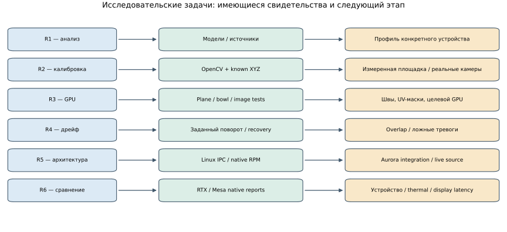

# Заключение диссертационного исследования

Для темы «Исследование и разработка системы отображения и методик калибровки функции интерактивного кругового обзора ТС для ОС Аврора» подготовлены Linux-прототип, теоретическая база и набор синтетических проверок. Commit audit от 09.10.2026 выявил, что часть свежих исследовательских скриптов измеряет не те величины, на которых основаны ранние выводы. Поэтому это заключение предварительное: ниже отделены реализованные компоненты от ещё не подтверждённых исследовательских результатов. План исправления — [[../TODO]], аудит — [[planning/AUDIT]].

1. **Теоретические основания и моделирование:** Систематизированы модели широкоугольных камер и реализованы synthetic fits Kannala-Brandt, Brown-Conrady и Scaramuzza. Результат относится к заданным математическим моделям; выбор модели для физической оптики не подтверждён.
2. **Алгоритмы слияния и геометрия поверхностей (серия E-STITCH-01):**
   - Реализованы и экспериментально сопоставлены 7 алгоритмов слияния (`hard_best_angle`, `edge_feather`, `angular_feather`, `seam_distance_feather`, `graph_cut_seam`, `multi_band`, `graph_cut_multi_band`) на 6 поверхностях-носителях (`plane`, `bowl`, `dome_floor`, `cylinder_floor`, `cube_floor`, `burger_like`);
   - Историческая 84-конфигурационная offline matrix имела некорректные seam/ghost proxies и label `graph_cut_seam`, который тогда не означал graph-cut optimizer. В текущем native коде реализованы binary cuts и переключаемый multilabel alpha-expansion, проверенные independent exhaustive controls (§4.46); историческое замечание не описывает нынешний solver;
   - Выполнены native сравнения пяти носителей при сопоставимом mesh budget, independent paired RGB/ID/visibility, refinement и floor/shell strata. Controlled height/range серии выявляют сильные геометрические ошибки поднятых объектов даже при известной фактической калибровке (§§4.53–4.55). Универсальный алгоритмический рейтинг не установлен; полная память, новые scene families и target trials остаются открытыми.
3. **Независимый эталон качества и валидация GPU Readback:**
   - Реализован analytic oracle prototype, но его дорожная разметка не совпадает с Blender RGB fixture; SSIM/PSNR comparison не является валидной оценкой качества до унификации scene truth;
   - Native core/raster/SV01 parity проверены отдельными controls: [[validation/NATIVE_FUSION]]. Historical analytic RGB similarity не является доказательством качества реконструкции независимой сцены; актуальные scene comparisons используют paired Blender truth.
4. **Методика калибровки и пороги Quality Gate:**
   - Реализован synthetic Joint Bundle Adjustment и held-out gate workflow; точность ограничена построенной моделью/наблюдениями;
   - Пороговые значения gate заданы, но не откалиброваны на реальных измерениях и не являются физически обоснованными.

| Задача | Достигнутый результат | Статус |
|---|---|---|
| R1: анализ и теория | Главы 1–2, математические модели проекции, обзор Burger model | Выполнено |
| R2: модели дисторсии и калибровка | Synthetic KB/RadTan/Omni fits, Joint Bundle Adjustment, PnP, server gate | Частично: production detector/solver проверены на синтетических PNG (§4.29); physical observations/пороги не подтверждены |
| R3: 3D-носители и слияние камер | 6 offline carriers, 5 native carriers, 7 native modes, budget/refinement/lateral/controlled height screens | Частично: native корректность проверена; поднятые объекты и natural correspondence остаются проблемой, независимый scene-family holdout не выполнен |
| R4: контроль смещения и оракул | Scene Truth prototype, body mask, temporal script | Частично: парный 3-frame rig-motion опыт проверен; длинные клипы, object correspondence и drift diagnostics не завершены |
| R5: архитектура и интеграция | Linux C++17 ядро, EGL Surfaceless, сервер, `sv-client-lib` | Частично: multi-session, полноценный ConfigService и Aurora acceptance открыты |
| R6: доказательные испытания | CTest, GPU readback, synthetic sweeps | Частично: pass-ы покрывают кодовые проверки, не целевое качество/физические условия |

*Рисунок 5.1 — Трассировка исследовательских задач к результатам работы.*

Полученные компоненты задают основу для дальнейшего исследования и интеграции. Окончательные выводы можно формулировать после исправления экспериментов, получения независимых/физических данных и проверки на целевой ОС. Источники и текущие материалы приведены в [[diploma/01_THEORETICAL_FOUNDATIONS]], [[diploma/02_REQUIREMENTS_AND_METHODS]], [[diploma/03_PROTOTYPE_IMPLEMENTATION]] и [[diploma/04_EXPERIMENTAL_STUDY]].

Повторные resolution/exposure/object серии для `validity_zero_extension_v2` приведены в §4.43 и [[validation/STITCH_MASK_FOLLOWUP]]. Они устраняют долг пересчёта после исправления масок, но используют прежние входы и не заменяют независимый holdout, физические наблюдения или проверку на Авроре.

В §4.44 дополнительно выявлены яркостные ореолы zero-extension pyramid blending на одинаковых наблюдаемых цветах и реализован переключаемый native normalized-support вариант. 72 контролируемых сочетания сохраняют постоянный цвет с максимальной ошибкой 1.788139e-7 в linear RGB. Это подтверждает инвариант в заданных controls, но не превосходство на независимых уличных сценах; default и оба варианта сохранены для дальнейшей ablation.

Серверная textured ablation (§4.45) уточнила предыдущий вывод. На двух прежних позах normalized уменьшил общую RGB MAE во всех 20 парных условиях, но IoU coded target ухудшилась в шести. На девятикадровой moving-target серии RGB ухудшилась в четырёх из 18 пар, IoU — в восьми. Следовательно, constant-field инвариант не обосновывает универсальный выбор normalized и не устраняет геометрическое искажение поднятых объектов. Реализованный native многокадровый runner с capture и проверяемым восстановлением настроек позволяет продолжать сравнение серверных кандидатов; независимые scene families/holdout, проверка multilabel candidate и целевая квалификация остаются необходимыми.

В §4.46 реализован и проверен native multilabel weighted-Potts кандидат с переключением через серверный протокол. Все512 binary expansion moves совпали с exhaustive oracle, но global optimum достигнут только в125/128 small graphs; сохранён контрпример60 против52. Первый paired server screen дал небольшие неоднозначные quality эффекты и дополнительные334–344ms CPU на текущем Linux/Mesa стенде. Это результат исследования ограничений, а не доказательство превосходства или realtime готовности; legacy default сохранён.

Frozen follow-up (§4.47) на трёх новых экземплярах улицы с отклонениями монтажа дал RGB улучшение в4/12 пар и ухудшение в8/12, дополнительные769–958ms median fusion CPU. Истинная perturbed calibration известна: результат относится к сшивке, не к точности её восстановления. Это подтверждает необходимость отделять оптимизацию surrogate energy от качества изображения и сохранять legacy default до более широких испытаний; natural-object truth, независимые семейства сцен, длинные clips и целевой стенд остаются открытыми.

В §4.48 проведён первый carrier screen при сопоставимом mesh budget:120 native условий,3196–3208 active triangles и общие vertex/position-index buffer ceilings. Конфликт метрик сохраняется: bowl увеличил общую RGB MAE во24/24 парах относительно dome, хотя coded-target IoU улучшилась в20. Это результат для заранее фиксированных profiles на одном street family, не универсальное ранжирование форм. Полная память/compute не уравнены; нужны budget convergence, ground/raised/shell ROI, другие views и scene families.

Finite mesh-refinement screen (§4.49) уточнил влияние дискретизации:360 условий, включая240 новых,118/120 medium outputs ближе к fine. Но fine улучшил independent-truth RGB MAE только в92/120 парах, а coded IoU ухудшил в10. Bowl чувствительнее остальных; local medium/fine RGB8 channel delta достигает72 при малом среднем error. Это не asymptotic convergence certificate или автомобильный acceptance threshold; spatial ROI, другие views/resolutions и физические данные остаются необходимыми.

Post-hoc ROI анализ (§4.50) выявил ограничение общей RGB MAE:89.24–90.70% interior ROI занимает дорога, узкий coded pole полностью исключён boundary suppression. Bowl ухудшает road RGB во24/24 medium парах, но улучшает other_scene interior/boundary во24/24. Поэтому одно aggregate число не определяет лучший носитель; нужны раздельные spatial/силуэтные критерии. Semantic classes не заменяют physical-height truth, ghost correspondence и carrier-shell coverage.

Геометрическая проверка §4.51 показала, что historical view почти не исследовал shell:0.203–0.325% кадра и0.143–0.428% прежней RGB ROI. Боковой view увеличивает shell representation до42.608–43.944%, а paired RGB truth для него подготовлен на следующем этапе (§4.52). Поэтому прежние carrier comparisons сохраняются как результат преимущественно для пола; вывод о лучшей оболочке вокруг наблюдателя пока не подтверждён: [[validation/CARRIER_COVERAGE]].

Парный lateral follow-up §4.52 закрыл недостаток представления оболочки в прежнем ракурсе:120 quality conditions с новым independent Blender truth и побитно прежними camera inputs. На common-shell ROI dome имеет меньшую RGB MAE, чем cylinder/cube, во24/24 парах с каждым, но это результат одного view/street family. Незаполненный background plane иногда получает меньшую MAE, чем искажённая оболочка, поэтому средняя RGB-ошибка недостаточна для выбора носителя. Низкая coded IoU и растянутые raised-object textures требуют controlled parallax/height и correspondence исследования; normalized улучшил aggregate60/60, но shell только42/60, с4 ухудшениями. Итоговое качество решения пока не подтверждено: [[validation/CARRIER_LATERAL]].

Controlled follow-up §§4.53–4.55 отделил высоту объекта и clipping от общей street scene. Первая серия240 native условий дала нулевую full IoU поднятого target во160 случаях; повторная conditional оценка сохранила отрицательный результат на source-visible support. Новый fully framed screen480 условий на двух mount seeds исключил clipping полного box: margin≥10.179px, direct RGB между rigs побитно одинаков. Full IoU поднятого target0 во320 условиях, conditional IoU0 в280 определённых случаях и undefined40 из-за пустого visible support. Normalized снижает aggregate RGB MAE во240/240 парах новой серии, но ни разу не улучшает object IoU. Эти результаты показывают ограничение выбранного единого носителя/проекции; они не подтверждают универсальный выбор blend algorithm и не объясняются только обрезанием эталонного кадра. Требуются geometry-versus-sampling ablation, optical-height/baseline и natural correspondence; реальная Aurora проверка по-прежнему отсутствует: [[validation/PARALLAX_FRAMED]].

Парный cubemap sampling control §4.56 сохраняет низкий пространственный результат при256→512: все320 raised full IoU остаются0, хотя все480 RGBA изменяются. Direct RGB/ID/visibility, config/poses и binaries подтверждённо совпадают между разрешениями. Недостаточная детализация cubemap256 не объясняет провал сама по себе; sensor/output sampling, correspondence и carrier geometry ещё не разделены полностью. Ground IoU имеет59 улучшений/101 ухудшение; aggregate RGB MAE228 улучшений/252 ухудшения, поэтому монотонное улучшение и сходимость не подтверждены. Эти зависимые synthetic conditions не дают universal ranking или целевую hardware гарантию: [[validation/PARALLAX_SAMPLING]].

Output-resolution follow-up §4.57 при побитно прежних sources также сохранил320 нулевых raised full IoU при320×180→640×360. High conditional score стал определённым во всех480 условиях:40 прежних undefined превратились в определённый0, поскольку independent640 truth обнаружил tiny visible surfaces. Это показывает чувствительность sampled visibility к direct ray grid и не допускает интерпретацию low0visible как доказанную непрерывную occlusion. High8/high32component policies совпали480/480; near-z080 остаётся смещённым на28.5–33.2% высоты output. Недостаточное выходное разрешение не объясняет проблему само по себе; fixed pixel-unit fusion parameters/ROI меняют физический support, поэтому проверка fisheye-resolution выполнена отдельно в §4.58; чистая geometry attribution всё ещё требует source/triangle correspondence controls. [[validation/PARALLAX_OUTPUT]].

Fisheye-resolution follow-up §4.58 при cubemap512/output640×360 и неизменном angular support также сохранил320 нулевых raised full/conditional overlaps. Все480 RGBA изменились; source coded pixels выросли примерно в4 раза, но near-z080 смещение остаётся28.7–33.1% высоты кадра. Ground full IoU30 улучшений/130 ухудшений, RGB MAE55 улучшений/425 ухудшений: увеличение входной сетки само по себе недостаточно. Independent direct RGB/ID/visibility и source cubes совпали побитно, бинарники/device прежние; повторный полный парный аудит воспроизводится побитно. Это контроль full-pipeline sensitivity с fixed source-edge pixels, не новый сенсор или доказательство сходимости/исключительно геометрической причины. Следующий приоритет — native source-surface correspondence/triangle-hit, затем optical-height/baseline и независимые natural scenes. [[validation/PARALLAX_SENSOR]].

Для дальнейшего разделения причин в §4.59 добавлен native carrier-position measurement layer: координата фактического depth-tested треугольного носителя, а не идеальной поверхности.1343 выбранных rays/backend сверены независимым C++ intersection oracle на NVIDIA/Mesa; finite raster precision требует fixture-specific допусков.40 прежних native conditions сохраняют обычный RGBA, hybrid inspection также прошёл composition/wire parity. Это подтверждает работоспособность измерительного слоя, но не качество сшивки и не завершение source-surface correspondence: source UV/contributing support, independent scene surface, triangle identity/coverage и клиентский diagnostic workflow ещё нужны. [[validation/CARRIER_POSITIONS]].

Native diagnostic API расширен координатами выборки четырёх камер и причинами её отклонения (§4.60). Проверки Mesa/NVIDIA и hybrid validity подтверждают инженерную согласованность capture с рендерером; они не устанавливают соответствие source-scene surface и не закрывают исследование качества сшивки.

§4.61 дополняет измерительную цепочку native capture весов уровней и reconstructed color contributions для hybrid fusion. Проверки отделяют локальную source validity от нелокального вклада multiband; они не устанавливают scene correspondence и не дают нового рейтинга качества алгоритмов.

В первом native source-surface pilot (§4.62) локализован конкретный механизм raised-object failure: на76 source-visible pixels target допустимая выборка camera3 попадает в дорогу, потому что выбранный carrier point находится около пола, а не на поверхности объекта. Результат сохраняется на48 visible interior pixels и пяти carriers, при optical projection residual<0.00009px и совпадающих archived server baseline RGBA hashes. Это обосновывает необходимость проверки ограничений floor-based correspondence; пока результат относится к одному edge-feather кадру, не является исправлением и не обобщается на остальные algorithm families/сцены/Аврору.

Follow-up §4.63 проверил20 native условий: две высоты объёмного box, два коррелированных кадра и пять carriers. Выбор дороги вместо поднятого target повторился после translation автомобиля; ground-contact target уменьшает source UV displacement, но добавляет попадания в неверную точку того же объекта. Все20 RGBA hashes совпали с archived server frame baselines. Это усиливает локальное объяснение correspondence failure и показывает недостаточность только RGB/object-ID overlap, но не является исправлением, planar control либо независимым подтверждающим исследованием. [[validation/SOURCE_CORRESPONDENCE_CONTROLS]].

§4.64 добавляет isolated planar geometry control: при loose surface criterion2cm все1640 valid pairs exact-floor carriers совпадают с direct plane, в отличие от объёмного target. Однако строгие заранее заданные пороги0.1mm/0.01px прошли лишь5/8 условий;3 failure сохранены и требуют raster-position/virtual-ray precision follow-up. Optical projection residual<0.000082px. Это геометрический контроль без planar RGB truth, не исправление height failure и не полный quality verdict. [[validation/PLANAR_CORRESPONDENCE]].

Парный precision control §4.65 с тем же native binary/config/inputs дал exact-floor strict pass5/8 на NVIDIA и8/8 на Mesa. Модель только float32 MVP rounding существенно меньше observed residual; малая ошибка зависит от backend, но конкретная raster/interpolation причина не доказана. Это не исправление высотных искажений: приоритет остаётся у displaced/hybrid source attribution. [[validation/PLANAR_PRECISION]].

Displaced attribution §4.66 локализует вторую сторону height/occlusion failure: все52720 proxy pixels имеют nearest virtual road hit, но51556 имеют source target hit перед carrier point. Target sample получает normalized edge weight0.5; независимая bilinear/edge color reconstruction отличается от native менее1 RGB8 LSB.1164 point-ray/RGB mismatch pixels сохранены для footprint/resampling проверки. Это объяснение смещения в edge-feather fixture, не mitigation или hybrid/generalization verdict. [[validation/DISPLACED_CORRESPONDENCE]].

Matched hybrid follow-up §4.67 проверил60 native условий с exact carrier/UV/status parity и прежним edge fallback. Signed native bands reconstruct camera contributions через SciPy с max error1.49e−8, ordinary RGBA — в пределах1LSB. Ни один вариант не восстановил raw target-color overlap в expected ROI. Multiband имеет nonlocal contributions при invalid local camera, поэтому local weights не заменяют attribution; это также не доказательство правильного scene correspondence. [[validation/HYBRID_CORRESPONDENCE]].

Four-texel follow-up §4.68:1024 из1164 прежних RGB/point-ray mismatches имеют положительно взвешенный соседний target-center texel. У140 chroma присутствует без target texel-center hits; причина upstream filtering требует отдельного опыта. Это не улучшение изображения и не устранение height failure. [[validation/SOURCE_FOOTPRINT]].

§4.69 проследил140 остаточных pixels до actual cube PNG:256 source texel реконструируются точно;135 output pixels имеют cube-center target support,5 — только support внутри площади cube pixel. Это не causal Eevee filter reconstruction и не устранение height failure. [[validation/CUBE_FOOTPRINT]].
