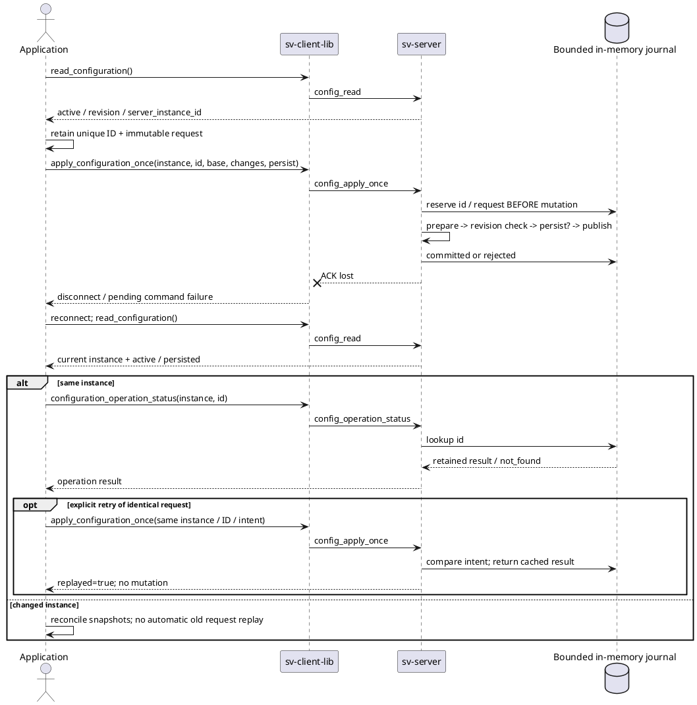

# ConfigService: журнал операций и восстановление после потери ACK

14.10.2026. Реализован Linux-срез `config_operations_v1` поверх текущего SV01.
Он дополняет [[engineering/CONFIG_SERVICE]], не изменяет прежний `config_apply` и не включает
автоматический retry в библиотеке. Protobuf migration остаётся отдельной задачей.

## Контракт и границы

`config_read` теперь возвращает дополнительный `configuration.server_instance_id`: случайный
128-bit ID процесса, hex32. `ConfigurationSnapshot::server_instance_id` содержит его либо пустую
строку для прежнего сервера. Ориентироваться также на capability `config_operations_v1`.

Две новые type20 команды:

```json
{"command_id":"45","type":"config_apply_once","server_instance_id":"0123456789abcdef0123456789abcdef","operation_id":"random-client-operation-000001","base_config_revision":"7","changes":{"fusion":{"mode":"multi_band"}},"persist":false}
```

```json
{"command_id":"46","type":"config_operation_status","server_instance_id":"0123456789abcdef0123456789abcdef","operation_id":"random-client-operation-000001"}
```

Operation ID:16–64 ASCII characters `[A-Za-z0-9_-]`; приложение должно генерировать уникальный
случайный ID и сохранять **до отправки** вместе с server_instance_id и неизменным intent
(base revision, replacement changes, persist). Новый command_id при повторе допустим.
Неподдерживаемый instance возвращает `configuration_server_instance_mismatch` до mutation.
Instance ID не является authentication credential. Журнал пока общий для доверенных подключений;
ownership/roles для будущих независимых клиентов требуют отдельной политики.

Новый запрос резервирует запись перед mutation, затем выполняет прежний ConfigService apply.
Тот же ID/intent возвращает retained результат; другой intent —
`configuration_operation_id_conflict`. Rejected результат тоже сохраняется: исправление ошибки
или диска не превращает повтор старого ID в новую попытку. Для намеренной новой попытки нужны
новый ID и актуальная revision после reconciliation.

Журнал ограничен **128 записями**, supplied changes ≤16KiB serialized JSON, error text ≤1024bytes.
Это ограничения содержимого, а не точный RAM budget C++ объектов. Нет eviction/TTL: новые ID при
заполнении отклоняются `configuration_operation_capacity_exhausted` до preparation/persistence;
прежние status/replay продолжают работать. Oversize — `configuration_operation_request_too_large`.
Изменяемая ёмкость/безопасное освобождение записей пока не реализованы; этот лимит учитывать в
длительных сценариях, а не незаметно обходить сменой ID или старым config_apply.

Журнал живёт в render thread, сохраняется при disconnect/reconnect, **не сохраняется на диск**.
После restart меняется instance ID и старый запрос отклоняется. Даже persist=true сохраняет
конфиг, но не durable journal. Это at-most-once apply в пределах одного процесса, не гарантия
exactly-once после crash/power loss. При новом instance нужно заново читать active/persisted и
решать, требуется ли новая операция; нельзя автоматически подставлять новый instance в старый запрос.

## Ответы

Accepted type21 apply содержит `configuration_operation`:

```json
{"schema_version":1,"scope":"config_store_operation","server_instance_id":"0123456789abcdef0123456789abcdef","operation_id":"random-client-operation-000001","state":"committed","replayed":false,"base_config_revision":"7","revision":"8","persisted":false,"reason":""}
```

Повтор apply: replayed=true. Status query: replayed=false и accepted=true даже для retained
rejected или not_found. Apply с retained rejected: accepted=false, обычный ACK reason и nested
state=rejected/reason, persisted=false, без revision. Pending зарезервирован для незавершённого
исхода; он никогда не разрешает повторное выполнение. Нормальный синхронный executor завершается
committed или rejected. При unknown ID status содержит state=not_found и только identity/schema/
replayed, без base/revision/persisted/reason.

Nested revision — **историческая revision commit**, а ACK config_revision/state_revision описывают
текущий сервер: они могут уже быть больше. Повтор/чтение статуса не меняют revision, applied_command,
dirty, файл или mesh. Внутри experiment lease разрешены status и чтение retained result; новая
mutation записывается как rejected experiment_lease_conflict. Отдельная validation по-прежнему
не резервирует revision. Старый `config_apply` остаётся без operation-ID deduplication.

Сервер завершает запись terminal outcome до построения ACK. Ошибка отправки/потеря связи не
удаляет запись. Успех операции означает применённую конфигурацию, а не доставленный клиенту кадр.
Старый in-flight frame нужно release; выбирать новый по config revision согласно прежнему контракту.

## Процесс и API



Рисунок — Восстановление результата после потери ACK без повторного применения конфигурации.

Публичный API без Qt/OpenCV:
`apply_configuration_once(instance, operation_id, base_revision, changes, persist)`,
`configuration_operation_status(instance, operation_id)` и
`parse_configuration_operation(message)`. Последний разбирает также rejected ACK с retained
результатом; rejected ACK без nested result (wrong instance/conflict/capacity/invalid input)
обрабатывать как обычную ошибку. Parser проверяет schema, IDs, state, types, base+1 и
historical revision≤current ACK revision. Callback исполняется на worker; GUI переносит результат
в свой thread. Библиотека не хранит intent за приложение и сама запросы не повторяет.

Catalog schema2 прежнего config_apply сохраняет operation_ids_supported=false для **этой команды**.
Две новые команды обнаруживаются по отдельной HELLO capability; каталог групп не заменяет полный
каталог команд [[engineering/PROTOCOL_SCENARIOS]]. GUI fusion/surface reconciliation реализован: [[engineering/CONFIG_SERVICE#GUI sv-simulator: формы и восстановление результата]].

```sh
build/svctl --unix /tmp/sv-prototype command config_read
# Подставить instance и base revision из ответа; ID создать один раз и сохранить:
build/svctl --unix /tmp/sv-prototype command config_apply_once --params '{"server_instance_id":"INSTANCE_FROM_READ","operation_id":"unique-operation-000001","base_config_revision":"0","changes":{"fusion":{"mode":"angular_feather"}},"persist":false}'
build/svctl --unix /tmp/sv-prototype command config_operation_status --params '{"server_instance_id":"INSTANCE_FROM_READ","operation_id":"unique-operation-000001"}'
```

## Проверки

Шесть новых GTest: deduplication/conflicting intent, retained failure, capacity без eviction,
instance/ID/size/revision bounds, неисполняемый pending после нестандартного exception и malformed
client results. Всего configuration GTest21. Live output-products suite14 cases включает отправку
без чтения ACK, наблюдение persistence, disconnect/reconnect/status/replay, historical result после
нового commit, lease и disk-failure retention, restart namespace. Реальный C++ consumer проверяет
apply→replay→status через typed API по Unix и TCP. Полная сборка включает оба Qt-клиента.

Selected CTest configuration_snapshot/experiment_lease/output_products: **3/3 за7.49s**, включая окончательный disk-retention fixture. Полная suite60 в этом срезе повторно не запускалась.
Sandbox запрещает socket bind; live tests запускаются вне sandbox. Aurora и durable recovery
этим Linux-срезом не подтверждены.
