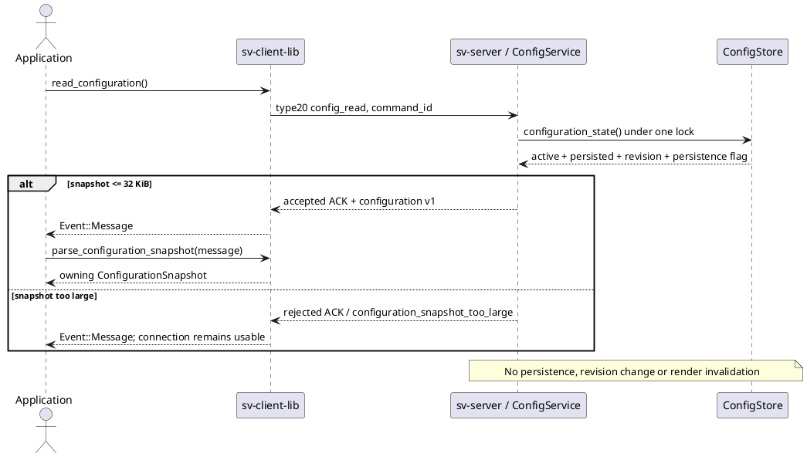
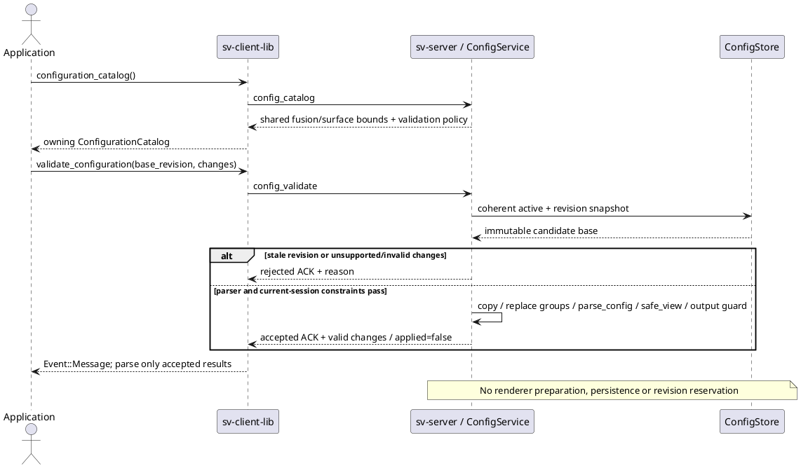
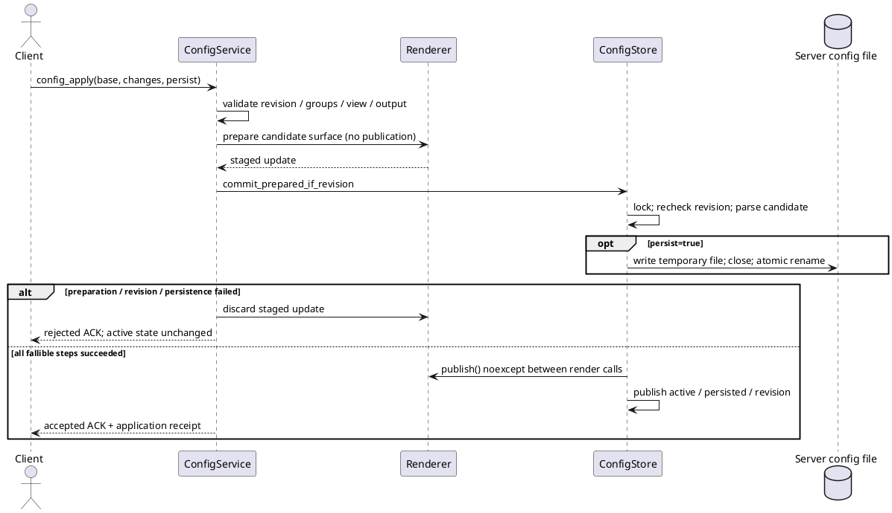

# ConfigService: чтение, проверка и атомарное применение

14.10.2026. Продуктовые шаги после bounded research [[validation/TARGET_OVERLAP]].
Серверный `ConfigService` предоставляет read, discovery, проверку и атомарное применение групп fusion/surface с явным выбором сохранения. Operation IDs/status, другие root groups и restart orchestration ещё не реализованы. Временные configure_fusion/surface
и persistent calibration apply сохраняют прежние контракты.

## Wire-контракт config_read_v1

HELLO capability: `config_read_v1`. Запрос SV01 type20:

```json
{"command_id":"42","type":"config_read"}
```

Прежний type21 ACK дополнен `configuration`:

```json
{
  "schema_version":1,
  "scope":"config_store",
  "revision":"7",
  "active":{},
  "persisted":{},
  "has_runtime_changes":true,
  "persistence_configured":true
}
```

`active`/`persisted` в примере сокращены: в реальном ответе это полные ConfigStore effective JSON.
Active, persisted и revision извлекаются **под одним mutex**. Runtime changes означает JSON
inequality, а не просто ненулевую revision. Persisted — cached baseline последнего успешного
store persistence или начальной загрузки; файл не перечитывается на каждый запрос.
Persistence configured указывает наличие серверного persistence path, не гарантирует доступность диска.

Scope `config_store` намеренно исключает текущий session view, pause/output selection,
фактическое состояние listeners и launch-only CLI overrides `--ipc-dir`/`--manifest`/`--loop`.
Для текущего view/lease/runtime state использовать `state`; не считать snapshot полным паспортом
запущенного процесса. Для discovery fusion/surface использовать отдельный config_catalog ниже.

Read доступен и при удерживаемом/recovering experiment lease без lease token. Не меняет
config_revision/state_revision/applied_command, не помечает render dirty и не сохраняет файл.
Две stream-связи control/data по-прежнему обязательны; control-only и несколько клиентов не добавлены.

Если serialized configuration превышает32KiB (половину max_header), сервер возвращает rejected
ACK с reason `configuration_snapshot_too_large`, без configuration. Это консервативный лимит
с резервом под обычный ACK. Конфигурация не усекается, соединение сохраняется. Pagination или
отдельный snapshot payload пока отсутствуют; SV01 framing version не меняется.



Рисунок — Реализованный сценарий согласованного чтения. Callback выполняется на worker библиотеки;
GUI переносит данные в свой thread. UI формы редактирования не должны напрямую менять файлы сервера.

## C++ и CLI

Публичный installed header `sv/client_configuration.hpp` не требует Qt/OpenCV/GLM.
`Client::read_configuration()` возвращает command ID и использует прежнюю bounded queue/reconnect
политику. В callback для соответствующего accepted ACK:

```cpp
const auto snapshot = sv::client::parse_configuration_snapshot(*event.message);
// snapshot.revision: uint64_t, without floating-point conversion
// snapshot.active / persisted: owning boost::json::object copies
```

Parser проверяет ACK type/accepted/empty payload, decimal IDs, schema/scope, равенство nested revision
и config_revision, типы объектов/bools и consistency change flag. Не выполняет полную серверную
semantic validation Config; неизвестные дополнительные поля допускаются для additive extensions.

```sh
build/svctl --unix /tmp/sv-prototype command config_read
build/svctl --tcp 127.0.0.1 53101 53102 command config_read
```

JSON-ввод для этого запроса не нужен. GUI binding/read forms — следующий этап, не свойство текущего UI.

## Проверки первого read-среза и следующие шаги

5 новых GTest проверяют active/persisted, отсутствие read-side revision changes, coherent
concurrent publication, oversize rejection, owning typed result/uint64 max и malformed responses.
Live integration проверяет runtime-only update/read при lease, неизменность файла, oversize error
без disconnect и реальный typed C++ client по Unix/TCP с capability discovery.

Сборка server/client library/svctl/consumer и selected CTest
configuration_snapshot/config_store_persistence/client_output/experiment_lease/output_products:
5/5 за5.92s (output_products содержит8 Python integration cases). Первый sandbox run не мог bind
сокеты; проверка повторена вне sandbox. Full suite и Aurora в этом шаге не проверялись.

Следующий этап после реализованного ниже config_apply: operation IDs/status; затем
подключить формы GUI и сценарный runner. API должен различать временные settings, persisted
settings, session state и restart-required settings. Исторические configure_* не превращать
в автоматически сохраняемые операции без явного контракта.

## Discovery config_catalog_v1: исходная схема 1

Capability `config_catalog_v1`, команда `config_catalog`, ACK field `configuration_catalog`:

|Поле|Контракт v1|
|---|---|
|schema_version / scope|1 / config_store_groups|
|operations|config_read, config_catalog, config_validate|
|replaceable_groups|fusion, surface|
|changes_semantics|replace_each_supplied_group|
|omitted_groups|keep_active|
|base_config_revision_required|true|
|validation_scope|parse_config_and_current_session|
|prepares_renderer / reserves_revision / generic_apply_supported|false / false / false|
|persistence|none|
|fusion / surface|Общие каталоги runtime параметров, без дублирования bounds в сервисе|

Это каталог параметров/политик, **не полный JSON Schema всех root groups**. Другие группы
(cameras/source/connections/output/runtime/vehicle/view) через config_validate пока не изменяются.
Surface.geometry_fields описывает четыре geometry types: required geometry fields, units,
числовые integer-cell bounds и текстовые cross-field constraints. Optional reference height,
local support и source occlusion описаны прежними разделами surface catalog. Поле type задаёт
discriminator и обязательно в replacement. Plane — rectangular_bowl_v1 с corner_height_m0.
Общий parse_config остаётся authoritative validator для связей параметров, optics и budgets;
GUI не должен считать static field hints достаточным доказательством допустимости.

`surface_catalog` использует тот же helper и получает additive geometry_fields. Fusion catalog v5
сохраняет прежний контракт. Команды чтения/каталога/validation не требуют lease token и не меняют состояние.

## Проверка config_validate_v1

Capability `config_validate_v1`. Запрос type20:

```json
{
  "command_id":"43",
  "type":"config_validate",
  "base_config_revision":"7",
  "changes":{"fusion":{"mode":"multi_band","pyramid_boundary":"normalized"}}
}
```

Каждый supplied group полностью заменяет соответствующий active JSON block; omitted groups
сохраняются. Поэтому mode обязателен в fusion, а остальные omitted fusion parameters получают
defaults общего parser. Surface должен содержать type и все required fields своего geometry type.
Пустой changes, неизвестные groups и неверные типы/поля отклоняются. Это не JSON merge patch.

После декодирования changes object сервис получает coherent active/revision snapshot. При stale
base revision проверка сразу отклоняется; затем candidate копируется и проходит parse_config,
safe_view для **текущего session view**, color requirement выбранного intermediate output.
Проверяются в том числе CPU research pixel budget и прежние constraints virtual_camera из Config.
Renderer allocation/mesh preparation/driver checks не выполняются: valid не гарантирует успешную
будущую GPU preparation или запись на диск. Validation не резервирует revision и не выдаёт apply token.

Успешный ACK accepted=true содержит configuration_validation:

```json
{
  "schema_version":1,
  "scope":"config_store_groups",
  "base_config_revision":"7",
  "valid":true,
  "changes":{"fusion":{"mode":"multi_band","diagnostic":"color","edge_width_px":24,"angle_power":2,"smoothness_weight":0.1,"pyramid_levels":4,"pyramid_boundary":"normalized"}},
  "applied":false,
  "renderer_prepared":false
}
```

Fusion возвращается с defaults через общий fusion_settings; surface — проверенный complete input
block, без materialization всех optional defaults. При отказе accepted=false, reason и обычные
state fields; configuration_validation отсутствует. Стабильные reasons этого шага:
stale_config_revision, configuration_changes_empty, configuration_group_unsupported, view_clearance
и прежние *_requires_color. Ошибки parse_config возвращают прежний текст parser; structured
field-level errors/локализация ещё не добавлены.

Во время lease validation разрешён без token: active/persisted/revision/file и paused-render dirty
не меняются. При config_apply выполняются повторная проверка revision, session constraints, preparation и явная persistence policy. Отдельная validation не резервирует revision для будущего apply.



Рисунок — Реализованный discovery/validation workflow. Приложение выбирает допустимые параметры
из catalog; отрицательный результат отображает по ACK reason, не вызывает success parser.

Typed API: Client::configuration_catalog(), Client::validate_configuration(base_revision, changes),
parse_configuration_catalog(), parse_configuration_validation(). Owning results не зависят от Qt,
OpenCV или core Config; parsers проверяют schema/policy/revision и не подменяют semantic validation.
Строгий parser не позволяет принять applied=true/renderer_prepared=true как validation-only result.

```sh
build/svctl --unix /tmp/sv-prototype command config_catalog
# base_config_revision взять из config_read, не считать постоянным нулём:
build/svctl --unix /tmp/sv-prototype command config_validate --params '{"base_config_revision":"0","changes":{"fusion":{"mode":"multi_band"}}}'
```

Новые5 GTest (всего10 configuration tests) проверяют replacement/defaults, отсутствие изменений,
stale/empty/unsupported/typed bounds, current view/output guards, research budget, shared catalog
и malformed typed responses. Live tests проверяют все7 fusion modes и invalid matrix при lease,
неизменные file/revisions/output и отсутствие нового paused frame. Реальный C++ consumer выполняет
read→catalog→validate по Unix и TCP. Selected CTest5/5 за6.30s; output_products содержит9 integration
cases. Full regression и Aurora в этом шаге не запускались.

## Атомарное применение config_apply_v1

Capability `config_apply_v1`; команда type20, required `persist` **boolean**:

```json
{"command_id":"44","type":"config_apply","base_config_revision":"7","changes":{"fusion":{"mode":"multi_band"}},"persist":false}
```

Replacement semantics совпадают с validate. `persist=false` изменяет только active; `persist=true`
сохраняет **весь результирующий active snapshot**, включая предыдущие временные изменения других
групп. Это не выборочное сохранение supplied groups. Применение запрещено во время любого active,
restoring или failed experiment lease, в том числе его владельцу. Read/catalog/validate остаются доступны.

Accepted type21 содержит обычные state fields и:

```json
{"configuration_application":{"schema_version":1,"scope":"config_store_groups","base_config_revision":"7","revision":"8","applied":true,"persisted":false}}
```

API: `Client::apply_configuration(base_revision, changes, persist)`;
`parse_configuration_application(message)` возвращает owning typed receipt. Новая config_revision
и state_revision увеличиваются по одному разу, render помечается dirty. Config revision начинается
с нуля при новом запуске процесса; нельзя использовать cached revision после reconnect без чтения.

Текущий config_catalog имеет **schema_version=2**, прежнюю capability `config_catalog_v1`, четыре
operations, generic_apply_supported=true, persistence=explicit_runtime_or_snapshot и apply_policy
(between_render_calls/prepares_before_persistence=true; allowed_during_experiment/
operation_ids_supported/automatic_retry=false). Root prepares_renderer/reserves_revision=false
описывают validation, а не apply. Клиентский parser понимает схемы 1 и 2; apply_supported=false
для прежней схемы 1. Catalog не является полным JSON Schema всех root groups.



Рисунок — Подготовка, сохранение и публикация конфигурации; при отказе стадия публикации не выполняется.

Mesh preparation не меняет активные meshes и не загружает заново cached camera frames. Fusion-only
apply не перестраивает mesh. `Renderer::SurfaceUpdate` живёт только в render thread и не должен
пережить Renderer. После успешной подготовки повторный revision check защищает от stale candidate.
Success receipt выделяется до commit; публикация не выполняет fallible allocation или GL preparation.
Ошибки подготовки/rename/stale revision оставляют прежние config, renderer и persisted snapshot.
Atomic rename обеспечивает атомарную замену файла при работающем процессе; **fsync и гарантия
сохранности после сбоя питания не реализованы**.

При потере ACK клиент не повторяет запрос автоматически: operation IDs/status ещё отсутствуют.
Нужно перечитать config/state и согласовать следующий запрос. Таймаут не доказывает отсутствие commit.

```sh
build/svctl --unix /tmp/sv-prototype command config_read
# Подставить актуальную revision; persist=true сохраняет полный active snapshot:
build/svctl --unix /tmp/sv-prototype command config_apply --params '{"base_config_revision":"0","changes":{"fusion":{"mode":"multi_band"}},"persist":false}'
```

Проверено 14.10.2026: полная сборка, включая Qt-клиенты; Mesa CTest **60/60 за78.10s**.
Configuration GTest **15/15**, отдельный native renderer test проверяет prepare/discard/commit и
cached uploads. Output-products integration содержит12 cases: runtime/persist/restart, disk rename
failure с неизменным RGBA, lease rejection, stale revision и typed Unix/TCP read→validate→apply.
Target Aurora и crash durability этим Linux-прогоном не подтверждаются.
