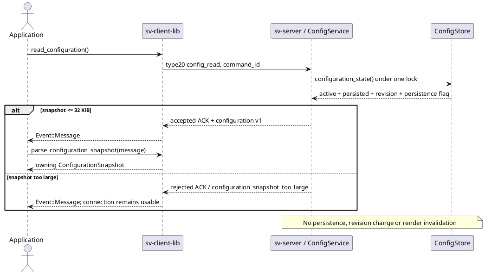

# ConfigService: реализованное чтение конфигурации

14.10.2026. Первый продуктовый шаг после bounded research [[validation/TARGET_OVERLAP]].
Серверный `ConfigService` предоставляет **только read**; general validate/update/apply/save,
operation IDs и restart orchestration ещё не реализованы. Временные configure_fusion/surface
и persistent calibration apply сохраняют прежние контракты.

## Wire-контракт config_read_v1

HELLO capability: `config_read_v1`. Запрос SV01 type20:

```json
{"command_id":"42","type":"config_read"}
```

Прежний type21 ACK дополнен `configuration`:

```json
{
  "schema_version":1,
  "scope":"config_store",
  "revision":"7",
  "active":{},
  "persisted":{},
  "has_runtime_changes":true,
  "persistence_configured":true
}
```

`active`/`persisted` в примере сокращены: в реальном ответе это полные ConfigStore effective JSON.
Active, persisted и revision извлекаются **под одним mutex**. Runtime changes означает JSON
inequality, а не просто ненулевую revision. Persisted — cached baseline последнего успешного
store persistence или начальной загрузки; файл не перечитывается на каждый запрос.
Persistence configured указывает наличие серверного persistence path, не гарантирует доступность диска.

Scope `config_store` намеренно исключает текущий session view, pause/output selection,
фактическое состояние listeners и launch-only CLI overrides `--ipc-dir`/`--manifest`/`--loop`.
Для текущего view/lease/runtime state использовать `state`; не считать snapshot полным паспортом
запущенного процесса. Это чтение, не schema discovery всех поддерживаемых изменений.

Read доступен и при удерживаемом/recovering experiment lease без lease token. Не меняет
config_revision/state_revision/applied_command, не помечает render dirty и не сохраняет файл.
Две stream-связи control/data по-прежнему обязательны; control-only и несколько клиентов не добавлены.

Если serialized configuration превышает32KiB (половину max_header), сервер возвращает rejected
ACK с reason `configuration_snapshot_too_large`, без configuration. Это консервативный лимит
с резервом под обычный ACK. Конфигурация не усекается, соединение сохраняется. Pagination или
отдельный snapshot payload пока отсутствуют; SV01 framing version не меняется.



Рисунок — Реализованный сценарий согласованного чтения. Callback выполняется на worker библиотеки;
GUI переносит данные в свой thread. UI формы редактирования не должны напрямую менять файлы сервера.

## C++ и CLI

Публичный installed header `sv/client_configuration.hpp` не требует Qt/OpenCV/GLM.
`Client::read_configuration()` возвращает command ID и использует прежнюю bounded queue/reconnect
политику. В callback для соответствующего accepted ACK:

```cpp
const auto snapshot = sv::client::parse_configuration_snapshot(*event.message);
// snapshot.revision: uint64_t, without floating-point conversion
// snapshot.active / persisted: owning boost::json::object copies
```

Parser проверяет ACK type/accepted/empty payload, decimal IDs, schema/scope, равенство nested revision
и config_revision, типы объектов/bools и consistency change flag. Не выполняет полную серверную
semantic validation Config; неизвестные дополнительные поля допускаются для additive extensions.

```sh
build/svctl --unix /tmp/sv-prototype command config_read
build/svctl --tcp 127.0.0.1 53101 53102 command config_read
```

JSON-ввод для этого запроса не нужен. GUI binding/read forms — следующий этап, не свойство текущего UI.

## Проверки и следующие шаги

5 новых GTest проверяют active/persisted, отсутствие read-side revision changes, coherent
concurrent publication, oversize rejection, owning typed result/uint64 max и malformed responses.
Live integration проверяет runtime-only update/read при lease, неизменность файла, oversize error
без disconnect и реальный typed C++ client по Unix/TCP с capability discovery.

Сборка server/client library/svctl/consumer и selected CTest
configuration_snapshot/config_store_persistence/client_output/experiment_lease/output_products:
5/5 за5.92s (output_products содержит8 Python integration cases). Первый sandbox run не мог bind
сокеты; проверка повторена вне sandbox. Full suite и Aurora в этом шаге не проверялись.

Далее: ConfigService schema/capability discovery с apply policy, side-effect-free validate,
revision-aware update, operation IDs/status, atomic persistence и frame-boundary apply; затем
подключить формы GUI и сценарный runner. API должен различать временные settings, persisted
settings, session state и restart-required settings. Исторические configure_* не превращать
в автоматически сохраняемые операции без явного контракта.
