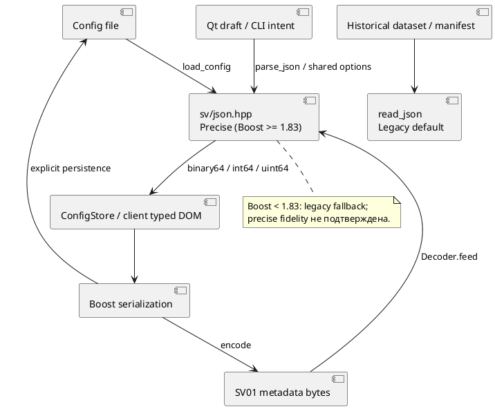

# Точность чисел в конфигурации и SV01

Для калибровки и воспроизводимости эксперимента важны исходные значения матриц и параметров.
Default Boost.JSON parser может изменить последние разряды double. Введена общая политика
в installed `sv/json.hpp`: `parse_json`, `json_parse_options`, `JsonNumberPolicy` и compile-time
`json_precise_numbers_available`. На Boost≥1.83 режим Precise выбирает `number_precision::precise`.
Boost описывает его как более точный, но более медленный режим; ускорение системы этим изменением
не заявляется. [Boost.JSON number_precision](https://www.boost.org/doc/libs/1_86_0/libs/json/doc/html/json/ref/boost__json__number_precision.html).
Режим появился в [Boost.JSON1.83 release notes](https://www.boost.org/doc/libs/1_83_0/libs/json/doc/html/json/release_notes.html).

## Воспроизведённая ошибка

До исправления GTest обнаружил изменение binary64 уже после первого encode→Decoder.feed:

| Контроль | Ожидалось | Получено до исправления |
|---|---|---|
| Исходное значение | `-1.1959916878056157e-7` | Другое соседнее binary64 |
| Биты double как uint64 | `13726986393446128461` | `13726986393446128460` |
| Расхождение | 0 ULP | 1 ULP |

Это regression-контрпример, а не оценка визуального влияния на сшивку. Сервер не должен
вносить дополнительную численную погрешность при простом обмене и сохранении настроек.
Точное чтение восстанавливает binary64, соответствующее десятичному представлению;
произвольная десятичная точность в double не появляется.

## Область применения

| Путь | Политика по умолчанию | Причина |
|---|---|---|
| SV01 `Decoder::feed` в сервере и SDK | Precise | Команды, calibration inputs, configuration snapshots и telemetry |
| `load_config(path)` | Precise | Матрицы при startup/restart и ConfigStore persistence |
| GUI `ConfigurationEditor` Qt JSON→Boost, RuntimeSettings | Precise | Сохранение чисел draft и runtime updates |
| svctl `command --params`, scenario JSON | Precise | CLI/research intent не округляется перед отправкой |
| sv-project stdin JSON | Precise | Координаты входных rays/points |
| Telemetry archive import | Precise | Единая политика вместо локального дублирования |
| Generic `read_json(path)` для dataset/manifest | Legacy | Явно сохранена прежняя интерпретация исторических данных |

`parse_config(boost::json::value)` не выполняет повторного текстового разбора и не может исправить
уже округлённые значения. SDK-пользователю, который сам создаёт DOM из текста, рекомендуется
`sv::parse_json(text)` вместо default `boost::json::parse(text)`. Изменение касается разбора;
существующая Boost serialization, SV01 framing, JSON field types, команды и size limits сохранены.
Все uint64 identities по-прежнему передаются decimal strings; обычные integer JSON values
сохраняют int64/uint64 тип.

```cpp
#include <sv/json.hpp>

const auto parameters = sv::parse_json(json_text); // Precise when supported.
const auto historical = sv::parse_json(json_text, sv::JsonNumberPolicy::Legacy);
const bool supports_precise = sv::json_precise_numbers_available;
```

Во внутреннем C++ API можно явно вызвать `load_config(path, JsonNumberPolicy::Legacy)` для
аудита прежнего численного поведения или `read_json(path, JsonNumberPolicy::Precise)` для
нового проверенного загрузчика. Это не переключатель сетевого сервера во время работы:
wire decoder всегда использует общую compiled policy.



*Рисунок J.1 — единая политика продуктовых JSON-путей и сохранённая граница legacy datasets.*

## Совместимость и исследовательские baseline

На Boost<1.83 поле `parse_options.numbers` отсутствует. Сохранён старый parser для совместимости
с minimum1.75; флаг available=false, precision-specific GTests пропускаются с причиной.
Отдельная сборка/приёмка с Boost1.75 и1.86 в этом шаге не выполнялась. Для заявленной точности
целевого RPM нужен Boost≥1.83, например предоставленный Aurora1.86; одного требования1.75
недостаточно для численной гарантии. Legacy-mode behavior проверено на текущем host Boost1.92.

Тексты configs, dataset assets и исторические reports не переписываются. При этом новый
`load_config` и SV01 decoder могут выбрать другое последнее значение binary64 из того же JSON.
Таким образом, новые compiled experiments используют изменённую численную политику; исторические
результаты не пересчитаны и их equality с новым build не заявлена. Для повторения фиксируйте
source/build fingerprint, версию Boost, config/dataset hashes и политику parser. Старый binary
или явный Legacy file API нужны для аудита прежнего parsing; смешивание старого клиента с новым
сервером не гарантирует fidelity всей цепочки. Точный reader не восстанавливает уже потерянные bits.

Qt хранит/сериализует числа своей моделью. Unit regression проверяет одну проблемную дробь
через QVariant→QJsonDocument→Boost→SV01. Это не доказательство сохранности всех binary64 в Qt,
знака -0 или uint64>2^53 в QVariant. Неизменяемые camera matrices проходят authoritative server
snapshot/ConfigStore и не редактируются этим GUI draft. Не подменять precision этого пути
утверждением о поддержке редактирования camera profile через ConfigService.

## Проверка

```sh
cmake --build build -j 4
ctest --test-dir build -R '^(json_number_precision|configuration_snapshot|config_store_persistence|svctl_options|simulator_runtime_errors)$' --output-on-failure
```

Новый `json_number_precision` содержит четыре GTest: десять encode/decode циклов для520 doubles
(восемь boundary/known values и512 детерминированных finite binary64), exact integer kinds/payload
и repeated wire bytes; десять config load→wire→persist→restart циклов с calibration translation;
явные Precise/Legacy APIs и неизменность default dataset loader; строгий JSON syntax.
Отдельные GUI и CLI regressions проверяют проблемную дробь. Installed SDK consumer собирается
с новым installed header и проверяет parse_json на startup.

Численное совпадение проверяется exact bits, а не EXPECT_DOUBLE_EQ с ULP-допуском. Для файлов
ConfigStore сравниваются effective DOM и параметры typed Camera. Старые persistence tests теперь
читают server config через `load_config`, а не через generic legacy dataset reader.

Остаются old-Boost и Aurora acceptance, дополнительные Qt cases, измерение overhead precise
parsing, формальная запись parser policy в experiment metadata и отдельный согласованный переход
исторических observation/dataset loaders. Полный исследовательский набор этим дополнением не закрыт.

Финальная проверка на Linux/Boost1.92: полная сборка успешна;13 выбранных CTest прошли. В первом unit наборе прошли8 checks; configuration_snapshot повторно прошёл1/1 за0,01 с после перевода старых test readers на load_config. Отдельный sources/client_transports/telemetry_ipc/output_products набор —4/4 за34,79 с. Все24 PlantUML blocks этого файла/главы3 прошли local1.2026.6 -checkonly. Полный65-test suite, Boost1.75 и Aurora1.86 SDK/device acceptance не выполнялись.
