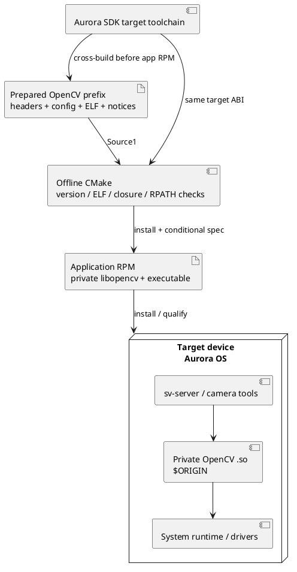

# Приватные зависимости в тестовом RPM Авроры

Для тестового развёртывания реализован **offline bundle OpenCV**: target shared libraries
включаются в RPM приложения, без установки отдельного opencv-devel/runtime RPM на устройство.
Обычный system-package профиль остаётся default. GLM поддерживает отдельный offline header-only
input; `.so` для неё не требуется. Boost/OpenSSL/Qt/EGL/GLES и системный runtime остаются SDK/OS
зависимостями. Произвольное копирование host `.so` не заменяет сборку под ABI целевой платформы.

## Выбор профиля до сборки

`rpmbuild` проверяет BuildRequires **до** `%build`/CMake. Поэтому CMake не может автоматически
обойти отсутствие `opencv-devel`: при недостающем пакете выбирают bundle профиль до разрешения
RPM dependencies. Это явный воспроизводимый выбор двух spec, а не скрытое скачивание.
Внутри `SV_AURORA=ON` FetchContent запрещён даже при попытке включить его через cache option.

| Профиль | Вход | Устройство получает |
|---|---|---|
| Default | SDK glm-devel/opencv-devel≥4.5 | Приложение с обычными runtime Requires |
| `--with bundled_opencv` | Source1: target install-prefix OpenCV4.10.0 | Приватные OpenCV `.so` и notices |
| `--with bundled_glm` | Source2: подготовленные GLM1.0.1 headers | Только приложение; заголовки GLM — build input |
| Обе опции | Оба подготовленных архива | Те же приватные OpenCV `.so`; остальные system Requires сохранены |

Условные RPM flags используют `%bcond_with`: [RPM conditional builds](https://rpm.org/docs/4.20.x/manual/conditionalbuilds.html).
CMake minimum OpenCV version регулируется `SV_OPENCV_MIN_VERSION`, например4.6; в spec
тот же minimum задаётся `--define 'sv_opencv_min_version 4.6'` и применяется к BuildRequires/CMake. Нельзя указать
более новую версию и молча получить старый bundle или host package. Закреплённый Linux FetchContent
fallback4.10.0 тоже отвергается, если требуемая версия выше. Для другого bundle version поменяйте
`sv_opencv_version` при rpmbuild через `--define 'sv_opencv_version X.Y.Z'` (см. замечание ниже).

## Подготовка OpenCV

Подготовьте исходники OpenCV4.10.0 вне offline RPM-сборки. Сборку выполняйте компилятором,
sysroot и toolchain **того же Aurora SDK target**, что и приложение. Устройство/aarch64 и выпуск
SDK пока не предоставлены, поэтому ниже шаблон, а не команда с подтверждённым путём toolchain.
Переменная AURORA_TOOLCHAIN должна указывать на реальный toolchain-файл; если SDK engine уже
задаёт компилятор/sysroot, применяйте его штатный способ cross-build.

```sh
cmake -S /path/to/opencv-4.10.0 -B artifacts/aurora-deps/build-opencv -G Ninja \
  -DCMAKE_TOOLCHAIN_FILE="$AURORA_TOOLCHAIN" \
  -DCMAKE_BUILD_TYPE=Release \
  -DCMAKE_INSTALL_PREFIX="$PWD/artifacts/aurora-deps/stage/opencv" \
  -DCMAKE_INSTALL_LIBDIR=lib -DOPENCV_LIB_INSTALL_PATH=lib \
  -DOPENCV_CONFIG_INSTALL_PATH=lib/cmake/opencv4 \
  -DOPENCV_LICENSES_INSTALL_PATH=licenses \
  '-DCMAKE_INSTALL_RPATH=$ORIGIN' -DCMAKE_INSTALL_RPATH_USE_LINK_PATH=OFF \
  -DBUILD_SHARED_LIBS=ON -DBUILD_LIST=core,imgproc,imgcodecs,videoio,calib3d,objdetect \
  -DBUILD_TESTS=OFF -DBUILD_PERF_TESTS=OFF -DBUILD_EXAMPLES=OFF \
  -DBUILD_opencv_apps=OFF -DWITH_V4L=ON \
  -DWITH_FFMPEG=OFF -DWITH_GSTREAMER=OFF -DWITH_GTK=OFF -DWITH_QT=OFF \
  -DWITH_OPENCL=OFF -DWITH_IPP=OFF -DBUILD_IPP_IW=OFF -DBUILD_ITT=OFF
cmake --build artifacts/aurora-deps/build-opencv --parallel 4
cmake --install artifacts/aurora-deps/build-opencv
```

OpenCV добавляет зависимые модули, например features2d/flann; **все** полученные libopencv `.so`
нужно оставить в prefix. Его layout задаётся upstream
[OpenCVInstallLayout.cmake](https://github.com/opencv/opencv/blob/4.10.0/cmake/OpenCVInstallLayout.cmake).
Upstream может изменять RPATH_USE_LINK_PATH; проверьте финальный DT_RUNPATH/DT_RPATH, а не только
значение CMake cache. При необходимости до архивации нормализуйте real libraries к `$ORIGIN`
host-инструментом patchelf, который умеет редактировать target ELF без их исполнения.

```sh
readelf -h artifacts/aurora-deps/stage/opencv/lib/libopencv_core.so.4.10.0
readelf -d artifacts/aurora-deps/stage/opencv/lib/libopencv_core.so.4.10.0
# Только при лишнем/отсутствующем RUNPATH; обрабатывайте real files, не symlink chains.
patchelf --set-rpath '$ORIGIN' artifacts/aurora-deps/stage/opencv/lib/libopencv_core.so.4.10.0
```

Аналогично проверьте остальные модули. `licenses/` должен содержать upstream LICENSE и notices
всех включённых third-party компонентов; проверяется наличие каталога/файлов, но не юридическая
полнота списка. Системные JPEG/PNG/zlib и прочие зависимости не копируются автоматически:
их SONAME/ABI Requires остаются у RPM. Если target их не предоставляет, подготовьте отдельные
целевые пакеты или отдельный согласованный bundle-механизм; не исключайте их из Requires.

## Архивы RPM sources

Source1 содержит корневую папку `opencv/` с include, lib либо lib64, CMake config и licenses.
Исходники OpenCV, `.so` и SDK artifacts не добавляются в Git/LFS. GLM Source2 содержит корневую
`glm/`, внутри которой находятся `glm/glm.hpp` и остальные upstream headers. Не путайте это с
папкой только одного header: нужны все заголовки выбранной версии.

```sh
mkdir -p artifacts/aurora-deps/SOURCES
# target_arch задайте фактической RPM архитектурой: aarch64 или armv7hl и т.п.
tar -czf "artifacts/aurora-deps/SOURCES/surround-view-opencv-4.10.0-${target_arch}.tar.gz" \
  -C artifacts/aurora-deps/stage opencv
mkdir -p artifacts/aurora-deps/stage/glm
cp -a /path/to/glm-1.0.1/glm artifacts/aurora-deps/stage/glm/
tar -czf artifacts/aurora-deps/SOURCES/surround-view-glm-1.0.1.tar.gz \
  -C artifacts/aurora-deps/stage glm
sha256sum artifacts/aurora-deps/SOURCES/*.tar.gz
```

Сохраните checksums, OpenCV flags, исходные версии/commit, compiler/sysroot/SDK release вместе
с target experiment artifacts. Передайте Source0 проекта и эти архивы в SOURCES рабочего
пространства SDK. Папки vendor/opencv и vendor/glm в рабочем checkout игнорируются Git.

```sh
# В подготовленном RPM/SDK build environment с корректным target.
rpmbuild -bb packaging/rpm/surround-view.spec --with bundled_opencv --with bundled_glm
# CPU профиль:
rpmbuild -bb packaging/rpm/surround-view-cpu.spec --with bundled_opencv --with bundled_glm
```

При работе через mb2 передайте эти же RPM conditionals штатным механизмом используемой версии
SDK; точная команда engine зависит от предоставленного target. Это не замена signing/validation.
Для другого bundle version передайте согласованные `--define 'sv_opencv_version X.Y.Z'`
и/или `--define 'sv_glm_version X.Y.Z'` и соответствующие архивы. Default по-прежнему требует системные development RPM.

## Прямая CMake-сборка

```sh
cmake -S . -B build-aurora-bundle -G Ninja \
  -DCMAKE_TOOLCHAIN_FILE="$AURORA_TOOLCHAIN" \
  -DSV_AURORA=ON -DSV_FETCH_MISSING_DEPS=OFF \
  -DSV_BUNDLE_OPENCV=ON -DSV_OPENCV_MIN_VERSION=4.6 \
  -DSV_OPENCV_BUNDLE_ROOT="$PWD/artifacts/aurora-deps/stage/opencv" \
  -DSV_GLM_INCLUDE_DIR="$PWD/artifacts/aurora-deps/stage/glm" \
  -DSV_SIMULATOR=OFF -DSV_CLIENT=OFF -DBUILD_TESTING=OFF
cmake --build build-aurora-bundle --parallel 4
DESTDIR="$PWD/artifacts/aurora-deps/rootfs" cmake --install build-aurora-bundle
```

Используйте отдельный build directory для другой архитектуры/SDK/profile. SDK обязан предоставить
CMake≥3.20, Ninja, compiler, Boost, OpenSSL и GPU libraries для SV_GPU=ON. Bundling `.so` не решает
отсутствие build-host CMake и не заменяет системную glibc/libstdc++.

## Установка и проверка механизма

Библиотеки попадают в `%{_libdir}/surround-view/opencv`, а OpenCV-dependent executables используют
`$ORIGIN/../<libdir>/surround-view/opencv`. Каждая приватная OpenCV library обязана иметь собственный
`$ORIGIN` RUNPATH/RPATH для транзитивных зависимостей. Это важно для RUNPATH загрузчика: путь
главного executable не заменяет путь его дочерней shared library. Настройка executable выполняется
через [CMake INSTALL_RPATH](https://cmake.org/cmake/help/v3.20/prop_tgt/INSTALL_RPATH.html).

CMake читает ELF через target/host readelf, **не исполняет target code и не вызывает host ldd**.
Проверяются machine/class/little-endian, DYN, SONAME link, relative in-root symlinks, точный `$ORIGIN`,
внутренняя OpenCV DT_NEEDED closure и imported locations из выбранного package config. Ошибки
останавливают configure. Не обещаются проверка glibc symbol versions, floating-point ABI ARM,
драйверов и полноценная Aurora ABI compatibility: для этого нужны SDK build и target запуск.

В bundle-профиле фильтруются только `libopencv_*` autogenerated Provides/Requires. Приватный
OpenCV не должен удовлетворять зависимости другого приложения. Остальные Requires остаются;
фильтр применяется после проверки internal closure. Механизм фильтров:
[RPM dependency generators](https://rpm.org/docs/4.20.x/manual/dependency_generators.html).
Лицензии включены в `%license`; headers/CMake-config OpenCV не входят в runtime RPM.

```sh
ctest --test-dir build -R '^opencv_private_bundle$' --output-on-failure
rpm -qpl /path/to/surround-view.rpm
rpm -qp --requires /path/to/surround-view.rpm
rpm -qp --provides /path/to/surround-view.rpm
```

На Linux тест строит собственные ELF fixture libraries, устанавливает app, переносит root и
скрывает исходный prefix: private direct/transitive linking сохраняется без LD_LIBRARY_PATH.
Negative cases проверяют architecture/ELF, SONAME/closure, absolute symlink/RUNPATH, импорт вне
prefix, license notices и запрет Aurora fetch. rpmspec проверяет8 combinations обоих spec и
двух flags, когда RPM tools доступны. Это не сборка реального OpenCV4.10.0 под Aurora и не
полный bundled RPM acceptance. Их нужно выполнить после предоставления SDK/toolchain/device.




*Рисунок P.1 — offline bundle без скачивания зависимостей при сборке приложения.*

Финальные host checks: полная Linux сборка;4 выбранных CTest прошли. Bundle executable test включает13 unittest cases и8 RPM flag combinations, финальный CTest1/1 за1,26 с. Проверены24 PlantUML blocks этого файла/главы3 (local1.2026.6 -checkonly). Full target OpenCV/RPM build не выполнялся; полный66-test suite не запускался.
