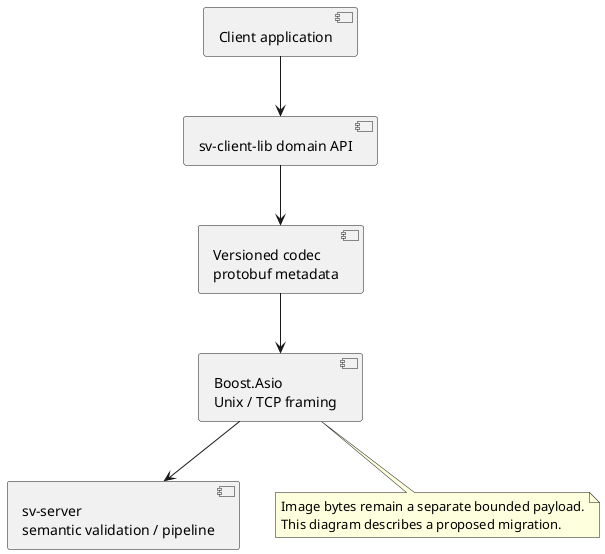

# Protobuf для sv-server ↔ sv-client-lib: оценка перехода

14.10.2026. **Рекомендация: использовать typed protobuf для будущего versioned control/metadata codec.**
Это решение улучшает контракт и компактность сообщений; ускорение всего pipeline и уменьшение RSS
не доказаны. Production wire сейчас остаётся SV01 с JSON metadata и бинарным image payload.
Новый optional benchmark не добавляет protobuf в зависимости продукта или Aurora RPM.

## Что полезно перенять из aasdk

В [aasdk_proto/CMakeLists.txt](https://github.com/f1xpl/aasdk/blob/development/aasdk_proto/CMakeLists.txt)
.proto компилируются в C++ и отдельную библиотеку aasdk_proto, связанную с protobuf runtime.
Аналогично можно отделить sv-protocol schema/generated code от transport и публичных domain API.
Это пример организации сборки, а не доказательство эффективности для surround-view workloads.

Protobuf — формат сообщений, а не транспорт. Boost.Asio и выбранные Unix/TCP endpoints остаются.
Он [не задаёт границы сообщений в stream](https://protobuf.dev/programming-guides/techniques/),
поэтому length framing, quotas, deadlines и channel/session binding всё равно нужны. gRPC для
такого перехода не обязателен. JSON файлов конфигурации можно сохранить независимо от wire codec.

## Измерение на текущем ПК

Исходники: `tools/protocol_bench/{main.cpp,codec.proto,CMakeLists.txt}`.
Полный baseline с версиями, семью batch means, hashes и ограничениями:
[protocol_codec_v1.json](../validation/baselines/protocol_codec_v1.json).
Linux, AMD Ryzen9 9950X; Release, GCC16.2.1, Boost1.92; protobuf version macro7036001.
50 000 операций на batch, семь повторений; указана медиана batch means, не latency percentile
отдельных запросов. Сообщения создаются до timed loop; roundtrip и numeric ID checks проходят.
Serialize создаёт новую строку, parse создаёт новое сообщение и читает один ID. Порядок codec
чередуется; affinity/frequency не фиксировались. Полная semantic validation не включена.

| Fixture | JSON, bytes | Protobuf, bytes | Serialize JSON/PB, µs | Parse+ID JSON/PB, µs |
|---|---:|---:|---:|---:|
| Orbit |89|28|0.1003 /0.0168|0.1282 /0.0302|
| Fusion subset |213|76|0.1194 /0.0345|0.2703 /0.1061|
| Frame metadata subset |779|255|0.3634 /0.0825|0.9564 /0.2948|

Это ограниченные fixtures, **не полный production telemetry header**. Экономия metadata около67%,
но RGBA640×360 занимает921600bytes уже сейчас. В пакете с последним fixture и24-byte prefix
экономия524bytes составляет только **0.0568%**. Следовательно, компактный header почти не меняет
нагрузку передачи такого несжатого кадра. Расчёт относится именно к указанному fixture/размеру.

Не измерены: end-to-end latency, RSS/peak memory, allocations, Aurora ARM, rendering, full frame
framing/copies, concurrent clients. Результаты не являются сравнением алгоритмов сшивки или
доказательством ускорения всей системы. Следующий системный benchmark должен сравнить один
и тот же replay/workload с одинаковыми algorithms/output/backpressure на обоих codec.

## Память и основные расходы

`src/core/protocol.cpp` уже передаёт изображения raw binary, без JSON/base64. Замена metadata
не уменьшает эти буферы, texture memory, render targets, mesh или calibration working sets.
Текущий encoder копирует payload в общий packet vector; decoder копирует его в Message и
компактирует pending buffer. Работа с ownership/scatter-gather/bounded shared buffers — отдельный
потенциально более существенный путь оптимизации, требующий измерения и lifetime tests.

Бинарный wire size не равен размеру C++ объекта. Protobuf runtime/generated code добавляют память,
а Boost.JSON пока остаётся для configs. [Arena allocation](https://protobuf.dev/reference/cpp/arenas/)
может уменьшить расходы выделений при правильном lifetime, но protobuf не даёт автоматического
zero-copy или гарантии меньшего RSS. Уменьшение RAM в этом опыте **не проверялось**.

## Предлагаемый контракт и этапы, ещё не реализованные

1. Выделить versioned schema: Envelope, request/response/event, typed command oneof, Config groups,
   frame identity, metrics и structured errors. uint64 IDs/revisions без decimal-string conversion;
   enums с UNSPECIFIED и явной проверкой допустимости. `persist` должен иметь presence, чтобы omission
   отличался от explicit false. Не упаковывать весь существующий JSON в string/Struct.
2. Разработать явно несовместимый SV02 или согласуемую версию codec; не переиспользовать SV01 flags
   молча. Поддержать migration/unsupported-version tests, reserved field numbers и additive evolution.
3. Оставить изображения отдельным bounded binary payload, protobuf использовать для descriptor.
   Сохранить semantic bounds, lease/revision rules, release/backpressure, size/depth limits и timeouts.
   Parser success не означает допустимую команду; protobuf не добавляет authentication/encryption.
4. Сохранить public sv-client-lib domain API; schema details скрыть внутри codec. Сервер остаётся
   единственным владельцем config file и pipeline, клиентские приложения используют библиотеку.
5. Для Aurora подготовить offline RPM dependencies и generation workflow: host protoc и target C++
   runtime совместимой **точно совпадающей версии**, проверить toolchain/architecture. Это требование
   [C++ compatibility policy](https://protobuf.dev/support/cross-version-runtime-guarantee/);
   нельзя рассчитывать на произвольный системный runtime или downloads во время SDK RPM build.
6. Проверить parity сценариев, malformed/truncated/oversize packets, unknown fields/enums, lifetime,
   lost ACK/reconnect и bounded queues; затем измерить CPU, allocation counts, RSS/peak, bytes/frame,
   p50/p95/p99 end-to-end на ПК и целевой платформе при одинаковой нагрузке.

Рисунок — Предлагаемое размещение protobuf без изменения ответственности сервера и клиентской библиотеки.

Первый этап — contract/schema и compatibility tests, затем codec integration. Полная миграция
не выполнена и не должна блокировать operation IDs/status и текущие GUI bindings ConfigService.
