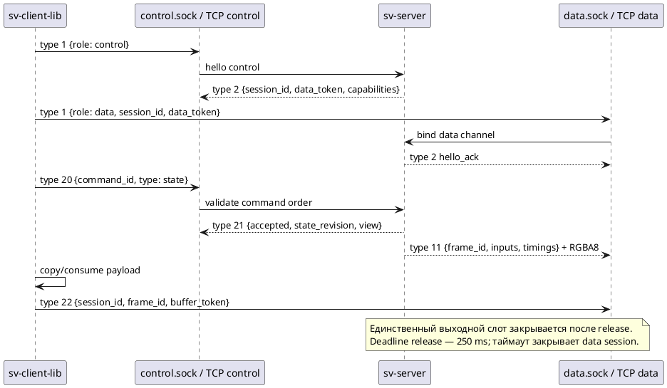
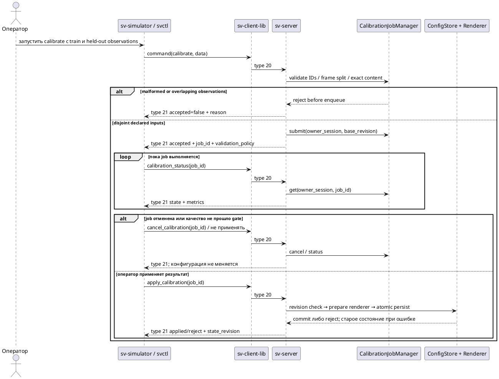

# Реализованный протокол SV01

Срез реализации Linux 0.6.x. Это описание текущего wire-контракта, сверенное с `include/sv/protocol.hpp`, `src/core/protocol.cpp`, `src/apps/server.cpp` и `src/client_library/client.cpp`. Runtime fusion API `fusion_runtime_v1` описан ниже; ConfigService read/catalog/validate и atomic apply с explicit persistence для fusion/surface/telemetry реализованы ([[engineering/CONFIG_SERVICE]]); process-scoped apply-once/status реализованы ([[engineering/CONFIG_OPERATIONS]]), durable recovery и другие группы отсутствуют. Целевая расширенная архитектура и подписки описаны отдельно в [[architecture/CLIENT_SERVER_MODEL]] и пока не являются возможностями сервера.

## Транспорт и кадрирование

Полный каталог 29 команд и 17 сценариев подключения, применения, обработки кадров и отказов с PlantUML: [[engineering/PROTOCOL_SCENARIOS]]. Сценарии описывают текущий код; проектируемые API остаются отдельно.

Один логический клиент использует две независимые stream-связи: control и data. Поддерживаются Unix domain sockets либо TCP; транспорт выбирается только конфигурацией endpoint/listeners. Клиентская библиотека сама не переключается на другой транспорт. UDP, TLS, несколько одновременных клиентов и control-only пока отсутствуют. Серверная сторона ограничена одной сессией: второй клиент не образует независимое пространство состояния.

Сообщение содержит 24-байтовый префикс: ASCII `SV01`, версия 1, тип uint16, полная длина заголовка uint32, длина payload uint64, flags uint32=0; числа big-endian. За ним следуют JSON UTF-8 и binary payload. Пределы — 64 KiB header и 64 MiB payload. TCP-чтение не совпадает с границами сообщений, поэтому decoder буферизует частичные и пакетированные сообщения.

| Тип | Направление и смысл в текущем коде |
|---:|---|
| 1 | Клиент → сервер: hello; на control `{role:"control"}`, на data `{role:"data", session_id, data_token}` |
| 2 | Сервер → клиент: hello_ack с `session_id`, `data_token`, `profile`, `capabilities` |
| 3 | Библиотека → callback: локальное событие потери ожидающей команды (`session_lost`); отдельный wire error пока не реализован |
| 11 | Сервер → клиент по data: выбранный RGBA8 продукт (final_frame, integer render_support_v1 или source_visibility_v1) и provenance/timing metadata |
| 20 | Клиент → сервер по control: команда с монотонным в рамках сессии `command_id`, `type` и параметрами |
| 21 | Сервер → клиент по control: ACK/reject с `accepted`, `reason`, `state_revision` и результатом операции |
| 22 | Клиент → сервер по data: release с `session_id`, `frame_id`, `buffer_token`; binary payload обязан быть пустым |

## Переключение fusion во время работы: fusion_runtime_v1

Handshake объявляет `fusion_runtime_v1`. Это первый реализованный срез исследовательского runtime, не общий ConfigService. Поверх него реализован application-level sequential paused-frame runner через sv-client-lib: [[validation/RESEARCH_RUNTIME]]. Сервер сохраняет все три текущих GPU-режима; для переключения не требуется перезапуск, повторный upload камер или rebuild сетки.

| Команда / поле | Контракт |
|---|---|
| `fusion_catalog` | Read-only ACK с `fusion_catalog`: version=4, modes, diagnostics, пределы параметров, temporary persistence, backend/GL device, server source revision/fingerprint и configured `build_passport` |
| `configure_fusion` | Обязательные `base_config_revision` (decimal string) и `fusion` (object); полностью заменяет fusion-секцию, пропущенные необязательные поля получают defaults |
| `fusion.mode` | `edge_feather`, `hard_best_angle`, `angular_feather`, `seam_distance_feather`, `graph_cut_seam`, `multi_band`, `graph_cut_multi_band` |
| `fusion.diagnostic` | `color` (default), `coverage`, `weights` |
| `fusion.edge_width_px` | Число (0,4096], default 24 |
| `fusion.angle_power` | Число (0,32], default 2 |
| `fusion.pyramid_levels` | Целое 1..8, default 4; pyramid blend |
| `fusion.pyramid_boundary` | `zero` (default) либо `normalized`; применяется только в двух pyramid-режимах, `normalized_support_v1` — экспериментальный вариант |
| `fusion.smoothness_weight` | Число [0,100], default 0.1; pairwise cut |
| ACK / `state` | `config_revision` и полный `fusion` вместе с существующими state fields |
| type 11 frame | `config_revision` и полный фактический `fusion`; `state_revision` позволяет отфильтровать ранее поставленные в очередь кадры |

`sv-client-lib` предоставляет `fusion_catalog()` и `configure_fusion(base_revision, FusionSettings)`. Неизвестные режимы, поля fusion, неконечные числа и параметры вне диапазона отклоняются общей config validation. Устаревшая revision отклоняется; rejected/read-only команды не меняют revisions. Запрос с корректными параметрами и старой revision возвращает `stale_config_revision`; ошибочный запрос может быть отклонён раньше при validation.

Команда выполняется на render thread между render calls: полный проверенный snapshot и uniform settings становятся активными до следующего render. Входной frame set при паузе сохраняется; новый результат может использовать тот же набор камер с новой config revision. ACK подтверждает применение, но уже отправленные/очередные старые кадры не отзываются. Переключение не делает `frame_set_id` новым и не является полноценным seek/reset истории.

`configure_fusion` не записывает файл конфигурации; restore выполняется отправкой ранее прочитанного полного fusion с текущей revision. Для сессий с `experiment_lease_v1` автоматический restore fusion/surface/pause реализован ниже; вне lease его нет. Идемпотентные operation IDs и отдельный save API ещё отсутствуют. Существующий `apply_calibration` сохраняет полный актуальный snapshot, поэтому при его использовании временные fusion/surface также попадут в файл: до общего ConfigService восстановить fusion/surface baseline перед persistent calibration apply. Внутри активного lease `apply_calibration` отклоняется до persistence, поэтому сценарный runner не сохраняет временный fusion через эту команду.

Handshake дополнительно объявляет `research_fusion_v1`: четыре новых режима выполняют GLES-проекцию четырёх слоёв и native CPU fusion (OpenCV + Boost.Graph), не Python. Выход ограничен 262144 пикселями; превышение отклоняется при config validation. Каталог содержит `research_backend`, `research_pixel_limit`, `graph_cut_scope`, `research_fusion_implementation`. Три прежних режима остаются одним GPU-проходом.

Frame содержит `fusion_backend`, `gpu_timer_status`, `surface`, `mesh_triangles`. В `pipeline_spans_ms` добавлены `layer_readback_cpu` (четыре GPU draw/readback, преобразование слоёв и ego overlay) и `fusion_cpu` (native fusion и композиция). Это wall durations на сервере; первая включает ожидание GPU. `render_wall` включает весь renderer, вложенные spans нельзя суммировать с ним. Для гибридного пути `gpu_draw=null`, status=`hybrid_total_not_measured`: старый timer query не измеряет полный гибридный pipeline. `research_fusion_implementation=validity_zero_extension_v2` фиксирует обнуление RGB вне validity перед pyramid filtering. Каталог версии 3 дополнительно сообщает `pyramid_boundary` и `normalized_pyramid_implementation=normalized_support_v1`; выбор находится в фактическом fusion snapshot. Default zero сохраняет прежнюю численную реализацию. Проверки постоянного цвета, новых RGBA и wire cases: [[validation/PYRAMID_BOUNDARY]]. Формат слоёв и проверка эталона: [[validation/NATIVE_FUSION]].

## Геометрия во время работы: runtime_surface_v1

`surface_catalog` возвращает четыре config type и описание плоского варианта. `configure_surface` принимает `base_config_revision` (decimal string), полный объект `surface` в формате [[engineering/RENDERING]], optional `lease_id`. Подготовка mesh/GPU buffers предшествует публикации snapshot; при ошибке или stale revision активная геометрия и revisions сохраняются. Текущая view должна удовлетворять `safe_view`, иначе `view_clearance`. Применение выполняется между render calls, увеличивает `mesh_build_count`, не переотправляет камеры. ACK/state/frame содержат фактическую surface.

API библиотеки: `surface_catalog()` и `configure_surface(base_revision, boost::json::object, optional_lease_id)`. Это temporary apply, файл не записывается. Повтор идентичной surface также готовит сетку заново; idempotent operations пока нет. Plane задаётся `rectangular_bowl_v1` с `corner_height_m=0`. Parameterized burger-like остаётся offline; куб здесь геометрический носитель, не cubemap. Общего ConfigService для этих операций не требуется.

## Ограниченный эксперимент: experiment_lease_v1

Handshake объявляет `experiment_lease_v1`. Lease привязан к control session, доступен только для replay и сохраняет исходные fusion/surface/pause. Он не является general transaction для всего ConfigService и не сохраняет playback cursor, source images или temporal history.

| Команда | Параметры и результат |
|---|---|
| `experiment_acquire` | `ttl_ms`: целое 250..30000. Только idle; ACK содержит `experiment_lease` с server-issued lease ID и monotonic deadline |
| `experiment_renew` | `lease_id`: тот же владелец, активный непросроченный ID; продлевает на исходный TTL |
| `experiment_release` | `lease_id`: тот же владелец; ACK означает переход в restoring, а не завершение |
| `state` / ACK | `experiment_lease`: state=`idle/active/restoring/failed`, lease_id, deadline_monotonic_ns, error; deadline не является временем клиента |

Во время active владелец передаёт `lease_id` в `configure_fusion`, `configure_surface`, `pause`, `resume`, `step`, `replay_reset` и lease commands. Replay hello объявляет `experiment_step_v1`; шаг разрешён только владельцу с действующим token. Lease не возвращает playback cursor. Другие мутации (orbit/zoom/preset, calibration start/apply/cancel) блокируются; read-only state/catalog/calibration_status доступны. Команды без token, с чужим/старым ID или после истечения TTL возвращают `experiment_lease_conflict` без изменений. После завершения старый ID не становится обычной mutation без lease. Существующие команды без lease работают по-прежнему в idle.

`sv-client-lib` предоставляет `acquire_experiment(ttl_ms)`, `renew_experiment(id)`, `release_experiment(id)`, optional lease ID у configure_fusion/surface/pause/resume/step/reset_replay. Runner приобретает lease на 30000 ms и продлевает перед каждым trial и cleanup. Долгий progress callback/ожидание дольше TTL может прервать эксперимент.

Истечение срока или удаление control session запускает recovery на render thread: проверенные fusion и surface публикуются новым config snapshot, uniform settings обновляются между render calls, затем source получает асинхронный pause/resume при необходимости. Пока restoring, новые мутации отклоняются. На успешном source ACK состояние становится idle; статус idle означает завершённую координацию конфигурации и источника. Recovery не пишет файл. Source request не исполнился за 5 s либо восстановление завершилось ошибкой — failed; мутации остаются заблокированы до перезапуска. Поздний source ACK не снимает failed. Ошибки/переходы записываются в trace как experiment_restore events.

Watchdog кооперативный, проверяется server loop; блокировка GPU/драйвера или авария самого сервера не дают гарантии жёсткого срока восстановления. Потеря только data channel при живом control не считается удалением владельца: без renew восстановление произойдёт по TTL. Восстанавливаются fusion/surface/pause, но не номер кадра или исходное изображение после проигрывания записи.

При release/cleanup клиент опрашивает state до idle/failed, проверяет восстановленные fusion/surface/pause и сохраняет final_state. Lost-ACK idempotence и checkpoint recovery ещё не реализованы: при сомнении не переигрывать мутации автоматически; использовать state/trace и серверный watchdog.

## Порядок открытия сессии и доставки кадра



Если release теряется или задерживается, библиотека/клиент не получает второй кадр в этом stream; по deadline сервер закрывает соединение. Отправлять release нужно после копирования данных в собственный буфер. Client callback работает на worker thread; UI обязан передать событие в свой executor и не блокировать остановку клиента внутри callback.

Release с непустым binary payload отклоняется закрытием data connection, даже при совпадающем token. Он не обрабатывается как успешный release; слот возвращается при cleanup закрытого канала, дальнейшие кадры по нему не выдаются. Control connection при этом остаётся доступен; библиотека при data EOF завершает оба своих канала и следует обычной reconnect policy. Ошибочный release не имеет отдельного ACK. Перед постановкой release библиотека синхронно проверяет типы трёх строковых полей и SV01 size limit; oversized metadata дают exception у вызывающего кода, не занимая release queue.

## Команды

Все команды имеют заголовок `{command_id: decimal-string, type: string, ...parameters}`. Повторный или меньший ID отклоняется как `duplicate_or_out_of_order`. ACK несёт `command_id`, `accepted`, при отказе — `reason`; состояние/результат включается в ACK. Потерянные при разрыве pending-команды получают локальную ошибку `session_lost` и автоматически не воспроизводятся после reconnect.

Библиотека сериализует выдачу ID и постановку command в worker при вызовах из нескольких потоков. ID принадлежат объекту Client и не сбрасываются при reconnect; сервер проверяет порядок в пределах control connection. Пропуски после синхронной ошибки допустимы; переполнение uint64 даёт exception без wrap. Ранний reject duplicate/out-of-order не содержит полного state snapshot. Проверка конкурентного порядка — `client_command_order`.

| Команда | Параметры | Эффект / отказ |
|---|---|---|
| `state` | нет | Read-only view, fusion, source_type, pause и state/config revisions |
| `orbit` | `azimuth_delta_rad`, `elevation_delta_rad` | Изменение virtual view с ограничением elevation и проверкой clearance |
| `zoom` | `distance_delta_m` | Изменение дистанции, диапазон 6–18 m |
| `preset` | `name=top/front/rear` | Переключение стандартного ракурса; иначе `unknown_preset` |
| `pause`, `resume`, `step` | нет | Управление replay; для не-replay `step_unsupported_for_source` |
| `calibrate` | см. ниже | Асинхронная job, результатом ACK является `job_id` |
| `calibration_status` | `job_id` | Только владелец сессии; статус, fit/validation metrics |
| `cancel_calibration` | `job_id` | Только владелец; running solver отменяется кооперативно после возврата OpenCV |
| `apply_calibration` | `job_id` | Только владелец; новый renderer подготовлен до сохранения, проверяется base revision и held-out gate |

Неизвестная операция возвращает `unknown_command`; malformed/non-finite parameters возвращают reject с причиной. Config revision/state revision не меняются на read-only и rejected операциях. Калибровка применима только если validation RMSE ≤3 px, max error ≤8 px и базовая revision ещё актуальна. Лимиты 3/8 px предварительны и должны быть пересмотрены на физических данных.

Пример сокращённого запроса калибровки:

```json
{
  "command_id": "17",
  "type": "calibrate",
  "camera_id": 0,
  "method": "ransac_epnp_lm",
  "points": [[1.0, 0.2, 0.1], [2.0, -0.4, 0.2]],
  "pixels": [[413.2, 250.1], [382.0, 214.4]],
  "validation_points": [[1.5, 0.1, 0.4], [3.0, 0.7, 0.2]],
  "validation_pixels": [[400.0, 230.0], [355.0, 190.0]],
  "provenance": {
    "dataset_id": "survey-2026-10-10",
    "training": {
      "observation_ids": ["front-f0001-c00", "front-f0001-c01"],
      "frame_ids": ["front-f0001", "front-f0001"]
    },
    "validation": {
      "observation_ids": ["front-f0020-c00", "front-f0020-c01"],
      "frame_ids": ["front-f0020", "front-f0020"]
    }
  }
}
```

Фактически сервер требует 6..10000 train и validation соответствий и обязательный `provenance`; координаты точек имеют три конечные метрические компоненты, пиксели — две. Пример выше показывает только форму и намеренно не является исполняемым минимумом. Источник, единицы, независимое измерение, detector, hashes observations и распределение поз остаются обязанностью вызывающего инструмента. GUI не должен генерировать псевдоизмерения.

XYZ/UV и вещественные параметры orbit/zoom принимают JSON int64, uint64 и double: `0` и `0.0` обозначают одно геометрическое значение. Числа преобразуются в double с проверкой конечности; bool/string/null/array/object не приводятся к числу (`command_number_required`), nonfinite value отклоняется как `command_number_nonfinite`. Синтаксически некорректный JSON может быть отклонён decoder до command ACK. `camera_id` — отдельный строгий индекс: только JSON integer 0..3, диапазон проверяется **до** сужения в int. Нецелый тип, включая `0.0`/bool, даёт `camera_id_integer_required`; целое вне диапазона — `camera_id_out_of_range`. IDs/revisions в decimal strings не проходят через double parser.

С 10.10.2026 handshake объявляет capability `calibration_provenance_v1`. Старые calibration requests без provenance отклоняются с `calibration_provenance_required`; транспорт SV01 и остальные команды сохраняют формат. Ограничение 10000 — лимит менеджера; фактический SV01 header limit 64 KiB дополнительно ограничивает размер wire запроса. Для каждого split `observation_ids` и `frame_ids` идут в том же порядке, что XYZ/UV, с той же длиной. IDs — 1..128 ASCII символов `[A-Za-z0-9._:/-]`, непрозрачные токены, не пути к серверным файлам. `dataset_id` обозначает набор; observation ID уникален во всём запросе. Несколько углов одного кадра имеют разные observation IDs и одинаковый frame ID. Исходный frame ID должен сохраняться при crop/augmentation/re-detection, иначе клиент скрывает пересечение данных.

До выделения job ID/queue сервер проверяет:

- размеры metadata, конечность XYZ/UV и valid pixels;
- уникальность observation IDs внутри и между split;
- отсутствие общих frame IDs между train/validation;
- отсутствие точных копий `(X,Y,Z,u,v)` внутри и между split независимо от IDs.

Одна физическая XYZ точка в разных кадрах с различными UV допустима. Погрешность сравнения exact-content равна нулю; signed zero считается одинаковым. Near duplicates или произвольно изменённые labels не распознаются этой проверкой. Присланные клиентом IDs не аутентифицируют снимки и не доказывают статистическую независимость.

ACK принятой calibration job и `calibration_status` возвращают `validation_policy="client_declared_frames_and_exact_content_disjoint"`. Status дополнительно содержит `dataset_id`, `training_observations`, `validation_observations`, `training_frames`, `validation_frames` во всех состояниях job. В job сохраняется компактная сводка, а не исходные metadata arrays; оригинальный dataset/request клиент должен архивировать сам. Пороговые gate значения 3/8 px остаются предварительными.

Явные причины reject: `calibration_provenance_required`, `calibration_provenance_size_mismatch`, `calibration_provenance_invalid_id`, `calibration_duplicate_observation_id`, `calibration_train_validation_frame_overlap`, `calibration_duplicate_correspondence`, `calibration_invalid_correspondence`, `calibration_nonfinite_correspondence`. Некорректные JSON типы/отсутствующие вложенные поля также отклоняются, но текст исключения JSON parser не является стабильным error code. Проверки и пределы: [[validation/CALIBRATION_PROVENANCE]].



*Рисунок — Calibration workflow: reject до enqueue, status и отдельное применение только для созданной job.*

## Метаданные и гарантии

Кадр 11 включает `frame_id`, `frame_set_id`, `state_revision`, `applied_command_id`, token, размер/stride, `RGBA8`, top-left origin, source/fusion/view IDs, четыре записи `inputs`, health и spans pipeline. Он не является промежуточной stitched texture и не содержит control subscriptions. `local_monotonic` timestamp нельзя вычитать из часов удалённого ноутбука; текущие показатели server-side, а не физическая sensor-to-display задержка.

Очереди и payload bounded. Network delivery не подтверждает источник-съёмку: текущий camera source timestamp соответствует host delivery, если драйвер не предоставляет проверенный capture timestamp. Утилита должна сохранять endpoint, версии, config/calibration revision, IDs и hashes данных в отчёте эксперимента.

## Планируемое расширение и проверка

Несколько независимых клиентов, control-only, per-session view, config snapshot/update, subscriptions (`final_frame=false`), canvas/coverage/weights, trace stream, typed library API, UDP и двуххостовой clock mapping не реализованы. Их normative target contract — [[requirements/PROTOCOL]] и [[architecture/CLIENT_SERVER_MODEL]]. Protobuf не нужен для текущего небольшого JSON-header/binary-frame профиля: менять codec следует при появлении совместного schema/codegen требования, а не ради замены формата.

Основные тесты текущего протокола: `client_lifecycle`, `client_transports`, `client_command_order`, `server_session`, `calibration_job`, `config_store_persistence`, `replay_ipc`. Пробелы: fuzz/property decoder, контрольные vectors для каждого message type, прямой тест exhaustion uint64 (guard запрещает wrap), длительный release/backpressure, cancellation race, и межмашинное TCP испытание.

## Seam solver, catalog v4

Optional `fusion.seam_solver` принимает `binary_pairs` (default) и `alpha_expansion`, применяется в `graph_cut_seam`/`graph_cut_multi_band`; для остальных mode не влияет на output. Новый выбор не меняет семь mode names. Field default опускается в snapshot/library wire для совместимости; отсутствие означает binary_pairs. Configure полностью заменяет fusion, поэтому omission возвращает default. Неверное значение отклоняется при общей config validation до apply/revision change.

Каталог объявляет список `seam_solver`, `alpha_expansion_implementation=integer_potts_v1`, `alpha_expansion_max_sweeps=8` и новую область graph_cut_scope. Перед новым значением клиент проверяет catalog v4. У alpha output есть `seam_optimization` (initial/final integer energy, nodes/edges, sweeps, accepted_moves, converged, max_sweeps, implementation); после возврата к legacy/GPU diagnostics не сохраняется. Converged означает отсутствие строго улучшающего alpha move в последнем полном sweep; не означает global optimum. Metadata описывает hard labels до blur/pyramid, не image quality. Контракт lease/revision/persistence прежний; формулы и ограничения: [[validation/MULTILABEL_SEAM]].

Frame telemetry дополнена `mesh_resources`: scope=carrier_position_index_buffers; active/resident содержат vertices, indices, triangles, vertex_buffer_bytes, index_buffer_bytes, buffer_bytes. Историческое mesh_triangles равно active.triangles. После runtime surface switching resident может превышать active из-за retained carrier buffers; это не весь GPU memory footprint. Поля описаны в [[engineering/RENDERING#Учёт бюджета носителя]].

`surface_catalog.rectangular_reference_height` описывает optional `reference_height_m` (m,default0,min0,max5) для rectangular_bowl_v1. Existing `configure_surface` принимает это поле при full surface replacement; base revision/lease, prepare/publish и temporary persistence semantics прежние. Через sv-client-lib: `surface["reference_height_m"] = .8; client.configure_surface(base_config_revision, std::move(surface));`. Поле отсутствует →0; другие types отклоняют его. Server checks clearance и bounds. [[validation/REFERENCE_HEIGHT]].

`surface_catalog.rectangular_local_support` describes optional `local_support_patch` for rectangular carriers: six metre-valued fields, vehicle coordinate frame, height range and containment rule. Apply via the existing `configure_surface(base_config_revision, full_surface)` API in sv-client-lib; send the full surface without `local_support_patch` to remove it. The server validates dimensions and view clearance before publishing a rebuilt mesh. Stale/invalid requests preserve revisions and active buffers; temporary research settings do not rewrite the config file. Patch geometry is supplied by the caller, not inferred from RGB.

`surface_catalog.rectangular_source_occlusion` advertises the optional `source_occlusion_box` object, vehicle frame, coordinate and tolerance ranges. Use the existing full-surface `configure_surface` command via sv-client-lib; omit the box to remove the control. Config ownership, revision validation, temporary application and restoration are unchanged. This bounded research input contains known geometry, not estimated camera depth; source status7 exposes the rejection in native diagnostic captures.

`surface_catalog.rectangular_source_occlusion` adds optional `mode`/`guard_texels`, modes center/bilinear_radial_v1/bilinear_box_surface_v1, guard0/1 and zero-distortion optics restriction. Apply through the same full-surface `Client::configure_surface` call. Default omitted mode/guard preserves center semantics; center+guard1, unknown mode, guard>1 and footprint with nonzero camera distortion are rejected before publication. Rejection status stays7; native source UV is NaN for rejected samples. No new wire command or depth estimator is implied.

## Supplied box surface preservation (experimental)

`surface.source_occlusion_box.mode="bilinear_box_surface_v1"` adds a bounded alternative to `bilinear_radial_v1`. When uncertainty is omitted, after the unchanged central occlusion test, a carrier endpoint within the configured support band (default10µm, L∞ distance) of any finite supplied-box face retains the central sample. Central occlusion rejection remains in force; optional facing filtering below further restricts the surface exemption. Points outside that surface band use the prior radial footprint test with `guard_texels=0/1`; zero-distortion equidistant optics are required. Interior points and face extensions farther than the numerical band receive no exemption. This recognizes one known box, not arbitrary scene surfaces or RGB depth. Default remains `center`.

The mode is selected through existing `Client::configure_surface` with the whole surface and current `base_config_revision`; the server validates and publishes it between renders. `surface_catalog.rectangular_source_occlusion.modes` lists it, and `default_support_tolerance_m=0.00001` and `support_tolerance_range_m=[0,0.05]` describe the optional configurable `support_tolerance_m`. It is separate from configurable `tolerance_m` (central endpoint bias); clients must not submit the catalog metadata as config fields. No new message/transport is introduced. A GUI control for this mode is still pending.

`source_occlusion_box.support_tolerance_m` is optional and valid only with `mode=bilinear_box_surface_v1`: finite value in[0,0.05]m, default0.00001m. It changes support membership alone; it does not expand the occluder, alter `tolerance_m`, remove central-ray rejection or change neighbor inset. A larger band explicitly assumes more geometry uncertainty and can exempt incorrect surfaces. The old fixed-band catalog key is replaced by the default/range keys. Omitted field preserves previous pixels; other modes reject the field to avoid silent no-op configuration. Apply and restore via existing full-surface `Client::configure_surface` and revision checks.


## Выбор data product: output_selection_v1 / render_support_v1

Handshake объявляет output_selection_v1, render_support_v1 и source_visibility_v1. Существующий type11/22 framing не меняется: data channel передаёт **один выбранный продукт**, с теми же правилами bounded slot/release timeout250ms. Default — final_frame; отсутствие output_product у старого сервера также означает final_frame. Unknown product в новом клиенте вызывает protocol error до пользовательского callback.

| Команда / поле | Контракт |
|---|---|
| output_catalog | Read-only ACK с version1, products=[final_frame,render_support_v1,source_visibility_v1], default, selection, persistence, requirements и render_support_schema |
| configure_output | Обязательный product string из каталога; применяется между render calls, требует attached data channel |
| ACK/state.output_product | Текущий выбранный продукт; accepted configure_output увеличивает state_revision и applied_command_id, config_revision не меняется |
| type11.output_product | final_frame, render_support_v1 либо source_visibility_v1; RGBA8, top_left, stride=width*4 |
| type11.support_schema | Только у render_support_v1: version1, channels=[eligible_camera_count,positive_local_weight_count,render_support_path,raster_geometry], scope=local_base_weights_not_scene_visibility |
| type11.inspection_cpu_ms | Только у маски: CPU wall time geometry inspection/readbacks/merge, не GPU elapsed; hybrid count construction входит в fusion_cpu_ms |

Маска содержит ровно width*height*4 bytes, не изображение для прямого display. Значения и B-path enum: [[engineering/RENDERING#Native маска локальной поддержки]]. Вместе с ней передаются session_id, frame_id, frame_set_id, state_revision, config_revision, applied_command_id, buffer_token, полный fusion/surface и inputs[4]. Используемые inputs содержат calibration_id, sequence_id и release_timestamp_ns вместе с прежней source provenance. Это identity той же render invocation; второй final-frame пакет параллельно не отправляется. Обычный цвет по-прежнему вычисляется внутри renderer — выбор маски пока не является оптимизацией вычислений.

render_support_v1 требует fusion.diagnostic=color. Несовместимый configure_output или configure_fusion отклоняется с render_support_requires_color **до mutation**, сохраняя settings/revisions. Unknown/malformed product отклоняется; точный exception reason parser не фиксирован. Пока experiment lease active/restoring/failed, configure_output запрещён, в том числе owner с lease_id: selector не входит в lease snapshot. output_catalog доступен read-only. Для исследования выбрать продукт до acquire; fusion/surface можно менять в пределах обычных lease правил и color restriction.

Selection ephemeral и привязана к data generation: новый data attachment сбрасывает её в final_frame. Ничего не записывается на диск. Публикация привязана к generation, в которой начат render; старый пакет не может быть перепривязан к новой сессии, а освобождение старого slot не снимает reservation нового generation. В текущем Linux profile остаётся одна активная control/data pair, не multi-client subscription service.

ACK на control не отзывает уже опубликованный старый продукт. Клиент всегда release-ит такой пакет и фильтрует новые данные по output_product и state_revision>=ACK; frame_id остаётся монотонным и продукт не имеет собственного счётчика. При reconnect библиотека не воспроизводит configure_output: приложение проверяет HELLO capabilities и выбирает маску заново. Older server явно отвергнет неизвестную команду; не считать coverage view эквивалентом маски.

Typed API: Client::output_catalog(), Client::configure_output(OutputProduct), RenderSupportView(shared_ptr<const Message>). View сохраняет owning immutable Message без копии payload, даёт bounds-checked at(x,y) и message() с исходной provenance. Transport проверяет schema, shapes, limits, identities и все pixel codes до callback; view повторно валидирует пакет при construction. validate_output_product для legacy/final выполняет только classification/schema check: общая frame validation остаётся в transport. Unit/integration и native/wire parity: [[validation/OUTPUT_PRODUCTS]].

## Bounded central uncertainty (experimental)

`surface.source_occlusion_box.uncertainty` is optional. If present, both `radius_m` (finite[0,0.05]m) and `ambiguous_policy` (`accept` or `reject`) are required; extra keys are rejected. Omit the object for nominal behavior; radius0 retains historical classification. For fixed carrier/poses/endpoint bias, the eroded supplied box certifies blocking and the dilated box certifies clearance. Accept admits ambiguous central rays to the existing nominal footprint stage; reject returns native `SourceProjectionStatus::uncertain_occluder=8`. Status1 remains policy eligibility, including accepted ambiguity, not definitely-clear confidence. Status7 can represent definite central blocking or nominal footprint rejection; rejected UV stays NaN. Support membership and neighbor rays remain nominal and independent of central uncertainty.

The existing full-surface `Client::configure_surface` call applies/restores these fields with current revision/lease; the server advertises required fields/range/policies under `surface_catalog.rectangular_source_occlusion.uncertainty`. No new wire command, persistence or parallel subscription is implied. Accepted ambiguity and rejection reasons are now remotely selectable through source_visibility_v1; the legacy UV/status inspection remains unchanged: [[validation/SOURCE_VISIBILITY_PRODUCT]]. GUI forms remain pending. Defaults are unchanged. Implementation,54 native RGBA controls, backend provenance and negative robustness results: [[validation/NATIVE_UNCERTAINTY]].

## Finite-face orientation runtime field

`configure_surface` whole surface now accepts `source_occlusion_box.require_facing_surface` (bool, defaultfalse, only `mode=bilinear_box_surface_v1`; evenfalse in another mode is rejected). Catalog exposes optional field, `default_require_facing_surface=false` and `facing_scope`. Server validates/applies under the same revision and optional owner lease. Within finite-face support band, after central acceptance, at least one near face must strictly face the camera; otherwise native inspection status9/UV NaN. The surface field adds no command, persistence or multiple sessions; status9 can now be read through source_visibility_v1. Existing output delivery uses the accepted config revision; restore false/omit through another full-surface update. Detailed order and experiment: [[engineering/RENDERING#Finite-face orientation (experimental)]], [[validation/NATIVE_FACING]].

## Source visibility product

`source_visibility_v1` выбирается существующим configure_output; enum `OutputProduct::SourceVisibility`. Requirements и lifecycle совпадают с локальной support mask: attached data, color view, idle lease, ephemeral data-generation selection, reset final on reconnect. При color conflict reason=`source_visibility_requires_color`; no mutation. Type11.source_visibility_schema строго равна source_visibility_schema() version1, channels=[camera0,camera1,camera2,camera3], statuses0..12 и scope=supplied_geometry_policy_not_scene_visibility. support_schema в таком пакете отсутствует. Все provenance/revision/token/release правила выше применяются и к этому продукту; параллельный final не передаётся.

Четыре bytes каждого pixel — camera statuses, **A не opacity**.0=no_carrier/ego,1=eligible_unclassified,2=unavailable,3=behind,4=angle,5=image,6=vehicle_footprint,7=central blocked,8=ambiguous rejected,9=backfacing,10=ambiguous accepted,11=clear accepted,12=footprint blocked.0/6 одинаковы во всех каналах.1/10/11 eligible до fusion, без утверждения positive/effective weight или истинной поверхности.10/11 используются только при enabled box + explicit positive-radius uncertainty; radius0/omission accepted→1. Clear11 относится только к dilated supplied-box certificate с fixed carrier/poses. Полный порядок, тесты и ограничения: [[validation/SOURCE_VISIBILITY_PRODUCT]]. Typed owning SourceVisibilityView.at(x,y,camera) доступен через sv-client-lib без OpenCV/Qt.

### Optional fallback display: catalog v5

`fusion.fallback_display` — strict object с единственным обязательным `mode=legacy|hatch`; default/omission legacy. Использует прежний full-replacement configure_fusion и temporary revision/lease apply. Unknown keys/types/values отвергаются до mutation. Snapshot/typed wire опускают legacy, hatch сохраняется в ACK/frame.fusion. Catalog key `fallback_display` объявляет modes, scope `existing_fallback_branch_color_only`, implementation `screen_tiles_8px_v1`, scene_correspondence=false. Нет новых operations/products/schemas. Client проверяет capability; старому серверу default field не отправляется. Режим меняет только отображение fallback при color; все source decisions, diagnostic payloads, ego/background и fused pixels прежние. [[validation/FALLBACK_DISPLAY]].

### source_disagreement_v1 через output_selection_v1

Additive HELLO/output_catalog product `source_disagreement_v1` with exact source_disagreement_schema version1: channels encoded_rgb_max_range_u8, eligible_camera_count, defined_pair_comparison, carrier_domain; scope eligible_samples_not_fusion_weights_or_scene_confidence; sampling bilinear_encoded_rgb_before_color_compensation; defined=count_at_least_two. Integer RGBA8: R0..255, G0..4, B255 iff G≥2, A255 carrier outside footprint/ego, otherwise all0. R0 forced when undefined. Uses existing configure_output/type11/release; no new operation, color only. Non-color selection or configure_fusion rejected before mutation with source_disagreement_requires_color. Product/schema isolation, generation/reset/lease and revision/input identity contracts remain unchanged. Output catalog version1 remains additive; do not confuse it with fusion catalog version5. [[validation/SOURCE_DISAGREEMENT]].

## ConfigService read config_read_v1

`config_read` возвращает coherent active/persisted/revision snapshot в ACK configuration; доступен при lease, не меняет revisions/файл/render dirty. Typed API: read_configuration()/parse_configuration_snapshot(). Лимит snapshot32KiB, oversize отклоняется без disconnect. Scope config_store исключает launch-only overrides и session state. Поля, диаграмма, проверки и оставшиеся операции: [[engineering/CONFIG_SERVICE]].

## ConfigService discovery/validation v1

Capabilities config_catalog_v1/config_validate_v1, команды config_catalog/config_validate. Каталог задаёт replacement policy для fusion/surface и общие parameter bounds. Validation проверяет base_config_revision, complete replacement groups, общий parser, текущий view и output guard; successful ACK содержит configuration_validation с applied=false/renderer_prepared=false. Read-only при lease, без изменения revisions/файла/render dirty. Это не apply token и не гарантия GPU preparation. Typed API, negative cases и диаграмма: [[engineering/CONFIG_SERVICE]].

## ConfigService atomic apply

`config_apply_v1`: type20 config_apply с base_config_revision, changes и required persist boolean; type21 configuration_application. Catalog schema2, runtime/persist policy, lease rejection и rollback: [[engineering/CONFIG_SERVICE]]. Protobuf рассматривается отдельно: [[engineering/PROTOBUF]]; текущий SV01 остаётся JSON metadata + binary payload.

## ConfigService process-scoped operation journal

Capability config_operations_v1 добавляет config_apply_once и config_operation_status, а config_read — server_instance_id. Wire fields, bounded retention, rejected/status ACK semantics и reconnect/restart сценарии: [[engineering/CONFIG_OPERATIONS]]. Прежние config_apply/configure_* не получили автоматическую идемпотентность.

## Отключаемая devel telemetry_v1

`telemetry_catalog` и `telemetry_read` реализованы как read-only type20/type21 с typed API библиотеки.
Instance/epoch/cursor guards, bounds, schema, units и PlantUML последовательности:
[[engineering/TELEMETRY]]. Группа telemetry применяется через ConfigService; сбор default off.
Это bounded polling process CPU/RSS и последних существующих frame spans, без subscriptions
и полного subsystem profiler. Control-only/multi-client пока отсутствуют.

## source_work_timing_v1

Аддитивный optional массив в telemetry samples, без новых команд/изменения SV01 framing:
[[engineering/SOURCE_TIMING]]. Records привязаны к выбранным render inputs и текущему telemetry
session epoch. Большой telemetry batch может сократиться по32KiB budget; next_cursor/has_more
остаются обязательными для pagination. Это не отдельный worker event stream.


telemetry_read schema1 дополнен optional source.camera_diagnostics: null или ровно четыре ordered camera_id0…3, decimal-string open_attempts/read_failures/opencv_exceptions/reconnects/release_failures и bool worker_stopped. Команд и framing не добавлено. [[engineering/TELEMETRY#Camera diagnostics в telemetry samples]].


Optional source.camera_diagnostics[i].negotiated_mode: null либо width/height (positive integers), open_attempt (nonzero decimal uint64 == open_attempts), fps (finite positive number/null), fourcc (ASCII4/null), buffer_count (integer1…32/null). Non-null запрещён у worker_stopped; old omission принимается. Команды/transport framing не менялись. [[engineering/SOURCES#Проверенный режим камеры через SDK]].


Type11 inputs[].camera_capture дополнен optional immutable open_attempt и negotiated_mode выбранного hardware Frame. Telemetry frame.camera_inputs содержит до4 typed selected records с source_sequence_id. Identities decimal uint64; nonzero attempt должен совпасть с nested mode attempt, но не обязательно с current diagnostics. Existing framing/commands сохраняются. [[engineering/SOURCES#Происхождение выбранного кадра при reconnect]].


CameraDiagnostics дополнены optional `recovery`: exact decimal uint64 `consecutive_failures`, nullable integer1…60000 `retry_delay_ms` текущего wait и nullable enum-string `terminal_reason` (stop_requested/retry_exhausted/release_failure). Legacy omission/null допустимы; SDK проверяет согласованность со stopped и streak, archive schema1 сохраняет объект. Новых команд нет. [[engineering/SOURCES#Снимок восстановления камеры]].


CameraCaptureMode дополнен optional `automatic_properties` (nullable fps/fourcc/buffer_count) для best-effort readback незаданных свойств. Checked и automatic значения одного свойства одновременно non-null запрещены. SDK принимает legacy omission/null; extension сохраняется в current telemetry, selected type11 provenance и archive schema1. Новых команд нет. [[engineering/SOURCES#Наблюдаемые свойства автоматического профиля камеры]].


На Boost≥1.83 продуктовые JSON-пути используют общую Precise number policy: SV01 decoder, load_config, GUI/CLI intents и archive import. В installed SDK доступен sv/json.hpp. Framing/команды не меняются; Legacy dataset reader и старый Boost имеют отдельные ограничения. Новые config/wire baseline могут отличаться последними binary64 bits. Контракт, regression и миграция: [[engineering/JSON_PRECISION]].


## Сброс replay к первой строке (`replay_reset_v1`)

HELLO replay-сервера объявляет `replay_reset_v1`; typed API библиотеки —
`Client::reset_replay(lease_id = {})`, wire command — `replay_reset` с optional `lease_id`.
В idle token должен отсутствовать/быть пустым; active lease разрешает команду только владельцу
с действующим token. Истёкший/чужой token не превращает её в обычную мутацию.
Для camera/socket source ACK отрицательный: `replay_reset_unsupported_for_source`.

Команда асинхронная: worker последовательно завершает предыдущую операцию, ставит cursor на
строку0 manifest, освобождает свой четырёхкамерный image cache, публикует reset boundary,
декодирует/публикует первый набор, затем control completion. На reset boundary render thread
очищает очереди Synchronizer, guards sequence/time и last_set. Lifetime counters не обнуляются.
ACK accepted=true отправляется **после** обработки первого набора и completion; paused=true,
новая state_revision. Клиент должен дождаться FRAME с revision не меньше ACK и проверить READY;
неполная первая строка manifest может дать DEGRADED/NO_INPUT, reset не достраивает отсутствующие камеры.
Ошибки загрузки остаются фатальными source failure, успешный ACK в этом случае не отправляется.

Следующий step читает строку1 (для единственной строки — снова строку0). Внутренний sequence и
frame_set_id продолжают расти; source_session_id меняется на `<startup-session>/reset-N`,
source_timestamp_ns повторяет scenario timestamp строки manifest. До boundary могут быть доставлены
старые события; они не относятся к post-ACK кадрам. Счётчики decoded/received/upload остаются
накопительными. GPU caches, OS page cache, telemetry window и настройки fusion/surface/view не
сбрасываются; это cold **decode-cache**, а не гарантия cold hardware benchmark. Команда не сохраняет
конфиг на диск и не возвращает предыдущую позицию при lease release/expiry.

При потере ACK автоматически повторять reset нельзя: каждый вызов создаёт новый epoch и двигает
sequence. Сначала сверяйте state/frame provenance; durable idempotence пока не реализована.


## Снимок виртуальной проекции в кадре (`frame_view_v1`)

HELLO объявляет frame_view_v1. Каждый FRAME type11, включая diagnostic output products,
содержит `view` со значениями, фактически использованными данным render invocation:
`azimuth_rad`, `elevation_rad`, `distance_m`, `fov_y_rad`, `clip_m=[near,far]`,
`target_m=[x,y,z]`. Dimensions кадра задают aspect. Формат SV01, ACK и прежние поля сохранены;
это additive metadata, не новая команда управления камерой. Координаты — в vehicle frame,
метры/радианы, как у существующего renderer. Клиент сверяет FRAME state_revision с ACK;
чтение state отдельно не заменяет снимок проекции конкретного кадра.

C++ research evaluator использует этот снимок для запрета сравнения с эталоном другого view.
Качество/истинность внешнего эталона не являются server-side свойствами протокола:
[[engineering/RESEARCH_QUALITY]]. Truth и evaluation mask серверу не передаются.


## Replay input identity (`replay_input_identity_v1`)

Replay HELLO объявляет replay_input_identity_v1. Каждый used replay input в FRAME содержит
image_identity={algorithm:packed_rgb8_sha256_v1,sha256,width,height,pixel_format:RGB8,row_origin:top_left}
и camera_model_sha256 активной числовой модели renderer (algorithm camera_model_sha256_v1).
Image digest рассчитан worker по immutable decoded buffer при cache miss, не по пути/дисковому
файлу после загрузки. Cache reset перечитывает и заново хэширует pixels. Нет новой wire команды,
нет передачи truth на сервер, нет автоматического hashing реальных камер/socket inputs.
Формат digest и strict schema2 reference guards: [[engineering/RESEARCH_QUALITY#Schema2: проверка содержимого входов и числовой модели]].


Набор носителей в исследовательской форме не вводит новую wire-команду: C++ adapter
создаёт обычные variants с полным surface, runner использует прежние revision-aware
`configure_surface`/`configure_fusion` и проверяет metadata кадров. Снимки поступают из
active `config_read`, доступность типа — из `config_catalog.surface.types`.
[[architecture/RESEARCH_RUNTIME#Матрица носителей: снимки active, а не черновиков]].


Числовые списки исследовательской формы также не меняют wire format: C++ adapter
разворачивает их в обычные fusion variants; runner передаёт полный FusionSettings
через существующий configure_fusion. Catalog guard проверяет edge_width_px,
angle_power и smoothness_weight каждого варианта, включая неявные defaults.
[[engineering/RESEARCH_BATCH#Числовые списки параметров fusion]].


Профиль наблюдения research runner использует существующий read-only `config_read` внутри
experiment lease для telemetry before/after; wire-команды не меняются. При недоступном
чтении эксперимент не выдумывает defaults и не разрешает timing comparison. Новые поля —
добавление в отчёт native schema1; offline comparison audit использует policy v2.
[[engineering/RESEARCH_REPORTS#Нагрузка наблюдения и policy v2]].


Scenario bundle — локальный формат client inputs, не wire extension. Экспорт и verify
не создают Client; verified-run фиксирует inputs и использует прежний ExperimentRunner
через sv-client-lib. Сервер не получает reference и не меняет source/config из bundle.
В native report добавлены input_bundle и scenario_input_kind=verified_bundle_snapshot_v1.
[[engineering/RESEARCH_BATCH#Переносимый набор сценария]].


`fusion_catalog.build_passport` добавляет versioned claims конфигурации серверной сборки.
`sv-client-lib` передаёт это поле в существующем JSON catalog, новая команда/transport не
добавлены. Reader обязан проверять policy/schema/hash перед использованием для сравнения;
legacy catalogs могут не содержать поле. Подробный контракт и ограничения:
[[engineering/RESEARCH_REPORTS#Паспорт конфигурации сборки и policy v3]].
