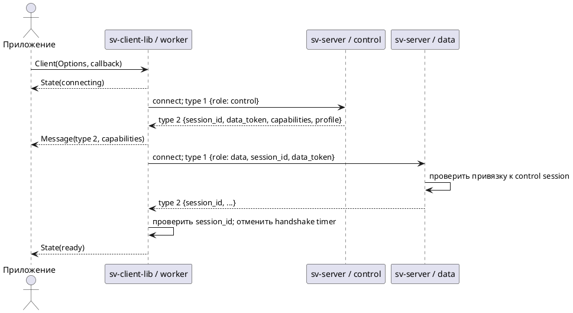
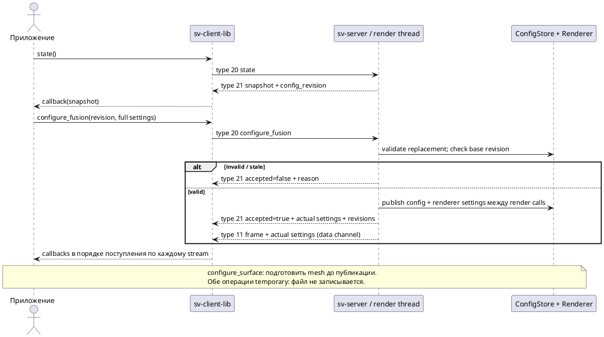
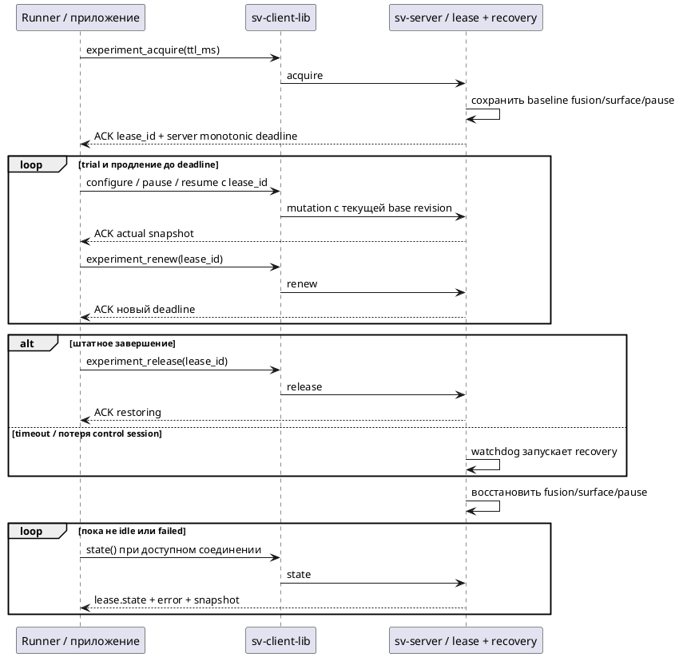
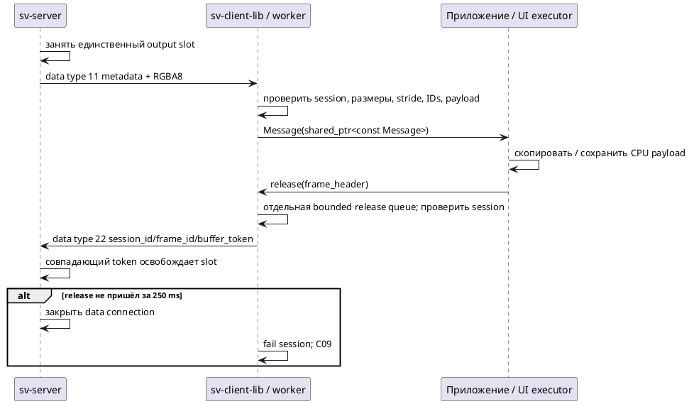
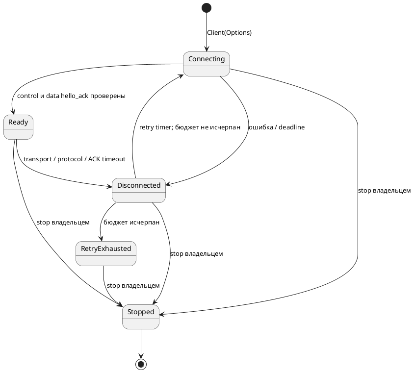
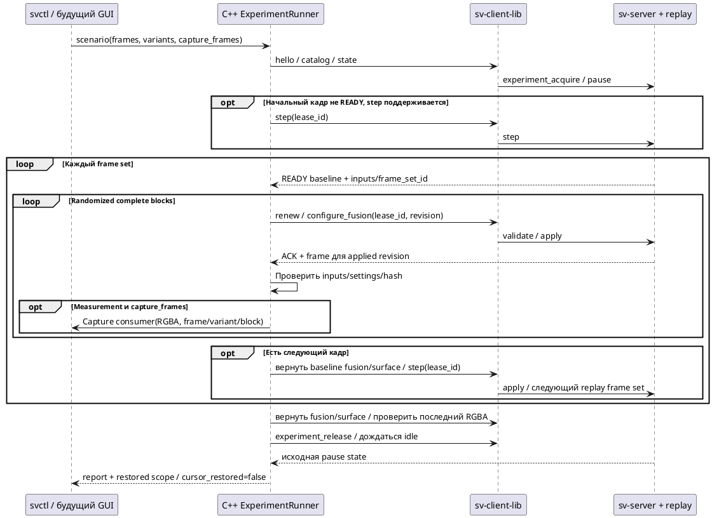
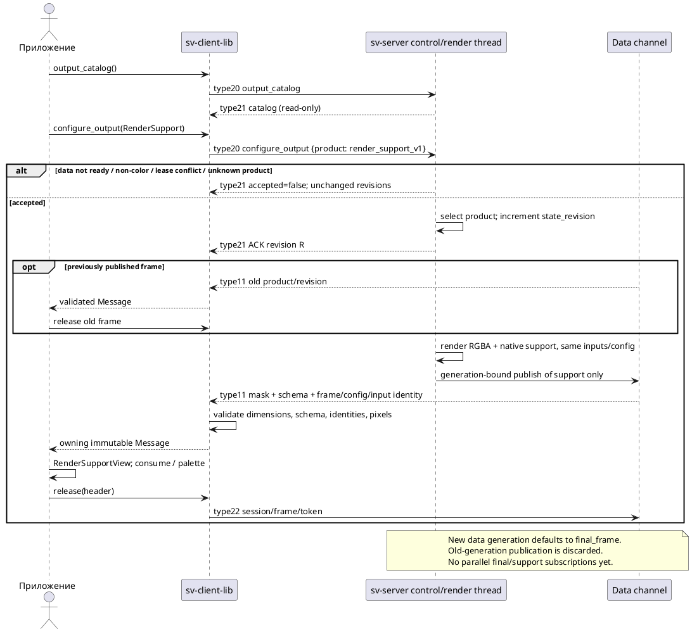

# Сценарии взаимодействия sv-server и sv-client-lib

Сверено с кодом 15.10.2026. Это каталог **реализованных** взаимодействий SV01, а не обещание полного ConfigService. Формат сообщений, параметры и ограничения: [[engineering/PROTOCOL_IMPLEMENTED]]. Целевые расширения: [[architecture/CLIENT_SERVER_MODEL]], [[requirements/PROTOCOL]]. Любое клиентское приложение выполняет описанные операции через `sv-client-lib`; конфигурационный файл изменяет только сервер.

Локальное сравнение individual reports не вызывает SV01 и не требует соединения:
общий C++ service/worker, guards и экспорт описаны в [[engineering/RESEARCH_REPORTS]].

Форма исследования также использует ранее полученный `config_catalog`: локальный C++
capability guard не добавляет wire messages; после него выполняется прежний runner workflow.
[[architecture/RESEARCH_RUNTIME#Выбор профиля исследования по каталогу сервера]].

Критерии опыта остаются локальными в общем C++ evaluator: `quality_criteria` — поле
scenario/report, а не новая SV01 команда и не настройка серверного renderer. Truth и пороги
алгоритму не передаются. [[engineering/RESEARCH_QUALITY#Критерии конкретного сценария без изменения эталона]].

GUI parameter matrix — локальное построение ordinary variants общим C++ expander.
Новых wire messages нет: каждый вариант исполняется прежними lease/apply/frame/restore
операциями. [[architecture/RESEARCH_RUNTIME#Матрица параметров fusion в форме исследования]].

## Границы и обозначения

Реализация: `include/sv/client.hpp`, `src/client_library/client.cpp`, `src/apps/server.cpp`, `src/core/protocol.cpp`, `include/sv/experiment_lease.hpp`. Unix и TCP используют одинаковые сообщения, но разные явно выбранные endpoints. Одна сессия требует двух stream-соединений: control и data. Producer изображений — отдельный входной протокол [[engineering/SOURCES]], не data channel клиентской библиотеки.

В диаграммах «Приложение» означает sv-simulator, автомобильный sv-client, svctl или внешний потребитель библиотеки. Стрелка callback выполняется на worker библиотеки: UI переносит обработку в свой executor. Библиотека не вызывает Qt и не редактирует конфиг сервера.

`svctl research-batch` — клиентский C++ application workflow, не новая SV01-команда.
Он последовательно повторяет существующие lease/reset/apply/frame/restore взаимодействия
через тот же runner и sv-client-lib. Предварительная проверка всех inputs/outputs, остановка при
техническом отказе и отдельная обработка quality rejection: [[engineering/RESEARCH_BATCH]].
PlantUML последовательность: [[architecture/RESEARCH_RUNTIME#Последовательный batch service одной записи]].

GUI reference/import также использует прежние SV01 команды через общий runner. Truth RGB/mask
и criteria остаются у клиента и не передаются алгоритму сервера; input provenance и quality
summaries — поля исследовательского отчёта, не новые wire messages. Последовательность:
[[architecture/RESEARCH_RUNTIME#Выбор reference и импорт одиночного сценария]].

## Полный каталог текущих операций

Каталог содержит 29 серверных команд; запросы передаются как type20, результат — type21. Typed API перечислен там, где он есть; остальные доступны через `command(type, parameters)`. Наличие generic API не означает поддержку неизвестной команды сервером.

| Команда | Запрос помимо command_id/type | Успешный результат / сценарий |
|---|---|---|
| `state` | Нет | Snapshot, revisions, lease; С02 |
| `config_read` | Нет; capability config_read_v1 | Coherent ConfigStore active/persisted/revision, read-only; С13 |
| `config_catalog` | Нет; capability config_catalog_v1 | Fusion/surface/telemetry bounds и replacement/validation policy; С14 |
| `config_validate` | base_config_revision, changes object; capability config_validate_v1 | Read-only candidate check, без renderer preparation/persistence; С14 |
| `config_apply` | base_config_revision, changes, required persist boolean; capability config_apply_v1 | Atomic runtime/persist apply fusion/surface/telemetry; С15 |
| `config_apply_once` | server_instance_id, operation_id, base_config_revision, changes, persist; capability config_operations_v1 | Process-scoped dedup apply; С16 |
| `config_operation_status` | server_instance_id, operation_id; capability config_operations_v1 | Retained committed/rejected/pending/not_found; С16 |
| `telemetry_catalog` | Нет; capability telemetry_v1 | Instance/epoch/settings/units; С17 |
| `telemetry_read` | server_instance_id, epoch, after_cursor, limit integer1..16 | Bounded samples/cursors/loss; С17 |
| `fusion_catalog` | Нет | Каталог fusion версии 5, capabilities параметров; С02 |
| `output_catalog` | Нет | Каталог продуктов/формат маски; С12 |
| `configure_output` | `product=final_frame/render_support_v1/source_visibility_v1/source_disagreement_v1` | Выбор одного data product до следующего render; С12 |
| `surface_catalog` | Нет | Типы носителей и описание plane; С02 |
| `orbit` | `azimuth_delta_rad`, `elevation_delta_rad` | Допустимый view; С03 |
| `zoom` | `distance_delta_m` | Допустимая дистанция; С03 |
| `preset` | `name=top/front/rear` | Выбранный view; С03 |
| `pause` | Optional `lease_id` | Источник подтвердил паузу; С04 |
| `resume` | Optional `lease_id` | Источник подтвердил продолжение; С04 |
| `step` | Optional `lease_id` | Один следующий replay frame set и пауза; С04 |
| `replay_reset` | Optional `lease_id`; replay_reset_v1 | Cursor0, decode-cache/sync-history reset, первый набор и пауза; [[architecture/RESEARCH_RUNTIME#Явный replay start и сброс истории]] |
| `configure_fusion` | `base_config_revision`, полный `fusion`, optional `lease_id` | Temporary replacement; С05 |
| `configure_surface` | `base_config_revision`, полный `surface`, optional `lease_id` | Подготовленная и применённая mesh; С05 |
| `experiment_acquire` | Целый `ttl_ms` 250..30000 | Lease для replay; С06 |
| `experiment_renew` | `lease_id` | Новый deadline с исходным TTL; С06 |
| `experiment_release` | `lease_id` | Начало restoring; С06 |
| `calibrate` | `camera_id`, train/validation XYZ/UV, `provenance`, optional `method` | `job_id`, политика validation; С07 |
| `calibration_status` | `job_id` | Состояние и доступные метрики job владельца; С07 |
| `cancel_calibration` | `job_id` | Кооперативная отмена; С07 |
| `apply_calibration` | `job_id` | Подготовка renderer и persistent config commit; С07 |

С01 и С08–С11 — жизненный цикл и отказы, не дополнительные серверные команды. Форматы вложенных fusion/surface/provenance не дублируются: [[engineering/PROTOCOL_IMPLEMENTED]], [[engineering/RENDERING]], [[validation/CALIBRATION_PROVENANCE]].

## С01. Подключение и привязка data channel

Предусловие: сервер слушает выбранный транспорт, приложение владеет объектом Client. Конструктор библиотеки запускает подключение асинхронно. До события `ready` приложение не должно отправлять рабочие команды.

*Рисунок ПС.1 — Открытие обязательных control/data каналов. Получение control hello ещё не означает ready.*

При ошибке connect/hello или deadline — С09. В текущем сервере нет независимых одновременных клиентских сессий и control-only режима; второй клиент не должен использоваться как параллельный конфигуратор.

## С02. Чтение состояния и возможностей

После ready приложение читает `state`, `fusion_catalog`, `surface_catalog`, сопоставляет handshake capabilities со своими операциями. `state()` и методы catalog возвращают локальный command ID немедленно; сам результат приходит callback-ом с тем же ID. Эти read-only команды не меняют state/config revisions. Каталог fusion содержит ограничения параметров и идентификаторы реализации; поддержку normalized boundary нужно проверять по каталогу.

Приложение хранит серверный snapshot как подтверждённое состояние, а локальные формы — как черновик. Это основа будущего интерфейса с регуляторами, а не требование ручного JSON ввода. Ошибка/таймаут не превращаются в подтверждение применённых настроек.

## С03. Управление view и получение результата

`orbit/zoom/preset` изменяют виртуальную камеру после серверной проверки диапазонов и clearance. Принятая команда обновляет state revision; отвергнутая оставляет её прежней. ACK сообщает итоговый view, но не содержит RGBA. Результат рендера приходит отдельно по data, только когда свободен выходной слот.

ACK и frame идут разными streams: приложение не должно предполагать общий порядок их прихода. Для выбора актуального результата проверять `state_revision`, `config_revision` и фактические view/fusion/surface metadata. `applied_command_id` не является универсальным журналом выполнения всех операций: в частности, read-only/job/lease команды не обязаны менять его. Сопоставление ответа конкретной команде выполняется только по ACK command ID.

## С04. Pause, resume и step

Сервер передаёт управление источнику; ACK отправляется после source control event, а не при одном помещении запроса в очередь. При ожидании source event остальные команды сохраняются для последующей обработки. Причины отказа включают `source_control_queue_full`; step для источника кроме replay — `step_unsupported_for_source`.

Pause сохраняет текущий согласованный набор, но не гарантирует READY: можно остановиться на NO_INPUT/устаревшем наборе. Перед исследовательским trial проверять health и входные frame IDs. Step продвигает replay и оставляет его на паузе. Seek к произвольному кадру и сброс temporal history не реализованы. В активном lease допускаются pause/resume владельца с lease ID, а step владельца разрешён при capability `experiment_step_v1` и действующем lease ID. Позиция replay и history не восстанавливаются.

## С05. Temporary настройка fusion и носителя

*Рисунок ПС.2 — Revision-aware замена исследовательских настроек. Межканальный порядок ACK/frame не гарантирован.*

Вложенный объект полностью заменяет секцию; пропуски optional полей получают defaults. Типизированная библиотека опускает default `pyramid_boundary=zero` для совместимости со старым сервером. Нормализованный вариант отправляется явно. При stale revision перечитать state и предложить/перепроверить новый черновик; не повторять старую мутацию вслепую.

Сохранение этих temporary настроек отдельной командой отсутствует. Вне lease восстановление — отдельная replacement команда с исходной секцией и **текущей** revision. `apply_calibration` сохраняет весь активный snapshot, поэтому перед ним восстановить исследовательский baseline, если эти временные значения не должны попасть в файл.

## С06. Ограниченный исследовательский lease

Предусловия: replay source, idle lease. Библиотека предоставляет acquire/renew/release, а общий C++ runner использует их для последовательности paused frame sets. Lease хранит исходные fusion/surface/pause, но не playback cursor/изображения/temporal history.

*Рисунок ПС.3 — Lease и автоматическое восстановление. ACK release подтверждает начало recovery, не его завершение.*

Active lease пропускает read-only state/catalog/calibration_status; мутации ограничены configure_fusion/configure_surface/pause/resume/step/renew/release владельца. Orbit, новые calibration jobs и persistent apply заблокированы. Старый lease ID не становится обычной мутацией после expiry. В failed состоянии проверить error и серверный журнал; не считать baseline восстановленным. Состояние deadline относится к часам сервера, его нельзя вычитать из часов ноутбука.

## С07. Калибровочная job, отмена и применение

`camera_id` проверяется как JSON integer 0..3 до сужения типа. XYZ/UV принимают конечные JSON integers/doubles без приведения bool/string. Пример `camera_id=4294967296` должен отклоняться, а координата `0` должна иметь тот же смысл, что `0.0`. Точные причины numeric rejects: [[engineering/PROTOCOL_IMPLEMENTED#Команды]]. Эти проверки предшествуют выделению job ID.

Порядок: `calibrate` с train/held-out observations и provenance → ACK `job_id` → polling `calibration_status` → решение оператора → `apply_calibration` либо отмена. Подробная sequence diagram и точные validation требования: [[engineering/PROTOCOL_IMPLEMENTED#Команды]]. Все job операции проверяют владельца session; reconnect не переносит владение job.

ACK calibrate означает постановку задания, а не завершение solver и не применение калибровки. Cancellation кооперативная: текущий вызов OpenCV заканчивается, результат после отмены не применяется. Read-only status не сохраняет файл. Apply требует completed job, предварительного held-out gate и актуальной base config revision; сервер сначала готовит renderer, затем атомарно сохраняет snapshot и публикует активную пару. При отказе сохраняется прежняя конфигурация. Применение временных fusion/surface через persistent snapshot — ограничение С05.

При disconnect сервер отменяет jobs старой session. Клиент должен архивировать запрос/данные/ответы самостоятельно: компактный статус не является полным архивом observations. Проверки split и их ограничения: [[validation/CALIBRATION_PROVENANCE]].

## С08. Приём кадра и release

*Рисунок ПС.4 — Владение выходным слотом и CPU-буфером. Release не уничтожает shared_ptr клиента.*

Release посылается один раз после копирования/получения собственного безопасного владения данными. Output token не является GL handle. Пока слот занят, новый кадр этому stream не публикуется. Несовпадающий frame/token не освобождает слот; release старой session библиотека отбрасывает. Очередь release имеет собственный лимит, поэтому насыщение command submission само по себе не отнимает её ёмкость. Насыщение самой release queue всё ещё является ошибкой.

Release содержит только metadata, без binary body. Непустой payload закрывает серверный data connection без отдельного ACK, включая случай правильного token. Control остаётся жив; штатная библиотека воспринимает data EOF как потерю своей сессии (С09). На стороне API oversized metadata отклоняются до post и до расходования release submission budget, даже до ready. Вызывающий код получает synchronous exception; worker не должен обнаруживать эту ошибку впервые при send.

## С09. Ошибка, потерянный ACK и reconnect

Транспортная ошибка, malformed response, handshake/partial-message/command deadline переводят библиотеку в disconnected: оба канала закрываются, session/token очищаются. Каждая ожидающая ACK команда получает локальное Error `session_lost` с command ID; затем выдаются причина сбоя и State(disconnected). Это локальные события type 3, не отдельные серверные wire сообщения.

Если мутация уже была отправлена, `session_lost` означает **неизвестный результат**, а не доказанный rollback: сервер мог применить её до потери ACK. Pending команды автоматически не воспроизводятся. Reconnect создаёт новую сессию на том же endpoint; после ready приложение повторно читает capabilities/state. На исчерпании max_retries приходит retry_exhausted; новый ready сбрасывает счётчик последовательных ошибок. Operation ID deduplication и восстановление исходного ACK по ID пока отсутствуют.

*Рисунок ПС.5 — Жизненный цикл библиотеки. Stopped — терминальное состояние конкретного Client.*

## С10. Параллельные команды, отказ и границы очередей

`command()` разрешён из нескольких потоков потребителя. Выдача ID, предварительная encode validation и post в worker сериализованы одним mutex: меньший отправленный ID не обгоняется большим. Порядок одновременно начатых вызовов между потоками не определён заранее. ID монотонны в пределах объекта Client, не сбрасываются при reconnect; сервер проверяет возрастание в пределах control connection. Пропуски ID после синхронной ошибки допустимы. При исчерпании uint64 библиотека выбрасывает overflow_error; wrap в 0 запрещён, нужен новый Client.

Невалидный размер/полная submission queue дают синхронное исключение. Если отправка уже поставлена в worker, но тот ещё не ready или заполнен pending ACK budget, приходит локальный Error `not_ready_or_queue_full` с ID, запрос не отправляется серверу. На уровне сервера повторный/меньший ID получает reject `duplicate_or_out_of_order`; этот ранний ACK может не содержать полного state snapshot. Неизвестная команда — `unknown_command`, invalid command parameters — reject. Ошибка framing/handshake закрывает connection и не обязана возвращать command ACK.

Тест `client_command_order`: восемь конкурентных отправителей, 256 команд с неравным объёмом encoding, TCP mock с настоящими SV01 codec и библиотекой, проверка всех IDs на wire и принятых ACK. До исправления воспроизведён порядок 3,4,5,1,2 и серверный reject; после — возрастающий порядок без reject. Это тест транспорта/библиотеки, не подтверждение multi-client сервера.

## С11. Остановка владельцем

Владелец сериализует `stop()`/destruction с вызовами command/release. Stop отменяет работу, присоединяет worker и закрывает sockets; после возврата callbacks не выполняются. Остановка не обещает ACK/terminal Error для каждой queued команды. Callback не должен вызывать blocking stop или уничтожать Client: остановку нужно запланировать во владеющем потоке. Повторный stop допустим.

## Проверки и оставшиеся сценарии

| Сценарии | Существующее покрытие |
|---|---|
| С01–С04, С08–С09 | `client_lifecycle`, `client_transports`, `replay_ipc`, `server_session` |
| С05 | `render_fusion_parity`, `native_fusion_parity`, runtime GUI probes внутри `client_transports` |
| С06 | `experiment_lease`, `experiment_watchdog`, `research_scenarios`, lease/runtime checks внутри `client_transports` |
| С07 | `command_parameters`, `calibration_job`, `calibration_observations`, `config_store_persistence`, provenance/numeric checks внутри `replay_ipc` |
| С08, С10 | `client_release_budget`, `client_command_order` |
| С11 | `client_lifecycle` и cleanup остальных library suites |

Названия — точки входа проверок, а не утверждение о полном покрытии всех ветвей. Длительный overload, два физических узла, fuzz decoder, cancellation/ACK races и fault injection persistence для config_apply реализован; остальные ветви требуют расширения. Multi-session, control-only, parallel subscriptions/остальные intermediate products (один выбранный support product реализован в С12), durable operation recovery/retention, другие ConfigService groups и UDP находятся в TODO; не добавлять их в список текущих возможностей без реализации и тестов.

### С06а. Несколько paused frame sets и capture

Это расширение С06 теми же командами; новых wire command types нет. Capability `experiment_step_v1` означает разрешённый step владельца lease. Клиент проверяет её до mutation для frames>1.

*Рисунок С06а — Последовательное сравнение вариантов на одних входах каждого кадра. Capture consumer не управляет fusion; исключение вызывает тот же cleanup, что cancel.*

Восстановленный image hash сравнивается с baseline последнего пройденного кадра. Cursor/history не восстанавливаются; новый READY после stale preparation также продвигает позицию. Lease не является полной транзакцией replay. Ограничения и тесты: [[validation/RESEARCH_RUNTIME]], опыт: [[validation/SERVER_BOUNDARY]].

## С12. Выбор и получение local-support mask

Предусловия: HELLO capabilities output_selection_v1/render_support_v1, data ready, color diagnostic, experiment lease idle. Полный формат и пределы — [[engineering/PROTOCOL_IMPLEMENTED#Выбор data product: output_selection_v1 / render_support_v1]].

Рисунок — Реализованный сценарий выбора support product с сохранением bounded release semantics.

После ACK приложение может увидеть старый in-flight продукт: release обязателен, затем ожидать output_product=render_support_v1 и state_revision>=R. При восстановлении final_frame повторить configure_output; конфиг на диске не меняется. Не путать sample eligibility или local base weights с scene visibility и полным multiband contribution. Tests: [[validation/OUTPUT_PRODUCTS]].

Сценарий С12 также применяется к source_visibility_v1: каталог/schema → configure_output → ACK state_revision → type11 statuses → release. Проверять product и revision каждого пакета; older in-flight пакет освободить и пропустить. При reconnect повторно выбрать продукт. Color/lease rejection, native parity семи modes и typed Unix/TCP consumption проверены: [[validation/SOURCE_VISIBILITY_PRODUCT]].

### Сценарий отображения fallback через configure_fusion

Клиент читает state и fusion_catalog, проверяет fallback_display capability, копирует fusion snapshot и устанавливает nested mode=hatch. Сервер проверяет base_config_revision/lease и всю конфигурацию, применяет её между render calls и возвращает временный snapshot. Клиент ждёт frame с применённой revision; после ACK возможен прежний in-flight frame. Stale/invalid request не меняет state/config revisions. Legacy возвращается full replacement с mode=legacy либо omission. Настройка не пишет config file; внутри experiment сохраняется прежний lease restore contract. Последовательность и ограничения: [[diploma/04_EXPERIMENTAL_STUDY#4.87.3. Процесс управления и интерфейс]], [[validation/FALLBACK_DISPLAY]].

### Расширение С12: encoded RGB disagreement

Вместо render_support_v1 выбрать source_disagreement_v1, проверив catalog/schema. Сервер вычисляет обычный кадр и отдельный native eligible RGB pass, передаёт выбранную integer matrix с теми же frame/config/input identities. Client validator проверяет exact schema/shape/domain/counts, SourceDisagreementView различает undefined и defined-zero; release/old in-flight filtering прежние. Смена non-color/active lease отвергается без mutation. Диагностика не включает rejection threshold, не меняет cameras/fusion и не доказывает scene correspondence. Sequence: [[diploma/04_EXPERIMENTAL_STUDY#4.88.2. Реализация server/library и формат]].

## С13. Согласованное чтение ConfigStore

Реализованы read_configuration() и owning parse_configuration_snapshot(); snapshot доступен без lease token и не меняет revisions/рендер/файл. Scope исключает session view и launch-only CLI overrides. Диаграмма request/ACK, oversize rejection и поля: [[engineering/CONFIG_SERVICE]]. Discovery/validation описаны в С14; Атомарное применение описано в С15.

## С14. Discovery и проверка без применения

Приложение читает catalog и snapshot, формирует полные replacement groups fusion/surface и вызывает validate_configuration(base_revision, changes). Валидный запрос возвращает configuration_validation, invalid/stale — rejected ACK с reason. Даже успешный результат не резервирует revision, не подготавливает GPU и не применяет настройки. Операции разрешены при lease и не вызывают новый paused render. Диаграмма последовательности, поля/границы и проверки: [[engineering/CONFIG_SERVICE]].

## С15. Revision-aware runtime/persistent apply

Клиент читает snapshot/catalog, редактирует replacement groups и вызывает apply_configuration(base, changes, persist). Сервер проверяет session constraints, готовит renderer, повторно проверяет revision под store lock, при persist=true заменяет файл, затем публикует prepared state между render calls. Ошибка до публикации сохраняет прежний state. Во время experiment lease запрос отвергается. Accepted ACK содержит typed application receipt; старый in-flight frame освободить, ожидать новую revision. Потеря ACK требует reconciliation через config_read, автоматического повтора нет. Диаграмма и проверки: [[engineering/CONFIG_SERVICE]].

## С16. Восстановление результата после потери ACK

Приложение сохраняет server_instance_id, уникальный operation ID и неизменный intent до apply_configuration_once(). При потере ACK переподключается, проверяет instance, получает configuration_operation_status(). Explicit retry того же запроса возвращает retained результат без новых revisions/dirty. Конфликт intent отклоняется; отказ тоже сохраняется. После restart старый instance отклоняется: автоматического replay нет. Bounded journal без eviction, lease semantics, historical revision, API, sequence diagram и проверки: [[engineering/CONFIG_OPERATIONS]].

## С17 — Чтение отключаемой devel telemetry

Catalog → typed read с instance/epoch/cursor → проверка schema/sequence/revision → отметка потерь →
следующий cursor. При epoch/instance смене начать новую серию. Read не включает sampler, не
меняет revisions/dirty и разрешён под lease; hot изменение группы telemetry выполняется по С15/С16.
Последовательности, sample fields и null/fresh semantics: [[engineering/TELEMETRY]].
Sampling не зависит от нового frame/release, но control/data по-прежнему обязательны.

### С17: input operation observations

Telemetry catalog/HELLO объявляют source_work_timing_v1. Read может включать selected input work;
SDK проверяет epoch, IDs, clocks/durations. При hot telemetry settings old-session work исключается,
а новому источнику/step требуется создать observation текущей серии. Looping replay следует явно
поставить на pause для такого теста. Контракт/PlantUML: [[engineering/SOURCE_TIMING]].

Дополнение telemetry сценария: source.camera_diagnostics передаётся независимо от frame.fresh,
включая недоступные камеры без кадров. Это optional состояние источника, не событие source_work;
reset epoch не обнуляет lifetime counters. SDK валидирует ordered camera_id0…3 и типы, архив
сохраняет точные значения. Новые команды/сценарии подключения не добавлены.
[[engineering/SOURCES#Диагностика состояния каждой аппаратной камеры]].

Дополнение telemetry сценария: optional negotiated_mode относится к текущему source open attempt,
очищается при начале open/close и допускается без frame record. Оно не связывает автоматически
selected Frame с новым capture generation после reconnect. Legacy omission/null принимаются;
stale attempt/stopped inconsistency отклоняются. [[engineering/SOURCES#Проверенный режим камеры через SDK]].

Reconnect сценарий дополнен разделением current capture mode и selected Frame provenance: старый выбранный Frame сохраняет opening identity; повторный render/sample не переписывает её текущим состоянием. SDK сравнивает source_work/selected source_sequence, а не historical attempt с current counter. [[engineering/SOURCES#Происхождение выбранного кадра при reconnect]].

Дополнение telemetry сценария восстановления камеры: клиент получает recovery snapshot даже без frame. Во время retry наблюдаем streak+назначенный wait; после завершения worker — stopped и terminal reason. Stop очищает wait, release failure приоритетен над исходной причиной выхода. Resume не пересоздаёт завершённый worker. Отсутствие snapshot у старого сервера принимается. Новых команд нет. [[engineering/SOURCES#Снимок восстановления камеры]].

CameraCaptureMode дополнен optional `automatic_properties` (nullable fps/fourcc/buffer_count) для best-effort readback незаданных свойств. Checked и automatic значения одного свойства одновременно non-null запрещены. SDK принимает legacy omission/null; extension сохраняется в current telemetry, selected type11 provenance и archive schema1. Новых команд нет. [[engineering/SOURCES#Наблюдаемые свойства автоматического профиля камеры]].

На Boost≥1.83 продуктовые JSON-пути используют общую Precise number policy: SV01 decoder, load_config, GUI/CLI intents и archive import. В installed SDK доступен sv/json.hpp. Framing/команды не меняются; Legacy dataset reader и старый Boost имеют отдельные ограничения. Новые config/wire baseline могут отличаться последними binary64 bits. Контракт, regression и миграция: [[engineering/JSON_PRECISION]].

## Повторный запуск записи с первой строки

Runner/другой клиент получает replay lease, запрашивает `replay_reset`, ждёт post-ACK frame и
проверяет READY + timestamps строки0; затем применяет варианты и выполняет step между frame sets.
На неполной первой строке исследовательский runner прекращает опыт и восстанавливает настройки.
Release/expiry восстанавливает fusion/surface/pause; позиция записи не возвращается. После loss of
ACK автоматический reset retry запрещён: это новая мутация, а не idempotent запрос.
Sequence diagram и граница очистки истории: [[architecture/RESEARCH_RUNTIME#Явный replay start и сброс истории]].
Точный контракт: [[PROTOCOL_IMPLEMENTED#Сброс replay к первой строке (`replay_reset_v1`)]].

### GUI batch одной записи

Выбор сохранённого плана вызывает клиентский C++ `run_batch` в worker. Новых wire-команд нет:
каждый сценарий использует прежние lease/reset/apply/render/restore через sv-client-lib.
Progress и aggregate report — локальный application-service контракт, не server job ID.
Другой клиент может работать между lease отдельных участников; серия не является общей
транзакцией и не меняет запись на сервере. Ошибка критериев продолжает серию, техническая
ошибка/отмена прекращает новые запуски. См. рисунок RR.9 в [[architecture/RESEARCH_RUNTIME]]
и [[engineering/RESEARCH_BATCH#Запуск batch-плана из GUI]].

Визуальный состав batch преобразуется C++ builder из URL в абсолютные scenario paths;
контроллер фиксирует документ/endpoint до worker. `run_batch(document, base, ...)` использует
тот же preflight и тот же lease/reset/apply/render/restore, что файловый запуск; новых wire
operations нет. До сети сохраняется `inputs/plan.json`; источники/эталоны не копируются и
должны оставаться доступными для повторения. Это client-side plan snapshot, не серверный
job/checkpoint. [[engineering/RESEARCH_BATCH#Визуальное составление серии]], рисунок RR.10.

Импорт batch в редактируемый список — локальная структурная операция клиента без wire-команд.
Общий parser проверяет весь документ до замены списка; относительные пути привязаны к каталогу
выбранного batch, ID/порядок сохранены. Ошибка/отмена не меняет прежний draft и результаты
исследования. Импорт не читает references и не доказывает совместимость server recording;
последующий запуск выполняет прежний полный preflight/reset/apply/render/restore.
[[engineering/RESEARCH_BATCH#Импорт плана в редактор серии]], рисунок RR.11.

Сохранение batch-черновика — локальный C++ write_batch_plan без wire-команд и без запуска
worker. Builder фиксирует абсолютные scenario paths; общий parser проверяет структуру до
O_EXCL reservation нового файла. Отмена/ошибка сохраняет UI состав и прежние результаты;
busy save отклоняется. Последующее исполнение заново проверяет inputs/budgets и использует
прежние lease/reset/apply/render/restore. См. рисунок RR.12 и
[[engineering/RESEARCH_BATCH#Сохранение черновика без исполнения]].
