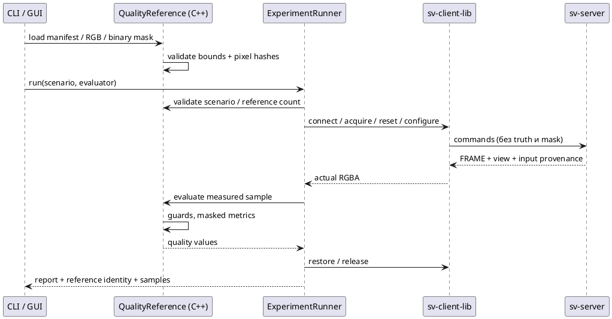

# Внешние RGB-эталоны в C++ ExperimentRunner

Реализация: `examples/common/research/quality_reference.*`, `quality_metrics.*`.
Сценарий запускается через `svctl research` и настоящую sv-client-lib. Сервер выполняет
сшивку/рендеринг; клиентский C++ evaluator получает только результат. Эталон и mask не
передаются серверу, поэтому исследуемый алгоритм не использует их для выбора шва.

## Подготовка и запуск

В scenario schema1 добавьте относительный путь к manifest эталонов и явный reset:

```json
{
  "schema_version": 1,
  "frames": 1,
  "reset_replay": true,
  "quality_reference": "quality/reference.json",
  "warmup": 2,
  "repeats": 5,
  "variants": [{"mode": "multi_band", "pyramid_boundary": "normalized"}]
}
```

Путь `quality_reference` разрешается относительно **файла сценария**, пути RGB/mask — относительно
**manifest эталонов**. Absolute paths также разрешены. Используйте новые report/capture paths:

```sh
build/svctl --unix /tmp/sv-prototype --timeout-ms 10000 research \
  artifacts/study/scenario.json artifacts/study/report-01.json
```

Создайте `artifacts/study/quality/reference.json` и указанные в нём изображения заранее.
Пример ниже рассчитан на один кадр; для frames=N нужны ровно N entries в порядке replay.
View, resolution, calibration IDs и timestamps замените значениями вашего стенда/набора:

```json
{
  "schema_version": 1,
  "kind": "independent_ground_truth",
  "dataset_id": "holdout-scene-a",
  "width": 640,
  "height": 360,
  "view": {"azimuth_rad": 0.0, "elevation_rad": 1.2, "distance_m": 8.0,
           "fov_y_rad": 1.0, "clip_m": [0.1, 50.0], "target_m": [0.0, 0.0, 0.0]},
  "frames": [{
    "rgb": "direct-view-0000.ppm",
    "mask": "evaluation-mask-0000.ppm",
    "inputs": [
      {"camera_id": 0, "calibration_id": "front-v1", "source_timestamp_ns": "0"},
      {"camera_id": 1, "calibration_id": "right-v1", "source_timestamp_ns": "0"},
      {"camera_id": 2, "calibration_id": "rear-v1", "source_timestamp_ns": "0"},
      {"camera_id": 3, "calibration_id": "left-v1", "source_timestamp_ns": "0"}
    ]
  }]
}
```

RGB и mask — P6 PPM, 8 bit, top-left; mask тоже трёхканальная: каждый пиксель строго
(0,0,0) или (255,255,255). Белый включает пиксель, чёрный исключает. Хотя бы один пиксель
должен быть включён. Код не подбирает маску по output/ошибке: автор заранее определяет ROI
и объясняет исключения в протоколе исследования. Нет автоматического resize, gamma conversion,
flip, SSIM, object/ghost segmentation или подгонки exposure.

`kind=independent_ground_truth` означает заявленное автором независимое прямое изображение
с тем же виртуальным ракурсом; независимость не проверяется программно.
`kind=regression` обязателен для сохранённого вывода исследуемого сервера: он проверяет
совпадение/изменение, но не физическую правильность реконструкции. Не переименовывайте
серверный capture в независимую truth. `dataset_id` — декларация автора, не проверенная
сервером content identity. В legacy schema1 input guards проверяют только calibration IDs/timestamps. Для новых
подтверждающих опытов используйте schema2 с content/model guards, описанную ниже.

## Проверки и ограничения загрузки

Manifest — не более1 MiB, schema1/schema2 с проверкой неизвестных полей. Frames1…256,
resolution2…4096 ×2…2160; суммарный размер RGB+mask pixels не более128 MiB. Изображения
загружаются и mask проверяется **до подключения к серверу**. CLI также проверяет совместимость
scenario до reservation report: malformed reference не создаёт report и не меняет сервер.

Требуются reset_replay=true, точное количество frame references и color diagnostic всех variants.
C++ API принимает `shared_ptr<const QualityReference>` последним аргументом `run`; GUI может
загрузить тот же объект и передать его без записи дополнительного JSON. Если scenario содержит
quality_reference, но evaluator не передан, run возвращает failed report до подключения.
Клиент не запускает Python для оценки.

HELLO должен объявлять `frame_view_v1`: FRAME содержит `view={azimuth_rad,elevation_rad,distance_m,fov_y_rad,clip_m,target_m}`,
снимок фактически использованной виртуальной камеры. Для каждого measured sample проверяются:

- RGBA8/top_left, packed stride и совпадающие width/height;
- READY, replay, final_frame, color и точное равенство view;
- четыре used inputs в порядке0…3, совпадение calibration_id/source_timestamp_ns каждого.

Поля timestamps — канонические десятичные строки uint64. Ошибка guard прекращает опыт;
lease cleanup/restore выполняется обычным runner. Нет скрытого преобразования view или пропуска
неподходящей строки. На старом сервере отсутствие capability отклоняется до acquire/reset.
Побитовая числовая совместимость на старых Boost/Аврора ещё требует целевой проверки.

## Метрики и отчёт

Для множества M выбранных пикселей и каналов c∈{R,G,B}:

$$
\operatorname{MAE}=\frac{1}{3|M|}\sum_{p\in M,c}|I_{pc}-T_{pc}|,
\quad
\operatorname{RMSE}=\sqrt{\frac{1}{3|M|}\sum_{p\in M,c}(I_{pc}-T_{pc})^2}.
$$

$$
\operatorname{PSNR}=10\log_{10}\frac{255^2}{\operatorname{MSE}}.
$$

Это ошибки **кодовых значений RGB8**, не linear-light radiometric errors. Alpha игнорируется.
При MSE=0 записываются `exact_match=true`, `psnr_db=null`, а не невалидная JSON infinity.
Также сохраняются selected_pixels и max_absolute_rgb8. Результаты находятся в
`samples[*].quality`; warmup не оценивается и не входит в quality summaries.

`report.quality_reference` содержит algorithm=masked_rgb8_v1, kind/dataset_id, SHA-256 исходного
manifest, hashes **декодированных RGB/mask pixels**, dimensions/view/input guards/ROI count.
Хэши pixels не являются hashes исходных файлов PPM; форматирование PPM может отличаться.
`scenario_sha256` включает locator quality_reference, если он задан; content identity эталона
смотрите отдельно в quality_reference. Manifest/hash не доказывают истинность эталона.

`quality_summaries` агрегирует по variant: один результат на frame_index, а не на каждый
paused repeat. MAE взвешивается числом выбранных пикселей; RMSE — корень взвешенного MSE.
`pixel_weighted_psnr_db` вычисляется из той же общей MSE: PSNR кадров не усредняется.
При нулевой MSE `exact_match=true`, PSNR равен JSON null; без оценённых кадров поле PSNR
отсутствует. GUI отображает точное совпадение отдельным символом, не числом 0 dB.
Frames одного клипа также не объявляются статистически независимыми сценами. Если результаты
одного frame/variant меняются между measured repeats, success=false и quality_error фиксирует
нестабильность; restore к этому моменту уже выполнен. Samples сохраняются для диагностики.

`success=true` означает завершённый workflow и прошедшие guards; результат порогов качества
находится отдельно в quality_acceptance. Механизм пороговых критериев описан ниже. Holdout/scene seeds, доверительные интервалы,
полная dataset/config identity и полноценная quality-oracle orchestration ещё предстоят. Время evaluator/capture —
клиентская нагрузка вне server pipeline_spans_ms; такие прогоны не измеряют sustained FPS.

Reference можно выбрать в форме sv-simulator либо загрузить сохранённый сценарий с его
относительными ссылками. Общий FileExperiment выполняет preflight до output reservation и
сети; качество, kind reference и workflow status показаны раздельно. Инструкция и происхождение
input bytes: [[engineering/RESEARCH_BATCH#Исследование из sv-simulator]].



*Рисунок Q.1 — независимость канала эталона от исследуемого серверного алгоритма; истинность
самого эталона остаётся ответственностью протокола исследования.*

Проверки: [[validation/RESEARCH_RUNTIME]]. Общий workflow: [[architecture/RESEARCH_RUNTIME]].


## Schema2: проверка содержимого входов и числовой модели

Показанный выше schema1 сохранён для чтения прежних reference manifests; report явно помечает
его `input_guard=legacy metadata only...`. Для новой серии замените schema_version на2 и добавьте
**к каждому из четырёх** inputs обязательные поля:

```json
{
  "camera_id": 0,
  "calibration_id": "front-v1",
  "source_timestamp_ns": "0",
  "image_identity": {
    "algorithm": "packed_rgb8_sha256_v1",
    "sha256": "<64 lowercase hex characters of the expected decoded image>",
    "width": 320, "height": 180,
    "pixel_format": "RGB8", "row_origin": "top_left"
  },
  "camera_model_sha256": "<64 lowercase hex characters of the expected numeric camera model>"
}
```

Значения в угловых скобках нужно заменить реальными digest: loader отклоняет placeholders,
неполные guards, неправильные algorithms/dimensions и неканонические hashes. Copy из прежнего
report допустим для regression/reference provenance, но независимость RGB truth этим не доказывается.
Schema2 требует server capability replay_input_identity_v1 **до acquire/reset**; fallback на schema1
или сравнение только timestamps автоматически не выполняется.

Replay worker считает image hash при cache miss по реально загруженному packed RGB8 buffer;
доставленные Frames владеют immutable image и его hash. После reset cache/hash очищаются и
вычисляются заново. Изменённый файл по прежнему пути до cache miss не меняет уже загруженный
buffer: hash описывает использованные pixels, а не текущее состояние файла на диске. PNG/JPEG
headers/compression не входят в identity. Смысл — равенство декодированных наблюдений.

Точное представление packed_rgb8_sha256_v1: ASCII `sv-packed-rgb8-v1`, NUL, width и height как
uint32 big-endian, затем width×height×3 RGB bytes в порядке строк top-left. Размер входит в digest,
поэтому reshape одних bytes не совпадает. camera_model_sha256_v1: ASCII `sv-camera-model-v1`, NUL,
uint32 big-endian id/width/height, затем IEEE754 binary64 big-endian в порядке fx,fy,cx,cy,
theta_max,z_epsilon,k[0..3],T_camera_from_vehicle[0..15] row-major. Нули канонизированы в+0,
не-finite значения запрещены. Name/calibration_id не входят в numeric model hash; calibration_id
проверяется отдельно. Это модель текущего renderer, не hash всего server config или файла calibration.

Сервер помещает model hash **активной** модели renderer и image identity каждого used replay input
в FRAME. Смена числовых параметров с прежним calibration ID либо подмена RGB при прежнем timestamp
вызывают input guard mismatch. Capability не обещается camera/socket sources: real-camera hashing
не добавлен. Хэширование добавляет работу при decode; replay_load timing остаётся временем loader,
а не всего hash/cache preparation. Текущие render spans также не измеряют полную стоимость source
hashing. Для performance нужно отдельно учесть эту нагрузку; эффект на target пока не измерен.


## Заданные до запуска критерии качества

Manifest schema1/schema2 принимает optional непустой `criteria`:

```json
"criteria": {"max_mae_rgb8": 5.0, "max_rmse_rgb8": 10.0, "min_psnr_db": 30.0}
```

Можно указать любое непустое подмножество трёх полей. MAE/RMSE thresholds — finite0…255,
PSNR — finite0…200 dB; unknown/negative/boolean/string values отклоняются до подключения.
Сравнения включают границу: MAE≤max, RMSE≤max, PSNR≥min. Perfect match с psnr_db=null,
exact_match=true удовлетворяет любому допустимому min PSNR. Числа criteria и view нормализуются
в double, поэтому синтаксис8 и8.0 не создаёт ложного несовпадения. Дробные значения не округляются
до integer, epsilon при сравнении view не применяется.

Criteria загружаются с reference до подключения и входят в manifest_sha256. Файл после загрузки
не перечитывается. Это фиксация порогов данного прогона, **не** внешняя научная регистрация:
пороги всё равно нужно обосновать/утвердить до подтверждающей серии. Пример5/10/30 не является
рекомендованной нормой качества или результатом выбора алгоритма.

Каждый measured sample получает quality.acceptance={passed,failed_criteria}. Пороговый отказ
не останавливает trials: остальные варианты/кадры и restore должны выполниться, чтобы не скрыть
плохие условия. Отмена/ошибка guard/capture/restore сохраняют существующий failed workflow.

В report.quality_acceptance:

| Status | Значение |
|---|---|
| not_requested | Criteria отсутствуют; нет заявления о прохождении порогов |
| incomplete | Workflow/restore не завершён либо нет полного measured sample set |
| passed | Все measured samples полного опыта проходят все заданные thresholds |
| failed | Полный опыт завершён, хотя бы один measured sample нарушил threshold |

Policy all_measured_samples_v1 проверяет **каждый** sample, а не только среднее качество.
Expected count=frames×variants×repeats, warmup исключён. Evaluated/failed_samples — число
повторных рендеров; evaluated/failed_frame_variants — число уникальных пар(frame_index,variant),
а не число независимых сцен. Raw samples позволяют локализовать конкретный метод/кадр.
Success и restored остаются статусами выполнения, а не качества: допустим success=true,
restored=true, quality_acceptance.status=failed. При неполном опыте status всегда incomplete,
даже если все успевшие samples прошли thresholds.

CLI выводит quality_status и возвращает0 для успешного workflow с passed/not_requested,
5 для полного опыта с failed,4 для ошибки workflow/incomplete. Ошибки preflight/argument parsing
остаются прежними исключениями CLI; не трактуйте любой ненулевой код как качество failed.
В автоматизации сохраняйте report и различайте scientific rejection(5) и технический отказ(4).
Для threshold study schema2 предпочтительнее legacy metadata-only schema1.


## Проверка на сохранённом прямом Blender RGB

`research_quality_fixture` использует committed tests/data/paired_street_v1: verifier проверяет
capture/file hashes, poses/timestamps и прежнюю object-ID ROI (исключены кузов, фон и полоса
вокруг границ). Test fixture adapter переводит PNG truth/ROI в PPM и формирует schema2 guards.
Сшивка и metrics исполняются native sv-server/svctl; Python здесь только fixture/oracle/checks.

```sh
ctest --test-dir build -R '^research_quality_fixture$' --output-on-failure
# Для сохранения всех native reports/frames выберите новый каталог:
LIBGL_ALWAYS_SOFTWARE=1 EGL_PLATFORM=surfaceless \
  python3 tests/test_research_quality_fixture.py build --output artifacts/q-native-mesa-new
python3 docs/diploma/plot_native_quality.py --run artifacts/q-native-mesa-new
```

В persistent output находятся config/scenario/reference manifests, PPM truth/masks, server trace,
report.json, report.json.frames и oracle-check.json. Это результаты выполнения, не assets;
они остаются в ignored artifacts. Committed figure — иллюстрация документации.
Старый output нельзя перезаписывать. Test сравнивает24 samples/96 metric values с NumPy,
не требует ненулевой ошибки (совершенная реконструкция тоже допустима), не задаёт quality thresholds.
Fixture reused, три близкие позы одной низкодетализированной сцены — не новый holdout.

## Критерии конкретного сценария без изменения эталона

Scenario schema1 теперь допускает optional непустой `quality_criteria` вместе с
`quality_reference`. Пример фрагмента:

```json
{
  "quality_reference": "quality/reference.json",
  "quality_criteria": {"max_mae_rgb8": 0.125, "min_psnr_db": 40}
}
```

Это **полная замена** criteria из manifest для данного опыта. В примере прежний
`max_rmse_rgb8`, даже если он был в manifest, больше не применяется. При отсутствии
`quality_criteria` сохраняется прежнее наследование; пустой объект, неизвестное поле,
нечисловое/неfinite/отрицательное значение и criteria без reference отвергаются.
Диапазоны те же: MAE/RMSE0…255, PSNR0…200dB; примеры не задают норму качества.
Для режима «только метрики» без приёмки используйте reference без criteria и не задавайте
override. Отдельного скрытого отключения manifest thresholds нет.

`FileExperiment` передаёт override immutable `QualityReference` при preflight; RGB/masks,
view/input guards и содержимое исходного manifest не меняются. Даже при override manifest
обязан оставаться корректным. Prepared evaluator фиксирует изображения и критерии до
output reservation/network; позднее редактирование файлов не меняет текущий опыт.
Прямой C++ `run` требует согласованных Scenario и загруженного evaluator: несоответствие
criteria override отвергается до подключения.

Отчёт содержит:

| Поле | Значение |
|---|---|
| `scenario.quality_criteria` | Явно заданный override; участвует в scenario hash |
| `quality_reference.manifest_sha256` | SHA256 исходных bytes manifest без переписывания |
| `quality_reference.criteria` | Эффективный набор, если задан |
| `quality_reference.criteria_source` | `manifest_v1`, `scenario_override_v1` или `not_requested` |
| `quality_reference.manifest_criteria` | При override — исходные нормализованные criteria либо null, если их не было |
| `quality_acceptance.criteria` | Набор, применённый прежней all_measured_samples_v1 policy |

Прежние manifest schema1/schema2 не получают новых обязательных полей. `criteria_source`
и `manifest_criteria` — metadata отчёта, их не надо добавлять в исходный manifest.
GUI scenario snapshot сохраняет reference locator и override до исполнения; batch использует
тот же FileExperiment, поэтому каждый участник может иметь собственные criteria.

В **Исследование → План → Настроить через форму** выберите reference, включите
**Задать полный набор критериев для этого опыта**, отметьте нужные MAE/RMSE/PSNR и
задайте пределы. Каждое неотмеченное поле исключено из override. Изначально не отмечено
ни одного предела: запуск потребует явного выбора. Ноль допустим, но не рекомендован
автоматически. Форма поддерживает шесть знаков после запятой; C++/scenario API сохраняет
поддерживаемую double точность для более мелких порогов. Отключение режима возвращает
наследование manifest, сохраняя введённые значения для последующего явного включения.
Saved scenario/batch не получают thresholds текущей формы.

В сравнении отчётов два паспорта теперь показывают effective criteria/source. Разные
thresholds/origins дают reason `acceptance_policy_differs`. Это не запрещает сравнение
сырых MAE/RMSE при прежних content/truth gates, но два verdict нельзя интерпретировать как
прохождение одинаковых условий. Независимость truth и научная обоснованность выбранных
порогов по-прежнему требуют отдельного подтверждения.

Сценарии с новым `quality_criteria` требуют обновлённого runner: прежний strict parser
отклонит неизвестное поле. Старые сценарии без override сохраняют прежнюю семантику.
