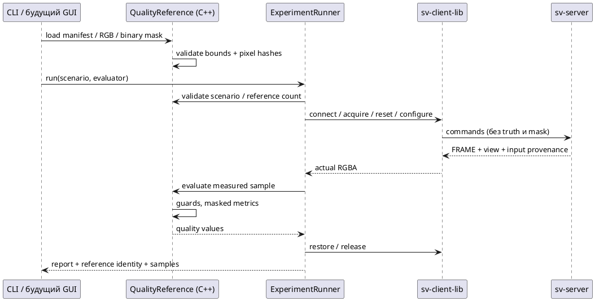

# Внешние RGB-эталоны в C++ ExperimentRunner

Реализация: `examples/common/research/quality_reference.*`, `quality_metrics.*`.
Сценарий запускается через `svctl research` и настоящую sv-client-lib. Сервер выполняет
сшивку/рендеринг; клиентский C++ evaluator получает только результат. Эталон и mask не
передаются серверу, поэтому исследуемый алгоритм не использует их для выбора шва.

## Подготовка и запуск

В scenario schema1 добавьте относительный путь к manifest эталонов и явный reset:

```json
{
  "schema_version": 1,
  "frames": 1,
  "reset_replay": true,
  "quality_reference": "quality/reference.json",
  "warmup": 2,
  "repeats": 5,
  "variants": [{"mode": "multi_band", "pyramid_boundary": "normalized"}]
}
```

Путь `quality_reference` разрешается относительно **файла сценария**, пути RGB/mask — относительно
**manifest эталонов**. Absolute paths также разрешены. Используйте новые report/capture paths:

```sh
build/svctl --unix /tmp/sv-prototype --timeout-ms 10000 research \
  artifacts/study/scenario.json artifacts/study/report-01.json
```

Создайте `artifacts/study/quality/reference.json` и указанные в нём изображения заранее.
Пример ниже рассчитан на один кадр; для frames=N нужны ровно N entries в порядке replay.
View, resolution, calibration IDs и timestamps замените значениями вашего стенда/набора:

```json
{
  "schema_version": 1,
  "kind": "independent_ground_truth",
  "dataset_id": "holdout-scene-a",
  "width": 640,
  "height": 360,
  "view": {"azimuth_rad": 0.0, "elevation_rad": 1.2, "distance_m": 8.0,
           "fov_y_rad": 1.0, "clip_m": [0.1, 50.0], "target_m": [0.0, 0.0, 0.0]},
  "frames": [{
    "rgb": "direct-view-0000.ppm",
    "mask": "evaluation-mask-0000.ppm",
    "inputs": [
      {"camera_id": 0, "calibration_id": "front-v1", "source_timestamp_ns": "0"},
      {"camera_id": 1, "calibration_id": "right-v1", "source_timestamp_ns": "0"},
      {"camera_id": 2, "calibration_id": "rear-v1", "source_timestamp_ns": "0"},
      {"camera_id": 3, "calibration_id": "left-v1", "source_timestamp_ns": "0"}
    ]
  }]
}
```

RGB и mask — P6 PPM, 8 bit, top-left; mask тоже трёхканальная: каждый пиксель строго
(0,0,0) или (255,255,255). Белый включает пиксель, чёрный исключает. Хотя бы один пиксель
должен быть включён. Код не подбирает маску по output/ошибке: автор заранее определяет ROI
и объясняет исключения в протоколе исследования. Нет автоматического resize, gamma conversion,
flip, SSIM, object/ghost segmentation или подгонки exposure.

`kind=independent_ground_truth` означает заявленное автором независимое прямое изображение
с тем же виртуальным ракурсом; независимость не проверяется программно.
`kind=regression` обязателен для сохранённого вывода исследуемого сервера: он проверяет
совпадение/изменение, но не физическую правильность реконструкции. Не переименовывайте
серверный capture в независимую truth. `dataset_id` — декларация автора, не проверенная
сервером content identity. Текущие input guards проверяют calibration IDs/timestamps,
**не хэши исходных camera images**; подмена содержимого с теми же IDs ещё не обнаруживается.

## Проверки и ограничения загрузки

Manifest — не более1 MiB, schema1 с проверкой неизвестных полей. Frames1…256,
resolution2…4096 ×2…2160; суммарный размер RGB+mask pixels не более128 MiB. Изображения
загружаются и mask проверяется **до подключения к серверу**. CLI также проверяет совместимость
scenario до reservation report: malformed reference не создаёт report и не меняет сервер.

Требуются reset_replay=true, точное количество frame references и color diagnostic всех variants.
C++ API принимает `shared_ptr<const QualityReference>` последним аргументом `run`; GUI может
загрузить тот же объект и передать его без записи дополнительного JSON. Если scenario содержит
quality_reference, но evaluator не передан, run возвращает failed report до подключения.
Клиент не запускает Python для оценки.

HELLO должен объявлять `frame_view_v1`: FRAME содержит `view={azimuth_rad,elevation_rad,distance_m,fov_y_rad,clip_m,target_m}`,
снимок фактически использованной виртуальной камеры. Для каждого measured sample проверяются:

- RGBA8/top_left, packed stride и совпадающие width/height;
- READY, replay, final_frame, color и точное равенство view;
- четыре used inputs в порядке0…3, совпадение calibration_id/source_timestamp_ns каждого.

Поля timestamps — канонические десятичные строки uint64. Ошибка guard прекращает опыт;
lease cleanup/restore выполняется обычным runner. Нет скрытого преобразования view или пропуска
неподходящей строки. На старом сервере отсутствие capability отклоняется до acquire/reset.
Побитовая числовая совместимость на старых Boost/Аврора ещё требует целевой проверки.

## Метрики и отчёт

Для множества M выбранных пикселей и каналов c∈{R,G,B}:

$$
\operatorname{MAE}=\frac{1}{3|M|}\sum_{p\in M,c}|I_{pc}-T_{pc}|,
\quad
\operatorname{RMSE}=\sqrt{\frac{1}{3|M|}\sum_{p\in M,c}(I_{pc}-T_{pc})^2}.
$$

$$
\operatorname{PSNR}=10\log_{10}\frac{255^2}{\operatorname{MSE}}.
$$

Это ошибки **кодовых значений RGB8**, не linear-light radiometric errors. Alpha игнорируется.
При MSE=0 записываются `exact_match=true`, `psnr_db=null`, а не невалидная JSON infinity.
Также сохраняются selected_pixels и max_absolute_rgb8. Результаты находятся в
`samples[*].quality`; warmup не оценивается и не входит в quality summaries.

`report.quality_reference` содержит algorithm=masked_rgb8_v1, kind/dataset_id, SHA-256 исходного
manifest, hashes **декодированных RGB/mask pixels**, dimensions/view/input guards/ROI count.
Хэши pixels не являются hashes исходных файлов PPM; форматирование PPM может отличаться.
`scenario_sha256` включает locator quality_reference, если он задан; content identity эталона
смотрите отдельно в quality_reference. Manifest/hash не доказывают истинность эталона.

`quality_summaries` агрегирует по variant: один результат на frame_index, а не на каждый
paused repeat. MAE взвешивается числом выбранных пикселей; RMSE — корень взвешенного MSE.
Frames одного клипа также не объявляются статистически независимыми сценами. Если результаты
одного frame/variant меняются между measured repeats, success=false и quality_error фиксирует
нестабильность; restore к этому моменту уже выполнен. Samples сохраняются для диагностики.

`success=true` означает завершённый workflow и прошедшие guards, **не** достижение заданного
порога качества. Пороговые критерии, holdout/scene seeds, доверительные интервалы, input-content
identity и полноценная quality-oracle orchestration ещё предстоят. Время evaluator/capture —
клиентская нагрузка вне server pipeline_spans_ms; такие прогоны не измеряют sustained FPS.



*Рисунок Q.1 — независимость канала эталона от исследуемого серверного алгоритма; истинность
самого эталона остаётся ответственностью протокола исследования.*

Проверки: [[validation/RESEARCH_RUNTIME]]. Общий workflow: [[architecture/RESEARCH_RUNTIME]].
