# Источники кадров: replay, виртуальные и аппаратные камеры

Linux-профиль **0.6.0**. Реализован C++ `FrameSource` с неблокирующими `request`/`poll`; GL-ресурсы остаются в основном потоке сервера. `sv-sources` — внутренний target; публичная `sv-client-lib` принимает готовый RGBA-результат, а не входы камер. Подключение клиента и отправка камер имеют разные endpoints. Добавлен локальный OpenCV/V4L2 capture adapter, выбираемый через `source.type=camera`; физическое подключение устройств и поведение разных драйверов ещё не проверялись.

## Выбор источника

Блок `source` необязателен: прежние `--manifest FILE --loop true|false` сохраняют replay. Если `source` присутствует, эти CLI-параметры запрещены, даже когда совпадают с конфигурацией. Неизвестные ключи/типы отвергаются. Hot reload и смешивание replay/аппаратных камер пока не поддерживаются.

```json
"source": {"type": "replay", "manifest": "recording/manifest.json", "loop": true}
```

Путь здесь разрешается относительно **каталога config**. CLI `--manifest` остаётся относительно рабочего каталога. `loop` по умолчанию true. Временная шкала задаёт интервалы между завершёнными наборами; decode и scheduling добавляют задержку. На wrap используется первый интервал, при одном ряде — 33.333333 ms. Это воспроизведение интервалов без гарантии realtime pacing. Отрицательные/положительные `offset_ns` manifest моделируют skew относительно server delivery.

Для локальных V4L2 устройств задайте тип источника и четыре абсолютных пути. Если `devices` не указан, используются `/dev/video0`…`/dev/video3`:

```json
"source": {
  "type": "camera",
  "devices": ["/dev/video0", "/dev/video2", "/dev/video4", "/dev/video6"]
}
```

Каждый путь должен быть уникальным. Сервер открывает все четыре потока независимо, запрашивает разрешение из camera config, проверяет readback настроек перед чтением и затем принимает только совпадающие размеры кадров; Только8-bit (CV_8U) BGR, grayscale и BGRA приводятся к RGB8; другая глубина отклоняется со status camera_unsupported_depth до публикации Image. Несовпадающее разрешение публикуется как source status и кадр пропускается, потому что автоматическое изменение intrinsics не выполняется. Буфер событий ограничен 64 записями и при насыщении вытесняет старейший кадр. Pause прекращает добавление новых кадров в очередь; Step для live capture не поддерживается. Поток повторяет попытку открытия после ошибки, но блокирующий драйверный `VideoCapture::read` может задержать остановку процесса. Физические камеры не были доступны при создании этого baseline; `camera_source_lifecycle` проверяет только API/control queue, а не сенсор.

```json
"source": {
  "type": "socket",
  "message_timeout_ms": 2000,
  "cameras": [
    {"camera_id": 0, "transport": "unix", "path": "/tmp/sv-input/front.sock"},
    {"camera_id": 1, "transport": "unix", "path": "/tmp/sv-input/right.sock"},
    {"camera_id": 2, "transport": "tcp", "address": "127.0.0.1", "port": 48082},
    {"camera_id": 3, "transport": "tcp", "address": "127.0.0.1", "port": 48083}
  ]
}
```

Обязательны ровно четыре уникальных `camera_id` 0…3. Unix path абсолютный, ≤100 байт; существующий путь не удаляется и вызывает ошибку запуска. Сервер удаляет только созданные им пути при штатной остановке. TCP address — явный IP-литерал, port 1…65535. `message_timeout_ms` — целое 10…60000, default 2000: handshake и получение неполного сообщения; молчащий уже подключённый producer не отключается, свежесть контролирует Synchronizer. Одна активная producer-сессия на камеру; дополнительное подключение закрывается.

`connections` управляет клиентскими endpoints независимо. Unix-only для **всего процесса** получается при Unix client connections и всех четырёх Unix camera endpoints; TCP source открывает IP sockets даже при Unix-only client connections. Без явного socket source сервер не открывает порты камер. Нет UDP, TLS и аутентификации producer; session ID отделяет переподключения и не является учётными данными. TCP применять в доверенной сети; не выдавать его за защищённый публичный сервис.

## Worker, буферы и команды

| Свойство | Replay worker | Socket worker | V4L2 camera workers |
|---|---|---|
| Работа вне GL-потока | Decode PPM/OpenCV PNG/JPEG, cache | Asio accept/read/decode, проверка RGB8 | OpenCV VideoCapture, BGR/gray/BGRA → RGB8 |
| Очередь кадров | До Q четырёхкамерных наборов | До Q кадров **каждой** камеры, суммарно 4Q | До 64 событий суммарно; вытесняется старый frame event |
| Переполнение | Вытеснение старого набора | Вытеснение старого кадра той же камеры |
| Pause ACK | После завершения текущего decode; новых decode нет | После обработки команды в source io_context; новые входы проверяются и отбрасываются |
| Step | Один следующий набор, затем пауза | Reject `step_requires_replay`, revision не меняется | Reject через source API; live stepping не реализован |
| Resume | Следующий ряд немедленно | Публикуются только вновь принятые кадры |
| Stop | Notify/join; ожидание текущего file decode | Stop io_context/join/close/cleanup | Stop/join; ожидание блокирующего camera read |

Q = `runtime.input_queue_per_camera`. У replay cache содержит до четырёх последних изображений. У socket decoder ограничен общим SV01 payload limit 64 MiB на соединение; очередь содержит owning RGB8 buffers, не ссылки на переиспользуемый read buffer. Для больших разрешений учитывать память 4Q × W × H × 3 плюс decoder/current frames и GL textures. Source request queue ограничена 64 запросами; socket status mailbox — 16 событиями. Старые уведомления могут быть пропущены при избытке ошибок, но не отключают остальные камеры.

File decode нельзя принудительно прервать внутри OpenCV/файловой системы: для replay нет жёсткой границы shutdown при зависшем чтении. Для обычных локальных файлов пауза и shutdown проверены. Аппаратный backend потребует собственного решения cancellation/timeouts; наивный блокирующий `VideoCapture::read` не объявляется завершённым live-адаптером.

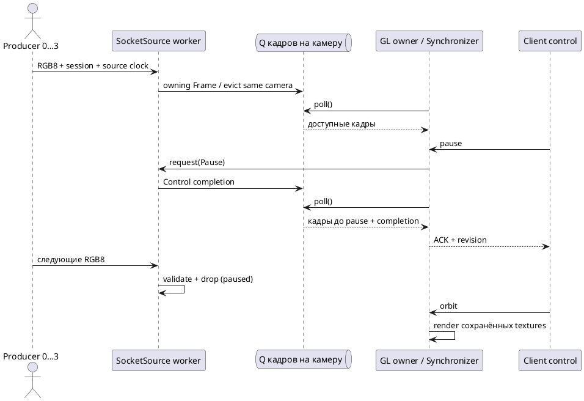

*Рисунок И.1 — Разделение source worker и владельца GL; pause подтверждается после source barrier.*

## Протокол producer

Используется существующий framing SV01: 24-byte prefix, JSON header, binary payload; partial/coalesced reads допустимы. Числовые счётчики/наносекунды передаются десятичными строками uint64. Поля размеров и camera ID — JSON integers.

1. Producer → type **1**, payload пустой: `role="producer"`, `camera_id`, `calibration_id`, `width`, `height`, `pixel_format="RGB8"`, `row_origin="top_left"`, `clock_domain` (непустая строка ≤128 байт).
2. Server → type **2**: `session_id`, `camera_id`, `timestamp_basis="server_delivery"`; payload пустой.
3. Producer → type **10**: session/id/calibration/resolution/format/origin/clock из handshake; `stride_bytes=width*3`, строки `sequence_id`, `source_timestamp_ns`, `scenario_timestamp_ns`. Payload ровно width × height × 3, RGB, строки сверху вниз, без padding. ACK каждого кадра отсутствует.

В рамках сессии sequence строго возрастает, source timestamp не убывает. Переподключение начинает новую сессию и может сбросить source sequence в 0; локальный sequence Synchronizer продолжает возрастать. Неверные метаданные, payload или порядок закрывают только данный вход. Доставка TCP подтверждает байты транспортом, но не гарантирует, что кадр не был вытеснен перед рендером.

Выходной type 11 содержит `source_type`, `timestamp_basis`, `source_received`, `source_rejected`, `source_dropped_batches`, `source_queue_depth`, `decode_count`; счётчики строковые, глубина очереди integer. Drop unit — replay batch либо один socket camera frame. Depth наблюдается после poll и не является измерением пикового заполнения. Для used inputs добавлены `source_session_id`, `source_clock_domain`, `source_sequence_id`, `source_timestamp_ns`. Независимые source clocks **не вычитаются** из server clock: Synchronizer использует server delivery. READY означает свежий набор по этой шкале, а не доказанную синхронность экспозиции камер.

## Producer из Blender-записи

`tools/producer.py` — host-утилита Python + Pillow; framing из `tools/ipc.py`. Она проверяет calibration IDs, timeline, безопасные dataset paths и SHA-256 **до подключения**, затем четыре независимых потока читают RGB и передают кадры. В памяти кешируется последнее изображение каждой камеры. `--loops N` ограничивает продолжительность; `--host IP` меняет TCP destination, не серверную политику listeners. Nonzero replay offsets отвергаются: сетевой producer пока не симулирует timestamp skew. Producer автоматически переподключает каждую камеру с собственным ограниченным retry budget; новая сессия начинает sequence с 0. Просроченные кадры пропускаются, чтобы после простоя не отправлять накопленную историю. Ошибка одной камеры не закрывает сокеты остальных; после их завершения итоговый exit ненулевой. SIGINT/SIGTERM останавливают ожидание и сохраняют отменённый отчёт; сетевые операции ограничены `--timeout-ms` (default 1000 ms). Подробности ниже; file decode/verification всё ещё не имеют жёсткого cancellation deadline.

Полные команды: [[engineering/USAGE#Blender-запись через виртуальные камеры]]. Этот producer пересылает готовую 3D-запись; он не получает live-кадры из визуального driving preview в `sv-simulator` и не выполняет Blender render. Сервер и producer могут работать на разных машинах по TCP, но проверены Unix/localhost; physical two-host acceptance и распределённые часы остаются открытыми.

Socket pipeline дополнительно проверена на сохранённой Blender-улице с RTX 5070 Ti; actual readback опубликован в главе 3 (рисунок 3.14). Проверки и ограничения: [[validation/SOURCES_SMOKE]]. Исходники: `include/sv/source.hpp`, `src/sources/replay.cpp`, `src/sources/socket.cpp`, `tests/source_tests.cpp`, `tests/test_sources.py`.

## Восстановление producer и отчёт

Host-расширение к профилю 0.6.0 не меняет C++ server protocol/RPM payload. Оно проверено отдельно: [[validation/PRODUCER_RECOVERY]]. На каждую камеру выделен собственный worker и одно текущее RGB-изображение; списка ожидающих кадров нет. Ошибка TCP/Unix, EOF или timeout закрывает соединение целиком, включая возможное частичное сообщение. Следующая попытка выполняет новый handshake; старая session не переиспользуется.

| Опция | Default / диапазон | Значение |
|---|---|---|
| `--reconnect-attempts` | 5 / 0…10000 | Дополнительные попытки после первой ошибки в непрерывном сбое; 0 отключает retry |
| `--reconnect-delay-ms` | 100 / 1…60000 | Ожидание между попытками, прерываемое stop |
| `--timeout-ms` | 1000 / 10…60000 | Connect, полный HELLO_ACK (общий deadline, включая partial reads) и send; DNS не используется, TCP destination должен быть IP-литералом |
| `--max-lateness-ms` | 100 / 0…60000 | Допустимое отставание от общего расписания до начала send; более старый кадр пропускается |
| `--report FILE.json` | Не задан | Новый JSON плюс одноимённый Markdown; наличие любого файла запрещает запуск |

Retry budget сбрасывается только после успешного `sendall`, а не после TCP connect. Пять retry разрешают максимум шесть последовательных неудач; после исчерпания останавливается только данная камера. Ошибка формата server handshake фатальна без retry. Сервер, который просто закрывает неверный handshake без error message, обнаруживается как EOF и использует обычный ограниченный budget. После pause/resume producer продолжает расписание; входы на server pause отбрасывает server.

Расписание едино для четырёх workers: epoch + loop × period + scenario offset. На reconnect проверяется lateness заново, включая время handshake. После длительной паузы старые ряды просматриваются и учитываются как skipped, а не отправляются burst. Это best-effort воспроизведение; frame delivery может быть неполной. Уже переданные в kernel/network байты не отзываются; lateness budget не гарантирует возраст при получении или синхронность экспозиции.

Отчёт `surround-view-producer-v1`, schema 1 содержит hashes manifest/config и implementation (producer.py + ipc.py), версии Python/Pillow, UTC запуска, параметры и четыре фиксированные camera records. Поля: `scheduled_frames`, `sent_frames`, `skipped_late_frames`, `skipped_missing_frames`, `connect_attempts`, `connections`, `reconnects`, `transport_failures`, `payload_bytes`, `max_lateness_ms`, `max_send_block_ms`, last session/error и status. На завершённой камере sent + late + missing = scheduled; на failed/cancelled остаток не обработан. Payload bytes учитывает только полностью завершённые sendall, не частичную ошибочную передачу. Max send измеряет время `sendall`, не decode или network RTT.

`completed` означает завершение расписания, не обработку каждого кадра сервером. ACK type 10 отсутствует: sent не доказывает отсутствие server-side drop. `failed` означает fatal error/исчерпанный retry budget; отчёт сохраняется до ненулевого exit 1. `cancelled` сохраняет частичные счётчики при stop; CLI возвращает 130 для SIGINT, 143 для SIGTERM. Если до stop уже была ошибка камеры, failure сохраняет приоритет. Проверки dataset/options выполняются до запуска workers и при ошибке завершают CLI с кодом 2 без runtime report. Ошибка записи отчёта также даёт ненулевой exit.

Markdown содержит краткую таблицу и полный fenced JSON для Obsidian. Это отдельный report suite: `compare_reports.py` platform-suite его не сравнивает. Нельзя вычитать source monotonic clock из server clock или трактовать эти числа как capture-to-display latency. Для воспроизводимости входные файлы не менять во время streaming; SHA-256 проверяется перед подключением.

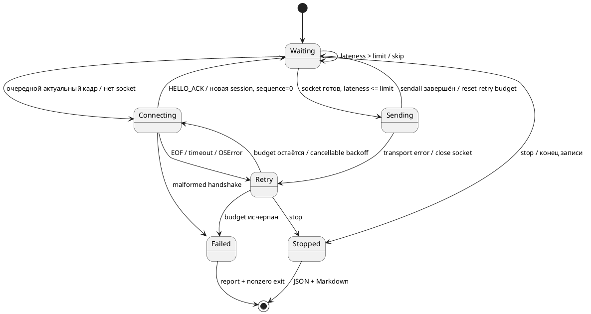

*Рисунок И.2 — Lifecycle одного camera worker. Остальные камеры имеют независимые состояния; проверка lateness выполняется также после handshake.*

## Запланировано: независимый источник каждой камеры

По требованию автора следующий source schema должен позволять для camera_id0…3 независимо
выбирать device (/dev/video* или стабильный /dev/v4l/by-id/*), simulator socket или replay.
Четыре настоящие камеры — частный случай; mixed real/virtual camera set тоже обязателен.
Это будущая возможность: текущий source.type по-прежнему выбирает один общий backend.

Нужны CompositeFrameSource и отдельные capture workers/queues, negotiated format/resolution/FPS,
реальные sensor timestamps и clock mapping, calibration identity, reconnect/backoff и ограниченное
завершение зависшего capture. Pause/resume и допустимость Step должны быть определены для mixed
set, а не унаследованы молча от replay. ConfigService должен сообщать apply/restart policy каждой
настройки; simulator показывает формы выбора device/path/transport и ошибок negotiation.

Перед аппаратной приёмкой проверить fake V4L2 adapter + socket producer, mixed-source skew,
потери/переподключение, отсутствие открытия неописанных ports/devices и shutdown bounds.
Физические /dev/video* и Aurora остаются обязательным отдельным испытанием. [[../TODO]].

Отключаемые successful camera/replay work timings, camera driver seam, настоящие RGB conversions
и PNG loader в GTest, clock/epoch guards и byte-bounded SDK polling: [[engineering/SOURCE_TIMING]].
Обработка OpenCV exceptions и прерываемое ожидание reconnect реализованы ниже; физическая проверка и остановка зависшего V4L2 read остаются открытыми.


## Восстановление camera worker после ошибки OpenCV

Рабочий поток перехватывает `cv::Exception` при проверке/открытии устройства, чтении
и подготовке RGB. Вместо выхода исключения из `std::thread` он публикует Status
`camera_exception:open`, `camera_exception:read` либо `camera_exception:prepare`, закрывает
capture и повторяет открытие через 250 мс. Неуспешный read (`false` или пустой Mat)
сохраняет прежний `camera_read_failed:<path>` и задержку 100 мс. Недоступное устройство
повторяется через 250 мс. Это значения по умолчанию; per-camera recovery policy описана ниже.

Ошибка `close` имеет отдельную политику: `camera_exception:close_worker_stopped` и завершение
только соответствующего worker, без повторного использования capture с неизвестным состоянием.
Остальные камеры продолжают работу. Для восстановления остановленного worker сейчас требуется
перезапуск источника/сервера; команды restart отдельной камеры пока нет. Ошибка release при
штатном stop тоже перехватывается. Детали `what()` не включаются в сетевой статус.

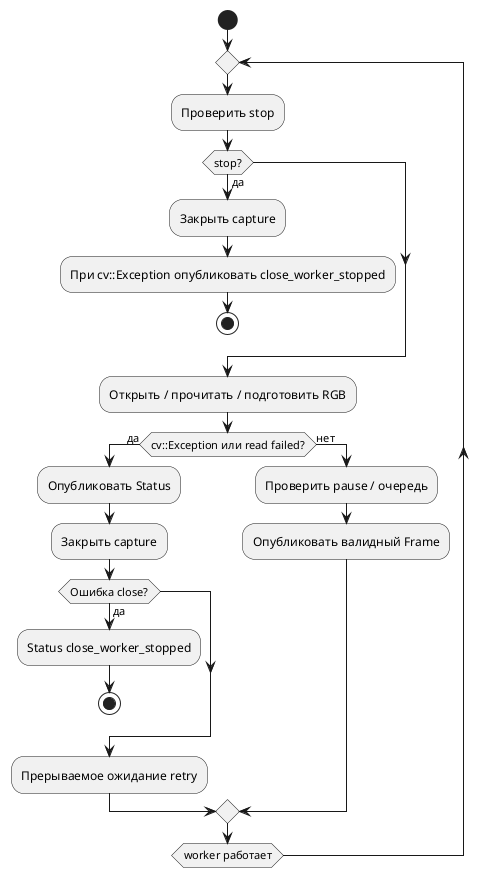

*Рисунок И.3 — Политика восстановления аппаратного camera worker. Неподдерживаемые
размеры/форматы отклоняются до подготовки и публикации Frame; на диаграмме показана ветвь
успешной проверки формата.*

Ожидание reconnect использует condition variable и пробуждается при stop всех workers.
Это убирает обязательное ожидание остатка retry delay, но **не прерывает вызов OpenCV**:
зависшие `open`, `read` или `release` всё ещё могут задержать join. Исключения выделения памяти
и произвольные C++ exceptions не объявлены recoverable; обработка относится к `cv::Exception`.
Status события проходят обычную bounded очередь и не являются надёжным журналом всех ошибок.

Неуспешная операция не создаёт Frame/source_work; существующая sequence продолжает расти
только при подготовке следующего валидного кадра. Счётчики ошибок/reconnect добавлены следующим этапом (см. ниже); durations
неуспешных операций пока отсутствуют. Это важно при интерпретации телеметрии: наличие timing
успешного кадра не характеризует предшествующие retry delays.

GTest с подставным CameraCapture проверяет исключения open/read, false/empty read,
повторное открытие и RGB следующего кадра, отказ close с продолжением соседней камеры,
исключение close при stop и повторный stop. Это программная проверка lifecycle, без физического
V4L2-устройства; negotiation, driver timestamps и bounded blocking calls остаются аппаратной
приёмкой.

Проверка Linux: полная сборка успешна, выбранные CTest 6/6 за 21,17 с (sources, camera_source_config, camera_sources, telemetry_ipc, source_work_timing и telemetry). Source-work executable включает 7 прежних и 6 новых GTest. Полный набор CTest и физические камеры в этом шаге не проверялись.


## Диагностика состояния каждой аппаратной камеры

`FrameSource::stats()` для camera backend теперь содержит optional `camera_diagnostics`:
четыре упорядоченные записи camera_id 0…3. Replay/socket возвращают отсутствие диагностики,
а не четыре нулевых результата. Снимок состояния всех камер защищён существующим source mutex.
Обновления выполняются при открытии/ошибке/завершении, без нового lock на каждом успешном кадре.

| Поле | Что учитывается | Что не следует из значения |
|---|---|---|
| open_attempts | Каждый вызов open, включая первый, false и exception | Это не число успешных подключений |
| read_failures | Обработанные false, пустой Mat либо cv::Exception из read; результат, отменённый сразу после read из-за stop, не учитывается | Отклонённые размеры/depth/channels сюда не входят |
| opencv_exceptions | Перехваченные cv::Exception при open/read/prepare/close | Это не все ошибки устройства: false не является exception |
| reconnects | Успешное повторное open после хотя бы одного успешного open | Открытие после первоначально неудачных попыток не является reconnect; успешный read не требуется |
| release_failures | cv::Exception из close, включая штатный stop | Это не failed read; один отказ read+close увеличивает разные показатели |
| worker_stopped | Worker завершён штатно либо из-за close failure | false означает, что worker ещё работает/retry, а не что камера исправна |

Счётчики принадлежат lifetime источника; смена telemetry epoch их не обнуляет. Они остаются
диагностикой backend при отключённом сборе телеметрии. Default-off collector не создаёт samples
и не отправляет их автоматически; zero-cost режим этим не заявляется. Пока нет независимых
per-camera drop/rejected/queue counters, durations ошибок или надёжного журнала всех операций.
После рестарта сервера показатели нужно рассматривать в новом server_instance_id.

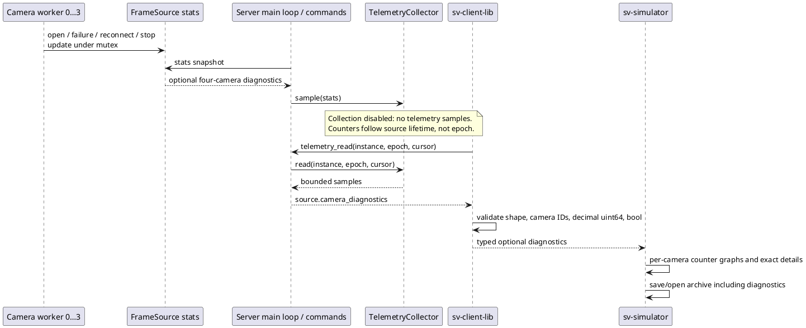

*Рисунок И.4 — Передача накопительной диагностики аппаратных камер. Polling выполняется
через существующий протокол; отдельная подписка и поток worker events не добавлены.*

Проверки восстановления дополнены точными assertions счётчиков для open/read exceptions,
false/empty read и close failure. Live server test использует четыре уникальных несуществующих
пути, дожидается повторных open и читает диагностику без входных кадров. Это проверка поведения
на unavailable paths с настоящим OpenCV adapter, а не физического отключения V4L2-устройства.

Проверки этого дополнения: выбранные CTest двумя наборами — 4/4 за 7,93 с и 3/3 за 49,37 с (source_work_timing, telemetry, simulator_runtime_errors, simulator_configuration_qml, camera_sources, client_transports, telemetry_ipc). Source-work: 13 GTest; telemetry/archive: 18 GTest; runtime: 21 cases; QML: 3 cases; live telemetry: 7 cases. Physical V4L2/Aurora и полный набор CTest не проверялись.


## Валидность кадра и статус camera_ready

Исправлена преждевременная публикация ready: ранее непустой результат read уже переключал
статус в `camera_ready:<path>`, до проверки размера/depth/channels и преобразования RGB.
Постоянно неверный формат поэтому давал чередование ready → format error на каждом read.
Теперь ready публикуется только после проверки и создания owned RGB Image. Повторное одинаковое
состояние подавляется существующим emit_status. Ошибка подготовки OpenCV попадает в прежнюю
exception/reopen policy; для неё ready не публикуется.

Для resolution mismatch, unsupported depth и unsupported channels добавлено прерываемое ожидание
100 мс перед следующим read. Capture остаётся открытым; это не reconnect. Задержка защищает от
неограниченного повторения rejected read при быстро возвращающем backend и даёт восстановиться
формату без рестарта. Интервал теперь настраивается через recovery.invalid_frame_delay_ms (см. ниже). Drop остаётся существующим source
counter; read_failures и opencv_exceptions не растут от одной только несовместимости формата.

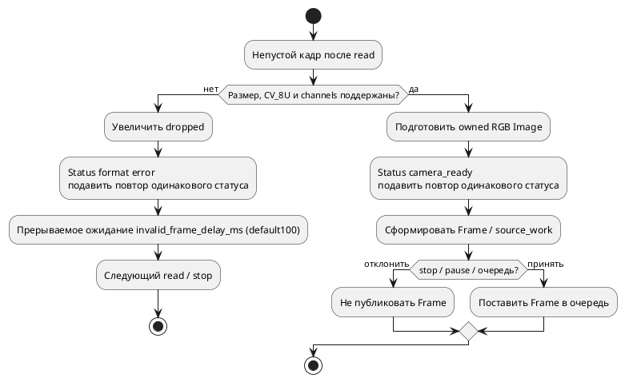

*Рисунок И.5 — Порядок валидации и ready. Исключения OpenCV обрабатываются по рисунку И.3;
ready относится к подготовке корректного изображения, а не к доставке клиенту.*

Ready не доказывает синхронизацию четырёх камер, свежесть выбранного набора, вывод результата
клиенту или отсутствие последующих drop. В частности, pause может блокировать публикацию Frame
после подготовки валидного изображения. Status проходит bounded очередь и не является
гарантированной историей каждого перехода.

Три параметризованных GTest используют fake capture с переключением invalid → valid → invalid
для размера/depth/channels. Проверяются отсутствие ложного ready/Frame, один status при повторной
ошибке, минимальные retry waits, RGB и первый sequence после восстановления, второй error
после валидного кадра и отсутствие read/exception counter increments от rejected format.
Проверка задержки имеет только нижнюю границу и не заявляет real-time deadline или measured
hardware performance. Physical negotiation и зависший V4L2 read остаются открытыми.

Проверки дополнения: полная Linux сборка и выбранные CTest 5/5 за 6,73 с; source-work executable содержит 16 GTest. Первая попытка sources внутри sandbox получила запрет bind, повтор с разрешёнными локальными сокетами прошёл. Полный набор CTest, физические камеры и Аврора не проверялись.


## Остановка на границах camera backend

Добавлены проверки atomic stop flag после `is_open`, перед `read` и после его возврата.
Прежде, если stop поступал во время open, worker после возврата open всё равно начинал read;
это могло добавить ещё один блокирующий вызов к shutdown. После read он также мог подготовить
RGB и сообщить ready, хотя итоговая публикация Frame уже запрещалась существующей проверкой
под source mutex. Теперь замеченный на этих границах stop ведёт сразу к cleanup.

Новый успешный результат read, отменённый этой проверкой, не доходит до received counter,
validation, ready, Frame или source_work. Существующие ранее поставленные события при stop
не очищаются: poll по-прежнему может вернуть старую очередь. Ошибки OpenCV и release имеют
прежнюю политику обработки; это не запрет всех диагностических сообщений во время остановки.

Одновременные вызовы camera source stop сериализованы отдельным shutdown mutex:
второй вызов ждёт join первого и не возвращается только потому, что stop flag уже установлен.
Source mutex не удерживается при join и вызовах driver. Межэтапные проверки читают atomic flag,
не добавляя захват source mutex на каждую границу. Все callers обязаны сохранять lifetime
FrameSource до окончания своих вызовов; синхронизация stop не решает произвольное разрушение
объекта одновременно с чужим методом.

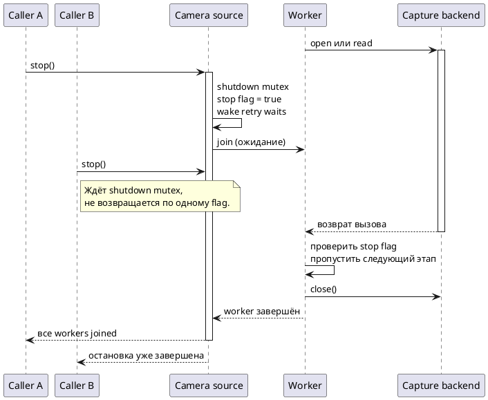

*Рисунок И.6 — Остановка, пришедшая во время backend call, и второй concurrent stop.
Возврат backend показан явно: сервер не умеет принудительно вызвать этот возврат.*

Три управляемых GTest блокируют is_open/open/read, затем дожидаются наблюдаемого отказа
новых control requests при stop. Очередь control при этом опустошается, чтобы capacity rejection
не имитировал stopped state. Второй stop должен оставаться незавершённым до освобождения gate.
После возврата backend проверяются отсутствие следующего open/read, ready/Frame, нулевые
received/decoded для отменённого результата, один cleanup и worker_stopped. Gate имеет конечный
test timeout и освобождается перед assertions/join; это проверка lifecycle, не physical driver.

Проверки уменьшают лишнюю работу на границах, но проверка flag и вызов driver не атомарны:
stop, пришедший сразу после проверки, всё ещё может застать начавшийся вызов. Ни open/read/release
не стали прерываемыми, bounded shutdown deadline и timeout для V4L2 не заявляются. Требуются
отдельная архитектура отменяемого захвата и реальные испытания отключения/зависания устройства.

Проверки: полная Linux сборка; выбранные CTest 5/5 за 6,86 с, включая 19 source-work GTest, telemetry/archive, source config/lifecycle и 7 live telemetry cases. Полный набор CTest, physical V4L2 и Аврора в этом шаге не проверялись.


## Настройки и проверка согласования OpenCV/V4L2

До этого этапа сервер вызывал set(width/height), но игнорировал фактическое согласование.
Теперь внутренний OpenCvCapture отделён от worker и делегирует операции VideoDevice:
в production это настоящий cv::VideoCapture, в GTest — MockVideoDevice. Настройки применяются
при каждом открытии, включая reconnect; source остаётся startup-only, ConfigService hot apply
для него ещё отсутствует.

```json
"source": {
  "type": "camera",
  "devices": ["/dev/v4l/by-id/front", "/dev/v4l/by-id/rear", "/dev/v4l/by-id/left", "/dev/v4l/by-id/right"],
  "capture": [
    {"camera_id": 0, "fps": 30, "fourcc": "MJPG", "buffer_count": 2},
    {"camera_id": 1, "fps": 25, "fourcc": "YUYV"},
    {"camera_id": 2, "fps": 15},
    {"camera_id": 3}
  ]
}
```

Пути в этом примере условные; используйте реальные стабильные symlinks конкретного стенда.
Capture необязателен. Если указан, это ровно четыре ordered записи camera_id0…3; неизвестные
поля/неверный порядок/типы отвергаются. FPS — finite число0.1…240, FOURCC — четыре printable
ASCII bytes, buffer_count — integer1…32. Пустой FOURCC/null не являются значением «по умолчанию»:
для default поле следует опустить. Параметры каждой камеры независимы. Разрешение берётся
исключительно из cameras[id].resolution вместе с соответствующей калибровкой; отдельное width
в source.capture запрещено, чтобы не рассогласовать intrinsics.

| Параметр | Применение и проверка | Ограничение |
|---|---|---|
| width/height | Запрос и exact get после всех set | Нельзя молча менять калибровку под другое разрешение |
| convert_rgb | Запрос1 и exact get1 | Требуется decoded output; raw encoded Mat не принимается как grayscale |
| fourcc | Если задан, запрос первым и exact readback | Codec устройства, не формат конечного RGB Image |
| fps | Если задан, readback с допуском max(0.01, 1% requested) | 29.97 при запросе30 допустим; реальный cadence отдельно не измерен |
| buffer_count | Если задан, exact readback | Backend может не поддерживать property; это ошибка явного запроса |

FOURCC задаётся до размера/FPS, поскольку смена формата может менять другие параметры;
все readback проверки выполняются после всех запросов. False от set сам по себе не является
отказом, если фактическое значение уже соответствует запросу; true также не доказывает успех.
Nonfinite/нулевой неподдерживаемый get для обязательного или явно заданного параметра приводит
к отказу. Отсутствующие optional поля не задаются через set и не проверяются относительно запроса.
Их best-effort get передаётся отдельно: [[#Наблюдаемые свойства автоматического профиля камеры]].

OpenCV отдельно предупреждает о зависимости set/get от backend/driver/hardware и о том, что
успешный set не гарантирует принятие значения: [VideoCapture](https://docs.opencv.org/4.x/d8/dfe/classcv_1_1VideoCapture.html).
Здесь readback — контракт backend, а не независимое измерение сенсора; validation фактического
Mat перед RGB остаётся обязательной. Список свойств: [Video I/O flags](https://docs.opencv.org/4.x/d4/d15/group__videoio__flags__base.html).

При несовпадении worker выдаёт source_status reason
`camera_configuration_rejected:<property>:requested=<value>:actual=<value>`, закрывает capture
и ждёт recovery delay перед retry (default250 мс). Даже false open может оставить частично открытый
capture: worker теперь закрывает его перед повтором. При close exception сохраняется
close_worker_stopped policy. До успешного согласования read не вызывается и ready не выдаётся.
Status находится в серверном журнале, не является новым SDK command или надёжной event history.
Health open_attempts растёт, read_failures не растёт от одного negotiation rejection; первое
успешное open после отказов ещё не считается reconnect.

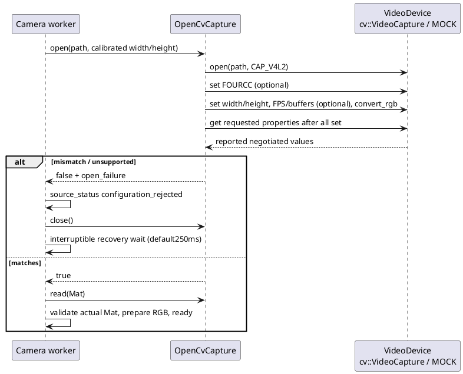

*Рисунок И.7 — Согласование свойств до чтения. Backend readback и валидация фактического Mat
остаются разными проверками; блокирующие calls не стали отменяемыми.*

### Матрица MOCK-камер

| Вариант | Ожидание |
|---|---|
| 640×480 YUYV25, 1280×720 MJPG30, 1920×1080 MJPG29.97, 320×240 GREY15; buffers1/2/4/8 | Правильные property requests/readback и размеры синтетического Mat |
| FPS29.97 при requested30 | Успех в пределах допуска |
| Неподдерживаемые width/height/conversion/FPS/FOURCC/buffers | Отказ до read |
| Set=true, значение проигнорировано | Отказ по get |
| Set=false, значение уже совпадает | Успех по get |
| Последний set сбрасывает width | Отказ при финальном readback |
| NaN get / invalid direct settings | Отказ/validation exception |
| Первый open partially succeeds либо negotiation rejected, второй succeeds | Close перед повтором, затем валидный Frame |
| Release failure после negotiation rejection | Worker останавливается без read |

MockVideoDevice моделирует property API и создаёт Mat. Он **не эмулирует** USB, MJPEG decoding,
реальный pixel format/cadence, sensor timestamps, kernel buffers и driver blocking. Реальные
OpenCV RGB conversion/PNG decode ранее проверены отдельно. В текущем окружении /dev/video*
и /dev/v4l/by-id/* отсутствуют. Физическая приёмка, bounded capture cancellation и сравнение
Aurora/PC остаются открытыми; MOCK нужны для воспроизводимых программных lifecycle проверок.

Проверки дополнения: полная Linux сборка, выбранные CTest 6/6 за 2,99 с (camera_source_config, core, config_store_persistence, source_work_timing, telemetry, configuration_snapshot) и 4/4 за 29,80 с (sources, camera_sources, replay_ipc, telemetry_ipc). Camera/source target: 34 GTest, включая 15 новых negotiation/config cases. Полный набор CTest и physical V4L2/Aurora acceptance не выполнялись.


## Проверенный режим камеры через SDK

Успешное согласование теперь создаёт optional `negotiated_mode` в camera diagnostics.
Он содержит width/height, номер open_attempt (decimal uint64), nullable fps/fourcc/buffer_count.
Width/height подтверждены точным readback; FPS сохраняется фактический проверенный double
(например29.97 при requested30), FOURCC/buffers — значения с exact readback. Optional параметры,
не запрошенные профилем, остаются null на уровне checked fields. Best-effort readback
автоматического режима передаётся в отдельном automatic_properties: [[#Наблюдаемые свойства автоматического профиля камеры]].
Decoded conversion проверена adapter до создания mode, отдельного raw-mode этот DTO не описывает.

Worker присваивает номер текущей попытки из open_attempts под source mutex. Mode очищается
в начале следующего open и перед close, включая release failure; при отсутствии поддержки
CameraCapture возвращает null. Null может означать закрытый, ещё не согласованный или
неинструментированный capture, а не разрешение0/FPS0. У stopped worker mode отсутствует.

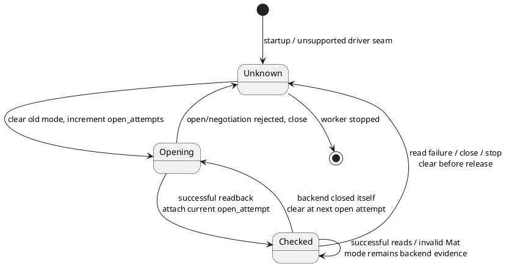

*Рисунок И.8 — Lifetime checked mode. Наличие mode не означает camera_ready, новый кадр или
синхронность набора; неверный Mat может быть отклонён после успешного backend readback.*

В `sv-client-lib` используется Qt/OpenCV-free public CameraCaptureMode
(installed camera_capture_mode.hpp). SDK принимает прежние сообщения без negotiated_mode и null;
для непустого mode проверяет dimensions1…16384, finite positive FPS, FOURCC ASCII4,
buffers1…32 и nonzero open_attempt, равный open_attempts камеры. Mode у worker_stopped отвергается.
Это additive schema1 extension, без новых команд; зависимые C++ приложения нужно пересобрать.

Archive codec сохраняет снимок и exact attempt identity, включая uint64 max. Старый SDK может
проигнорировать поле и потерять его при повторном export. В I/O details симулятора появляются
checked resolution/FPS/FOURCC/buffers/attempt; число metric choices остаётся42. Archived samples
хранят исторические режимы, даже если текущая камера уже закрыта.

Mode относится к source snapshot в момент sample, а не к selected input frame. После reconnect
старый выбранный кадр и текущий mode могут относиться к разным открытиям: нельзя переносить
номер попытки на Frame автоматически. Frame-level capture attempt provenance реализована следующим срезом, см. ниже.
Backend readback, measured sensor mode, frame readiness и final delivery остаются разными понятиями.

MOCK assertions проверяют actual29.97 вместо requested30, nullable незапрошенные свойства,
номер второй успешной попытки после отказа, очистку при close/rejected reopen/failed release.
Parser/архив проверяют legacy omission, null, stale/zero attempt, stopped inconsistency и malformed
поля; byte-budget pagination проверяется с четырьмя source_work и mode records. QML fixture
сохраняет checked mode при offline archive restoration; это не live physical-camera acceptance.

Проверки этого среза: полная Linux сборка; выбранные CTest 7/7 за 39,26 с, включая 35 camera/source GTest, typed telemetry/archive, installed SDK consumer/Unix/TCP, live unavailable-device path и offscreen QML archive checks. Полный набор CTest и physical V4L2/Aurora acceptance не выполнялись.


## Происхождение выбранного кадра при reconnect

Каждое успешное open создаёт один immutable CameraFrameProvenance: open_attempt и optional
проверенный режим этого открытия. Camera worker разделяет const shared pointer между его
Frames; следующее open создаёт новый объект. Старый Frame сохраняет собственную ссылку,
даже после close, reconnect или stop источника. Timing collection для этого не требуется.
У уже открытого внешнего test adapter без наблюдаемого open такой записи может не быть:
источник не выдумывает номер открытия.

В metadata результата type11 для used hardware input добавлено optional camera_capture:

```json
{
  "camera_id": 0,
  "used": true,
  "source_sequence_id": "9",
  "camera_capture": {
    "open_attempt": "1",
    "negotiated_mode": {
      "width": 640, "height": 480, "open_attempt": "1",
      "fps": 15, "fourcc": "YUYV", "buffer_count": 2
    }
  }
}
```

Это фрагмент inputs одного результата, не полный type11 packet. Source_session, calibration_id,
receive/source timestamps и output revision остаются в прежних полях. Attempt identity имеет
смысл внутри server_instance_id и camera_id; номер1 у разных камер/после restart не означает
общее открытие. Source_sequence позволяет связать запись с конкретным выбранным Frame.

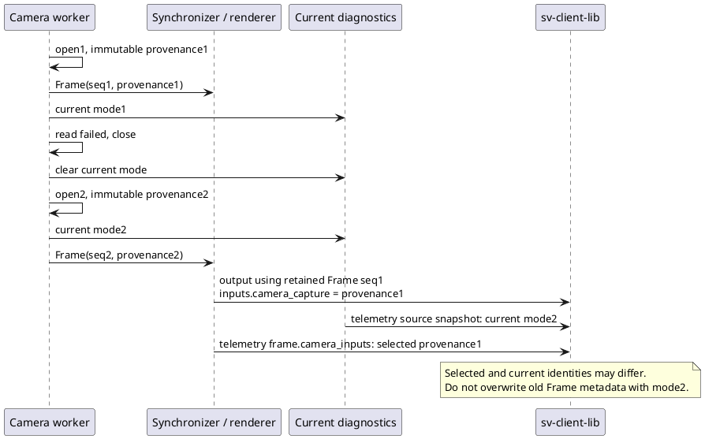

*Рисунок И.9 — Сохранение происхождения кадра после переподключения. Удержание старого Frame
возможно при очередях/rerender; диаграмма не гарантирует, что Synchronizer выберет его всегда.*

Public SDK parse_frame_camera_inputs(Message) возвращает typed CameraInputProvenance для
hardware inputs; проверяет type11, четыре уникальных IDs, used/source_type=camera для non-null
camera_capture, decimal identities и согласованность вложенного режима. Метод проверяет
только camera metadata, не изображение/payload или весь протокол результата. Прежние inputs
без camera_capture/null принимаются. Nullable negotiated_mode означает известное открытие
без проверенных характеристик, а не нулевые характеристики.

В telemetry frame.camera_inputs хранится до четырёх выбранных hardware records (camera_id,
source_sequence_id, camera_capture). Это snapshot **последнего render**, не новая операция
захвата при каждом sample. Fresh=false сохраняет его, смена collection epoch не меняет identity
самого Frame. Collector копирует только маленькие metadata, не удерживает Image буферы.
В archive поле сохраняется; omission прежней schema1 означает пустой список. Source_work и
selected provenance одной камеры должны иметь одинаковый source_sequence. Текущий diagnostic
mode намеренно не сравнивается с selected attempt: после reconnect они могут различаться.

SDK отклоняет duplicate/>4 selected records, zero/mismatched attempts и противоречие source_work
sequence. Frame helper отклоняет capture на unused/replay/socket input. Нет новых команд или
framing. Существующий bounded polling подбирает число samples по byte budget также с четырьмя
current modes и selected provenance. Старый SDK может игнорировать и терять extension при export.

В I/O details отдельно показаны current checked mode и Selected camera с source_sequence,
capture attempt и проверенным режимом выбранного кадра. Новых metric choices нет. До внедрения
планируемой UI-перегруппировки это диагностические строки в существующей панели.

MOCK reconnect test хранит Frame от открытия1 (15 FPS), затем получает Frame от открытия2
(30 FPS); после stop оба сохраняют исходные объекты и последовательность не сбрасывается.
Render/telemetry/archive со старым Frame должны показывать selected1 одновременно с current2,
в том числе при повторном sample и новом telemetry epoch. Это тест владения/атрибуции, а не
hot смена startup profile, реального FPS или аппаратного reconnect. Типовые тесты также проверяют
legacy packets, uint64 max, неверный context, дубли, inconsistent identity и byte pagination.

Проверки этого среза: полная Linux сборка; выбранные CTest 4/4 за 9,70 с (source_work_timing, telemetry, simulator_runtime_errors, simulator_configuration_qml) и 3/3 за 30,87 с (sources, client_transports/installed consumer, telemetry_ipc). Camera/source executable содержит 39 GTest. Полный набор CTest, physical V4L2/Aurora и overhead measurements не выполнялись.


## Политика повторов и backoff аппаратной камеры

В каждой startup source.capture записи добавлена optional группа recovery. Она применяется
camera worker, а не VideoCapture property API, и не превращает driver calls в отменяемые.
Если группу опустить, прежние интервалы250/100/100/250 мс и бесконечный retry сохраняются.

```json
"capture": [
  {"camera_id": 0, "recovery": {
    "open_delay_ms": 250,
    "read_delay_ms": 100,
    "invalid_frame_delay_ms": 100,
    "exception_delay_ms": 250,
    "max_delay_ms": 5000,
    "backoff_multiplier": 2,
    "max_consecutive_failures": 8
  }},
  {"camera_id": 1}, {"camera_id": 2}, {"camera_id": 3}
]
```

Это вложенный capture fragment source.type=camera, не полный config. Камеры1…3 остаются
на default policy; режимы и пути задаются как раньше. Recovery startup-only: hot apply/формы
ConfigService и restart одного worker ещё не реализованы.

| Поле | Default / bounds | Смысл |
|---|---|---|
| open_delay_ms | 250 / integer1…60000 | False open и negotiation rejection после cleanup |
| read_delay_ms | 100 / integer1…60000 | False/empty read после close |
| invalid_frame_delay_ms | 100 / integer1…60000 | Неверные size/depth/channels; capture остаётся открытым |
| exception_delay_ms | 250 / integer1…60000 | Recoverable cv::Exception после cleanup |
| max_delay_ms | 5000 / integer1…60000 | Верхняя граница requested wait; не меньше всех четырёх base delays |
| backoff_multiplier | 1 / integer1…8 | Рост delay по общему числу последовательных отказов |
| max_consecutive_failures | 0 / integer0…1000000 | 0 — unlimited; N>0 останавливает worker на N-м отказе |

Для failure ordinal n≥1 и его категории k рассчитывается:

$$
d_n = \min(d_{\max}, b_k \cdot m^{n-1}).
$$

Реализация использует integer multiplication только до cap, а не floating pow. При multiplier1
вычисление не обходит весь failure history. Failure counter насыщается на uint64 max.
При finite budget и n≥N delay уже не выполняется, следующего open/read нет. N означает
максимум последовательных failed cycles, включая первый, а не N дополнительных повторов.

Цепочка общая для open/read/invalid-frame/exception: успешный open её не сбрасывает. Сброс
происходит только после создания валидного owned RGB Image, до проверки pause/output queue.
Поэтому работающий сенсор при pause/busy всё ещё восстанавливает health policy, а камера,
которая каждый раз открывается и сразу возвращает failed read, достигает finite limit.
Rejected output delivery/queue saturation сами по себе не являются camera failures.

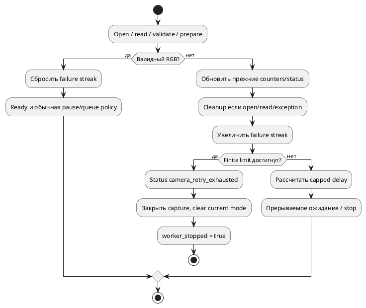

*Рисунок И.10 — Один цикл recovery policy. Успешный open не является успешным RGB; stop
прерывает wait, но не драйверный вызов. Release failure имеет прежнюю terminal policy.*

На исчерпании budget `camera_retry_exhausted` публикуется в bounded status queue/серверном
журнале, worker завершается и current mode очищается. Остальные камеры и сервер продолжают
работу. Source-wide resume не пересоздаёт остановленный worker; нужен restart источника/сервера.
Существующие counters сохраняют смысл. Status может быть вытеснен; typed recovery snapshot
сохраняет streak, текущее ожидание и причину завершения: [[#Снимок восстановления камеры]].

Max delay ограничивает только ожидание между операциями. Backend call duration и scheduling
в него не входят; wall deadline, read timeout, cancellation open/read/release и physical recovery
не реализованы этой политикой. Не задавайте finite budget как гарантию доступности кругового
обзора: потерянная камера остаётся потерянной до восстановления source lifecycle.

MOCK tests проверяют exact capped delays и reset, лимит первого/третьего отказа, unlimited/default
policy, persistent open/read/format/exception с независимым здоровым соседом, valid RGB при pause,
invalid bounds и wakeup из60000-мс retry wait. Live server test с несуществующими paths проверяет
camera0 budget2, продолжающийся retry camera1 и доступность state/telemetry. Это не проверка
физического disconnect или bounded V4L2 calls. Source-work CTest имеет30-секундный test timeout
на случай regression зависания; это ограничение CI, не эксплуатационный deadline сервера.

Проверки среза: полная Linux сборка; выбранные CTest 6/6 за 3,05 с (camera_source_config, core, config_store_persistence, source_work_timing, telemetry, configuration_snapshot) и 3/3 за 9,49 с (sources, replay_ipc, telemetry_ipc). Camera/source executable: 48 GTest, live telemetry: 8 cases. Все10 PlantUML-блоков этого файла прошли local PlantUML1.2026.6 -checkonly после исправления переносов в labels/notes; это syntax check, не визуальная приёмка layout. Полный набор CTest и physical V4L2/Aurora acceptance не выполнялись.


## Снимок восстановления камеры

`source.camera_diagnostics[i].recovery` — optional объект `CameraRecoveryStatus` из installed
`camera_diagnostics.hpp`. Camera backend создаёт его для всех четырёх workers до запуска потоков.
Отсутствие поля или `null` у прежнего сервера означает отсутствие инструментации, а не нулевой streak.
SDK принимает оба legacy случая; archive schema1 сохраняет новый объект без смены framing/команд.

| Поле | Wire type | Смысл |
|---|---|---|
| `consecutive_failures` | decimal string uint64 | Число отказов, переданных recovery policy с последнего valid RGB |
| `retry_delay_ms` | integer1…60000 или null | Назначенный полный интервал текущего retry wait; не остаток времени |
| `terminal_reason` | string или null | `stop_requested`, `retry_exhausted`, `release_failure`; null до завершения |

Streak включает open/read/invalid-frame/OpenCV failures, дошедшие до policy. При stop или
терминальном release failure policy уже не вызывается: соответствующие counters остаются
источником числа таких ошибок. Streak сбрасывается только после подготовки valid RGB, даже при
pause; успешное open не сбрасывает его. Telemetry epoch и pause/resume его не обнуляют.

Retry interval публикуется непосредственно перед ожиданием и очищается сразу после выхода из него,
включая stop. Это снимок логического состояния, не точный таймер потока: допустим короткий переход
между публикацией и входом/выходом condition-variable wait. Null не означает готовность камеры:
worker может находиться в open/read/prepare/close или завершаться.

Terminal reason публикуется под тем же mutex, что и `worker_stopped=true`, после финального close.
`release_failure` имеет приоритет над stop и exhaustion: неизвестное состояние драйвера нельзя
скрыть исходной причиной выхода из цикла. Во время блокирующего close stopped остаётся false и
terminal null. Причина означает логическую остановку захвата; подтверждение join даёт только
возврат `FrameSource::stop()`. В уже остановленном worker причина не меняется после source-wide stop.

SDK отвергает неизвестную причину, terminal без stopped (и stopped без terminal при наличии
recovery), wait у stopped или при нулевом streak, exhaustion с нулевым streak, неверные типы и
границы. Старые stopped snapshots без recovery по-прежнему принимаются. `retry_delay_ms` не
передаётся строкой, в отличие от uint64 streak. Current negotiated mode очищается до close;
selected Frame provenance сохраняется независимо от terminal snapshot.

sv-simulator показывает recovery в существующем блоке I/O details. Новых metric choices нет.
Telemetry может пропустить краткий wait между samples; исторический архив показывает лишь
наблюдённые состояния и не заменяет полный event trace. Сбор отключённой telemetry не мешает
source поддерживать bounded O(1) snapshot; overhead этой инструментации отдельно не измерен.

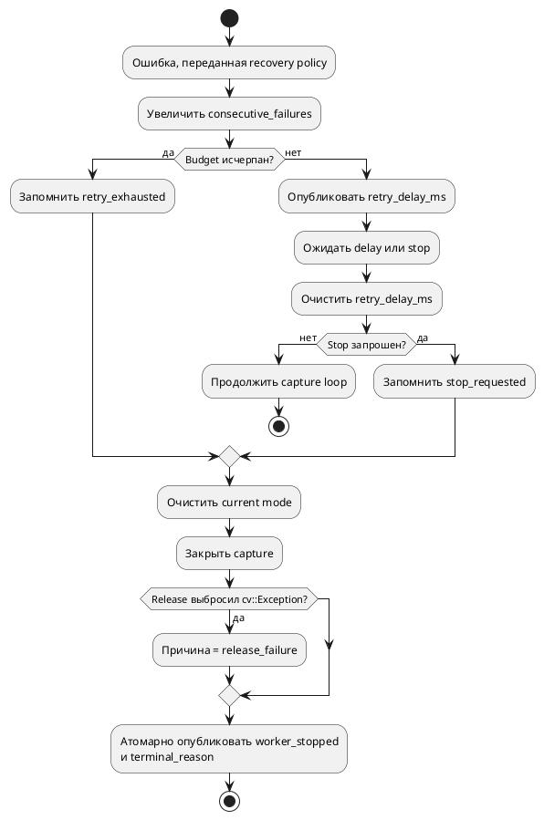

*Рисунок I.11 — публикация ожидания и терминального состояния. Освобождение драйвера может
блокироваться; диаграмма не задаёт deadline операции close.*

Проверки: MOCK exhaustion всех четырёх категорий, wait60000/stop, release failure при stop и
после exhaustion; SDK legacy/null/shape/type/bounds/invariants, exact uint64 archive round-trip,
GUI details без увеличения списка metrics, live missing-path budget. Physical V4L2/Aurora не проверены.

Финальные проверки этого дополнения: полная Linux сборка; source_work_timing49 GTest (3,01 с), telemetry, simulator_runtime_errors и simulator_configuration_qml прошли. Отдельный интеграционный набор sources/client_transports/telemetry_ipc —3/3 за26,52 с, включая installed SDK consumer и8 live cases. Все11 PlantUML blocks этого файла и21 блока главы3 прошли local1.2026.6 -checkonly; два прежних diagram labels главы3 исправлены. Полный набор CTest не запускался.


## Наблюдаемые свойства автоматического профиля камеры

Если FPS, FOURCC или число буферов отсутствуют в `source.capture`, сервер теперь читает их
через OpenCV после всех set и обязательных/explicit проверок. `CameraCaptureMode::automatic_properties`
(структура `CameraAutomaticProperties` в installed `camera_capture_mode.hpp`) отделяет такие
наблюдения от checked fields. Явно запрошенное свойство остаётся в checked поле; в automatic
его аналог равен null, повторного get для него нет. При полном explicit профиле automatic объект
существует, но все три его поля null.

Это readback текущего открытия, а не перечень доступных конфигураций. OpenCV указывает, что
неподдерживаемое свойство возвращает0, а значения зависят от backend/driver и могут отличаться
от реально используемых устройством. Поэтому успешный get не принимается как измерение
sensor cadence или доказательство поддержки других режимов.
[OpenCV VideoCapture::get](https://docs.opencv.org/4.13.0/d8/dfe/classcv_1_1VideoCapture.html).

| Свойство | Допустимое автоматическое наблюдение | Недоступное значение |
|---|---|---|
| `fps` | Finite positive double; границы config0.1…240 не применяются | Ноль, отрицательное, NaN/Inf, cv::Exception → null |
| `fourcc` | Целый положительный uint32, декодированный младшим байтом вперёд в четыре ASCII32…126 символа | Fractional/out-of-range, нулевой/непечатный байт, cv::Exception → null |
| `buffer_count` | Целое1…4294967295 | Ноль, отрицательное, fractional/nonfinite/out-of-range, cv::Exception → null |

Config разрешает запрос1…32 буферов, но наблюдаемое64 не является ошибкой: сервер не выбирал
его через explicit profile. Число не говорит о фактической задержке buffering. Ошибка optional
get локальна только этому полю; остальные опрашиваются. `open_failure()` остаётся пустым,
worker не переподключается из-за такой ошибки. Она не увеличивает `opencv_exceptions`: этот
счётчик относится к ошибкам операций, дошедшим до worker recovery. Явная проверка get сохраняет
строгое поведение: mismatch/nonfinite или исключение отклоняют capture, как раньше.

Пример фрагмента mode после default open (width/height проверены отдельно):

```json
{
  "width": 1280, "height": 720, "open_attempt": "1",
  "fps": null, "fourcc": null, "buffer_count": null,
  "automatic_properties": {"fps": 29.97, "fourcc": "YUYV", "buffer_count": 64}
}
```

При partial profile, например explicit FOURCC="MJPG", checked fourcc="MJPG", а automatic
fourcc=null; автоматические FPS/buffers всё ещё могут быть доступны. SDK отвергает поле,
одновременно non-null в checked и automatic. Missing/null automatic object у старого сервера
принимается. Present объект требует все три nullable поля, проверяет types/ranges/ASCII.

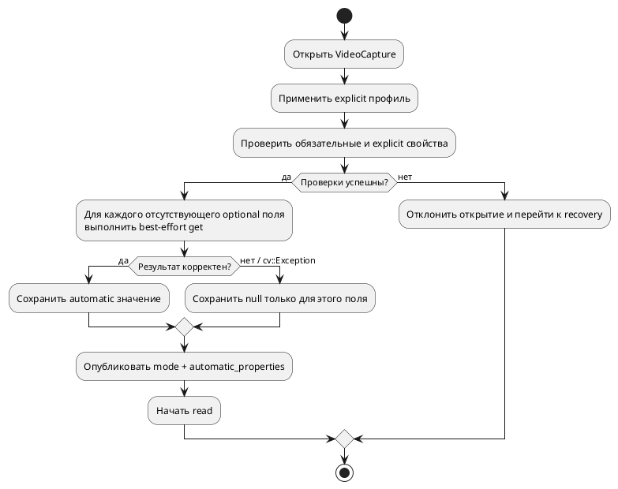

*Рисунок I.12 — отделение строгой настройки захвата от диагностического чтения автоматических свойств.*

Наблюдения снимаются один раз на успешное open. Runtime изменения драйвера без reopen не
отслеживаются. Snapshot очищается вместе с mode на новом open/close; immutable metadata ранее
полученного Frame сохраняет старые automatic values после reconnect, stop и смены telemetry epoch.
Extension проходит type11 selected provenance, telemetry SDK и schema1 archive. sv-simulator
показывает отдельную строку Automatic readback для current и Selected mode без новых metrics.
Omission/null прежнего сообщения означает отсутствие snapshot; present all-null может означать
полный explicit profile либо недоступность всех автоматических запросов. Контекст даёт checked mode.

Каждый дополнительный get синхронен и потенциально блокирующий. Выполняется максимум три
таких вызова на open, без новых потоков и per-frame queries. Driver timeout/cancellation и overhead
не подтверждены этим дополнением. Full V4L2 format/size/FPS enumeration, physical device tests,
measured cadence и sensor timestamps остаются открытыми.

Проверки дополнения: полная Linux сборка; выбранные CTest4/4 за9,65 с (source_work_timing51 GTest, telemetry, simulator_runtime_errors, simulator_configuration_qml) и3/3 за25,74 с (sources, client_transports/installed SDK, telemetry_ipc). Все12 PlantUML blocks этого файла и22 блока главы3 прошли local1.2026.6 -checkonly. Полный набор CTest, реальные камеры и Аврора не проверялись.
