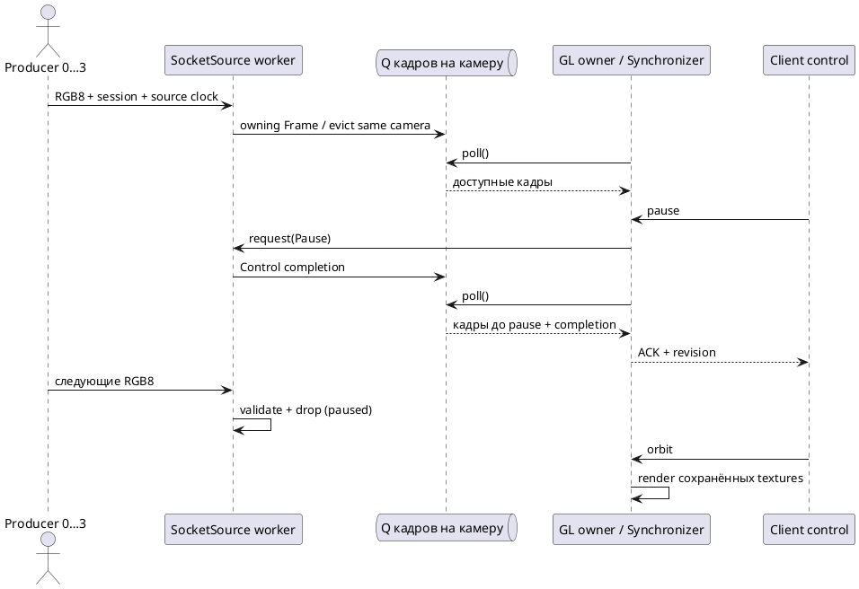
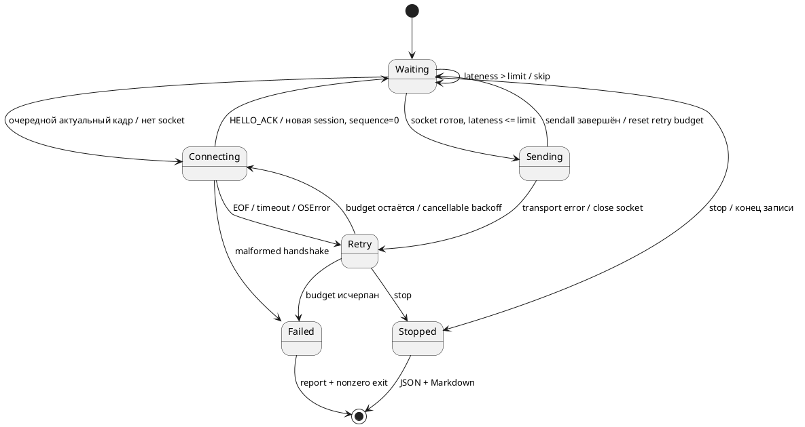
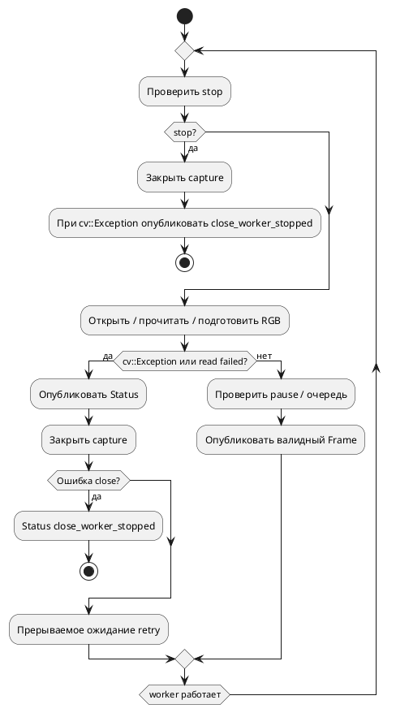
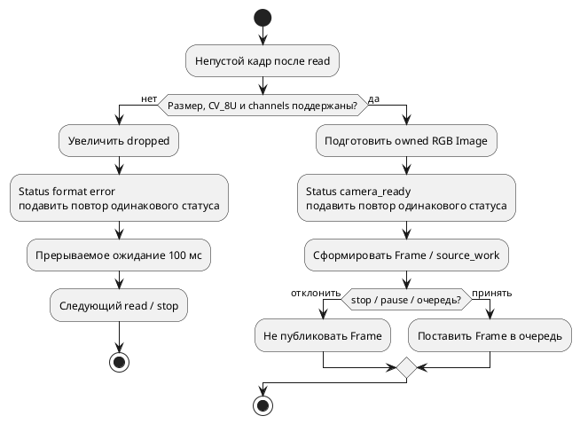

# Источники кадров: replay, виртуальные и аппаратные камеры

Linux-профиль **0.6.0**. Реализован C++ `FrameSource` с неблокирующими `request`/`poll`; GL-ресурсы остаются в основном потоке сервера. `sv-sources` — внутренний target; публичная `sv-client-lib` принимает готовый RGBA-результат, а не входы камер. Подключение клиента и отправка камер имеют разные endpoints. Добавлен локальный OpenCV/V4L2 capture adapter, выбираемый через `source.type=camera`; физическое подключение устройств и поведение разных драйверов ещё не проверялись.

## Выбор источника

Блок `source` необязателен: прежние `--manifest FILE --loop true|false` сохраняют replay. Если `source` присутствует, эти CLI-параметры запрещены, даже когда совпадают с конфигурацией. Неизвестные ключи/типы отвергаются. Hot reload и смешивание replay/аппаратных камер пока не поддерживаются.

```json
"source": {"type": "replay", "manifest": "recording/manifest.json", "loop": true}
```

Путь здесь разрешается относительно **каталога config**. CLI `--manifest` остаётся относительно рабочего каталога. `loop` по умолчанию true. Временная шкала задаёт интервалы между завершёнными наборами; decode и scheduling добавляют задержку. На wrap используется первый интервал, при одном ряде — 33.333333 ms. Это воспроизведение интервалов без гарантии realtime pacing. Отрицательные/положительные `offset_ns` manifest моделируют skew относительно server delivery.

Для локальных V4L2 устройств задайте тип источника и четыре абсолютных пути. Если `devices` не указан, используются `/dev/video0`…`/dev/video3`:

```json
"source": {
  "type": "camera",
  "devices": ["/dev/video0", "/dev/video2", "/dev/video4", "/dev/video6"]
}
```

Каждый путь должен быть уникальным. Сервер открывает все четыре потока независимо, просит разрешение из camera config и принимает только совпадающие размеры; Только8-bit (CV_8U) BGR, grayscale и BGRA приводятся к RGB8; другая глубина отклоняется со status camera_unsupported_depth до публикации Image. Несовпадающее разрешение публикуется как source status и кадр пропускается, потому что автоматическое изменение intrinsics не выполняется. Буфер событий ограничен 64 записями и при насыщении вытесняет старейший кадр. Pause прекращает добавление новых кадров в очередь; Step для live capture не поддерживается. Поток повторяет попытку открытия после ошибки, но блокирующий драйверный `VideoCapture::read` может задержать остановку процесса. Физические камеры не были доступны при создании этого baseline; `camera_source_lifecycle` проверяет только API/control queue, а не сенсор.

```json
"source": {
  "type": "socket",
  "message_timeout_ms": 2000,
  "cameras": [
    {"camera_id": 0, "transport": "unix", "path": "/tmp/sv-input/front.sock"},
    {"camera_id": 1, "transport": "unix", "path": "/tmp/sv-input/right.sock"},
    {"camera_id": 2, "transport": "tcp", "address": "127.0.0.1", "port": 48082},
    {"camera_id": 3, "transport": "tcp", "address": "127.0.0.1", "port": 48083}
  ]
}
```

Обязательны ровно четыре уникальных `camera_id` 0…3. Unix path абсолютный, ≤100 байт; существующий путь не удаляется и вызывает ошибку запуска. Сервер удаляет только созданные им пути при штатной остановке. TCP address — явный IP-литерал, port 1…65535. `message_timeout_ms` — целое 10…60000, default 2000: handshake и получение неполного сообщения; молчащий уже подключённый producer не отключается, свежесть контролирует Synchronizer. Одна активная producer-сессия на камеру; дополнительное подключение закрывается.

`connections` управляет клиентскими endpoints независимо. Unix-only для **всего процесса** получается при Unix client connections и всех четырёх Unix camera endpoints; TCP source открывает IP sockets даже при Unix-only client connections. Без явного socket source сервер не открывает порты камер. Нет UDP, TLS и аутентификации producer; session ID отделяет переподключения и не является учётными данными. TCP применять в доверенной сети; не выдавать его за защищённый публичный сервис.

## Worker, буферы и команды

| Свойство | Replay worker | Socket worker | V4L2 camera workers |
|---|---|---|
| Работа вне GL-потока | Decode PPM/OpenCV PNG/JPEG, cache | Asio accept/read/decode, проверка RGB8 | OpenCV VideoCapture, BGR/gray/BGRA → RGB8 |
| Очередь кадров | До Q четырёхкамерных наборов | До Q кадров **каждой** камеры, суммарно 4Q | До 64 событий суммарно; вытесняется старый frame event |
| Переполнение | Вытеснение старого набора | Вытеснение старого кадра той же камеры |
| Pause ACK | После завершения текущего decode; новых decode нет | После обработки команды в source io_context; новые входы проверяются и отбрасываются |
| Step | Один следующий набор, затем пауза | Reject `step_requires_replay`, revision не меняется | Reject через source API; live stepping не реализован |
| Resume | Следующий ряд немедленно | Публикуются только вновь принятые кадры |
| Stop | Notify/join; ожидание текущего file decode | Stop io_context/join/close/cleanup | Stop/join; ожидание блокирующего camera read |

Q = `runtime.input_queue_per_camera`. У replay cache содержит до четырёх последних изображений. У socket decoder ограничен общим SV01 payload limit 64 MiB на соединение; очередь содержит owning RGB8 buffers, не ссылки на переиспользуемый read buffer. Для больших разрешений учитывать память 4Q × W × H × 3 плюс decoder/current frames и GL textures. Source request queue ограничена 64 запросами; socket status mailbox — 16 событиями. Старые уведомления могут быть пропущены при избытке ошибок, но не отключают остальные камеры.

File decode нельзя принудительно прервать внутри OpenCV/файловой системы: для replay нет жёсткой границы shutdown при зависшем чтении. Для обычных локальных файлов пауза и shutdown проверены. Аппаратный backend потребует собственного решения cancellation/timeouts; наивный блокирующий `VideoCapture::read` не объявляется завершённым live-адаптером.



*Рисунок И.1 — Разделение source worker и владельца GL; pause подтверждается после source barrier.*

## Протокол producer

Используется существующий framing SV01: 24-byte prefix, JSON header, binary payload; partial/coalesced reads допустимы. Числовые счётчики/наносекунды передаются десятичными строками uint64. Поля размеров и camera ID — JSON integers.

1. Producer → type **1**, payload пустой: `role="producer"`, `camera_id`, `calibration_id`, `width`, `height`, `pixel_format="RGB8"`, `row_origin="top_left"`, `clock_domain` (непустая строка ≤128 байт).
2. Server → type **2**: `session_id`, `camera_id`, `timestamp_basis="server_delivery"`; payload пустой.
3. Producer → type **10**: session/id/calibration/resolution/format/origin/clock из handshake; `stride_bytes=width*3`, строки `sequence_id`, `source_timestamp_ns`, `scenario_timestamp_ns`. Payload ровно width × height × 3, RGB, строки сверху вниз, без padding. ACK каждого кадра отсутствует.

В рамках сессии sequence строго возрастает, source timestamp не убывает. Переподключение начинает новую сессию и может сбросить source sequence в 0; локальный sequence Synchronizer продолжает возрастать. Неверные метаданные, payload или порядок закрывают только данный вход. Доставка TCP подтверждает байты транспортом, но не гарантирует, что кадр не был вытеснен перед рендером.

Выходной type 11 содержит `source_type`, `timestamp_basis`, `source_received`, `source_rejected`, `source_dropped_batches`, `source_queue_depth`, `decode_count`; счётчики строковые, глубина очереди integer. Drop unit — replay batch либо один socket camera frame. Depth наблюдается после poll и не является измерением пикового заполнения. Для used inputs добавлены `source_session_id`, `source_clock_domain`, `source_sequence_id`, `source_timestamp_ns`. Независимые source clocks **не вычитаются** из server clock: Synchronizer использует server delivery. READY означает свежий набор по этой шкале, а не доказанную синхронность экспозиции камер.

## Producer из Blender-записи

`tools/producer.py` — host-утилита Python + Pillow; framing из `tools/ipc.py`. Она проверяет calibration IDs, timeline, безопасные dataset paths и SHA-256 **до подключения**, затем четыре независимых потока читают RGB и передают кадры. В памяти кешируется последнее изображение каждой камеры. `--loops N` ограничивает продолжительность; `--host IP` меняет TCP destination, не серверную политику listeners. Nonzero replay offsets отвергаются: сетевой producer пока не симулирует timestamp skew. Producer автоматически переподключает каждую камеру с собственным ограниченным retry budget; новая сессия начинает sequence с 0. Просроченные кадры пропускаются, чтобы после простоя не отправлять накопленную историю. Ошибка одной камеры не закрывает сокеты остальных; после их завершения итоговый exit ненулевой. SIGINT/SIGTERM останавливают ожидание и сохраняют отменённый отчёт; сетевые операции ограничены `--timeout-ms` (default 1000 ms). Подробности ниже; file decode/verification всё ещё не имеют жёсткого cancellation deadline.

Полные команды: [[engineering/USAGE#Blender-запись через виртуальные камеры]]. Этот producer пересылает готовую 3D-запись; он не получает live-кадры из визуального driving preview в `sv-simulator` и не выполняет Blender render. Сервер и producer могут работать на разных машинах по TCP, но проверены Unix/localhost; physical two-host acceptance и распределённые часы остаются открытыми.

Socket pipeline дополнительно проверена на сохранённой Blender-улице с RTX 5070 Ti; actual readback опубликован в главе 3 (рисунок 3.14). Проверки и ограничения: [[validation/SOURCES_SMOKE]]. Исходники: `include/sv/source.hpp`, `src/sources/replay.cpp`, `src/sources/socket.cpp`, `tests/source_tests.cpp`, `tests/test_sources.py`.

## Восстановление producer и отчёт

Host-расширение к профилю 0.6.0 не меняет C++ server protocol/RPM payload. Оно проверено отдельно: [[validation/PRODUCER_RECOVERY]]. На каждую камеру выделен собственный worker и одно текущее RGB-изображение; списка ожидающих кадров нет. Ошибка TCP/Unix, EOF или timeout закрывает соединение целиком, включая возможное частичное сообщение. Следующая попытка выполняет новый handshake; старая session не переиспользуется.

| Опция | Default / диапазон | Значение |
|---|---|---|
| `--reconnect-attempts` | 5 / 0…10000 | Дополнительные попытки после первой ошибки в непрерывном сбое; 0 отключает retry |
| `--reconnect-delay-ms` | 100 / 1…60000 | Ожидание между попытками, прерываемое stop |
| `--timeout-ms` | 1000 / 10…60000 | Connect, полный HELLO_ACK (общий deadline, включая partial reads) и send; DNS не используется, TCP destination должен быть IP-литералом |
| `--max-lateness-ms` | 100 / 0…60000 | Допустимое отставание от общего расписания до начала send; более старый кадр пропускается |
| `--report FILE.json` | Не задан | Новый JSON плюс одноимённый Markdown; наличие любого файла запрещает запуск |

Retry budget сбрасывается только после успешного `sendall`, а не после TCP connect. Пять retry разрешают максимум шесть последовательных неудач; после исчерпания останавливается только данная камера. Ошибка формата server handshake фатальна без retry. Сервер, который просто закрывает неверный handshake без error message, обнаруживается как EOF и использует обычный ограниченный budget. После pause/resume producer продолжает расписание; входы на server pause отбрасывает server.

Расписание едино для четырёх workers: epoch + loop × period + scenario offset. На reconnect проверяется lateness заново, включая время handshake. После длительной паузы старые ряды просматриваются и учитываются как skipped, а не отправляются burst. Это best-effort воспроизведение; frame delivery может быть неполной. Уже переданные в kernel/network байты не отзываются; lateness budget не гарантирует возраст при получении или синхронность экспозиции.

Отчёт `surround-view-producer-v1`, schema 1 содержит hashes manifest/config и implementation (producer.py + ipc.py), версии Python/Pillow, UTC запуска, параметры и четыре фиксированные camera records. Поля: `scheduled_frames`, `sent_frames`, `skipped_late_frames`, `skipped_missing_frames`, `connect_attempts`, `connections`, `reconnects`, `transport_failures`, `payload_bytes`, `max_lateness_ms`, `max_send_block_ms`, last session/error и status. На завершённой камере sent + late + missing = scheduled; на failed/cancelled остаток не обработан. Payload bytes учитывает только полностью завершённые sendall, не частичную ошибочную передачу. Max send измеряет время `sendall`, не decode или network RTT.

`completed` означает завершение расписания, не обработку каждого кадра сервером. ACK type 10 отсутствует: sent не доказывает отсутствие server-side drop. `failed` означает fatal error/исчерпанный retry budget; отчёт сохраняется до ненулевого exit 1. `cancelled` сохраняет частичные счётчики при stop; CLI возвращает 130 для SIGINT, 143 для SIGTERM. Если до stop уже была ошибка камеры, failure сохраняет приоритет. Проверки dataset/options выполняются до запуска workers и при ошибке завершают CLI с кодом 2 без runtime report. Ошибка записи отчёта также даёт ненулевой exit.

Markdown содержит краткую таблицу и полный fenced JSON для Obsidian. Это отдельный report suite: `compare_reports.py` platform-suite его не сравнивает. Нельзя вычитать source monotonic clock из server clock или трактовать эти числа как capture-to-display latency. Для воспроизводимости входные файлы не менять во время streaming; SHA-256 проверяется перед подключением.



*Рисунок И.2 — Lifecycle одного camera worker. Остальные камеры имеют независимые состояния; проверка lateness выполняется также после handshake.*

## Запланировано: независимый источник каждой камеры

По требованию автора следующий source schema должен позволять для camera_id0…3 независимо
выбирать device (/dev/video* или стабильный /dev/v4l/by-id/*), simulator socket или replay.
Четыре настоящие камеры — частный случай; mixed real/virtual camera set тоже обязателен.
Это будущая возможность: текущий source.type по-прежнему выбирает один общий backend.

Нужны CompositeFrameSource и отдельные capture workers/queues, negotiated format/resolution/FPS,
реальные sensor timestamps и clock mapping, calibration identity, reconnect/backoff и ограниченное
завершение зависшего capture. Pause/resume и допустимость Step должны быть определены для mixed
set, а не унаследованы молча от replay. ConfigService должен сообщать apply/restart policy каждой
настройки; simulator показывает формы выбора device/path/transport и ошибок negotiation.

Перед аппаратной приёмкой проверить fake V4L2 adapter + socket producer, mixed-source skew,
потери/переподключение, отсутствие открытия неописанных ports/devices и shutdown bounds.
Физические /dev/video* и Aurora остаются обязательным отдельным испытанием. [[../TODO]].

Отключаемые successful camera/replay work timings, camera driver seam, настоящие RGB conversions
и PNG loader в GTest, clock/epoch guards и byte-bounded SDK polling: [[engineering/SOURCE_TIMING]].
Обработка OpenCV exceptions и прерываемое ожидание reconnect реализованы ниже; физическая проверка и остановка зависшего V4L2 read остаются открытыми.


## Восстановление camera worker после ошибки OpenCV

Рабочий поток перехватывает `cv::Exception` при проверке/открытии устройства, чтении
и подготовке RGB. Вместо выхода исключения из `std::thread` он публикует Status
`camera_exception:open`, `camera_exception:read` либо `camera_exception:prepare`, закрывает
capture и повторяет открытие через 250 мс. Неуспешный read (`false` или пустой Mat)
сохраняет прежний `camera_read_failed:<path>` и задержку 100 мс. Недоступное устройство
повторяется через 250 мс. Эти интервалы фиксированы; configurable backoff ещё отсутствует.

Ошибка `close` имеет отдельную политику: `camera_exception:close_worker_stopped` и завершение
только соответствующего worker, без повторного использования capture с неизвестным состоянием.
Остальные камеры продолжают работу. Для восстановления остановленного worker сейчас требуется
перезапуск источника/сервера; команды restart отдельной камеры пока нет. Ошибка release при
штатном stop тоже перехватывается. Детали `what()` не включаются в сетевой статус.



*Рисунок И.3 — Политика восстановления аппаратного camera worker. Неподдерживаемые
размеры/форматы отклоняются до подготовки и публикации Frame; на диаграмме показана ветвь
успешной проверки формата.*

Ожидание reconnect использует condition variable и пробуждается при stop всех workers.
Это убирает обязательное ожидание остатка retry delay, но **не прерывает вызов OpenCV**:
зависшие `open`, `read` или `release` всё ещё могут задержать join. Исключения выделения памяти
и произвольные C++ exceptions не объявлены recoverable; обработка относится к `cv::Exception`.
Status события проходят обычную bounded очередь и не являются надёжным журналом всех ошибок.

Неуспешная операция не создаёт Frame/source_work; существующая sequence продолжает расти
только при подготовке следующего валидного кадра. Счётчики ошибок/reconnect добавлены следующим этапом (см. ниже); durations
неуспешных операций пока отсутствуют. Это важно при интерпретации телеметрии: наличие timing
успешного кадра не характеризует предшествующие retry delays.

GTest с подставным CameraCapture проверяет исключения open/read, false/empty read,
повторное открытие и RGB следующего кадра, отказ close с продолжением соседней камеры,
исключение close при stop и повторный stop. Это программная проверка lifecycle, без физического
V4L2-устройства; negotiation, driver timestamps и bounded blocking calls остаются аппаратной
приёмкой.

Проверка Linux: полная сборка успешна, выбранные CTest 6/6 за 21,17 с (sources, camera_source_config, camera_sources, telemetry_ipc, source_work_timing и telemetry). Source-work executable включает 7 прежних и 6 новых GTest. Полный набор CTest и физические камеры в этом шаге не проверялись.


## Диагностика состояния каждой аппаратной камеры

`FrameSource::stats()` для camera backend теперь содержит optional `camera_diagnostics`:
четыре упорядоченные записи camera_id 0…3. Replay/socket возвращают отсутствие диагностики,
а не четыре нулевых результата. Снимок состояния всех камер защищён существующим source mutex.
Обновления выполняются при открытии/ошибке/завершении, без нового lock на каждом успешном кадре.

| Поле | Что учитывается | Что не следует из значения |
|---|---|---|
| open_attempts | Каждый вызов open, включая первый, false и exception | Это не число успешных подключений |
| read_failures | false, пустой Mat либо cv::Exception из read | Отклонённые размеры/depth/channels сюда не входят |
| opencv_exceptions | Перехваченные cv::Exception при open/read/prepare/close | Это не все ошибки устройства: false не является exception |
| reconnects | Успешное повторное open после хотя бы одного успешного open | Открытие после первоначально неудачных попыток не является reconnect; успешный read не требуется |
| release_failures | cv::Exception из close, включая штатный stop | Это не failed read; один отказ read+close увеличивает разные показатели |
| worker_stopped | Worker завершён штатно либо из-за close failure | false означает, что worker ещё работает/retry, а не что камера исправна |

Счётчики принадлежат lifetime источника; смена telemetry epoch их не обнуляет. Они остаются
диагностикой backend при отключённом сборе телеметрии. Default-off collector не создаёт samples
и не отправляет их автоматически; zero-cost режим этим не заявляется. Пока нет независимых
per-camera drop/rejected/queue counters, durations ошибок или надёжного журнала всех операций.
После рестарта сервера показатели нужно рассматривать в новом server_instance_id.

```plantuml
@startuml
participant "Camera worker 0…3" as W
participant "FrameSource stats" as S
participant "Server main loop / commands" as M
participant "TelemetryCollector" as T
participant "sv-client-lib" as L
participant "sv-simulator" as G
W -> S : open / failure / reconnect / stop
update under mutex
M -> S : stats snapshot
S --> M : optional four-camera diagnostics
M -> T : sample(stats)
note over T : Collection disabled: no telemetry samples.
Counters follow source lifetime, not epoch.
L -> M : telemetry_read(instance, epoch, cursor)
M -> T : read(instance, epoch, cursor)
T --> M : bounded samples
M --> L : source.camera_diagnostics
L -> L : validate shape, camera IDs, decimal uint64, bool
L --> G : typed optional diagnostics
G -> G : per-camera counter graphs and exact details
G -> G : save/open archive including diagnostics
@enduml
```

*Рисунок И.4 — Передача накопительной диагностики аппаратных камер. Polling выполняется
через существующий протокол; отдельная подписка и поток worker events не добавлены.*

Проверки восстановления дополнены точными assertions счётчиков для open/read exceptions,
false/empty read и close failure. Live server test использует четыре уникальных несуществующих
пути, дожидается повторных open и читает диагностику без входных кадров. Это проверка поведения
на unavailable paths с настоящим OpenCV adapter, а не физического отключения V4L2-устройства.

Проверки этого дополнения: выбранные CTest двумя наборами — 4/4 за 7,93 с и 3/3 за 49,37 с (source_work_timing, telemetry, simulator_runtime_errors, simulator_configuration_qml, camera_sources, client_transports, telemetry_ipc). Source-work: 13 GTest; telemetry/archive: 18 GTest; runtime: 21 cases; QML: 3 cases; live telemetry: 7 cases. Physical V4L2/Aurora и полный набор CTest не проверялись.


## Валидность кадра и статус camera_ready

Исправлена преждевременная публикация ready: ранее непустой результат read уже переключал
статус в `camera_ready:<path>`, до проверки размера/depth/channels и преобразования RGB.
Постоянно неверный формат поэтому давал чередование ready → format error на каждом read.
Теперь ready публикуется только после проверки и создания owned RGB Image. Повторное одинаковое
состояние подавляется существующим emit_status. Ошибка подготовки OpenCV попадает в прежнюю
exception/reopen policy; для неё ready не публикуется.

Для resolution mismatch, unsupported depth и unsupported channels добавлено прерываемое ожидание
100 мс перед следующим read. Capture остаётся открытым; это не reconnect. Задержка защищает от
неограниченного повторения rejected read при быстро возвращающем backend и даёт восстановиться
формату без рестарта. Настройка интервала пока отсутствует. Drop остаётся существующим source
counter; read_failures и opencv_exceptions не растут от одной только несовместимости формата.



*Рисунок И.5 — Порядок валидации и ready. Исключения OpenCV обрабатываются по рисунку И.3;
ready относится к подготовке корректного изображения, а не к доставке клиенту.*

Ready не доказывает синхронизацию четырёх камер, свежесть выбранного набора, вывод результата
клиенту или отсутствие последующих drop. В частности, pause может блокировать публикацию Frame
после подготовки валидного изображения. Status проходит bounded очередь и не является
гарантированной историей каждого перехода.

Три параметризованных GTest используют fake capture с переключением invalid → valid → invalid
для размера/depth/channels. Проверяются отсутствие ложного ready/Frame, один status при повторной
ошибке, минимальные retry waits, RGB и первый sequence после восстановления, второй error
после валидного кадра и отсутствие read/exception counter increments от rejected format.
Проверка задержки имеет только нижнюю границу и не заявляет real-time deadline или measured
hardware performance. Physical negotiation и зависший V4L2 read остаются открытыми.

Проверки дополнения: полная Linux сборка и выбранные CTest 5/5 за 6,73 с; source-work executable содержит 16 GTest. Первая попытка sources внутри sandbox получила запрет bind, повтор с разрешёнными локальными сокетами прошёл. Полный набор CTest, физические камеры и Аврора не проверялись.
