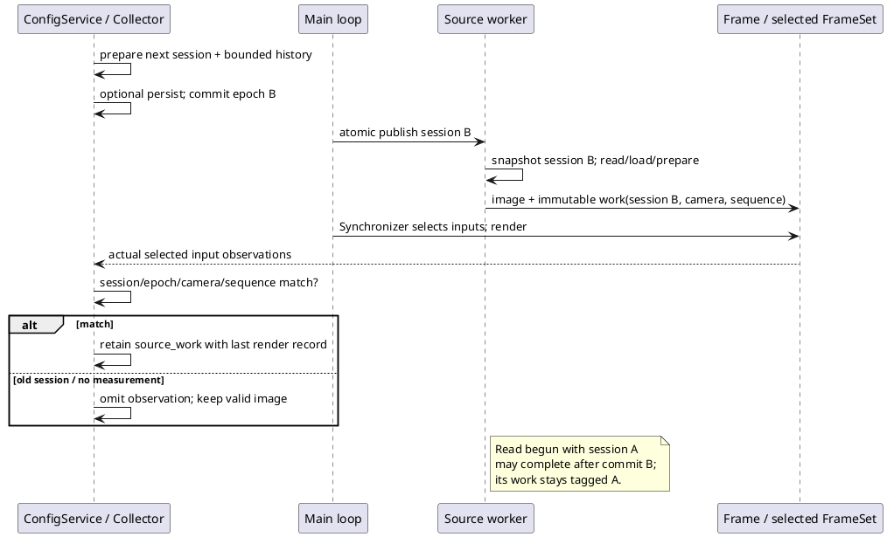

# Отключаемые измерения работы источников

16.10.2026. В camera/replay sources добавлены C++ измерения операций, связанных с выбранными
render inputs. `telemetry.enabled` управляет ими вместе с остальным collector. SDK, window archive
и I/O graph поддерживают optional `source_work`. Это не поток всех worker events.
Основные контракты: [[engineering/TELEMETRY]], [[engineering/TELEMETRY_ARCHIVE]].

## Измеряемые границы

| Kind / поле | Граница | Ограничение |
|---|---|---|
| camera_read / camera_read_wall_ms | Вокруг успешного OpenCV VideoCapture.read | Wall time backend call; может включать ожидание и декодирование, не exposure timestamp |
| camera_read / image_prepare_wall_ms | cvtColor BGR/GRAY/BGRA→RGB и копирование owned Image | Без open/reconnect, queue wait и render |
| replay_load / image_load_wall_ms | Вокруг вызова ImageLoader при смене path | Default PNG/JPEG loader включает OpenCV read/conversion/copy; PPM использует native read_ppm; custom loader имеет собственный смысл |
| replay_load / cache_hit=true | Image path уже закеширован | Load skipped: duration0, started_ns=completed_ns на delivery boundary; это не быстрый физический disk read |

OpenCV описывает read как получение очередного кадра с декодированием, поэтому измерение одного
вызова не разделяет hardware acquisition и decode. Первичный источник:
[OpenCV VideoCapture](https://docs.opencv.org/4.x/d8/dfe/classcv_1_1VideoCapture.html).
В camera path используется V4L2 preference; mock driver заменяет только backend read/open,
а production cvtColor/copy/queue выполняется и в native tests. Camera path теперь явно принимает только CV_8U: неподдерживаемая глубина
(например16-bit) даёт camera_unsupported_depth status/drop до создания RGB Image; ранее такой
кадр мог получить неверный RGB8 byte layout.

Физические /dev/video устройства и Aurora здесь не проверялись. Failed/empty reads, invalid
resolution/channels, dropped/unselected frames не образуют передаваемый timing record. Нет
распределения всех worker operations и worst-case failure latency. Socket source получает готовые
RGB frames и не фабрикует capture/decode timings.

## Серия и атомарная перенастройка

TelemetryCollector владеет immutable shared SourceTimingSession(epoch). При enabled session
выделяется вместе с prepared history **до** persistence. Commit переключает pointer и очищает
last frame/source observations. Main loop перед следующим render распространяет session в source.
При disabled session=null; semantic no-op settings сохраняют прежнюю session.

Worker читает atomic shared-pointer snapshot **перед** read/load. Операция, начатая раньше commit,
может завершиться позже и сохранить old session; её изображение остаётся обычным допустимым input.
Collector включает timing только при совпадении session pointer, epoch, camera_id и source_sequence
с реально выбранным Frame. Поэтому старый timing не получает метку новой серии. Во время перехода
часть камер может не иметь observations до следующей подходящей операции; пустота не заменяется0.
Rollback preparation/persistence оставляет session прежней. Initial enabled session передаётся
factory до старта workers, чтобы первый load/read тоже мог измеряться.

При disabled новые операции не выполняют дополнительные timing clock reads и не выделяют work
records. In-flight old-session операция может закончить измерение/выделение после disable, но не
попадает в новую историю. Atomic pointer check, driver indirection и пустое поле в Frame остаются;
это не доказательство нулевого overhead. Новые sampler threads не создаются. Worker timers измеряют
каждую успешную операцию, а период collector определяет частоту **samples**, не worker clock calls.

Рисунок 1 — Источники получают session после commit; collector отбирает observations по provenance.

## Wire и SDK

HELLO capability `source_work_timing_v1` и catalog flag с тем же именем объявляют наличие optional
records. Telemetry schema1/SV01 framing и команды28/scenarios17 не меняются. Legacy flag
capture_decode_duration_supported=false остаётся: полного разделённого capture/decode profiler нет.

Sample.source_work — array0..4. При непустом массиве sample.frame обязателен. Каждый record:

| Поля | Формат |
|---|---|
| camera_id / kind | JSON integer0..3; camera_read либо replay_load |
| epoch / source_sequence | Decimal uint64 strings; epoch равна batch epoch |
| started_ns / completed_ns | Server steady clock ns strings; start≤complete≤frame.timestamp_ns |
| camera_read_wall_ms / image_load_wall_ms / image_prepare_wall_ms | Nullable finite nonnegative numbers, ms; комбинация соответствует kind |
| cache_hit | bool; только replay cache может быть true |

Camera read+prepare duration не превосходят интервал observation с tolerance1ns для float conversion;
replay load также ограничен своим interval. Cache hit имеет load0 и нулевой interval. SDK parser
проверяет shape/count, уникальность camera IDs, epoch, clocks и допустимость durations/kind. Отсутствие
optional source_work в старом сообщении/отчёте означает пустой массив.

Typed discovery: TelemetryCatalog.source_work_supported читает catalog flag; это поддержка
формата, а не гарантия доступного датчика/наблюдения в каждом backend.
Installed `source_work_timing.hpp` не зависит от OpenCV/Qt. `TelemetrySample::source_work` владеет DTO.
Новый archive codec сохраняет records внутри прежней schema1; старые readers могут игнорировать
дополнительное поле, поэтому для round-trip этих records нужен обновлённый SDK.

Четыре observations увеличивают размер batch. `telemetry_read(limit<=16)` теперь может вернуть
меньше records по byte budget32KiB. Проверять has_more/next_cursor, а не ожидать ровно limit. Server
не пропускает sample при сокращении batch; oversized одиночный sample по-прежнему отклоняется.
Граница ring/history не изменена. Read/serialization costs учитываются отдельно в будущем overhead study.

## Просмотр и интерпретация

В **Телеметрия → I/O** выбрать «Камера N: OpenCV read / Replay image load / RGB prepare/copy».
Неприменимые и отсутствующие metrics остаются null. Details показывают kind, source_sequence,
epoch и cache hit. Графики используют fresh render records, но **fresh render не равен fresh input**:
при rerender выбранное изображение и его operation timing могут повторяться. Поэтому capture
quantiles/rates не выводятся; для уникальных операций сопоставлять instance/epoch/camera/sequence/
started/completed. Workers, чьи кадры не выбраны render, не представлены этим snapshot.

Рисунок 2 — Per-camera read graph и provenance, контролируемый QML fixture. Duration0.25ms на
рисунке задан тестом; это не измерение V4L2-устройства или Aurora.

## Проверка и следующий шаг

`source_work_timing` GTest проверяет настоящие RGB conversions с fake driver, отсутствие records
при disabled, cold/cache replay, default OpenCV PNG loader, rejection of non-8-bit input, old-frame rejection после epoch commit,
in-flight camera read через blocking mock и byte-budget pagination. SDK tests проверяют malformed
IDs/epoch/clocks/durations, duplicates/missing frame, archive uint64/source record round-trip и old
optional-field compatibility. Live test явно ставит looping replay на pause, меняет epoch, убеждается
в отсутствии old work и делает step для нового cache-hit observation.

Остаются physical V4L2 acceptance (форматы/FPS/backend buffers/timestamps), bounded stop/reconnect
при зависшем read и политика OpenCV exceptions, failed-operation timings, independent worker event
stream/dedup, mixed per-camera sources, separate capture/decode, sync/calibration/seam/send timers,
levels/subsystem budgets и одинаковый replay для overhead on/off. Измерения успешного selected input
не доказывают worst-case latency устройства и не заменяют сравнение целевых платформ.

Полная сборка Linux успешна. Итоговый выбранный набор CTest: 7/7 за 53,00 с, включая 7 source-work GTest, 15 telemetry/archive GTest, 20 runtime unit cases, 3 QML cases, 6 live telemetry cases и проверки camera/Unix/TCP/installed consumer. Ранее также прошли регрессионные проверки sources/config/replay/output. Полный набор из 64 CTest, физические V4L2-камеры и приёмка на Авроре в этом шаге не проверялись.
