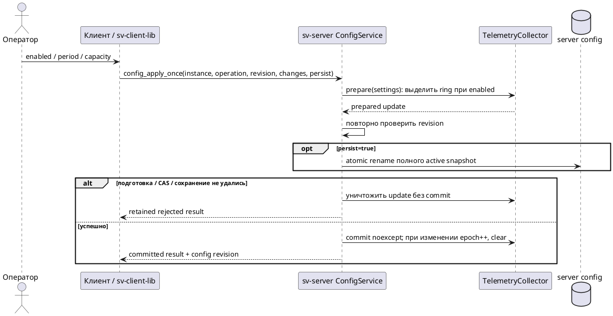
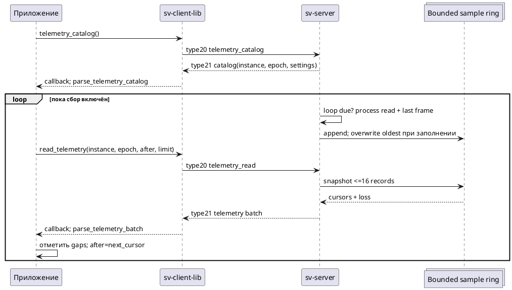

# Отключаемая телеметрия сервера

15.10.2026. Первый реализованный срез `telemetry_v1`: process CPU/RSS, counters источника,
состояние доставки и существующие frame spans. Сервер собирает данные на C++, клиент читает
их через typed `sv-client-lib`. sv-simulator предоставляет формы настроек и CPU/RSS/render, pipeline и source/delivery графики; subscriptions и полного subsystem profiler пока нет.

## Настройка и жизненный цикл

Необязательная корневая группа:

```json
"telemetry": {"enabled": false, "period_ms": 100, "history_capacity": 128}
```

`enabled` обязателен внутри группы и принимает только bool; остальные поля необязательны.
`period_ms` — JSON integer50..5000, `history_capacity` — integer8..256. Неизвестные поля
отклоняются. При отсутствии группы сбор выключен. ConfigService поддерживает полную замену
этой группы через validate/apply/apply-once; пропущенные поля получают defaults.
Остальные пропущенные root groups сохраняются. Catalog schema2 расширен аддитивно:
`replaceable_groups` теперь содержит fusion/surface/telemetry и отдельный telemetry bounds object.

Перед сохранением сервер выделяет ограниченный ring buffer; после успешной публикации config
меняет collector без исключений. Ошибка preparation/CAS/persistence сохраняет прежний collector.
Изменение эффективных настроек очищает историю, CPU baseline и последний frame, увеличивает
`epoch`. Повторное применение тех же настроек не сбрасывает epoch/history, хотя обычная config
revision увеличивается. Disable также очищает историю. Restart создаёт новый server instance.

При disabled новый collector не вызывает process provider, не хранит samples и не создаёт
дополнительных GPU queries. Уже существующие frame timers, PipelineSpanTracker и trace остаются
независимыми; это не режим полного отключения всей инструментализации и не доказательство
нулевых накладных расходов.



Рисунок 1 — Сервер владеет настройкой и публикацией сборщика; сборщик не включается до успешного commit.

## Метрики и границы интерпретации

| Поле | Единица и смысл | Ограничение |
|---|---|---|
| timestamp_ns | server steady clock, наносекунды | Не UTC; нельзя вычитать clock другого host |
| process.cpu_percent | 100 × Δ(user+system CPU ns)/Δsample timestamp ns | 100% соответствует одному logical CPU; может быть >100%; первый/недоступный интервал null |
| process.rss_bytes | resident pages × page size, decimal uint64 | Приближённый current RSS Linux `/proc/self/statm`; null при недоступности, не peak RSS |
| source | received/rejected/decoded/dropped/queued_batches, decimal uint64 | Смысл counters задаёт backend; не длительность decode и не отдельная очередь каждой камеры |
| paused/data_ready/data_busy | bool | Состояние при sampling; busy — незавершённая доставка, не длительность send |
| frame | Последний завершённый render record либо null | Может относиться к прежней config revision; fresh=false при повторе |
| spans_ms | source_poll, pre_render_prepare, render_wall, fusion_cpu, layer_readback_cpu, upload_cpu, readback_copy_cpu, publish_enqueue, nullable gpu_draw | Интервалы перекрываются; сумма не равна latency |
| input_age_at_render_ms | Старейший selected input receive → render completion | Возраст входа, а не чистая длительность вычислений; растёт на paused input |
| collection_wall_ms | Process read и подготовка sample, мс | Не включает запись в ring, JSON serialization, network, влияние cache/scheduling и старые frame timers |

CPU основан на `getrusage(RUSAGE_SELF)`: user/system время всего процесса, включая его threads.
Семантика подтверждается [Linux getrusage(2)](https://man7.org/linux/man-pages/man2/getrusage.2.html).
Resident column statm измеряется в pages и имеет ограниченную точность из-за оптимизаций kernel;
это описано в [Linux proc_pid_statm(5)](https://man7.org/linux/man-pages/man5/proc_pid_statm.5.html).
В текущем non-Linux build обе process metrics null. Проверка Aurora SDK/устройства ещё не проведена.

GPU draw берётся из существующего renderer query при available и non-disjoint результате;
null означает отсутствие пригодного измерения. В hybrid fusion полный GPU путь не измеряется.
Это не GPU utilisation/memory и не wall time CPU. Отдельных timers calibration, seam, pyramid, projection, encode/send и per-worker load в первом срезе нет.
Последующий camera/replay selected-input work описан в [[engineering/SOURCE_TIMING]]; это ещё не
разделённые physical capture/decode timers.

Sampling идёт в главном server/render loop без отдельного thread. Если render/command блокирует
loop, период увеличивается: анализировать фактические timestamp gaps. Между samples берётся
только последний завершённый frame; быстрые кадры могут не попасть в периодическую историю.
`lost_samples` считает перезаписанные samples, а не все пропущенные кадры. На paused/backpressured
выводе process samples продолжаются; повторные frame spans нельзя считать новыми render events.

## Wire и typed API

HELLO capability `telemetry_v1`; SV01 type20 → type21, JSON envelope без image payload.

- `telemetry_catalog()` → `parse_telemetry_catalog(message)`: schema1/scope devel_telemetry,
  instance, epoch, clock domain, settings, max_read_samples=16, CPU basis и ограничения.
- `read_telemetry(instance, epoch, after_cursor, limit=16)` → `parse_telemetry_batch(message)`:
  samples, enabled, after/next/oldest/latest cursor, lost_samples, has_more.

Instance проверяется как точная строка текущего процесса. Epoch, cursors, timestamps, config
revision и counters передаются decimal uint64 strings. Limit — JSON integer1..16. Запрос с чужим
instance/epoch, cursor ahead или неверным limit отклоняется без изменения конфигурации/состояния.
Catalog/read разрешены и под experiment lease; изменение группы под lease запрещено.

При потере истории первый cursor = after_cursor + lost_samples + 1; далее cursors непрерывны.
Если samples пусты, next_cursor=after_cursor. `has_more` означает next_cursor<latest_cursor.
Read возвращает максимум16 records и ограничивает serialized result32KiB, без усечения record.
При epoch mismatch перечитать catalog и начать новый ряд с cursor0. При reconnect сверить instance
и epoch; значения разных серий не объединять. Ответ может быть историческим относительно ACK
config_revision; typed parser проверяет sample revision≤ACK revision и frame revision≤sample revision.



Рисунок 2 — Bounded polling: медленный клиент теряет старые samples явно, без роста server history.

Обе transport connections control/data пока обязательны, сервер односессионный. Telemetry read
не ждёт освобождения frame buffer и не требует нового final frame, но data channel всё равно
нужно подключить; большой control ACK может задерживать следующие команды в том же stream.
Push subscriptions, отдельный telemetry transport, control-only и отключение final output ещё не реализованы.
Installed SDK включает `client_telemetry.hpp`; не требует Qt/OpenCV/GLM.

## Использование

Закрыть GUI перед отдельным svctl: сервер пока принимает одну сессию. Путь — Unix IPC directory
запущенного сервера; для TCP доступны обычные `--tcp HOST CONTROL_PORT DATA_PORT`.

```sh
build/examples/svctl/svctl --unix /tmp/sv-prototype command telemetry_catalog
build/examples/svctl/svctl --unix /tmp/sv-prototype command config_read
# Подставить актуальную revision из config_read; runtime apply без записи файла:
build/examples/svctl/svctl --unix /tmp/sv-prototype command config_apply --params '{"base_config_revision":"0","changes":{"telemetry":{"enabled":true,"period_ms":100,"history_capacity":128}},"persist":false}'
# Подставить instance и epoch из нового telemetry_catalog:
build/examples/svctl/svctl --unix /tmp/sv-prototype command telemetry_read --params '{"server_instance_id":"INSTANCE","epoch":"EPOCH","after_cursor":"0","limit":16}'
```

Отдельные CLI sessions не сбрасывают process history. Для длительного reader использовать один
Client и его callback с correlation command_id, очередью bounded размера и explicit release
при получении frame. Чтение нового API само по себе не включает сбор и не обходит enabled=false.
Изменения production settings следует выполнять с apply-once/status для reconciliation неизвестного исхода;
пример config_apply выше предназначен для ручного smoke, не автоматического retry.

## Проверка и следующая работа

`telemetry` GTest проверяет disabled/provider calls, periodic CPU/freshness, ring loss/pagination,
instance/epoch/limit guards, prepare/discard/commit/reset, configuration bounds и malformed replies.
`telemetry_ipc` проверяет Linux server hot enable/disable, paused/busy sampling, read-only lease,
rejection guards, rollback при persistence failure и typed C++ consumer на Unix/TCP.

Остаются: графики остальных подсистем/очередей и их квантили, streaming trace/timed playback и paired comparison, experiment
markers, детализация подсистем, metric IDs/levels, GPU/threads, independent/control-only delivery
и overhead experiment disabled/minimal/detailed на одинаковых входах. Этот срез не является
новым сравнительным исследованием производительности или доказательством выбора алгоритма.

Итоговая проверка Linux/Mesa: полная сборка успешна. Первичный selected CTest6/6 за10.66s
(telemetry/output/configuration/lease/QML); после расширения restart/apply-once проверок —
CTest5/5 за24.12s (7 telemetry GTests,5 live telemetry cases, client transports, ConfigStore,
pipeline spans). Полный63-test suite и Aurora SDK в этом шаге не запускались.

## sv-simulator: настройки и графики

1. Подключиться к серверу. В **Конфигурация → Телеметрия** отметить сбор, задать период и размер
   history. Нажать «Проверить черновик», затем «Применить временно» либо явно сохранить snapshot.
   UI использует server catalog bounds и существующий apply-once/status workflow; неизвестный
   исход блокирует новые изменения. Если telemetry group не объявлена, её поля недоступны.
2. В панели **Телеметрия сервера** включить «Читать каждые500мс». Чтение по умолчанию выключено.
   Оно не включает серверный sampler: disabled catalog показывает подсказку о настройке.
3. Переключать CPU / Память / Render / Этапы / I/O. Память отображается в MiB; CPU100% — одно logical CPU.
   X использует фактические server timestamps относительно первого sample серии, не arrival time.
4. «Очистить графики локально» удаляет только точки; cursor сохраняется. Остановка чтения не
   выключает сбор. Для отключения сбора применить enabled=false в серверных настройках.

Модель хранит максимум120 samples, опрашивает catalog перед каждым bounded batch, держит только
один telemetry request в ожидании и читает не более16 records за tick. Даже при has_more следующий
batch ждёт tick; низкая частота/маленький server buffer могут вести к loss. При instance/epoch смене
или disconnect окно очищается; при epoch race rejected read следующий tick перечитывает catalog.
Transport failure завершает pending read и останавливает timer; возобновление выполняется явно.
Ответы связываются по command_id, batch — также по instance/epoch/after_cursor. Сам Client может
переподключиться по общей transport policy; новый ready возобновляет ранее выбранный monitoring.

Линия разрывается при lost_samples, отсутствующей metric или timestamp gap больше2.5 sampling
periods. Для render берутся только fresh frame records; repeated frames остаются отсутствующими
точками. Dots показывают и одиночные значения. На окне выводятся render wall p50/p95/p99 методом
nearest rank по **выбранным fresh records**, число таких records, cumulative ring loss и последняя
config revision. Это не квантили всех серверных frames: промежуточные кадры могут не попасть в sampling.


Рисунок 3 — Native QML панель offline report и CPU graph с отсутствующим sample. Значения заданы тестовым fixture
для проверки визуализации; это не измерения автомобиля, host performance или Aurora.

Модель проверена на bounded window, freshness/known-answer quantiles, gaps/loss, series reset,
foreign reply/time guards и command failure correlation. QML regression переключает все три вкладки
и рисует nullable/fresh records без Qt warnings; формы проверены реальными сигналами controls.
Native adapter integration включает collection через ConfigurationEditor, читает samples через
TelemetryModel и восстанавливает настройки по Unix/TCP, без записи server file клиентом.

Полная Linux сборка успешна; selected CTest5/5 за31.84s (Unix/TCP GUI adapters, telemetry IPC,14 runtime unit cases, session cleanup и3 QML cases). Full63-test suite/Aurora в этом шаге не запускались.

## Сохранение окна и offline view

C++ codec, поля/лимиты, файловые диалоги, static offline view и ограничения:
[[engineering/TELEMETRY_ARCHIVE]]. Сохраняются полные typed samples текущего окна, не только
нарисованные точки. Streaming/timed playback и полный experiment report остаются открытыми.

## Pipeline и source/delivery графики

Во вкладке **Этапы** список выбирает один из9 существующих spans либо input age at render.
Для каждого выбора выводятся ms, пояснение смысла, число доступных значений и nearest-rank
p50/p95/p99 по retained window. Все frame-показатели здесь используют **только fresh records**;
GPU null/repeated frames не заменяются нулями. Вызовы renderer могут включать другие spans:
графики нельзя складывать для получения общей latency или CPU utilisation.

| Выбор | Откуда берётся | Что не измеряет |
|---|---|---|
| render_wall | Вход → выход renderer.render в server main loop | Полную capture-to-display latency |
| source_poll | FrameSource.poll в текущем main loop | Capture/decode worker duration |
| pre_render_prepare | Конец poll → начало render, включая events/commands | Отдельную GPU projection stage |
| fusion_cpu | Hybrid CPU fusion и вложенные операции | Полную CPU нагрузку процесса/отдельные seam/pyramid timers |
| layer_readback_cpu | Подготовку/чтение hybrid layers | Чистую GPU execution time |
| upload_cpu | CPU wall upload изменившихся входов | GPU execution time |
| readback_copy_cpu | CPU wall readback/copy результата | Отдельное время каждого GL call |
| publish_enqueue | Постановку результата в output delivery | Send/release round-trip |
| gpu_draw | Пригодный renderer timer query | GPU utilisation/memory/полный hybrid GPU путь |
| input_age_at_render | Старейший selected input receive → render done | Чистую длительность вычислений |

Во вкладке **I/O** доступны queue gauge, paused/data_ready/data_busy0/1, возраст последнего
render record и collection wall. `frame_record_age = (sample.timestamp_ns − frame.timestamp_ns)/1e6`
вычисляется из той же server clock domain и обновляется даже при fresh=false. При отсутствии frame
показатель null. Рост record age при paused/busy не означает рост renderer duration; показывает
давность последнего render measurement. Input age at render остаётся отдельным frozen measurement.

Collection wall охватывает process read и подготовку record, но не все издержки инструментализации.
Для I/O flags квантили latency не выводятся. Точные latest source counters показаны строками;
queue graph подавляет значения выше2^53, чтобы не выдавать округлённый double за точный count.
Исходные uint64 сохраняются в details и archive.

| Backend | queue gauge | Пример семантики counters |
|---|---|---|
| Replay | Число queued Frames batches, не все события | received — камера в созданном frame set; decoded — загрузка нового image path; dropped — batch eviction |
| Socket | Суммарные queued per-camera Frames events | received — принятый frame; dropped — paused/evicted frame; rejected — rejected input; decoded всегда0, decode не измеряется |
| Camera | Все pending events, включая control/status | received — успешный camera read; decoded — подготовленный и поставленный frame; dropped — rejected/paused/evicted frame; rejected отдельным counter не собирается |

Нельзя напрямую сравнивать decoded/drop fractions этих backend без нормализации единиц.
Sampling в main loop также не даёт peak queue внутри заблокированного render. Семантика сверена
с `src/apps/server.cpp`, `src/render/renderer.cpp`, `src/sources/{replay,socket,camera_source}.cpp`.
Новых server timers/threads/commands этот GUI шаг не добавляет.


Рисунок 4 — Выбор CPU fusion wall и масштаб малых значений. Контролируемый QML fixture,
не измерение производительности hardware. Ось автоматически подстраивается к ненулевому максимуму;
для малых значений используется scientific notation. Смена метрики вызывает repaint, даже если
новых samples не поступало.

Live и offline view используют один C++ point builder. Archive schema1 не менялась: исходные
spans/counters/flags уже сохранялись. Информация о точности дробных archive values на версиях
Boost и отдельном regression test: [[engineering/TELEMETRY_ARCHIVE#Точность дробных метрик]].

Остаются реальные отдельные capture/decode/sync/calibration/projection/seam/pyramid/send timers,
per-worker/per-camera queues, GPU load/memory и controlled overhead experiment. Наличие selector
не означает наличия нового profiler или доказательства причины performance spike.

Полная Linux сборка успешна; selected CTest6/6 за26.95s:13 telemetry/archive GTests,20 runtime unit cases,8 session cases,3 QML cases и real Unix/TCP adapters/installed consumer. Полный63-test suite и Aurora SDK/устройство в этом шаге не проверялись.

## Camera/replay input work (16.10.2026)

Отключаемые source operation timings, shared-session epoch guard, optional SDK/source_work records,
byte-budget pagination и per-camera I/O choices реализованы: [[engineering/SOURCE_TIMING]].
Число I/O choices теперь18 (прежние6 +12 per-camera); capture quantiles не выводятся из повторяемых
selected-input measurements. Physical capture/decode separation и полноценный worker trace ещё отсутствуют.
