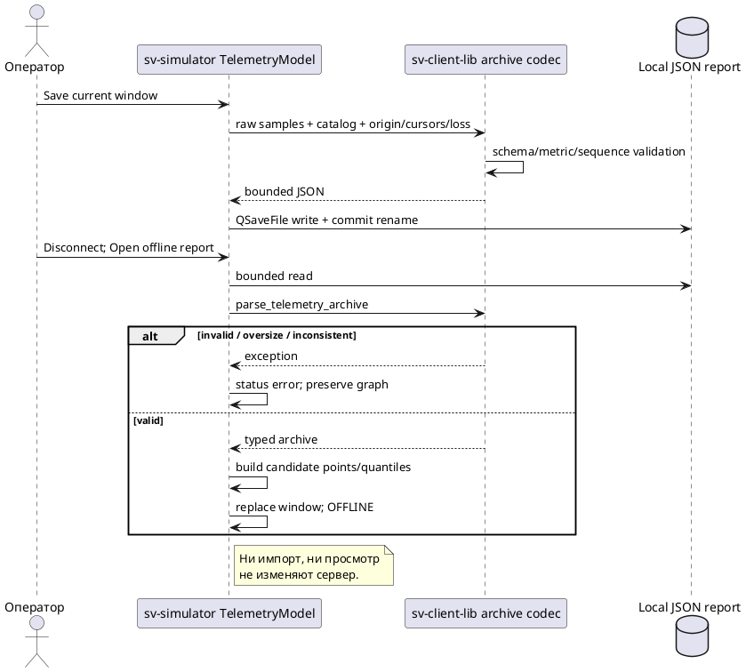

# Отчёт окна телеметрии и offline-просмотр

15.10.2026. Реализованы C++ формат `sv_telemetry_window` schema1 в sv-client-lib,
сохранение текущего окна в sv-simulator и статический offline-просмотр на тех же графиках.
Server wire не меняется: это локальный клиентский формат, без новых команд и без Python.
Контракт исходных метрик: [[engineering/TELEMETRY]].

## Использование GUI

1. Включить server collection и отдельный reader согласно [[engineering/TELEMETRY#sv-simulator: настройки и графики]].
2. При желании заполнить подпись, затем нажать **Сохранить окно в отчёт** и выбрать файл.
   Можно сохранять во время чтения: экспортируется согласованное текущее окно GUI thread.
   File chooser запрашивает подтверждение перезаписи существующего файла.
3. Остановить reader и нажать **Отключить** в панели соединения. Затем выбрать
   **Открыть отчёт offline**. Нужен local file URL; сеть и сервер не используются для импорта.
4. В режиме OFFLINE доступны CPU/Память/Render/Этапы/I/O и те же квантили. Это статическое окно,
   а не покадровое проигрывание во времени. Подключение к серверу очищает offline series;
   для live monitoring подключиться заново. Неверный файл оставляет прежние графики.

Подпись UI ограничена64 UTF-16 code units; формат принимает до256 UTF-8 bytes. Кнопка импорта
доступна только без attached Client, monitoring и pending telemetry requests. Простого выключения
collection недостаточно: это отдельная server setting, не disconnect. Закрытие reader/GUI не
отключает уже включённый collection автоматически.

В Qt6 chooser реализован через `QtQuick.Dialogs`, с Quick fallback и стандартным overwrite prompt;
API описан в [Qt FileDialog](https://doc.qt.io/qt-6/qml-qtquick-dialogs-filedialog.html).
Нужен соответствующий QML runtime module. Для Qt5 выделен отдельный `QtQuick.Dialogs 1.3` adapter;
его host/SDK acceptance в этом шаге не выполнялась. Aurora touchscreen client этим GUI модулем
не затронут, sv-simulator по-прежнему исключён из Aurora RPM profile.

## Что хранится

| Поле | Содержание |
|---|---|
| schema_version / kind | 1 / sv_telemetry_window |
| catalog | Typed telemetry catalog: server instance, epoch, sampling settings, clock domain, CPU basis и read bound |
| origin_ns | Первый timestamp серии до eviction/local clear, decimal uint64; задаёт тот же X origin |
| latest_cursor | Последний обработанный cursor, decimal uint64 |
| lost_samples_total | Cumulative ring loss с начала серии, decimal uint64; может включать потери до retained window |
| first_gap | Признак разрыва перед первой retained точкой, который нельзя восстановить без прежнего окна |
| label | Необязательная пользовательская подпись |
| samples | До120 полных typed records: CPU/RSS, source counters, timestamps/revisions, nullable frame с fresh/spans, delivery flags, collection wall time |

Все uint64 передаются строками, включая RSS и counters, поэтому значения выше2^53 не теряются
при JSON round-trip. CPU/spans остаются конечными неотрицательными JSON numbers; null остаётся null.
Не экспортируются только нарисованные значения MiB/seconds: исходные bytes/ns и repeated-frame
records сохраняются. Offline view повторяет преобразования и fresh-only quantiles.

Локальное удаление старых полученных samples при переполнении UI window не увеличивает
lost_samples_total. Внутренние cursor holes отражают server history loss; сумма этих holes не
может превышать cumulative loss. Потери до первой retained точки невозможно доказать только
по retained records. first_gap также может отражать timing gap, поэтому он не является счётчиком.

Файл не содержит полного server config, algorithm settings по каждой revision, host hardware/
compiler fingerprint, experiment markers, image payload или всего frame trace. Подпись и revision
не заменяют эти данные. Нельзя считать два отчёта одинаковыми экспериментальными условиями только
по похожим графикам; план сравнения платформ ещё требует provenance/config snapshots и общего runner.
Schema validation проверяет согласованность данных, не их подлинность: JSON можно редактировать.

## API и проверки

Installed header `sv/client_telemetry_archive.hpp`:

```cpp
std::string serialize_telemetry_archive(const TelemetryArchive &);
TelemetryArchive parse_telemetry_archive(std::string_view);
```

API не зависит от Qt/OpenCV/GLM и не обращается к файловой системе. Внешний клиент выбирает свой
I/O. Parser ограничивает input2MiB до JSON parsing и samples120, проверяет schema/kind/catalog,
label bound, положительные возрастающие cursors, origin/timestamp order, latest cursor,
cumulative loss и исходные metrics/frame identities через существующие typed validators.
Exporter использует тот же validator, поэтому не создаёт отчёт, который reader отвергает.
Обычные ACK/command IDs в файле не сохраняются и сетевые команды при импорте не исполняются.

В sv-simulator `telemetry_files.cpp` читает максимум2MiB+1, собирает candidate model целиком,
и только затем заменяет окно. Ошибка формата/чтения меняет status, сохраняя прежние данные.
Сохранение использует QSaveFile без direct-write fallback: временный файл + commit rename,
без truncation destination при неудачной записи. Семантика подтверждается
[Qt QSaveFile](https://doc.qt.io/qt-6/qsavefile.html). Проверка power-loss durability не проводилась.
I/O выполняется синхронно в GUI thread для ограниченного snapshot; это не streaming recorder.



Рисунок 1 — Экспорт ограниченного snapshot и импорт через проверенный candidate без серверной mutation.

## Проверка и оставшаяся работа

GTest проверяет uint64 max/null/fresh round-trip, cursor holes vs eviction, malformed schema/
metrics/clocks, byte/sample bounds и empty window. Model tests проверяют совпадение графиков и
квантилей, truncated120-record window с прежним origin, local clear, failed import/write и
offline/live isolation. Live Unix/TCP GUI adapter сохраняет реальные server samples и открывает
их в отдельной offline model; attached live model не принимает импорт. QML regression открывает
и закрывает Qt6 chooser, исполняет chosen signals для save/open и проверяет warnings.

Остаются streaming trace с ротацией/бюджетом, timed playback, overlay/paired comparisons,
host/build/config provenance, experiment markers и сценарная запись. Накладные расходы collection,
polling и экспортного I/O надо измерять отдельно на одинаковом replay, затем на целевом устройстве.

Linux сборка успешна; selected CTest6/6 за25.06s:12 telemetry/archive GTests,17 runtime unit cases,8 session cases,3 QML cases, real Unix/TCP adapters и installed consumer. Полный63-test suite, Qt5 chooser и Aurora в этом шаге не проверялись.

## Точность дробных метрик

QML stage regression обнаружил drift последних разрядов при default Boost.JSON parsing дробных
duration. Для локального archive reader на Boost≥1.83 включён number_precision::precise.
Наличие этого режима с1.83 подтверждается [Boost.JSON release notes](https://www.boost.org/doc/libs/1_83_0/libs/json/doc/html/json/release_notes.html).
Регрессия проверяет пять repeated save/load passes для малых fusion durations, nextafter CPU%
и collection wall; host round-trip сохраняет исходные double. uint64 strings не затронуты.

На Boost<1.83 сохранён прежний parser для source compatibility; точный floating round-trip там
не гарантирован и precise-specific test пропускается. Legacy numeric stability остаётся задачей.
Изменён только локальный archive parsing; live SV01 decoder, config parser, Qt↔config conversions
и исторические research inputs/reports этим шагом не менялись. Archive сохраняет полученные
клиентом значения и не восстанавливает precision, уже потерянную раньше в wire/config pipeline.
