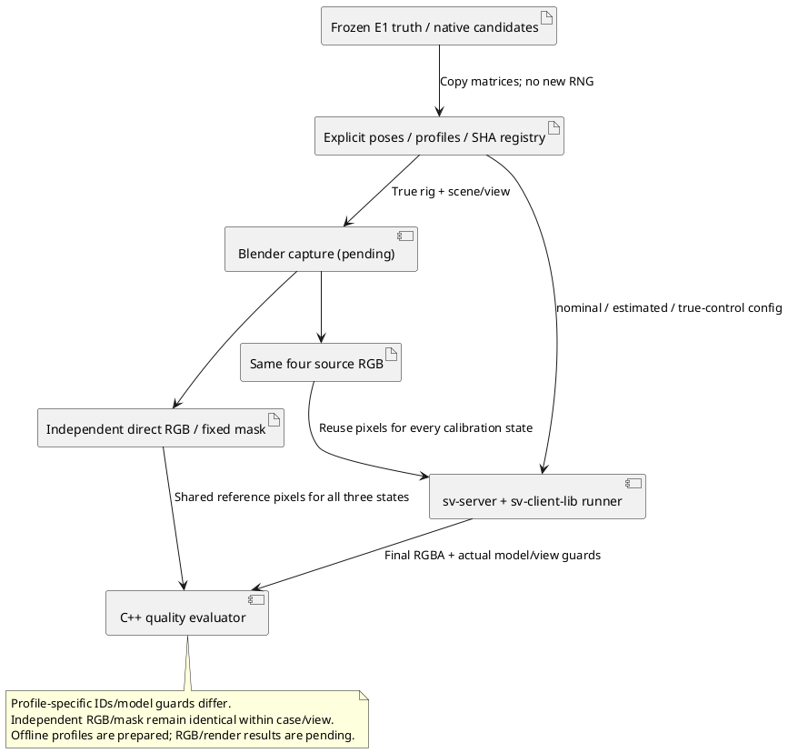

# Компактный протокол диплома E1–E3

Версия2,25.10.2026. Тема: «Исследование и разработка системы отображения и методик
калибровки функции интерактивного кругового обзора ТС для ОС Аврора».
Срок и недельные результаты: [[planning/ROADMAP#Фокус диплома и еженедельные результаты]].

Параметры ниже зафиксированы до получения новой подтверждающей выборки. Numerical E1 input/observation registry сформирован и серия выполнена: [[validation/THESIS_E1]].
Scene seed mapping и explicit E1 pose/profile registry E2/E3 подготовлены: [[validation/THESIS_E3]].
29.10.2026 получены18 новых captures/references, выполнены image-quality E2/E3 и отдельный
PC performance profile. Результаты: [[validation/THESIS_E2]], [[validation/THESIS_E3]],
[[validation/THESIS_PC_PERFORMANCE]]. Параметры плана не менялись после просмотра новых
outputs. Аппаратная приёмка остаётся отдельным этапом.
Пилот [[validation/THESIS_CORE_PILOT]] использует исторические inputs и проверяет только
исполнение. Изменение параметров/правил после просмотра новых outputs требует следующей версии
и явного отделения прежнего exploratory результата. Внешняя регистрация не заявляется.

Изменение v1→v2 до новой серии: E1 сокращён144→48 fits без дублирования scene labels;
геометрия board poses и общая rig зафиксированы в `configs/research/thesis-e1-inputs.json`.
Это ответ на узкую околоосевую геометрию exploratory pilot9001, не подбор параметров
по новым mount seeds1001–1003. Их результаты ещё не просмотрены при фиксации этого плана.
Pilot9001 и его исходные таблицы не переписываются. Pose centres заданы в true optical
coordinates; R_true=Rx(pitch)R_nominalRz(−yaw), C_true=C_nominal+[along_body,0,0].
Случайность solver — backend-owned legacy OpenCV API без seed argument; выполнение
должно сохранять execution_policy/version и проходить ambient-RNG repeatability checks.
Это не обещание битового совпадения разных OpenCV/ABI/платформ.

## Вопрос и границы

Как ошибка установки и её программная коррекция влияют на обзор и какой компромисс
ошибки изображения/вычислительных затрат дают выбранные способы отображения?
Сравниваются существующие реализации; новый универсальный калибратор, восстановление
трёхмерной сцены и доказательство превосходства над всеми аналогами не являются целью.

| Опыт | Изменяемое | Фиксированное | Основной результат |
|---|---|---|---|
| E1 | sqpnp / ransac_epnp_lm; обычные/загрязнённые observations | Intrinsics, train/validation groups, ground-truth mount | Ошибка позиции/поворота, held-out reprojection, failures и fit wall time |
| E2 | hard_best_angle / edge_feather / multi_band × plane / dome_floor | True calibration, source RGB, view, raster, активный mesh budget | Masked RGB MAE/RMSE и затраты native pipeline |
| E3 | Nominal / estimated / true-control calibration | dome_floor + edge_feather, те же inputs/reference/view | Изменение конечной RGB ошибки; Linux server timings и доступные counters |

E3 использует заранее выбранный ransac_epnp_lm, а не победителя по E1 holdout.
Для E3 зафиксирован Gaussian observation profile (без injected outliers) после E1,
до получения новых scene RGB; отдельные камеры не отбираются по fit error.
True-control — эталон параметров камеры, не эталон конечного изображения: carrier всё
ещё приближает геометрию сцены. Неудачный fit остаётся в таблице failures; его нельзя
заменять удачным методом или новой реализацией без смены версии протокола.

## Данные и независимость

Начальная конечная выборка:3 новых scene instances с seeds260101/260102/260103 и3
независимых mount seeds1001/1002/1003 —9 rigs. Семейства ограничить street/cargo_yard,
хотя бы один instance каждого; семейства и seed→preset mapping записать до генерации.
Seeds не доказывают независимость: сохранить генератор, параметры и content identities.
Исторические seeds/Blender recordings не входят в подтверждающую выборку.

Для каждой камеры yaw/pitch независимо U[−3°,3°], сдвиг вдоль продольной оси кузова
U[−0.05,0.05]м; направления и порядок преобразований фиксируются в генераторе/manifest
до получения observations. Это выбранный stress range, не измеренный допуск реального
монтажа. Не добавлять отдельную матрицу случайных intrinsics/экспозиции/шума текстур.

Истинные transforms используются независимым renderer/reference и E1 оценщиком,
но не передаются fit. Nominal config соответствует установке без perturbations.
Сервер принимает готовые observations через существующий calibration API; solver
исполняется в C++, а графики и независимая оценка могут использовать Python.

В версии2 E1 выполняется один раз на каждом из3 mount seeds для общей nominal rig
`configs/research/thesis-rig.json`. Текстуры/семейства сцен не влияют на supplied XYZ/UV
без detector: повторять тот же E1 под тремя scene labels значило бы размножать данные.
E2/E3 по-прежнему используют9 rigs (3 scene instances ×3 mount seeds).

E1:6 различных положений условной мишени на камеру,4 training +2 validation; по24
угла4×6 с шагом0.04м на положение. Совокупность training XYZ должна быть noncoplanar
(ограничение текущего production solver). Split по целым положениям, не случайным
точкам одной мишени. Все poses и visibility проверяются до fit; недостаточные данные
дают явный data-preflight failure, а не подбор по полученной ошибке.

Два observation profiles: Gaussian σ0.5px; тот же шум плюс10% training outliers со
смещением U[−10,10]px по каждой оси. Validation не содержит injected outliers; training
и validation noise streams раздельны, profiles и methods используют paired inputs.
Это контролируемый synthetic stress, не модель реального детектора. В E1 detector,
intrinsics fitting и физическая геометрия не исследуются заново. RANSAC option3px
в текущем коде превращается в normalized threshold3/max(fx,fy); он не трактуется как
строгий fisheye-pixel acceptance gate.

Для E2/E3 нужен direct-view RGB из независимого Blender renderer, не server capture.
Фиксированная mask исключает ego и невидимые reference области по независимой truth,
а не по ошибке исследуемого метода. Для E3 scene plan закрепляет non-ego/any-camera-visible
mask по independent object/visibility truth с erosion2px до просмотра новых RGB. Сохраняются image/model/config/reference hashes.
Reference schema2 и actual-camera input guards обязательны. В E3 model/calibration guards
должны соответствовать nominal/estimated/true-control **используемой** config, поэтому
создаются отдельные reference manifests с общими неизменными direct RGB/mask hashes;
геометрия independent renderer остаётся истинной во всех трёх branches. Нельзя менять
сам reference RGB под оценённую камеру, чтобы скрыть ошибку калибровки. Неполная reference/mask
или mismatch останавливают опыт; не менять mask отдельно для каждого метода.

## Профили отображения и ресурсы

Исполняемый набор: `configs/research/thesis-core.json`,6 variants. Feather width24px,
angle power2, multiband levels4, boundary=normalized, smoothness0.1; дополнительных
seam/compensation вариантов нет. Hard/feather не используют pyramid parameters.

Plane — rectangular_bowl_v1 с corner_height0, outer half extents14м, cells32×45.
Dome-floor — radius14м, latitude14, longitude64, floor radial12. Ожидаемые active
triangles3196/3200, vertices≤1810, position/index buffers≤60500 bytes. Это **active mesh**,
не общий CPU/GPU memory budget; resident cache и текущие allocations записывать отдельно.
Для новой серии начальный server carrier=эта plane, без прежней high-density dome в cache.

Исходные камеры400×400, выход320×180 RGB8/RGBA8; raster не менять в пределах серии.
Два ракурса: azimuth0.8rad, elevation1.0/0.35rad, distance8.5м, FOV1rad,
clip[0.1,100]м, target[0,0,0]. Верхний ракурс нужен для дороги, низкий — для различия
carrier walls; оценка только верхнего ракурса не подтверждает качество купола.
Один заранее выбранный static frame на rig; длинные клипы и temporal ranking исключены.

E2:9 rigs ×2 views ×6 variants =108 quality conditions. E3:9×2×3 =54 conditions.
E1:3 mount seeds ×4 cameras ×2 methods ×2 profiles =48 fits, не48 независимых rigs.
Отдельные fit failures и data-preflight failures сохраняются с denominators.

## Исполнение и трактовка метрик

Использовать существующие sv-server→sv-client-lib→svctl research без Python dispatcher.
Quality scenario:reset_replay=true, capture_frames=true, warmup2/repeats7, seed20261025;
одинаковые input identities/frame_set/view в парных variants. Порядок чередуется
versioned mt19937_fisher_yates_reject_v1; shader/OS/GPU caches не объявляются холодными.
Pause и fusion/surface восстанавливаются; replay cursor пока не восстанавливается.

Основные quality endpoints: MAE/RMSE RGB8 по заранее заданной mask на scene/view,
ошибка центра камеры в метрах, rotation geodesic error в градусах и held-out reprojection
в пикселях. PSNR — вспомогательный показатель; одинаковые paused repeats не увеличивают
число quality observations. Scene/rig парные разницы показывать отдельно, затем median
и range; при3 scenes не заявлять статистическую значимость или точность population CI.
Ghost/flicker proxies могут иллюстрировать ограничения, но не становятся primary endpoint.

Семь timing repeats — только короткое описательное наблюдение. Для E3 performance
профиля отдельно warmup5/repeats30 при том же качестве, без сохранения каждого RGBA,
с фиксацией observation policy. Показывать p50/p95 и raw samples; имеющийся p99 явно
помечать как эмпирический и нестабильный при малом N. Render/readback CPU wall, GPU query
и fusion CPU spans не суммировать как неперекрывающиеся стадии без доказательства.
Capture-to-display, sensor synchronisation и thermal acceptance здесь не измеряются.

Quality pass/fail thresholds не назначать из удобных чисел. Исследование сравнительное;
workflow success не означает нормативно приемлемое изображение. Если нет внешнего
обоснования порога, дать численные различия и ограниченное заключение без Quality Gate.

## Условия завершения и аппаратная часть

E1–E3 завершены, когда сохранены все planned cases либо явные failures, identities/raw
reports, таблицы и репрезентативные изображения, отрицательные результаты и условия
воспроизведения; главы4–5 содержат ответ на ограниченный вопрос, а не обещание будущего опыта.
На Aurora повторить тот же subset при доступном SDK/устройстве и описать ABI/GPU/драйверы.
Без этого Linux/synthetic результат нельзя объявлять квалификацией ОС Аврора; границы
такого диплома и формулировку вклада согласовать с руководителем заранее.

## Передача поз E1 в E3

Capture не пересэмплирует камеры по seed: legacy Blender и E1 используют разные pitch/
slide conventions. Explicit camera_rig переносит exact nominal/actual matrices и source
hashes; дополнительная perturbation запрещена. Стартовые profiles проверяются native
loader. target_m относится к FRAME/reference view, а не к startup virtual_camera;
в startup используются пять поддержанных полей и target[0,0,0].
[[validation/THESIS_E3]] фиксирует offline checks и выполненные29.10 Blender/native trials.

*Рисунок E3.1 — источник камер и независимый эталон используют true rig, оценённая
калибровка применяется только в исследуемом серверном пути.*
