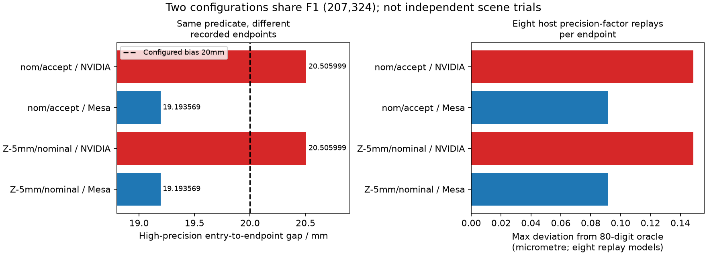
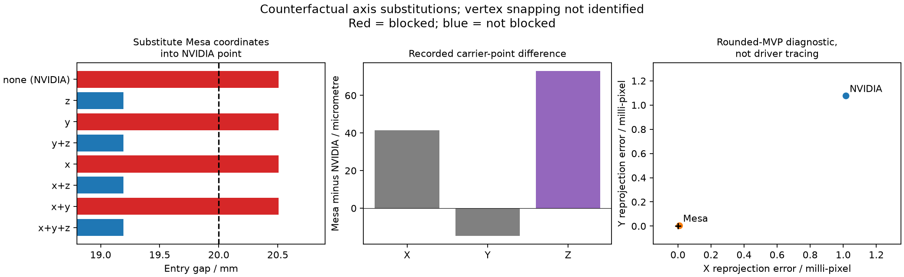

# Почему два historical pairing различаются между backend

14.10.2026. Read-only численная атрибуция двух failures из [[validation/SOURCE_DISAGREEMENT]], F1(207,324). Новый серверный фильтр или tolerance не добавлялись. Результат: [[validation/baselines/endpoint_precision_v1.json]], frozen attribution plan `configs/research/endpoint-precision-plan.json`, commit0d552f7. Первичный photometric report остаётся failed2/162; объяснение не заменяет его pass.

## Что проверяется

Предыдущий post-hoc контроль уже показал: архивный и текущий binaries на Mesa имеют одинаковые11 payloads в обеих configurations; исторический NVIDIA отличается по camera3 central rejection. Новый опыт проверяет **записанные аргументы предиката**, не эмулирует внутренние инструкции GPU.

Для NVIDIA/Mesa carrier points выполняются независимый finite-six-face intersection с Decimal80 digits и host slab replays. Decimal получает точные значения представленных binary floats, а не дополнительные сведения о физической точности сцены. Full factorial:2 endpoints ×2 origin precision ×2 parameter precision ×2 arithmetic precision на каждую из двух configurations —32 replay rows. Float32 model округляет отдельные операции без FMA и не объявляется точным GPU instruction emulator.

Дополнительно проверяются все8 substitutions координат NVIDIA point координатами Mesa и rounded-MVP reprojection. Исходные configs, captures, geometry/UV/status/RGBA, helpers и shader/math sources закреплены hashes. До фиксации плана exploratory replay уже обнаружил разные gaps; это воспроизводимая post-hoc attribution, не blind holdout.

## Измеренная причина смены решения

Carrier points:

|Backend|X, м|Y, м|Z, м|
|---|---:|---:|---:|
|Historical NVIDIA|2.188779354095459|2.5012261867523193|0.993868887424469|
|Current/archived Mesa|2.1888208389282227|2.501211404800415|0.9939419031143188|

Mesa−NVIDIA: `(41.484833, −14.781952, 73.015690)` мкм, norm85.268918 мкм. Camera origin одинаков по config, approximate `(0.38617925,1.1,1.12)` м. В nominal/accept используется eroded box с radius5mm; в Z−5mm/nominal — nominal box. **Активная верхняя грань в обоих случаях Z=0.995 м.** Это объясняет одинаковую чувствительность двух configurations; они не независимые сцены.

При `d=q−o`, активном верхнем Z-face `h` и entry `t=(h−o_z)/(q_z−o_z)` расстояние до endpoint равно

`g(q)=(1−t)·||q−o||`.

Central rejection требует finite hit и строго `g>bias`. Fixed bias20mm лежит между результатами:

|Endpoint|80-digit gap, мм|Gap−bias, мм|Решение central stage|
|---|---:|---:|---|
|NVIDIA|20.505998665|+0.505998665|blocked|
|Mesa|19.193568922|−0.806431078|not blocked|

Разница gap1.312429743mm при endpoint delta0.085268918mm, amplification15.391655. Записанные координаты действительно находятся по разные стороны threshold. Это не ошибка выбора `<`/`<=` при exact tie.

Все32 host replays и четыре high-precision cases согласованы с соответствующим native central decision. Максимальное отклонение gap в precision-factor matrix от Decimal oracle:0.148631мкм для NVIDIA endpoint и0.091546мкм для Mesa. **В этой матрице** округление origin/parameters/arithmetic не меняет решение; оно существенно меньше margins505.999/806.431мкм. Эти числа не являются универсальной оценкой погрешности GPU.



Рисунок — Gap по обеим configurations и максимальное отклонение восьми host precision replays. Каждая configuration использует один и тот же выбранный pixel; ranges моделей не являются confidence intervals.

## Покомпонентная атрибуция

Из восьми substitutions во всех четырёх случаях с Mesa Z central result not-blocked, во всех четырёх с NVIDIA Z — blocked. Только замена Z меняет gap20.505998665→19.193370449mm и пересекает20mm; замена X/Y при старом Z даёт20.506210711mm и не пересекает threshold. Таким образом, изменение Z достаточно для смены результата, XY — нет, в данной конечной матрице.

Rounded-MVP reprojection norm: NVIDIA0.001479666px, Mesa0.000009123px. Это показывает различие зарегистрированных carrier varyings относительно общего pixel centre и согласуется с атрибуцией к endpoint construction/raster interpolation. **Конкретный механизм драйвера** (vertex snapping, interpolation, triangle coverage, instruction choices) не изолирован. Один reprojection metric не задаёт scene truth и не доказывает корректность любого backend во всех pixels.



Рисунок — Counterfactual coordinate substitutions, измеренные XYZ deltas и rounded-MVP diagnostic. Вторая configuration имеет те же gaps; её дублирование не добавляет независимых trials.

## Решение для продукта и исследований

Причина смены central decision на **записанных** аргументах локализована: малый endpoint drift усиливается скользящим пересечением. Предикат не следует чинить подбором нового bias по двум pixels. Native defaults, source selection и RGBA сохранены. Fixed-carrier supplied-box uncertainty ограничивает faces коробки, а не ошибку самого endpoint; эти два вида неопределённости нельзя смешивать.

Следующий matched current-backend source truth и первый paired inventory выполнены: [[validation/MESA_SOURCE_TRUTH]], §4.90. Далее independent nonuniform/texture-rich object scenes и balanced correct/incorrect controls с отдельной image-quality оценкой. Дополнительная driver/raster attribution полезна, но не обязана блокировать fixed-backend эксперименты с явно измеренными аргументами. Для общей numerical ambiguity policy нужны отдельный контракт endpoint uncertainty, обоснованная область/граница ошибок и preservation/false-admission tests; два selected pixels такой границы не задают. Physical sensor/model uncertainty, overhead и Aurora остаются отдельными этапами.

## Проверки и повторение

Пять known-answer tests: exact strict power-of-two endpoint bias, miss/parallel/inside, translation/axis permutation, float32/64 replay и invalid geometry. Selected CTest source_correspondence/uncertainty_facing/facing_entry_gap/residual_surface4/4 за1.20s. Native C++/GLSL/server/library не менялись; полный Mesa59/59 из §4.88 относится к предыдущей реализации и здесь не пересчитывался. Report при повторении побайтно одинаков.

```sh
python3 tests/test_endpoint_precision.py
python3 tools/research/endpoint_precision.py --output-report /tmp/endpoint-precision-repeat.json
cmp /tmp/endpoint-precision-repeat.json docs/validation/baselines/endpoint_precision_v1.json
ctest --test-dir build -R '^(source_correspondence|uncertainty_facing|facing_entry_gap|residual_surface)$' --output-on-failure
MPLCONFIGDIR=/tmp/sv-matplotlib python3 docs/diploma/plot_endpoint_precision.py
```

Нужны сохранённые captures в `artifacts/`; tracked JSON не заменяет raw payloads. Источники метода — фактический [GLSL predicate](../../src/render/surface.frag), [camera uniform preparation](../../src/render/renderer.cpp), независимый [audit oracle](../../tools/research/endpoint_precision.py) и предыдущие pairing reports. Никакой новой Blender/RGB/NVIDIA capture в этом шаге нет.
