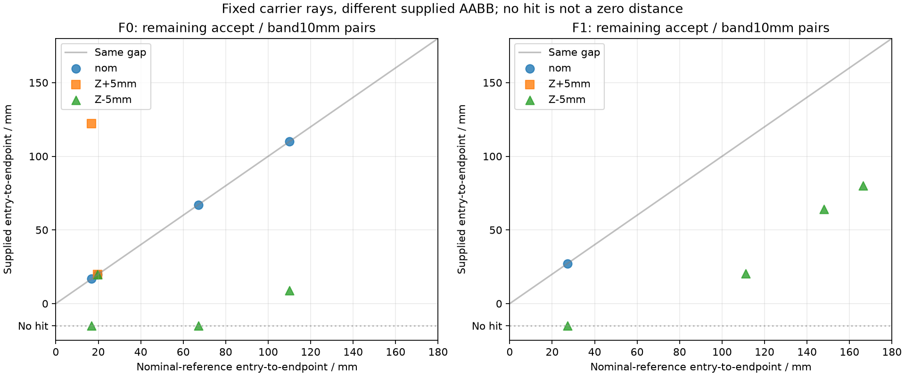
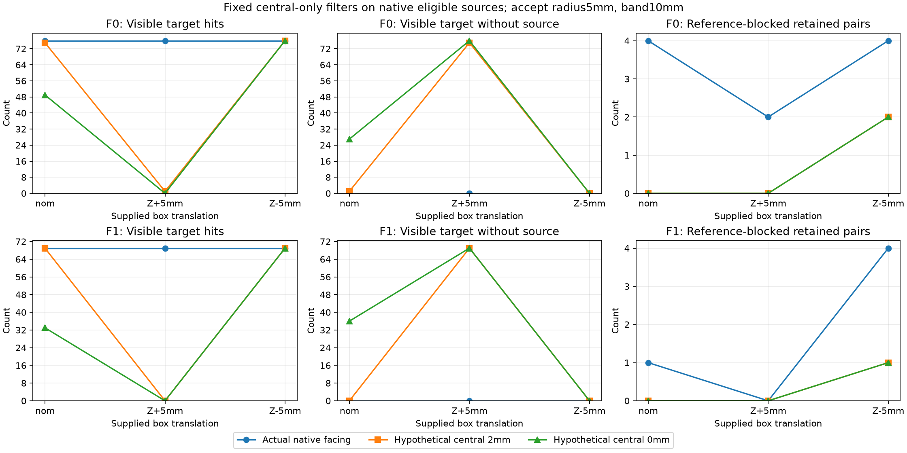

# Остаточные лучи: отступ вдоль луча и ошибка положения грани

Продолжение [[validation/NATIVE_FACING]]. Выполнен **read-only post-hoc audit36 facing-enabled outputs**, без новых renders и изменений продукта. Найдены30 оставшихся nominal-reference-blocked memberships на9 уникальных(frame,y,x,camera) парах. Все имеют положительные веса. Проверены два заранее зафиксированных дополнительных central-only фильтра по текущему supplied box:2mm и0mm. Ни один не даёт fixed robust профиль. Снижение endpoint bias само по себе не является решением.

## План, данные и границы опыта

План `configs/research/facing-entry-gap-plan.json`, commit3fcb504, зафиксирован до новых gap/counterfactual результатов, после известных агрегатов §4.83. Это exploratory развитие прежнего опыта, не preregistration независимой проверки. Выборка exhaustive:36 enabled outputs=2frames×3shifts×2bands×3policies; все remaining reference pairs и все independent-visible target pixels. Primary report, native plan и исходные helpers pinned hashes. Collector повторно валидирует весь40-case native parent audit, включая inputs/products/backend/revision, затем рассчитывает новые величины. Новые helper hashes записаны в итоговый отчёт.

Кандидат отклоняет только уже native-eligible sample, если его центральный луч blocked текущим supplied box при fixed2/0mm. Истинный nominal box используется **только для оценки**, не выбора источника. Ни band, ни радиус, ни pose/carrier/input не подбираются. Это дополнительный фильтр после исходной pipeline, не эквивалент изменения `tolerance_m` в сервере: там tolerance также влияет на neighboring footprint rays. Accepted sources не создаются.

## Независимая геометрическая атрибуция

Для camera origin o и carrier endpoint q рассматривается конечный отрезок:

\[
p(t)=o+t(q-o),\quad t\in[0,1],\qquad
 g=(1-t_{entry})\|q-o\|.
\]

`t_entry` — первое пересечение любой из шести конечных граней. Origin внутри/на closed box имеет entry0, как в reference predicate. Нет segment intersection — `null`, а не gap0. Reference блокирует при entry раньше endpoint на заданный отступ; near-threshold floating-point comparisons остаются вычислениями конечной точности. Oracle реализован через отдельные пересечения плоскостей, а не native slab code. Exact binary fixture проверяет strict boundary; arbitrary decimal равенство не заявляется.

Для тех30 memberships:

- Reference gaps16.804–166.417mm: все действительно превышают evaluation bias2mm.
- 7 уже blocked supplied box при20mm, но допущены uncertainty acceptance; остальные23 не blocked при20mm.
- 9 не имеют segment intersection с supplied box вообще; никакое уменьшение nonnegative endpoint bias не удалит их этим central predicate.
- 17 классифицированы ambiguous,13 clear при **радиусе соответствующего captured условия**; nominal rows используют radius0. Это классы supplied-geometry certificates, не independent scene labels.
- Оба fixed фильтра удаляют21/30 reference memberships. Удаление9 остальных потребовало бы другого критерия/геометрии; использовать nominal box для отбора означало бы oracle leakage.

У frame0, pixel(y211,x318), camera3, direction cosines≈(0.833477,0.550510,−0.047495). При nominal gap16.804mm, Z+5mm gap122.078mm. Разница105.274mm объясняется пересечением с той же top-face плоскостью:

\[
 |\Delta\ell|=\frac{|\Delta z|}{|d_z|}
 =\frac{5\text{ mm}}{0.04749495}\approx105.274\text{ mm}.
\]

Формула применима пока first-hit face остаётся той же и пересечение лежит в конечной грани. При выходе за finite bounds hit может исчезнуть; формула тогда не заменяет проверку. Например при Z−5mm для этого луча supplied segment hit отсутствует, хотя nominal-reference blockage остаётся. Ошибка координаты грани5mm и endpoint bias5mm измеряются в разных направлениях и не взаимозаменяемы. Эта атрибуция уточняет конкретный случай, не доказывает всеобщую невозможность RGB/geometry mitigation.



Рисунок — Remaining accept/surface10mm пары. Нижняя отметка No hit — отсутствие пересечения, не отрицательная длина. Два frames и повторные camera/pixel memberships не являются независимыми сценами.

## Hypothetical RGB: цена более строгого центрального фильтра

Исходный full-frame supported edge-feather RGB воспроизведён с максимальным отклонением0.773484LSB при лимите2LSB. Для изменённых pixels выполнена независимая linear-RGB recomposition из тех же исходных texels/weights; неизменённые pixels сохранены из native RGBA. При отсутствии положительных weights используется прежний rectangular color fallback. Это **counterfactual Python**, не новая серверная реализация или capture.

Таблица — Accept/surface10mm; значения F0/F1. Пять gates прежние, baseline nominal-center: visible76/69, outside<198/56, road MAE≤0.020982273/0.020858322, reference≤3/0, no visible without source.

|Shift / дополнительный central filter|Visible hits|Visible без источника|Outside|Reference-blocked|Joint gate обоих frames|
|---|---:|---:|---:|---:|---|
|nom /нет, actual native|76/69|0/0|2/0|4/1|нет|
|nom /2mm hypothetical|75/69|1/0|1/0|0/0|нет|
|nom /0mm hypothetical|49/33|27/36|1/0|0/0|нет|
|Z+5mm /нет, actual native|76/69|0/0|3/0|2/0|да|
|Z+5mm /2mm hypothetical|1/0|75/69|2/0|0/0|нет|
|Z+5mm /0mm hypothetical|0/0|76/69|2/0|0/0|нет|
|Z−5mm /нет, actual native|76/69|0/0|2/0|4/4|нет|
|Z−5mm /2mm hypothetical|76/69|0/0|1/0|2/1|нет|
|Z−5mm /0mm hypothetical|76/69|0/0|1/0|2/1|нет|



Рисунок — Сопоставление actual native и hypothetical фильтров: снижение reference violations ценой почти полной потери visible target при Z+5mm. Сохранение road MAE не компенсирует провал preservation gate.

По всей36-case matrix2mm проходит8 отдельных outputs,0mm —4; **ни один band×policy профиль не проходит все shifts на обоих frames**. Выбор метода по известному experimental shift запрещён. Даже2mm при Z−5mm оставляет frame1 reference1>0. Нельзя объявлять candidate улучшением по одному reference counter.

## Проверки и воспроизведение

```sh
python3 tests/test_facing_entry_gap.py
cmake -S . -B build
ctest --test-dir build -R 'facing_entry_gap|uncertainty_facing|visibility_uncertainty|source_correspondence' --output-on-failure
python3 tools/research/facing_entry_gap.py --output-report /tmp/facing-entry-gap.json
python3 docs/diploma/plot_facing_entry_gap.py
```

Шесть known-answer tests: axial before/on/behind face, oblique corner/miss, closed inside/boundary origin, exact strict bias, translation/axis permutation/scale, invalid/empty input. Selected CTest4/4,1.21s. Полный native regression57/57 из §4.83 относится к прежнему code revision; в этом этапе renderer/protocol/library не изменены и полный suite заново не запускался. Native parent audit повторно совпал; новый report при повторении побайтно идентичен. Tracked report: [[validation/baselines/facing_entry_gap_v1.json]], plot script рядом с главой: `docs/diploma/plot_facing_entry_gap.py`. Нужны локальные raw artifacts предыдущих опытов.

## Решение и следующие работы

Не переносить fixed central2/0mm rejection в сервер как mitigation: исследование выявило regression preservation. Defaults остаются прежними. Следующие ограниченные задачи:

1. Добавить native accepted-ambiguity/rejection-reason диагностику с точным контрактом, отдельно от eligibility/positive-weight/path маски. Нельзя трактовать status1 как definitely-clear.
2. Проверить source-surface/triangle correspondence для всех9 уникальных residual pairs и альтернативных камер, включая finite filter footprint; visibility bit не задаёт точку поверхности.
3. Обосновать доступную дополнительную информацию для joint selection/unsupported policy без истинного shift. Явно различать independent validation truth и runtime input.
4. Затем frozen nonuniform/natural-object holdout с собственными geometry/mount seeds и overhead. По однородному marker и двум correlated frames ranking не завершать.
