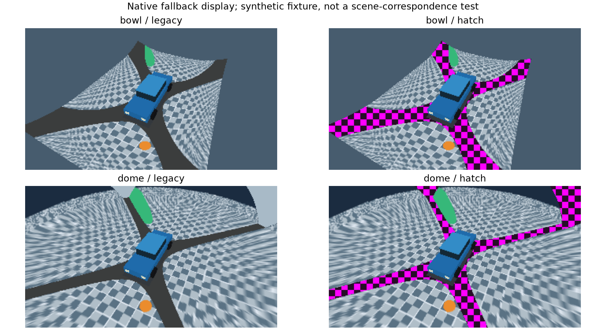

# Явное отображение fallback

14.10.2026. Реализован ограниченный следующий шаг после [[validation/RESIDUAL_SURFACE]]: сервер умеет отличать собственную ветку fallback от сшитого изображения и по запросу показывает её штриховкой. Это presentation policy, не исправление parallax и не confidence истинной поверхности.

## Контракт

Optional `fusion.fallback_display={"mode":"legacy"|"hatch"}`. Omission возвращает `legacy`, сохранены прежние цвета bowl/градиент dome. Nested object требует единственный строковый `mode`; unknown fields/values отклоняются до mutation. Typed `FusionSettings::fallback_display` использует общую небольшую структуру `sv::FallbackDisplay`, установленную вместе с библиотекой. Default legacy опускается при wire serialization и в normalized snapshot для сохранения исторического формата.

`fusion_catalog` version5 объявляет modes, `scope=existing_fallback_branch_color_only`, `implementation=screen_tiles_8px_v1`, `scene_correspondence=false`. Используются прежние `configure_fusion`, config/state revisions, frame metadata и temporary lease restore. Новых commands/products нет. В full replacement omission сбрасывает режим; JSON config file runtime apply не перезаписывает. Клиенты должны проверить capability перед включением hatch; default omission совместим со старым сервером.

Shader меняет только последний fallback branch при `diagnostic=color`, после projection/weight predicates. 8px screen tiles чередуют RGB `(1,0,1)` и `(0.15,0.05,0.15)`, alpha1. GPU ветка достигается при отсутствии winner hard_best_angle либо `total<=1e-6` у feather. Hybrid при отсутствии eligible samples сохраняет этот fallback; при наличии local eligible samples заменяет его результатом CPU fusion. Поэтому нулевой local base weight не обязательно означает fallback hybrid. RenderSupportPath остаётся источником точной классификации branch; его codes/schema не меняются.

Ego model, masked footprint и background не маркируются. Реальный чёрный кадр не считается пропуском. Диагностики coverage/weights, source visibility и support mask от режима не зависят. Marked pixels остаются opaque — это не alpha-validity product. Grid задан в framebuffer coordinates; для top-left payload фаза по Y использует `height-1-y`.

## Какие признаки действительно доступны

|Признак|Есть в runtime|Что разрешает заключить|Чего не доказывает|
|---|---|---|---|
|Projection/input validity и supplied-box predicates|Да, source_visibility_v1|Почему source принят/отклонён текущей моделью|Совпадение scene point|
|Eligible count / local positive weights / actual branch|Да, render_support_v1|Выполнена сшивка либо fallback; локальная поддержка|Effective multiband support и scene observability|
|Central ambiguous/clear certificate|Да, при explicit positive-radius uncertainty|Свойство supplied AABB при stated assumptions|Истинный occluder и правильность carrier|
|Scene nearest hit / source-depth / semantic target ID|Нет как общего server input|Только независимая оценка Blender опыта|Runtime confidence или автоматически доступная mitigation|
|Различие RGB между камерами|Кадры доступны; отдельный проверенный correspondence estimator отсутствует|Возможный будущий consistency signal|Нужная точка поверхности: uniform marker может скрывать mismatch|

Результат §4.86 (у7/9 выбранных coordinates нет matching alternative при20mm) не позволяет решить задачу отбрасыванием по недоступному oracle. Hatch маркирует только известный pipeline fallback; wrong-point источники с ненулевым результатом остаются обычным изображением. Следующий исследовательский контракт должен отдельно определить дополнительные доступные геометрические/изобразительные признаки, abstention и preservation gates.

## Использование

В simulator открыть панель «Алгоритмы и геометрия сервера», обновить состояние/catalog и нажать **«Показать fallback штриховкой»**. Кнопка использует текущий snapshot/revision через `sv-client-lib`, не требует JSON editing и сохраняет остальные fusion settings. Повторное нажатие возвращает legacy. Доступность определяется объявленным catalog; pending/stale/rejection обрабатываются прежним adapter.

```cpp
sv::client::FusionSettings settings; // задать также остальные желаемые fusion settings
settings.mode = "multi_band";
settings.fallback_display.mode = "hatch";
client.configure_fusion(base_config_revision, settings);
```

Scenario runner принимает тот же nested field в variant; отчёт сохраняет его, lease восстанавливает исходный snapshot. CLI может передать объект через существующий `command configure_fusion --params` с текущей ревизией; операция полностью заменяет fusion, не является patch.

## Проверки и иллюстрация

GTest для каждого из семи fusion modes проверяет плоский rectangular carrier (bowl с H=0) и dome, отсутствие всех frames и доступные реальные чёрные samples, ожидаемый pattern по RenderSupportPath, неизменность остальных pixels, inspection parity и legacy restore. Config/scenario tests проверяют default и strict nested fields. Live SV01 tests для семи modes сравнивают marked frame с mask, проверяют неизменность обоих diagnostic products, rejection без изменения revisions, omission reset и unchanged config file. Simulator adapter через typed библиотеку проверяет hatch/invalid/legacy по Unix/TCP. Installed consumer проверяет поставку нового header без Qt/OpenCV зависимости.



Рисунок — Скомпилированный renderer: legacy/hatch на синтетическом ground fixture с суженным FoV, bowl и dome. Это иллюстрация отображения, не новый quality trial. Скрипт `docs/diploma/plot_fallback_display.py` готовит fixture, вызывает существующий native probe и рисует сохранённые RGBA; Python не реализует продуктовый renderer. Actual device, source fingerprint, inputs/config/raw hashes: [[validation/baselines/fallback_display_example_v1.json]].

```sh
cmake --build build -j 6
__EGL_VENDOR_LIBRARY_FILENAMES=/usr/share/glvnd/egl_vendor.d/50_mesa.json \
  ctest --test-dir build --output-on-failure
# Только первое создание artifacts/fallback-display-example-v1:
MPLCONFIGDIR=/tmp/sv-matplotlib python3 docs/diploma/plot_fallback_display.py --capture
# Повторное построение рисунка из сохранённых captures:
MPLCONFIGDIR=/tmp/sv-matplotlib python3 docs/diploma/plot_fallback_display.py
```

Начальные прогоны выявили запрет сокетов в sandbox, ошибки GL1285 текущего автоматически выбранного драйвера и пропуск нового header в install list. Header добавлен; полный Mesa CTest59/59 прошёл за107.13s. Окончательная проверка выполнена с явно выбранным Mesa и разрешёнными local sockets. Проверка Aurora/физических камер и NVIDIA backend этим не заменяется.

## Осталось

General scene correspondence, joint selection без truth leakage и независимый nonuniform holdout остаются открытыми. Нужны GUI palettes/camera selectors diagnostic products, matched captures и overhead. Эта реализация закрывает только optional визуальное различение существующего fallback; temporal/prior fill, confidence calibration, параллельные продукты и multiple client sessions не добавлены.

Следующий этап добавил native RGB disagreement measurement и проверил границы evidence, сохранив2 historical pairing failures: [[validation/SOURCE_DISAGREEMENT]], §4.88. Сетка fallback и RGB disagreement не заменяют scene point correspondence.
