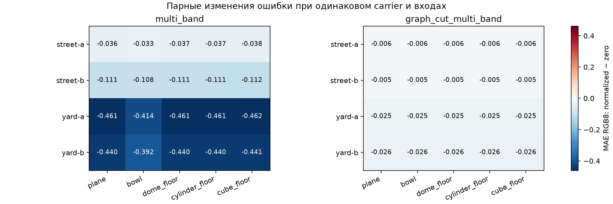
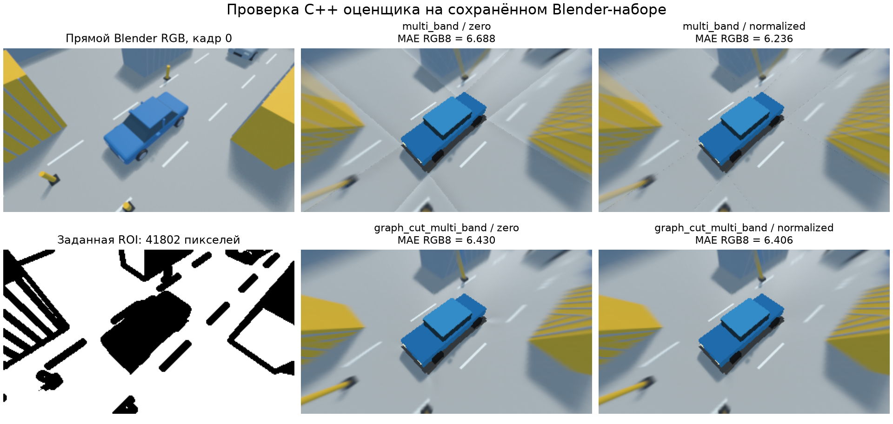

# Пилот переноса между окружениями и носителями

Дата:17.10.2026. Это validation pilot общего native runner, не confirmatory holdout.
Рецепты генерации сохранены до захвата в commit0ba810c, матрица native trials —98b5f67.
Источники: assets/scenarios/quality-families-v1.json и configs/research/family-carrier-screen.json.
Метрики/guards: [[engineering/RESEARCH_QUALITY]]. Процедурные ассеты: [[engineering/ASSETS]].

## Условия и контроль смешивающих факторов

Четыре случая: street-a/b(scene_seed424201/424202), cargo yard-a/b(525201/525202).
Mount seed9001 во всех случаях, допустимые yaw/pitch±3° и сдвиг±0,1 м. Numeric camera-model
hashes совпадают между случаями; true perturbed calibration **передана** серверу, она не найдена
автоматической калибровкой. Это опыт сшивки при известной калибровке, не приёмка calibration jobs.
Сохранены nominal config и sampled offsets для последующих исследований.

Blender5.2.2 LTS/EEVEE: две позы0/0,4 м, timestamps0/200000000 ns, пять perspective faces128²
на каждую из четырёх400² fisheye камер; virtual direct RGB320×180. Семейство street имеет
301/319 meshes, cargo_yard193 meshes и8 cargo blocks. В грузовом дворе отсутствует street
топология sidewalks/buildings; общий автомобиль и rig сохранены. Обе семьи остаются простой
процедурной геометрией, не фотореалистическими или физическими камерами.

ROI определена direct object IDs: исключены кузов/фон/полоса2 px вокруг границ, затем применена
независимая center-ray source visibility(any camera). Она не зависит от носителя или output.
ROI counts:street-a44338/44338, street-b44336/44357, yard-a41802/41267, yard-b42096/41983.
Visibility игнорирует antialiasing/частичный texel footprint; это не полная filtered visibility.

Native NVIDIA GeForce RTX5070Ti, одна и та же virtual projection.20 вариантов:5 carriers×2 modes
(multi_band, graph_cut_multi_band/binary_pairs)×2 pyramid boundaries(zero,normalized).
Каждый frame:1 warmup block+3 measured complete blocks, seed20261017. Всего640 trials,
из них160 warmup/480 measured,80 case/variant conditions и160 frame/variant identities.
Warmup исключён из quality summaries; repeats не объявляются независимыми scenes.

Active meshes3196…3208 triangles,58392…60168 buffer bytes: все samples уложились в прежний
budget3190…3210 triangles,≤1810 vertices,≤60500 bytes. Это только position/index buffers.
Resident ranges measured116904…118680 bytes; warmup до497832 bytes из-за исходного baseline
mesh. Ни total GPU memory, ни steady-state FPS равными этим active budgets не объявляются.

## Результаты RGB8

В таблице MAE взвешена ROI pixels двух frames; channels — кодовые RGB8. Каждая строка использует
одни входы/ракурс/ROI для четырёх fusion вариантов. Между случаями ROI и содержание различаются;
меньший абсолютный MAE другой семьи не является универсальным рейтингом сложности.

| Случай | Carrier | multi/zero | multi/normalized | graph+multi/zero | graph+multi/normalized |
|---|---|---:|---:|---:|---:|
| street-a | plane | 9.033936 | 8.997583 | 9.192390 | 9.186529 |
| street-a | bowl | 10.588431 | 10.555581 | 10.680395 | 10.674617 |
| street-a | dome_floor | 9.025328 | 8.988084 | 9.183206 | 9.177331 |
| street-a | cylinder_floor | 9.024697 | 8.987419 | 9.182466 | 9.176617 |
| street-a | cube_floor | 9.020411 | 8.982622 | 9.175583 | 9.169723 |
| street-b | plane | 8.893005 | 8.782504 | 9.181044 | 9.176169 |
| street-b | bowl | 10.481496 | 10.373419 | 10.683861 | 10.679088 |
| street-b | dome_floor | 8.884324 | 8.772891 | 9.171799 | 9.166883 |
| street-b | cylinder_floor | 8.883854 | 8.772447 | 9.171088 | 9.166210 |
| street-b | cube_floor | 8.879615 | 8.767633 | 9.164278 | 9.159381 |
| yard-a | plane | 6.884441 | 6.423042 | 6.649568 | 6.624858 |
| yard-a | bowl | 9.966678 | 9.552609 | 10.214825 | 10.190223 |
| yard-a | dome_floor | 6.771307 | 6.310798 | 6.555542 | 6.530836 |
| yard-a | cylinder_floor | 6.770933 | 6.310292 | 6.554383 | 6.529656 |
| yard-a | cube_floor | 6.758422 | 6.296745 | 6.532048 | 6.507381 |
| yard-b | plane | 6.280284 | 5.840012 | 5.856004 | 5.830406 |
| yard-b | bowl | 9.356764 | 8.964446 | 9.337908 | 9.312385 |
| yard-b | dome_floor | 6.148852 | 5.708762 | 5.740482 | 5.714887 |
| yard-b | cylinder_floor | 6.148245 | 5.708040 | 5.739531 | 5.713912 |
| yard-b | cube_floor | 6.135924 | 5.695144 | 5.720017 | 5.694462 |

Normalized снизил MAE в40/40 пар case/carrier/mode means и80/80 отдельных frame pairs.
Диапазон разности средних normalized−zero:−0,461676…−0,004773 RGB8; frame contrasts:
−0,470974…−0,004488. Это описательная проверка данного пилота, не p-value или80 независимых сцен.

*Рисунок F.1 — парный эффект pyramid boundary; отрицательное значение означает меньшую ошибку
в той же области. Каждая строка — один случай, а не независимая выборка из многих сцен.*

*Рисунок F.2 — yard-a, frame0, dome-floor radius14 м и active3200 triangles. На изображениях
сохраняется растяжение вертикальных объектов; уменьшение общей RGB ошибки его не устраняет.*

## Проверка исполнения и границы вывода

Все480 samples проверены независимым NumPy oracle:1920 сравнений MAE/RMSE/PSNR/max,
максимальное расхождение7,105427357601002e−15. RGB hashes трёх repeats каждой из160
frame/variant identities совпали. Все4 workflows и restores успешны; source/model guards schema2
сошлись. Criteria не заданы: quality_acceptance=not_requested, научная норма не утверждалась.
Отчёты/frames/метаданные и summary остаются в ignored artifacts/quality-families-v1.
Компактный tracked baseline [[validation/baselines/family_carrier_v1.json]] сохраняет все
средние метрики/contrasts, hashes отчётов, capture generator hashes и reference passports
(view, ROI/source/model identities). Это производный результат, не замена raw captures.
Heatmap можно восстановить из него через `plot_native_quality.py --summary BASELINE`.

Cube/cylinder/dome с полом близки в этой ROI; bowl показывает больший MAE. Но sparse poses,
две близкие procedural families и ground-dominated ROI не позволяют выбрать универсальный
носитель. Калибровка известна, face128 limited, natural-object ghost segmentation отсутствует,
так что причины остаточной ошибки нельзя свести только к выбору шва. Vertical distortion и
ошибки вне ROI требуют отдельной оценки/модели геометрии; этот результат их не закрывает.
Alpha-expansion, photometric stress, noise, длительная динамика и реальные камеры не проверялись
этой матрицей. Timing samples здесь не используются как qualification производительности.

Первый deeply nested persistent output выявил ограничение server IPC path≤80 bytes. Исправлен
тестовый адаптер: IPC теперь всегда в коротком отдельном /tmp каталоге; неудачный output сохранён
отдельно, не перезаписан. Dataset IDs формируются из capture hash вместо одинакового basename.
Сохранены исходная Blender Scene/Cube и все4 новые scenes; cancel-before-first-case smoke дал
cancelled с0 completed. Strict plan preflight покрывает unsafe/duplicate IDs, boolean schema/settings,
unknown family и bounds до создания output. Общий compiled multi-dataset supervisor ещё не реализован:
Python в этом опыте только exporter/fixture/oracle harness; все product algorithms/metrics — C++.

Воспроизведение: [[engineering/BLENDER#Независимые семейства окружения и раздельные seeds]].

После пилота отдельно исправлены обзорная поза новых сцен и проверка результата render.
Калиброванные изображения пилота сохранены без изменений. Live smoke в Blender проверил
72 проекции (max 0,00004753 px, limit 0,001 px), восстановление позы/lens/calibration и
создание непустого preview PNG. Fixture unit suite: 19 тестов, включая CANCELLED/missing/empty
render output. После этих исправлений targeted CTest: blender_fixture, stitch_robustness,
research_quality_fixture — 3/3; полная регрессия непосредственно перед ними — 67/67 (54,78 с).
