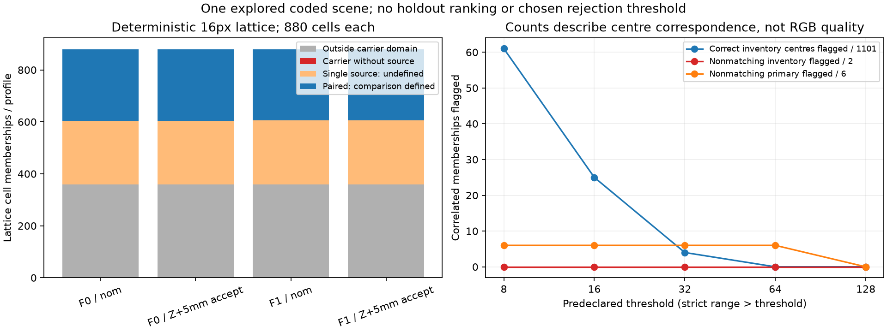
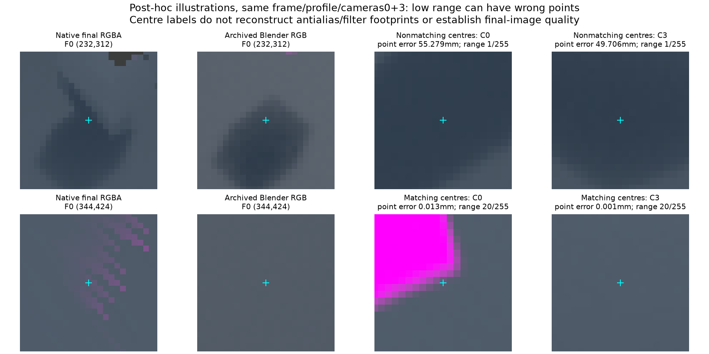

# Matched source truth текущего Mesa backend

14.10.2026. Следующий этап после [[validation/ENDPOINT_PRECISION]]: новые native UV/status и независимое пересечение ранее проверенных Blender triangles. Старые NVIDIA truth labels не переносятся на изменившиеся eligible sets. Исторический photometric report остаётся failed2/162; этот опыт имеет новый plan/report и собственные проверки.

## Зафиксированный метод

Plan `configs/research/mesa-source-truth-plan.json`, commit `eaf740e` до capture. Архивный current correspondence binary сохранён в `artifacts/research-binaries/source-truth-mesa-v1`, SHA2aede073…; новые outputs — `artifacts/mesa-source-truth-v1`. Frozen SHA охватывают binary, configs, source images, прежние metric payloads/invocations, geometry export, helpers и calibration/poses. C++/GLSL/server/library в этом шаге не менялись.

Получены36 native captures прежних facing-enabled conditions на llvmpipe (LLVM22.1.8,256bits). Probe проверяет parity ordinary RGBA до/во время/после inspection. Config/manifest/frame/input identity и source fingerprint совпадают с capture source_disagreement_v1; фактические device strings также совпали для36 pairs. Это отдельные repeat renders на одинаковых static inputs, не новый совместный wire payload.

Две заранее заданные выборки:

1. **Primary:** все9 residual coordinates на18 условиях соответствующего frame —162 correlated cells. Используются только текущие retained UV/status, соответствие поверхностям вычисляется заново.
2. **Inventory:** все pixel centres с offset8/step16 на640×360 для nominal/surface1mm/nominal и Z+5mm/surface10mm/accept, оба frames:880 cells на profile/frame, всего3520. Отбора по RGB или correctness нет. Это inventory одной уже изученной сцены, не независимый holdout.

Геометрический oracle повторно проверяет69 ранее сопоставленных Blender rays и9 reconstructed virtual rays: **78/78**, max point difference5.05µm. Используются evaluated world triangles с прежней проверкой full target mask/target visibility, физические camera poses и фактические UV текущего renderer. Calibration roundtrip ≤1.11e−16, frozen tolerance1e−12. Для новых source rays выполняется независимый NumPy triangle intersection; свежего Blender ray_cast/RGB capture нет. Дополнительная post-collection проверка сопоставила virtual semantic kinds всех1049 уникальных in-domain coordinates с полными архивными Blender object-ID arrays:1049/1049. Она проверяет kind, не расстояние каждой новой точки.

Correspondence требует finite source/virtual hits, одинаковый semantic kind и расстояние≤2/20mm. Допуски2/20mm — sensitivity controls, не обоснованные автомобильные требования. Это centre-ray labels, не реконструкция bilinear/cubemap/Eevee filter kernels и не final-image quality. RGB range независимо проверяется по текущим UV на source images, tolerance1 byte. No-hit, singleton и outside carrier domain сохраняют отдельный смысл.

## Primary: текущие labels вместо исторического переноса

Все162 cells прошли metric count/domain/defined/RGB oracle; max byte error0. Current count distribution110 empty /46 singleton /6 paired. Для двух дополнительных eligible cells F1(207,324) source3 попадает в target, но в другую точку: distance108.253mm, не matching при2/20mm. Pair comparison остаётся undefined, поскольку источник один.

|Point tolerance|Нет eligible source|Eligible, matching нет|Есть matched eligible source|
|---|---:|---:|---:|
|2mm|110|44|8|
|20mm|110|32|20|

Шесть paired cells F0(208,309) по-прежнему не имеют matching source. Native range116, current-UV independent range116.44556 byte, после округления116. Прежний oracle использовал historical UV и давал116.63605→117; это показывает, зачем обновлять sampling arguments, хотя старый1-byte tolerance был соблюдён. Новый matched report не исправляет historical gate задним числом.

## Inventory и counterexamples

|Frame/profile|Все cells|Outside domain|Singleton|Paired|Все source centres matching≤2mm|
|---|---:|---:|---:|---:|---:|
|F0 nominal|880|360|243|277|276|
|F0 Z+5mm accept|880|360|242|278|277|
|F1 nominal|880|360|246|274|274|
|F1 Z+5mm accept|880|360|246|274|274|
|Всего|3520|1440|977|1103|1101|

Внутри domain нет zero-source lattice cells в этой выборке;1440 count0 относятся к outside domain, их нельзя назвать потерей наблюдаемого carrier. Все3520 metric oracles прошли, max RGB byte error1. Из1103 paired cells1101 имеют все centres matching при обоих tolerances; max distance в correct subset0.115125mm. Две nonmatching cells — одна F0 coordinate, повторённая в двух profiles, а не два независимых случая.

F0(232,312), cameras0+3: оба source hits — road, но errors55.279/49.706mm; native D=1/255. Carrier лежит на заданном transition local_support_patch, Z=15.187mm, тогда как virtual truth — road Z0. Это ошибка соответствия относительно scene, не доказательство нового дефекта mesh implementation.

В том же frame/profile Z+5mm accept и той же pair0+3, F0(344,424): centre errors0.012620/0.000883mm, но D=20/255. Для правила `reject iff D>T` отклонить первую пару требует T<1, сохранить вторую —T≥20. Одновременно выполнить это нельзя, даже индивидуальным threshold этой camera pair. У другой correct pair0+1 max D=53/255. Это **контрпример сертификации centre correspondence**, не доказательство бесполезности RGB disagreement для видимых seams.

|Frozen threshold, byte|Correct inventory centres flagged /1101|Nonmatching inventory flagged /2|Nonmatching primary flagged /6|
|---:|---:|---:|---:|
|8|61|0|6|
|16|25|0|6|
|32|4|0|6|
|64|0|0|6|
|128|0|0|0|

Это counts зависимых memberships, не population false-positive rates, ROC или ranking. Primary/inventory не объединяются в новую случайную выборку; threshold не выбран и не развёрнут в сервере.



Рисунок — Fixed lattice и заранее заданные thresholds. «Correct» относится к source centres; ordinary RGBA quality этим не устанавливается.



Рисунок — Post-hoc illustrations одного frame/profile/pair: native final RGBA, archived independent Blender RGB и camera input patches. Подписи относятся к выделенному centre. На C0 crop второй пары видна близкая граница magenta target, но точный antialias/filter contribution здесь не атрибутирован.

Для первого centre native RGB `[47,61,77]`, independent RGB `[61,72,84]`; для второго `[90,90,113]` и `[83,92,103]`. Это иллюстративные bytes, не новый quality gate. Centre matching не гарантирует correct filtered RGB, а low inter-camera disagreement не гарантирует совпадение с независимым RGB. Графический выбор этих examples post-hoc; первичная lattice selection и thresholds остались frozen.

## Артефакты и проверки

Полный raw report4.1MB сохраняется локально в `artifacts/mesa-source-truth-v1/report.json`; tracked [[validation/baselines/mesa_source_truth_v1.json]] содержит его SHA,36 capture report hashes, anchors, все162 primary cells, все1103 paired inventory cells, group/threshold counts и examples. Nonpaired lattice details восстанавливаются из full raw report/compiled captures. Renderer inputs/images и provenance рисунков проверяются по SHA. Raw data/binary не добавляются в Git/LFS.

4 новых known-answer tests проверяют pixel-centre virtual ray/near-far clipping, world translation, missing/wrong-kind hit и point tolerance. Вместе с sampler/residual/endpoint controls18/18 Python tests; selected CTest source_correspondence/uncertainty_facing/facing_entry_gap/residual_surface4/4 за1.30s. Full regression59/59 из §4.88 не пересчитывался: product code unchanged. Повторный collector дал побайтно одинаковый full raw JSON.

```sh
python3 tests/test_mesa_source_truth.py
# Только первое создание output directory frozen plan:
python3 tools/research/mesa_source_truth.py --capture --output-report artifacts/mesa-source-truth-v1/report.json
# Повторение без нового capture:
python3 tools/research/mesa_source_truth.py --output-report /tmp/mesa-source-truth-repeat.json
cmp /tmp/mesa-source-truth-repeat.json artifacts/mesa-source-truth-v1/report.json
MPLCONFIGDIR=/tmp/sv-matplotlib python3 docs/diploma/plot_mesa_source_truth.py
ctest --test-dir build -R '^(source_correspondence|uncertainty_facing|facing_entry_gap|residual_surface)$' --output-on-failure
```

Нужны прежние local artifacts/exported geometry, frozen source images и archived compiled binary. Открытая Blender scene не использовалась и не менялась.

## Следующий этап

Matched source truth текущего backend и первый inventory paired controls выполнены. Теперь нужны independent texture-rich/nonuniform object scenes, balanced correct/incorrect paired controls, exposure/filter/noise ablations и отдельная оценка **final RGB/ghost/seam quality**. Сначала уточнить, какой признак должен управлять selection/abstention: centre geometry, filter contamination либо visual seam. Простой RGB-range threshold как сертификат centre correctness отвергнут наблюдаемыми counterexamples; иные metrics/compensation не исследованы. Singletons остаются undefined. Natural-object holdout, general reconstruction, physical cameras, overhead и Aurora остаются открытыми.
