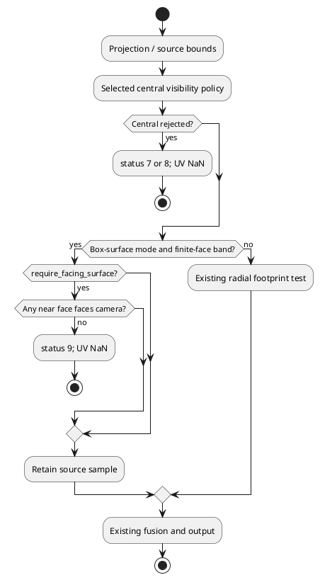
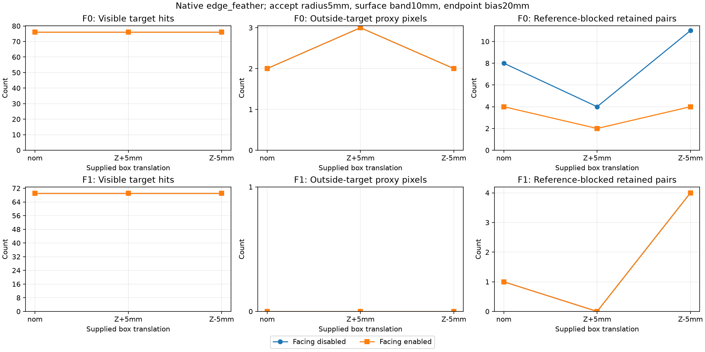
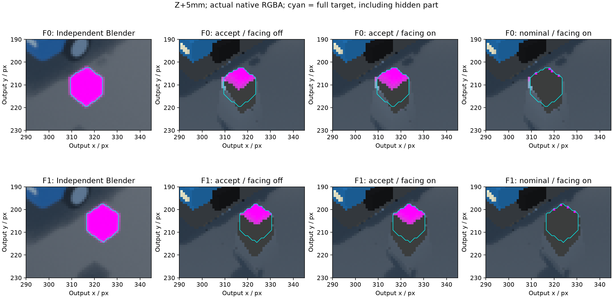

# Совместная uncertainty и ориентация конечных граней

Продолжение [[validation/NATIVE_UNCERTAINTY]]: сначала read-only атрибуция36 прежних outputs, затем **40 новых native NVIDIA captures** с отдельной переключаемой проверкой ориентации. Это developmental paired опыт на прежней сцене. Независимого holdout нет; общий robust профиль не найден. Default сохранён.

## Вопрос и предварительная диагностика

Accept+surface10mm при Z+5mm восстанавливал76/69 видимых target hits, но frame0 имел4 nominal-reference-blocked retained pairs при baseline3. Нужно выяснить, имеют ли эти пары ненулевой вклад и можно ли уменьшить число нарушений без потери видимого target.

План `configs/research/uncertainty-facing-plan.json` зафиксирован commit8675805 перед новым coordinate/weight audit, после известных агрегатов прошлого опыта. Это **post-hoc exploratory**, не независимая preregistration. Для всех36 accept/reject outputs включены все1845 reference-blocked пары и все independent-visible pixels. Все1845 пары имеют положительный edge weight. Независимое linear-RGB воспроизведение исходных RGBA отличается максимум на0.773484LSB при заранее заданном пределе2LSB. Нулевые веса не объясняют остаточные нарушения.

Четыре пары проблемного frame0/Z+5mm/accept/surface10mm:

| y,x,camera | Independent virtual ROI | Newly admitted vs nominal | Near faces | Facing faces | Удаление кандидатом |
|---|---|---|---|---|---|
|206,311,0|visible target|нет|+Z|нет|да|
|208,309,3|road|нет|+X,−Y|−Y|нет|
|208,310,0|hidden target|да|+X|нет|да|
|211,318,3|visible target|да|+Y,+Z|+Z|нет|

У всех weight1; normalized weights0.5/0.5/1/1. Hypothetical leave-one-out RGB deltas43.73/45.12/179.01/139.89LSB — аналитические абляции, не отдельные native captures. Две пары относятся к source-visible target; одна из них удаляется, но альтернативные камеры сохраняют output coverage. **Reference blocking на actual carrier относительно nominal AABB не равно доказанной ошибке наблюдения сцены**: endpoint carrier может отличаться от реальной точки. Нельзя называть1845 пары false accepts.

Полная атрибуция без выборочного ограничения координат: [[validation/baselines/uncertainty_facing_v1.json]]. Её hypothetical RGB служил разработке кандидата; следующие результаты получены уже серверным shader.

## Native контракт и порядок

Optional `surface.source_occlusion_box.require_facing_surface`: только bool, defaultfalse; допустим только при `mode=bilinear_box_surface_v1`, даже явныйfalse в другом mode отклоняется. Catalog сообщает optional field, default и scope. Это условие дополнительно ограничивает finite-face preservation после central policy, не меняя радиус uncertainty, endpoint bias или support band.

Для грани f с outward normal n, её опорной точкой p, camera origin o и carrier endpoint q:

\[
N_f(q)=[q\in[b_{min}-s,b_{max}+s]]\land[|q_a-p_a|\le s],\qquad
F_f(o,q)=N_f(q)\land[n_f\cdot(o-p_f)>0].
\]

При central acceptance и попадании в surface band sample сохраняется только если существует хотя бы одна facing near face. Проверяются **все** near faces, включая рёбра/углы; nearest-face tie-break не используется. Strict half-space означает, что камера в плоскости грани не считается facing. Если near face есть, но facing нет, native status9 `backfacing_support`, UV=NaN. Central statuses7/8 имеют приоритет. За band действует прежний radial footprint; при false/omission — прежняя реализация. Это один supplied box, без scene-depth estimation и без заполнения неподдержанной поверхности.



Рисунок — Порядок native проверок; uncertainty acceptance не обходит ориентацию.

Apply/restore через прежний `Client::configure_surface(revision, whole_surface, optional_lease)`. Сервер валидирует и атомарно применяет; новых wire commands, persistence и parallel products нет. Status9 пока только native inspection, не отдельный wire product. GUI form для bool пока не реализована. Пример API: [[engineering/USAGE#Ориентация конечных граней]].

## Замороженный native опыт

Implementation commitb1a820c8db08606da9a9a4c757adf850d4c35be8. План `configs/research/native-facing-plan.json` зафиксирован commit78b4b5a до native captures, но после диагностического hypothetical анализа.36 enabled conditions:2frames×3shifts(nominal,Z±5mm)×2bands(1/10mm)×3policies(nominal/accept/reject);4 disabled historical controls. Radius5mm для accept/reject, bias20mm, edge_feather, прежние camera RGB/poses/truth/carrier. Проверяется NVIDIA GeForce RTX5070Ti через explicit vendor `10_nvidia.json`; silent Mesa fallback запрещён provenance check. Все inputs, templates, source fingerprint/revision, binary и invocations привязаны hashes в плане/отчёте. После capture bands/gates не подбирались.

| Surface10mm policy / shift | Visible hits F0/F1 | Outside F0/F1 | Reference-blocked F0/F1 | Все пять gates на двух frames |
|---|---:|---:|---:|---|
|nominal /nom|76/69|2/0|2/0|да|
|nominal /Z+5mm|4/4|3/0|1/0|нет|
|nominal /Z−5mm|76/69|2/0|4/1|нет|
|accept /nom|76/69|2/0|4/1|нет|
|accept /Z+5mm|76/69|3/0|2/0|да|
|accept /Z−5mm|76/69|2/0|4/4|нет|
|reject /nom|3/3|1/0|0/0|нет|
|reject /Z+5mm|3/3|2/0|0/0|нет|
|reject /Z−5mm|76/69|1/0|1/0|да|

Gates прежние: все76/69 visible proxy hits, no visible pixel without source, outside ниже nominal-center198/56, road linear-RGB MAE≤0.020982273/0.020858322, reference-blocked≤3/0. Для Z+5mm/accept/surface10mm road MAE0.020786668/0.020800755. Ориентация удаляет2 пары frame0, остальные2 остаются; видимый target сохранён благодаря другим источникам. По всем40 outputs gates проходят12, из36 enabled —10; из18 paired enabled cells —5. **Ни один фиксированный band×policy профиль не проходит все три shifts на обоих frames**. Переключение policy по известному истинному shift не является robust решением.



Рисунок — Paired accept/surface10mm с выключенной и включённой ориентацией. Reference остаётся консервативным supplied-geometry proxy.



Рисунок — Z+5mm; cyan full-target outline включает скрытую часть. Это реальные результаты shader, не Python counterfactual. Однородный marker RGB не доказывает point/surface correspondence.

## Проверки и воспроизведение

- Независимый finite-face/strict-halfspace oracle: **0 mismatches на8407961 prior-valid pairs**; всего25 status9 rejection memberships по40 outputs.
- Все carrier XYZ/regions и retained UV неизменны; rejected9 UV=NaN; normal/inspection output parity сохранена.
- Все4 disabled RGBA побайтно совпадают с историей. Full-frame supported RGB reconstruction для всех40 outputs≤0.773484LSB; качество оценено по actual RGBA.
- Полный Mesa CTest **57/57**,94.65s. Четыре parameterized GTest cases на NVIDIA **4/4** проверяют edge_feather/multi_band и accept/reject, facing oracle, UV, restore parity и неизменные uploads. Это не полный25-case NVIDIA rerun и не overhead benchmark.
- Python facing known-answer tests7/7 входят в CTest; schema и live runtime catalog/apply/reject/restore тоже проверены. Повторные36-row diagnostic и40-row native audits побайтно идентичны.

```sh
cmake -S . -B build
cmake --build build -j6
__EGL_VENDOR_LIBRARY_FILENAMES=/usr/share/glvnd/egl_vendor.d/50_mesa.json ctest --test-dir build --output-on-failure
python3 tools/research/native_facing.py --output-report /tmp/native-facing-report.json
python3 docs/diploma/plot_native_facing.py
```

Collector проверяет архивный frozen binary, source revision через Git, hashes raw products и captured backend; текущий rebuild не обязан иметь hash frozen binary. Для точного нового capture восстановите implementation revision и build fingerprint плана в отдельном checkout, используйте pinned inputs/templates; `python3 tools/research/native_facing.py --capture --binary PATH` проверит binary hash. Не перезаписывайте primary capture новым binary. Raw outputs и saved executable находятся в `artifacts/native-facing-v1`, configs в `artifacts/native-facing-configs-v1`; производные картинки/отчёты tracked, raw artifacts исключены из Git. Read-only audit требует локальных artifacts прежнего опыта.

Primary native results: [[validation/baselines/native_facing_v1.json]]; графики воспроизводит `docs/diploma/plot_native_facing.py`. Следующий шаг: joint correspondence/unsupported policy без знания истинного shift, независимые nonuniform/natural-object holdouts, triangle-hit truth и overhead. Accepted-ambiguity diagnostic остаётся отдельной задачей; нынешний render_support не различает причины отказа.
