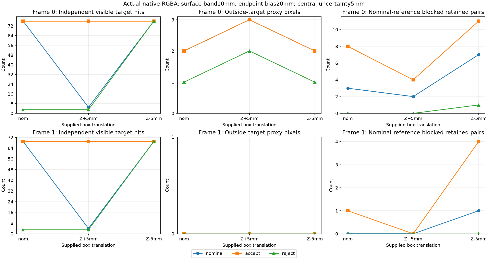
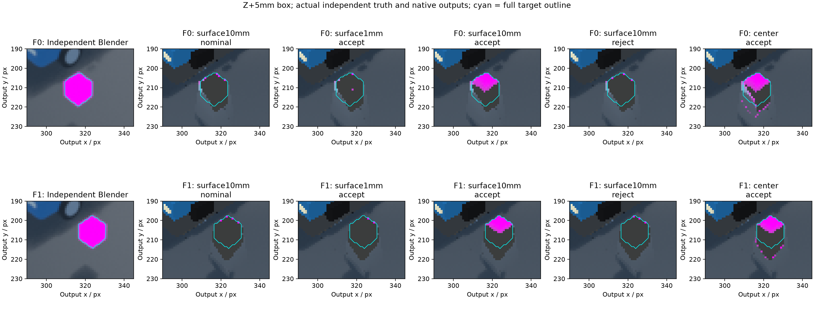

# Native политики неопределённой центральной окклюзии

Следующий этап после [[validation/VISIBILITY_UNCERTAINTY]] реализует две переключаемые серверные политики и проверяет **54 новых native RGBA captures**. Это developmental paired control на прежней сцене, не независимый holdout. Кандидаты доступны через существующие `configure_surface`/`sv-client-lib`; default сохранён. Общая robust mitigation **не подтверждена**.

## Реализация и контракт

Опциональный объект внутри `surface.source_occlusion_box`:

```json
"uncertainty": {"radius_m": 0.005, "ambiguous_policy": "accept"}
```

Оба поля обязательны при наличии объекта. Радиус finite в[0,0.05]m; policy только `accept` или `reject`, unknown fields запрещены. Отсутствие объекта сохраняет nominal predicate; radius0 сохраняет прежнюю классификацию и RGBA. Это ошибка координат граней supplied AABB, включающая bounded translation, при фиксированных carrier/poses и endpoint bias. Радиус не оценивается сервером по RGB/sensors.

- Eroded box blocking даёт central rejection7 в обеих политиках.
- Если eroded box не блокирует, но dilated box блокирует, central ray ambiguous: `accept` пропускает его к следующей стадии, `reject` возвращает новый native status8 `uncertain_occluder`.
- Если dilated box не блокирует, central ray проходит.
- После этого действуют **прежние nominal footprint rays и nominal finite-face membership**. `support_tolerance_m`, neighbor inset10µm и endpoint bias не меняются. Принятие central ambiguity не отключает footprint filtering.

Статус1 означает eligibility по выбранной политике, включая принятые ambiguous rays; это не сертификат definitely clear. Статус7 при uncertainty может означать definite central blocking или nominal footprint rejection. Для rejected statuses UV остаются NaN. Status8 находится в native source inspection/export, не в отдельном wire product; support mask передаёт counts/path без причины отказа. Accepted ambiguity count в исследовательском отчёте получен независимым geometry oracle, не отдельным native diagnostic channel.

`surface_catalog.rectangular_source_occlusion.uncertainty` публикует required fields, range, policies и central-only scope. Применение/restore — полный surface object с текущей revision, existing temporary frame-boundary semantics и experiment lease. Параметр читается production shader как для GPU fusion, так и для гибридных sample passes. Ни новый wire command, ни persistence workflow, ни автоматическое заполнение unsupported surface не добавлены.

## План и устранённое расхождение стенда

Native implementation commit `006b74a`, compiled fingerprint `24848fb721badb4bce8ae96b912641d93f8eb8a8bc5bb24a1e2db70dff1f9044`. Первичный план `configs/research/native-uncertainty-plan.json`, commit `11ccee5`, зафиксирован до54 captures. В песочнице EGL автоматически выбрал llvmpipe; audit остановился на carrier/RGBA mismatch относительно NVIDIA archive. Эта серия сохранена в `artifacts/native-uncertainty-v1`, её план не переписан, она **исключена** из matched results. Это не отказ алгоритма и не основание расширять geometry tolerance.

После проверки одного explicit-NVIDIA nominal control, совпавшего с архивом, до повторной матрицы зафиксирован backend-pinned план `configs/research/native-uncertainty-nvidia-plan.json`, commit `55a20b5`. Candidate metrics первой Mesa-серии не анализировались. Новый план явно требует NVIDIA RTX5070Ti и NVIDIA EGL vendor. Collector проверяет device; silent backend fallback теперь запрещён этим протоколом.

Матрица: два ранее исследованных correlated frames × supplied nominal/Z+5mm/Z−5mm × center/surface1mm/surface10mm × nominal/accept/reject =54. Все biases20mm; footprint guard1; candidate uncertainty5mm выбрана по прежнему exploratory bounds. RGB800×800, output640×360, actual carrier, cameras и independent Blender truth прежние. Все quality captures — edge_feather; hybrid correctness отдельно проверяется GTest, не этой quality matrix.

## Результаты на actual RGBA

Таблица показывает пары frame0/frame1. В source-visible target всего76/69 pixels. Reference pairs — все retained baseline-eligible camera-point pairs на кадре, blocked nominal box при fixed2mm bias; это не independent scene false-accept rate.

| Shift / policy / footprint | Visible proxy hits | Outside proxy | Nominal-reference blocked pairs |
|---|---:|---:|---:|
| nominal /nominal /surface1mm |76/69|1/0|2/0|
| nominal /accept /surface1mm |76/69|1/0|5/1|
| Z+5mm /nominal /surface10mm |5/4|3/0|2/0|
| Z+5mm /accept /surface1mm |3/2|2/0|2/0|
| Z+5mm /accept /surface10mm |76/69|3/0|4/0|
| Z+5mm /reject /surface10mm |3/3|2/0|0/0|
| Z+5mm /accept /center |76/69|852/277|664/221|
| Z−5mm /nominal /surface10mm |76/69|2/0|7/1|
| Z−5mm /reject /surface10mm |76/69|1/0|1/0|

Accept+surface10mm снимает все71/65 прежних central losses при Z+5mm и сохраняет low outside3/0. Но frame0 reference blocking4 превышает nominal-center baseline3; полный joint gate этой пары не пройден. При surface1mm после принятия central ambiguity сохранены лишь3/2 hits: nominal footprint/membership остаётся самостоятельным ограничением. Accept без footprint сохраняет hits ценой outside852/277 и ухудшения road MAE до0.021903361/0.021165150 против nominal center0.020982273/0.020858322.

Reject+surface10mm при Z−5mm сохраняет76/69 hits, outside1/0 и reference1/0: эта пара проходит все пять прежних gates. Но nominal/Z+5mm для той же политики сохраняют только3/3 hits. Нельзя выбирать policy отдельно для каждой геометрической ошибки, используя известный experimental shift, и называть это одним robust режимом.

Всего gates проходят9/54 outputs, из них5/36 candidate outputs. Двухкадровых проходящих cells4/27, из них2/18 candidate cells — reject при Z−5mm с center или surface10mm. **Ни один из шести candidate profiles kind×policy не проходит все пять gates для всех трёх shifts на обоих frames.** Full target178/172 включает hidden surfaces; восстановление76/69 visible hits не означает восстановления всего target.



Рисунок — Измеренные native visible/outside/reference counts при surface10mm и трёх shifts. Это54 condition captures одной сцены, не оценка обобщения по независимым сценам.



Рисунок — Z+5mm: independent Blender truth и actual native outputs; голубая линия — full target outline. Accept+surface10mm возвращает наблюдаемую верхнюю часть target, reject её почти удаляет; center+accept сохраняет посторонние копии. Изображения не являются результатом Python renderer.

## Проверки и воспроизведение

Все18 nominal outputs побайтно совпали с archived RGBA; actual carrier/regions и retained source UV неизменны. Независимый finite-face/neighbor-ray oracle: **0 mismatches /11665215 prior-valid camera-point pairs**. Все mismatches, если появятся, сохраняются в отчёт, а не исключаются из ROI. Primary JSON: [[validation/baselines/native_uncertainty_v1.json]]. Повторный audit побайтно идентичен.

Четыре новые parameterized GTest cases проверяют accept/reject на edge_feather и multi_band, радиусы0/5/10/50mm, empty erosion, rejected NaN UV, unchanged uploads, nominal0 parity и restore. Полный inspection suite25/25 на NVIDIA; Mesa suite проходит в составе CTest. Core schema tests проверяют required fields/ranges/policy/unknown fields; live runtime integration проверяет catalog, apply обоих вариантов, reject invalid/stale settings и restore. Python oracle tests9/9 включают parity прежних footprint modes и explicit control «accept central ambiguity не bypass footprint». Полная Mesa CTest56/56 за80.21s; это regression, не comparative overhead benchmark. При первом sandbox запуске IPC bind был запрещён; успешная full suite выполнена вне песочницы. Логи сохранены в capture directory.

```sh
cmake -S . -B build
cmake --build build --target sv-server sv-correspondence-probe sv-carrier-inspection-tests -j6
python3 tests/test_visibility_uncertainty.py
# Нужен NVIDIA EGL/device access; все raw inputs/templates из frozen plan должны существовать.
# Fresh capture directory, binary hash должен совпадать с планом; существующий capture не перезаписывается.
python3 tools/research/native_uncertainty.py --capture \
  --plan configs/research/native-uncertainty-nvidia-plan.json
MPLCONFIGDIR=/tmp/sv-mpl-cache python3 docs/diploma/plot_native_uncertainty.py \
  --output-report artifacts/native-uncertainty-nvidia-v1/reaudit.json \
  --figures artifacts/native-uncertainty-nvidia-v1/figures
cmp docs/validation/baselines/native_uncertainty_v1.json artifacts/native-uncertainty-nvidia-v1/reaudit.json
```

Современная rebuild может изменить binary/source hashes: для повторения frozen capture нужен сохранённый бинарник `artifacts/native-uncertainty-nvidia-v1/sv-correspondence-probe`, для новой implementation нужен новый план. Read-only reaudit использует сохранённые products и binary hashes, не требует запуска EGL. Python здесь orchestrates capture/oracle/plots; продуктовая логика находится в C++/GLSL сервере.

## Оставшиеся задачи

Закрыты native candidate/runtime switch и matched RGB/footprint control. Открыты robust joint central/footprint mitigation, scene-surface correspondence и unsupported policy, accepted ambiguity diagnostics через server/library, independent nonuniform/natural-object holdout и оценка радиуса по реальным данным. Default nominal сохранён; не называть developmental5mm рекомендованным deployment threshold. Диплом: §4.82 [[diploma/04_EXPERIMENTAL_STUDY]].

## Граничное исправление после primary capture

Commit `50fad11` отделил closed degenerate erosion новых сертификатов от исторического правила empty-interior для nominal/footprint inset boxes. Иначе новый общий helper мог изменить legacy footprint при нулевой ширине inset box. В GTest добавлен радиус10mm, дающий collapsed erosion. Primary54-case experiment относится к revision006b74a и не переписан. Frozen source hashes проверяются по содержимому этого Git commit, а не текущим файлам; raw arrays/config/truth по-прежнему проверяются по фактическим bytes. Поэтому последующее изменение native source не делает старый capture новым.

Отдельный compatibility plan `configs/research/native-uncertainty-degenerate-parity-plan.json` зафиксирован commit `1f914be` до повторного исполнения54 условий. На final revision50fad11 все594 product payloads, включая54 ordinary RGBA, побайтно совпали с primary. Отчёт: [[validation/baselines/native_uncertainty_degenerate_parity_v1.json]], runner `tests/test_native_uncertainty_parity.py --output-report PATH` требует archived inputs и NVIDIA; он намеренно не включён в обычную CTest без большого research dataset. New RGBA и metadata сохранены в parity directory, остальные новые temporary payloads удалены только после exact checksum verification; их идентичные reference payloads сохранены в primary directory. Это regression compatibility, не54 новых независимых quality observations. Final Mesa CTest56/56 за80.21s, NVIDIA inspection25/25; оба запуска проверяют уже исправленный shader.
