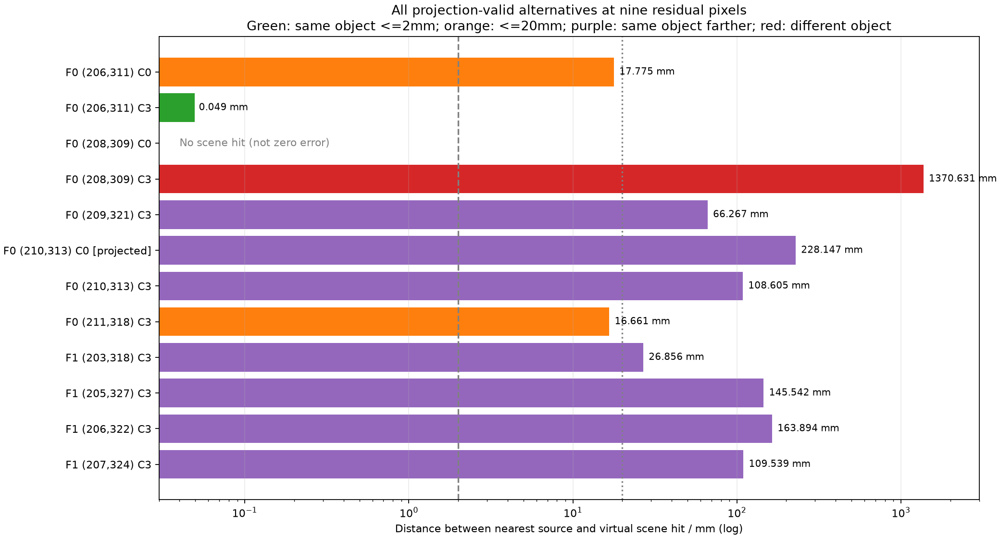
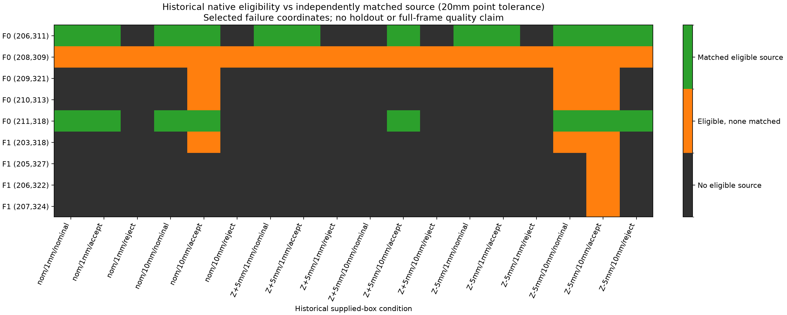
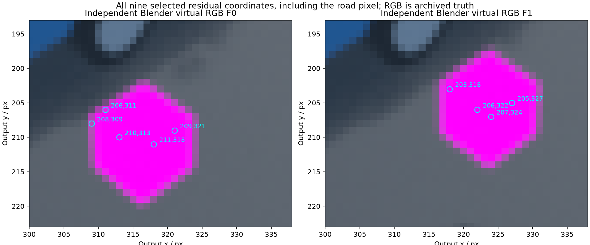

# Соответствие поверхности на остаточных лучах

13.10.2026. Ограниченный post-hoc audit после [[validation/FACING_ENTRY_GAP]] и [[validation/SOURCE_VISIBILITY_PRODUCT]]. План `configs/research/residual-surface-plan.json`, подготовленные входы и helpers зафиксированы commit `702bd3d` **до нового Blender ray capture**. Отчёт: [[validation/baselines/residual_surface_v1.json]]. Это все девять уникальных остаточных пар из 30 reference memberships, а не независимый holdout или выборка для оценки общей частоты ошибок.

## Метод и независимость

В отдельном background Blender 5.2.2 LTS восстановлена прежняя диагностическая сцена, rig и два положения автомобиля. Открытая пользовательская сцена не изменялась; MCP после запуска Blender доступен. До интерпретации лучей проверены точное совпадение полной virtual-target mask 640×360 с архивом (178/172 target pixels) и visibility bits на этих target pixels. Проверка не утверждает равенство visibility вне target.

На девяти output coordinates рассмотрены все четыре камеры: 12 из 36 проекций допустимы. В 11 случаях взяты фактические native UV, сохранённые хотя бы в одном из прежних условий; ещё одна альтернатива никогда не удерживалась renderer и обозначена `independently_projected`. Это не новый native sample. Максимальная разница независимой проекции и сохранённых UV — 0.0000491 px при заранее заданном допуске 0.002 px.

Для каждого допустимого источника сняты nearest scene hit центрального луча и четыре соседних texel-centre hits с bilinear coefficients; отдельно снят virtual-view hit. Всего 69 лучей: 9 virtual + 12 source centres + 48 texel centres. На каждом кадре экспортированы 2310 evaluated world triangles. Независимое two-sided пересечение NumPy проверяет nearest semantic kind и точку против Blender `scene.ray_cast`: **69/69 согласованы**, максимальное расхождение 5.05 мкм при допуске 200 мкм. Индекс треугольника не используется как критерий равенства: на общих рёбрах возможны несколько эквивалентных hits.

Сравниваются не расстояние до carrier и не только object-ID, а расстояние между nearest source hit и virtual hit при одинаковом semantic kind. Допуски **2 и 20 мм** заданы до capture; они показывают чувствительность результата и не являются доказанными требованиями автомобильного продукта. Truth доступна только исследовательскому oracle и не подаётся в сервер как runtime evidence.

## Результаты

Таблица — Все исходные девять residual pairs. Координаты `(y,x)`, ошибки в мм; kind=target означает совпадение объекта, но не обязательно точки.

|Кадр / pixel|Камера|Virtual / source kind|Ошибка точки, мм|Совпадение ≤20 мм|
|---|---|---|---:|---|
|F0 (206,311)|0|target / target|17.775|да|
|F0 (208,309)|3|road / target|1370.631|нет|
|F0 (209,321)|3|target / target|66.267|нет|
|F0 (210,313)|3|target / target|108.605|нет|
|F0 (211,318)|3|target / target|16.661|да|
|F1 (203,318)|3|target / target|26.856|нет|
|F1 (205,327)|3|target / target|145.542|нет|
|F1 (206,322)|3|target / target|163.894|нет|
|F1 (207,324)|3|target / target|109.539|нет|

Из девяти исходных пар две соответствуют поверхности при 20 мм, шесть попадают в другую точку нужного объекта, одна — в другой объект. **Ни одна исходная пара не проходит 2 мм.** Следовательно, прежний supplied-box reference violation нельзя автоматически называть ошибочным scene correspondence: это разные проверки.

Три дополнительные допустимые альтернативы:

- F0 (206,311), C3: target с ошибкой **0.048599 мм**, проходит оба допуска. Его доступность зависит от прежних pipeline filters.
- F0 (208,309), C0: нет scene hit; расстояние отсутствует, не равно нулю.
- F0 (210,313), C0: independently projected target, ошибка **228.147 мм**; не native-retained источник.

Среди всех 12 допустимых источников при 20 мм получены 3 совпадения, 7 same-object/wrong-point, 1 wrong-object и 1 no-hit. **У 7/9 выбранных pixels нет соответствующей альтернативы даже до проверки исторической eligibility.** При 2 мм такая альтернатива отсутствует у 8/9 pixels. Это результат данной сцены и выбранных coordinates, не universal bound и не доказательство невозможности другой реконструкции/геометрии.



Рисунок — Все 12 projection-valid источников; логарифмическая ось расстояний, заранее заданные допуски и отдельно отмеченная independently projected альтернатива.

Для 162 pixel-condition cells (9 coordinates × 18 исторических условий соответствующего frame) eligibility взята из прежних native statuses, где accepted=1. Новый `source_visibility_v1` в этой матрице не переснимался.

|Допуск|Нет eligible source|Eligible есть, совпадений нет|Есть matched eligible source|
|---|---:|---:|---:|
|2 мм|112|42|8|
|20 мм|112|30|20|

Это зависимые memberships на выбранных failure coordinates; считать их независимыми испытаниями или full-frame quality percentages нельзя. Matched eligibility также не доказывает positive/effective fusion contribution.



Рисунок — Eligibility и point correspondence при 20 мм по nominal/Z±5mm, bands 1/10mm и nominal/accept/reject policies; изменение supplied box не меняет истинные точки сцены.

У трёх F1 pixels (205,327), (206,322), (207,324) все четыре texel rays попадают в target, сумма target bilinear coefficients равна 1, но central point error составляет 109.539–163.894 мм. Object-ID согласие всего footprint недостаточно. Сумма coefficients — геометрическая атрибуция texels, **не** точные Eevee RGB/filter weights и не критерий правильности всех точек footprint. Однородный magenta marker может скрывать wrong-point sampling в RGB.



Рисунок — Девять координат на архивном независимом Blender RGB. F0 (208,309) имеет central road truth, хотя filtered RGB у границы объекта окрашен; новый RGB не рендерился.

## Воспроизведение и проверки

Нужны сохранённые raw artifacts прежних опытов: helper проверяет их hashes, parent native report, неизменность carrier XYZ/UV и reconstruction. Raw captures остаются в игнорируемой `artifacts/`; tracked JSON и фигуры не заменяют исходные данные. Команда capture рассчитана на первое создание output directory из frozen plan; существующий результат не перезаписывать.

```sh
python3 tools/research/residual_surface.py --prepare /tmp/residual-surface-input-repeat.json
cmp /tmp/residual-surface-input-repeat.json artifacts/residual-surface-input-v1.json
# BLENDER задаётся путём к Blender 5.2.2 LTS.
"$BLENDER" --background --factory-startup --threads 4 --python-exit-code 1 \
  --python-expr "import sys; from pathlib import Path; root=Path.cwd(); sys.path.insert(0,str(root/'tools/blender')); from residual_surface_truth import capture; capture(root,root/'configs/research/residual-surface-plan.json')"
python3 tools/research/residual_surface.py --output-report /tmp/residual-surface-repeat.json
cmp /tmp/residual-surface-repeat.json docs/validation/baselines/residual_surface_v1.json
python3 docs/diploma/plot_residual_surface.py
ctest --test-dir build -R '^(source_correspondence|uncertainty_facing|facing_entry_gap|residual_surface)$' --output-on-failure
```

Шесть новых known-answer tests: nearest/two-sided hit; parallel/miss/finite distance; vertex/degenerate triangles; triangle order/winding/translation; invalid/empty inputs; известный equidistant inverse. Selected CTest **4/4, 0.63 s**. Prepared input и итоговый отчёт при повторении побайтно совпали. Native renderer/protocol/library не менялись; прежняя полная регрессия 58/58 не выдаётся за новый запуск полного suite после регистрации нового теста.

## Решение и открытые задачи

Не вводить новый fixed rejection или выбирать камеры по недоступной в реальности scene truth. На выбранных координатах простая смена камеры часто не имеет соответствующего источника. Следующий шаг — определить доступную дополнительную информацию и явную unsupported policy, проверить joint selection с сохранением полезных наблюдений. Затем frozen nonuniform/natural-object holdout с независимыми geometry/mount seeds и отдельный overhead. Общие triangle/raster identity/coverage controls, physical cameras и Aurora остаются открытыми. Диагностический supplied-box clear в `source_visibility_v1` не гарантирует scene point correspondence.
