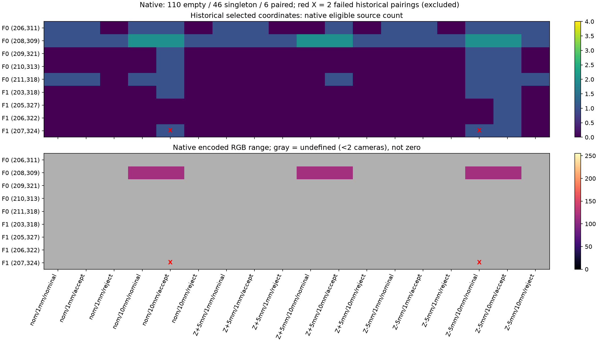
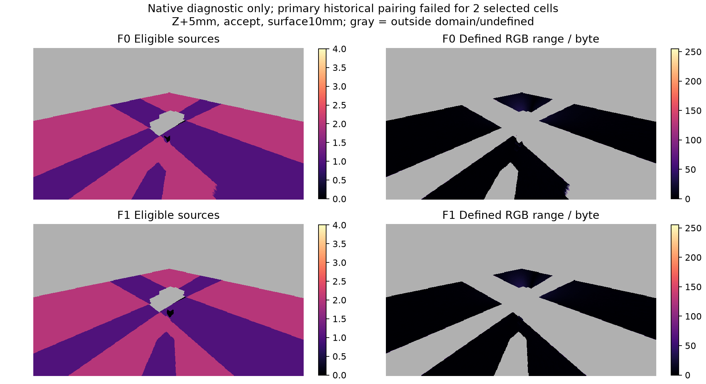

# RGB disagreement допущенных источников

14.10.2026. После [[validation/RESIDUAL_SURFACE]] и [[validation/FALLBACK_DISPLAY]] реализован native/server/library продукт `source_disagreement_v1` и отдельный bounded audit доступного photometric evidence. Он **не** управляет отбором камер, не восстанавливает скрытые участки и не является scene confidence.

## Определение и границы

Для фактической carrier point shader получает тот же eligible set, что обычный render: projection, supplied occlusion, uncertainty/facing/footprint predicates. В encoded RGB после bilinear texture sampling вычисляется `d=max_channel(max_camera(rgb)-min_camera(rgb))`. Это максимум попарного L∞ расхождения, до fusion weights и без photometric compensation. Не используется яркость для определения доступности, положительный вес или оценочная geometry truth.

RGBA8, top-left, schema version1:

|Канал|Значение|Контракт|
|---|---|---|
|R|round/UNORM encoded range×255|0 при менее двух eligible samples; иначе0..255|
|G|eligible_camera_count|integer0..4, не fraction/count×255|
|B|defined_pair_comparison|255 iff G≥2, иначе0|
|A|carrier_domain|255 для carrier вне masked footprint/ego;0 для background/ego/footprint|

Вне domain все bytes0. R0/B0 при одной камере означает **undefined**, R0/B255 — наблюдаемое согласие двух или более источников. Ни один случай не подтверждает нужную scene point: одноцветные поверхности, exposure/filtering, parallax и освещение ограничивают photometric inference. У hybrid это local eligible sources до nonlocal pyramid/seam effects, не effective support конечного кадра.

`RenderInspectionRequest::source_disagreement` — шестой optional bool; прежние aggregate initializers не сдвинуты. Один RGBA8 diagnostic pass/readback следует после common region pass и использует shared source projection. Vehicle depth occluder и masked footprint очищают domain. Request требует inspection destination и diagnostic=color; ordinary RGBA сохраняется, данные очищаются на следующем render без запроса.

## Wire и клиентская библиотека

HELLO/output_catalog объявляют новый продукт и точную `source_disagreement_schema`; configure_output выбирает его через существующий протокол. Старые commands, type11, frame/config/input identities и release unchanged. One product per data generation, default/reconnect final_frame, no configure_output при active lease; selector временный, не сохраняется на диск. Non-color diagnostic отклоняется до mutation с source_disagreement_requires_color.

`OutputProduct::SourceDisagreement` и owning `SourceDisagreementView` доступны без OpenCV/Qt. `view.at(x,y)` возвращает `encoded_rgb_range`, `eligible_cameras`, `defined`, `carrier`. Validator проверяет exact schema, отсутствующие/cross-product schemas, payload/shape/provenance, G≤used inputs, B↔count и domain/undefined invariants. Owning view сохраняет immutable Message без payload copy; серверный buffer всё равно своевременно release-ить.

```cpp
client.output_catalog(); // проверить source_disagreement_v1 и schema
client.configure_output(sv::OutputProduct::SourceDisagreement);
// Отфильтровать type11 по product/state_revision, прежние in-flight packets release-ить.
sv::client::SourceDisagreementView view(message);
auto p = view.at(x, y);
if (p.defined) {
    // p.encoded_rgb_range — измерение, не confidence или порог готового rejection.
}
client.release(message->header);
```

GUI palette/selector и parallel products ещё не добавлены. Product вычисляется в работающем сервере; исследовательский Python только вызывает compiled native fixture и проверяет сохранённые данные.

## Frozen bounded experiment

План `configs/research/source-disagreement-plan.json` фиксируется до native capture: все36 прежних facing-enabled configurations,9 residual coordinates/162 correlated pixel-condition cells, прежние input hashes. Native probe и code hashes заморожены, actual backend обязан быть llvmpipe. Это новый Mesa metric capture на прежних данных NVIDIA, поэтому selected eligibility сравнивается строго, sampling — независимым bilinear oracle по retained native UV, tolerance1 byte. Другие full-frame pixels не получают scene correctness label.

До опыта известно из прежних statuses:112 cells без eligible source,44 singleton,6 paired. Все paired относятся к одной road coordinate и не имеют matching eligible source при2/20mm. Поэтому выборка не содержит correct paired controls для specificity/ranking. Заранее заданы thresholds8/16/32/64/128 bytes с правилом strict d>threshold. Threshold не подбирается и не включается в сервер; undefined samples не превращаются в accepted/correct.

Результат и рисунки: [[validation/baselines/source_disagreement_v1.json]], §4.88. Raw captures/provenance сохраняются в `artifacts/source-disagreement-v1`, tracked report содержит selected pixels/oracle/threshold counts. Архивные datasets необходимы для повторения; один JSON не заменяет source images.

## Результат и обнаруженное расхождение pairing

**Primary all_oracles_passed=false: 160/162 cells проходят frozen проверки, две не совпадают с historical eligibility.** Текущий native count distribution110 empty /46 singleton /6 paired вместо historical112/44/6. Ошибку нельзя скрывать под успешной регрессией продукта: это разные gates.

Обе не совпавшие cells — F1(207,324): `s_nom_b020_e10mm-accept-facing` и `s_zm_b020_e10mm-nominal-facing`. Исторический camera3 status7, current source_visibility10/1; независимый повтор source_visibility подтверждает ровно одну текущую eligible camera. Эти cells исключены из переноса historical correctness labels.

Post-hoc контроль повторил обе конфигурации на Mesa **архивным неизменным бинарником** (SHA из native-facing-plan) и текущим correspondence probe: legacy camera3 status1 в обоих. Все11 payload hashes (RGBA, geometry, UV/status) совпадают для old/current Mesa. Следовательно, расхождение с историческим NVIDIA уже воспроизводится старым бинарником на текущем Mesa; это не новая regression метрики в данных двух controls. Backend/runtime sensitivity центрального predicate требует отдельной численной атрибуции; current NVIDIA не проверен. Отчёт controls: [[validation/baselines/source_disagreement_pairing_v1.json]]. Он не заменяет frozen primary report и не делает его gate успешным.

В шести совпавших paired cells F0(208,309) native R=116, независимый encoded bilinear range116.636 byte (разница с округлённым117 составляет1 byte, в frozen допуске). Все относятся к одной road coordinate и не имеют matching eligible source при2/20mm. Thresholds8/16/32/64 отмечают6/6, threshold128 —0/6. Correct paired controls отсутствуют: specificity, false-positive rate, ranking и рабочий threshold **не установлены**. 44 совпавшие singleton cells остаются undefined, в том числе содержащие известные wrong-point samples.



Рисунок — Все162 selected cells: count и range; red X обозначает два failed historical pairings, gray — undefined comparison. Неопределённость не превращена в согласие.



Рисунок — Native count/range maps на прежних frames, Z+5mm/accept/surface10mm. Это измерения source RGB, не full-frame truth/confidence. Primary pairing failure сохранён в заголовке.

Повторный collector дал побайтно идентичный primary JSON. Plot по умолчанию отказывается изображать failed study как успешный; `--allow-pairing-failures` разрешает только явную визуализацию помеченных failures.

## Проверки и воспроизведение

Native GTest для всех семи modes проверяет известные encoded ranges, одинаковые чёрные images, counts4/2/1/0, undefined vs defined-zero, statuses/counts, ego/domain, RGBA parity и reset. Дополнительный zero-edge-weight control показывает, что eligible comparison существует и на GPU fallback. Typed unit tests проверяют owning lifetime/bounds, malformed schemas/pixels, missing inputs и truncated payload. Live integration сравнивает каждый wire byte с native для семи modes, color rejection, final restore и typed Unix/TCP consumer; reconnect чередует три diagnostic products. Independent audit sampler имеет3 known-answer tests (asymmetric bilinear weights, pixel centres/clamp/black, invalid shapes/UV).

```sh
cmake --build build -j 6
__EGL_VENDOR_LIBRARY_FILENAMES=/usr/share/glvnd/egl_vendor.d/50_mesa.json \
  ctest --test-dir build --output-on-failure
python3 tests/test_disagreement_oracle.py
# Capture только в ещё не существующую output directory frozen plan:
python3 tools/research/source_disagreement.py --capture --output-report /tmp/source-disagreement.json
# Повторная проверка уже сохранённых captures:
python3 tools/research/source_disagreement.py --output-report /tmp/source-disagreement-repeat.json
cmp /tmp/source-disagreement-repeat.json docs/validation/baselines/source_disagreement_v1.json
MPLCONFIGDIR=/tmp/sv-matplotlib python3 docs/diploma/plot_source_disagreement.py --allow-pairing-failures
```

Полный Mesa CTest59/59 за106.94s после завершения сборки; новая native fixture добавляет8 GTest cases к carrier inspection, typed tests —2. Ранний selected run выявил ошибку расположения assertion в расширенном test consumer; исправлено до полного прогона. Это не overhead benchmark, новая independent scene family, NVIDIA или Aurora validation.

## Следующая задача

Атрибуция на записанных endpoints завершена: [[validation/ENDPOINT_PRECISION]], §4.89; малый Z drift пересекает20mm bias, все32 host replays согласованы. Primary pairing failure сохранён, точный driver/raster механизм не установлен. Matched independent source truth текущего backend и первый paired lattice inventory выполнены ([[validation/MESA_SOURCE_TRUTH]], §4.90). Далее independent texture-rich/nonuniform object scenes с balanced correct/incorrect paired controls, exposure/filter/noise и carrier-error ablations. Centre correctness и final RGB/ghost/seam quality оценивать отдельно. Проверить, добавляет ли photometric evidence информацию к geometry/eligibility, и обосновать abstention для singleton/ambiguous texture. Только после этого обсуждать joint selection thresholds и holdout. Общая mitigation и законченное исследовательское заключение остаются открытыми.

Post-hoc controls воспроизводятся существующими compiled probes; output directories уже сохранённого опыта не перезаписывать:

```sh
# Для каждой из двух variants из pairing report, FRAME_INDEX=1:
__EGL_VENDOR_LIBRARY_FILENAMES=/usr/share/glvnd/egl_vendor.d/50_mesa.json \
  LIBGL_ALWAYS_SOFTWARE=1 EGL_PLATFORM=surfaceless \
  artifacts/native-facing-v1/sv-correspondence-probe CONFIG MANIFEST NEW_OLD_MESA_OUTPUT 1
__EGL_VENDOR_LIBRARY_FILENAMES=/usr/share/glvnd/egl_vendor.d/50_mesa.json \
  LIBGL_ALWAYS_SOFTWARE=1 EGL_PLATFORM=surfaceless \
  build/sv-correspondence-probe CONFIG MANIFEST NEW_CURRENT_MESA_OUTPUT 1
```

CONFIG/manifest paths, exact variants, old/current binary hashes, report hashes, selected statuses и все11 payload hashes записаны в pairing report; архивный binary проверяется по `configs/research/native-facing-plan.json`. Source-visibility повтор использует `build/sv-support-wire-probe CONFIG MANIFEST OUTPUT source_visibility_v1 1`. Это отдельный post-hoc diagnostic control, не новая заранее объявленная primary matrix.
