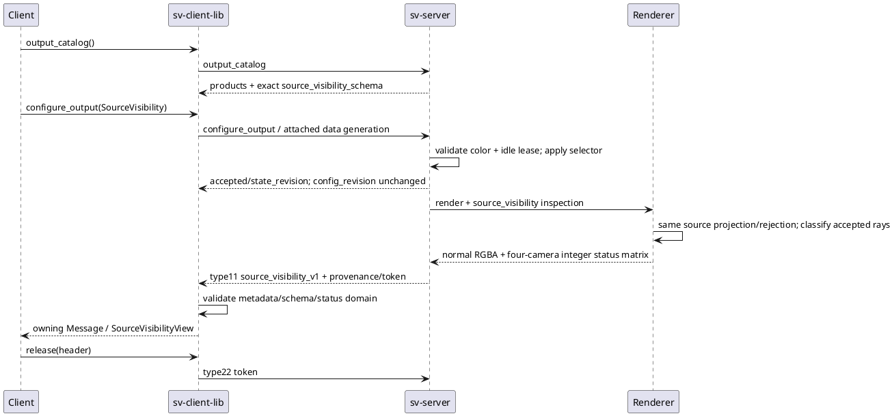
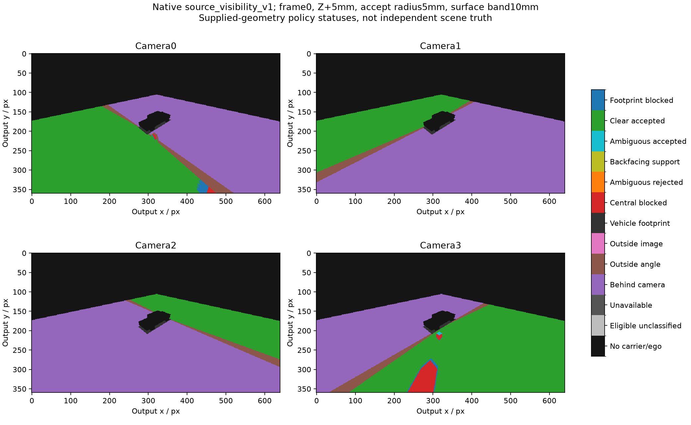

# Native причины отказа и принятая uncertainty через SV01

Следующий этап после [[validation/FACING_ENTRY_GAP]] реализует наблюдаемость, необходимую для следующих joint-selection опытов. Добавлен **source_visibility_v1**: четыре integer bytes на output pixel, по одному для камер0..3. Native shader, server output selection и `sv-client-lib::SourceVisibilityView` используют общий контракт. Это supplied-geometry policy result, не independent scene truth, depth reconstruction, confidence или новое улучшение качества RGB.

## Реализация и семантика

Implementation commits: native `d8db0c4`, wire/library `5e24373`. `RenderInspectionRequest::source_visibility` добавлен последним полем, сохраняя прежние positional requests. Матрица `RenderInspection::source_visibility`: CV_8UC4, top-left. Существующий `SourceProjectionInspection::status` остаётся прежним: accepted sample всегда1, отказ7 по-прежнему может включать central/footprint. UV и обычная fusion не перекодируются ради диагностики.

Новый shader pass9 вызывает тот же `source_projection` и выделенную общую `source_central_rejection`. Поэтому порядок проверок совпадает с основным shader. Footprint rejection разделён с central rejection только в новом продукте. Для accepted sample при enabled box, positive uncertainty radius и explicit accept/reject проверяется outer-box certificate: ambiguous→10, clear→11. Reject policy не допускает10; без активной uncertainty accepted→1. Central erosion/blocking и face/footprint rejection уже пройдены перед классификацией accepted.

|Byte|Имя|Смысл|
|---:|---|---|
|0|no_carrier|Background или depth-covered vehicle model; одинаково во всех четырёх каналах|
|1|eligible_unclassified|Принят pipeline, но bounded-uncertainty certificate не активен|
|2|unavailable|Нет source frame данной камеры|
|3|behind_camera|Нарушен camera Z threshold|
|4|outside_angle|Нарушен angular limit|
|5|outside_image|UV вне image bounds|
|6|vehicle_footprint|Carrier в mask кузова; одинаково во всех каналах|
|7|central_occluder|Central blocked: nominal box либо sufficient eroded-box certificate при uncertainty|
|8|uncertain_occluder|Central ambiguous отклонён policy=reject|
|9|backfacing_support|Ни одна near finite face не facing при opt-in filter|
|10|accepted_ambiguous|После всех filters сохранён ambiguous central sample; policy=accept|
|11|accepted_clear|После всех filters сохранён sample, clear по dilated-box certificate|
|12|footprint_occluder|Central принят, но radial neighbor/guard footprint отклонён|

`source_visibility_eligible(status)` true только для1/10/11. Статусы характеризуют source eligibility до fusion: не положительный weight, не winner/seam label и не effective multiband contribution. Для этого существует отдельный [[validation/RENDER_SUPPORT]]. Clear11 ограничен переданным box, endpoint bias, face-coordinate radius и fixed carrier/poses; не удостоверяет правильную поверхность сцены, калибровку, timing или отсутствие других препятствий. Status7 сам по себе не различает nominal и uncertainty certificate: нужен соответствующий surface по config_revision. Для отклонённого sample передаётся одна причина согласно pipeline priority, а не все stage predicates одновременно.

## Wire и библиотека

Handshake capability `source_visibility_v1`; output_catalog products теперь `[final_frame,render_support_v1,source_visibility_v1]`. Новый enum `OutputProduct::SourceVisibility`, имя продукта и schema доступны без OpenCV/Qt через installed public headers. Используются прежние `output_catalog` и `configure_output`: новых команд нет. Catalog добавляет requirement `fusion.diagnostic=color` и `source_visibility_schema`.

Type11 сохраняет RGBA8 transport container, top_left, stride=width*4 и ровно width*height*4bytes. **Канал A содержит status камеры3, не alpha**; непосредственно показывать payload как цветное изображение нельзя. Header содержит `output_product=source_visibility_v1`, точный `source_visibility_schema()` version1, camera channel order, status names и scope; `support_schema` отсутствует. Provenance/session/buffer/input/calibration/config/state revisions и release/token правила прежние. `inspection_cpu_ms` включает geometry passes/readbacks; не GPU elapsed и не hardware benchmark.

Выбирается один продукт на текущий data generation. Default/reconnect→final_frame; selector не сохраняется в конфиг. Configure требует attached data channel и idle experiment lease; сначала выбрать продукт, затем acquire lease. Выбор при color-incompatible settings либо configure_fusion, который сделал бы их несовместимыми, отклоняется до mutation с `source_visibility_requires_color`. Финальный цвет внутри renderer по-прежнему рассчитывается; selector не оптимизирует pipeline. Parallel subscriptions и несколько сессий не добавлены.

`SourceVisibilityView` сохраняет owning shared_ptr<const Message> без копирования payload; предоставляет width/height, `at(x,y,camera)` и исходный Message. Validator проверяет type/shape/schema/metadata/provenance, domain0..12, согласованность all-zero/all-footprint и unavailable claims для missing inputs. Unknown/schema mismatch отклоняется до event callback. Старые clients не должны запрашивать неизвестный им продукт; default final совместим. Release не инвалидирует retained owning view; серверный buffer должен освобождаться своевременно.

Пример применения и callback: [[engineering/USAGE#Причины отказа и принятая неоднозначность]]. Точный протокол: [[engineering/PROTOCOL_IMPLEMENTED#Source visibility product]], сценарий С12 дополнен в [[engineering/PROTOCOL_SCENARIOS]].



Рисунок — Доставка native диагностики через существующие control/data каналы.

## Проверки

Полная сборка Linux targets прошла. После завершения сборки полный Mesa CTest **58/58**,81.69s. Полный native inspection suite на explicit NVIDIA vendor **25/25**,1.071s. Тайминги относятся к тестам, не overhead измерениям.

- Четыре parameterized GTest cases проверяют радиусы0/5/10/50mm, accept/reject, edge_feather/multi_band: independent six-face oracle, новые10/11, сохранность прежних UV/status/RGBA, facing9 и restore.
- Independent neighbor-ray fixture различает7/12 для guard0/1 и требует положительное число neighbor-only отказов. Это проверка причины, не только histogram.
- На всех семи fusion modes маска без активной uncertainty совпадает с legacy source status; отсутствующая камера, projection rejection, ego/background и inspection reset проверены.
- Client GTest проверяет owning view/bounds, status/helper, missing input, unknown13/255, invalid schemas, cross-product schemas и truncated payload.
- Живой сервер: полные masks побайтно равны native probe для всех семи modes и дополнительных runtime accept/reject условий; несовместимые updates не изменяют config_revision; restore возвращает прежний final RGBA.
- Typed C++ consumer получает новый продукт через Unix и TCP loopback. Десять reconnect cycles чередуют два диагностических продукта и не переносят selector в новую data generation.

После полного suite расширена live uncertainty проверка: configure_surface переключает accept/reject, требует ненулевое число10/8, проверяет полную native/wire parity и restore поверхности. Повторный output_products CTest1/1,3.02s; native code не менялся.

Ранний selected test запуск пересёкся с relink сервера и получил PermissionError; ещё один тестовый дефект использовал `_` после присваивания payload вместо loop index. Исправлен индекс, сборка завершена, затем полный suite повторён успешно. Это не воспроизведённый runtime-дефект сервера и не пропущенный failure.

```sh
cmake -S . -B build
cmake --build build -j6
__EGL_VENDOR_LIBRARY_FILENAMES=/usr/share/glvnd/egl_vendor.d/50_mesa.json ctest --test-dir build --output-on-failure
__EGL_VENDOR_LIBRARY_FILENAMES=/usr/share/glvnd/egl_vendor.d/10_nvidia.json build/sv-carrier-inspection-tests
```

## Иллюстрация на прежней Blender-сцене

Для frame0/Z+5mm/accept/surface10mm записана одна native матрица из прежних frozen inputs. Это иллюстрация нового продукта, **не новая quality matrix или holdout**.74 accepted-ambiguous camera memberships находятся в camera3; camera0 имеет2 backfacing отказа, footprint отказов709/0/0/572. Это pixel-camera counts по всему carrier, не число target hits. Данные и hashes: [[validation/baselines/source_visibility_example_v1.json]]. Fixture не записывает фактическую строку device; metadata честно хранит только requested NVIDIA EGL vendor, не backend verification новой научной серии.

```sh
__EGL_VENDOR_LIBRARY_FILENAMES=/usr/share/glvnd/egl_vendor.d/10_nvidia.json build/sv-support-wire-probe artifacts/native-facing-configs-v1/frame0-s_zp_b020_e10mm-accept-facing.json artifacts/parallax-sensor-inputs-v1/rig101-near-z080/seed101-inputs/manifest.json artifacts/source-visibility-frame0.rgba source_visibility_v1
MPLCONFIGDIR=/tmp/sv-mpl-source-visibility python3 docs/diploma/plot_source_visibility_product.py
```

Test fixture берёт manifest frame0 и только сохраняет native mask; это не пользовательская замена server/client. Существующий report binding запрещает молча перегенерировать иллюстрацию из изменённых данных. Raw artifact исключён из Git, производная картинка и report tracked.



Рисунок — Native source_visibility_v1 в прежней сцене. Palette создаётся только для оформления; продукт остаётся integer matrix.

Закрыта native и typed wire наблюдаемость принятых ambiguous rays и причин отказа. Далее остаются GUI palette/camera selector, matched occlusion studies с этим продуктом, per-stage masks для всех rejected predicates при необходимости, overhead, actual source-surface/triangle truth и independent holdout. Эта реализация не устраняет выявленные parallax/unsupported failures.

Следующий bounded geometry audit выполнен отдельно: [[validation/RESIDUAL_SURFACE]], §4.86. Historical native eligibility сопоставлена с independent source hits; новый diagnostic product в этих captures не переснимался. Supplied-box clear не означает scene point correspondence.
