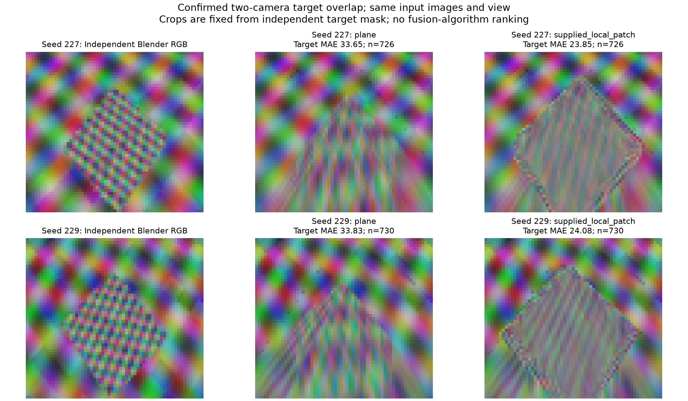

# Завершающий bounded control: подтверждённый overlap препятствия

14.10.2026. Протокол [[research/TARGET_OVERLAP_PROTOCOL]] зафиксирован до preflight в `6ce7bd8`.
Blender Python не содержит SciPy: первый импорт остановился до любых измерений/captures.
Эквивалентная NumPy erosion с четырьмя соседями и отдельный retry plan зафиксированы в `45de94d`.
Параметры scenes и критерии не менялись по RGB результатам.

## Gate и native результат

Две новые textured instances seeds227/229, низкий box1.2×1.2×0.5m, новые mount perturbations.
Blender geometry-only preflight дал target interior726/730pixels, все видны≥2 cameras:
bit masks9 (cameras0+3) и12 (cameras2+3). Frozen gate≥16 пройден обеими сценами.
После RGB capture независимые object-ID/visibility дали **те же counts**. Это устраняет n0
ограничение §4.91 для этих двух scenes; не доказывает general visibility или reconstruction.

Четыре compiled captures plane/local patch: одинаковые inputs, view, default fusion и coarse mesh32×45
внутри пары. Cycles8 samples, cube256, fisheye400, output320×180, один frame, true calibration.
3520/3520 metric checks, max RGB error1byte;240/240 anchor checks (120 уникальных rays),
max point error8.68µm;2744 in-domain virtual semantic checks совпали с Blender object-ID.
Native input/config/manifest/fingerprint/backend identity и ordinary RGBA parity проверены.

|Scene|Target two-camera interior n|MAE plane|MAE local patch|Target lattice paired: plane none-matching → patch all-matching|
|---|---:|---:|---:|---:|
|227|726|33.6469|23.8494|13→13|
|229|730|33.8251|24.0785|13→13|

Для26 общих lattice coordinates camera pairs совпадают между profiles. При2mm все26 plane
memberships имеют ни одного matching centre, все26 patch memberships — два matching centres.
Это наблюдаемый balanced **within-coordinate contrast**, без дополнительного поиска pixels/seeds.
Зависимые точки двух scenes не являются26 независимыми trials. RNG/mounts, RGB и virtual truth
не меняются внутри contrast. Geometry labels при20mm совпадают с2mm.

Final RGB MAE вычислена отдельно на общей independent target interior ∩ two-camera visibility.
Common-native-domain subset сохраняет те же n/MAE. Patch снижает ошибку примерно на29%,
но остаток≈24byte и различия filtering заметны. Native RGB range plane3–119, patch8–52:
геометрическое matching не делает source colors идентичными. Полноценного ghost/seam score,
filter convergence и ranking fusion algorithms этот control не даёт.



Рисунок — Crops independent Blender RGB и ordinary native results. Границы crop заданы
полным independent target mask с12px margin; дополнительного RGB-отбора нет. Nearest display
сохраняет видимость исходного output raster, не добавляет разрешение изображению.

## Воспроизведение и граница этапа

Tracked [[validation/baselines/target_overlap_v1.json]] содержит preflight, hashes, anchors,
32 RGB ROI measurements и26 target coordinate pairs с обеими native conditions. Raw report и
captures — `artifacts/target-overlap-{captures,native}-v1`, preflight — отдельный JSON.
Plan/helper hashes фиксированы; нужны локальные frozen binaries и source exports. После обновления
build binaries для нового опыта нужен новый versioned plan, прежние hashes не переписывать.

В Blender: `target_overlap_preflight.check(root, plan)` перед
`textured_source_study.capture(root, plan)`, где plan — `configs/research/target-overlap-retry-plan.json`.
Native capture/collector:

```sh
python3 tools/research/textured_source.py --plan configs/research/target-overlap-retry-plan.json --capture --output-report artifacts/target-overlap-native-v1/report.json
python3 tools/research/textured_source.py --plan configs/research/target-overlap-retry-plan.json --output-report /tmp/target-overlap-repeat.json
cmp /tmp/target-overlap-repeat.json artifacts/target-overlap-native-v1/report.json
MPLCONFIGDIR=/tmp/sv-matplotlib python3 docs/diploma/plot_target_overlap.py
```

Existing directories/report отклоняются. Offline fixtures/evaluation остаются Python;
product calculation выполняется compiled C++/GLSL. Открытая пользовательская сцена восстанавливается.

**Ограниченный исследовательский этап завершён. Следующая работа — ConfigService/library/GUI.**
Filter/resolution, exposure/noise, temporal, natural-object holdout, physical cameras и Aurora
остаются открытыми и переносятся в будущий общий ExperimentRunner. Новые исследовательские
ветви не являются предварительным условием перехода к продуктовым шагам; полного завершения
E-STITCH-01 этот отчёт не заявляет.
