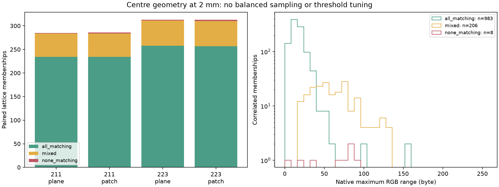
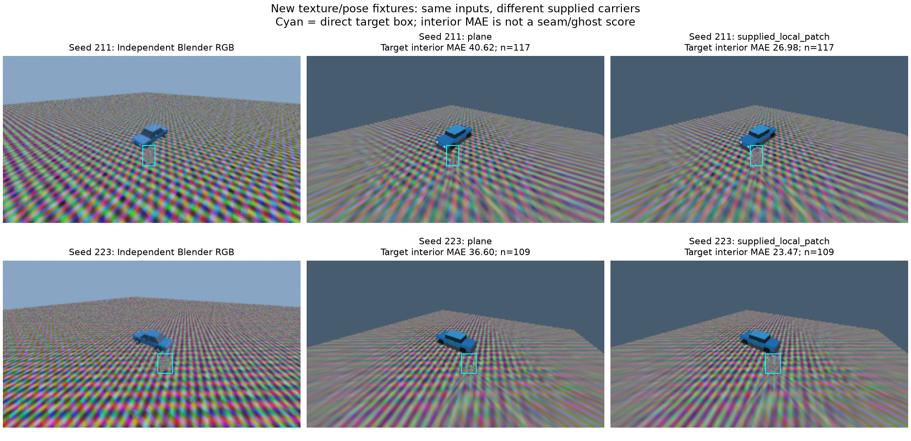

# Независимые неоднородные сцены: baseline

14.10.2026. Продолжение [[validation/MESA_SOURCE_TRUTH]]: два новых Blender captures и четыре
native C++ условия. Протокол [[research/TEXTURED_SOURCE_PROTOCOL]] зафиксирован до захвата
в `09e4397`. Это feasibility screen, не завершение E-STITCH-01 и не сравнение fusion algorithms.

## Получение данных

Seeds 211/223 задают новые монтажи камер, разные положения/размеры/повороты box и virtual view.
Road и target получают разные неоднородные текстуры, создаваемые `textured_fixture.py` без скачиваний.
World-space box projection, emission shader, Cycles CPU 8 samples, denoising off; cube256,
fisheye400, output320×180, один frame. Все серверные реализации остаются C++/GLSL;
Python строит независимые fixtures, проверяет результаты и оформляет рисунки.

Первый plan `textured-source-plan.json` остановился **до первого изображения**: Blender5.2
не принял float64 buffer в `image.pixels.foreach_set`. Исправление float32 и отдельный
`textured-source-retry-plan.json` зафиксированы в `02a462b` до повторного capture. Первый plan
сохранён. Успешный экспорт — `artifacts/textured-source-captures-v2`, Blender5.2.2 LTS.
Исходная открытая сцена восстановлена; .blend с packed textures и evaluated triangles сохранены
локально, сцены восстанавливаются tracked scripts/recipes без Git LFS.

Независимый эталон содержит virtual RGB, object-ID, source visibility, world triangles и
120 уникальных Blender ray anchors. Повторная проверка для двух carrier profiles даёт240/240,
max error7.61µm при frozen tolerance0.2mm. Нативный calibration roundtrip≤2.22e−16 проверяется
с тем же tolerance1e−12, что в предыдущем matched audit; inverse physical rays используют
именно архивную физическую calibration. Смена intrinsic или реального extrinsic отклоняется.

Оба profiles используют прежний native fusion default и одинаковые camera inputs: flat plane
и `supplied_local_patch` до верхней грани объекта с axis-aligned bounding footprint повёрнутого
box/transition0.2m. Source occlusion отключена. Patch не моделирует вертикальные грани и не является
автоматически восстановленной геометрией. Native captures на llvmpipe имеют одинаковые fingerprints
и device strings между correspondence/metric probes, ordinary RGBA parity соблюдена.

## Геометрия и RGB-расхождение

На заранее заданной lattice offset4/step8 получены3520 cells, metric checks3520/3520,
max RGB byte error1. Virtual semantic kind внутри carrier domain совпал с Blender object-ID.
No-hit/outside/singleton не превращаются в paired confidence.

|Scene/profile|Cells|Outside domain|Singleton|Paired all matching|Paired mixed|Paired none matching|
|---|---:|---:|---:|---:|---:|---:|
|211 plane|880|362|233|234|50|1|
|211 patch|880|361|233|234|50|2|
|223 plane|880|364|203|258|53|2|
|223 patch|880|364|203|257|53|3|
|Всего|3520|1451|872|983|206|8|

Matching требует finite hits, одинаковый kind и расстояние≤2mm; classification при20mm здесь
совпадает. Все1197 paired memberships имеют ровно две eligible cameras. Внутри domain zero-source
cells отсутствуют. Повторы между plane/patch коррелированы, это не1197 независимых trials.
Новые seeds не делают procedural boxes natural-object holdout; balanced controls ещё не получены.

|Frozen D threshold, byte|All-matching flagged /983|Mixed flagged /206|None-matching flagged /8|
|---:|---:|---:|---:|
|8|788|206|7|
|16|408|206|7|
|32|62|174|6|
|64|4|86|5|
|128|2|0|0|

У all-matching centres native D лежит2–152, у mixed17–128, у none-matching1–93.
Эти диапазоны перекрываются. Это counts зависимости RGB от заданных textures/filters, а не ROC,
validated threshold или ошибки perceptual quality. Correct centres могут давать большие различия
filtered RGB; source footprint, raster filtering и финальный цвет требуют отдельной атрибуции.



Рисунок — Состав paired lattice и RGB ranges по centre geometry. Логарифмическая шкала counts;
подвыборки не балансировались и thresholds не подбирались по результату.

## Итоговый RGB оценивается отдельно

Предварительно заданная маска — object-ID interior после erosion1px. MAE вычисляется в encoded RGB
bytes по всем трём каналам. Virtual RGB включает поверхность вне finite plane и недоступные камерам
части сцены: поэтому full interior MAE нельзя интерпретировать как чистую ошибку fusion.

|Scene|Target interior n|Target MAE plane→patch|Road interior n|Road MAE plane→patch|
|---|---:|---:|---:|---:|
|211|117|40.618→26.980|41246|23.274→23.305|
|223|109|36.602→23.468|41264|24.093→24.138|

Дополнительный, **post-hoc** control ограничивает ROI общим native carrier domain двух profiles
и независимой видимостью≥2 камер. Он добавлен после просмотра full-frame outputs, отдельно от
предварительно заданных ROIs, без замены прежних denominators. Для road n15086/16521 и MAE
20.812→20.845 /22.024→22.071. Следовательно, finite-domain mismatch объясняет только часть
наблюдаемого RGB residual; причину остатка этот опыт не изолирует.

**Target two-camera-visible interior пуст в обеих сценах**: n0, MAE=null, а не0.
Уменьшение target MAE после supplied height не доказывает улучшение двухкамерной сшивки препятствия.
Для следующего опыта нужны более низкий объект/иной монтаж, обеспечивающие independently verified
overlap непосредственно на target, и balanced matching/mixed/nonmatching controls. Нельзя объявлять
это ограничение пройденным только по наличию paired road pixels.



Рисунок — Direct Blender RGB и ordinary native outputs для двух carriers. Cyan показывает bounding
box direct target mask. Паттерны намеренно неоднородны; различия резкости/moire заметны и требуют
resolution/filter convergence. Рисунок не является natural-world demonstration или ghost segmentation.

## Проверки и воспроизведение

Tracked [[validation/baselines/textured_source_v1.json]] содержит SHA raw report/export/invocations,
240 anchor checks, все1197 paired cells, counts/thresholds,32 RGB ROI measurements и hashes рисунков.
Полные3520 rows и исходные inputs остаются в artifacts. Новый collector следует предварительно
зафиксированному протоколу; supplementary common-domain ROI явно помечен posthoc.

6 новых tests проверяют repeatable/nonuniform textures, bounds, decimal-only camera roundtrip,
отказ при extrinsic/intrinsic drift, missing camera и NaN. Вместе с matched-ray/sampler controls13/13
Python tests; selected CTest4/4 за0.69s. Native product code unchanged; full suite не повторялась.

Первый capture выполнить в Blender через MCP/консоль:

```python
import sys
sys.path.insert(0, '/path/to/surround-view/tools/blender')
import textured_source_study
textured_source_study.capture('/path/to/surround-view',
    '/path/to/surround-view/configs/research/textured-source-retry-plan.json')
```

Затем из корня проекта:

```sh
# --capture только при первом создании native output directory:
python3 tools/research/textured_source.py --capture --output-report artifacts/textured-source-native-v2/report.json
# Повторный read-only collector:
python3 tools/research/textured_source.py --output-report /tmp/textured-source-repeat.json
cmp /tmp/textured-source-repeat.json artifacts/textured-source-native-v2/report.json
MPLCONFIGDIR=/tmp/sv-matplotlib python3 docs/diploma/plot_textured_source.py
python3 tests/test_textured_fixture.py
python3 tests/test_textured_source.py
```

Нужны frozen binaries/helpers, local captures, NumPy/Pillow/SciPy/matplotlib и рабочий EGL/Mesa.
Existing output directories отклоняются. Другой binary/backend/generator требует нового plan/version,
а не подмены hashes. Продукт не запускает эти offline scripts.

Следующий этап: обеспечить target overlap, сбалансировать centre controls, проверить filter/resolution,
провести exposure/noise ablations и отдельную final seam/ghost evaluation. Общая реконструкция,
реальные камеры, temporal tests и Aurora остаются открытыми.
