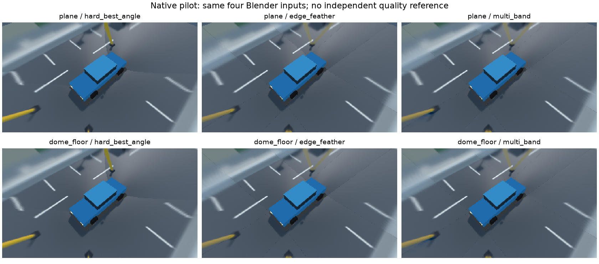
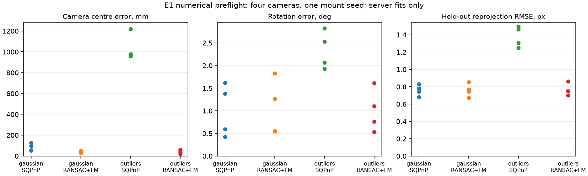

# Сквозной пилот сокращённого дипломного исследования

25.10.2026. Протокол: [[research/THESIS_CORE_PROTOCOL]]. Это workflow pilot на старой
Blender street recording, не новая holdout-серия и не выбор лучшего алгоритма.
Product code не менялся; использованы existing server, sv-client-lib и C++ ExperimentRunner.

## Результат

success=true, restored=true;54 trials (12 warmup +42 measured),6 variants и42 сохранённых
RGBA. Каждый variant дал один и тот же RGB hash во всех9 повторениях. Все samples
используют один frame_set, одинаковые4 image/model identities и view; source timestamp0.
Все четыре packed RGB8 identities независимо пересчитаны из PPM с domain/size prefix.
Active mesh:3196/3200 triangles, position/index buffers58512/58392 bytes.
Original fusion/surface/pause восстановлены; baseline/restored RGB hashes совпали.
Replay cursor не восстанавливался. Сервер после опыта штатно завершён SIGINT.



*Рисунок П.1 — один и тот же Blender street frame,3 fusion ×2 carriers, output320×180.
Панели выбираются как первый measured trial по заранее заданному порядку variants,
без выбора красивого повторения. Верхний ракурс в основном показывает пол: он не
подтверждает качество стенки купола; низкий ракурс предусмотрен финальным протоколом.*

| Carrier | Метод | Active triangles | Active buffers, bytes | Render wall p50, ms | p95, ms |
|---|---|---:|---:|---:|---:|
| plane | hard_best_angle | 3196 | 58512 | 2.133 | 2.348 |
| plane | edge_feather | 3196 | 58512 | 2.024 | 2.183 |
| plane | multi_band | 3196 | 58512 | 26.671 | 31.314 |
| dome_floor | hard_best_angle | 3200 | 58392 | 1.885 | 2.327 |
| dome_floor | edge_feather | 3200 | 58392 | 2.095 | 2.368 |
| dome_floor | multi_band | 3200 | 58392 | 28.799 | 28.959 |

Время — описательный render/readback wall на7 повторах одного frozen frame, не FPS,
не capture-to-display и не приёмка быстродействия. Capture/readback observation включено,
telemetry sampling выключен. Показатели нельзя переносить на RTX/Aurora или считать
стоимостью всех стадий без пересечений.

Actual GL_RENDERER: AMD Ryzen 9 9950X 16-Core Processor (radeonsi, raphael_mendocino, ACO, DRM 3.64, 7.2.6-arch2-1).
Mesa vendor selection не означает software llvmpipe. Configured build revision в отчёте
b9f9ca3: бинарник собран с тогда незакоммиченным исправлением, позже сохранённым вe866550.
Source fingerprint/полные client/server passports включены в compact audit; код после
проверенной сборки не менялся. Нельзя выдавать revision descriptor за чистую сборку b58812a.

Quality reference/criteria не подключались: quality_status=not_requested. Нет independent
RGB truth и проверки новых калибраторов; E1–E3 не объявляются завершёнными. Resident mesh
cache включает исходный high-density dome и другие carriers: активный лимит60500 bytes
не является resident/RSS bound. Для финальной серии начальный carrier задан протоколом.

## Первичные данные и воспроизведение

Raw config/report/42 RGBA/trace находятся в artifacts/thesis-core-pilot-20261025.
Compact audit с hashes/identities/resources/timings/passports:
[thesis_core_pilot_v1.json](baselines/thesis_core_pilot_v1.json).
Исторический manifest: artifacts/blender-street/manifest.json,
SHA256 d91af117739c24ec52f173369692ad9793804ed1837fecd65f6751f5b7eb96bc.
Raw report SHA256 8b000dbb032c79989a41105e9679dc2af499f16c25ca6cf47af06f277c8b3de1.

Подготовка config и команды native запуска: [[engineering/USAGE#Компактный дипломный пилот]].
При повторении report/capture directory должны быть новыми; первый прогон не перезаписывать.
Сохранённая Blender recording должна существовать либо быть воссоздана по
[[engineering/BLENDER]]. Она остаётся historical/exploratory, не становится holdout после повторения.

График и независимая проверка сохранённых captures (Python только post-processing):

```sh
MPLCONFIGDIR=/tmp/sv-thesis-pilot-mpl python3 docs/diploma/plot_thesis_pilot.py \
  --report artifacts/thesis-core-pilot-20261025/report.json \
  --config artifacts/thesis-core-pilot-20261025/config.json \
  --manifest artifacts/blender-street/manifest.json \
  --scenario configs/research/thesis-core.json \
  --figure docs/diploma/figures/experiments/thesis_core_pilot.png \
  --audit docs/validation/baselines/thesis_core_pilot_v1.json
```

Audit успешен; negative check с width640 вместо320 отклоняет несовместимый config
до экспорта figure/audit. py_compile script и git diff --check успешны. Полный CTest в этом срезе
не повторяется: product binaries не менялись; предыдущая проверенная сборка69/69 описана
в [[validation/CLIENT_SMOKE#Защита клиентских deadline]].


## Численный пилот калибровки E1

25.10.2026. Новый native calibration-run устраняет блокер measurement: completed candidate
pose доступна без apply, все jobs выполняются одной owner-сессией.16 cases на4 камерах
(два метода ×два observation profiles) завершены; config revision не изменилась.
Это numerical preflight с seed9001, **не** новая Blender scene/holdout и не весь E1.

Known fisheye intrinsics из configs/synthetic.json; independent NumPy projection создаёт
6 board poses/camera (4 training,2 validation),96/48 correspondences. Sigma0.5px; outlier
profile сохраняет тот же шум и добавляет10 из96 offsets U[−10,10]px. Group split по целым
poses. R_true=Rx(pitch) R_nominal Rz(−yaw), C_true=C_nominal+[along_body,0,0], t=−RC.
Yaw/pitch U[−3°,3°], shift U[−0.05,0.05]м. Порядок16 jobs перемешан fixture seed93001.
Truth не отправляется solver. Метод/validation выполняются серверным production OpenCV.

| Profile | Метод | Completed | Median centre error, mm | Rotation error, deg | Held-out RMSE, px |
|---|---|---|---:|---:|---:|
| gaussian | sqpnp |4/4| 76.827 | 0.984 | 0.763 |
| gaussian | ransac_epnp_lm |4/4| 38.788 | 0.907 | 0.758 |
| outliers | sqpnp |4/4| 971.288 | 2.296 | 1.384 |
| outliers | ransac_epnp_lm |4/4| 44.910 | 0.932 | 0.749 |



*Рисунок П.2 — каждый marker соответствует камере одного rig; четыре камеры не являются
четырьмя независимыми сценами. Это scatter numerical errors, не фотографии с детектора.*

Все16 candidates имеют quality_accepted=true. Но при outliers SQPnP даёт spatial errors
957–1219mm, validation RMSE1.248–1.497px. Gate проверяет только reprojection и не
подтверждает pose accuracy. Формальный physical false-accept rate без внешних требований
не определяется. Даже RANSAC не всегда улучшает centre относительно nominal:
для clean profile улучшение лишь у1/4 камер. Не выбирать другой порог по этим outputs.

Мишени маленькие и близки к optical axis, что ограничивает обусловленность. Это полезный
отрицательный контроль: до основной серии зафиксировать геометрически разнесённые board
poses в input registry, без отбора по полученному fit error. Полное angular-coverage
исследование не добавляется. OpenCV worker RNG в этом pilot не закреплён per-job API;
для финальной воспроизводимой серии его policy ещё нужно явно определить/записать.
RANSAC randomness и один mount seed не позволяют объявить универсального победителя.

Raw cases/truth/report/trace: artifacts/thesis-e1-numerical-20261025. Synthetic replay
служит только data attachment и **не** является изображениями калибровочной мишени.
Compact results/passports/hashes:
[thesis_calibration_pilot_v1.json](baselines/thesis_calibration_pilot_v1.json).
Candidate projection/RMSE независимо пересчитаны и совпали с сервером с допуском1e−7px.
Сервер после сохранения16 результатов штатно завершён SIGINT.

Подготовка и post-processing (solver в Python отсутствует):

```sh
python3 docs/diploma/plot_thesis_calibration.py prepare configs/synthetic.json artifacts/e1
python3 tools/simulator.py --config configs/synthetic.json --frames 2 --output artifacts/e1/replay
```

Запустить sv-server с configs/synthetic.json, manifest artifacts/e1/replay/manifest.json
и Unix /tmp/sv-thesis-e1; затем native команду из [[engineering/USAGE#Сравнение калибраторов без изменения сервера]].
После завершения сервера:

```sh
MPLCONFIGDIR=/tmp/sv-e1-mpl python3 docs/diploma/plot_thesis_calibration.py plot \
  artifacts/e1/new-report.json artifacts/e1/truth.json \
  artifacts/e1/figure.png artifacts/e1/audit.json
```

Исходный compact audit закрепляет numerical pilot, повтор создаёт новый report/audit;
случайные RANSAC результаты не требуются побитно прежними. Device/Aurora и detector не проверены.


Linux build успешна. Финальный профильный CTest6/6 за6,59с: calibration_job, replay_ipc,
calibration_observations, research_scenarios, svctl_options, extrinsics. Новые GTest
проверяют preflight empty/duplicate/extra/oversize и отказ перезаписи до network;
Unix integration — candidate matrix/duration, completed+failed в одной сессии, сохранение
config revision и previous report. Полный69-test прогон здесь не повторялся.
Scientific pilot выполнялся до добавления только preflight test registration в CMake;
его собственные build passports сохранены в audit, не подменены финальной сборкой.
