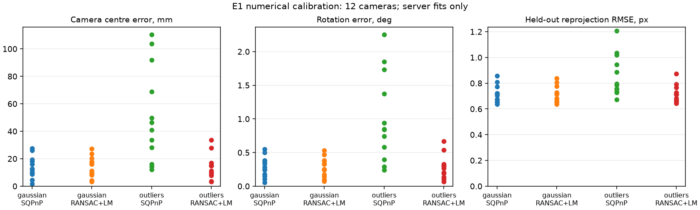

# E1: зарегистрированное численное сравнение калибраторов

25.10.2026. Выполнен численный E1 протоколаv2 [[research/THESIS_CORE_PROTOCOL]]:
3 perturbed rigs ×4 cameras ×2 methods ×2 observation profiles =48 fits. Это завершённая
ограниченная numerical серия, не физическая калибровка, detector benchmark или scene-RGB
confirmation. Прежний pilot9001 сохранён отдельно: [[validation/THESIS_CORE_PILOT]].

Последующие image-quality E2/E3 и короткий PC performance profile выполнены29.10.2026:
[[validation/THESIS_E2]], [[validation/THESIS_E3]], [[validation/THESIS_PC_PERFORMANCE]].

## План и данные до запуска

Commit c3cad33 закрепил configs/research/thesis-rig.json и thesis-e1-inputs.json до
генерации/просмотра новых результатов. Mount seeds1001/1002/1003, fixed train poses0–3,
validation4–5; board6×4 corners с шагом0.04м,96/48 pairs. Заданы разнесённые optical
centres и board yaw, без отбора по fit error. Совокупность train XYZ проверена на rank3
до fit; проекции всех corners находятся в модели/растре. Эта проверка не гарантирует
полного углового покрытия или хорошей обусловленности любой реальной мишени.

Gaussian σ0.5px; contaminated profile использует те же noise samples плюс10 из96
training offsets U[−10,10]px. Validation не имеет injected outliers и использует другие
целые board poses/noise streams. Intrinsics известны, фиксированы; detector отсутствует.
True pose используется fixture/независимым evaluator, не solver. Целевые points заданы
относительно true optical frame и преобразованы в известные vehicle XYZ: это conditional
known-correspondence experiment, не идентичная неподвижная физическая разметка всех rigs.

Вv2 E1 не размножается под тремя scene labels: без detector texture scene не меняет
supplied XYZ/UV. E2/E3 сохраняют3 scenes ×3 mount seeds. Это ускорение не добавляет
псевдонезависимых measurements и не расширяет область вывода.

## Результаты

48/48 completed; все48 имеют прежний quality_accepted=true. Ни один candidate не применён,
config revision не изменилась. Независимый evaluator пересчитал held-out RMSE из server
transform и совпал с server values с допуском1e−7px. Четыре виртуальные камеры каждого
rig — зависимые observations, не четыре независимые сцены.

| Observation profile | Методика | Completed | Median centre error, mm | Rotation error, deg | Held-out RMSE, px |
|---|---|---|---:|---:|---:|
| gaussian | sqpnp |12/12| 12.562 | 0.263 | 0.712 |
| gaussian | ransac_epnp_lm |12/12| 13.566 | 0.288 | 0.715 |
| outliers | sqpnp |12/12| 43.637 | 0.846 | 0.791 |
| outliers | ransac_epnp_lm |12/12| 13.054 | 0.281 | 0.713 |

В contaminated subset RANSAC+LM имеет меньшую centre error в12/12 camera pairs;
при Gaussian —7/12. Это не универсальный победитель: median centre error в clean
subset немного меньше у SQPnP. Сравниваются целые pipeline profiles (SQPnP против
EPNP RANSAC+LM), а не изолированный вклад одного RANSAC sampling stage.

Разбивка contaminated centre error по независимым mount seeds (median4 камер,mm):

| Mount seed | SQPnP | RANSAC+LM |
|---|---:|---:|
| 1001 | 70.816 | 15.937 |
| 1002 | 24.726 | 10.604 |
| 1003 | 37.212 | 12.215 |



*Рисунок E1.1 —12 camera instances/profile/method из3 rigs. Все точки показаны;
малое N и общие шаблоны target poses не дают population significance/CI.*

Нельзя приписывать отличие от pilot9001 только разнесению мишеней: изменились также rig
intrinsics/resolution и seeds. Причинный paired comparison внутри этой серии — методы
на одинаковых данных и добавление outliers при том же Gaussian noise. Статистика pose/
RGB воздействия E3 ещё не получена; physical/Aurora acceptance отсутствует.

## RNG и контроль повторяемости

Source evidence legacy OpenCV4.10 показывает backend-local RNG ([[references/VISION#S75]]).
Вместо неподтверждённого seed knob сервер сообщает execution_policy: method/version,
backend_owned_no_seed_parameter; для RANSAC kernel EPNP,300 iterations,confidence0.999,
normalized threshold3/max(fx,fy), затем LM с defaults данной версии OpenCV.
На установленной5.0.0 GTest меняет ambient RNG, делает посторонний fit и запускает другой
thread: T/inliers/RMSE одинаковы, ambient RNG не расходуется. Это observed regression,
не гарантия одинаковых результатов между версиями/ABI/OS.

Дополнительно все48 requests повторены в обратном порядке в новой owner-сессии. T,
training/validation RMSE, max validation error, inliers, quality flag и execution_policy
совпали точно в48/48 cases. Job IDs/duration не сравнивались. Повтор **не** увеличивает
количество quality samples до96 и не является новым независимым experiment.

## Артефакты, запуск и ограничения

Raw cases/truth/reports/trace: artifacts/thesis-e1-v2-20261025. Compact audit с48 results,
input registry, group summaries, repeat hashes и server/client passports:
[thesis_calibration_e1_v2.json](baselines/thesis_calibration_e1_v2.json).
Fixture generator SHA и NumPy version записаны в truth/audit. Server config и frozen
plan отслеживаются в Git; raw reports не заменяются при повторном запуске.

```sh
python3 docs/diploma/plot_thesis_calibration.py prepare configs/research/thesis-rig.json \
  artifacts/e1-v2-repeat --plan configs/research/thesis-e1-inputs.json
python3 tools/simulator.py --config configs/research/thesis-rig.json --frames 2 \
  --output artifacts/e1-v2-repeat/replay
```

Запустить sv-server с этим config/manifest и отдельным IPC directory, затем:

```sh
build/svctl --unix /tmp/sv-e1-v2-repeat --timeout-ms 10000 calibration-run \
  artifacts/e1-v2-repeat/cases.json artifacts/e1-v2-repeat/report.json
MPLCONFIGDIR=/tmp/sv-e1-v2-mpl python3 docs/diploma/plot_thesis_calibration.py plot \
  artifacts/e1-v2-repeat/report.json artifacts/e1-v2-repeat/truth.json \
  artifacts/e1-v2-repeat/figure.png artifacts/e1-v2-repeat/audit.json
```

Сервер выполняет все fits/validation на C++; Python — numerical fixture/evaluator/plot,
не продуктовая реализация калибратора. Synthetic replay используется для data attachment,
а не как снимки наблюдений мишени. После primary+reverse series сервер штатно остановлен.
Worker duration включает solver+validation и не является target performance benchmark.
Повторить reversed control: развернуть cases array без изменения parameters, сохранить
в новом cases-reversed.json, запустить calibration-run с новым report path и сравнить
перечисленные numeric fields по case_id; hashes исходного control закреплены в audit.

Linux build успешна. CTest6/6 за9,53с: calibration_job, replay_ipc,
calibration_observations, research_scenarios, svctl_options, extrinsics. Включены новая
RNG regression и проверка policy в настоящем server IPC. Полный69-test suite здесь
не повторялся. Исторические отчёты/критерии и pilot images не переписаны.

Численное сравнение E1 в этом объёме выполнено. Следующий этап —E3 и E2 с independent
scene RGB/масками и теми же nominal/true/candidate models, без нового семейства солверов.

## Надёжность partial report (29.10.2026)

В `research_scenarios` добавлены10 TCP fault regressions настоящего client SDK с mock peer:
потеря admission/status, пустой job ID, отклонённый status, потеря/отказ cancel после
deadline, неверные job/camera ID, матрица неправильного размера и потеря финального state.
Проверяются отсутствие повторного submit, outcomes, остаток cases, сохранение исходной
ошибки timeout и равенство записанного отчёта возвращённому объекту. Контракт:
[[engineering/PROTOCOL_SCENARIOS#Частичный отчёт при ошибке CAL-E1]].

Это инженерная проверка orchestration/reporting, не новые calibration samples и не
доказательство качества изображения. Результаты48 fits и их исходные hashes не менялись.
Linux build успешна; профильные CTest `research_scenarios`, `replay_ipc`, `svctl_options`
прошли3/3 за6,97с, включая все10 новых fault cases. Полная suite здесь не повторялась.
