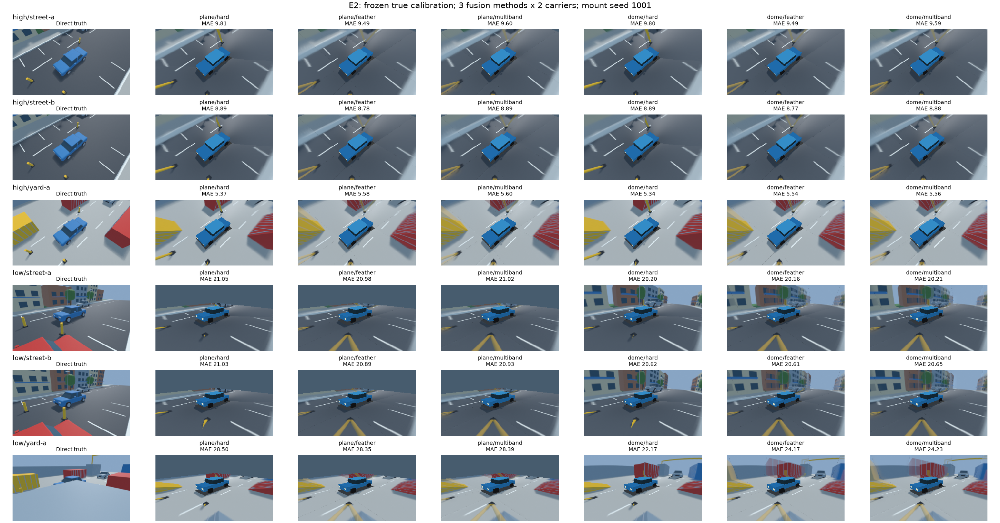

# E2: три метода сшивки и два носителя

29.10.2026: ограниченная image-quality серия выполнена. Протокол
[[research/THESIS_CORE_PROTOCOL]], данные и независимая ROI из [[validation/THESIS_E3]].
Новых алгоритмов, scenes, masks или критериев по результатам не добавлялось.

## Методика и проверки

18 заранее заданных scene/mount/view cells, true calibration, общие4×400×400 inputs,
direct RGB и eroded non-ego/any-camera-visible mask.6 вариантов:
hard_best_angle / edge_feather24px / multi_band4 normalized levels ×plane/dome_floor.
Каждый сервер начинает с plane, затем C++ runner переключает методы/геометрию через
sv-client-lib в versioned randomized block order. Выход320×180; plane3196 triangles,
1680 vertices/58512 active buffer bytes; dome3200 triangles,1666 vertices/58392 bytes.
Runtime guard требует≤1810 vertices и≤60500 bytes. Это active mesh, не resident/RSS budget.

18/18 workflows success/restored, baseline/restored RGB identical; replay cursor не
восстанавливается.108 conditions ×(2 warmup+7 measured)=972 trials/756 RGBA. Все9 outputs
одного условия имеют общий hash. Schema2 image/model/view guards проверены, truth/mask/
config/manifest совпали с прежней E3 true branch.18/18 dome+feather RGBA совпали с E3.
3024 MAE/RMSE/max/PSNR values независимо пересчитаны по RGBA; max difference3.55e−15.
Quality thresholds не назначались: not_requested означает отсутствие pass/fail gate,
а не отсутствие вычисленных метрик.

## Результаты

В таблице — median individual-cell RGB8 MAE по9 scene/mount cells на view, без pooling
pixels между сценами. Общие seeds/geometry означают зависимость observations; это
описательная оценка трёх instances из двух семейств, не population ranking.

| View | Носитель | Hard MAE | Feather MAE | Multiband MAE |
|---|---|---:|---:|---:|
| high | plane |8.863|8.626|8.691|
| high | dome_floor |8.857|8.621|8.686|
| low | plane |21.084|20.977|21.020|
| low | dome_floor |20.619|20.597|20.619|

Dome уменьшил MAE относительно plane во всех54 парных mode/cell comparisons. Для high
median разности dome−plane около−0.006 RGB8 levels: преимущество очень мало и не означает
существенного улучшения всего изображения. Для low median разности−0.885/−0.819/−0.814
для hard/feather/multiband; отдельные изменения от−6.458 до−0.280. Этот результат относится
к общей source-visible mask, а не всем пустотам/окклюзиям полного кадра.

Feather улучшил hard в24/36 mode-paired cells, multiband улучшил feather в7/36. Например,
low-yard/dome имеет median MAE22.001 для hard,24.173 для feather и24.059 для multiband.
Более сложное смешивание не гарантирует меньшую ошибку: правильные параметры камеры
не устраняют carrier parallax/occlusion mismatch, а смешение может переносить цвета
разных объектов. Это возможное объяснение, не раздельное доказательство всех механизмов.
Метрика RGB MAE не измеряет отдельно ghosting или заметность шва.



*Рисунок E2.1 — direct truth и6 native вариантов.6 строк соответствуют3 scenes×2 views,
mount1001 задан до просмотра results. Показан полный кадр, MAE только по общей mask.
Ego исключён. Выбор «лучшего» примера или другой mask под метод не выполнялся.*

Получен ограниченный вывод: на испытанных inputs dome лучше plane по выбранному RGB
endpoint, особенно в низком ракурсе, но ни один метод fusion не выигрывает во всех cells.
Feather остаётся разумным демонстрационным baseline, а hard/multiband сохраняются
переключаемыми вариантами. Нормативно допустимое качество парковочного обзора не установлено.
Производительность не выводится из7 quality repeats: отдельная серия описана в
[[validation/THESIS_PC_PERFORMANCE]].

## Данные и воспроизведение

Raw artifacts/thesis-e2-runs-20261029:18 config/manifest/reference/scenario sets,
reports,756 RGBA, logs/traces; registry binds all source files to E3.
Compact audit: [thesis_e2_quality_v1.json](baselines/thesis_e2_quality_v1.json).
Actual GL_RENDERER RTX5070Ti; fingerprint
a3ae77f9c3d29ce854593902b6e61c7e20621443da9524d4d269cc456cc0a5da.

```sh
python3 docs/diploma/plot_thesis_e2.py prepare \
  artifacts/thesis-e3-runs-20261029 artifacts/e2-new
build/sv-server --config artifacts/e2-new/high/street-a-m1001/config.json \
  --manifest artifacts/e2-new/high/street-a-m1001/manifest.json --loop false \
  --ipc-dir /tmp/sv-e2-new --trace artifacts/e2-new/high/street-a-m1001/trace.jsonl
# Другой терминал:
build/svctl --unix /tmp/sv-e2-new --timeout-ms 10000 research \
  artifacts/e2-new/high/street-a-m1001/scenario.json \
  artifacts/e2-new/high/street-a-m1001/report.json
```

Штатно остановить server, повторить для остальных17 sets; output/report всегда новые.
Исполняются native binaries, Python только готовит научные fixtures и проверяет bytes.

```sh
MPLCONFIGDIR=/tmp/sv-e2-mpl python3 docs/diploma/plot_thesis_e2.py audit \
  artifacts/e2-new artifacts/thesis-e3-runs-20261029 \
  artifacts/e2-new-figure.png artifacts/e2-new-audit.json
```

Regression проверяет известный MAE10 и отказы при чужом input ID, превышении vertex/buffer
budgets, смене carrier, ложной метрике и испорченном hash. Это проверка научного audit,
не новая продуктовая реализация сшивки. Физические камеры, target Aurora и thermal режим
этой серией не проверяются. GPU/CPU-stage budgets не равны полной задержке системы.

После GUI-port исправления Linux build и полный CTest70/70 за194,94с пройдены;
scientific fixture group содержит32 tests (в том числе E2/performance audit regressions).
Новые source code changes не использовались для переписывания уже полученных E2 чисел.
