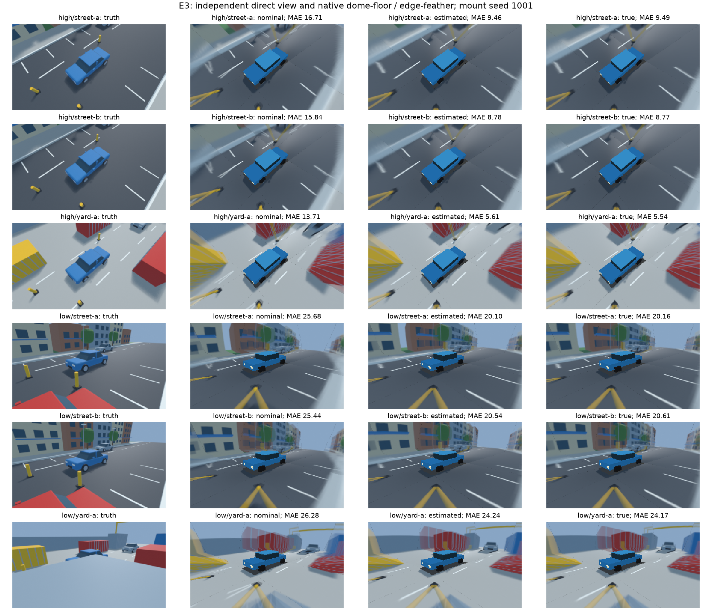

# E3: влияние калибровки на конечный обзор

29.10.2026: **image-quality часть E3 выполнена**:18 новых Blender captures,54 native
условия nominal/estimated/true,18 парных сравнений. Estimated снижает MAE относительно
nominal в18/18 ячейках. Отдельный performance profile и аппаратная Аврора ещё не проверены.
Итоговые данные и ограничения — в разделе [[validation/THESIS_E3#Результат серверной серии 29.10.2026]].
Далее сначала сохранено описание исторического preflight от25.10, когда RGB ещё не было.

25.10.2026. Статус: **offline preflight выполнен; изображения и quality results E3
ещё не получены**. MCP Blender не подключается; по указанию автора работа продолжается
без рендера. Результат — подготовленные планы и исправление передачи поз, не новая
RGB-выборка. Основной протокол: [[research/THESIS_CORE_PROTOCOL]].

## Найденная несовместимость

Одинаковый mount seed не воспроизводит одинаковую камеру в двух прежних генераторах:
E1 задаёт Rx(pitch)R_nominalRz(−yaw) и сдвиг по vehicle X для всех камер; legacy Blender
задаёт Rx(−pitch)R_nominalRz(−yaw) и сдвиг front/rear поY, sides поX. Это два разных
контракта. Исторические Blender recipes не объявляются ошибочными и не переписываются;
ошибкой E3 было бы считать их совпадающими с E1 по одному seed.

При seed1001 и тех же bounds3°/3°/0.05м legacy Blender относительно истинных поз E1:

| Камера | Ошибка центра,mm | Различие поворота,deg |
|---|---:|---:|
| Front |44.167|5.811594|
| Right |0|5.085616|
| Rear |49.186|4.817254|
| Left |0|4.416859|

Такое различие смешало бы качество калибратора с другой фактической установкой камер.
Новый camera_rig передаёт **сами матрицы** из E1, без повторного sampler. Legacy default
perturb сохраняется. Для explicit rig запрещены дополнительные mount bounds/overrides;
проверяются ordered IDs, finite rigid right-handed4×4 и неизменность остальных полей
между nominal/actual. Scene builder использует actual для capture/locators и сохраняет
nominal/provenance в capture.json. Converter переносит camera_rig_provenance в
ground_truth.json; legacy field отсутствует, если его не было в capture. Runtime этого нового Blender adapter ещё не проверен.

## Подготовленный набор

Frozen mapping: configs/research/thesis-scene-inputs.json —street-a260101,
street-b260102, cargo yard-a260103; mount seeds1001/1002/1003. Два view high/low,
static frame0, cube face256, output320×180. Primary mask до просмотра новых RGB
задана как non-ego/any-camera-visible по independent object/visibility truth с erosion2px;
маска ещё не построена. Она общая для nominal/true/estimated и не зависит от их errors. Выбор estimated profile=Gaussian RANSAC+LM
сделан после численного E1, до новых scene RGB: обычные observations без injected outliers,
а не выбор лучшего отдельного fit. В каждом mount используются все4 выбранных candidates.

Exporter подготовил18 startup profiles (2 views ×3 mounts ×nominal/true/estimated),
два capture plans по9 cases и registry SHA256. Capture использует только true profiles;
estimated и nominal предназначены серверным runs на **тех же** source RGB. Candidate
calibration IDs взяты из server E1 results, source physical truth остаётся неизменной.

Найдена и устранена ошибка подготовки config: FRAME/reference view содержит target_m,
но startup virtual_camera не принимает это поле. В плане остаются5 поддержанных config
полей; Blender и сервер используют default target[0,0,0]. Explicit FRAME-only field теперь
отклоняется exporter до output. Нативный loader проверяет итоговые JSON, поэтому Python
структурная проверка не выдаётся за полную C++ config validation.

## Проверки без Blender

- 25/25 offline tests, включая6 новых методов проверки rig/bridge, прошли; CTest
  blender_fixture1/1 за5,32с (финальный прогон с converter provenance assertion). Legacy scene/mount, optics и converter checks сохранены.
- Все18 startup configs приняты настоящим sv-project;3456 validation-point projections
  корректны. Для6 estimated profiles24 camera RMSE совпали с E1 с допуском1e−7px.
- 72 camera matrices в2×9 capture cases точно равны source E1 truth; nominal/estimated
  profile matrices также сверены с исходными records. Пересэмплирования нет.
- Повреждённый файл/источник, отсутствующий fit, reflected transform, новые intrinsics,
  повторная perturbation, неизвестный target_m и повторный output отвергаются тестами.
- Py_compile и git diff --check успешны. Native binaries не менялись; новый полный
  CTest/build не запускались. Actual Blender scene/capture, PNG truth и final RGBA не проверены.

Raw prepared set: artifacts/thesis-e3-ready-20261025. Предыдущая preparation attempt
с target_m в artifacts/thesis-e3-prepared-20261025 не прошла native validation и не
используется. Compact audit:
[thesis_e3_preflight_v1.json](baselines/thesis_e3_preflight_v1.json).
В нём сохранены hashes20 prepared files и camera models nominal/true/estimated для3
mounts, чтобы позы не зависели только от временных output directories. Бинарный мир
не создавался; будущие scenes восстанавливаются procedural recipes и этими моделями.

## Воспроизведение

Нужны raw truth/report завершённого E1 ([[validation/THESIS_E1]]). Exporter не вычисляет
калибровку и не правит конфиг работающего сервера — он подготавливает scientific fixtures.

```sh
python3 docs/diploma/plot_thesis_calibration.py prepare-e3 \
  configs/research/thesis-scene-inputs.json \
  artifacts/thesis-e1-v2-20261025/truth.json artifacts/thesis-e1-v2-20261025/report.json \
  artifacts/e3-new-prepared
python3 docs/diploma/plot_thesis_calibration.py audit-e3 \
  artifacts/e3-new-prepared artifacts/thesis-e1-v2-20261025/truth.json \
  artifacts/thesis-e1-v2-20261025/report.json build/sv-project artifacts/e3-new-audit.json
```

Output directory должен быть новым. Registry помечен prepared_no_render;
independent_rgb_available=false и native_e3_trials_completed=false сохраняются до
реальных captures/runs. Следующий этап после доступности Blender: выполнить два capture
plans, сверить actual pose/provenance с этим registry, конвертировать RGB один раз на
case/view и подготовить3 profile-specific manifests/reference guards с общими image/
mask hashes. Calibration IDs/model guards различаются, independent RGB truth —общая.
После этого выполнить E3. Не подменять новый RGB историческими картинками другого rig.

PlantUML E3.1 прошёл syntax check; новый mask policy пока только декларация, без построения маски.

## Результат серверной серии 29.10.2026

MCP подключён к Blender5.2.3 LTS, EEVEE. Дополнение protocol13 (server ожидает15), но
execute_code и renders работают; обновление дополнения не требовалось для опыта.
Оба frozen capture plans выполнены без изменения seeds/параметров:3 scene instances
(street-a, street-b, yard-a),3 mounts,2 views. Во всех18 captures config/provenance/recipe,
timestamp0, intended optical poses и72 camera transforms сверены с E1→capture registry.
Blender projector checks каждой сцены и virtual reference имеют ошибку≤0.001px.
Это численный контроль координат; Blender matrices имеют конечную float precision.

На каждом case/view cubemap конвертирован один раз в4×400×400 RGB8. Для nominal,
estimated и true-control копируются **те же байты** source RGB, direct RGB и mask;
меняются только config calibration/model guards. Все source image identities также
совпали между high/low. Schema2 guards проверяет native runner, а не только Python audit.
Ни fit, ни rendering, ни рабочая оценка качества не выполняются Python-скриптом:
sv-server рендерит, C++ evaluator клиента считает метрики через существующий protocol.
Python — Blender fixture export, независимый пересчёт сохранённых RGBA и рисунок.

### Маска, повторения и проверка результата

Зафиксированная до просмотра новых server outputs policy: labels≠0, объект не ego,
visibility bits≠0; затем erosion квадратным5×5 kernel (радиус2 в метрике Чебышёва),
вне изображения false. Маска зависит только от independent object/visibility truth.
Она **не** исключает границы между двумя допустимыми объектами и не строится по carrier
validity или ошибке. Это конкретизация ранее записанной erosion2px, не подбор по результату.
ROI44177…47233 pixels для high и10054…40898 для low; одна и та же mask в трёх ветвях.
Малый ROI low-yard нужно учитывать: эти pixel-weighted оценки не описывают весь кадр.

Два warmup и7 measured repeats на условие:486 native trials,378 сохранённых RGBA.
54/54 workflows success/restored, baseline/restored RGB hashes совпали. Replay cursor
не восстанавливается. В каждом условии все9 outputs имеют один hash: повторения не
увеличивают число независимых quality observations.18 paired scene/mount/view cells
также не являются18 независимыми сценами: mounts и оценки E1 повторяются между scenes/views.
1512 значений MAE/RMSE/max/PSNR пересчитаны из сохранённых bytes, максимальное отличие
от C++7.11e−15; malformed/mismatched inputs не пропускаются. Порог качества не назначался:
quality_status=not_requested означает отсутствие acceptance criteria, метрики вычислены.

### Парные различия

Ниже median по3 mount seeds внутри scene/view; RGB8 MAE и разность median paired
improvements приводятся отдельно (разность медиан не обязана равняться медиане разностей).

| View/сцена | Nominal MAE | Estimated MAE | True-control MAE | Median nominal−estimated |
|---|---:|---:|---:|---:|
| high/street-a |13.675|9.442|9.437|4.264|
| high/street-b |12.486|8.647|8.621|3.881|
| high/yard-a |10.897|5.569|5.539|5.405|
| low/street-a |24.655|20.116|20.194|4.468|
| low/street-b |24.767|20.542|20.597|4.195|
| low/yard-a |26.281|24.202|24.173|2.044|

Во всех18 cells estimated улучшает nominal; median paired gain4.038 RGB8 levels.
Estimated−true от−0.0784 до+0.0681 MAE, median+0.00587. Небольшое преимущество estimated
над true в части cells не доказывает более точную физическую позу: проекционная
поверхность и итоговый RGB endpoint допускают компенсацию иных ошибок.
True-control MAE остаётся5.49…24.19: правильная калибровка не устраняет parallax,
occlusion, cubemap resampling и несоответствие геометрии dome_floor настоящей сцене.
Именно это отделяет влияние калибровки от предела выбранного способа отображения.



*Рисунок E3.2 — direct Blender truth и native dome_floor+edge_feather для nominal,
estimated RANSAC+LM и true-control. Все6 scene/view rows используют заранее фиксированный
mount1001, а не лучший пример. Показан полный кадр, MAE считается только по общей ROI;
ego в ROI не входит. Верхние3 строки —high, нижние3 —low.*

Actual GL_RENDERER: NVIDIA GeForce RTX5070Ti/PCIe/SSE2. Source fingerprint
a3ae77f9c3d29ce854593902b6e61c7e20621443da9524d4d269cc456cc0a5da;
client/server passport digests закреплены для каждого report. Короткие7 timing samples
с сохранением каждого RGBA — описательные, не performance acceptance. Опыты идут по
отдельным процессам/ветвям; межветочные timings не рандомизированы и не ранжируются.
Нужен отдельный frozen warmup5/repeats30 performance profile.

## Артефакты и воспроизведение выполненного E3

Raw captures: artifacts/thesis-e3-capture-high-20261029 и thesis-e3-capture-low-20261029.
В каждом case/raw сохранены street.blend,20 cubemap PNG,overview/direct RGB,NPY truth и
capture/paired metadata. Это результаты эксперимента, не новые скачанные assets;
исходная сцена восстанавливается tracked scene.py/environments.py/rig.py и frozen plans.
Файлы мира не зависят от Git LFS. User default scene сохранена, исследовательские сцены
созданы отдельно. Данные исследования не заменять симуляторной тестовой шахматной сценой.

Fixtures/configs/manifests/scenarios/reports/RGBA/traces:
artifacts/thesis-e3-runs-20261029. Compact audit:
[thesis_e3_quality_v1.json](baselines/thesis_e3_quality_v1.json),54 rows,18 paired contrasts,
capture/reference/mask/report/figure hashes и1512 metric checks.

В живом Blender по MCP (пути заменить своими, output directories новые):

```python
import sys
from pathlib import Path
root = Path('/home/bogdan/prog/MAI/surround-view')
sys.path.insert(0, str(root / 'tools/blender'))
from paired_truth import schedule_family_plan
schedule_family_plan(root / 'artifacts/thesis-e3-ready-20261025/capture-high.json',
                     root / 'artifacts/e3-new-high')
# Дождаться job.json state=complete; затем аналогично capture-low.json в другой output.
```

Подготовить fixture case/view (остальные — тем же способом; existing output отвергается):

```sh
python3 docs/diploma/plot_thesis_e3.py prepare artifacts/thesis-e3-ready-20261025 \
  artifacts/e3-new-high high street-a-m1001 artifacts/e3-new-runs/high/street-a-m1001
```

Запустить сервер и CLI для каждой из трёх branches; ни Python dispatcher, ни новый
продуктовый runner не нужны:

```sh
build/sv-server --config artifacts/e3-new-runs/high/street-a-m1001/nominal/config.json \
  --manifest artifacts/e3-new-runs/high/street-a-m1001/nominal/manifest.json \
  --loop false --ipc-dir /tmp/sv-e3-new \
  --trace artifacts/e3-new-runs/high/street-a-m1001/nominal/trace.jsonl
# В другом терминале:
build/svctl --unix /tmp/sv-e3-new --timeout-ms 10000 research \
  artifacts/e3-new-runs/high/street-a-m1001/nominal/scenario.json \
  artifacts/e3-new-runs/high/street-a-m1001/nominal/report.json
```

Остановить сервер штатно; для estimated/true использовать соответствующую branch,
для следующего опыта новый report path. После всех54 условий:

```sh
MPLCONFIGDIR=/tmp/sv-e3-mpl python3 docs/diploma/plot_thesis_e3.py audit \
  artifacts/e3-new-runs artifacts/e3-new-figure.png artifacts/e3-new-audit.json
ctest --test-dir build -R '^blender_fixture$' --output-on-failure
```

Fixture regression suite29/29 (25 прежних+4 новых), CTest1/1 за3,06с. Новые checks
проверяют kernel/ego/visibility/empty mask, совпадение с C++ known-answer hashes,
numeric/metadata separation и испорченные/нехэшированные/выходящие за root файлы.
Полный CTest и rebuild не повторялись: C++ product code не менялся. E2 comparison,
отдельные server performance trials, физические камеры и Aurora остаются открытыми.
