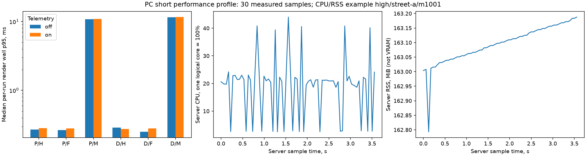

# Короткий профиль производительности native pipeline на ПК

29.10.2026. Выполнен следующий шаг после [[validation/THESIS_E2]]: тот же набор18 inputs,
6 variants, true calibration, warmup5/repeats30, capture_frames=false.216 timing
conditions,7560 trials/6480 measured. Телеметрия off/on50ms,capacity256 в отдельных
процессах; порядок off/on чередуется между cases. Параметры закреплены до запуска.
Это короткий paused pipeline profile, не live-camera throughput и не target acceptance.

## Область измерения и контроль

Native sv-server→sv-client-lib→svctl research. Каждый trial по-прежнему читает RGBA и
считает SHA256; C++ quality evaluator включён, записи каждого кадра на диск нет.
Observation policies и telemetry settings before/after проверены. Workflow/restore
успешны36/36; каждый output hash и native quality совпал с E2 при том же variant.
Изменений inputs/view/геометрии/калибровки между off/on нет. Серия не содержит Blender
render или тестовой сборки параллельно измерению.

По30 measured samples каждого условия независимо проверены native count/p50/p95.
Сохраняется nearest-rank p99; при N=30 это maximum, не устойчивая оценка хвоста.
Raw stage samples находятся в report.json, compact audit содержит distributions и hashes.
Render wall включает синхронный readback; GPU draw и readback не складываются с ним.
Publish_enqueue в FRAME snapshot может быть0, поскольку publish выполняется после снимка;
это не доказательство нулевой стоимости доставки.

## Задержки

Таблица — median per-condition p95 по18 scene/mount/view cells, ms. Она не является
квантилем объединённой выборки или доверительным интервалом. P=plane,D=dome_floor.

| Вариант | Render off | Render on | Fusion CPU off | Readback copy off |
|---|---:|---:|---:|---:|
| P/hard |0.271|0.283|0|0.182|
| P/feather |0.264|0.280|0|0.178|
| P/multiband |10.816|10.865|7.587|0.184|
| D/hard |0.287|0.275|0|0.186|
| D/feather |0.250|0.281|0|0.179|
| D/multiband |11.557|11.575|8.036|0.176|

Hard/feather используют GPU path; median GPU draw p95 off0.011…0.024ms. Multiband в
текущей реализации включает CPU fusion; gpu_draw для этого path отсутствует и не
подменяется нулём. Его render wall p95 примерно на порядок дороже, при этом E2 не дал
универсального выигрыша качества. Это основание сохранить multiband исследовательским
переключаемым режимом, а для простой демонстрации начать с feather/hard. Это не решение
об окончательном алгоритме автомобильной платформы до её измерения.

## Телеметрия CPU/RSS

Сбор включён на сервере. После timing run отдельные native CLI sessions вызывают
telemetry_catalog/telemetry_read через ту же клиентскую библиотеку; polling не пересекается
с измеряемыми render trials. Paginated snapshot ограничивается latest_cursor первой
страницы; новые samples, возникшие при чтении, не добавляются бесконечно. Проверяются
instance/epoch, непрерывность cursor, отсутствие lost_samples и полнота snapshot.

Для CPU/RSS выбраны samples внутри временного диапазона measured frames с frame ID,
принадлежащим этим trials:1248 samples,68…70 на каждый on-run. CPU — process usage
относительно одного logical core=100%, усреднённый за предыдущий collection interval;
интервал может пересекать переключение алгоритмов. Поэтому per-algorithm CPU attribution
не заявляется. Это CPU сервера, без CPU клиента/evaluator и общей нагрузки ОС.

Median per-run CPU p50=21.075%; диапазон per-run RSS p95=160.41…163.43MiB. RSS не VRAM
и не сумма памяти всех процессов. Median per-run collector wall p95=0.0482ms. Off/on
render differences разного знака: одного pair процесса на input недостаточно для точной
оценки причинного overhead при шуме GPU/ОС. Не объявлять телеметрию бесплатной и не
выводить из этой серии универсальный процент замедления.

Source dropped batches max0 на paused replay; это не результат disconnect/load test
физических камер. Retained-input age сохранён отдельно: при pause он растёт и не равен
sensor latency. GPU utilization, sensor-to-display, thermal stability и device power
не измеряются этим collector. Новых чисел вместо отсутствующих измерений не вводилось.



*Рисунок P.1 — слева median per-run render p95, логарифмическая шкала; справа CPU/RSS
заранее выбранного high/street-a/mount1001 on-run.30 timing repeats и samples телеметрии
не являются независимыми сценами. Off/on — разные процессы с чередованием порядка.*

## Артефакты, перенос и воспроизведение

artifacts/thesis-pc-performance-20261029 содержит frozen registry/order,36 config/scenario
sets, native reports/traces и18 paginated telemetry snapshots. Compact audit:
[thesis_pc_performance_v1.json](baselines/thesis_pc_performance_v1.json).
Actual GPU RTX5070Ti, pipeline fingerprint
a3ae77f9c3d29ce854593902b6e61c7e20621443da9524d4d269cc456cc0a5da.
Измерение выполнено **до** последующего GUI-only исправления TCP-port parsing. Исторические
reports не переписаны. Перед PC↔Aurora comparison получить обе серии одной финальной
implementation fingerprint; текущие числа не выдавать за target baseline другой сборки.

```sh
python3 docs/diploma/plot_thesis_e2.py prepare-performance \
  artifacts/thesis-e2-runs-20261029 artifacts/performance-new
```

Далее запускать native server/research так же, как E2, для каждого directory из registry
в записанном порядке; использовать новые report paths и отдельный IPC directory.
Для on-профиля после research, пока сервер ещё работает:

```sh
build/svctl --unix /tmp/sv-perf-new command telemetry_catalog
build/svctl --unix /tmp/sv-perf-new command telemetry_read \
  --params '{"server_instance_id":"INSTANCE","epoch":"EPOCH","after_cursor":"0","limit":16}'
```

Подставлять реальные instance/epoch; каждый следующий after_cursor=предыдущий next_cursor.
Сохранять JSON ACK в catalog.json/telemetry-1.json,… и закончить после достижения
latest_cursor первой страницы. Не перезапускать server до чтения snapshot; polling
после timing не меняет default-off production policy.

```sh
MPLCONFIGDIR=/tmp/sv-perf-mpl python3 docs/diploma/plot_thesis_performance.py \
  artifacts/performance-new artifacts/thesis-e2-runs-20261029 \
  artifacts/performance-new-figure.png artifacts/performance-new-audit.json
```

Regression проверяет nearest-rank30 и invalid series, snapshot boundary при появлении
новых records и отказ при потере telemetry samples. Устройство/SDK и физические камеры
для этих измерений не использовались; одних этих данных недостаточно для автомобильной приёмки.
