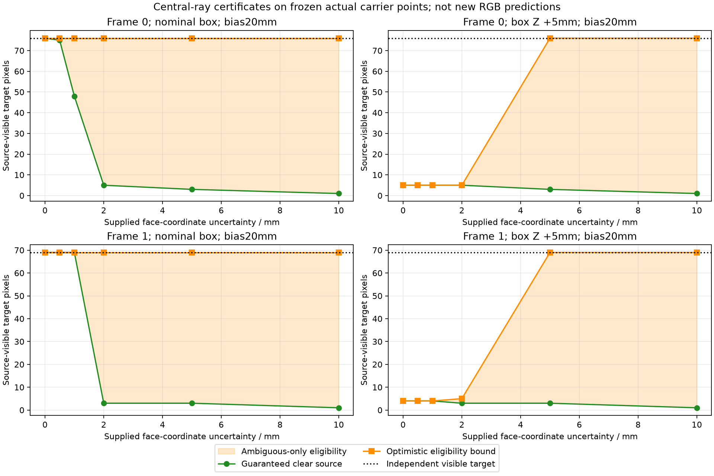
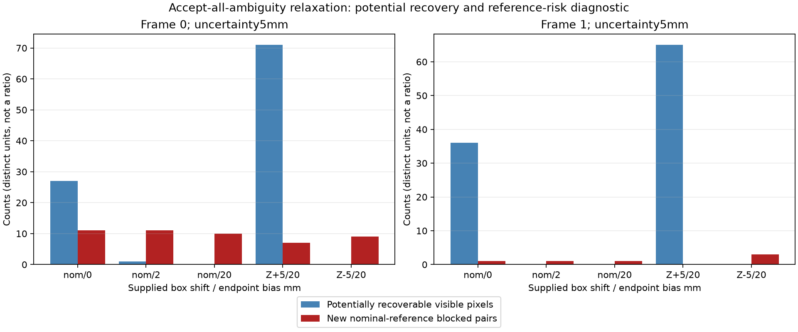

# Границы центральной окклюзии при неточной геометрии

Это post-hoc read-only исследование **18 center controls** прежней серии [[validation/VISIBILITY_SENSITIVITY]]. Шесть заданных радиусов ошибки дают108 строк анализа, а не108 новых рендеров. Ни серверный алгоритм, ни default, ни старые RGB/truth не менялись. Задача — выяснить, позволяет ли ограниченная ошибка supplied AABB объяснить центральные потери, обнаруженные в [[validation/VISIBILITY_FAILURE]].

## Контракт опыта

План `configs/research/visibility-uncertainty-plan.json` зафиксирован commit `cefea5e` до вычисления новых категорий, **после** знакомства с прежними aggregate results. Это exploratory protocol, не независимая подтверждающая preregistration. Использованы все18 center controls: nominal biases0/2/20mm и шесть vehicle-axis translations±5mm при20mm bias, два correlated frames. Surface/footprint controls намеренно исключены: здесь исследуется только central segment predicate, не полный filter-aware кандидат.

Для nominal supplied box $B=[l,h]$ и максимальной ошибки каждой координаты грани $u$ строятся вложенные объёмы:

$$B^-_u=[l+u,h-u],\qquad B^+_u=[l-u,h+u].$$

Для любой допустимой непустой AABB $B'$ выполняется $B^-_u\subseteq B'\subseteq B^+_u$. Это включает translations с $\|\Delta\|_\infty\le u$, но допускает также независимые ошибки граней. Отрицательная ширина eroded box означает пустое пересечение; нулевая ширина сохраняется как замкнутый вырожденный box. Радиусы:0/0.5/1/2/5/10mm. Они заданы исследователем, не оценены по sensors.

При неизменных camera origin $o$, actual raster carrier point $p$ и endpoint bias $b$ рассматривается обрезанный отрезок $o+t(p-o)$, $0\le t<1-b/\|p-o\|$. Пересечение с $B^-_u$ даёт достаточный признак **definitely blocked**; отсутствие пересечения с $B^+_u$ — **definitely clear**. Остальное — **ambiguous**. Это достаточные границы: ambiguous не доказывает существование clear translation; один общий box также связывает исходы всех rays.

Для output pixel с baseline-eligible cameras $E$ guaranteed eligibility требует хотя бы одну definitely-clear camera. Definitely unavailable означает, что все камеры из непустого $E$ definitely blocked; остальные доступные pixels — ambiguous-only. Accept-all-ambiguity даёт оптимистическую **верхнюю границу eligibility**, не предсказание RGB hits и не готовую mitigation.

Математическое обоснование использует монотонность пересечения вложенных множеств. Реализация double six-face oracle не является вычислением с гарантированным округлением: прежний допуск `1e-10m` на другие координаты грани сохраняется; endpoint bias не расширяется. Known-answer и enclosure tests проверяют реализацию, но не доказывают floating-point robustness на всех возможных tangencies.

## Результаты

В таблице дана пара frame0/frame1 при $u=5mm$. Все числа относятся к independent source-visible target pixels, кроме последнего столбца — camera-point pairs.

| Box / endpoint bias | Исходная eligibility | Guaranteed clear | Optimistic bound | Центральные потери, допускающие восстановление | Новые nominal-reference blocked pairs |
|---|---:|---:|---:|---:|---:|
| nominal /0mm |49/33|0/0|76/69|27/36|11/1|
| nominal /2mm |75/69|0/0|76/69|1/0|11/1|
| nominal /20mm |76/69|3/3|76/69|0/0|10/1|
| Z+5mm /20mm |5/4|3/3|76/69|71/65|7/0|
| Z−5mm /20mm |76/69|76/69|76/69|0/0|9/3|

Reference-risk column считает newly admitted rays, заблокированные **nominal supplied box при фиксированном2mm bias на actual carrier points**. Это не false acceptance относительно независимой сцены. Даже в строке без новых reference-blocked pairs могут приниматься rays к другой поверхности; «0» не является доказательством безопасности.

Для Z+5mm при $u\le1mm$ optimistic eligibility остаётся5/4. При2mm —5/5, при5mm —76/69. Таким образом, все прежние71/65 центральные потери перестают быть definitely blocked только на более широкой из исследованных границ; точный минимальный порог между2 и5mm не измерялся. Одновременно guaranteed eligibility уменьшается до3/3. Это объясняет, почему широкая surface membership полоса сама по себе не могла исправить центральный отказ.

По18 controls200 loss memberships: при0.5/1/2mm потенциально снимаются62/64/65, при5mm —200. При5mm всего1305 source-visible condition-pixel memberships, из них180 guaranteed,1125 ambiguous-only; newly admitted nominal-reference blocked pairs93. Это повторные условия на двух кадрах, не200 независимых наблюдений и не доверительная оценка по сценам.

Hidden-target optimistic eligibility также возрастает: nominal20mm frame0 —24→32 из102 hidden pixels, frame1 —0→1 из103. Отсутствие independent source visibility не устраняется изменением box predicate. Вновь доступный sample не доказывает восстановления скрытой target surface.



Рисунок — Guaranteed и optimistic central eligibility при заданной ошибке box; между кривыми расположены ambiguous-only pixels. Линии соединяют шесть дискретных измерений, промежуточные пороги не измерены.



Рисунок — Accept-all-ambiguity при5mm: potentially recoverable visible pixels и новые reference-blocked camera pairs. Разные единицы не образуют precision/recall или отношение пользы к риску.

## Воспроизведение и проверки

```sh
python3 tests/test_visibility_uncertainty.py
ctest --test-dir build -R '^(visibility_uncertainty|source_correspondence)$' --output-on-failure
MPLCONFIGDIR=/tmp/sv-mpl-cache python3 docs/diploma/plot_visibility_uncertainty.py \
  --output-report artifacts/visibility-uncertainty-v1/report.json \
  --figures artifacts/visibility-uncertainty-v1/figures
cmp docs/validation/baselines/visibility_uncertainty_v1.json artifacts/visibility-uncertainty-v1/report.json
```

Требуются сохранённые ignored capture/truth directories из primary plan: tracked JSON не заменяет исходные данные. Collector `tools/research/visibility_uncertainty.py` проверяет primary/sensitivity hashes, pinned truth manifest, consumed array/product checksums, matched carrier/camera geometry, native center status vs independent face oracle и совпадение center eligibility losses с прежними RGB proxy losses. Historical source hashes описывают capture revision; текущий `surface.frag` намеренно не сравнивается со старым hash после добавления новых функций.

Семь unit tests проверяют known-answer rays, bias/origin-inside, пустой и вырожденный erosion, invalid inputs, disjoint pixel categories, монотонность сертификатов и enclosure для27 translations плюс100 независимых face perturbations при трёх biases на200 rays. Дополнительно прежние23 correspondence tests прошли; CTest2/2. Повторный108-row JSON побайтно совпал. Matplotlib scripts находятся рядом с дипломной главой. Native code не менялся; полная renderer regression для этого read-only анализа повторно не запускалась.

## Что это закрывает и что дальше

Закрыт bounded central uncertainty audit: потери локализованы относительно явно заданной модели ошибки, показана цена оптимистического и консервативного решения. **Robust mitigation не закрыта.** Accept-all-ambiguity не следует включать по умолчанию: оно убирает часть central rejection, но не гарантирует нужную surface, footprint consistency, RGB quality или отсутствие ghosts.

Следующий проверяемый шаг — server-side uncertainty-aware кандидат с отдельным состоянием ambiguous/unsupported, matched RGB captures при прежнем independent truth и совместными gates visible preservation/outside/road/reference blocking. Footprint stage нужно оценивать отдельно: снятие central refusal может оставить footprint refusal. Затем нужны independent nonuniform/natural-object holdout и реальная оценка геометрии, а не только supplied boxes. Aurora и overhead остаются отдельными проверками. Диплом: §4.81 [[diploma/04_EXPERIMENTAL_STUDY]].

Продолжение выполнено: native accept/reject policies и54 matched RGBA controls, [[validation/NATIVE_UNCERTAINTY]], §4.82. Предыдущий bounded audit остаётся read-only; general mitigation и independent holdout не закрыты.
